> Ticker: **002050.SZ (심천거래소 A주, 主板) / 2050.HK (홍콩 H주, 2025-06-23 상장)** — 浙江三花智能控制股份有限公司 Zhejiang Sanhua Intelligent Controls Co., Ltd. (약칭 三花智控)
> Sector: 로봇 — 서브섹터: **로봇 부품** (글로벌 피어. 본업은 냉동·공조 가전 부품 + 자동차 열관리 부품, 로봇 기전 액추에이터는 "전략 신흥 사업")
> 작성 시각: 2026-11-14 19:42 KST (**v1.0**)
> 적용 구조: v4.8 (6개 섹션) — 해외 종목이라 12종 차트 중 데이터로 만들 수 있는 11종 작성 (chart5 주주지분 시계열 미작성)
> 데이터: 연간 12년(2014~2025) + 분기 12개(4Q23~3Q26, 분기 단독 = 누적 차감) + 사업부 반기 15개(1H19~1H26) + A주 월간 주가(2005-06~2026-11)
> 출처: **[1차 — 회사 원문] 심천거래소 공고 PDF(东方财富 공고 미러 경유)** — 2026년 3분기 보고서(2026-10-28), 2026년 반기 보고서(2026-08-26), 2025년 연간 보고서(2026-03-23) / **东方财富 F10 재무 API**(연간·분기 손익·재무상태·현금흐름·主营构成·배당 — 회사 공시 집계, 3Q26·1H26·2025 원문과 대조 일치) / **Yahoo Finance v8**(002050.SZ·2050.HK 주가, HKD/CNY) / 보도 인용: 동오증권(2026-10-29)·국원증권(2026-11-02) 3Q26 리뷰, TrendForce(2026-09-21)
> 로봇 부문 공시: **미분리** — 사업부 표는 냉동·공조 가전 부품 / 자동차 부품 2개뿐. 로봇 매출 금액·비중 미공시 (2025 연간·2026 반기·3분기 보고서 확인)

# Sanhua 산화즈쿵 (三花智控, 002050) 기업 개요 (v1.0 — 로봇 부품 글로벌 피어 / 냉동·공조 밸브·자동차 열관리 부품 글로벌 상위권, Tesla Optimus 관절 액추에이터 개발사)
> **Fact verify cutoff**: 2026-11-14 (A주 2026-11-13 종가 **34.87위안**, H주 **HK$22.76** [Yahoo Finance v8], 시가총액 ≈ **1,393억위안** [계산: A주 3,731.48백만주 × 34.87 + H주 476.54백만주 × HK$22.76 × 0.8489(HKD/CNY, Yahoo 11/13)]. A주 장중 사상 최고 **60.77위안 (2026-01-19)** [Yahoo 일간] → 현재 -42.6% [계산]. H주 장중 최고 HK$41.36 (2026-01-02) → -45.0% [계산])

> **로봇 매출 미분리**: 시장은 Sanhua를 "Tesla Optimus 관절 액추에이터 조립품 공급사"로 보지만, 회사는 로봇 액추에이터를 "제품 개발 성과, 핵심 제품 배치 납품·라인 램프업 추진"으로만 서술하고 금액을 공개하지 않는다. 이 문서의 숫자는 모두 회사 전체(가전 부품 + 자동차 부품) 기준이다 → 로봇 부품 섹터 합산 시 트래킹 처리 권고

## ① 기업 분류

(1) Primary / Secondary 분류

**Primary 분류: 지속성장 (12년 매출 CAGR 15.2%, 매출 역성장 1회(2015 -6.1%), 조정 영업이익률 11.8~16.2%의 좁은 범위)**

→ 냉동·공조 밸브(4방향 밸브·전자팽창밸브 등)·펌프·열교환기를 세계 가전·공조 업체에, 신에너지차 열관리 부품(전자팽창밸브·전자수펌프·통합 모듈)을 세계 완성차·열관리 시스템 업체에 공급한다 (2025 연간 보고서)

→ 이익률이 안정적인 대신 성장률은 가전 경기·EV 판매에 따라 10~30%를 오간다. 2025년 순이익 +31.1% → 2026년 9M -5.4%

**Secondary 노트: 꿈(로봇 액추에이터) + 사이클(가전·자동차)**

→ 2023년 이후 주가는 로봇 액추에이터 기대가 멀티플을 끌었다 — 2026-01 고점 PER(2026E 동오 순이익 기준, A주가 × 총주식) 약 62배 → 현재 34배 [계산]

(2) Summary Box (12년, 억위안)

| 지표 | 12년 평균·CAGR (2014~2025) | 정점 | 저점 | 2025년 |
|---|---|---|---|---|
| 매출 | CAGR **15.2%** [계산] | 310.1 (2025) | 61.6 (2015) | **310.1** |
| 지배주주 순이익 | CAGR **19.7%** [계산] | 40.6 (2025) | 5.6 (2014) | **40.6** |
| 조정 영업이익률 | 평균 13.5% [계산] | 16.2% (2017) | 11.8% (2015) | **15.2%** |
| 지배주주 순이익률 | 평균 11.6% [계산] | 13.1% (2025) | 8.5% (2014) | **13.1%** |
| 매출총이익률 | 평균 28.3% [계산] | 31.2% (2017) | 25.7% (2021) | **28.8%** |

→ 조정 영업이익 = 매출 − 매출원가 − 세금·부가 − 판매비 − 관리비 − 연구개발비 [계산]. 중국식 영업이익(营业利润)에는 환차손익·평가손익·투자수익·보조금이 섞여 있어 K-IFRS 영업이익과 비교할 때 조정치를 쓴다

```
[Sanhua 12년 손익 (억위안)]
연도   매출    조정영업이익  조정OPM  지배주주순이익  순이익률
2014    65.6      8.2      12.5%      5.6       8.5%
2015    61.6      7.3      11.8%      6.1       9.8%   ← 가전 경기 둔화, 매출 유일한 역성장
2016    76.6     10.1      13.2%      9.9      12.9%
2017    95.8     15.5      16.2%     12.4      12.9%   ← 이익률 정점
2018   108.4     14.6      13.5%     12.9      11.9%
2019   112.9     15.3      13.6%     14.2      12.6%
2020   121.1     16.5      13.6%     14.6      12.1%
2021   160.2     19.5      12.2%     16.8      10.5%   ← EV 열관리 고성장, 원재료 급등
2022   213.5     26.9      12.6%     25.7      12.1%
2023   245.6     34.7      14.1%     29.2      11.9%
2024   279.5     36.6      13.1%     31.0      11.1%
2025   310.1     47.1      15.2%     40.6      13.1%   ← H주 상장(6월), 최고 이익
9M26   252.7     40.1      15.9%     30.7      12.1%   ← 환차손 3.83억위안, 순이익 -5.4%
```

(3) 정량적 분류 근거

→ 매출 YoY 12년 범위 -6.1% ~ +33.2%, 조정 영업이익률 범위 11.8~16.2%(4.4%p) — 사이클 cutoff(±10%p) 미만 → 지속성장

→ 2021~2022년 매출 +32~33%는 신에너지차 열관리 확대 덕분이었다. 자동차 부품 매출 비중 2019년 14.6% → 2025년 40.1% [계산]

(4) 산업 분류

→ 회사 분류: 통용설비 제조업(通用设备制造业) (2026 반기 보고서). 심천거래소 자동차 제조 관련 업종 공시 지침 적용 (2025 연간 보고서)

→ 워치리스트 섹터: 로봇 / 서브섹터: 로봇 부품 (글로벌 피어 — 한국 현대모비스·로보티즈와 같은 서브섹터)

(5) 분류 결정 논리

→ 매출 100%가 가전·자동차 부품이다. 로봇은 매출이 공개되지 않아 분류를 바꾸지 않는다. 로봇 부품 섹터 편입 근거는 "Tesla Optimus 관절 액추에이터 개발" 보도와 회사의 "바이오닉 로봇 기전 액추에이터" 사업 서술이다

(6) 적정 밸류에이션 방법

→ 1차 — Forward PER: 2026E 34.0배 / 2027E 27.2배 (동오 순이익 40.94·51.14억위안 [보도 인용·계산]). 국원 2026E 46.89억 기준 29.7배 [계산]

→ 2차 — PBR 4.25배 [계산] (시총 1,393억 / 지배주주 자본 327.8억위안, 2026-09 말). ROE 2025 15.9% [계산, 평균 자본]

→ 로봇 옵션 가치: 본업 저성장(조정 영업이익 +8%) 대비 PER 30배대는 로봇·액랭 기대가 일부 남아 있다는 뜻이다 [판단]

(7) 분기 재평가 트리거 (분류 변경 조건)

→ ① 로봇 액추에이터 매출이 사업부로 분리 공시되고 전사 매출 5% 이상 → Secondary "꿈"을 "성장"으로 승격, 섹터 합산 핵심 편입

→ ② 냉동·공조 부품 매출 2개 반기 연속 역성장 → 가전 사이클 하강 반영(사이클 비중 확대)

→ ③ 조정 영업이익률 12% 미만 2개 분기 연속 → 지속성장 분류 재검토

## ② 회사 개요

① 기본 사항

→ 회사명: 浙江三花智能控制股份有限公司 (Zhejiang Sanhua Intelligent Controls), 심천거래소 002050(2005-06 A주 상장 [Yahoo 시계열 시작 시점 기준]), 홍콩 2050(2025-06-23 H주 상장, 476,536,400주, 그린슈 포함 — 2025 연간 보고서)

→ 본사: 저장성 사오싱시 신창현. 총주식 4,208,013,935주 (A주 3,731,477,535 + H주 476,536,400)

→ 지배주주: 三花控股集团 22.54% + 浙江三花绿能实业集团 15.79% (2026-09 말). 실제 지배자: 장다오차이(张道才)·장야보(张亚波)·장샤오보(张少波) (2025 연간 보고서)

→ 사업 한 줄: 냉동·공조 가전 부품(밸브·펌프·열교환기)과 신에너지차 열관리 부품(밸브·펌프·통합 모듈)의 글로벌 공급사. "전략 신흥 사업"으로 바이오닉 로봇 기전 액추에이터와 데이터센터 액랭 부품을 키운다

→ 규모(2025): 매출 310.1억위안, 총자산 494.1억위안, 임직원 19,090명(연구개발 3,671명, 19.2%), 생산기지 8곳(해외: 멕시코·폴란드·베트남·태국), 해외 연구개발 거점 3곳(미국·독일), 특허 4,680건(발명 2,560건) (2025 연간 보고서). 1H26 생산기지 9곳, 특허 4,877건 (2026 반기 보고서)

→ **로봇 부품 섹터 내 위치 (어디서 맞붙나)**

| 영역 | Sanhua 위치 | 경쟁·비교 | 구도 [판단] |
|---|---|---|---|
| 휴머노이드 관절 액추에이터 (조립품) | 개발·배치 납품·라인 램프업 (회사), "북미 대형 고객과 엔지니어링 램프업"(동오) | Tuopu(직선·회전 액추에이터 소량 납품, 매출 공시), 기타 중국 공급사 | Tesla 공급망 "1차 후보" 2곳 중 하나로 거론. 매출 미공시라 점유율 확인 불가 |
| 자동차 열관리 부품 | 전자팽창밸브·전자수펌프·통합 모듈 — BYD·Geely·GM·VW·Mercedes·BMW 등 + Denso·Hanon·Mahle·Valeo에 납품 | Tuopu(열관리 시스템), 한온시스템(한국) | 부품(밸브·펌프) 강자. 한온시스템과는 고객이자 경쟁 관계 |
| 냉동·공조 가전 부품 | Carrier·Daikin·Gree·Haier·LG·Midea·Samsung 등에 납품 | 둔안(盾安环境) 등 | 세계 상위권 (회사) |
| 데이터센터 액랭 | 1차측·CDU·서버 랙 부품까지 확장 | Vertiv 등 시스템사에 부품 공급 | 매출 미공시, 동오 2026년 +50~100% 추정 [보도 인용] |

② 12년 손익·자본 추이 (억위안)

| 연도 | 매출 | 매출총이익률 | 조정 영업이익 | 조정 OPM | 중국식 영업이익 | 지배주주 순이익 | 순이익률 | 扣非 순이익 | 매출 YoY | 순이익 YoY | 지배주주 자본 |
|---|---|---|---|---|---|---|---|---|---|---|---|
| 2014 | 65.6 | 28.3 | 8.2 | 12.5 | 6.7 | 5.6 | 8.5 | 4.7 | — | — | 37.3 |
| 2015 | 61.6 | 28.5 | 7.3 | 11.8 | 6.9 | 6.1 | 9.8 | 5.5 | -6.1 | +8.0 | 46.5 |
| 2016 | 76.6 | 29.9 | 10.1 | 13.2 | 10.9 | 9.9 | 12.9 | 7.8 | +24.3 | +63.7 | 58.9 |
| 2017 | 95.8 | 31.2 | 15.5 | 16.2 | 14.7 | 12.4 | 12.9 | 10.9 | +25.1 | +24.7 | 78.8 |
| 2018 | 108.4 | 28.6 | 14.6 | 13.5 | 15.5 | 12.9 | 11.9 | 12.9 | +13.1 | +4.6 | 86.1 |
| 2019 | 112.9 | 29.6 | 15.3 | 13.6 | 16.6 | 14.2 | 12.6 | 13.5 | +4.2 | +10.0 | 92.9 |
| 2020 | 121.1 | 27.8 | 16.5 | 13.6 | 17.0 | 14.6 | 12.1 | 12.7 | +7.3 | +2.9 | 100.6 |
| 2021 | 160.2 | 25.7 | 19.5 | 12.2 | 19.9 | 16.8 | 10.5 | 14.9 | +32.3 | +15.2 | 111.5 |
| 2022 | 213.5 | 26.1 | 26.9 | 12.6 | 30.7 | 25.7 | 12.1 | 22.9 | +33.2 | +52.8 | 129.4 |
| 2023 | 245.6 | 27.6 | 34.7 | 14.1 | 35.5 | 29.2 | 11.9 | 29.2 | +15.0 | +13.5 | 178.9 |
| 2024 | 279.5 | 27.5 | 36.6 | 13.1 | 37.1 | 31.0 | 11.1 | 31.2 | +13.8 | +6.1 | 193.0 |
| 2025 | 310.1 | 28.8 | 47.1 | 15.2 | 48.6 | 40.6 | 13.1 | 39.6 | +11.0 | +31.1 | 317.5 |

→ (출처: 东方财富 F10 연간 손익·재무상태(회사 연간 보고서 집계), 2025는 연간 보고서 원문(매출 310.12·순이익 40.63억위안) 대조. 2016 이전 연구개발비는 관리비에 포함(2018년 회계 기준 변경 전 표기) — 조정 영업이익 계산에는 영향 없음. 2017년 자동차 부품 자회사 三花汽零 편입은 동일지배 합병으로 소급 재작성됨 [공개 정보, 세부 미대조]. 2025 자본 급증은 H주 상장 공모)

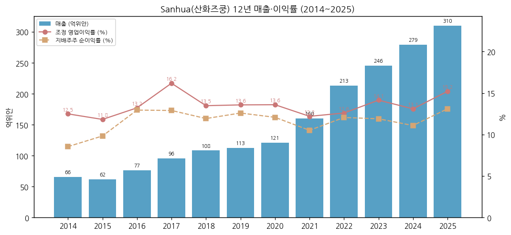

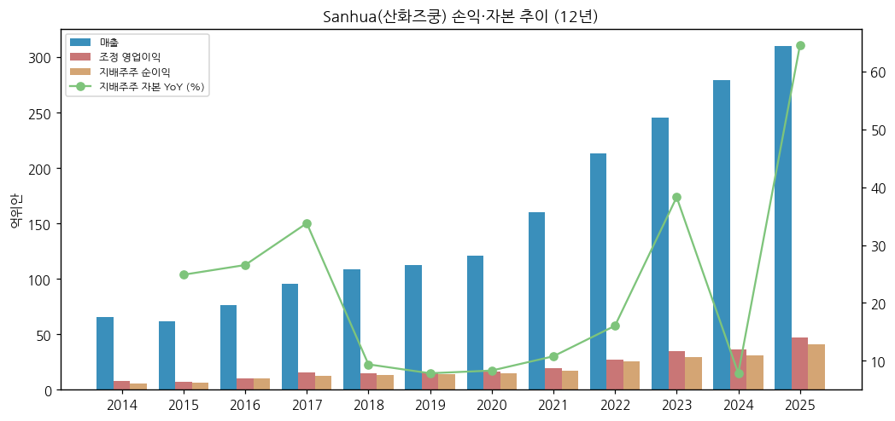

③ 회사 주가 역사

→ A주는 2005-06 상장 후 장기 우상향. 2020~2021년 EV 열관리 기대로 재평가, 2023년 하반기부터 "Optimus 액추에이터" 기대가 붙었다

→ 2025-06 H주 상장 후 2025-12~2026-01 로봇 기대 정점 — **A주 장중 사상 최고 60.77위안 (2026-01-19)** [Yahoo 일간]

→ 2026-02 이후 하락: 2026년 이익 정체(1Q +2.7%, 2Q -7.5%) + 환차손 + 로봇 매출 미확인 → 11/13 34.87위안 (-42.6%). 3Q26 발표 후 10/29 -3.2%, 10/30 -3.7%

→ 시총: 약 1,393억위안 (A+H 합산 [계산], fact verify cutoff 참조). 과거 시총 시계열은 주식 수 이력(무상증자 2018·2019년 10주당 3주)을 반영하지 못해 미작성

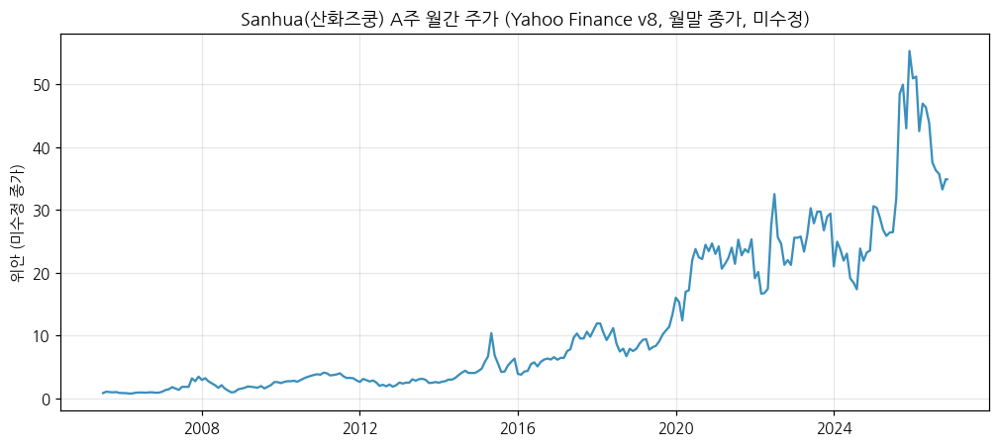

④ 주요 연혁

| 시점 | 사건 |
|---|---|
| 1984 | 창업주 장다오차이, 신창(新昌)에서 냉동 부품 공장 창업 [공개 정보, 세부 미대조] |
| 2005-06 | 심천거래소 중소판 상장 (002050) |
| 2017 | 자동차 부품 자회사(三花汽零) 편입 — 자동차 열관리 사업 상장사 통합 [공개 정보, 세부 미대조] |
| 2018·2019 | 결산 시 10주당 3주 무상증자 (배당 공시) |
| 2023~ | 바이오닉 로봇 기전 액추에이터를 "전략 신흥 사업"으로 서술 |
| 2025-06-23 | 홍콩 H주 상장 (476,536,400주) |
| 2025 | 매출 310.1억위안(+11.0%), 순이익 40.6억위안(+31.1%) 사상 최고 |
| 2026-08 | 반기 보고서 "로봇 액추에이터 핵심 제품 배치 납품·라인 램프업" |
| 2026-09 | Tesla Optimus 3세대 공급사 실사 보도 — 회사 "주요 고객과 관절 액추에이터 개발 중" 확인 (TrendForce 9/21) |

## ③ 비즈니스 모델

① 실적 추이 통합 (사업부별 주영업수입, 억위안)

| 사업부 | 2021 | 2022 | 2023 | 2024 | 2025 | 1H25 | **1H26** | 1H26 YoY |
|---|---|---|---|---|---|---|---|---|
| 냉동·공조 가전 부품 | 112.2 | 138.3 | 146.4 | 165.6 | 185.9 | 103.9 | **104.4** | +0.5 |
| (매출총이익률) | 26.5 | 26.2 | 28.2 | 27.4 | 28.8 | 28.2 | **28.4** | +0.2%p |
| 자동차 부품 (열관리) | 48.0 | 75.1 | 99.1 | 113.9 | 124.3 | 58.7 | **64.6** | +9.9 |
| (매출총이익률) | 23.8 | 25.9 | 27.4 | 27.6 | 28.8 | 28.0 | **27.6** | -0.4%p |
| 로봇 액추에이터 | 미분리 | 미분리 | 미분리 | 미분리 | 미분리 | 미분리 | **미분리** | — |
| 지역: 국내 | — | 114.2 | 134.0 | 154.5 | 176.9 | 90.5 | **98.5** | +8.8 |
| 지역: 해외 | — | 99.3 | 111.5 | 125.0 | 133.2 | 72.1 | **70.5** | -2.2 |

→ (출처: 东方财富 主营构成(회사 연간·반기 보고서 "营业收入构成" 집계), 2025·1H26 원문 대조. 2021 = 1H21 + 2H21 [계산]. 2023년 표기 "…业务" 동일 사업부로 매핑)

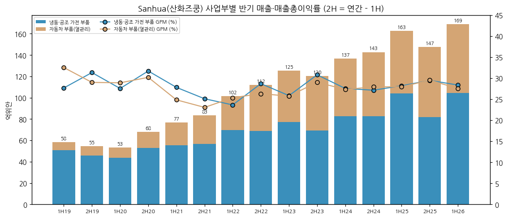

→ 분기 사업부 매출은 회사가 공시하지 않는다. 증권사 추정(동오, 10/29): 3Q26 냉동·공조 48.8억위안(+7% YoY), 자동차 34.9억위안(+10%), 9M26 순이익 냉동·공조 16.9억(-11%)·자동차 13.8억(+2%) [보도 인용]

① 12분기 시계열 (억위안, 분기 단독 = 누적 차감)

| 분기 | 4Q23 | 1Q24 | 2Q24 | 3Q24 | 4Q24 | 1Q25 | 2Q25 | 3Q25 | 4Q25 | 1Q26 | 2Q26 | 3Q26 |
|---|---|---|---|---|---|---|---|---|---|---|---|---|
| 매출 | 55.8 | 64.4 | 72.4 | 68.9 | 73.8 | 76.7 | 85.9 | 77.7 | 69.8 | 77.7 | 91.3 | 83.7 |
| 조정 영업이익 | 7.9 | 8.4 | 10.1 | 8.7 | 9.4 | 10.5 | 15.1 | 11.8 | 9.7 | 12.1 | 15.2 | 12.8 |
| 조정 OPM (%) | 14.1 | 13.1 | 14.0 | 12.6 | 12.7 | 13.7 | 17.6 | 15.2 | 13.9 | 15.6 | 16.7 | 15.3 |
| 지배주주 순이익 | 7.61 | 6.48 | 8.67 | 7.87 | 7.97 | 9.03 | 12.07 | 11.32 | 8.21 | 9.28 | 11.16 | 10.23 |
| 순이익률 (%) | 13.6 | 10.1 | 12.0 | 11.4 | 10.8 | 11.8 | 14.0 | 14.6 | 11.8 | 11.9 | 12.2 | 12.2 |
| 매출총이익률 (%) | 28.4 | 27.1 | 27.8 | 28.2 | 26.8 | 26.8 | 29.3 | 28.0 | 31.2 | 27.8 | 28.3 | 28.9 |
| 매출 YoY (%) | -2.9 | +13.4 | +5.6 | +6.8 | +32.3 | +19.1 | +18.7 | +12.8 | -5.4 | +1.4 | +6.2 | +7.8 |
| 순이익 YoY (%) | -19.5 | +7.7 | +9.2 | +3.0 | +4.7 | +39.5 | +39.2 | +43.8 | +2.9 | +2.7 | -7.5 | -9.6 |

→ (출처: 실적 리뷰 `2026-Q3_002050.SZ_리뷰.md` 1-① 표와 동일)

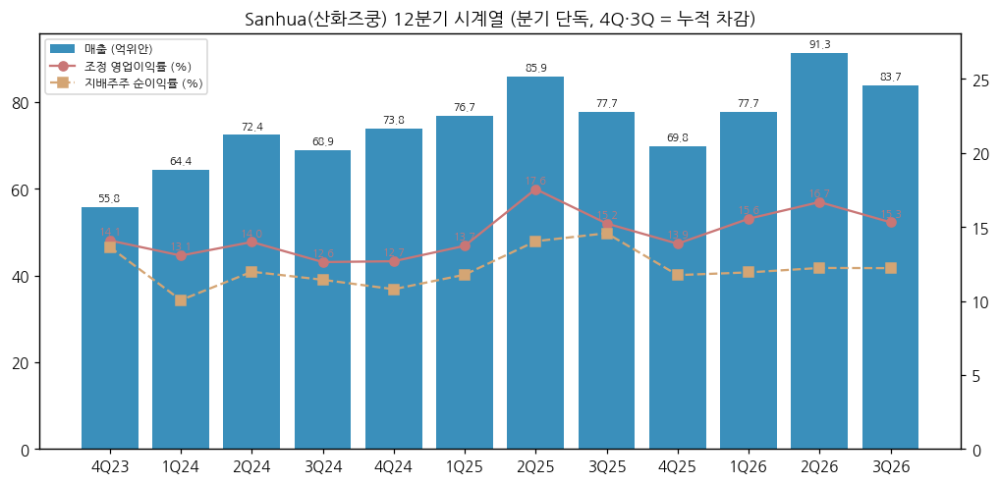

→ 분기 15년(60분기) 사업부 시계열은 회사가 분기 사업부를 공시하지 않아 만들 수 없다. 반기 사업부 시계열(1H19~1H26)로 대체했다

② 사업부별 개요 (매출 비중 순, 2025)

→ **냉동·공조 가전 부품 (59.9%)**: 4방향 밸브·전자팽창밸브·전자수펌프·마이크로채널 열교환기 등. 고객 Carrier·Bosch-Siemens·Daikin·Gree·Haier·LG·Midea·Mitsubishi·Panasonic·Samsung·Siemens·Trane (2025 연간 보고서). 데이터센터 액랭(펌프·밸브·열교환기·센서·CDU 부품)이 이 사업부 안에서 성장 중

→ **자동차 부품 (40.1%)**: 신에너지차 열관리 — 전자팽창밸브·전자수펌프·통합 모듈. 고객 Mercedes·BMW·BYD·Ford·Geely·GM·GAC·Honda·Hyundai·Leapmotor·Li Auto·NIO·Stellantis·SAIC·Toyota·VW·Volvo·Xpeng + Denso·Hanon·Mahle·Valeo (2025 연간 보고서). 2025년 전략: "확장에서 정밀 경영으로" 전환, 해외 공장 운영 개선

→ **전략 신흥 사업 (매출 미분리)**: 바이오닉 로봇 기전 액추에이터. 2025년 "고객과 핵심 제품 연구개발·시제작·반복 개선·샘플 출하, 액추에이터 핵심 부품 개발 강화, 해외 생산 확대, 연구개발 인력 확충" (2025 연간 보고서). 1H26 "핵심 제품 배치 납품·라인 램프업" (2026 반기 보고서)

③ 사업부별 디테일

→ 이익률 outlier 없음: 두 사업부 매출총이익률이 2025년 모두 28.8%로 같다 (회사)

→ 성장 축 교대: 2021~2023년 자동차 부품(+30~60%) → 1H25 냉동·공조(+25.5%, 가전 보조금·수출) → 1H26 다시 자동차(+9.9%) [계산]

④ 주요 경쟁사

→ 로봇 액추에이터: Tuopu(601689, 같은 서브섹터), 기타 중국 공급사(Tesla 공급망 실사 대상 — TrendForce)
→ 자동차 열관리: 한온시스템, Denso·Mahle·Valeo(고객 겸 경쟁), Tuopu·银轮股份 등 중국사
→ 냉동·공조 부품: 盾安环境 등 중국사, Danfoss·Emerson(Copeland) 등 글로벌 [공개 정보]

⑤ 주요 매출처

→ 상위 5개 고객 매출 99.7억위안(32.1%, 2025), 1위 33.8억(10.9%), 2위 27.5억(8.9%), 3위 15.1억(4.9%), 4위 14.3억(4.6%), 5위 9.0억(2.9%). 고객명 미공시, 관계사 0% (2025 연간 보고서)
→ 상위 5개 공급사 매입 26.1억위안(14.2%)

⑥ 생산 CAPA + 임직원

→ 생산기지 8곳(2025) → 9곳(1H26). 해외 멕시코·폴란드·베트남·태국 (회사)
→ 임직원 19,090명(2025 말), 연구개발 인력 3,671명(19.2%, 전년 3,578명) (2025 연간 보고서)

## ④ 재무 구조

① 손익계산서 — ② 표 참고

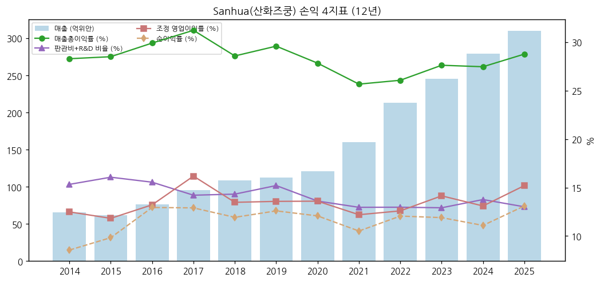

② 재무상태표 (억위안)

| 연도 | 총자산 | 부채 | 지배주주 자본 | 부채/자산 | 현금 | 차입금(단기+장기+사채+유동성장기) | 순현금 |
|---|---|---|---|---|---|---|---|
| 2014 | 76.9 | 39.4 | 37.3 | 51.3 | 7.2 | 15.3 | -8.1 |
| 2015 | 80.4 | 33.5 | 46.5 | 41.7 | 11.6 | 14.7 | -3.1 |
| 2016 | 95.5 | 36.2 | 58.9 | 37.9 | 16.7 | 10.1 | 6.6 |
| 2017 | 123.5 | 44.2 | 78.8 | 35.8 | 15.0 | 13.4 | 1.7 |
| 2018 | 139.3 | 52.3 | 86.1 | 37.6 | 13.5 | 18.1 | -4.6 |
| 2019 | 147.9 | 54.2 | 92.9 | 36.7 | 26.6 | 19.1 | 7.5 |
| 2020 | 170.3 | 68.8 | 100.6 | 40.4 | 34.9 | 22.2 | 12.7 |
| 2021 | 236.2 | 123.7 | 111.5 | 52.4 | 67.1 | 59.6 | 7.5 |
| 2022 | 279.6 | 148.4 | 129.4 | 53.1 | 58.8 | 64.4 | -5.6 |
| 2023 | 318.9 | 138.3 | 178.9 | 43.4 | 65.8 | 36.8 | 29.0 |
| 2024 | 363.5 | 168.4 | 193.0 | 46.3 | 52.5 | 41.9 | 10.6 |
| 2025 | 494.1 | 173.7 | 317.5 | 35.1 | 149.1 | 38.5 | 110.7 |
| 2026-09 | 512.0 | 180.7 | 327.8 | 35.3 | 136.3 | 37.8 | 98.5 |

→ (출처: 东方财富 F10 재무상태표, 2026 3분기 보고서(총자산 512.03·지배주주 자본 327.76억위안) 대조. 2021~2022 사채 26.5·27.8억위안은 2023년 말 소멸 — 전환사채 전환·상환으로 추정 [판단]. 2025 현금 급증은 H주 공모)
→ 2026-09 말 재고 61.8억위안(+25.0% YoY, 동오), 매출채권 80.4억위안

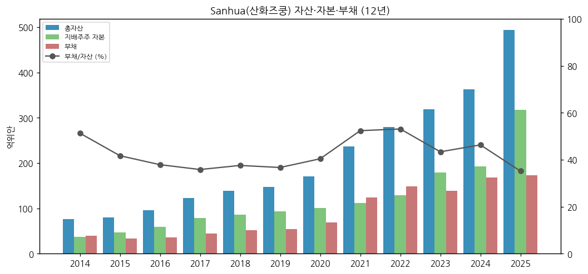

③ 현금흐름표 (억위안)

| 연도 | 영업CF | 투자CF | 재무CF | 유·무형자산 취득(CapEx) | FCF [계산] | CapEx/매출 | 연구개발비 | R&D/매출 |
|---|---|---|---|---|---|---|---|---|
| 2014 | 6.9 | -7.4 | -1.3 | 4.6 | 2.4 | 6.9 | 관리비 포함 | — |
| 2015 | 8.2 | -3.3 | 0.8 | 3.4 | 4.8 | 5.5 | 관리비 포함 | — |
| 2016 | 15.1 | -1.8 | -8.9 | 4.2 | 10.9 | 5.5 | 관리비 포함 | — |
| 2017 | 6.6 | -17.7 | 9.1 | 6.0 | 0.6 | 6.3 | 3.3 | 3.4 |
| 2018 | 12.9 | -12.8 | -2.0 | 9.2 | 3.7 | 8.4 | 4.4 | 4.0 |
| 2019 | 19.0 | 2.2 | -7.3 | 8.7 | 10.3 | 7.7 | 5.3 | 4.7 |
| 2020 | 20.9 | -8.0 | -4.0 | 11.5 | 9.4 | 9.5 | 5.2 | 4.3 |
| 2021 | 15.6 | -50.5 | 28.2 | 19.5 | -4.0 | 12.2 | 7.5 | 4.7 |
| 2022 | 25.1 | -26.7 | -6.0 | 29.4 | -4.3 | 13.8 | 9.9 | 4.6 |
| 2023 | 37.2 | -12.1 | -10.9 | 27.5 | 9.8 | 11.2 | 11.0 | 4.5 |
| 2024 | 43.7 | -35.1 | -9.6 | 32.9 | 10.8 | 11.8 | 13.5 | 4.8 |
| 2025 | 50.9 | -37.9 | 78.0 | 31.5 | 19.4 | 10.2 | 13.7 | 4.4 |

→ (출처: 东方财富 F10 현금흐름표·손익(회사 연간 보고서 집계). 9M26 영업CF 37.49억위안(+22.6%) (3분기 보고서))

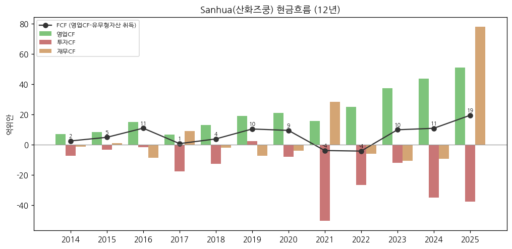

④ CapEx — ③ 표. 2021년부터 연 20~33억위안(매출 대비 10~14%)으로 레벨업 — 자동차 열관리 해외 공장(멕시코·폴란드)과 국내 증설

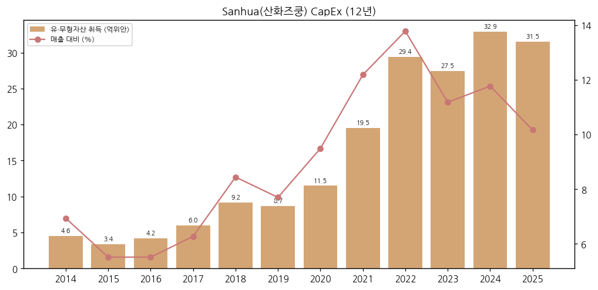

⑤ 부채구조 — 순현금 98.5억위안(2026-09). 회사채 잔액 없음. 장기차입금 12.3억위안 (东方财富 재무상태표)

⑥ 배당 (주당 현금배당, 위안, 세전 — 회계연도 귀속)

| 회계연도 | 중간 | 결산 | 합계 | 비고 |
|---|---|---|---|---|
| 2022 | 0.10 | 0.20 | 0.30 | |
| 2023 | 0.05 | 0.25 | 0.30 | |
| 2024 | 0.10 | 0.25 | 0.35 | |
| 2025 | 0.12 | 0.28 | 0.40 | 총액 약 16.8억위안 [계산 — 4,208백만주 기준, 자사주 제외 전] |
| 2026 | 0.12 | — | — | 중간배당 2026-09 실시 |

→ (출처: 东方财富 배당 집계(회사 권익분배 실시 공고), 2026 중간배당 실시 공고(2026-09-21))

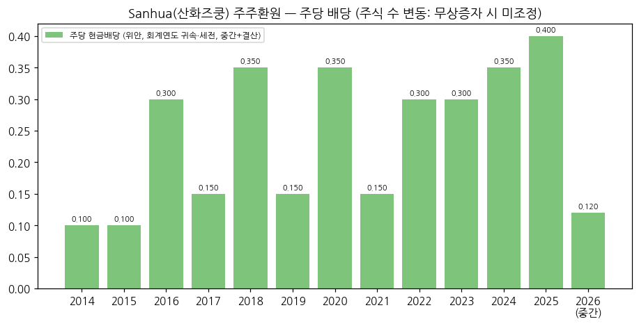

⑦ 재무비율: ROE 2025 15.9% [계산, 평균 지배주주 자본], 9M26 가중평균 ROE 9.38%(-4.29%p, 회사), 부채/자산 35.3%(2026-09)

## ⑤ 지배 구조

① 그룹 관계: 장씨 일가(张道才·张亚波·张少波) → 三花控股集团·浙江三花绿能实业集团 → 본사. 그룹 내 다른 상장사: 三花智控 외 별도 언급 생략

② 주주 (2026-09 말, 보통주 주주 585,065명 — A주 585,027·H주 38)

| 주주 | 지분율 (%) |
|---|---|
| 三花控股集团 | 22.54 |
| 浙江三花绿能实业集团 | 15.79 |
| HKSCC Nominees (H주 명의) | 11.32 |
| 홍콩중앙결산 (A주 북향 외국인) | 1.93 |
| 华夏 중증로봇 ETF | 0.95 |
| 장야보(张亚波) | 0.70 |
| 전국사회보장기금 104조합 | 0.50 |
| 天弘 중증로봇 ETF | 0.33 |
| 중국인수보험 | 0.31 |

→ (출처: 2026 3분기 보고서. 외국인·기관·개인 분리 시계열 미확보 → chart5 미작성)

③ 임원: 회장 겸 CEO 장야보(张亚波, 1974년생, 상해교통대 기계·냉동 전공, 2001년 입사, 2012-12부터 회장 겸 CEO), 창업주 장다오차이 (2025 연간 보고서)

## ⑥ 기타 팩트

① R&D: 2025 연구개발 투자 13.74억위안(매출 4.43%), 인력 3,671명. 1H26 7.63억위안(+8.3%) (회사)

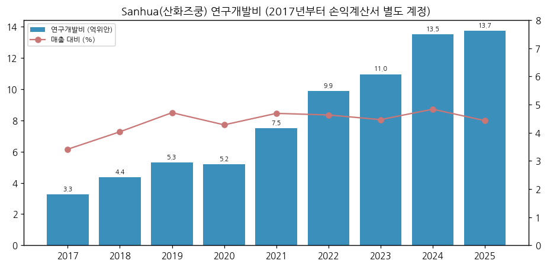

② Corporate action: 2017 자동차 부품 편입, 2025-06 H주 상장, 자사주 매입 (2025 연간 보고서 주석 "A주 회수 주식" 존재 — 수량 미정리)

③ R&D 마일스톤: 6대 연구개발 센터, 열관리 2.0 통합 모듈, 데이터센터 액랭(1차측·CDU·서버 랙) 제품군, 바이오닉 로봇 기전 액추에이터 핵심 제품 배치 납품(2026 상반기)

④ 주요 리스크
→ 환율: 해외 매출 41.7%(1H26). 9M26 환차손 3.83억위안 (3분기 보고서)
→ 로봇 매출 미공시 — 주가 기대와 실적 확인 사이 괴리
→ 투자 평가손 (9M26 2.15억위안 — 회사 자금 운용 상품)
→ 미국 관세·EV 보조금 종료(회사 2025 연간 보고서 언급 "대미법안 전기차 연방 세액공제 종료")

⑤ ESG 등급: 미확보

⑥ 인증: ISO 9001, IATF 16949, QC 080000 (2025 연간 보고서)

## Version Log

→ **v1.0 (2026-11-14)**: 최초 작성. 로봇 부품 글로벌 피어 편입. 회사 원문 3건(2026 3Q·반기, 2025 연간) + 东方财富 F10 재무 API + Yahoo 주가. 로봇 매출 미분리 명시. 차트 11종(chart1·1b·2·4·6·7·8·9·10·11·12)
→ 잔여 보완 후보: ① H주 연간 보고서 부문 정보(IFRS 8 — 로봇 별도 여부) ② 2015~2018 연간 보고서 원문 대조 ③ 주주 구성 시계열(chart5) ④ 시가총액 시계열(주식 수 이력) ⑤ 자사주 매입 내역 ⑥ ESG 등급 ⑦ 2026 연간 보고서(2027-03) 반영
