> Ticker: **SZSE ChiNext: 300073 — 北京当升材料科技股份有限公司 (Beijing Easpring Material Technology Co., Ltd.)**
> Entity: 중국 국무원 국자위 산하 중앙기업 **矿冶科技集团(BGRIMM)** 28.52% 지배 — 중국 최대급 독립 양극재 업체 중 **해외(한·일·유럽) 셀 업체 매출 비중이 가장 높은** 회사. 다원계(NCM/NCA) + LFP·LMFP + LCO + 고체전지 소재
> Sector: 배터리 — 서브섹터 **양극재 글로벌** (한국 3사: 에코프로비엠·포스코퓨처엠·엘앤에프와 비교)
> 작성 시각: **2026-11-14 KST** (**v1.0** — 첫 작성, Source 6종 전수 점검 후 단일 완성본)
> 적용 구조: v4.8 (6개 섹션) + 차트 14종 (chart2·2b·3 제품/지역/판매량, chart13 한국 3사 마진 비교 추가)
> 데이터 범위: **연간 12년 (2014~2025, CAS 연결)** + **9M26** + **분기 27Q (1Q20~3Q26, 분기 = 1Q / 반기−1Q / 9M−반기 / 연간−9M [계산])** + 제품별 6년+1H26 + 지역별 7년+1H26 + 판매량 7년 + 주가 2010-04 상장~2026-11
> 출처: **巨潮资讯网(cninfo) 원문 — 연보 2014~2025 (12건), 분기·반기보고 2020Q1~2026Q3 (21건), 공고 6건(3Q26 자산손상 2026-10-27, 윈난 LFP 일체화 2026-04-16, 2025 배당안 2026-03-31, 辉能 협력 2026-02-09, 핀란드 보조금 2026-01-21, 1H26 업적예고 2026-07-18)** / Yahoo Finance 300073.SZ 월간·일간, KRW=X·CNY=X / 동오증권 3Q26 점평(2026-10-27)·1H26 점평(2026-08-26), 同花顺 컨센 집계(2026-10-29), Mysteel(2026-10-27), 中证网(2025-03-11), 界面新闻(2026-01), 新华财经(2026-09-30)
> ⚠️ 다음 실적: **2026 연간 — 업적예고 2027-01 하순 예상 (전년 2026-01-29 선례) / 연보 2027-03 하순 예상 (전년 2026-03-30)** [추정]

# 当升科技 (Easpring) 기업 개요 (v1.0 — 양극재 글로벌 / 中 국유 양극재, 한국 셀 3사 동시 공급 / 매출 +135%·이익 −36%의 메탈가 사이클 한가운데)
> **Fact verify cutoff**: 2026-11-14 (주가 2026-11-13 **¥32.39** [Yahoo 300073.SZ], 시가총액 ≈ **¥176.3억 = 약 3.5조원** [계산: ¥32.39 × 544,293,668주, 2026-11-14 환율 200.3원/위안 (Yahoo KRW=X÷CNY=X)], 장중 ATH **¥117.43 (2022-07)** [Yahoo 월간 고가], 52주 고/저 **¥69.96 (2025-11-13) / ¥31.96 (2026-10-30)** [Yahoo 일간])

## Phase 1 Source Audit

```
=== 자료 수집 audit (Beijing Easpring, 300073.SZ) ===

✅ 확보 (39개 파일, 저장: company-overview-source/300073.SZ_Easpring/)
- reports/ 연보 2014~2025 (12) — 연결 손익·재무상태·현금흐름, 主要会计数据(3년), 제품·지역·산销量·前五大客户·연구개발
- reports/ 1Q·반기·3Q 보고 2020~2026 (21) — 분기 누적 손익 → 분기 단독 차감 [계산]
- ann/ 3Q26 자산손상 공고·윈난 LFP 일체화·2025 배당안·辉能(ProLogium) 협력·핀란드 보조금·1H26 업적예고 (6)
- api/ Yahoo 300073.SZ 월간(2010~)·일간(1년), USD/KRW·USD/CNY 일간(2년)
- 웹: 동오증권 3Q26·1H26 점평(출하량·톤당 이익 추정), 同花顺 기관 컨센(10개사), Mysteel 3Q26 flash, 中证网 LGES 장기계약, 界面新闻 수출환급 공고, 新华财经 탄산리튬 가격

❌ 누락 (5)
- 분기별 제품·지역 매출: 회사 미공시 (연보·반기만) → 3Q26 제품 믹스는 동오증권 추정 출하량으로 대체 ⚠️
- 컨퍼런스콜·실적 설명회 Q&A 원문 (1H26 网上业绩说明会 2026-08 개최 공고만 확인): 미수집
- 前五大客户 실명: 회사 비공개 ("客户一~五") → 해외 매출·장기계약 공시로 [추정]
- 2014~2018 R&D (研发费用 손익 분리 이전, 管理费用 포함) / 2024 직원 수(연보 표 파싱 실패 → 研发人员 비중 역산)
- 회사 IR 발표자료(PPT): A주 관행상 미발간

⚠️ 결과 영향
- **이익 지표 3종 병기**: ① 营业利润 (중국 회계 — 기타수익(정부보조금)·투자/공정가치손익·자산/신용손상·재무비용 포함) ② **영업이익(한국식 근사) = 매출 − 매출원가 − 税金及附加 − 판매비 − 관리비 − 연구개발비** [계산] ③ 지배순이익(归母净利润)
- 2014~2017 管理费用에 R&D 포함 (研发费用 별도 표시는 2018~) → 한국식 근사 OP는 기준 동일, 비용 내역만 차이
- 분기 R&D 변동이 큼 (연말 연구개발비 재분류: 4Q23 −24백만위안) → 한국식 근사 분기 OPM에 노이즈
- 2019 손실은 영업권 손상(中鼎高科 2.90억)·BAK 등 매출채권 개별 대손 (회사 연보) — 한국식 근사 OP는 흑자

Source 6종 audit:
[V] (1) 정기 보고서 (연보 12년 + 분기·반기 21건) ✓
[△] (2) IR 실적 발표 — A주 PPT 없음, 실적설명회 원문 ✗ → 증권사 점평으로 대체
[V] (3) 지속가능성 — 2025 지속가능발전보고서 존재 확인(2026-03-31), 본문 미수집 / 1H26 반기보고 ESG 단락 ✓
[V] (4) 주가 (Yahoo 300073.SZ 2010~) ✓
[△] (5) 중장기 목표 — "十五五" 전략·2026 출하 전망은 회사 미제시, 증권사 추정만 ✓
[V] (6) 12년 정확값 ✓ (2014~2025 연보 원문)
→ 5/6 source 확보. 최신 분기(3Q26, 2026-10-26 공시) 반영.
```

---

## ① 기업 분류

(1) Primary / Secondary 분류

**Primary 분류: 사이클 (메탈가 pass-through형 양극재, 사이클 2회)**

→ 매출 2016 13.3억 → 2018 32.8억 → 2019 22.8억(−30%) → 2022 **212.6억 (정점)** → 2024 75.9억(−64%) → 9M26 174.5억(+136% YoY). 매출이 리튬·니켈·코발트 가격을 그대로 따라 움직인다 (회사: "产品售价随着原材料市场行情上涨")

→ 한국식 근사 OPM 2016~2023 **6.5~13.6%** → 2024 **3.7%** / 2025 4.8% / 9M26 5.8% — 메탈 하락 국면(2024)에 GPM이 18% → 12%로 6%p 내려앉았고 아직 회복 전

**Secondary 노트: 고성장 (LFP 2nd curve + 해외 장기계약 볼륨)**

→ 판매량 2023 6.3만t → 2024 10.1만t → 2025 **14.9만t** (+48%) — LFP 신규 진입(2023) 후 2년 만에 매출의 27% (2025)

→ 2026 증권사 출하 추정: 다원계 ~8.5만t (+70%), LFP ~16.5만t, LCO ~0.4만t (동오증권 2026-10-27) — **물량은 고성장, 톤당 이익은 사이클**인 혼합형

**4개 제품군 구조 (2025 연보, 매출 / 매출총이익률)**

→ **(1) 다원계(多元材料, NCM/NCA)** — 62.1억위안 (**59.9%**), GPM 14.1% — 고니켈·초고니켈(9계)·중니켈 고전압. 해외(LGES·SK on·삼성SDI) + 국내(中创新航·亿纬·远景 등) EV용 — **이익 1위**

→ **(2) LFP·LMFP·나트륨 양극재** — 28.4억위안 (**27.4%**), GPM 6.1% (1H26 12.1%) — 판즈화(攀枝花) 12만t, ESS·AIDC 위주 — **물량 1위** (3Q26 출하 4.5~4.8만t ⚠️동오 추정)

→ **(3) LCO(钴酸锂)** — 10.4억위안 (**10.1%**), GPM 20.2% (1H26 24.2%) — 소형 IT(고전압 4.50~4.55V), 삼성·애플·화웨이 공급망

→ **(4) 스마트장비(中鼎高科)** — 1.6억위안 (1.5%), GPM 29.4% — 원형 칼 다이커팅기 (2015 인수, 2019 영업권 손상)

(2) Summary Box (12년, CAS 연결)

| 지표 | 값 |
|------|-----|
| 매출 CAGR (2014→2025, 11년) | **+29.1%/yr** [계산] (2020→2025 5년 **+26.7%**) |
| 영업이익률(한국식 근사) 평균 (12년) | **7.2%** [계산] (2016~2025 10년 평균 9.3%) |
| OPM 정점 | **13.6% (2023)** — 고니켈 해외 비중 + 탄산리튬 고점 재고 효과 |
| OPM 저점 | **−5.9% (2014)** — 소형 LCO 위주 시절 / 사이클 저점 2024 **3.7%** |
| 사이클 주기 | 매출 정점 2018 → 2022 (4년), 저점 2019 → 2024 (5년) |
| 사이클 회수 (12년) | **2회** (2018~2019 BAK 부실·보조금 축소 / 2022~2024 리튬가 폭락). 3번째 회복 2025~ 진행 중, 3Q26 이익 재하락 |

```
[当升科技 12년 손익 (백만위안, CAS 연결)]   한국식 OP = 매출 − 원가 − 税金及附加 − 판매·관리·R&D [계산]
연도     매출    GPM   한국식OP  OPM   营业利润  지배순이익
2014      625   3.1%     -37  -5.9%     -44     -26  ← 소형 LCO 중심, 적자
2016    1,335  17.0%      87   6.5%      95      99  ← 동력용 NCM 전환 (한국 셀 업체 공급 개시기)
2018    3,281  18.3%     355  10.8%     368     316  ← 1차 정점
2019    2,284  19.7%     260  11.4%    -201    -209  ← BAK 채권·中鼎高科 영업권 손상 (영업단은 흑자)
2021    8,258  18.2%     934  11.3%   1,241   1,091  ← 증자 46.45억, 하이먼(海门) 증설
2022   21,264  17.4%   2,469  11.6%   2,539   2,259  ← 매출 정점 (탄산리튬 50만위안대)
2023   15,127  18.1%   2,064  13.6%   2,221   1,924  ← 이익률 정점
2024    7,593  12.4%     281   3.7%     530     472  ← 리튬 폭락, 매출 −50%
2025   10,374  12.7%     499   4.8%     700     632  ← LFP 판즈화 가동, 판매량 14.9만t
9M26   17,455  10.9%   1,020   5.8%     823     643  ← 매출 +136%, 3Q26 GPM 7.5% (사상 최저)
```

**한국 양극재 3사 이익률 비교 (최근 5분기, 각사 주 지표)** — 当升은 한국식 근사 OP 기준

| OPM | 3Q25 | 4Q25 | 1Q26 | 2Q26 | **3Q26** |
|---|---|---|---|---|---|
| **当升科技 (한국식 근사)** | 5.1% | 3.9% | 7.7% | 6.7% | **3.9%** |
| 当升科技 (营业利润率, 중국식) | 7.2% | 4.7% | 7.9% | 5.5% | **2.0%** |
| 에코프로비엠 | 8.1% | 8.4% | 3.5% | 3.1% | **2.2%** [잠정] |
| 포스코퓨처엠 (연결) | 7.6% | −9.3% | 2.3% | 3.9% | **9.8%** |
| └ 포스코퓨처엠 에너지소재 | 8.9% | −27.9% | −0.3% | 0.8% | **11.3%** (고객 미이행 보상금 포함) |
| 엘앤에프 | 3.4% | 13.4% | 15.9% | 2.4% | **−3.0%** [잠정] |

→ (출처: 当升 = 분기보고 누적 차감 [계산] / 한국 3사 = 같은 폴더 `에코프로비엠_기업개요.md`·`포스코퓨처엠_기업개요.md`·`엘앤에프_기업개요.md` (2026-11-14 작성, DART·회사 IR))
→ 当升의 OPM 진폭(2.3~7.7%)이 한국 3사(엘앤에프 −3.0~15.9%, 퓨처엠 에너지소재 −27.9~11.3%)보다 **훨씬 좁다** — 4Q25~1Q26 메탈 반등기에 한국 업체는 재고평가 환입(엘앤에프 1Q26 926억원)으로 OPM이 튀었지만 当升은 7%대에 그쳤다. 반대로 3Q26 리튬 급락기 손실도 작았다 (재고평가손실 0.56억위안 = 매출의 0.8%) `[판단]`
→ 3Q26 동시 악화: 에코프로비엠 2.2%·엘앤에프 −3.0%·当升 3.9% — 공통 원인은 9월 탄산리튬 급락(고점 대비 −28%)에 따른 재고평가 + 원화·위안 환율 변동. 포스코퓨처엠만 보상금으로 예외

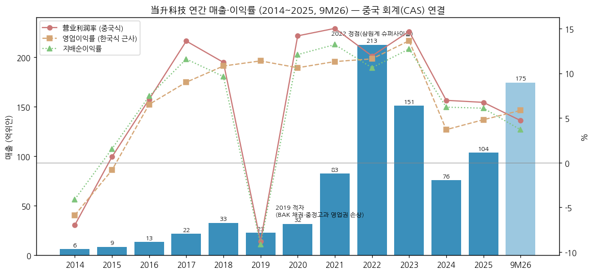

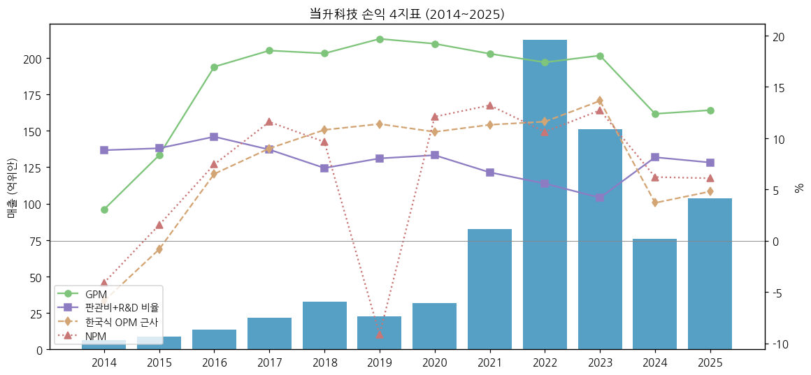

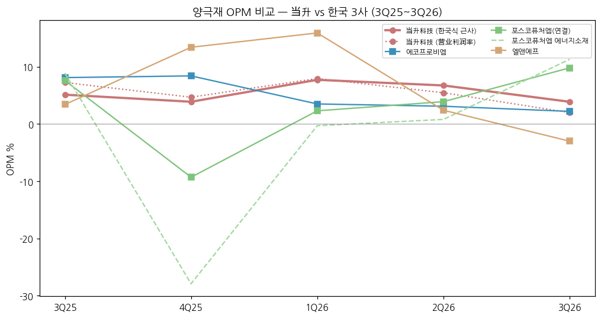

(3) 정량적 분류 근거

→ **판가 = 원재료 연동**: 2025 매출원가 90.5억 / 매출 103.7억 = 87% [계산]. 원재료 구매처 华友钴业·格林美·中伟股份(전구체), SQM(리튬), 云天化(인산철) — "期货点价采购·U型采购"로 헤지 (1H26 반기보고)
→ **해외 비중**: 2020 38.3% (정점) → 2024 22.0% (저점) → 2025 28.5% → **1H26 34.9%** (해외 매출 36.55억위안, +168.8% YoY) — 한국 셀 업체 장기계약 물량 램프업
→ **고객 집중도 상승**: 상위 5사 비중 2021 43.2% → 2023 58.6% → 2025 **64.0%** [계산: 66.4억/103.7억], 1위 26.7%·2위 24.5% (회사 비공개 실명)
→ **CAPA**: 2025말 건설 완료 22.8만t (유효 15.2만t, 가동률 106%) → 2026-06 유효 11.4만t(반기)·건설 중 21만t (핀란드 6만t + 윈난 LFP 15만t)

(4) 산업 분류

→ **회사 공시 업종** — 「锂电材料制造业」 (2025 연보 재무제표 주석), 매출의 98.4%가 리튬전지 소재 (2025)
→ **지수** — 창업판(ChiNext, 300) 구성종목, 易方达创业板ETF·华安创业板50ETF·中证500ETF·广发新能源车电池ETF가 10대 주주
→ **워치리스트** — 섹터 배터리 / 서브섹터 **양극재 글로벌**

(5) 분류 결정 논리

→ 12년간 매출 진폭: 2019 −30%, 2023 −29%, 2024 −50% → 3번의 역성장. OPM 범위 −5.9% ~ 13.6% (19.5%p) → ±10%p 사이클 cutoff 충족 → **Primary 사이클**
→ 다만 이익 사이클은 매출 사이클보다 **완만** — 2024 저점에도 한국식 OPM +3.7% (한국 3사: 에코프로비엠 2024 −1.2%, 엘앤에프 −29.3%, 포스코퓨처엠 0.0%) [계산·각 기업개요]. 원인: ① 해외 고객 비중(장기계약 가격 공식) ② 중국 LFP 저원가 ③ 순현금 재무구조(이자비용 거의 0) `[판단]`
→ **글로벌 피어 cross-ref** — 중국 경쟁사(容百科技 Ronbay·厦钨新能 XTC·长远锂科·华友 등)와 달리 **한국 셀 3사 + 일본 Murata를 동시에** 고객으로 둔 것이 차별점. 한국 3사와는 "한국 셀 업체의 양극재 공급 지분"을 두고 직접 경쟁

(6) 적정 밸류에이션 방법

→ **1차 — P/B (사이클 밴드)**: 시총 ¥176.3억 / 3Q26 지배자본 ¥151.7억 = **1.16배** [계산]. 한국 3사(에코프로비엠 6.0배·포스코퓨처엠 3.87배·엘앤에프 4.3배, 각 기업개요) 대비 **70~80% 할인**
→ **2차 — P/E**: LTM 지배순이익 7.73억 [계산: 4Q25~3Q26] → **22.8배**. 2026E 7.9억(동오, 3Q 후 하향) → 22.3배 / 컨센 평균 10.49억(10개사, 최근 6개월) → 16.8배 [계산]
→ **3차 — EV/EBIT**: 순현금 ≈ ¥45.2억 [계산: 현금 54.2 + 교역성금융자산 4.3 − 단기차입 12.8 − 장기차입 0.4] → EV ≈ ¥131.1억 / LTM 한국식 OP 11.4억 = **약 11.5배** [계산]
→ 증권사 TP: 최근 6개월 평균 ¥49.94 (최고 CICC ¥61.00, 최저 화태 ¥38.87, 2026-10-29) — 현재가 대비 +54% (同花顺 집계)

(7) 분기 재평가 트리거 (분류 변경 조건)

→ ① **GPM 2개 분기 연속 10% 미만** (3Q26 7.5%가 1회차) → 판가 전가력 훼손 = 사이클 하강 국면 확정
→ ② **핀란드 1기 가동(2026말 일부) + 해외 비중 40% 돌파** → 해외 장기계약형 "지속성장" Secondary 상향
→ ③ **LFP 톤당 순이익 0.2만위안 회복** (3Q26 0.05만위안 ⚠️동오 추정) → LFP 2nd curve 유효성 재확인

---

## ② 회사 개요

(1) 기본 정보

→ **법인명** — 北京当升材料科技股份有限公司 (Beijing Easpring Material Technology Co., Ltd.), 北京市丰台区南四环西路188号 总部基地18区21号
→ **설립** — **1998-06-03** 최초 등기 (2014 연보) — 전신 北京北矿电子材料发展中心을 북경광야연구총원(현 矿冶科技集团)과 白厚善 등 자연인 29명이 출자·개편 (2025 연보 주석)
→ **상장** — 심천 창업판(ChiNext) **300073**, **2010-04-27** 상장 (2025 연보). 총주식 **544,293,668주** (2025 矿冶集团 대상 정향증자 37,792,894주 포함 — 2027-01-09까지 보호예수)
→ **회계연도** — 1~12월 / 중국 기업회계준칙(CAS) / 1Q·3Q 보고는 미감사, 손익은 누적치만 공시
→ **사업 한 줄 정의** — 리튬이온전지 **양극재 4종(NCM/NCA·LFP/LMFP·LCO·고체전지용) 전 라인업**을 갖추고, 해외 한·일·유럽 셀 업체에 30% 이상을 수출하는 **중국 국유 양극재 업체**
→ **경영진** — 董事长 **陈彦彬** (1969년생, 2003 입사 R&D부 경리→기술총감→총경리, 2024-04~ 동사장, 핀란드 법인 동사장 겸임) / 总经理 **关志波** (2025 연보)
→ **직원** — 1,149명 (2020) → 1,555명 (2022) → 1,721명 (2023) → **1,750명 (2025)**, R&D 인력 438명 (25.0%)

(2) 핵심 KPI 요약 (백만위안)

| 항목 | 2024 | 2025 | 3Q25 | **3Q26** | 9M26 | 2026E (컨센) |
|---|---|---|---|---|---|---|
| 매출 | 7,593 | 10,374 | 2,967 | **6,980** | 17,455 | — |
| 매출 YoY | −49.8% | +36.6% | +49.5% | **+135.3%** | +135.9% | — |
| GPM | 12.4% | 12.7% | 12.0% | **7.5%** | 10.9% | — |
| 영업이익 (한국식 근사) | 281 | 499 | 152 | **271** | 1,020 | — |
| 营业利润 | 530 | 700 | 215 | **139** | 823 | — |
| 지배순이익 | 472 | 632 | 192 | **123** | 643 | 790 (동오) / 1,049 (10개사 평균) |
| 판매량 (만t) | 10.1 | 14.9 | — | ~6.9 ⚠️ | — | ~25.4 ⚠️ (동오: 다원 8.5 + LFP 16.5 + LCO 0.4) |
| 영업CF | 1,598 | 1,150 | — | — | −150 | — |
| CapEx | 871 | 1,923 | — | — | 2,887 | — |

> 원화 환산 참고: 3Q26 매출 ≈ **1조 4,668억원** / 한국식 OP ≈ 569억원 / 营业利润 ≈ 292억원 (3Q26 평균 210.16원/위안, Yahoo KRW=X÷CNY=X 일평균 [계산])

(3) 회사 주가 역사

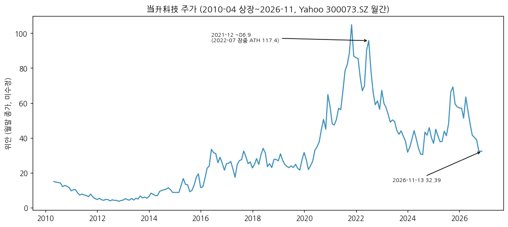

→ 2010-04 창업판 상장 → 2012~2013 ¥4~6 (소형 LCO 침체)
→ 2015~2018 ¥15~30 (동력용 NCM, 한국 셀 업체 수출)
→ **2020~2022 EV 슈퍼사이클**: 2020말 ¥64.9 → 2021말 ¥86.9 → **ATH ¥117.43 (2022-07 장중)** — 2021 정향증자 46.45억위안 (발행가 기준 대규모 CAPA 확장)
→ 2023~2024 ¥35~47 (리튬 폭락, 이익 −75%)
→ 2025 하반기 반등 ¥69.96 (2025-11-13, 52주 고점 — 고체전지·LFP 기대) → 2026-04 ¥63.4 → **2026-10-30 ¥31.96 (52주 저점)** → 11-13 ¥32.39 (52주 고점 대비 **−54%**, ATH 대비 −72% [계산])
→ 3Q26 발표(10/26 장 마감 후 공시) 다음 거래일 10/27 **−7.3%** (¥36.48 → ¥33.83)

```
[주가 국면 history]
[2010 ~ 2014] 소형 LCO 시절 (¥4~12) — 적자 (2014 −0.26억)
[2015 ~ 2019] 동력용 NCM 1차 (¥15~30) — 한국 셀 업체 수출, 2019 BAK 부실 손실
[2020 ~ 2022-07] EV 슈퍼사이클 (¥28 → ATH ¥117) — 46억 증자, 고니켈 해외 공급
[2022-08 ~ 2024] 리튬 폭락 디레이팅 (¥117 → ¥35)
[2025 ~ 2025-11] LFP·고체전지 재평가 (¥40 → ¥70)
[2025-12 ~ 현재] 이익 미달·메탈가 재하락 (¥70 → ¥32) — 매출 +135%에도 주가 반토막
```

(4) 주요 연혁

→ **1998-06** — 北京北矿电子材料发展中心을 북경광야연구총원·자연인 29명 출자로 개편·설립
→ **2010-04-27** — 심천 창업판 상장, 공모자금으로 장쑤 리튬전지 양극재 기지 1기 (2012 江苏当升 자회사로 실행 방식 변경)
→ **2015** — 北京中鼎高科自动化 인수 (스마트장비 사업 진입)
→ **2017** — 비공개 증자 (하이먼 3기)
→ **2019** — BAK 등 매출채권 개별 대손 + 中鼎高科 영업권 손상 2.90억 → 순손실 −2.09억
→ **2021** — 정향증자 **46.45억위안** (하이먼 4기·常州 기지)
→ **2022** — 매출 212.6억·지배순이익 22.6억 (사상 최대)
→ **2023** — LFP·LMFP 매출 첫 계상 (1.3억 [계산]), 판즈화(当升蜀道) LFP 기지 투자 (2025 연보 募集资金 표 2023 착수 [추정])
→ **2025-03** — **SK on** 양극재 공급계약 1.7만t (03-04 보도) / **LGES** 2025~2027 장기공급 **약 11만t** (중니켈 고전압·고니켈, 03-10 공시)
→ **2025** — 矿冶集团 대상 정향증자 **10억위안** 완료 / 핀란드 코트카(Kotka) 6만t 고니켈 1기 착공 (2025 상반기)
→ **2026-01** — Business Finland 보조금 최대 €1.15억 승인, 1차 €2,781만 수령 / 유럽 €5.144억 그린 파이낸싱
→ **2026-02** — 대만 辉能科技(ProLogium) 고체전지 전략 협력 MOU
→ **2026-04** — 윈난 云天化와 LFP 15만t + 인산철 20만t 일체화 프로젝트 (友天 51%·云聚能 49% 인수, 1.45억)
→ **2026-10-26** — 3Q26: 매출 +135%, 순이익 −36%, 9M 자산손상 0.97억 공시
→ **2026말 (예정)** — 핀란드 1기 일부 라인 가동

---

## ③ 비즈니스 모델

(1) 실적 추이 통합 표 (백만위안)

| 항목 | 2021 | 2022 | 2023 | 2024 | 2025 | 1H26 |
|------|------|------|------|------|------|------|
| **매출** | **8,258** | **21,264** | **15,127** | **7,593** | **10,374** | **10,475** |
| └ 다원계 (NCM/NCA) | 6,909 (83.7%) | 19,057 (89.6%) | 13,847 (91.5%) | 5,148 (67.8%) | 6,212 (59.9%) | 6,605 (63.1%) |
| └ LFP·LMFP·나트륨 | — | — | 127 [계산] | 1,754 (23.1%) | 2,838 (27.4%) | 2,819 (26.9%) |
| └ LCO | 967 (11.7%) | 758 (3.6%) | 632 (4.2%) | 472 (6.2%) | 1,044 (10.1%) | 664 (6.3%) |
| └ 스마트장비 | 186 | 162 | 128 | 144 | 160 | 74 |
| └ 기타 | 196 | 1,288 | 394 | 75 | 120 | 314 |
| **제품 GPM** | | | | | | |
| └ 다원계 | — | — | — | 16.2% [역산] | 14.1% | **12.7% (−5.8%p)** |
| └ LFP류 | — | — | — | 0.5% [역산] | 6.1% | **12.1% (+9.1%p)** |
| └ LCO | — | — | — | 9.8% [역산] | 20.2% | **24.2% (+16.0%p)** |
| **지역** | | | | | | |
| └ 중국 내수 | 5,556 (67.3%) | 14,251 (67.0%) | 10,778 (71.3%) | 5,926 (78.0%) | 7,416 (71.5%) | 6,820 (65.1%) |
| └ 해외 | 2,702 (32.7%) | 7,013 (33.0%) | 4,349 (28.7%) | 1,667 (22.0%) | 2,958 (28.5%) | **3,655 (34.9%)** |
| └ 해외 GPM | — | — | — | 21.0% [역산] | 16.4% | **9.6% (−9.4%p)** |
| └ 내수 GPM | — | — | — | 10.0% [역산] | 11.3% | 15.2% (+4.5%p) |
| **판매량 (t)** | 47,214 | 63,494 | 62,740 | 100,718 | 148,932 | 생산 105,044 |

> 출처: 각 연보 「营业收入构成」「占公司营业收入10%以上」「产销量」, 2026 반기보고. 2024 GPM은 2025 연보의 전년 대비 증감(%p)으로 역산 [계산]. 1H26 GPM 괄호 = 전년 동기 대비. 2023 LFP = 매출 − 기타 항목 합 [계산]

→ **핵심 관찰 ①** — 1H26 해외 GPM **9.6%** (−9.4%p) vs 내수 15.2% (+4.5%p): 2024년(해외 21% vs 내수 10%)과 **완전히 역전**. 해외 장기계약(LGES·SK on) 물량 램프업 + 수출환급 축소·취소 + 위안 강세 영향 `[판단 — 회사는 원인 미설명]`
→ **핵심 관찰 ②** — LFP GPM 0.5% (2024) → 6.1% (2025) → 12.1% (1H26): 판즈화 자체 CAPA·고압실 제품으로 수익화 진입, 그러나 3Q26 톤당 순이익은 다시 0.05만위안으로 하락 (탄산리튬 급락에 따른 재고평가, 동오증권)

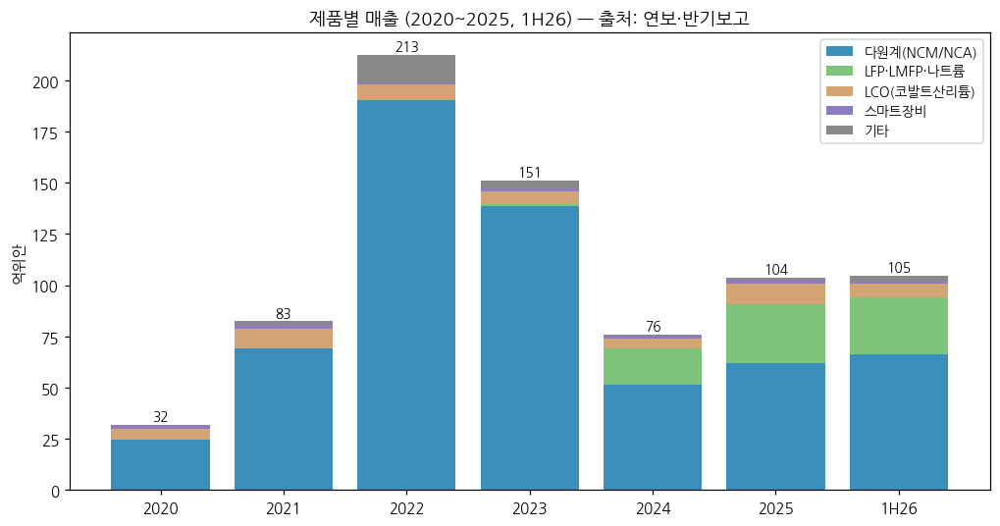

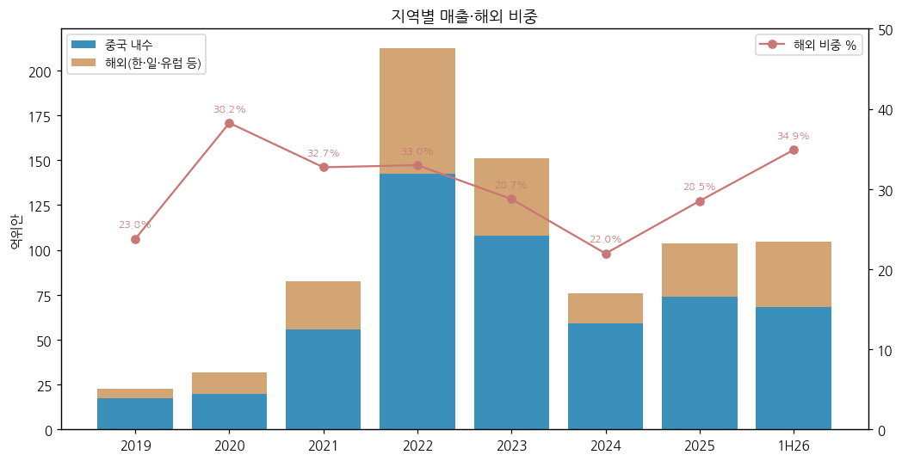

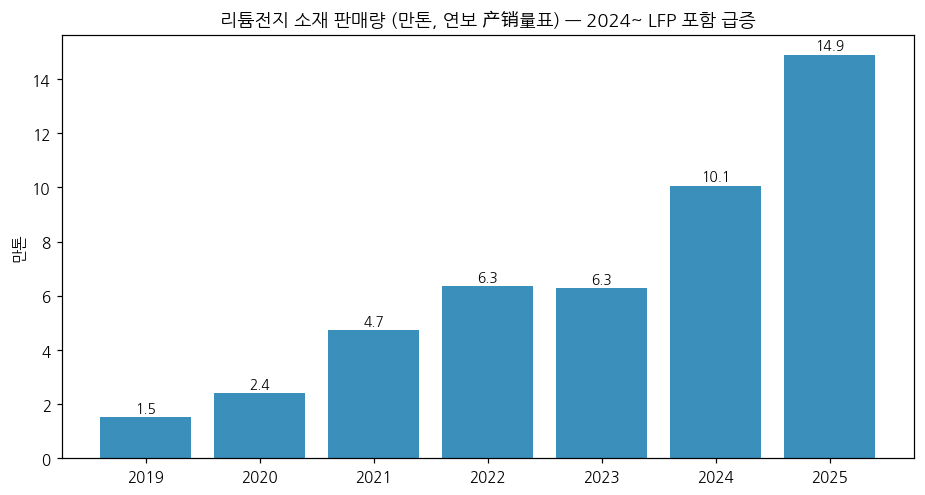

(2) 사업부별 개요 (매출 비중 순)

**다원계 (NCM/NCA) — 59.9% (2025)**

"전기차 배터리용 고니켈·중니켈 양극재. 한국 셀 3사가 주요 고객이고 회사 이익의 중심."

→ 제품: NCM5/6계(중니켈 고전압, 4.3~4.4V) · NCM8계 · **NCM9계(초고니켈, 215~235mAh/g)** · NCA — 9계는 亿纬锂能·江苏天鹏 원통형 46계열 공급
→ 해외: **LGES (2025~2027 약 11만t)**, **SK on (2025-03 1.7만t + 장기공급)**, 삼성SDI, Murata(소형) → 폭스바겐·BMW·벤츠·현대 차량 탑재 (회사 1H26 반기보고)
→ 국내: 亿纬锂能·远景·蜂巢能源·中航(CALB)·微宏动力 → BMW·벤츠·長城·岚图·IVECO
→ 3Q26 출하 약 2.2만t (QoQ 보합), 이 중 **해외 약 1.3만t (60%)**, 톤당 순이익 약 0.3만위안 (환손실·핀란드 손실 가산 시 0.7만) ⚠️동오증권 추정

**LFP·LMFP·나트륨 — 27.4% (2025)**

"ESS·AI 데이터센터(AIDC)용 인산철 계열. 판즈화 12만t 기지에서 2024년부터 본격 양산."

→ 고압실(压实密度 2.58g/cm³ 3.5세대, 5세대 2.75g/cm³) LFP — 中创新航·赣锋锂电·瑞浦兰钧·欣旺达·**Power Co(폭스바겐 배터리)** 공급
→ 3Q26 출하 4.5~4.8만t (QoQ +40%) ⚠️ / 2026말 CAPA 15만t (신규 12만t + 위탁생산), 윈난 15만t 착공 → 2027 출하 ~35만t 추정 (동오)
→ LMFP 6·7계, 나트륨 양극재(층상산화물·폴리음이온) — 소량 공급

**LCO (钴酸锂) — 10.1% (2025)**

"스마트폰·노트북용 코발트산리튬. 회사의 원래 사업(1998~)."

→ 고전압 4.50V·4.53V 양산, **4.55V 양산** 진입 / 고배율 LCO 점유율 상승 — 삼성·애플·화웨이·샤오미 최종 공급망
→ 2025 매출 +121%, GPM 20.2% (코발트 가격 급등 래깅 수혜) → 1H26 GPM 24.2%. 톤당 순이익 약 2만위안 (3Q26 ⚠️동오)

**고체전지 소재 — 매출 비중 미공시 (신사업)**

→ 고체-액체 혼합(固液) 전지용 양극재 누적 **천t급** 출하, 2상 복합 고체 양극재 월 100t+ / 전고체용 양극재 누적 **50t** (1H26) — 清陶·卫蓝·**辉能(ProLogium)**·赣锋·中汽新能 공급, eVTOL·로봇·드론 적용
→ 고체전해질: 산화물(LLTO·LATP·LLZO)·황화물(锂磷硫氯碘) — 소량 공급·검증 단계
→ 리튬리치 망간계(富锂锰基) — 500Wh/kg 전고체 대응, 소량 공급

(3) 사업부별 디테일

→ **현재 잘나가는 것 (1H26)**: LCO (GPM 24.2%, +16.0%p), LFP (매출 +116.6%, GPM 12.1%), 내수 다원계
→ **향후 큰 매출**: 핀란드 6만t 고니켈 (2026말 일부 가동 → 유럽 현지 공급, IRA·EU 역내조달 대응), 윈난 LFP 15만t, LGES 11만t 장기계약 (2027까지)
→ **이익 outlier**: LCO — 2025 GPM 20.2%, 매출 비중 10%로 이익의 약 16% [계산: 매출총이익 2.1억 / 13.2억]. 반대로 **해외 다원계 마진 하락**이 1H26 가장 큰 약점

(4) 주요 경쟁사 (한국 양극재 3사 겹침 중심)

| 当升 제품 | 한국 경쟁 제품 (기업) | 겹치는 고객·시장 | 비고 |
|---|---|---|---|
| 고니켈·초고니켈 NCM (8·9계) | **에코프로비엠 (NCA·NCM)**, **엘앤에프 (NCMA95)** | **SK on** (에코프로비엠 고객2 [추정]), 삼성SDI (에코프로비엠 고객1) | 当升은 SK on과 2025-03 계약 — 에코프로비엠의 SK on 물량과 직접 경쟁 |
| 중니켈 고전압 NCM (5·6계) | **포스코퓨처엠 (NCM, GM·LGES)**, 엘앤에프 | **LGES** (2025~2027 11만t) | LGES가 원가 절감 위해 중국산 중니켈 고전압 비중 확대 — 한국 업체의 LGES 점유율 잠식 요인 `[판단]` |
| LFP·LMFP | **엘앤에프 (LFP 2026-3Q 양산, 대구 3→6만t)**, 에코프로비엠 (LFP 파일럿 4천t→5만t 계획) | 한국 셀 3사 ESS용 LFP (엘앤에프 수주 ~100GWh) | 当升은 이미 10만t+ 양산, 한국 업체는 진입 단계 — 원가·CAPA 우위 |
| 유럽 현지 공장 (핀란드 6만t) | 에코프로비엠 헝가리 5.4만t, 포스코퓨처엠 (북미 Ultium CAM) | 유럽 VW·BMW·벤츠 | 에코프로비엠 헝가리 2026-06 가동·9월 일시중단 → 当升 핀란드 2026말 가동, 같은 시기 유럽 고객 경쟁 |
| 고체전지 소재 (전고체 양극재·황화물 전해질) | 에코프로비엠 (황화물 고체전해질, 2027 양산 목표), 포스코퓨처엠 | 삼성SDI 전고체 | 当升은 대만 ProLogium·중국 清陶·卫蓝 위주 |

→ 중국 내 경쟁: 容百科技(Ronbay, 고니켈 1위·한국 충주 공장), 厦钨新能(XTC, LCO 1위), 长远锂科, 巴莫(华友), 湖南裕能·德方纳米(LFP) — **当升 = 해외 비중 최고, 容百 = 고니켈 물량 최대** `[판단]`

(5) 주요 매출처

> 前五大客户는 "客户一~五"로만 공시. 아래 순서는 장기계약 공시·해외 비중 기반 [추정]

→ 상위 5사 합계: 2021 35.6억 (43.2%) → 2022 96.9억 (45.6%) → 2023 58.6% → 2024 47.5억 (62.5%) → **2025 66.4억 (64.0%)**, 1위 27.7억 (26.7%) · 2위 25.4억 (24.5%)
→ **1~2위 후보**: LGES(11만t 장기계약)·中创新航(LFP·다원 국내 최대 고객) [추정] — 2025 해외 매출 29.6억 < 1+2위 합 53.2억 → 1·2위 중 최소 1곳은 국내 고객 [계산]
→ **3~5위 후보**: SK on, 삼성SDI, 亿纬锂能 / Power Co (VW) [추정]

(6) 생산 CAPA + 임직원

| 기지 | 제품 | CAPA | 상태 |
|---|---|---|---|
| 江苏 南通(海门) | 다원계·LCO | (기지별 미공시) | 가동 — 2010~2021 1~4기 |
| 江苏 常州 | 다원계 (고니켈) | (미공시) | 가동 (2021 증자 자금) |
| 四川 攀枝花 (当升蜀道) | LFP·LMFP | 12만t (1기) | 2025 가동, 2기 8만t 시운전 |
| **핀란드 Kotka** | 고니켈 다원계 | **6만t (1기)** / 유럽 총계획 50만t (다원 20 + LFP 30) | 2025 상반기 착공 → **2026말 일부 가동** |
| 云南 昆明 (友天·云聚能, 云天化 합작) | LFP 15만t + 인산철 20만t | 15만t | 2026 착공 |

→ 전사 CAPA: 2025말 건설 완료 **22.8만t** (유효 15.2만t, 생산 16.1만t, 가동률 106%) → 2026-06 반기 유효 11.4만t, 건설 중 21만t (1H26 생산 10.5만t, 가동률 92%)
→ 임직원: 1,149명 (2020) → 1,315 (2021) → 1,555 (2022) → 1,721 (2023) → ~1,798 [역산] (2024) → **1,750 (2025)**

---

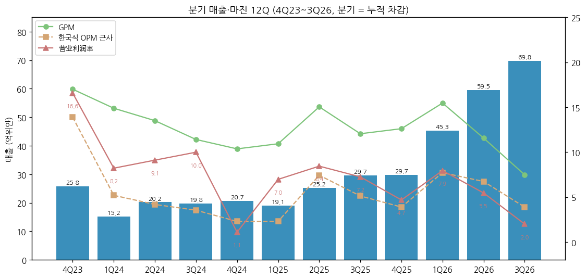

**분기 시계열 (백만위안, CAS 연결 — 분기 단독 = 누적 차감 [계산])**

| 분기 | 매출 | GPM | 영업이익(한국식) | OPM(한국식) | 营业利润 | 营业利润率 | 지배순이익 | 매출 YoY | 营业利润 YoY |
|---|---|---|---|---|---|---|---|---|---|
| 1Q20 | 416 | 17.5% | 39 | 9.4% | 39 | 9.4% | 33 |  |  |
| 2Q20 | 675 | 20.0% | 70 | 10.4% | 137 | 20.3% | 113 |  |  |
| 3Q20 | 938 | 20.2% | 131 | 14.0% | 142 | 15.1% | 119 |  |  |
| 4Q20 | 1,155 | 18.5% | 98 | 8.5% | 134 | 11.6% | 120 |  |  |
| 1Q21 | 1,264 | 19.2% | 127 | 10.0% | 181 | 14.3% | 149 | +203.9% | +364.9% |
| 2Q21 | 1,725 | 22.6% | 224 | 13.0% | 350 | 20.3% | 298 | +155.7% | +156.3% |
| 3Q21 | 2,183 | 16.9% | 252 | 11.6% | 326 | 14.9% | 280 | +132.8% | +129.8% |
| 4Q21 | 3,086 | 16.3% | 331 | 10.7% | 383 | 12.4% | 364 | +167.2% | +185.7% |
| 1Q22 | 3,842 | 17.4% | 398 | 10.3% | 458 | 11.9% | 387 | +204.0% | +152.5% |
| 2Q22 | 5,271 | 18.0% | 538 | 10.2% | 620 | 11.8% | 525 | +205.6% | +77.2% |
| 3Q22 | 4,974 | 17.5% | 578 | 11.6% | 666 | 13.4% | 566 | +127.9% | +104.2% |
| 4Q22 | 7,177 | 16.9% | 956 | 13.3% | 795 | 11.1% | 781 | +132.5% | +107.5% |
| 1Q23 | 4,692 | 16.4% | 554 | 11.8% | 515 | 11.0% | 431 | +22.1% | +12.5% |
| 2Q23 | 3,710 | 19.0% | 522 | 14.1% | 608 | 16.4% | 495 | -29.6% | -2.1% |
| 3Q23 | 4,142 | 19.7% | 629 | 15.2% | 670 | 16.2% | 566 | -16.7% | +0.7% |
| 4Q23 | 2,584 | 17.0% | 359 | 13.9% | 428 | 16.6% | 433 | -64.0% | -46.2% |
| 1Q24 | 1,517 | 14.9% | 79 | 5.2% | 125 | 8.2% | 110 | -67.7% | -75.8% |
| 2Q24 | 2,025 | 13.5% | 85 | 4.2% | 184 | 9.1% | 176 | -45.4% | -69.7% |
| 3Q24 | 1,984 | 11.4% | 70 | 3.5% | 198 | 10.0% | 177 | -52.1% | -70.4% |
| 4Q24 | 2,068 | 10.4% | 47 | 2.3% | 22 | 1.1% | 8 | -20.0% | -94.8% |
| 1Q25 | 1,908 | 10.9% | 44 | 2.3% | 133 | 7.0% | 111 | +25.8% | +6.8% |
| 2Q25 | 2,524 | 15.0% | 187 | 7.4% | 213 | 8.4% | 201 | +24.7% | +15.6% |
| 3Q25 | 2,967 | 12.0% | 152 | 5.1% | 215 | 7.2% | 192 | +49.5% | +8.4% |
| 4Q25 | 2,975 | 12.6% | 116 | 3.9% | 139 | 4.7% | 130 | +43.9% | +519.0% |
| 1Q26 | 4,526 | 15.5% | 349 | 7.7% | 359 | 7.9% | 277 | +137.2% | +170.3% |
| 2Q26 | 5,950 | 11.6% | 400 | 6.7% | 325 | 5.5% | 244 | +135.7% | +52.4% |
| **3Q26** | **6,980** | 7.5% | 271 | 3.9% | 139 | 2.0% | 123 | +135.3% | -35.4% |

> 1Q20~3Q26 27분기. 2020 3Q 보고서는 분기 단독 손익을 별도 공시 → 그대로 사용, 2021~ 3Q 보고서는 누적만 공시 → 9M − 반기 [계산]. 4Q = 연보 − 9M [계산]. 2020·2021 반기 营业利润은 반기보고 원문 수기 확인
> 계절성: 뚜렷하지 않음 — 메탈가 방향이 분기 이익을 좌우 (4Q22·3Q23 고점, 4Q24 저점)

---

## ④ 재무 구조

(1) 손익계산서 (CAS 연결, 백만위안) + chart1b

| 연도 | 매출 | 매출총이익 | GPM | 영업이익(한국식 근사) | OPM(한국식) | 营业利润 | 营业利润率 | 지배순이익 | 扣非 순이익 | NPM | 매출 YoY |
|---|---|---|---|---|---|---|---|---|---|---|---|
| 2014 | 625 | 19 | 3.1% | -37 | -5.9% | -44 | -7.0% | -26 | -38 | -4.1% |  |
| 2015 | 860 | 72 | 8.3% | -7 | -0.8% | 6 | 0.7% | 13 | 6 | 1.5% | +37.7% |
| 2016 | 1,335 | 226 | 17.0% | 87 | 6.5% | 95 | 7.1% | 99 | 94 | 7.4% | +55.1% |
| 2017 | 2,158 | 400 | 18.5% | 194 | 9.0% | 294 | 13.6% | 250 | 146 | 11.6% | +61.7% |
| 2018 | 3,281 | 599 | 18.3% | 355 | 10.8% | 368 | 11.2% | 316 | 304 | 9.6% | +52.0% |
| 2019 | 2,284 | 450 | 19.7% | 260 | 11.4% | -201 | -8.8% | -209 | -271 | -9.1% | -30.4% |
| 2020 | 3,183 | 612 | 19.2% | 338 | 10.6% | 452 | 14.2% | 385 | 244 | 12.1% | +39.4% |
| 2021 | 8,258 | 1,506 | 18.2% | 934 | 11.3% | 1,241 | 15.0% | 1,091 | 824 | 13.2% | +159.4% |
| 2022 | 21,264 | 3,700 | 17.4% | 2,469 | 11.6% | 2,539 | 11.9% | 2,259 | 2,325 | 10.6% | +157.5% |
| 2023 | 15,127 | 2,732 | 18.1% | 2,064 | 13.6% | 2,221 | 14.7% | 1,924 | 1,980 | 12.7% | -28.9% |
| 2024 | 7,593 | 940 | 12.4% | 281 | 3.7% | 530 | 7.0% | 472 | 273 | 6.2% | -49.8% |
| 2025 | 10,374 | 1,321 | 12.7% | 499 | 4.8% | 700 | 6.7% | 632 | 500 | 6.1% | +36.6% |
| **9M26** | **17,455** | 1,910 | 10.9% | 1,020 | 5.8% | 823 | 4.7% | 643 | 585 | 3.7% | +135.9% |

> 출처: 각 연보 합병이윤표(당기 컬럼). 한국식 근사 OP = 매출 − 매출원가 − 税金及附加 − 销售费用 − 管理费用 − 研发费用 [계산] (2014~2017 R&D는 管理费用에 포함). 营业利润 = 한국식 OP − 财务费用 + 其他收益 + 投资收益 + 公允价值变动 + 信用/资产减值 + 资产处置 [CAS 정의]
→ 2014→2025 매출 CAGR +29.1% [계산], GPM 3.1% → 19.7%(2019) → 12.7%(2025)
→ **营业利润 > 한국식 OP** 인 해가 대부분 (2017·2020·2021·2024·2025) — 정부보조금(其他收益, 2024 1.67억), 구조화예금 수익, 이자수익(순현금)이 더해지기 때문. 반대로 **9M26은 营业利润(8.2억) < 한국식 OP(10.2억)** — 환손실(재무비용 +1.94억)·자산손상(0.97억) 때문

(2) 재무상태표·현금흐름 (백만위안) + chart4·chart6

| 연말 | 자산총계 | 부채총계 | 지배자본 | 부채/자산 | 현금(货币资金) | 영업CF | CapEx | FCF [계산] | 가중ROE(회사) |
|---|---|---|---|---|---|---|---|---|---|
| 2014 | 1,018 | 201* | 818 | 20% | 89 | -0 | 12 | -12 | -3.08% |
| 2015 | 1,741 | 499* | 1,242 | 29% | 206 | 10 | 37 | -27 | 1.33% |
| 2016 | 2,163 | 822* | 1,341 | 38% | 252 | -72 | 48 | -120 | 7.69% |
| 2017 | 2,723 | 1,140* | 1,584 | 42% | 451 | 140 | 58 | 82 | 17.22% |
| 2018 | 4,398 | 1,097* | 3,301 | 25% | 1,878 | 286 | 52 | 234 | 11.17% |
| 2019 | 4,588 | 1,566* | 3,023 | 34% | 2,172 | 347 | 444 | -96 | -6.62% |
| 2020 | 5,941 | 2,131* | 3,811 | 36% | 1,726 | 661 | 543 | 118 | 11.97% |
| 2021 | 14,487 | 5,039 | 9,448 | 35% | 4,318 | 761 | 618 | 143 | 23.22% |
| 2022 | 21,556 | 10,065 | 11,490 | 47% | 5,216 | 1,160 | 1,117 | 44 | 21.61% |
| 2023 | 17,410 | 4,135 | 13,076 | 24% | 5,689 | 1,222 | 1,332 | -110 | 15.67% |
| 2024 | 17,122 | 3,429 | 13,167 | 20% | 6,420 | 1,598 | 871 | 727 | 3.60% |
| 2025 | 22,406 | 6,978 | 14,693 | 31% | 6,498 | 1,150 | 1,923 | -773 | 4.57% |
| **2026-09** | 28,744 | 12,574 | 15,170 | 44% | 5,415 | -150 (9M) | 2,888 (9M) | -3,037 | 4.30% (9M) |

> 출처: 연보 主要会计数据(자산총계·지배자본·영업CF), 합병자산부채표·현금흐름표. \* 2014~2020 부채 = 자산 − 지배자본 [계산, 비지배지분 포함 근사]. CapEx = 购建固定资产、无形资产和其他长期资产支付的现金
→ **순현금 기업**: 2025말 차입금 0, 현금 65.0억 + 구조화예금 15.4억 → 2026-09 단기차입 12.8억 신규 (운전자본·핀란드), 현금 54.2억
→ **운전자본 급증 (2026-09 vs 2025말)**: 매출채권 27.1 → **59.8억 (+121%)**, 재고 29.1 → **47.1억 (+62%)**, 지급어음 33.2 → 65.6억 — 매출 +135%에 운전자본이 따라 늘며 9M26 영업CF −1.50억 (전년 +7.30억)
→ 핀란드 소수주주 자금: 장기미지급금 5.66억 (소수주주 대여), 이연수익 6.52억 (Business Finland 보조금)

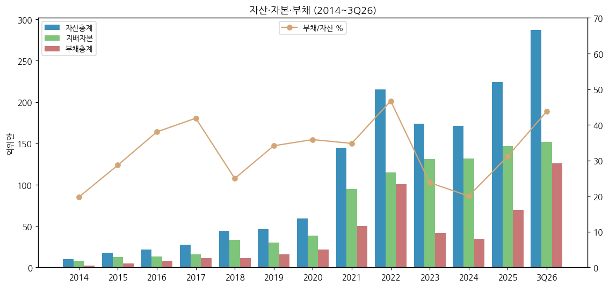

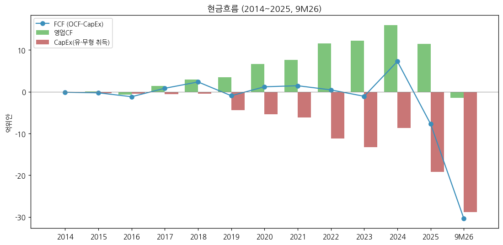

(3) CapEx + chart8

→ 2014~2018 연 0.1~0.6억 (경량 자산) → 2019~2021 연 4.4~6.2억 (하이먼·常州) → 2022~2023 11~13억 → 2024 8.7억 → 2025 **19.2억** → 9M26 **28.9억 (+162%)** — 핀란드 1기 + 판즈화 2기 + 윈난 LFP
→ 건설중자산 2025말 12.3억 → 2026-09 **30.8억** (+151%)

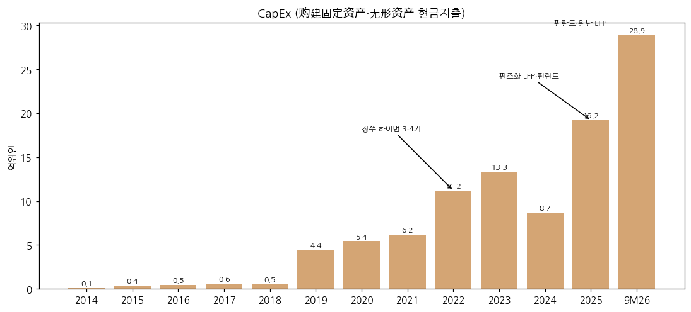

(4) 부채 구조

→ 회사채·전환사채 발행 이력 없음 (2014~2025 연보). 자금 조달은 주식 증자 위주: 2017 비공개 증자, **2021 46.45억**, **2025 10억 (지배주주 전액)**
→ 2026: 유럽 그린 파이낸싱 €5.144억 (핀란드 법인 차입, 회사 보증 공고 2025-12·2026-04·2026-05), 단기차입 12.8억

(5) 배당·자사주

| 회계연도 | 현금배당 총액 | 주당 (세전) | 배당성향 |
|---|---|---|---|
| 2023 | 3.81억 | ¥0.752 [계산: 506.5m주] | 19.8% |
| 2024 | 1.01억 | ¥0.20 [계산] | 21.5% |
| 2025 | 1.54억 | **¥0.283** | 24.4% |

→ (출처: 2025 배당안 공고 2026-03-31 「最近三个会计年度」표). 자사주 소각 0. 관리층·핵심인력 지분 증액 계획(2022·2023·2024·2025 4차, 시장 매입)

(6) R&D + chart7

→ 研发费用: 2019 0.99억 (4.3%) → 2021 3.36억 → 2022 **8.60억 (4.0%)** → 2023 4.08억 (2.7%) → 2024 3.70억 (4.9%) → 2025 4.86억 (4.7%) → 9M26 **5.55억 (+60.9%)** — "연구 시제품 원재료비 증가" (3Q26 보고)
→ R&D 인력 223명 (2020) → 438명 (2025, 전체의 25%) / 연구소 3곳 (북경 신에너지재료연구원·상주 리튬전지신재료연구원·공정기술연구원)

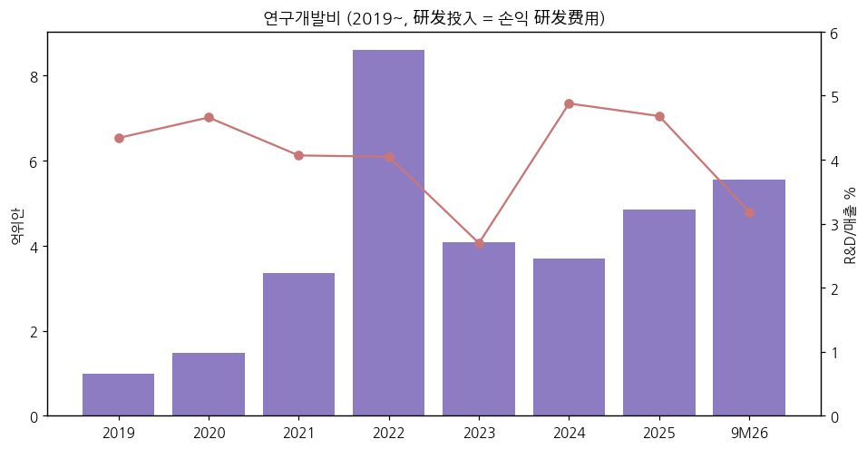

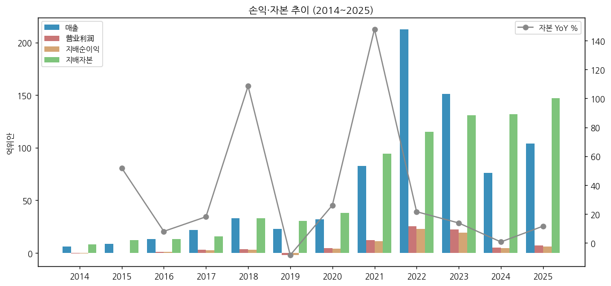

---

## ⑤ 지배 구조

(1) 그룹·계열 관계

→ **지배주주: 矿冶科技集团有限公司 (BGRIMM Technology Group)** 28.52% (155,230,155주, 이 중 37,792,894주 보호예수 ~2027-01-09) — 국무원 국유자산감독관리위원회(国资委) 직속 중앙기업 → **실제 통제인 = 국자위**
→ 국자위 "과학기술 개혁 시범기업(科改示范)" 2025 평가 "우수", 중앙기업 전문 선도기업 100곳 선정 (1H26 반기보고)
→ 주요 자회사: 江苏当升(南通), 当升科技(常州), **当升蜀道(攀枝花)** (四川 蜀道集团 합작), **当升科技(芬兰)新材料** (소수주주 출자 — 장기미지급금 5.66억), 中鼎高科(장비), 云南友天(51%, 2026)
→ 관계회사: 云南云聚能(49%), 北矿资环(江苏) — 2026 장기지분투자 0.04억 → 3.89억

(2) 주주 구분 + chart5 (2026-09-30, 보통주 주주 82,056명)

| 주주 | 지분 | 성격 |
|---|---|---|
| 矿冶科技集团 | **28.52%** | 국유법인 (지배주주) |
| 国新投资 | 1.92% | 국유법인 (중국국신 — 국유자본 운용) |
| 香港中央结算(HKSCC) | 1.06% | 외국인 (선강퉁 북향자금) |
| 易方达创业板ETF | 0.88% | 패시브 |
| 嘉兴聚力展业伍号 | 0.61% | 사모 |
| 개인 2명 (姚福来·刘恒才) | 0.98% | 개인 |
| 华安创业板50ETF·中证500ETF·广发新能源车电池ETF | 1.17% | 패시브 |

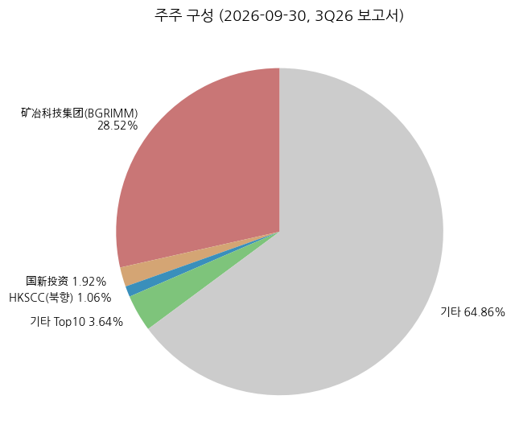

(3) 경영진

→ **董事长 陈彦彬** — 2003-02 입사 (R&D 부서장 → 기술총감 → 부총경리 → 총경리), 2021-04 이사, **2024-04~ 동사장**, 핀란드 법인 동사장 겸임. 보유 705,949주
→ **总经理 关志波** (50세), 부총경리 陈新·官云龙·张学全·陈翔宇 (2025 연보)
→ 2026-10 총법률고문 변경 공고

---

## ⑥ 기타 팩트

(1) 시가총액·밸류에이션 스냅샷 (2026-11-13)

→ 주가 ¥32.39 / 시총 ≈ ¥176.3억 (≈ 3.5조원) / P/B 1.16배 / LTM P/E 22.8배 / EV/LTM 한국식 OP ≈ 11.5배 [모두 계산]
→ 컨센 (同花顺, 최근 6개월 10개사, 2026-10-29): 2026E 순이익 평균 10.49억 (범위 7.90~12.69), TP 평균 ¥49.94 (38.87~61.00), 투자의견 매수 4·추천 3·증지 2·跑赢 1

(2) 진행 중 corporate action

→ **핀란드 유럽 기지 1기 6만t** (Kotka, 2026말 일부 가동) — Business Finland 보조금 최대 €1.15억 (CapEx의 20% 한도, 1차 €2,781만 수령), 그린 파이낸싱 €5.144억
→ **윈난 LFP 일체화** — 云天化와 LFP 15만t + 인산철 20만t, 반독점 신고 필요 (2026-04-16 공고)
→ **辉能(ProLogium) 전략 협력** — 지분투자·소재 공급 포함 MOU (구속력 없음, 2026-02-09)
→ 관리층 지분 증액 계획 2022·2023 존속기간 연장 (2026-06·10)

(3) R&D 마일스톤

→ NCM9계 초고니켈 양산 (亿纬 원통형 도입) / LCO 4.55V 양산 / LFP 5세대 2.75g/cm³ / 전고체 양극재 누적 50t·차량 탑재 검증 / 황화물·할로겐 고체전해질 소량 공급 / 리튬리치 망간계 소량 공급 (1H26 반기보고)

(4) 주요 리스크

→ **메탈가 래깅** — 탄산리튬 2026-08 고점 ¥16.29만/t → 9월 ¥11.70만 (−28%, 新华财经 2026-09-30) → 3Q26 재고평가손실 0.56억. 재고 47.1억 (매출의 약 2개월)
→ **수출 환급 축소** — 재정부·세무총국 2026-01-09 공고: 배터리 제품 증치세 수출환급 9% → 6% (2026-04-01) → **2027-01-01 취소**. 회사 3Q26 보고: "수출환급 정책 취소로 미납 증치세 증가" — 해외 매출(1H26 34.9%) 마진에 직접 영향
→ **환율** — 9M26 재무비용 +1.94억 (전년 −0.56억), 주로 환손실. 위안 강세(USD/CNY 6.67, 2026-11)와 해외 매출채권(달러·유로)
→ **해외 정책** — 중국 반외국제재·EU 역외보조금·IRA FEOC → 핀란드 프로젝트·한국 셀 업체 북미 공급망 제약 (1H26 반기보고 리스크 항목)
→ **고객 집중** — 상위 5사 64%, 1·2위 51%
→ **운전자본·CapEx 동시 확대** — 9M26 영업CF −1.5억, CapEx 28.9억 → 순현금 축소

(5) ESG

→ Wind ESG 8.46 → **9.10** (다원화공 업종 1위, 1H26), 商道融绿 ESG 선도기업 / 판즈화 300MW 녹색전력 직결 (쓰촨 1호) / SGS 양극재 업계 최초 탄소중립 선언 검증 (2025-01)

(6) 인증·라이선스

→ 유럽 CE 인증 선행(핀란드), ISO27001 진행 / 중앙기업 → 해외 투자 시 국자위·발개위 신고 대상

---

## Version Log

→ **v1.0** (2026-11-14) — 첫 작성. cninfo 원문 연보 12건 + 분기·반기 21건 + 공고 6건, Yahoo 주가·환율. 12년 연간 + 27분기 (누적 차감) + 제품·지역·판매량 + 한국 3사 마진 비교 + 차트 14종. 이익 지표 3종(营业利润·한국식 근사 OP·지배순이익) 병기
→ **잔여 보완 (v1.1)**: 2026 연보(2027-03) 제품·지역 4Q 역산 / 실적설명회 Q&A 원문 / 2025 지속가능발전보고서 본문 / 상위 고객 실명 교차검증 (한국 셀 3사 공시 역추적) / 중국 피어(容百·厦钨) 마진 비교 추가
