> Ticker: **SZSE: 300750 (A주, 创业板) / HKEX: 3750 (H주) — 宁德时代新能源科技股份有限公司 (Contemporary Amperex Technology Co., Limited, CATL)**
> Entity: 본사 중국 푸젠성 닝더시 (福建省宁德市蕉城区漳湾镇新港路 2号) — 세계 1위 동력전지(EV)·ESS 배터리 셀 메이커. 동력전지 사용량 9년 연속(2017~2025), ESS 배터리 출하량 5년 연속(2021~2025) 세계 1위 (회사 2025 연차보고서)
> Sector: 배터리 — 서브섹터 **배터리 셀 글로벌** (한국 셀: LG에너지솔루션·삼성SDI·SK온과 비교, 글로벌 피어: Panasonic Energy·BYD)
> 작성 시각: **2026-11-14 KST** (**v1.0** — 첫 작성. 3Q26 분기보고서(2026-10-21 공시)까지 반영)
> 적용 구조: v4.8 (6개 섹션) + 12종 차트 표준 (chart2는 사업부 반기·출하량/CAPA·지역별 3종 분할 2·2b·2c)
> 데이터 범위: **연간 12년 (2014~2025)** + **분기 23Q (1Q21~3Q26, 분기 단독)** + **사업부 반기 11개 (1H21~1H26)** + 연간 판매량·CAPA (2018~2025) + A주 월간 주가 (2018-06 상장~2026-11)
> 출처: **[1차 — 회사 원문] 심천거래소 공시 PDF (东方财富 공고 미러 경유) — 2026년 3분기 보고서(2026-10-21)·반기보고서(2026-07-25)·1분기 보고서(2026-04-16), 2025년 3분기 보고서, 연차보고서 2018·2019·2020·2021·2022·2023·2024·2025** / 분기 단독·연간 손익·재무상태·현금흐름 시계열은 东方财富 F10 재무 API(회사 공시 수치 집계 — 3Q26·1H26·2025 원문과 대조 일치)·사업부 반기 매출·GPM은 东方财富 主营构成(반기·연차보고서 원문 표와 대조) / Yahoo Finance v8 (300750.SZ·3750.HK·환율) / SNE Research(CnEVPost 인용 2026-08-04·08-07·11-02·11-05) / 3Q26 실적·IR 보도(东方财富 2026-10-21, CnEVPost 2026-10-21, Tiger Brokers 종합, Gasgoo 2026-10-22) / 회사 Hungary 보도자료(PR Newswire 2026-09-22) / 같은 폴더 `LG에너지솔루션_기업개요.md`·`삼성SDI_기업개요.md`
> ⚠️ 다음 실적: **2026 연차보고서 2027-03 중순 예상** (전년 2026-03-10, 2025-03-15 공시 — 회사 확정 공지 전)

# CATL 기업 개요 (v1.0 — 배터리 셀 글로벌 / 세계 1위 셀 메이커 / 리튬 사이클 + ESS 성장, 2026 하반기 마진 압박 국면)
> **Fact verify cutoff**: 2026-11-14 (A주 2026-11-13 종가 **237.70위안**, H주 **HK$369.8** [Yahoo Finance], 시가총액 ≈ **1.117조 위안 (11,165억위안)** [계산: A주 4,408.35백만주 × 237.70 + H주 218.30백만주 × HK$369.8 × 0.8503(HKD/CNY, Yahoo 11/13)] ≈ **223.7조원** [CNY/KRW 200.32, Yahoo 11/14], A주 ATH **장중 468.75위안 (2026-05-07)** [Yahoo 수정주가] → 현재 -49.3% [계산], H주 ATH 장중 HK$794.5 (2026-06-03) → -53.5% [계산])

> ⚠️ **회계·시계열 주의 4건 — 모든 표·차트 해석 시 확인**
> ① **이익 지표 정의** — 중국 기업회계준칙의 **营业利润(본 리포트 "중국식 영업이익")** 은 투자수익(지분법)·기타수익(정부보조금)·공정가치변동·자산/신용손상·재무비용(이자수익 순액)을 포함한다. 한국 K-IFRS 영업이익과 다르므로 **"영업이익(한국식 근사)" = 매출 − 매출원가 − 세금과공과(税金及附加) − 판매비 − 관리비 − R&D비** 를 별도 계산해 병기 [계산]. 한국 셀 2사와 마진 비교는 한국식 근사로 한다
> ② **보증비용(质保费) 재분류 — 2024 연차보고서부터 해석 18호 적용**: 보증성 품질보증 비용을 판매비 → 매출원가로 이동, 2023 연간을 소급 재작성. **2014~2022 연간·1Q~3Q23 분기 GPM은 구기준(GPM 2~3%p 높게 표시)**, 2023 연간·2024~ 분기는 신기준. 4Q23 분기 GPM(11.6%)은 "재작성 연간 − 구기준 9M"이라 해석 불가. 한국식 근사 영업이익은 원가·판매비를 모두 차감하므로 **영향 없음**
> ③ **단위·통화** — 억위안 (1억위안 ≈ 200억원, 11/14 기준). 분기 = 단독 3개월(4Q = 연간 − 9M). 연간 2014~2016은 R&D가 관리비에 포함(2018년부터 분리 표시)
> ④ **상장·자본 이벤트** — 2018-06-11 A주 창업판 상장 / 2022 10주당 8주 무상증자(주가는 Yahoo 수정주가) / **2025-05-20 홍콩 H주 상장**(155.9백만주) / **2026-04-30 H주 배정 62.385백만주 (HK$628.20)** → 총주식 4,626.65백만주 (A 4,408.35 / H 218.30)

---

## Phase 1 Source Audit

```
=== 자료 수집 audit (CATL, 300750.SZ / 3750.HK) ===

✅ 확보 (저장: company-overview-source/300750.SZ_CATL/)
- 정기보고서 원문 PDF 13건: 3Q26·1H26·1Q26·3Q25 분기·반기, 연차 2018~2025 (8개년)
- 东方财富 F10 재무 API: 분기 단독 손익(1Q17~3Q26)·누적 손익(2014~3Q26)·재무상태표·현금흐름표·주요지표(ROE 등)·主营构成(사업부/지역 반기)·주주·배당
- Yahoo: A주 월간(2018-06~)·일간 2년, H주 일간(2025-05~), USD/KRW·USD/CNY·HKD/CNY
- 3Q26 IR·보도: 출하량(~265GWh)·단위이익·소비세·수출환급·셀사이드 TP 변경 (东方财富·CnEVPost·Tiger·Gasgoo)
- SNE Research 점유율 (EV 1H26·1~9월, 비중국 1~9월, ESS 1H26 글로벌·북미)

❌ 누락 (4)
- 3Q26 실적설명회 원문 트랜스크립트: 미게시 → 보도 인용으로 대체 (출처 표기)
- 분기 사업부 매출·이익: 회사가 반기·연간만 공시 → 사업부 시계열은 반기 단위
- 분기 출하량(GWh): 회사 정기보고서 미공시 → IR 설명·보도 인용 (1Q26 >200, 3Q26 >260GWh)
- 2014~2017 판매량·CAPA, 2014 이전 손익: 상장 전 (2018 연차보고서 이전 미수집)

⚠️ 결과 영향
- 이익 지표 3종 병기: 중국식 영업이익(营业利润) / 한국식 근사 영업이익 [계산] / 지배순이익
- GPM은 2023 이전 구기준 → 2024~ 신기준과 단순 비교 금지
- 2H 사업부·지역 = 연간 − 1H [계산]

Source 6종 audit:
[V] (1) 정기 보고서 원문 (8개년 연차 + 2025~26 분기·반기) ✓
[△] (2) IR 실적 발표 — 회사 영문 보도자료·컨콜 원문 ✗, 보도·IR 기록 인용 ✓
[△] (3) ESG 보고서 — 미수집 (연차보고서 ESG 서술로 대체)
[V] (4) 주가 (Yahoo A주 상장 이후·H주) ✓
[△] (5) 중장기 목표 — 회사 수치 목표 미제시, 2027 수요 +20~30% 발언(3Q26 IR) ✓
[V] (6) 12년 정확값 (2014~2025, 2014~2016 R&D 관리비 포함) ✓
→ 4.5/6 source 확보. 최신 분기(3Q26, 2026-10-21) 반영.
```

---

## ① 기업 분류

(1) Primary / Secondary 분류

**Primary 분류: 고성장 (세계 1위 셀 메이커 — EV·ESS 물량 성장 + 원가 우위)**

→ 매출 2018 296억 → 2025 4,237억위안 (7년 CAGR **+46.3%** [계산]), 판매량 21GWh → 662GWh (7년 **약 31배** [계산])

→ 9M26 매출 4,421억 (+56.2% YoY), 3Q26 1,652억 (+58.6%) — 2024 매출 역성장(-9.7%, 리튬가 하락에 따른 판가 하락) 이후 다시 고성장 궤도

**Secondary 노트: 사이클 (리튬·메탈 가격 연동 판가 + 증설 사이클)**

→ 판가가 탄산리튬 등 메탈 가격에 연동(대부분 주문에 가격 연동 조항 — 1Q26 IR 설명, huxiu 2026-04-16 인용) → 매출은 메탈가에 따라 출렁이고, 마진은 메탈가 **방향**에 따라 반대로 움직임
→ 2022 리튬 급등기: 매출 +152%인데 한국식 OPM 14.1% → **9.8%** / 2024~25 리튬 하락기: 매출 -9.7%인데 OPM 15.1% → **16.7%**, 4Q25 19.1% 정점 / **2026 리튬 재상승**(탄산리튬 2025 중반 6만 위안/톤 미만 → 2026-06 21만 위안 돌파, 10jqka 2026-09-22): 3Q26 OPM **12.3%** 로 하락

**사업부 구조 (1H26, 회사 반기보고서 — 매출 2,769억위안)**

→ **(1) 동력전지 시스템 (EV)** — 매출 1,921억 (**69.4%**), GPM 20.6% (YoY -1.8%p) — LFP(神行 Shenxing)·삼원 고니켈(麒麟 Qilin)·하이브리드용(骁遥 Freevoy)·나트륨이온(钠新 Naxtra), 승용·상용·선박·항공

→ **(2) ESS 전지 시스템** — 매출 533억 (**19.2%**), GPM 24.0% (YoY -1.6%p) — 셀(587Ah·314Ah)·컨테이너(TENER, 天恒 6.25MWh, TENER Stack 9MWh)·시스템 통합, 데이터센터 전원

→ **(3) 배터리 소재·리사이클·광물** — 매출 188억 (6.8%), GPM 27.0% (YoY +5.8%p) — 리튬염·전구체·양극재, 폐배터리 재활용(邦普 Brunp), 리튬·니켈·인 광산 (2026 时代资源集团 신설)

→ **(4) 기타** — 127억 (4.6%), GPM 69.0% — 기술 라이선스(Ford 등)·임대·스크랩 등

(2) Summary Box (12년 시계열 + 사이클 통계)

| 지표 | 12년 (2014~2025) | 정점 | 저점 | 2025 | 9M26 |
|---|---|---|---|---|---|
| 매출 (억위안) | CAGR(2015→2025, 10년) **+53.9%/yr** [계산] | **4,237 (2025)** | 9 (2014) | 4,237 | 4,421 (+56.2%) |
| 중국식 영업이익 (억위안) | — | **895 (2025)** | — | 895 (OPM 21.1%) | 809 (18.3%) |
| 한국식 근사 영업이익 (억위안) | — | **709 (2025)** | — | 709 (16.7%) | 657 (14.9%) |
| 한국식 OPM 평균 (2015~2025) | **15.5%** [계산] | 24.3% (2016) | **9.8% (2022)** | 16.7% | 14.9% |
| 한국식 OPM 평균 (상장 후 2018~2025) | **13.5%** [계산] | 16.7% (2025) | 9.8% (2022) | — | — |
| 지배순이익 (억위안) | — | **722 (2025)** | — | 722 | 645 (+31.6%) |
| 사이클 주기 | 리튬 가격 사이클 약 3~4년 (2018 하락 → 2021~22 급등 → 2023~25 하락 → 2026 재상승) | | | | |
| 사이클 회수 (상장 후) | 마진 저점 2회 (2019~20 보조금 축소, 2022 리튬 급등) / 정점 2회 (2016~17 상장 전, 2025) | | | | |

```
[CATL 12년 손익 (억위안, 중국 기업회계준칙 연결)]
연도    매출   GPM*  한국식OP  한국식OPM  营业利润  OPM(중)  지배순이익  扣非순이익
2014       9  25.7%       0     3.2%        0     1.9%        1        0   ← 시험·초기 양산 (2011-12 설립)
2015      57  38.6%      12    21.3%       10    18.3%        9        9   ← 중국 EV 보조금 붐, BMW·우통 공급
2016     149  43.7%      36    24.3%       32    21.6%       29       28   ← 상장 전 마진 정점 (보조금 고점)
2017     200  36.3%      34    17.0%       48    24.2%       39       24   ← 보조금 축소 시작, 영업외(지분 매각익) 큼
2018     296  32.8%      46    15.5%       42    14.1%       34       31   ← 2018-06 A주 상장, 판매 21GWh
2019     458  29.1%      61    13.2%       58    12.6%       46       39   ← 보조금 대폭 축소, 판가 하락
2020     503  27.8%      61    12.2%       70    13.8%       56       43   ← COVID, Tesla 상하이 LFP 공급 개시
2021   1,304  26.3%     183    14.1%      198    15.2%      159      134   ← 판매 133GWh(+185%), 리튬 급등 시작
2022   3,286  20.3%     320     9.8%      368    11.2%      307      282   ← 매출 +152%, 리튬 정점 → 마진 저점
2023   4,009  19.2%     454    11.3%      537    13.4%      441      401   ← 판매 390GWh, 리튬 급락 시작 (GPM 신기준)
2024   3,620  24.4%     546    15.1%      641    17.7%      507      450   ← 판가 하락으로 매출 -9.7%, 이익 +15%
2025   4,237  26.3%     709    16.7%      895    21.1%      722      645   ← 판매 662GWh, H주 상장, 마진 정점
9M26   4,421  22.7%     657    14.9%      809    18.3%      645      579   ← 매출 +56%, 3Q GPM 20.7%로 하락

* GPM 2014~2022 구기준(보증비용 판매비), 2023~ 신기준. 2015~2016 순이익률 높은 것은 소규모·보조금 시기
한국식 OPM range (2015~2025): 9.8% ~ 24.3% = 14.5%p (상장 후 2018~2025: 9.8~16.7% = 6.9%p)
```

**한국 셀 2사 + 글로벌 피어 이익률 비교 (최근 분기, 한국식 영업이익 기준)**

| 회사 | 3Q26 매출 | 3Q26 OPM | 보조금 제외 OPM | 2025 연간 OPM | 출처 |
|---|---|---|---|---|---|
| **CATL** | 1,652억위안 (≈34.7조원) | **12.3%** (한국식 근사) / 15.3% (중국식) | 12.3% (정부보조금은 기타수익 → 한국식에 미포함) | 16.7% (한국식) | 3Q26 보고서 [계산] |
| LG에너지솔루션 | 9.64조원 | 7.8% | **3.5%** (AMPC 제외) | 5.3% (재작성) | 같은 폴더 LGES 기업개요 |
| 삼성SDI | 4.69조원 (전사) | 8.7% | **6.1%** (AMPC 제외) | -13.0% | 같은 폴더 삼성SDI 기업개요 |

→ 원화 환산: 3Q26 평균 CNY/KRW **210.2** [계산: USD/KRW 1,417.0 ÷ USD/CNY 6.741, Yahoo 7/1~9/30 일간 평균]
→ **마진 격차**: 정책 보조금(AMPC)을 뺀 기준으로 CATL 12.3% vs LGES 3.5%·SDI 6.1% — **6~9%p**. 1Q26 BT 리뷰의 "약 10%p"에서 3Q26에 좁혀졌다. 좁혀진 이유는 한국 쪽 개선(ESS)과 CATL 쪽 하락(리튬·소비세·믹스)이 동시에 일어났기 때문 `[판단]`
→ CATL의 마진 원천: ① 규모(글로벌 EV 39%) ② LFP·소재 내재화 ③ 해외 판매 GPM이 중국 내보다 높음(1H26 해외 30.0% vs 중국 21.2%) — 한국 셀이 북미 보조금으로 이익을 내는 구조와 다르다

(3) 정량적 분류 근거

→ **글로벌 EV 배터리 사용량 점유율 (SNE Research)** — 2022 37.0% → 2023 36.8% → 2024 37.9% → 2025 **39.2%** (연차보고서) → **1H26 39.9%** (242.7GWh, CnEVPost 2026-08-07) → 1~9월 **39.1%** (389.2GWh, +24.9%, CnEVPost 2026-11-02). 2위 BYD 15.2%, 3위 LGES 8.2%

→ **비중국 EV 시장** — 1~9월 CATL **33.7%** (143.7GWh, +46.7%, 전년 28.6%) vs LGES 16.4% (-4.9%), SK온 6.6%, 삼성SDI 3.5% / 유럽 CATL 96.8GWh (+35.4%) (SNE, CnEVPost 2026-11-05) — 한국 3사 합산 점유율 38.2% → 26.5%

→ **글로벌 ESS 배터리 출하 (SNE Research, 1H26)** — CATL **27.1%** (125.0GWh, +81%, 전년 25.6%), 2위 EVE 10.4%, 3위 Hithium 10.0% / LGES 2.6%, 삼성SDI 1.4% (CnEVPost 2026-08-04)
→ **북미 ESS (1H26)** — CATL **38.8%** (29.5GWh), Hithium 17.2%, LGES 13.6%, 삼성SDI 6.1% (같은 출처) — 미국 관세·FEOC 규제에도 북미 1위 유지

→ **가동률** — 2023 70.5% → 2024 76.3% → 2025 **96.9%** → 1H26 **94.9%** (연차·반기보고서). 1H26 생산 498GWh, 건설 중 CAPA **764GWh**

(4) 산업 분류

→ **CSRC 업종** — 电气机械和器材制造业 (전기기계·기자재 제조업) / 2025년부터 采选冶炼(광물) 매출 별도 표시
→ **지수** — CSI 300·创业板指 최대 비중 종목, 항셍지수 (H주)
→ **워치리스트** — 섹터 배터리 / 서브섹터 **배터리 셀 글로벌** (watchlist.md)

(5) 분류 결정 논리

→ 상장 후 8년(2018~2025) 매출 CAGR +46%, 2025 이익 사상 최대, 9M26 매출 +56% — 물량 성장이 압도적이라 **Primary 고성장**
→ 다만 이익률은 리튬 가격 방향에 따라 ±3~5%p 진폭으로 움직이고(2022 9.8% ↔ 2025 16.7%), 2026 하반기에는 매출 +59%에도 이익 +15%로 괴리 → **Secondary 사이클**
→ **한국 셀과의 차이**: LGES·삼성SDI는 OPM 진폭이 크고 적자 연도가 있어(LGES 2019, SDI 2025) **Primary 사이클** 분류. CATL은 상장 후 **한 번도 OPM 9% 아래로 내려간 적이 없다** — 같은 배터리 셀이라도 분류가 다르다 `[판단]`

(6) 적정 밸류에이션 방법 (한국 셀 2사와 같은 프레임)

**밸류에이션 다이얼 — 사업 mix → 지표 선택 논리**

| mix 요소 | 성격 | 적합 지표 | 근거 |
|---|---|---|---|
| 동력전지 (매출 69%) | 물량 성장 + 메탈가 연동 판가 | **포워드 PER** | 상장 후 매년 흑자, 이익 가시성 높음 |
| ESS (19%) | 고성장, 해외 마진 높음 | 포워드 PER | 2027 수요 +20~30% (회사) |
| 소재·광물 (7%) | 메탈 사이클 | PBR (보조) | 리튬 가격 연동 |
| 전사 | 순현금 대규모, D&A 큼 | **EV/EBITDA** (한국 셀 비교용) | 현금+금융자산 4,326억 > 차입 1,899억 |

**현재 수치 (2026-11-13 종가 기준, 시총 11,165억위안)**

| 지표 | CATL | LG에너지솔루션 | 삼성SDI | 비고 |
|---|---|---|---|---|
| PER (TTM) | **12.7x** (지배순이익 4Q25~3Q26 합 877억) | n/m (적자) | — | [계산] |
| PER (2026E / 2027E) | **12.9x / 11.9x** (JPM 863억·939억) | 68.8x (Fwd, stockanalysis 10/02) | 38.3x (Fwd, 10/01) | CATL [계산], 한국은 각 기업개요 인용 |
| PBR | **2.89x** (지배자본 3,869억, 3Q26말) | 4.03x (지배자본) | 약 1.5~1.6x | [계산] / 각 기업개요 |
| EV/EBITDA (TTM) | **7.5x** (한국식 OP 925 + D&A 약 283) / 6.6x (중국식 OP 기준) | 약 20.5x | 23.9x (stockanalysis) | [계산] |

→ EV 산식: 시총 11,165 + 차입(단기·장기·사채·유동성장기·리스) 1,899 − 현금·거래성금융자산 4,326 + 비지배지분 363 = **9,102억위안** [계산]. D&A TTM = 2025 252 + 1H26 148 − 1H25 117 (반기 기준 근사) ⚠️추정
→ **A/H 괴리**: H주가 A주 대비 **+32% 프리미엄** [계산: HK$369.8 × 0.8503 = 314.4위안 vs 237.70] — 외국인은 H주에 더 높은 값을 준다. 한국 셀 비교는 A주(시총 대부분) 기준
→ 셀사이드 관행: 한국 셀은 "CATL 멀티플에 30~60% 할증"(LGES 기업개요 인용) — 즉 **CATL이 섹터 밸류에이션의 기준점**

**우선순위: ① 포워드 PER (1차) → ② EV/EBITDA (한국 셀과 교차 비교) → ③ PBR (사이클 하방 체크)**

(7) 분기 재평가 트리거 (분류 변경 조건)

→ ① **지배순이익 YoY 2개 분기 연속 마이너스 + 한국식 OPM 10% 하회** → Primary를 "사이클"로 전환 (4Q26E JPM 역산 YoY -6% [계산]이 1차 판정 구간)
→ ② **소비세·수출환급 비용의 고객 전가 합의 + GPM 23% 회복** → 고성장 유지 재확인
→ ③ **해외 생산(헝가리·스페인·인니) 비중 확대로 해외 GPM 30% 유지** → 프리미엄 근거 강화

---

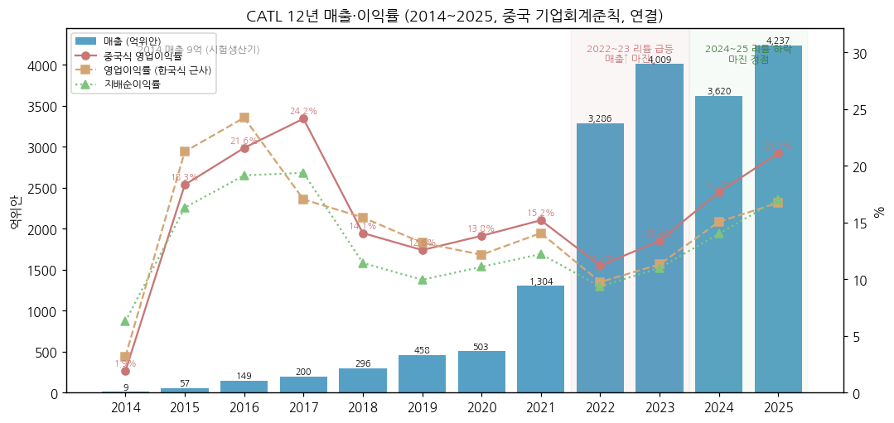

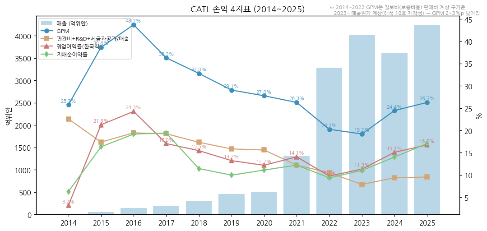

---

## ② 회사 개요

(1) 기본 정보

→ **법인명** — 宁德时代新能源科技股份有限公司 (Contemporary Amperex Technology Co., Limited), 법정대표 쩡위췬(曾毓群)
→ **설립** — 2011-12 (전신 ATL(Amperex Technology, 현 TDK 자회사)의 동력전지 사업에서 분리) / 2018-06-11 심천 창업판 상장 / 2025-05-20 홍콩 메인보드 상장 (H주 155.9백만주, 한 해 최대 규모 IPO 중 하나)
→ **회계연도** — 1~12월 / 중국 기업회계준칙 / 1Q·3Q 분기보고서(미감사), 반기·연차 보고서
→ **사업 한 줄 정의** — EV·ESS용 리튬이온(+나트륨이온) 배터리 셀·모듈·팩·시스템을 소재·리사이클·광물까지 수직 통합해 공급하는 **세계 최대 배터리 셀 메이커**
→ **경영진** — 쩡위췬 (57세, 董事长·执行董事·总经理(2022-08~), 창업자·실질 지배주주) / 판젠(潘健, 联席董事长, 2025-01~) / 리핑(李平, 副董事长) (2025 연차보고서)
→ **임직원** — 185,839명 (2025말, 모회사 16,233 + 자회사 169,606), R&D 인력 22,901명 (12.3%) (2025 연차보고서)
→ **총주식** — 4,626,650,861주 (2026-06말; A 4,408.35백만 / H 218.30백만), 자사주 39.26백만주 (0.85%, 3Q26말)

(2) 핵심 KPI 요약 (억위안)

| 항목 | 2023 | 2024 | 2025 | 3Q26 | 9M26 | 9M26 YoY |
|---|---|---|---|---|---|---|
| 매출 | 4,009 | 3,620 | 4,237 | 1,652 | 4,421 | +56.2% |
| GPM | 19.2%* | 24.4% | 26.3% | 20.7% | 22.7% | -2.6%p |
| 한국식 근사 영업이익 | 454 | 546 | 709 | 203 | 657 | +49.0% |
| 중국식 영업이익(营业利润) | 537 | 641 | 895 | 253 | 809 | +33.7% |
| 지배순이익 | 441 | 507 | 722 | 212 | 645 | +31.6% |
| 배터리 판매량 (GWh) | 390 | 475 | 662 | 약 265 (IR) | 약 700 ⚠️추정 | — |
| 영업현금흐름 | 928 | 970 | 1,332 | 14 (보도) | 616 | -23.6% |
| DPS (위안, 연간 합) | 5.028 (특별 포함) | 4.553 + 특별 1.230 | 7.964 (중간 1.007 + 기말 6.957) | — | 중간 1.411 | — |

> \* 2023 GPM은 신기준 재작성(2024 연차보고서). 9M26 판매량 = 1Q >200 + 2Q 약 230 [3Q 260+ ÷ 1.13 QoQ 역산] + 3Q 약 265 ⚠️추정 (회사 정기보고서에 분기 판매량 없음). 3Q26 영업CF 14억은 9M 616 − 1H 602 [계산]

(3) 회사 주가 역사

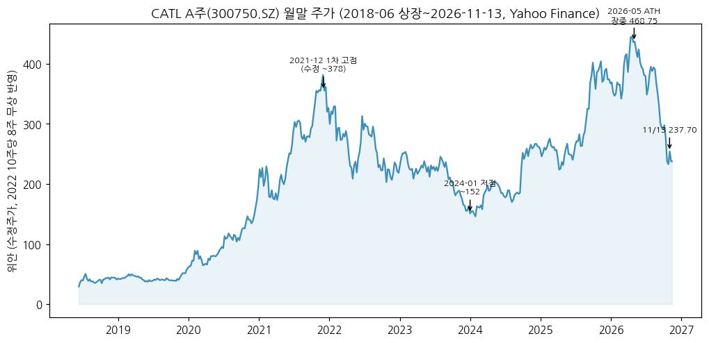

→ (출처: Yahoo Finance 300750.SZ 월간, 2022 무상증자 반영 수정주가. 시총 시계열은 주식수 변동(2020·2022 증자, 2025 H주) 때문에 주가로 대체)

→ 2018-06 상장 (수정 ~40위안) → 2019 말까지 박스 (보조금 축소)
→ **2020~2021 1차 상승**: Tesla 상하이 LFP 공급, 유럽 OEM 수주, 글로벌 EV 침투 → 2021-11 월말 수정 ~378위안
→ **2022~2024-01 하락 -60%**: 리튬 급등 후 급락, 중국 EV 가격 전쟁, 미국 IRA로 북미 배제 → 2024-01 월말 151.6위안
→ **2024-09~2026-05 재평가**: 이익 회복 + 고배당 + 2025-05 H주 상장 + ESS 급증 → **ATH 장중 468.75위안 (2026-05-07)**, H주 HK$794.5 (2026-06-03)
→ **2026-06~11 급락 -49%**: 리튬 재상승에 따른 마진 우려 → 9월 소비세 시행 → **10/21 3Q 실적 발표일 A주 -12.0% (259.08 → 227.90)**, H주 -11.4% (HK$411.8 → 364.8) [Yahoo 일간] → 11/13 237.70
→ 하락 원인 [판단]: ① 3Q26 순이익 컨센 하회(실적 21.2bn vs GS 24bn·CLSA 25~26bn 예상) ② 소비세 2%(→2027-09 4%)·수출환급 폐지(2027-01)라는 정책 비용 ③ 리튬 상승으로 단위이익 하락(GS 82위안/kWh, 전년 112) ④ 영업현금흐름 급감

```
[주가 국면 history (A주 수정주가)]
[2018-06 ~ 2019] 상장 박스 (36~59위안) — 보조금 축소기
[2020 ~ 2021-11] 1차 상승 (~59 → ~378) — Tesla·유럽 EV, 판매 +185%
[2021-12 ~ 2024-01] 하락 (~378 → ~152) — 리튬 급등락, 중국 EV 가격 전쟁, IRA
[2024-02 ~ 2026-05] 재평가 (~152 → 468.75 ATH) — 이익 사상 최대, 고배당, H주 상장, ESS
[2026-06 ~ 현재] 급락 (468.75 → 237.70, -49%) — 리튬 재상승·소비세·3Q 이익 둔화
```

(4) 주요 연혁

| 연도 | 이벤트 |
|---|---|
| 2011-12 | 닝더에서 설립 (ATL 동력전지 사업 분리) |
| 2012 | BMW 브릴리언스 공급 — 첫 해외 OEM 레퍼런스 |
| 2017 | 동력전지 사용량 세계 1위 첫 달성 (이후 9년 연속) |
| 2018-06 | 심천 창업판 A주 상장 / 독일 에르푸르트 공장 발표 |
| 2020 | Tesla 상하이 LFP 공급, CTP(Cell-to-Pack) 상용화, 유상증자 |
| 2021 | 나트륨이온 1세대 발표, ESS 출하 세계 1위 (이후 5년 연속) |
| 2022 | 10주당 8주 무상증자, 헝가리 데브레첸 공장 발표(100GWh), 麒麟 배터리 |
| 2023 | 神行 LFP 4C 초고속 충전, Ford 미시간 LFP 기술 라이선스 계약 |
| 2024 | Stellantis와 스페인 LFP JV 합의, 巧克力 배터리 교환 브랜드, 독일 공장 양산 |
| 2025-05 | 홍콩 H주 상장 (155.9백만주) |
| 2025-11 | 스페인 사라고사 JV 공장 착공 (€4.1bn, Stellantis) |
| 2026-04 | H주 62.4백만주 배정 (HK$628.2) — 1H26 중 超级科技日에서 3세대 神行/麒麟·钠新 발표 |
| 2026-06 | Ford 미시간 공장(라이선스) 양산 개시 (CarScoops 2026-07-01) |
| 2026-09 | 헝가리 데브레첸 셀 시험생산 (9/22), 중국 배터리 소비세 2% 시행 (9/1) |

---

## ③ 비즈니스 모델

(1) 실적 추이 통합 표 (연간, 억위안 — 사업부·지역 3단계)

| 구분 | 2021 | 2022 | 2023 | 2024 | 2025 | 1H26 | 1H26 YoY |
|---|---|---|---|---|---|---|---|
| **매출 합계** | 1,304 | 3,286 | 4,009 | 3,620 | 4,237 | 2,769 | +54.8% |
| 동력전지 시스템 | 915 | 2,366 | 2,853 | 2,530 | 3,165 | 1,921 | +46.0% |
| ESS 전지 시스템 | 136 | 450 | 599 | 573 | 624 | 533 | +87.5% |
| 소재·리사이클·광물 | 155 | 305 | 413 | 342 | 278 | 188 | +67.2% |
| 기타 | 98 | 165 | 144 | 175 | 169 | 127 | +65.8% |
| **GPM** 동력전지 | 22.0% | 17.2% | 22.3% | 23.9% | 23.8% | 20.6% | -1.8%p |
| GPM ESS | 28.5% | 17.0% | 23.8% | 26.8% | 26.7% | 24.0% | -1.6%p |
| GPM 소재·광물 | 25.1% | 19.9% | 13.0% | 10.2% | 23.8% | 27.0% | +5.8%p |
| **지역** 중국 내 매출 | 1,025 | 2,517 | 2,699 | 2,517 | 2,941 | 1,898 | +61.3% |
| 해외 매출 | 279 | 769 | 1,310 | 1,103 | 1,296 | 871 | +42.3% |
| 해외 비중 | 21.4% | 23.4% | 32.7% | 30.5% | 30.6% | 31.5% | — |
| GPM 중국 내 / 해외 | 25.1% / 30.5% | 19.9% / 21.5% | 21.8% / 25.2% | 22.3% / 29.5% | 24.0% / 31.4% | 21.2% / 30.0% | — |
| **판매량** (GWh) 동력 / ESS | 116.7 / 16.7 | 242 / 47 | 321 / 69 | 381 / 93 | 541 / 121 | (1H 생산 498) | — |

→ (출처: 각 연도 연차보고서·2026 반기보고서 "主营业务分产品/分地区" 표 (东方财富 主营构成으로 수집, 2025·1H26 원문 대조). 2023~2025 소재 = 电池材料及回收 + 电池矿产资源 [합산]. 2021~22 소재 = 锂电池材料. GPM 2021~2022는 구기준)
→ **판매 단가 추정**: 2025 매출(동력+ESS) 3,789억 ÷ 662GWh = **약 0.57위안/Wh** [계산] ≈ 1Q26 0.57위안/Wh (huxiu 2026-04-16) — 2022 0.97위안/Wh [계산: 2,816 ÷ 289] 대비 -41%. 메탈가 연동 판가의 결과

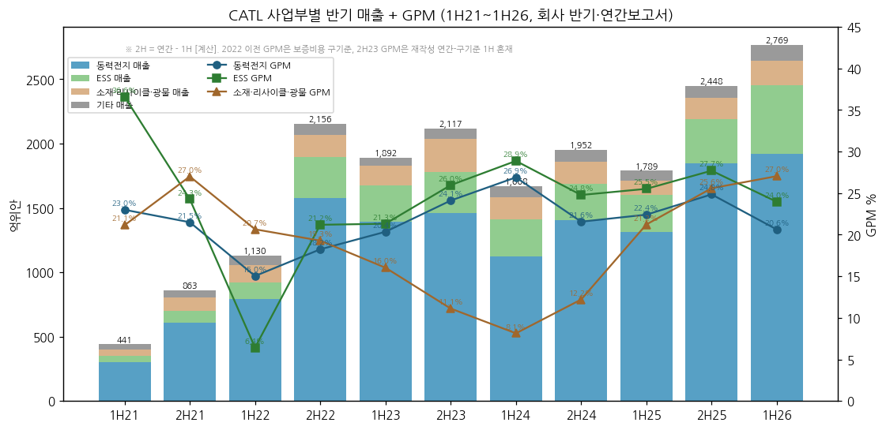

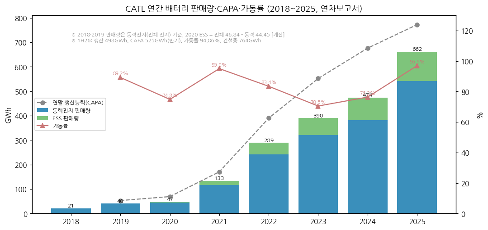

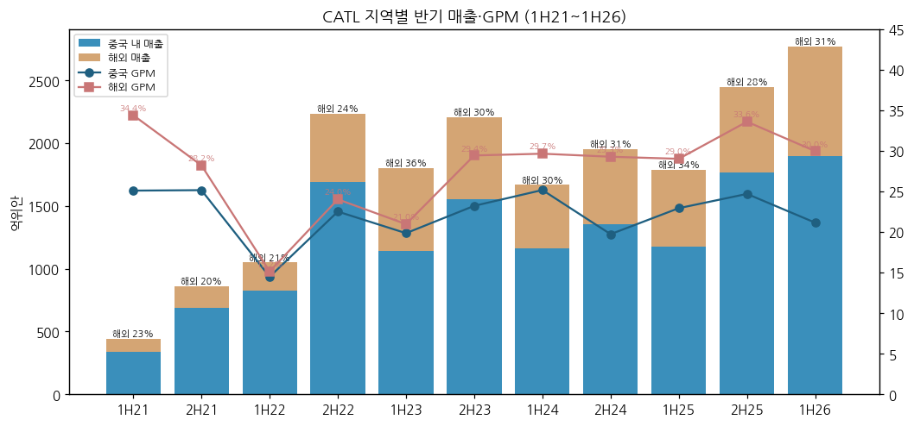

**분기 연결 시계열 (억위안, 분기 단독 — 사업부는 반기만 공시)**

| 분기 | 1Q24 | 2Q24 | 3Q24 | 4Q24 | 1Q25 | 2Q25 | 3Q25 | 4Q25 | 1Q26 | 2Q26 | **3Q26** |
|---|---|---|---|---|---|---|---|---|---|---|---|
| 매출 | 797.7 | 870.0 | 922.8 | 1,029.7 | 847.0 | 941.8 | 1,041.9 | 1,406.3 | 1,291.3 | 1,477.9 | **1,652.2** |
| GPM | 23.3% | 23.6% | 27.7% | 23.1% | 24.4% | 25.6% | 25.8% | 28.2% | 24.8% | 23.2% | **20.7%** |
| 한국식 근사 영업이익 | 104.7 | 128.2 | 173.9 | 139.0 | 118.3 | 148.5 | 174.2 | 268.4 | 220.9 | 232.9 | **203.2** |
| 한국식 OPM | 13.1% | 14.7% | 18.8% | 13.5% | 14.0% | 15.8% | 16.7% | 19.1% | 17.1% | 15.8% | **12.3%** |
| 중국식 영업이익 | 133.3 | 162.2 | 165.7 | 179.3 | 173.4 | 214.8 | 217.3 | 289.7 | 266.5 | 290.1 | **252.7** |
| 지배순이익 | 105.1 | 123.6 | 131.4 | 147.4 | 139.6 | 165.2 | 185.5 | 231.7 | 207.4 | 225.5 | **212.5** |
| 매출 YoY | -10.4% | -13.2% | -12.5% | -3.1% | +6.2% | +8.3% | +12.9% | +36.6% | +52.4% | +56.9% | **+58.6%** |
| 지배순이익 YoY | +7.0% | +13.4% | +26.0% | +13.6% | +32.9% | +33.7% | +41.2% | +57.1% | +48.5% | +36.5% | **+14.5%** |

→ (출처: 각 분기 보고서. 2024 분기는 2025 분기보고서의 재작성 비교치(보증비용 원가 이동) 기준 — 东方财富 분기 단독 데이터. 4Q = 연간 − 9M [계산])

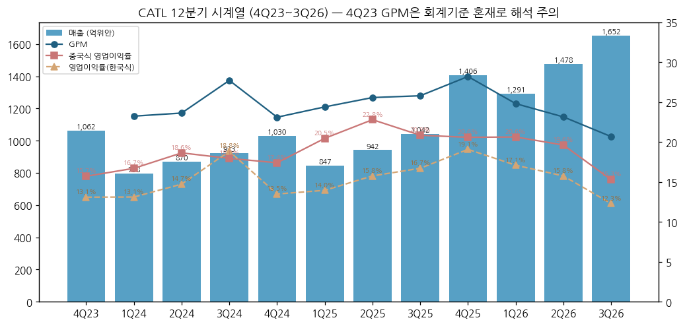

(2) 사업부별 개요 (매출 비중 큰 순서)

(2-1) **동력전지 시스템 — 1H26 매출 1,921억 (69%), GPM 20.6%**
→ 2025 판매 541GWh (+41.9%), 글로벌 EV 사용량 점유율 39.2% / 중국 내 장착 점유율 43.42% (중국 동력전지산업창신연맹) / 해외 사용량 점유율 30.0% (2025 연차보고서)
→ 1H26 중국 승용 장착 점유율 46.7% (+5.6%p), 중국 삼원 점유율 75.2% / 1~5월 해외 점유율 33.7% (+3.7%p) — VW·Stellantis·BMW·DMG·Volvo·Toyota (반기보고서 원문 표기)
→ 제품: 神行 3세대 LFP (15C 피크 충전), 麒麟 3세대·麒麟 응축(凝聚态), 骁遥 2세대 EREV/PHEV, 钠新 나트륨이온 (2026-04 超级科技日)
→ 3Q26 동력 판매 약 199GWh (+50% YoY, 东方财富 2026-10-21 IR 정리)

(2-2) **ESS 전지 시스템 — 1H26 매출 533억 (19%), GPM 24.0%**
→ 2025 판매 121GWh (+29.1%), 시스템 통합 출하 +160%, 70개+ 프로젝트 (2025 연차보고서)
→ 1H26 ESS 출하 글로벌 1위 (鑫椤资讯), SNE 기준 27.1%·북미 38.8%
→ 3Q26 ESS 판매 약 66GWh (YoY 약 2배, 전체의 약 1/4) — 3Q에 저가 구계약 물량이 정점, 4Q는 인도량 감소 예상, 신규 계약은 시스템 패키지로 마진 개선 (회사 IR, 东方财富 2026-10-21)
→ 셀 판가: CATL 온라인몰 9/21 314Ah 0.403위안/Wh·587Ah 0.415위안/Wh, 9월 초 대비 +1~2% "정례 조정" — 업계 314Ah 평균은 2025말 저점 대비 +20%+ 반등 (10jqka 2026-09-22)

(2-3) **배터리 소재·리사이클·광물 — 1H26 188억 (7%), GPM 27.0%**
→ 리튬염·전구체·양극재 + 邦普(Brunp) 리사이클 + 리튬(장시 이춘 리튬운모)·니켈(인니)·인 광산. 2026 상반기 时代资源集团 신설
→ 리튬 상승기에 GPM 상승 (1H25 21.2% → 1H26 27.0%) — **리튬 상승 시 셀 마진 하락을 일부 상쇄하는 자연 헤지** [판단]

(2-4) **기타 — 라이선스·교환 배터리·신사업**
→ 기술 라이선스(LRS: Ford 미시간·켄터키 등), 巧克力 배터리 교환소 2,500개+ (연말 3,000 목표), 骐骥 상용차 교환, eVTOL(峰飞航空), 선박, AI 데이터센터 전원

(3) 사업부별 디테일 (top-seller / growth / 이익 outlier)
→ **Top-seller**: 동력전지 (매출 69%) — 그러나 1H26 매출 증가분(+980억) 중 ESS가 249억(25%) [계산]
→ **Growth**: ESS 1H26 +87.5%, 해외 ESS가 마진 견인 (해외 GPM 30.0%)
→ **이익 outlier**: 소재·광물 GPM 27%로 셀보다 높음 / 기타 GPM 69% (라이선스)
→ **이익 원천의 절반 이상은 영업 외에서도 나온다**: 9M26 중국식 영업이익 809억 중 지분법·투자수익 91억, 기타수익(보조금) 64억, 공정가치 25억 — 한국식 근사 영업이익 657억과 152억 차이 [계산]

(4) 주요 경쟁사

| 사업 | 경쟁사 | 비고 |
|---|---|---|
| EV 배터리 (글로벌) | BYD(15.2%), LGES(8.2%), Gotion(5.1%), CALB(5.0%), EVE, Panasonic, SK온, Svolt | SNE 2026 1~9월 |
| EV 배터리 (비중국) | LGES 16.4%, BYD 10.8%, Panasonic 8.4%, SK온 6.6%, 삼성SDI 3.5% | CATL 33.7% |
| ESS (글로벌) | EVE 10.4%, Hithium 10.0%, BYD 7.7%, CALB·Rept 6.8%, LGES 2.6%, 삼성SDI 1.4% | SNE 1H26 |
| ESS (북미) | Hithium 17.2%, LGES 13.6%, CALB 7.5%, 삼성SDI 6.1% | CATL 38.8% |
| 내재화 위협 | 리오토(팩 자체), 샤오펑(셀 자체 생산 착수), 완성차 멀티소싱 | tiger 2026-10 정리 |

(5) 주요 매출처
→ 2025 상위 5대 고객 합계 1,650.6억 (**38.96%**) — 1위 13.73%, 2위 11.12%, 3위 7.13%, 4위 3.64%, 5위 3.34% (명칭 비공개, 관계사 매출 0%) (2025 연차보고서)
→ 1위 고객 581.6억은 "중대 판매계약 고객 A"와 동일 금액 — 총액 미정 장기 공급계약 (같은 보고서)
→ 공시된 해외 고객: VW, Stellantis, BMW, DMG, Volvo, Toyota (연차·반기보고서) + Ford(라이선스), Tesla·Mercedes-Benz (보도)
→ 상위 5대 공급사 합계 10.38% — 원재료 조달 분산

(6) 생산 CAPA + 임직원 추이

| 연도 | CAPA (GWh) | 건설중 | 가동률 | 생산 | 판매 | 임직원 |
|---|---|---|---|---|---|---|
| 2019 | 53.0 | 22.2 | 89.2% | 47.3 | 41.0 | [미확보] |
| 2020 | 69.1 | 77.5 | 74.8% | 51.7 | 46.8 | [미확보] |
| 2021 | 170.4 | 140.0 | 95.0% | 162.3 | 133.4 | [미확보] |
| 2022 | 390 | 152 | 83.4% | 325 | 289 | [미확보] |
| 2023 | 552 | 100 | 70.5% | 389 | 390 | [미확보] |
| 2024 | 676 | 219 | 76.3% | 516 | 475 | [미확보] |
| 2025 | 772 | 321 | 96.9% | 748 | 661 | 185,839 |
| 1H26 | 525 (반기) | **764** | 94.9% | 498 | — | — |

→ (출처: 각 연도 연차보고서 "产销情况" 표, 2020은 동력전지 기준. 2025 재고 186GWh (+75.5%))
→ **해외 공장**: 독일 에르푸르트 14GWh (2024 양산) / 헝가리 데브레첸 1기 (2026-09-22 시험생산, 최종 100GWh) / 스페인 사라고사 Stellantis JV 50GWh (2025-11 착공, €4.1bn) / 인도네시아 15GWh (2026 상반기 가동 목표) (회사 보도자료·IR, Tiger 2026-10 정리)
→ **중국 증설**: 지닝(산둥, ESS 100GWh+), 중저우(허난), 리양, 이빈, 루이칭 등 (반기보고서)

---
## ④ 재무 구조 (12년 시계열, 억위안, 연결)

(1) 손익계산서

| 연도 | 매출 | 매출원가 | GPM* | 세금과공과 | 판매비 | 관리비 | R&D | 한국식 OP | 한국식 OPM | 营业利润 | 지배순이익 | NPM |
|---|---|---|---|---|---|---|---|---|---|---|---|---|
| 2014 | 8.7 | 6.4 | 25.7% | 0.0 | 0.4 | 1.5 | (관리비 포함) | 0.3 | 3.2% | 0.2 | 0.5 | 6.3% |
| 2015 | 57 | 35 | 38.6% | 0.4 | 3.3 | 6.2 | (관리비 포함) | 12 | 21.3% | 10 | 9 | 16.3% |
| 2016 | 149 | 84 | 43.7% | 1.1 | 6.3 | 21.5 | (관리비 포함) | 36 | 24.3% | 32 | 29 | 19.2% |
| 2017 | 200 | 127 | 36.3% | 1.0 | 8.0 | 13.2 | 16.3 | 34 | 17.0% | 48 | 39 | 19.4% |
| 2018 | 296 | 199 | 32.8% | 1.7 | 13.8 | 15.9 | 19.9 | 46 | 15.5% | 42 | 34 | 11.4% |
| 2019 | 458 | 325 | 29.1% | 2.7 | 21.6 | 18.3 | 29.9 | 61 | 13.2% | 58 | 46 | 10.0% |
| 2020 | 503 | 363 | 27.8% | 3.0 | 22.2 | 17.7 | 35.7 | 61 | 12.2% | 70 | 56 | 11.1% |
| 2021 | 1,304 | 961 | 26.3% | 4.9 | 43.7 | 33.7 | 76.9 | 183 | 14.1% | 198 | 159 | 12.2% |
| 2022 | 3,286 | 2,620 | 20.3% | 9.1 | 111.0 | 69.8 | 155.1 | 320 | 9.8% | 368 | 307 | 9.4% |
| 2023 | 4,009 | 3,240 | 19.2% | 17.0 | 30.4 | 84.6 | 183.6 | 454 | 11.3% | 537 | 441 | 11.0% |
| 2024 | 3,620 | 2,735 | 24.4% | 20.6 | 35.6 | 96.9 | 186.1 | 546 | 15.1% | 641 | 507 | 14.0% |
| 2025 | 4,237 | 3,124 | 26.3% | 28.3 | 37.4 | 116.7 | 221.5 | 709 | 16.7% | 895 | 722 | 17.0% |
| 9M26 | 4,421 | 3,417 | 22.7% | 35.4 | 33.7 | 93.2 | 185.2 | 657 | 14.9% | 809 | 645 | 14.6% |

→ (출처: 东方财富 F10 누적 손익(각 연도 연차보고서 수치), 2025·9M26 원문 대조. * 2022 이전 GPM·판매비는 보증비용 구기준 — 2022 판매비 111.0 → 2023 30.4로 줄어든 것은 재분류 영향)
→ 9M26 세금과공과 35.4억 (+92.0% YoY) — **3Q26 단독 22.1억 (2Q 6.9억의 3.2배)**: 9/1 시행 배터리 소비세 2%가 9월분만 반영 [계산]


(2) 재무상태표

| 연도 | 총자산 | 총부채 | 총자본 | 지배자본 | 비지배 | 현금+거래성금융자산 | 차입(리스 포함) | 순현금 | 부채비율(부채/자본) |
|---|---|---|---|---|---|---|---|---|---|
| 2017 | 497 | 232 | 265 | 247 | 18 | 141 | 47 | 94 | 87.5% |
| 2018 | 739 | 387 | 352 | 329 | 23 | 277 | 56 | 221 | 109.9% |
| 2019 | 1,014 | 592 | 422 | 381 | 41 | 337 | 97 | 240 | 140.3% |
| 2020 | 1,566 | 874 | 692 | 642 | 50 | 717 | 281 | 436 | 126.3% |
| 2021 | 3,077 | 2,150 | 926 | 845 | 81 | 904 | 540 | 364 | 232.2% |
| 2022 | 6,010 | 4,240 | 1,769 | 1,645 | 124 | 1,930 | 1,005 | 925 | 239.7% |
| 2023 | 7,172 | 4,973 | 2,199 | 1,977 | 222 | 2,643 | 1,252 | 1,391 | 226.1% |
| 2024 | 7,867 | 5,132 | 2,735 | 2,469 | 265 | 3,178 | 1,364 | 1,814 | 187.6% |
| 2025 | 9,748 | 6,038 | 3,710 | 3,371 | 339 | 3,925 | 1,197 | 2,728 | 162.7% |
| 3Q26 | 11,832 | 7,600 | 4,232 | 3,869 | 363 | 4,326 | 1,899 | 2,427 | 179.6% |

→ (출처: 东方财富 F10 재무상태표 / 3Q26 원문 대조 — 총자산 11,831.7억, 지배자본 3,868.8억 일치. 차입 = 단기차입+장기차입+사채+유동성장기부채+리스부채 [계산])
→ 부채 대부분은 매입채무·어음(공급사 신용)과 계약부채(선수금) — 이자부 차입은 총부채의 25% [계산: 1,899 ÷ 7,600]. **3Q26 단기차입 399억 (연초 129억의 3.1배), 사채 527억 (연초 34억)** — 운전자본(재고 1,448억 +53%, 매출채권 1,129억 +48%, 선급금 265억 +85%) 증가를 차입으로 메움

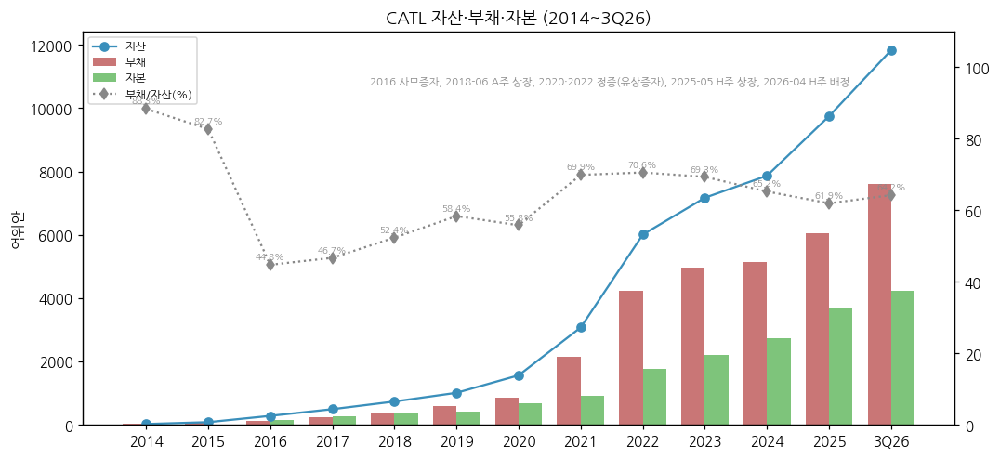

(3) 현금흐름표

| 연도 | 영업CF | 투자CF | 재무CF | CapEx | FCF | D&A |
|---|---|---|---|---|---|---|
| 2017 | 24 | -77 | 89 | 72 | -47 | 14 |
| 2018 | 113 | -195 | 70 | 66 | 47 | 22 |
| 2019 | 135 | 19 | 42 | 96 | 38 | 43 |
| 2020 | 184 | -151 | 374 | 133 | 51 | 47 |
| 2021 | 429 | -538 | 237 | 438 | -9 | 61 |
| 2022 | 612 | -641 | 823 | 482 | 130 | 124 |
| 2023 | 928 | -292 | 147 | 336 | 592 | 215 |
| 2024 | 970 | -489 | -145 | 312 | 658 | 231 |
| 2025 | 1,332 | -945 | -63 | 423 | 909 | 252 |
| 9M26 | 616 | -574 | 352 | 422 | 194 | (1H 148) |

→ (출처: 东方财富 F10 현금흐름표. CapEx = 购建固定资产、无形资产和其他长期资产支付的现金. FCF = 영업CF − CapEx [계산]. D&A = 고정자산 감가상각 + 무형자산 상각 + 사용권자산 상각 (간접법 보충자료))
→ **9M26 영업CF -23.6%**: 3Q26 단독 약 14억 (2Q 265억) — 회사는 선급금·공급사 결제기간 단축·공급사 증설 지원을 원인으로 들었고, JPM은 이 효과가 2~3개 분기 더 간다고 봤다 (Tiger 종합 2026-10)

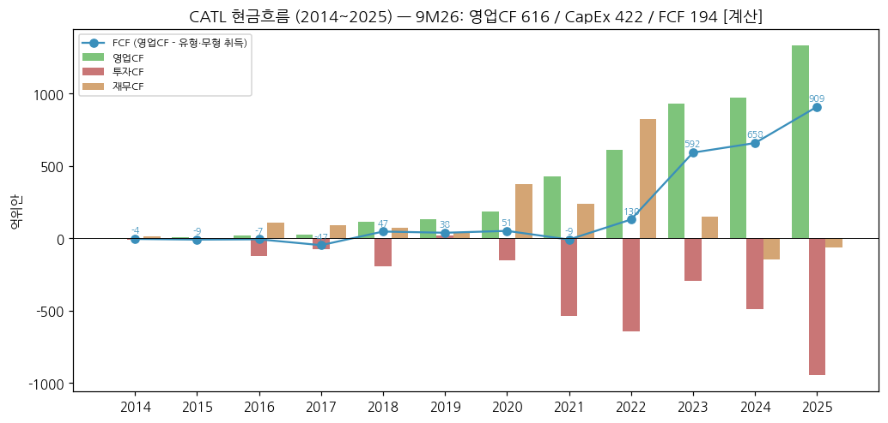

(4) CapEx

→ 2021~2022 1차 증설 피크 (438·482억, CAPA 170 → 390GWh) → 2023~2024 감속 (336·312억, 가동률 70%대) → 2025 423억 → **9M26 422억 (1Q 124 / 2Q 127 / 3Q 171억 [계산])** — 2026 연간은 2022 피크를 넘을 가능성 ⚠️추정
→ 3Q26 CapEx 171억 (+73% YoY, GS 집계 170.95억) — 건설 중 CAPA 764GWh (1H26말)

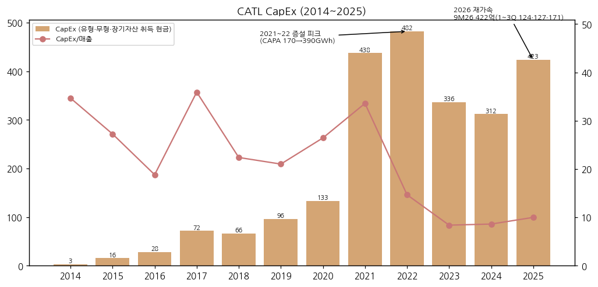

(5) 부채구조 + 채무증권
→ 3Q26말 이자부 차입 1,899억: 단기 399 / 장기 764 / 사채 527 / 유동성 장기 169 / 리스 41 [东方财富, 계산]
→ 현금+거래성금융자산 4,326억 → **순현금 2,427억** (2025말 2,728억에서 감소) — 이자수익(9M26 74억)이 이자비용(25억)의 약 3배
→ 2026 사채 발행 증가 (34 → 527억) — 상세 발행 조건은 [미확보] (v1.1 보완)

(6) 배당·자사주

| 회계연도 | DPS (위안/주, 세전) | 비고 |
|---|---|---|
| 2018 | 0.142 | 첫 배당 |
| 2019 | 0.220 | |
| 2020 | 0.240 | |
| 2021 | 0.653 | 2022-09 지급 |
| 2022 | 2.520 | + 10주당 8주 무상증자 |
| 2023 | **5.028** | 정기 2.011 + 특별 3.017 (총 220.6억) |
| 2024 | 4.553 + 특별 1.230 | 정기 배당성향 50%, 특별배당 2025-01 지급 |
| 2025 | **7.964** | 중간 1.007 (2025-08) + 기말 6.957 (2026-04) |
| 2026 | 중간 1.411 | 2026-08 지급 (H주 HK$1.629) |

→ (출처: 각 연도 연차보고서·2026 반기보고서 분배안, 东方财富 배당 데이터)
→ 2025 배당 총액 약 363억 ⚠️추정 [7.964 × 약 45.6억주] → 지배순이익 722억 대비 **배당성향 약 50%**
→ 자사주: 3Q26말 39.26백만주 보유 (0.85%), A주 누적 매입 10.95백만주 (3Q26 보고서)

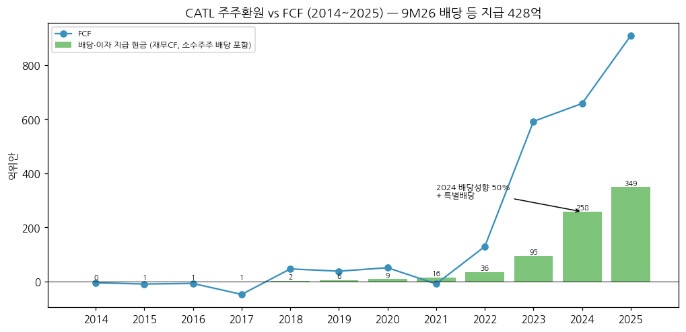

(7) 재무비율

| 연도 | ROE (가중) | 총자산이익률 | 부채/자산 | 유동비율 | 순현금 |
|---|---|---|---|---|---|
| 2018 | 11.75% | 6.05% | 52.4% | 1.73 | 221 |
| 2019 | 12.78% | 5.72% | 58.4% | 1.57 | 240 |
| 2020 | 11.27% | 4.73% | 55.8% | 2.05 | 436 |
| 2021 | 21.52% | 7.69% | 69.9% | 1.19 | 364 |
| 2022 | 24.67% | 7.36% | 70.6% | 1.31 | 925 |
| 2023 | 24.04% | 7.10% | 69.3% | 1.57 | 1,391 |
| 2024 | 24.13% | 7.18% | 65.2% | 1.61 | 1,814 |
| 2025 | 24.91% | 8.72% | 61.9% | 1.60 | 2,728 |
| 9M26 | 17.64% (비연환산) | 6.44% | 64.2% | 1.57 | 2,427 |

→ (출처: 东方财富 F10 주요지표 — 회사 공시 가중평균 ROE. 이자보상배율은 순이자수익 구조라 n/m)
→ ROE 2021~2025 **24% 안팎 5년 유지** — 한국 셀(LGES 2024~25 지배순이익 적자)과 가장 큰 차이

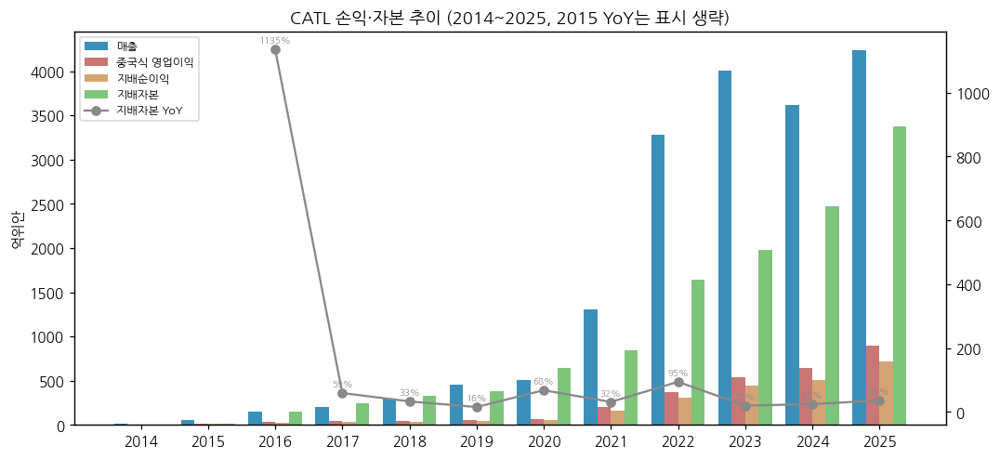

---

## ⑤ 지배 구조

(1) 그룹·계열 관계
→ **실질 지배주주: 쩡위췬** — 厦门瑞庭投资(샤먼루이팅) 지분 100%를 직·간접 보유 (2025 연차보고서). 리핑(부회장)과 일치행동 관계
→ 주요 관계·투자: CMOC(洛阳钼业) 약 25% 지분 보유(1Q26 IR 정리, huxiu) — 지분법이익의 큰 원천 / 邦普(Brunp) 리사이클 / 기원신(启源芯) 동력 24.87% (중대형 트럭 교환) / 峰飞航空(eVTOL)
→ 9M26 지분법 투자이익 84.4억 (+70.6%) — 순이익의 13% [계산]

(2) 주주 구분 (2026-09-30, 3Q26 보고서)

| 주주 | 지분율 | 주식수 | 성격 |
|---|---|---|---|
| 厦门瑞庭投资 | **22.04%** | 1,019,704,949 | 쩡위췬 100% 지배 |
| 香港中央结算 (후구퉁 북향자금) | **17.30%** | 800,682,980 | 외국인 A주 보유분 |
| 黄世霖 | 9.09% | 420,388,947 | 공동창업자 |
| 宁波联合创新新能源投资 | 4.89% | 226,220,608 | 경영진 지주 |
| HKSCC NOMINEES (H주) | 4.72% | 218,288,807 | H주 전체 (외국인) |
| 李平 | 4.27% | 197,460,277 | 부회장 (일부 질권 24.55백만주) |
| 易方达 창업판 ETF | 0.67% | 30,952,850 | 국내 기관 |
| 폭스콘(富泰华工业) | 0.62% | 28,707,235 | 전략 투자 |
| 자사주 계좌 | 0.85% | 39,264,206 | 상위 10위 집계 제외 |

→ **외국인 보유 합계 약 22.0%** [계산: 북향 17.30% + H주 4.72%] / 창업자·경영진 계열 합계 약 40% [계산: 瑞庭 22.04 + 黄 9.09 + 宁波 4.89 + 李 4.27]

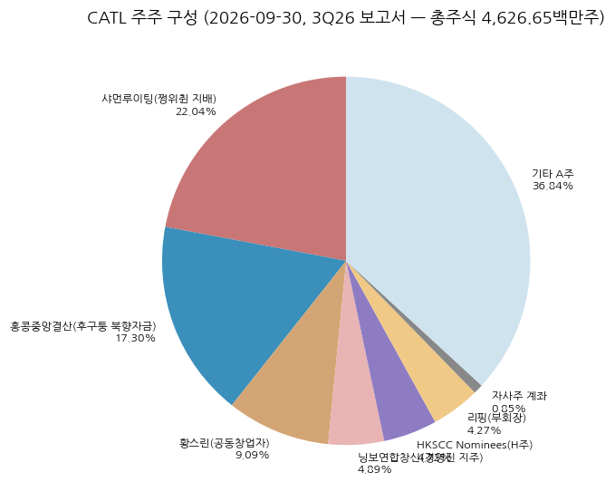

(3) 임원·이사회
→ 쩡위췬 — 董事长 겸 总经理 (2022-08~ 总经理 겸임). ATL 창업 멤버, 2011 CATL 설립. TDK 산하 ATL·东莞新能源 이사 경력 (2025 연차보고서)
→ 판젠(潘健) — 联席董事长 (2025-01~), 2014 이사 합류 / 리핑(李平) — 副董事长, 2014~2017 董事长
→ 고위 경영진 4명 (총경리·부총경리·이사회 비서·재무총감): 부총경리 겸 이사회 비서 장리(蒋理), CFO 정수(郑舒) (3Q26 IR 발언자, 보도)

---

## ⑥ 기타 팩트

(1) R&D 인프라
→ R&D 투입 2023 183.6억 (4.58%) → 2024 186.1억 (5.14%) → 2025 **221.5억 (5.23%)** → 9M26 185.2억 (+22.9%), 3Q26 71.4억 (+43.6%) (연차보고서·3Q26 보고서)
→ R&D 인력 22,901명 (박사 745, 석사 5,242) / 특허 보유·출원 60,319건 (1H26말) / 나트륨이온 10년간 약 100억위안 투자 (CTO, CarNewsChina 2026-06-25)

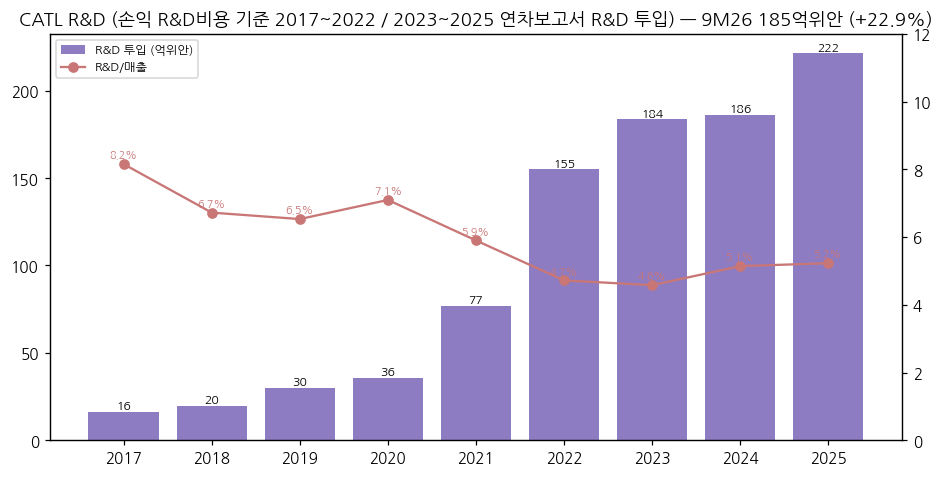

(2) 진행 중 corporate action (10년)
→ 2018 A주 IPO / 2020 정향 증자 / 2022 무상증자 / 2025-05 H주 IPO (155.9백만주) / 2026-04 H주 배정 62.4백만주 (HK$628.2, 약 HK$392억) / 2026 时代资源集团 설립(광물 플랫폼) / Octopus Energy와 유럽 중대형 트럭 교환 JV 합의 (1H26)
→ 해외 공장: 독일(2024 양산) → 헝가리(2026-09 시험생산) → 스페인 JV(2025-11 착공) → 인니(2026) / Ford 미시간 라이선스 공장 2026-06 양산 (CarScoops)

(3) R&D 마일스톤 (10년)
→ 2019 CTP / 2021 나트륨이온 1세대 / 2022 麒麟(CTP 3.0) / 2023 神行 4C LFP·응축(凝聚态) 배터리 / 2024 TENER 제로 열화 ESS / 2025 2세대 神行 12C·钠新 승용 / 1H26 3세대 神行·麒麟 15C, 麒麟 응축, 2세대 骁遥, 钠新 — **나트륨이온 양산 4Q26 예정, 2026년 1~2만 대 탑재 기대** (CarNewsChina 2026-06-25) / 天恒 钠电 ESS 9월 중국 초기 인도
→ 1H26 하이보스창(海博思创)과 3년 60GWh 나트륨 ESS 협력 (반기보고서)

(4) 주요 리스크
→ **정책 비용 (중국)**: 리튬전지 소비세 2% (2026-09-01) → 4% (2027-09) / 수출 증치세 환급 9% → 6% (2026-04-01) → **폐지 (2027-01-01)** — 고객과 비용 분담 협상 중 (CFO, CnEVPost 2026-10-21)
→ **미국 규제**: 2025-01 국방부 1260H 리스트 등재 (CATL 이의 제기) / OBBBA FEOC 규정 / **2026-08-26 행정명령 14420** — 대규모 ESS·인버터 등 전력망 장비 중 외국 우려 기업 관련 품목 금지·조건부 허가 가능, 시행규칙 120일 내 (Korea Herald 2026-09-15) / 2026-09-08 교통부 장관이 Ford에 CATL 관계 단절 서한
→ **유럽**: 헝가리·스페인 현지화로 관세 회피 — 스페인 공장 중국 인력 파견 논란 (보도)
→ **리튬 가격**: 탄산리튬 1만 위안/톤 상승 시 셀 원가 0.06~0.07위안/Wh 상승 (업계 추정, 10jqka) — 가격 연동 조항으로 전가하나 시차 존재
→ **고객 내재화**: 리오토·샤오펑 자체 셀/팩, 완성차 멀티소싱·단가 압박 (Tiger 2026-10)
→ **운전자본**: 재고 1,448억 (+53%), 3Q26 자산손상 17.1억 (리튬가 연동 재고 충당, 东方财富)

(5) ESG 등급
→ 2025 핵심 운영 탄소중립 달성(회사), 2026 《财富》중국 ESG 영향력 리스트 / 외부 등급(MSCI 등) [미확보]

(6) 인증·라이선스
→ 차량용 GB38031, UN38.3, ECE R100.3 / ESS UL9540A·UL1973·IEC62619 (2025 연차보고서 제품표)

---

## Version Log

| 버전 | 일자 | 내용 |
|---|---|---|
| v1.0 | 2026-11-14 | 첫 작성 — v4.8 표준 6섹션 + 차트 14종 (12종 표준 + chart2 3분할: 사업부 반기·판매량/CAPA·지역별). Source: 정기보고서 원문 13건(연차 2018~2025, 2025Q3·2026Q1·1H26·3Q26), 东方财富 F10 재무·主营构成 API(원문 대조), Yahoo(A·H·환율), SNE 점유율(CnEVPost), 3Q26 IR 보도. 이익 지표 3종(중국식·한국식 근사·지배순이익) 병기 |

**잔여 보완 후보 (v1.1)**
→ 3Q26 실적설명회 원문(회사 IR 게시 시) — 분기 출하량·ESS 비중·소비세 분담 비율 원문 확인
→ 2026 연차보고서(2027-03) 반영 — 2H26 사업부·판매량·CAPA, 4Q26 단독
→ 사채 발행 조건, ESG 외부 등급, 2014~2017 판매량(투자설명서)
→ Panasonic Energy·BYD 밸류에이션 동일 시점 비교 → 배터리 셀 글로벌 밸류에이션 다이얼 완성
