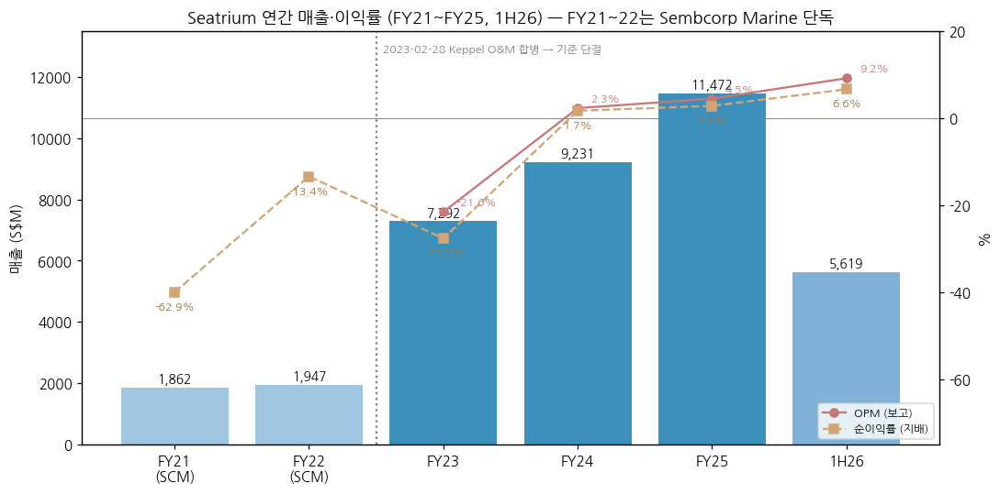
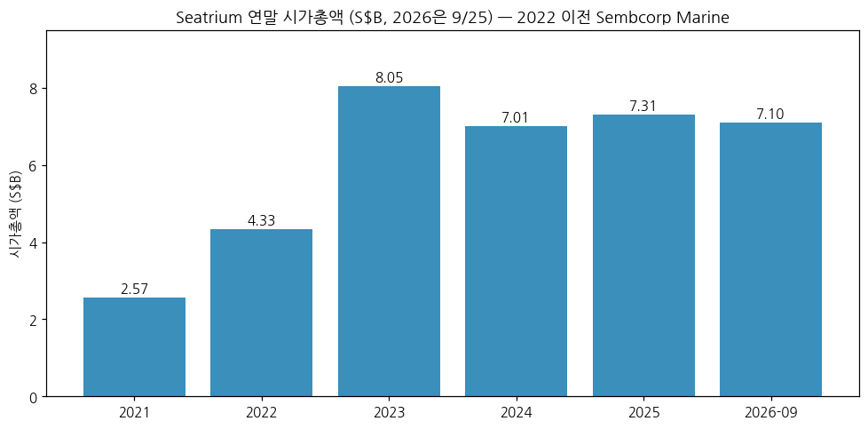
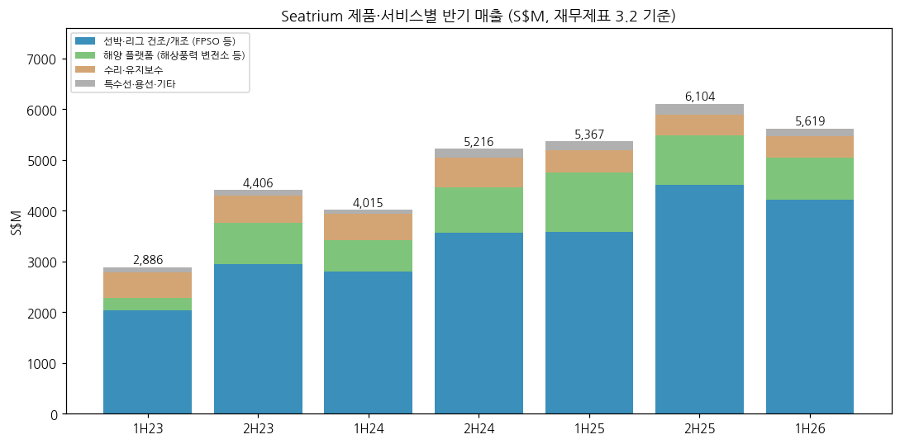
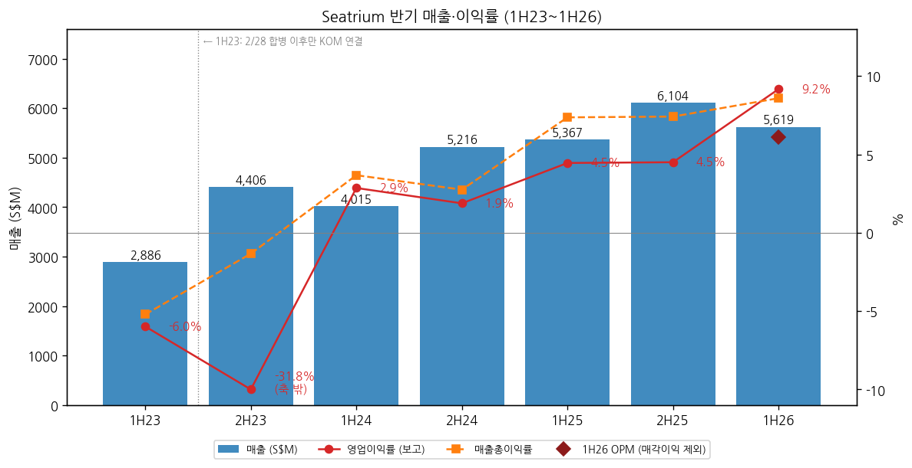
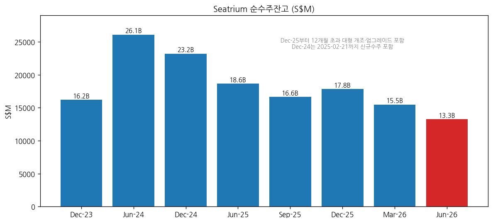
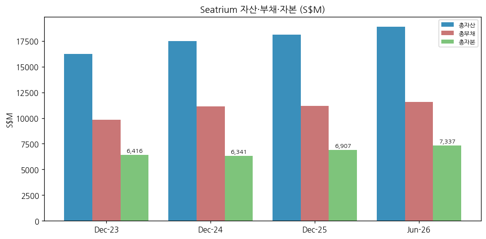

> Ticker: **SGX: 5E2** (파일 키 5E2.SI) / Seatrium Limited (옛 Sembcorp Marine)
> Sector: 조선 (섹터 T2 주도 후보) / 서브섹터: 조선 글로벌
> 작성 시각: 2026-11-14 KST (**v1.0**)
> 적용 구조: v4.8 (6개 섹션, 해외 반기 공시 종목 — 2023년 합병으로 시계열 기준 단절)
> 데이터: **2023-02-28 Keppel O&M 합병 이후 Seatrium 연결 (FY23~FY25 + 1H26)** + 합병 전 Sembcorp Marine FY21·FY22 (보도 인용)
> 출처: **SGX/investors.seatrium.com 회사 원문** — 1H26·FY25·FY24 Condensed Interim FS, 1H26·FY25·1H25·FY24·1H24 Results Presentation, 1H26 Briefing Transcript, 1Q26·3Q25 Business Update, 2H26 수주 공시 5건. **보도 인용** — Sembcorp Marine FY21·22 실적, 시가총액·밸류에이션(stockanalysis.com/S&P Global, 2026-09 기준), 대주주 지분(연차보고서 요약 보도)

# Seatrium 기업 개요 (v1.0 — 조선 글로벌, 싱가포르 해양플랜트·FPSO·해상풍력 변전소)
> **Fact verify cutoff**: 2026-11-14 (3Q26 Business Update는 2026-11-19 발표 예정 — 미반영)

## ① 기업 분류

### Phase 1 Source Audit

```
=== 자료 수집 audit (Seatrium) ===

✅ 확보 (회사 원문, 텍스트 판독):
- 반기 재무제표 3건 (1H26 / FY25 / FY24 — 각 하반기·전년 비교 열 포함 → 1H23~1H26 7개 반기 복원)
- 실적 IR 5건 (1H24·FY24·1H25·FY25·1H26), 1H26 브리핑 트랜스크립트
- 분기 Business Update 2건 (3Q25·1Q26) — 분기는 잔고·수주만 공시
- 2H26 수주 공시 5건 (10/5~10/30), 3Q26 발표일 공지 (11/19)

❌ 누락:
- 원문 PDF 바이너리 저장 실패 (company-data web_fetch 0바이트) → URL 인덱스만 company-overview-source\5E2.SI_Seatrium\ir\_index.json
- 합병 전 Sembcorp Marine FY2014~FY2020 손익 (FY21·22만 보도 인용)
- 주가 월간 시계열 (Yahoo v8 robots 차단) → 연말 시가총액 6개 시점만
- 연차보고서 (주주 명부·이사회·R&D·ESG 등급 원문)

⚠️ 결과 영향:
- 12년 시계열 불가 → 연간 FY23~FY25 3년 + 반기 7개
- 분기 손익 미공시 (반기 공시 종목) → chart10은 반기 시계열로 대체
- 사업부 이익 미공시 (보고 부문은 야드·용선·기타 3개) → 사업부는 매출만
```

(1) Primary / Secondary 분류

**Primary 분류: 턴어라운드 (합병 후 3년차, 레거시 손실 정리 → 마진 정상화 진행 중)**

→ FY23 영업손실 -S$1,573M(OPM -21.6%, 합병 후 자산 감액·손실충당금) → FY24 흑전(2.3%) → FY25 4.5% → 1H26 9.2%(매각이익 제외 6.1%)

→ 매출총이익률 -2.9%(FY23) → 3.1% → 7.4% → 8.6%(1H26). 회사 프로젝트 마진 허들은 "mid-teens"라 아직 정상화 중간 지점이다 [판단]

**Secondary 노트: 사이클 (해양 에너지 설비 발주 사이클 의존)**

→ 매출의 70% 이상이 FPSO·FPU·해양 플랫폼 등 대형 프로젝트(Series Build)라 수주 사이클이 2~4년 뒤 매출을 결정한다. 순수주잔고는 2024년 6월 S$26.1B(10년 최고) → 2026년 6월 S$13.3B로 반감했다

**Entity 구조**

→ **(1) Seatrium 연결 (FY23~)** — 2023-02-28 Sembcorp Marine이 Keppel Offshore & Marine을 합병(주식 교환), 같은 해 Seatrium으로 사명 변경. FY23은 KOM 10개월 연결

→ **(2) Legacy (~FY22)** — Sembcorp Marine 단독. FY22 매출 S$1.95B로 합병 후의 약 1/4 규모 → **YoY 비교 불가 (기준 단절)**

(2) Summary Box (연간 + 반기 시계열)

| 지표 | FY21 (SCM) | FY22 (SCM) | FY23 | FY24 | FY25 | 1H26 |
|---|---|---|---|---|---|---|
| 매출 (S$M) | 1,862 | 1,947 | 7,291 | 9,231 | **11,472** | 5,619 |
| 매출총이익 (S$M) | 미확보 | 미확보 | -209 | 291 | **848** | 482 |
| 영업이익 (S$M) | 미확보 | 미확보 | -1,573 | 212 | **514** | 515 |
| **OPM** | — | — | **-21.6%** | 2.3% | **4.5%** | 9.2% (매각 제외 6.1%) |
| 지배 순이익 (S$M) | -1,171 | -261 | -2,017 | 157 | **324** | 373 |
| EBITDA (S$M, 회사) | — | — | 236 | 627 | **837** | 651 (매각 제외 479) |
| 순수주잔고 (S$M, 기말) | — | — | 16,190 | 23,217 | **17,841** | 13,262 |

```
[Seatrium 연간 손익 (S$M)]
연도     매출      영업이익   OPM      순이익
FY21   1,862       —        —      -1,171   ← Sembcorp Marine 단독, 코로나 공기 지연 손실
FY22   1,947       —        —        -261   ← 합병 직전 (SCM 단독)
FY23   7,291    -1,573   -21.6%    -2,017   ← 2023-02-28 Keppel O&M 합병, 2H23 감액·충당금
FY24   9,231       212     2.3%       157   ← 첫 연간 흑자, 수주 S$15.2B(10년 최고 잔고)
FY25  11,472       514     4.5%       324   ← 매출총이익률 7.4%, Car Wash 합의 종결
1H26   5,619       515     9.2%       373   ← 매각이익 S$172M 포함 / 잔고 S$13.3B로 감소

OPM range (FY23~1H26): -21.6% ~ 9.2% = +30.8%p → 턴어라운드 (합병 기준 단절 후 단조 회복)
```

**📊 사이클 통계 (합병 후 3.5년, FY23~1H26)**

| 지표 | 값 |
|---|---|
| 매출 CAGR (FY23→FY25) | **+25.4%** [계산] |
| OPM 평균 (FY23~FY25) | **-4.9%** (FY23 제외 시 3.4%) [계산] |
| OPM 정점 | **9.2% (1H26, 매각이익 포함) / 6.1% (매각 제외)** |
| OPM 저점 | **-31.8% (2H23)** |
| 사이클 회수 | **0회** (합병 후 단조 회복, 수주 사이클은 2024년 정점) |

**한국 조선 3사 + 글로벌 비교 (OPM)**

→ **HD현대중공업** — 15.6% (3Q26 잠정)

→ **한화오션** — 14.2% (3Q26)

→ **삼성중공업** — 10.7% (3Q26 잠정)

→ **Seatrium** — **6.1% (1H26, 매각이익 제외) / 4.5% (FY25)** — 한국 3사의 절반 이하

→ (출처: 한국 3사는 2026-Q3 각 사 실적 리뷰, Seatrium은 회사 FS [계산])

(3) 정량적 분류 근거

→ **마진 정상화**: 매출총이익률이 FY23 -2.9% → 1H26 8.6%로 11.5%p 개선. G&A/매출 5.0% → 2.9%, 차입비용 5.7% → 3.5% (회사 IR)

→ **Series Build 잔고**: 순잔고의 약 95%가 반복 건조(페트로브라스 P-시리즈 FPSO 6척, 미국 걸프만 FPU 3기, TenneT 2GW HVDC 변환 플랫폼 4기). 합병 전 저마진 레거시(비 FPSO) 잔고는 S$140M 미만

→ **수주 공백**: 1H26 신규 수주 S$1억 남짓, 잔고 S$17.8B → S$13.3B (6개월 -26%). 잔고/연매출 1.16배 — 사이클 하강 신호

→ **현금·재무**: 1H26 FCF S$237M(일회성 제외), 순레버리지 0.5배, 순부채 S$0.68B, 유동성 S$3.4B

(4) 산업 분류

→ **SGX 업종**: Industrials — Marine & Offshore Engineering

→ **워치리스트 섹터** — 조선 (섹터 T2 주도 후보) / 서브섹터 **조선 글로벌**

→ 상선(컨테이너선·LNG선 신조)은 거의 하지 않는다. 해양 에너지 설비(FPSO·FPU·FLNG)·해상풍력 변전소·수리개조가 본업이라 한국 3사의 "해양·특수선" 부문과만 겹친다

(5) **한국 조선 3사와의 경쟁 지점** (필수)

| 영역 | Seatrium 포지션 | 한국 경쟁사 | 경쟁 양상 |
|---|---|---|---|
| **FPSO (부유식 원유 생산설비)** | 페트로브라스 P-78~P-85 6척 풀스코프 EPC, 2021~24년 페트로브라스 EPC 약 90% 수주(JPM 질문 인용). 브라질 야드 3곳 로컬 콘텐츠, 가이아나 통합 5기 | **삼성중공업·한화오션** (한화오션 P-79 인도, Venus FPSO 대기) | 페트로브라스가 EPC 직발주 → BOT(운영사 주도)로 전환. SBM·MODEC이 야드를 고르는 구조가 되면 Seatrium·한국·중국 야드가 하도급으로 경쟁 [판단] |
| **FLNG (부유식 LNG 생산설비)** | LNG선 → FLNG 개조 세계 유일 2기(Hilli·Gimi), 신조 설계 FLNG-X AiP. 계약 규모 통상 S$10억 | **삼성중공업** (FLNG 점유율 64%, 델핀 2호기) | 신조 FLNG는 삼성중공업 우위. Seatrium은 "개조형 = 빠르고 싼 대안"으로 경쟁하고 FLNG-X로 신조 진입 시도 |
| **FSRU·FSU 개조 / 파워십** | 세계 FSRU/FSU 개조의 90% 이상, Karpowership 9척, Excelerate 첫 EPCIC | (한국 3사는 신조 FSRU) | 신조 vs 개조. LNG 인프라 긴급 수요(에너지 안보)에서 개조가 공기 우위 |
| **해상풍력 변전소 (HVDC/HVAC OSS)** | TenneT 2GW HVDC 4기(Beta·Gamma·Nederwiek 2·BalWin5), 대만·미국 HVAC. TenneT 할당 사전적격 3곳 중 하나 | **HD현대중공업** (OSS 진입) | 유럽 HVDC 플랫폼은 Seatrium·중동/유럽 야드 과점, 한국은 후발 [판단] |
| **해상풍력 설치선 (WTIV·HLV)** | Maersk·Dominion WTIV, Penta-Ocean HLV | 한국 3사 일부 실적 | 미국 존스법 선박 등 소량. Seatrium은 레거시 손실로 신규 선별 |
| **고정식 플랫폼·가스 톱사이드** | 중동 고정식 플랫폼 파이프라인 S$2B | HD현대중공업 해양 | 중동 EPC 경쟁 |

→ 요약 [판단]: Seatrium은 한국 3사의 **해양 부문 전용 경쟁자**다. 상선 슈퍼사이클의 수혜는 없고, 해양 발주가 멈추면 전사 매출이 바로 줄어든다. 반대로 해양 발주가 재개되면(FPSO·FLNG) 한국 3사와 같은 입찰 테이블에 앉는다

(6) 분류 결정 논리

(1) **매출 비중** — Oil & Gas 71% + Offshore Wind 18%(FY25) → 해양 에너지 설비 전업

(2) **턴어라운드 vs 사이클** — 합병 후 OPM range +30.8%p, 단조 회복 → 턴어라운드 우선. 다만 잔고 반감으로 2027년 이후는 사이클 하강 노출 → Secondary 사이클

(3) **한국 피어 대비** — 한국 3사는 "상선 사이클 + 해양 옵션", Seatrium은 "해양 사이클 + 마진 정상화" — 같은 섹터지만 이익 동인이 다르다

(7) 적정 밸류에이션 방법

→ **1차 — P/B + ROE**: PBR 0.99배(2026-09, stockanalysis), FY2028 목표 ROE ≥8%. 턴어라운드 중이라 ROE 경로가 P/B를 정한다

→ **2차 — EV/EBITDA**: EV/EBITDA 9.2배(LTM, stockanalysis). FY2028 EBITDA 목표 ≥S$1.0B 대비 EV S$8.4B → 8.4배 [계산]

→ **3차 — 잔고 대비 시가총액**: 시총 S$7.1B / 순잔고 S$13.3B = 0.53배 [계산] — 수주 재개 국면의 선행 지표

→ **P/E 보조**: 매각이익·충당금 환입 등 비경상 이익 비중이 커서 단독 사용 부적합 (1H26 순이익의 43%가 매각이익)

(8) 분기 재평가 트리거 (**분류 변경 조건**)

→ ① **매출총이익률 10% 이상 2개 반기 연속 + 매각이익 제외 ROE 8% 도달** → 턴어라운드 종료 → **사이클 Primary 재분류**

→ ② **순잔고 S$10B 미만 + 2개 반기 연속 매출 역성장** → 사이클 하강 확정 → **사이클(하강) Primary 강등**

→ ③ **대형 FPSO·FLNG 수주로 순잔고 S$20B 회복 + OPM(매각 제외) 8% 이상** → 수주·마진 동반 → **사이클(상승) + 지속성장 Secondary 격상**

---

## ② 회사 개요

(1) 기본 사항

| 항목 | 내용 |
|---|---|
| Company Name | Seatrium Limited (옛 Sembcorp Marine Ltd) |
| Ticker | **SGX: 5E2** |
| 등록번호 | 196300098Z (1963년 등록) |
| Headquarters | 80 Tuas South Boulevard, Singapore |
| **CEO** | **Chris Ong** |
| CFO | Dr Stephen Lu |
| 이사회 의장 | 미확인 (보도 간 상이 — 연차보고서 원문 확인 필요) |
| Employees | 24,000명 이상 (회사 보도자료) |
| 사업 국가 | 15개국 야드·엔지니어링 거점 (보도자료), 재무제표상 20개국 영업 |
| 발행주식 | 약 33.8억주 (stockanalysis, 2026-09) |
| 시가총액 | S$7.1B (2026-09-25, 주가 S$2.09) |
| 배당 | FY25 DPS 3.0센트 (FY24 1.5센트) |
| 자사주 | S$100M 프로그램(2024-05) 완료 근접 → 2026-09-22 S$200M 신규 프로그램 |
| 회계 기준 | SFRS(I) (싱가포르 IFRS) |
| 보고 통화 | **SGD (S$)** |
| 공시 주기 | **반기 실적 (1H·FY) + 1Q·3Q Business Update(잔고·수주만)** |

(2) 손익 추이

→ 위 ① (2) 표 참조



→ (출처: 회사 FS, FY21·22 Sembcorp Marine 보도 인용)

(3) 주가·시가총액 역사



| 시점 | 시가총액 (S$B) | 비고 |
|---|---|---|
| 2021년 말 | 2.57 | Sembcorp Marine |
| 2022년 말 | 4.33 | 합병 발표 후 |
| 2023년 말 | 8.05 | 합병 완료, 출범 첫해 정점 |
| 2024년 말 | 7.01 | 2024-05 주식 병합 |
| 2025년 말 | 7.31 | |
| 2026-09-25 | 7.10 | 52주 -9.7%, 평균 TP S$2.51 (애널 10명) |

→ (출처: stockanalysis.com — S&P Global Market Intelligence, 보도 인용. 월간 주가 시계열은 미확보)
→ 합병 완료 후 시가총액은 S$7~8B 박스에 머물렀다. 이익은 FY24 S$157M → FY25 S$324M으로 2배가 됐지만 잔고 감소가 멀티플을 눌렀다 [판단]

(4) 주요 연혁

→ **1963**: 회사 설립 (등록번호 기준, Jurong Shipyard 계보 — 원문 미확인)

→ **2023-02-28**: **Sembcorp Marine–Keppel Offshore & Marine 합병 완료** → 2023년 Seatrium으로 사명 변경 (**시계열 기준 단절**)

→ **2023 하반기**: 합병 후 자산 감액·손실충당금으로 FY23 순손실 -S$2,017M

→ **2024**: 신규 수주 S$13.4B(1H) — 페트로브라스 P-84·P-85, Shell Sparta FPU, TenneT Nederwiek 2, bp Kaskida. 6월 말 순잔고 S$26.1B(10년 최고). Investor Day에서 FY2028 목표(매출 S$10~12B, EBITDA ≥S$1B, ROE ≥8%) 제시. 5월 주식 병합. 첫 연간 흑자

→ **2025**: Operation Car Wash(브라질 부패 사건) 브라질 당국 리니언시 합의(S$168M) + 싱가포르 DPA(US$57M 추가 지급), MAS·CAD "위반 없음" 종결. P-78 FPSO 출항·12/31 첫 원유. FY25 순이익 S$324M(+106%)

→ **2026-04**: S$3B MTN 프로그램, S$400M 2.95% 2031년 만기 무보증 사채 발행. AmFELS(미국)·Crescent·Karimun 야드 등 비핵심 자산 매각 완료

→ **2026-07-31**: 1H26 순이익 S$373M(+158%), 순잔고 S$13.3B

→ **2026-10**: Excelerate FSRU, Karpowership Whale급 파워십 5척, RigCo 리그 4기(>S$5억), SBM FPSO 통합(>S$2억) 수주

---

## ③ 비즈니스 모델

(1) 사업부 구성 (FY25 매출 비중, 회사 관리 기준)

| 사업부 | FY25 매출 (S$B) | 비중 | FY25 YoY | 주요 제품·고객 |
|---|---|---|---|---|
| **Oil & Gas** | 약 8.1 | **71%** | +24% | FPSO 신조(페트로브라스 P-시리즈), FPU(Shell·bp), FPSO 통합(MODEC·SBM·Exxon 가이아나), FLNG 개조·업그레이드(Golar), 가스 톱사이드 |
| **Offshore Wind** | 약 2.1 | **18%** | +60% | 2GW HVDC 변환 플랫폼(TenneT), HVAC 변전소(Ørsted·Equinor), WTIV·HLV |
| **Repairs & Upgrades** | 약 0.8 | **7%** | -25% | LNG선·크루즈·해군함 수리, FSRU/FSU 개조, 파워십 통합 |
| **Others** | 약 0.4 | **3%** | +55% | 특수선(준설선·연구선), 용선, 리그 키트·MRO |
| **합계** | **11.47** | 100% | +24% | |

→ (출처: FY25 IR 12쪽, S$B 소수 1자리. 사업부별 이익은 미공시 — 재무제표 보고 부문은 야드·용선·기타 3개)

(2) 반기 사업부별 매출 (재무제표 제품·서비스별, S$M)



| 제품·서비스 | 1H23 | 2H23 | 1H24 | 2H24 | 1H25 | 2H25 | 1H26 |
|---|---|---|---|---|---|---|---|
| 선박·리그 건조/개조 | 2,032 | 2,946 | 2,800 | 3,568 | 3,583 | 4,504 | **4,211** |
| 해양 플랫폼 | 245 | 819 | 616 | 892 | 1,168 | 976 | **830** |
| 수리·유지보수 | 503 | 531 | 517 | 587 | 433 | 408 | **428** |
| 특수선·용선·기타 | 104 | 110 | 81 | 169 | 183 | 217 | **150** |
| **합계** | **2,886** | **4,406** | **4,015** | **5,216** | **5,367** | **6,104** | **5,619** |

→ (출처: FY24·FY25·1H26 FS 주석 3.2. 1H23·1H24는 연간 − 하반기 [계산]. 1H23은 KOM 4개월 연결)

(3) 반기 시계열 (전사 매출 + 이익률)



| 항목 | 1H23 | 2H23 | 1H24 | 2H24 | 1H25 | 2H25 | 1H26 |
|---|---|---|---|---|---|---|---|
| 매출 (S$M) | 2,886 | 4,406 | 4,015 | 5,216 | 5,367 | 6,104 | 5,619 |
| 매출총이익률 | -5.2% | -1.3% | 3.7% | 2.7% | 7.4% | 7.4% | 8.6% |
| 영업이익 (S$M) | -173 | -1,400 | 115 | 98 | 239 | 275 | 515 |
| OPM | -6.0% | -31.8% | 2.9% | 1.9% | 4.5% | 4.5% | 9.2% |
| 지배 순이익 (S$M) | -264 | -1,752 | 36 | 121 | 144 | 179 | 373 |

→ (출처: 회사 FS, 1H23·1H24는 [계산]. 1H26 영업이익에 매각이익 S$172M 포함)

(4) 수주잔고



| 시점 | 순잔고 (S$M) | 프로젝트 수 | 비고 |
|---|---|---|---|
| Dec-23 | 16,190 | — | 합병 첫해 말 |
| Jun-24 | 26,083 | 32 | 1H24 수주 S$13.4B, 10년 최고 |
| Dec-24 | 23,217 | 27 | 2025-02-21까지 수주 포함 |
| Jun-25 | 18,637 | 25 | |
| Sep-25 | 16,638 | 24 | |
| Dec-25 | 17,841 | 24 | BalWin5 HVDC 수주, 대형 개조 포함으로 정의 변경 |
| Mar-26 | 15,488 | 24 | |
| **Jun-26** | **13,262** | **24** | O&G 62%·OW 37%, 인도 2033년까지 |

→ (출처: 각 IR·Business Update 부록)
→ Jun-26 잔고 인도연도별 순액: 2026년 122 / 2027년 1,806 / 2028년 1,992 / 2029년 2,438 / 2030년 이후 6,904 (S$M). 총계약액(gross) S$38.9B 중 미인식분이 S$13.3B다

(5) 사업부별 디테일

**(5-1) Oil & Gas — 71%, FPSO 풀스코프 EPC 역량**
→ 페트로브라스 P-78(2025-12 첫 원유)·P-80·P-82(2H26 출항)·P-83·P-84·P-85 — 6척 반복 건조
→ 미국 걸프만 FPU 3기: Shell Sparta(2026), bp Kaskida(2027), bp Tiber(2028)
→ FPSO 통합: 가이아나 Exxon 5기 완료(Errea Wittu 1H26), SBM Jaguar(2027), SBM 남미 FPSO(10/30 수주, 2029)
→ FLNG: Golar Hilli Episeyo 업그레이드(2027). 자체 설계 FlexHull(FPSO)·FLNG-X AiP
→ 파이프라인(2026-07): 남미 S$8B, 아프리카 S$7B(FLNG 등), 중동 S$2B(고정식), 북미 S$2B, 아시아 S$1B 등 O&G 약 S$21B

**(5-2) Offshore Wind — 18%, 유럽 HVDC 플랫폼**
→ TenneT 2GW HVDC 변환 플랫폼 4기(Beta 2029, Gamma·Nederwiek 2·BalWin5 2030+), DolWin5(2026)
→ HVAC 변전소: Ørsted Revolution Wind, Equinor Empire Wind 1 (2026 인도) — 미국 프로젝트 잔여 1% 미만
→ 설치선: Penta-Ocean HLV(2028). Maersk WTIV Sturgeon은 2025-10 해지 통보·중재(Maersk Viridis 2026-02 인도)
→ 파이프라인 S$9B, "2026년 둔화, 2027년 모멘텀 회복" (회사)

**(5-3) Repairs & Upgrades — 7%, FSRU 개조 세계 1위**
→ 연 185척(FY25) 처리, 우대 고객 계약(FCC)이 R&U 매출의 절반 가까이
→ FSRU/FSU 개조 세계 90% 이상, Karpowership 9척, Excelerate 첫 EPCIC(2026-10)
→ 크루즈 업그레이드(건당 S$50~100M), 해군(영국·미국·뉴질랜드·호주) — 마진은 EPC의 mid-teens 이상 (CFO)

**(5-4) Others — 3%**
→ 특수선(미국 존스법 준설선 Frederick Paup 2026-01 인도, 브라질 해군 연구선 NApAnt 2027), 리그 키트(세계 잭업 리그의 3분의 2 이상이 Seatrium 설계), Keppel RigCo 리그 완공(>S$5억)

(6) 주요 경쟁사

**FPSO·FPU**
→ 삼성중공업 · 한화오션 · 중국 야드(COSCO·CIMC Raffles·BOMESC 등) · 브라질 로컬 야드 / 운영사(SBM·MODEC·BW·Yinson)는 발주처이자 BOT 파트너

**FLNG·FSRU**
→ 삼성중공업(신조 FLNG) · 한화오션 · 중국 야드

**해상풍력 변전소**
→ HD현대중공업 · Aibel·Drydocks World·Dragados(유럽·중동 EPC) · 중국 야드

**수리·개조**
→ 중국·중동(Drydocks World)·유럽 수리 야드

(7) 주요 매출처

→ **Petrobras** (P-시리즈 6척 — 지역별 매출 1H26 브라질 S$3.44B, 61%) [계산]
→ **TenneT** (HVDC 4기 — 네덜란드 매출 1H26 S$0.59B)
→ Shell · bp (미국 FPU, 미국 매출 1H26 S$0.52B) · Ørsted · Equinor · SBM · MODEC · Exxon · Golar · Karpowership · Excelerate
→ (출처: 1H26 FS 주석 3.1 지역별 매출 — 고객 위치 기준. 고객별 매출은 미공시)

(8) 생산 거점 + 임직원

→ 싱가포르(Tuas Boulevard 주력 야드, Benoi 등), 브라질 3개 야드(Angra 등 — 로컬 콘텐츠), 중국, 인도네시아 Batam 등. 미국 AmFELS·싱가포르 Crescent·인도네시아 Karimun·필리핀 Batangas 야드 매각 완료(2024~2026). Admiralty 야드 반납 예정
→ 임직원 24,000명 이상
→ 비유형자산 S$8.8B 중 싱가포르 S$6.9B, 브라질 S$1.4B (1H26 FS)

---

## ④ 재무 구조

(1) 손익

→ 위 ① (2) 표 참조

(2) 재무상태표 (S$M)



| 항목 | Dec-23 | Dec-24 | Dec-25 | Jun-26 |
|---|---|---|---|---|
| 총자산 | 16,227 | 17,483 | 18,100 | 18,906 |
| 총부채 | 9,811 | 11,143 | 11,193 | 11,569 |
| 총자본 | 6,416 | 6,341 | 6,907 | 7,337 |
| 순부채 | 747 | 689 | 680 | 680 |
| 순레버리지 (순부채/EBITDA) | 3.2x | 1.1x | 0.8x | 0.5x |
| 총차입금 | — | 2,631 | 약 2,500 | 약 2,400 |

→ (출처: FY24·FY25·1H26 FS 재무상태표, 순부채·레버리지는 IR. Dec-23 총부채 = 총자산 − 총자본 [계산])

(3) 현금흐름 (S$M)

| 항목 | FY23 | FY24 | FY25 | 1H26 |
|---|---|---|---|---|
| 영업현금흐름 (보고) | 601 | 97 | 142 | 41 |
| 영업현금흐름 (일회성 제외, 회사) | — | — | 440 | 114 |
| CapEx | 116 | 100 | 122 | 52 |
| FCF (회사 정의, 보고) | 505 | 218 | 145 | 164 |
| FCF (일회성 제외, 회사) | — | — | 443 | 237 |

→ (출처: FY24·FY25·1H26 IR. 일회성 = Car Wash 합의금(FY25 브라질 S$172M, 1H26 싱가포르 S$73M), P-52 고객 지급 S$126M(FY25). 회사 FCF 정의는 영업CF + CapEx + 자산매각·배당 수취 포함)

(4) CapEx

→ FY23 S$116M → FY24 S$100M → FY25 S$122M → 1H26 S$52M — 매출 대비 1% 수준. 생산 능력 증설보다 야드 축소·매각 국면

(5) 부채 구조

→ 2026-04 S$3B MTN 프로그램, 첫 발행 S$400M 2.95% 2031년 만기 무보증 사채
→ 가중평균 차입비용 5.7%(2023) → 4.9%(2024) → 3.4%(2025) → 3.5%(1H26), 고정금리 비중 64%, 평균 만기 32개월
→ 2024 S$1.3B 신디케이트 은행 보증 한도 (프로젝트 이행보증용)

(6) 배당·자사주

| 항목 | FY24 | FY25 | 2026 |
|---|---|---|---|
| DPS (센트) | 1.5 | 3.0 | — |
| 배당 총액 (S$M) | 51 | 102 (예정) | — |
| 자사주 | S$100M 프로그램 개시(2024-05) | 연말 S$58M 집행 | 6월 말 S$90M 집행 → 9/22 S$200M 신규 |

→ (출처: FY25 FS·IR, 1H26 IR, 2026-09-22 공시)

(7) 재무비율

| 지표 | FY24 | FY25 | 1H26 (연환산) |
|---|---|---|---|
| ROE | 2.5% | 4.9% | 10.5% (매각 제외 6.1%) |
| 매출총이익률 | 3.1% | 7.4% | 8.6% |
| G&A/매출 | 3.5% | 3.0% | 2.9% |
| 순레버리지 | 1.1x | 0.8x | 0.5x |
| 순차입/자본 (net gearing) | 0.1x | 0.1x | 0.1x |
| P/B | — | — | 0.99x (2026-09, stockanalysis) |

→ (출처: 회사 IR, P/B 보도 인용)

---

## ⑤ 지배 구조

(1) 그룹 관계

→ Temasek Holdings 계열 (최대주주, 간주지분 약 36~37% — 연차보고서 요약 보도 인용, 2025-12-31 기준). 원문 미확인
→ Keppel Ltd는 합병 후 받은 잔여 지분을 매각했다 (보도 인용). 현재는 RigCo(Keppel 자회사) 리그 완공 계약 등 거래 관계
→ 자회사: Seatrium O&M(옛 Keppel O&M), 브라질 야드 법인, 기술 자회사 SMDTech·Aragon 등

(2) 주주 구성

→ Temasek 약 36~37% (보도 인용), 기관 12.65%·내부자 0.36% (stockanalysis, Temasek 제외 집계로 보임) — **주주 명부 원문 미확보**

(3) 임원·이사회

→ CEO Chris Ong, CFO Dr Stephen Lu, IR Head Amelia Lee
→ 이사(2026-06 지분 변동 공시 기준): Yap Chee Keong, Mark Gainsborough, Jan Holm, Ieda Gomes Yell, Sarjit Singh Gill, Astrid Skarheim Onsum, Mariel von Schumann 등
→ 이사회 의장: **미확인** (보도 간 상이)

---

## ⑥ 기타 팩트

(1) R&D·기술

→ 자체 설계: FlexHull FPSO(AiP), FLNG-X(AiP), OSS-500A 변전소, FWSS 부유식 풍력 하부구조, Ammonia FPSO, 액화CO2 운반선·암모니아 벙커선 AiP
→ 2025 세계 첫 풀스케일 선상 CCS 레트로핏(Solvang Clipper Eris)
→ R&D 비용 금액: 미확보

(2) 진행 중 corporate action

| 시점 | 액션 | 내용 |
|---|---|---|
| 2023-02-28 | Keppel O&M 합병 | Seatrium 출범 |
| 2024 | Batangas 야드·Golar Hilli 지분 매각 | 비핵심 자산 |
| 2024-05 | 주식 병합 + S$100M 자사주 | |
| 2025 | Car Wash 리니언시·DPA 종결 | 브라질 S$168M + 싱가포르 US$57M |
| 2025~2026-04 | AmFELS·Crescent·Karimun 야드, 예인선 17척, 부유식 독 매각 | 현금 >S$330M, 매각이익 >S$230M, 연 >S$50M 절감 |
| 2026-04 | S$3B MTN, S$400M 사채 | |
| 2026-07 | Aquarius Brasil 숙박선 매각 >S$80M | 2H26 종결, 용선 부문 소멸 |
| 2026-09-22 | S$200M 자사주 프로그램 | |
| 추가 | 장부가 >S$200M 자산 매각 예정, Admiralty 야드 반납 | FY28까지 누적 절감 >S$100M |

(3) 주요 리스크

→ **수주 공백**: 순잔고 S$13.3B(연매출 1.16배), 1H26 수주 S$1억 — 2027년 매출 역성장 위험
→ **페트로브라스 BOT 전환**: EPC 직수주 → 운영사 하도급 구조로 단가·물량 축소 가능
→ **해상풍력 FID 지연**: 유럽 HVDC·미국 정책 불확실성 (미국 HVAC 잔여 1% 미만)
→ **레거시·분쟁**: Maersk WTIV Sturgeon 해지·중재(2025-10~), 레거시 프로젝트 충당금
→ **비경상 이익 의존**: 1H26 순이익의 43%가 매각이익 [계산: 161/373]
→ **중동 긴장**: 연료비 상승, 중동 MRO 둔화 (회사)
→ **고객 집중**: 브라질 매출 61%(1H26)

(4) ESG

→ ESG 등급 "A"(2024, 2023 "BBB") — FY24 IR 기재, 평가기관 표기는 슬라이드 로고라 텍스트로 미확인
→ 2030 온실가스 30% 감축(2008 대비), 녹색·지속가능연계 차입 50% 달성
→ 1H26 순잔고의 45%가 친환경·청정 솔루션

(5) 인증

→ ISO 37001 반부패 경영시스템 (그룹 단일 인증, FY24 IR)
→ 선급 AiP: DNV·ABS·Class NK (각종 신설계)

---

## Activity 보고 (v1.0)

✅ **확보 자료** (회사 원문 17건, 텍스트 판독):
→ 반기 FS 3건, 실적 IR 5건, 브리핑 트랜스크립트 1건, 분기 Business Update 2건, 수주·공지 6건 — URL은 `company-overview-source\5E2.SI_Seatrium\ir\_index.json`

❌ **누락 자료**:
→ 원문 PDF 바이너리(다운로드 0바이트 — 같은 폴더의 0바이트 PDF 11개는 삭제 권한이 없어 남아 있음)
→ 합병 전 Sembcorp Marine FY2014~2020 손익, Keppel O&M 단독 손익
→ 주가 월간 시계열(Yahoo 차단), 연차보고서(주주 명부·이사회 의장·R&D 금액), 공개 컨센서스 원문

⚠️ **보도 인용 데이터**:
→ FY21·22 SCM 실적, 시가총액·P/B·EV/EBITDA·평균 TP(stockanalysis), Temasek 지분

**Data confidence: 80%** (손익·잔고·사업부 매출은 회사 원문 100%, 지배구조·주가는 보도 인용)

---

## Version Log

→ **v1.0 (2026-11-14)** — 신규 작성. 회사 원문(SGX/IR) 기준 FY23~FY25 연간 + 1H23~1H26 반기 7개 시계열 복원(연간 − 하반기 역산). 2023-02-28 Keppel O&M 합병 기준 단절 표시. 차트 6종(chart1 연간 매출·이익률, chart2 제품·서비스별 반기 매출, chart4 재무상태표, chart10 반기 매출·이익률, chart11 연말 시가총액, chart13 순수주잔고). ① 기업 분류에 한국 조선 3사 경쟁 지점 표(FPSO·FLNG·FSRU·OSS·설치선·고정식) 포함. 분류: Primary 턴어라운드 + Secondary 사이클

→ **v1.1 후보**: 3Q26 Business Update(11/19) 잔고 반영, 연차보고서 2025로 주주·이사회 의장·R&D 확정, 월간 주가 시계열(chart11 20년) 보강, FY26 실적(2027-02) 반영
