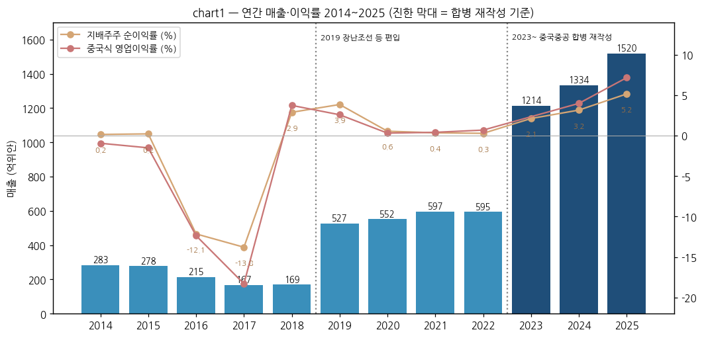
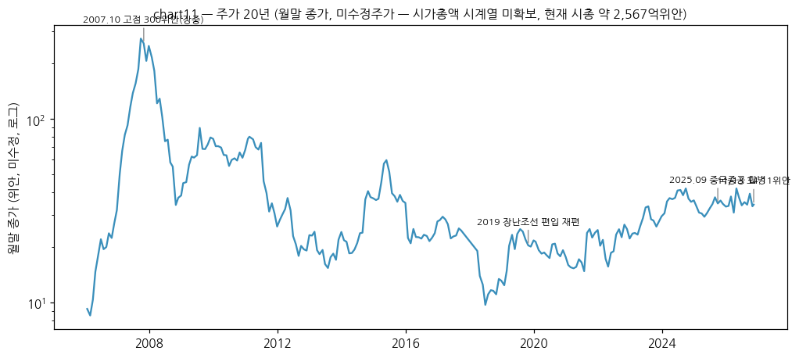
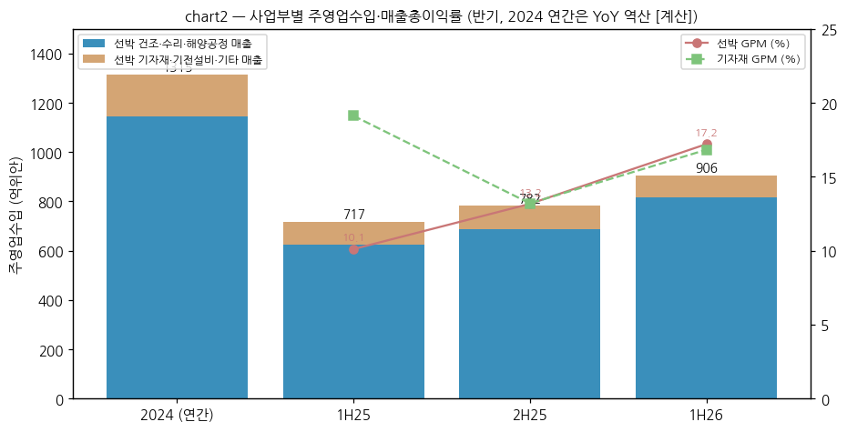
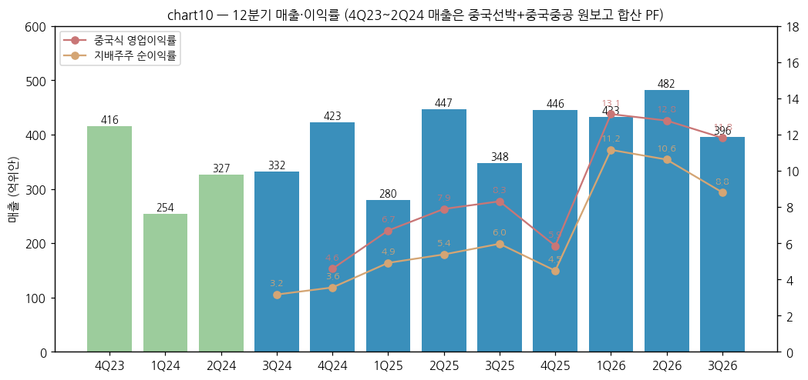
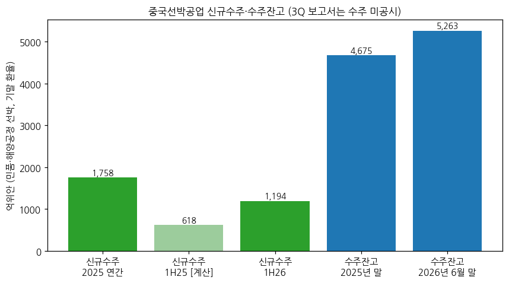
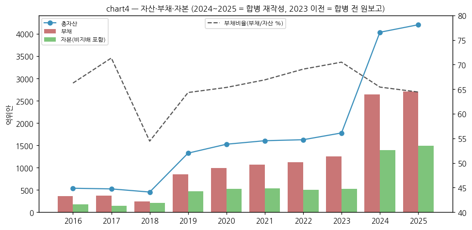
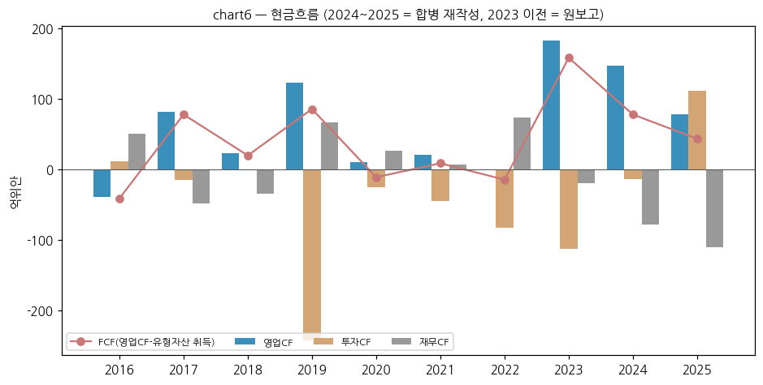

> Ticker: **600150.SH (상해거래소 A주, 파일 키 600150.SS)** / 中国船舶工业股份有限公司 China CSSC Holdings Limited (약칭 中国船舶)
> Sector: 조선 (섹터 T2 주도 후보) — 서브섹터: 조선 글로벌
> 작성 시각: 2026-11-14 19:13 KST (**v1.0**)
> 적용 구조: v4.8 (6개 섹션) — 해외 종목이라 12종 차트 중 데이터로 만들 수 있는 7종만 작성
> 데이터: 연간 12년(2014~2025, 2023~2025는 중국중공 합병 재작성 기준) + 분기 12개(4Q23~3Q26, 4Q23~2Q24 매출은 PF) + 반기 사업부 + 수주잔고 + 월간 주가 20년
> 출처: **회사 원문(상해거래소 공고 PDF)** — 2025 연간 보고서, 2026 반기·1분기·3분기 보고서, 2025 반기·3분기 보고서 / **东方财富 F10 재무 API**(연간·분기 손익·재무상태·현금흐름, 회사 공시 집계 — 원문과 대조) / **东方财富 월간 주가**(미수정) / 보도 인용: 중금공사·서부증권 3Q26 리뷰(格隆汇 전재), 每日经济新闻, Holland & Knight(USTR)

# 중국선박공업 (中国船舶, 600150) 기업 개요 (v1.0 — 조선 글로벌, 중국 최대 상선·군함 조선 상장사)
> **Fact verify cutoff**: 2026-11-14 (주가 11/13 종가 34.11위안, 시총 약 2,567억위안 [계산])

> **기준 단절 2회**: ① 2019년 자산 재편(장난조선 등 편입) — 2018년 매출 169억 → 2019년 527억위안 ② 2025-09-11 중국중공(中国重工, 601989) 흡수합병(동일지배) — 2023~2025년 재작성. 이 문서의 2022년 이전 숫자는 합병 전 원보고, 2023~2025년은 재작성치다

## ① 기업 분류

(1) Primary / Secondary 분류

**Primary 분류: 사이클 (조선 슈퍼사이클 업턴 구간) — 12년 순이익률 -13.8% ~ +5.2%, 적자 2회(2016~2017)**

→ 매출은 인도 시점 일괄 인식(完工交船法)이라 분기 변동이 크다. 이익률은 2~3년 전 수주 선가에 따라 움직인다 (회사 증권부, 每日经济新闻 2026-07-13) [보도 인용]

→ 2026년 9M 순이익률 10.3%, 매출총이익률 17.5%로 12년 최고 [계산]

**Secondary 노트: 국가 방산(해군 함정) 일부**

→ 장난조선(江南造船)·대련조선(大连造船)·무창조선(武昌造船)이 군용 함정을 건조한다. 2025년 장난조선이 중국 첫 전자기 사출 항모 "푸젠함"을 인도했다 (2025 연간 보고서). 군품 매출은 분리 공시하지 않는다

(2) Summary Box (12년, 억위안)

| 지표 | 12년 평균 (2014~2025) | 정점 | 저점 | 2025년 |
|---|---|---|---|---|
| 매출 | 620.8 [계산] | 1,519.8 (2025) | 166.9 (2017) | **1,519.8** |
| 지배주주 순이익 | 10.9 [계산] | 78.5 (2025) | -26.0 (2016) | **78.5** |
| 지배주주 순이익률 | — | 5.2% (2025) | -13.8% (2017) | **5.2%** |
| 매출총이익률 | 11.5% [계산] | 17.8% (2016)* | 7.7% (2022) | **12.6%** |

→ *2016~2017 매출총이익률이 높은 것은 매출 급감기 회계 처리 영향이고 같은 해 순이익은 적자다. 2023 매출총이익률은 합병 전 원보고(9.8%)

```
[중국선박공업 12년 손익 (억위안)]
연도   매출      중국식영업이익  지배주주순이익  순이익률
2014   283.2      -2.7          0.4          0.2%   ← 후동중기 시절 (외고교·청시 편입 후)
2015   277.6      -4.2          0.6          0.2%
2016   214.6     -26.5        -26.0        -12.1%   ← 조선 불황 바닥, 적자
2017   166.9     -30.5        -23.0        -13.8%   ← 2년 연속 적자
2018   169.1       6.3          4.9          2.9%
2019   526.6      13.6         20.3          3.9%   ← 장난조선 등 편입 (기준 단절 ①)
2020   552.4       1.8          3.1          0.6%   ← 저선가 수주분 인도
2021   597.4       2.5          2.1          0.4%   ← 강재가 급등
2022   594.9       4.1          1.7          0.3%
2023  1,213.9     미확보        25.8          2.1%   ← 중국중공 합병 재작성 (기준 단절 ②, 원보고 748.4 / 29.6)
2024  1,333.5      53.3         42.2          3.2%   ← 재작성 (원보고 785.8 / 36.1)
2025  1,519.8     109.0         78.5          5.2%   ← 합병 완료(9월), 업턴 본격화
9M26  1,311.2     165.3        134.4         10.3%   ← 매출총이익률 17.5%
```

(3) 정량적 분류 근거

→ 순이익률 레인지 -13.8% ~ +5.2%(19%p) — 사이클 cutoff(±10%p) 초과

→ 사이클 회수: 2014~2017 하강 → 2018~2022 바닥권(순이익률 0~4%) → 2023~ 업턴. 이익은 수주(선가) 후 2~3년 지연된다

→ 수주잔고 5,262.7억위안(2026-06 말) = 2025년 선박 매출의 4.0배 [계산] — 2027~2028년 매출 가시성

(4) 산업 분류

→ 중국증감회 업종: CG37 철도·선박·항공우주·기타 운송장비 제조업

→ 워치리스트 섹터: 조선 (섹터 T2 주도 후보) / 서브섹터: 조선 글로벌

(5) 분류 결정 논리

→ 매출의 87.6%(2025)가 선박 건조·수리·해양공정 — 상선 사이클이 그룹 가치를 정한다

→ 군함은 안정 수요지만 분리 공시가 없어 사이클 분류를 바꾸지 않는다

(6) 적정 밸류에이션 방법

→ 1차 — PBR(사이클): 현재 약 1.67배 [계산] (시총 2,567억 / 지배주주 자본 1,537.4억위안, 2026-09 말)

→ 2차 — Forward PER: 중금 2026/2027E 12.8배/9.4배, 목표주가 50위안(18.1배 2026E) [보도 인용]. 서부증권 2026E 순이익 192.8억 기준 약 13.3배 [계산]

→ 셀사이드가 한국 조선사에 "중국 조선사 수준 P/E(8배)"를 적용하기 시작했다는 점이 한국 피어 밸류에이션의 하단 기준이 된다 (조선 섹터 리뷰, JPM 인용)

(7) 분기 재평가 트리거 (분류 변경 조건)

→ ① 순이익률 10%+ 4개 분기 연속 + 수주잔고 증가 지속 → 사이클 "업턴 고원" 명시

→ ② 분기 매출총이익률 15% 미만 2개 분기 연속 → 업턴 정점 통과 검토

→ ③ 신규수주가 매출을 2개 반기 연속 하회(Book-to-bill < 1) → 하강 사이클 진입 검토

## ② 회사 개요

① 기본 사항

→ 회사명: 中国船舶工业股份有限公司 (China CSSC Holdings Limited), 상해거래소 600150 (구 약칭 沪东重机)

→ 지배주주: 중국선박집단(中国船舶集团, 국무원 국자위 100%) — 산하 중국선박공업집단 26.68% + 중국선박중공집단 14.01% + 대련선박투자 3.48% + 중선해양방무 2.89% + 무한무선투자 0.87% = 공동행동인 47.93% (2026-09 말)

→ 사업 한 줄: 장난·대련·무창·광저우·외고교·청시·베이하이 7개 핵심 조선소 + 기자재 15개사를 거느린 지주회사. 군함·LNG선·컨테이너선·VLCC·벌크선·크루즈까지 전 선종 건조

→ 규모(2025): 매출 1,519.8억위안, 총자산 4,204.9억위안, 임직원 41,839명, 연구개발 인력 9,396명

→ **한국 조선 3사와의 경쟁 지점 (어디서 맞붙나)**

| 선종 | 중국선박공업 주력 조선소 | 한국 경쟁사 | 경쟁 구도 [판단] |
|---|---|---|---|
| 대형 LNG운반선 | 장난조선(절차적 인도), 대련조선 | 한화오션·삼성중공업·HD현대중공업 | 한국 우위였으나 중국이 2025~2026년 점유율을 높이는 중(조선 섹터 리뷰: 중국 LNG선 점유율 39%) — 한국 LNG 프리미엄 희석의 핵심 |
| 초대형 컨테이너선 (LNG 이중연료) | 장난조선(1.8만TEU, 2025-02 180~190억위안 계약), 외고교·대련 | HD현대중공업·한화오션·삼성중공업 | 2026년 1H 중국 컨테이너선 점유율 87.0%(클락슨) — 가격·슬롯에서 중국 우위 |
| VLCC·수에즈막스·MR 탱커 | 대련·외고교·광저우·베이하이 | HD현대중공업(현대미포 흡수 후 MR), 삼성중공업(셔틀탱커) | 1H26 중국 유조선 수주 점유율 82.3% — 한국은 선별 수주 |
| 가스선 (LPG·에탄·암모니아) | 장난조선, 대련조선 | HD현대중공업(구 미포)·한화오션 | 중대형 가스선에서 직접 경쟁 |
| 해양공정 (FPSO·FSRU) | 대련·외고교·장난 | 삼성중공업·한화오션 | 상부설비 통합은 한국 우위, 선체·FSRU는 중국 추격 |
| 군함 | 장난·대련·무창 | 한화오션·HD현대중공업 (미 해군 MRO·건조 협력 MASGA) | 직접 경쟁 없음. 미국이 중국 배제 → 한국에 기회(미 해군 시장) |

→ 정책 변수: 미국 USTR 301조 중국 건조·운항 선박 입항료(2025-11부터 유예, 2027-01-09까지 연장)가 부과되면 미국 기항 선사의 발주가 한국으로 이동할 수 있다 [보도 인용, 판단]

② 12년 손익·자본 추이 (억위안)

| 연도 | 매출 | 매출총이익률 | 중국식 영업이익 | 지배주주 순이익 | 순이익률 | 지배주주 자본 | 기준 |
|---|---|---|---|---|---|---|---|
| 2014 | 283.2 | 9.8 | -2.7 | 0.4 | 0.2 | 미확보 | 원보고 |
| 2015 | 277.6 | 8.5 | -4.2 | 0.6 | 0.2 | 미확보 | 원보고 |
| 2016 | 214.6 | 17.8 | -26.5 | -26.0 | -12.1 | 155.8 | 원보고 |
| 2017 | 166.9 | 17.7 | -30.5 | -23.0 | -13.8 | 125.8 | 원보고 |
| 2018 | 169.1 | 13.3 | 6.3 | 4.9 | 2.9 | 151.0 | 원보고 |
| 2019 | 526.6 | 9.0 | 13.6 | 20.3 | 3.9 | 310.6 | 원보고 (재편 후) |
| 2020 | 552.4 | 10.7 | 1.8 | 3.1 | 0.6 | 457.8 | 원보고 |
| 2021 | 597.4 | 10.6 | 2.5 | 2.1 | 0.4 | 460.4 | 원보고 |
| 2022 | 594.9 | 7.7 | 4.1 | 1.7 | 0.3 | 458.5 | 원보고 |
| 2023 | 1,213.9 | 미확보 | 미확보 | 25.8 | 2.1 | 896.1 | 재작성 |
| 2024 | 1,333.5 | 10.5 | 53.3 | 42.2 | 3.2 | 921.0 | 재작성 |
| 2025 | 1,519.8 | 12.6 | 109.0 | 78.5 | 5.2 | 1,434.2 | 합병 후 |

→ (출처: 2014~2022 东方财富 F10 연간 손익·재무상태(회사 연간 보고서 원보고 집계), 2023~2025 2025 연간 보고서 "近三年主要会计数据" 재작성치. 2023 재작성 원가·营业利润은 공시 표에 없어 미확보. 2025 지배주주 자본이 2024 대비 크게 느는 것은 합병 신주 발행으로 기존 중국중공 소수주주 지분이 지배주주 지분으로 바뀌었기 때문이다)



③ 회사 주가 역사

→ 2007년 10월 장중 300위안(미수정) — 2003~2008 조선 슈퍼사이클 정점. 2008년 말 30위안대로 -90%

→ 2015년 6월 68.6위안(중국 증시 버블), 2016~2020년 17~25위안 바닥권

→ 2023~2024년 업턴과 합병 기대로 30~46위안. 2025-09 합병 완료, 2026-09 고점 41.2위안 → 11/13 34.11위안 (3Q26 발표 전후 10월 -14.6%)

→ 시총: 약 2,567억위안 (34.11위안 × 75.26억주 [계산]). 과거 시총 시계열은 주식수 이력을 확보하지 못해 미작성



④ 주요 연혁

| 시점 | 사건 |
|---|---|
| 1998 | 후동중기(沪东重机) 상해거래소 상장 (600150) |
| 2007 | 외고교조선·중선청시 편입, 中国船舶으로 사명 변경 |
| 2019 | 자산 재편 — 장난조선 등 편입 (매출 169억 → 527억위안) |
| 2025-02 | 장난조선 1.8만TEU LNG 이중연료 컨테이너선 계약(180~190억위안) |
| 2025-09-11 | 중국중공 흡수합병 완료 (신주 30.53억주, 총 75.26억주), 중국중공 상장폐지 |
| 2025 | 장난조선 "푸젠함"(전자기 사출 항모) 인도, 2025 수주 1,758.4억위안 |
| 2026-08 | 2026 반기 순이익 99.5억위안(+163.5%), 중간배당 주당 0.465위안 |

→ (출처: 2025 연간 보고서·2026 반기·3분기 보고서. 1998·2007 연혁은 회사 약칭 변경 이력(沪东重机)과 보고서 회사 소개 기준 [보도·공개 정보], 세부 일자 미대조)

## ③ 비즈니스 모델

① 실적 추이 통합 (주영업수입, 억위안)

| 사업부 | 2024 (재작성) | 2025 | 1H25 | 1H26 | 1H26 YoY | 1H26 매출총이익률 |
|---|---|---|---|---|---|---|
| 선박 건조·수리·해양공정 | 1,144.4 [계산] | 1,312.8 | 625.2 [계산] | 815.3 | +30.4 | 17.2 (+7.1%p) |
| 선박 기자재·기전설비·기타 | 170.7 [계산] | 186.2 | 92.2 [계산] | 90.5 | -1.8 | 16.8 (-2.3%p) |
| 합계 | 1,315.1 | 1,499.0 | 717.4 | 905.8 | +26.3 | 17.2 (+5.9%p) |
| 지역: 국내 | — | 810.0 (GPM 6.4%) | — | 미공시 | — | — |
| 지역: 해외 | — | 688.9 (GPM 19.2%) | — | 미공시 | — | — |

→ (출처: 2025 연간 보고서·2026 반기 보고서 主营业务分产品/分地区. 역산치 [계산])



① 12분기 시계열 (억위안)

| 분기 | 4Q23 | 1Q24 | 2Q24 | 3Q24 | 4Q24 | 1Q25 | 2Q25 | 3Q25 | 4Q25 | 1Q26 | 2Q26 | 3Q26 |
|---|---|---|---|---|---|---|---|---|---|---|---|---|
| 매출 | 415.7 PF | 254.4 PF | 326.8 PF | 331.9 | 423.0 | 279.6 | 446.8 | 347.6 | 445.8 | 433.1 | 482.2 | 395.9 |
| 중국식 영업이익 | — | — | — | — | 19.4 | 18.7 | 35.3 | 28.9 | 26.1 | 56.9 | 61.6 | 46.8 |
| 지배주주 순이익 | — | — | — | 10.5 | 15.0 | 13.7 | 24.0 | 20.7 | 20.0 | 48.3 | 51.2 | 34.9 |
| 순이익률 (%) | — | — | — | 3.2 | 3.6 | 4.9 | 5.4 | 6.0 | 4.5 | 11.2 | 10.6 | 8.8 |
| 매출총이익률 (%) | — | — | — | — | 10.2 | 12.9 | 10.8 | 14.6 | 12.6 | 17.5 | 17.3 | 17.7 |
| 매출 YoY (%) | — | +60.3 | +3.7 | +1.9 | +1.8 | +9.9 | +36.7 | +4.8 | +5.4 | +54.9 | +7.9 | +13.9 |

→ (출처: 실적 리뷰 `2026-Q3_600150.SS_리뷰.md` 1-① 표와 동일. PF = 중국선박 + 중국중공 원보고 합산 [계산])



→ 분기 15년 시계열(60분기)은 합병 재작성 이전 기간이 기준 단절이라 만들지 않았다. 합병 전 중국선박 단독 분기 손익은 东方财富 F10에 2006년부터 있다(다음 버전 후보)

(1) 수주·잔고

| 항목 | 2025 연간 | 1H26 | 2025년 말 잔고 | 2026-06 말 잔고 |
|---|---|---|---|---|
| 민품·해양공정 선박 | 237척 / 3,050.7만DWT / 1,758.4억 | 177척 / 2,245만DWT / 1,193.9억 (+93.1%) | 652척 / 7,997.3만DWT / 4,674.5억 | 729척 / 9,389만DWT / 5,262.7억 |
| 수리 | 820척 / 55.2억 | 367척 / 26.0억 | 189척 / 8.4억 | 157척 / 10.2억 |
| 기자재·기전·기타 | 167.7억 | 119.9억 | 129.6억 | 151.6억 |
| 인도 (민품) | 161척 / 1,367.8만DWT | 102척 / 956만DWT | — | 9M26 145척 |

→ (출처: 2025 연간 보고서, 2026 반기 보고서, 2026 3분기 보고서. 금액은 기말 환율 위안 환산. 잔고 구성(척수): 유조선 약 30%, 컨테이너 약 20%, 벌크 약 15%, 가스선 약 10%, 특수선 등 약 25%)



② 사업부별 개요 (매출 비중 순)

→ **선박 건조·수리·해양공정 (87.6%, 2025)**: 7개 조선소. 장난(군함·LNG선·대형 컨테이너선·가스선), 대련(군함·VLCC·VLOC·LNG선), 무창(군함·탱커·특수선), 광저우(VLCC·MR·컨테이너·LNG·PCTC·로팍스), 외고교(국산 대형 크루즈·VLCC·케이프사이즈), 청시(MR·벌크·수리), 베이하이(벌크·VLOC·수리)

→ **선박 기자재·기전설비·기타 (12.4%)**: 무한중공(크랭크축), 중남장비, 충칭홍강(고압 커먼레일·암모니아 분사밸브), 대련선추(프로펠러), 칭다오쌍서(FGSS·스크러버·평형수) 등 — 중선디젤(中船柴油机, 지분법)도 관계사

③ 사업부별 디테일 (2025, 주요 자회사 — 억위안)

| 자회사 | 매출 | 중국식 영업이익 | 순이익 | 순이익률 |
|---|---|---|---|---|
| 장난조선 | 421.5 | 11.1 | 9.5 | 2.3 |
| 대련조선 | 321.5 | 11.9 | 13.2 | 4.1 |
| 광저우국제(广船国际) | 201.9 | 20.7 | 20.0 | 9.9 |
| 외고교조선 | 164.7 | 25.1 | 25.0 | 15.2 |
| 베이하이조선 | 116.5 | 16.8 | 16.7 | 14.3 |
| 중선청시 | 87.2 | 10.4 | 8.7 | 9.9 |
| 중선디젤 (지분법 관계사) | 301.6 | 42.8 | 37.7 | 12.5 |

→ (출처: 2025 연간 보고서 "主要控股参股公司分析". 무창조선은 표 대상(순이익 영향 10% 이상)에 없음)
→ 군함 비중이 큰 장난·대련은 순이익률 2~4%, 상선 위주 외고교·베이하이는 14~15% — 상선 업턴의 이익은 상선 조선소에 먼저 들어온다 [판단]

④ 주요 경쟁사

→ 한국: HD현대중공업(HD현대미포 흡수), 한화오션, 삼성중공업 (경쟁 지점은 ②-① 표)
→ 중국: 양쯔장조선(BS6.SI, 민영 — 컨테이너·벌크), 중국선박집단 내 중선방무(600685, 광저우 황푸원충), 헝리중공, 신시대조선 등 민영사
→ 일본: 이마바리조선, JMU

⑤ 주요 매출처

→ 상위 5개 고객 매출 538.0억위안(35.4%, 2025), 그중 관계사(중국선박집단 계열) 107.2억위안(7.1%). 고객명 미공시
→ 공개 계약: 중원해운(COSCO) 그룹 500억위안 신조 프로젝트(2025, 중국 조선사 국내 단일 최대), 1.8만TEU 컨테이너선(2025-02, 선주 비공개)
→ 상위 5개 공급사 매입 629.4억위안(47.4%), 그중 관계사 564.5억위안(42.5%) — 강재·엔진을 그룹 내에서 조달

⑥ 생산 CAPA + 임직원

→ 2026 인도 계획 168척 / 1,650만DWT (2025 실적 161척 / 1,367.8만DWT)
→ 임직원 41,839명(2025 말), 연구개발 인력 9,396명(22.5%). 합병 전 연도 임직원 시계열 미확보

## ④ 재무 구조

① 손익계산서 — ② 표 참고. 2025 비용 구조: 매출원가 87.4%, 관리비 4.2%, 연구개발비 3.9%, 판매비 0.2%, 재무비용 -1.5%(이자수익 순) [계산]

② 재무상태표 (억위안)

| 연도 | 총자산 | 부채 | 자본(비지배 포함) | 지배주주 자본 | 부채/자산 | 현금성 자산 | 계약부채 | 기준 |
|---|---|---|---|---|---|---|---|---|
| 2016 | 538.0 | 356.4 | 181.6 | 155.8 | 66.2 | 147.7 | — | 원보고 |
| 2017 | 523.3 | 373.3 | 149.9 | 125.8 | 71.3 | 159.9 | — | 원보고 |
| 2018 | 452.7 | 246.5 | 206.2 | 151.0 | 54.5 | 144.9 | — | 원보고 |
| 2019 | 1,325.5 | 852.6 | 472.8 | 310.6 | 64.3 | 485.2 | — | 원보고 |
| 2020 | 1,525.1 | 996.8 | 528.3 | 457.8 | 65.4 | 512.6 | 469.1 | 원보고 |
| 2021 | 1,604.0 | 1,073.0 | 531.0 | 460.4 | 66.9 | 528.6 | 483.0 | 원보고 |
| 2022 | 1,626.2 | 1,123.3 | 502.9 | 458.5 | 69.1 | 574.0 | 494.8 | 원보고 |
| 2023 | 1,778.3 | 1,253.6 | 524.7 | 483.5 | 70.5 | 679.6 | 625.4 | 원보고 (재작성 총자산 3,758.4) |
| 2024 | 4,036.4 | 2,641.0 | 1,395.3 | 921.0 | 65.4 | 1,492.0 | 1,357.2 | 재작성 |
| 2025 | 4,204.9 | 2,709.0 | 1,495.9 | 1,434.2 | 64.4 | 1,468.4 | 1,522.1 | 합병 후 |
| 2026-09 | 4,401.9 | — | — | 1,537.4 | — | 1,489.1 | — | 3분기 보고서 |

→ (출처: 东方财富 F10 재무상태표, 2025 연간 보고서, 2026 3분기 보고서. 2019년까지 계약부채는 선수금 계정)
→ 현금 1,468억위안 > 차입금(단기 75.8 + 장기 149.4 = 225.2억) — 순현금 구조. 선수금(계약부채 1,522억)이 운전자본을 댄다



③ 현금흐름표 (억위안)

| 연도 | 영업CF | 투자CF | 재무CF | 유형자산 취득 | FCF [계산] |
|---|---|---|---|---|---|
| 2016 | -39.0 | 11.1 | 50.7 | 2.5 | -41.5 |
| 2017 | 80.8 | -15.5 | -48.4 | 3.2 | 77.6 |
| 2018 | 22.5 | -1.1 | -34.3 | 3.0 | 19.5 |
| 2019 | 122.3 | -242.4 | 66.5 | 37.0 | 85.3 |
| 2020 | 9.7 | -25.6 | 25.9 | 21.0 | -11.3 |
| 2021 | 20.2 | -45.6 | 6.8 | 11.8 | 8.4 |
| 2022 | -0.4 | -83.5 | 73.6 | 14.4 | -14.8 |
| 2023 | 182.1 | -112.4 | -19.5 | 24.2 | 157.9 |
| 2024 | 147.3 | -14.1 | -78.0 | 69.8 | 77.5 |
| 2025 | 77.7 | 111.4 | -110.6 | 34.5 | 43.2 |
| 9M26 | 219.0 | — | — | — | — |

→ (출처: 东方财富 F10 현금흐름표, 2025 연간 보고서(2024 재작성), 2026 3분기 보고서. 2023은 원보고(재작성 227.1억위안). 9M26 영업CF 219.0억위안(전년 31.0억)은 건조 단계별 대금 유입 증가 — 회사)



④ CapEx — ③ 표의 유형자산 취득. 2024년 69.8억위안이 최대. 회사는 "크레인 능력 향상, 도크·선대 핵심 자원 개조"로 캐파를 늘린다고 했다 (2026 반기 보고서). 매출 대비 CapEx 2~5%로 낮다

⑤ 부채구조 — 순현금. 회사채 잔액 없음(东方财富 응부채권 0). 차입 대부분 은행·그룹 재무공사(中船财务)

⑥ 배당

| 회계연도 | 주당 배당 (위안) | 총액 (억위안) | 배당성향 |
|---|---|---|---|
| 2025 결산 | 0.365 | 27.5 | 35.0% |
| 2026 중간 | 0.465 | 35.0 [계산] | — |
| 최근 3개 회계연도 누적 | — | 47.6 | — |

→ (출처: 2025 연간 보고서, 2026 반기 보고서. 자사주 매입 없음)

⑦ 재무비율 (2025): 가중평균 ROE 7.36%(회사), 부채/자산 64.4%, 9M26 ROE 8.99%(가중평균, 회사)

## ⑤ 지배 구조

① 그룹 관계: 국무원 국자위 → 중국선박집단(中国船舶集团, 2019년 남북 선박집단 합병) → 본사. 그룹은 본사 외 10개 상장사(중선방무 600685, 중국동력 600482, 중선과기 600072, 중국선박리스 03877 등) 보유

② 주주 (2026-09 말, 보통주 주주 555,007명)

| 주주 | 지분율 (%) |
|---|---|
| 중국선박공업집단 | 26.68 |
| 중국선박중공집단 | 14.01 |
| 대련선박투자 | 3.48 |
| 홍콩중앙결산 (외국인 북향) | 3.18 |
| 중선해양방무장비 | 2.89 |
| 중국국유자본풍투기금 | 2.28 |
| 중국신다자산관리 | 1.55 |
| 무한무선투자 | 0.87 |
| 국신굉성투자 | 0.87 |
| 공동행동인 합계 (그룹) | 47.93 [계산] |

→ (출처: 2026 3분기 보고서. 외국인·기관·개인 분리 시계열 미확보 → chart5 미작성)

③ 임원: 회사 책임자(公司负责人) 후셴푸(胡贤甫), 재무 책임자 쑨창칭(孙长庆) (2026 3분기 보고서). 이사회 약력 상세 미정리

## ⑥ 기타 팩트

① R&D: 2025 연구개발 투자 59.7억위안(매출 3.93%), 인력 9,396명(박사 121·석사 1,879). 1H26 연구개발비 27.1억위안 (회사)

② Corporate action: 2019 자산 재편(장난 등 편입), 2025-09 중국중공 흡수합병, 2026-08 중국중공 2009년 공모자금 잔액 영구 운전자금 전환

③ R&D 마일스톤: 2025 푸젠함 인도(장난), 국산 2호 대형 크루즈 "아이다·화청호" 시운전 통과(외고교, 2026), 1.8만TEU LNG 이중연료 컨테이너선, 세계 최대 MarkIII 멤브레인 에탄운반선, 암모니아 연료 대응 VLCC(베이하이, 7개월 조기 인도), 세계 최대 선박용 풍력 로터(칭다오쌍서, 2026)

④ 주요 리스크
→ 미국 USTR 301조 중국 선박 입항료(2027-01-09까지 유예) — 부과 재개 시 미국 기항 선사 수주 감소
→ 인도 시점 인식으로 분기 실적 변동 큼 (회사)
→ 강재·인건비, 위안화 환율(해외 매출 46%, 2025)
→ 외고교 2013년 싱가포르 ESSM CJ46 잭업 계약 분쟁 (2026 반기 보고서 소송 항목, 금액 미정리)
→ 합병 세무 처리에 따른 법인세 비용 (3Q26 6.92억위안)

⑤ ESG 등급: 미확보

⑥ 인증: 주요 선급(DNV·ABS·LR·BV·CCS 등) 규격 설계·건조 능력 (회사 설명)

## Version Log

→ **v1.0 (2026-11-14)**: 최초 작성. 조선 글로벌 편입(BT 결정). 회사 원문 6건(2025 연간, 2026 반기·1Q·3Q, 2025 반기·3Q) + 东方财富 F10 재무 API + 월간 주가. 중국중공 합병 재작성 기준 단절 2회 표시. 차트 7종(chart1·2·3·4·6·10·11)
→ 잔여 보완 후보: ① 합병 전 단독 분기 60분기 시계열(2011~2022) ② 시가총액 시계열(주식수 이력) ③ 주주 구성 시계열(chart5) ④ 2023 재작성 营业利润·매출원가(2024 연간 보고서 재작성 표 필요 시 2025 연간 보고서 재무제표 주석) ⑤ 달러 기준 수주잔고 ⑥ ESG 등급 ⑦ 2026 연간 보고서(2027-04) 반영
