> Ticker: **601689.SH (상해거래소 A주 主板, 파일 키 601689.SS)** — 宁波拓普集团股份有限公司 Ningbo Tuopu Group Co., Ltd. (약칭 拓普集团)
> Sector: 로봇 — 서브섹터: **로봇 부품** (글로벌 피어. 본업은 자동차 부품 — 섀시·내장·NVH·자동차 전자·열관리, 로봇 액추에이터는 2025년 사업부 분리 설립)
> 작성 시각: 2026-11-14 19:42 KST (**v1.0**)
> 적용 구조: v4.8 (6개 섹션) — 해외 종목이라 12종 차트 중 데이터로 만들 수 있는 11종 작성 (chart5 주주지분 시계열 미작성)
> 데이터: 연간 12년(2014~2025) + 분기 12개(4Q23~3Q26, 분기 단독 = 누적 차감) + 제품별 반기 9개(1H22~1H26) + 로봇 액추에이터 반기 매출(2H23~1H26) + A주 월간 주가(2015-03~2026-11)
> 출처: **[1차 — 회사 원문] 상해거래소 공고 PDF(东方财富 공고 미러 경유)** — 2026년 3분기 보고서(2026-10-29), 2026년 반기 보고서(2026-08-27), 2025년 연간 보고서(2026-03-23), 2025년 경영실적 예고(2026-02-11) / **东方财富 F10 재무 API**(연간·분기 손익·재무상태·현금흐름·主营构成·배당 — 회사 공시 집계, 3Q26·1H26·2025 원문과 대조 일치) / **Yahoo Finance v8**(601689.SS 주가) / 보도 인용: 동오증권(2026-10-31)·화안증권(2026-10-30) 3Q26 리뷰, TrendForce(2026-09-21)
> 로봇 부문 공시: **반기·연간 제품별 표에서 매출·GPM만 분리** (机器人执行器 — 2024년까지 "전동구동 시스템(电驱系统)" 표기). 분기·영업이익 미공시. 1H26 1,404.8만위안 = 전사 0.1%

# Tuopu 퉈푸그룹 (拓普集团, 601689) 기업 개요 (v1.0 — 로봇 부품 글로벌 피어 / Tier 0.5 자동차 모듈 공급사, 휴머노이드 액추에이터 소량 납품 단계)
> **Fact verify cutoff**: 2026-11-14 (A주 2026-11-13 종가 **50.28위안** [Yahoo Finance v8], 시가총액 ≈ **874억위안** [계산: 1,737.84백만주 × 50.28]. 장중 사상 최고 **86.88위안 (2025-09-18)** [Yahoo 일간] → 현재 -42.1% [계산]. 52주 최저 37.76위안)

> **로봇 매출 규모**: 로봇 액추에이터 매출은 2024년 1,343만위안 → 2025년 1,359만위안 → 1H26 1,404.8만위안(+83.4%). 전사 매출의 0.05~0.1%다. 이 문서의 손익·재무 숫자는 사실상 자동차 부품 회사의 숫자다 → 로봇 부품 섹터 합산 시 트래킹 처리 권고 (로봇 액추에이터 행은 별도 기록)

## ① 기업 분류

(1) Primary / Secondary 분류

**Primary 분류: 고성장 → 성장 둔화 전환 (12년 매출 CAGR 24.2%, 2021~2024 매출 +23~76%, 2025년 +11.2%·순이익 -7.4%)**

→ Tesla(회사 표기 "미국 혁신 차기업 A 고객")·Rivian·중국 신흥 EV(Seres·Xiaomi·Li Auto 등)의 성장에 올라타 매출이 2020년 65억 → 2025년 296억위안으로 4.5배가 됐다 [계산]

→ 2025년부터 "매출 성장 + 이익 정체" — 해외 신규 공장 램프업 감가상각, 원재료, 경쟁 심화 (회사 2025 경영실적 예고)

**Secondary 노트: 사이클(자동차) + 꿈(로봇 액추에이터)**

→ 상위 5개 고객 매출 65.8%(2025) — 최대 고객의 차량 판매 사이클에 이익이 묶인다. 로봇 액추에이터는 Tesla Optimus 공동 개발(회사 발언 보도)로 멀티플을 끌어왔다

(2) Summary Box (12년, 억위안)

| 지표 | 12년 평균·CAGR (2014~2025) | 정점 | 저점 | 2025년 |
|---|---|---|---|---|
| 매출 | CAGR **24.2%** [계산] | 295.8 (2025) | 27.4 (2014) | **295.8** |
| 지배주주 순이익 | CAGR **19.3%** [계산] | 30.0 (2024) | 4.0 (2014) | **27.8** |
| 조정 영업이익률 | 평균 12.8% [계산] | 16.9% (2016) | 9.8% (2019) | **10.2%** |
| 지배주주 순이익률 | 평균 11.7% [계산] | 15.6% (2016) | 8.5% (2019) | **9.4%** |
| 매출총이익률 | 평균 24.9% [계산] | 31.2% (2016) | 19.4% (2025) | **19.4%** |

→ 조정 영업이익 = 매출 − 매출원가 − 세금·부가 − 판매비 − 관리비 − 연구개발비 [계산]

```
[Tuopu 12년 손익 (억위안)]
연도   매출    조정영업이익  조정OPM  지배주주순이익  순이익률
2014    27.4      4.3      15.6%      4.0      14.6%   ← NVH 감쇠·내장 부품 중심
2015    30.1      4.2      14.0%      4.1      13.6%   ← 2015-03 상해 상장
2016    39.4      6.7      16.9%      6.2      15.6%   ← 이익률 정점
2017    50.9      7.7      15.1%      7.4      14.5%
2018    59.8      7.7      12.9%      7.5      12.6%
2019    53.6      5.3       9.8%      4.6       8.5%   ← 중국 자동차 역성장, 이익률 저점
2020    65.1      7.1      10.9%      6.3       9.6%
2021   114.6     12.5      10.9%     10.2       8.9%   ← Tesla 상하이 증산, 매출 +76%
2022   159.9     19.7      12.3%     17.0      10.6%
2023   197.0     26.0      13.2%     21.5      10.9%
2024   266.0     32.3      12.1%     30.0      11.3%   ← 순이익 정점
2025   295.8     30.2      10.2%     27.8       9.4%   ← 순이익 -7.4%, GPM 19.4% 저점
9M26   226.2     20.1       8.9%     16.6       7.3%   ← 순이익 -15.5%
```

(3) 정량적 분류 근거

→ 매출 YoY 12년 범위 -10.4%(2019) ~ +76.0%(2021). 조정 영업이익률 범위 9.8~16.9%(7.1%p)

→ 매출총이익률이 2016년 31.2% → 2025년 19.4%로 11.8%p 하락 — 고마진 NVH 감쇠 비중 축소, 저마진 대형 모듈(섀시·내장) 비중 확대 [판단]

(4) 산업 분류

→ 회사 분류: 자동차 부품(汽车零部件) 제조. 2026 반기 보고서부터 주영업을 "자동차 부품, 체화지능(具身智能) 부품, 액랭 제품"으로 서술

→ 워치리스트 섹터: 로봇 / 서브섹터: 로봇 부품 (글로벌 피어)

(5) 분류 결정 논리

→ 매출의 93%(1H26 주영업 기준)가 자동차 부품 [계산]. 로봇 액추에이터 0.1%는 분류를 바꾸지 않는다. 섹터 편입 근거는 회사의 로봇 액추에이터 사업부와 Tesla Optimus 공동 개발 발언(TrendForce 9/21 보도)

(6) 적정 밸류에이션 방법

→ 1차 — Forward PER: 2026E 35.2배 / 2027E 27.3배 (동오 순이익 24.85·31.99억위안 [보도 인용·계산]). 직전 4개 분기 순이익 24.76억위안 기준 35.3배 [계산]

→ 2차 — PBR 3.53배 [계산] (시총 874억 / 지배주주 자본 247.4억위안, 2026-09 말). ROE 2025 12.7% [계산, 평균 자본]

→ 이익이 2년 연속 감소하는데 PER 35배 — 로봇·액랭 옵션 가치가 상당 부분 남아 있다 [판단]

(7) 분기 재평가 트리거 (분류 변경 조건)

→ ① 로봇 액추에이터 반기 매출 1억위안 이상(전사 0.7%+) → 섹터 합산 핵심 편입 재검토

→ ② 분기 순이익 YoY 플러스 2개 분기 연속 + GPM 20% 회복 → "성장 재개"

→ ③ 매출 YoY 0% 미만 → 고성장 분류 철회, 사이클로 전환

## ② 회사 개요

① 기본 사항

→ 회사명: 宁波拓普集团股份有限公司 (Ningbo Tuopu Group), 상해거래소 601689 (2015-03 상장 [Yahoo 시계열 시작 기준]). 본사 저장성 닝보. "설립 40여 년" (2025 연간 보고서)

→ 총주식 1,737.84백만주 (전량 A주 유통, 동오증권 10/31)

→ 지배주주: 迈科国际控股(香港) 57.88% (2026-09 말). 실제 지배자·회장 우젠수(邬建树, 홍콩 국적, 개인 0.52%) (2025 연간·2026 3분기 보고서)

→ 사업 한 줄: 완성차의 초기 개발부터 참여해 섀시·내장·NVH·전자·열관리 모듈을 일괄 공급하는 "Tier 0.5" 자동차 부품사. IBS(전자식 브레이크)에서 쌓은 모터·감속기·제어 기술로 휴머노이드 액추에이터, 열관리 기술로 데이터센터 액랭에 진출

→ 규모(2025): 매출 295.8억위안, 총자산 439.3억위안, 임직원 26,123명(연구개발 4,466명, 17.1%) (2025 연간 보고서)

→ **로봇 부품 섹터 내 위치 (어디서 맞붙나)**

| 영역 | Tuopu 위치 | 경쟁·비교 | 구도 [판단] |
|---|---|---|---|
| 휴머노이드 액추에이터 | 직선·회전 액추에이터, 영교수 모터·총성 소량 납품. 몸체 구조물·발 충격흡수기·전자 유연 피부 양산 준비. 로봇 부품 산업기지 1기 완공 (2026 반기 보고서) | Sanhua(같은 서브섹터, 매출 미공시) | Tesla 연구개발 인력 정기 상주·공동 개발(회사 발언, TrendForce 9/21) — 공급 관계는 구체적, 매출은 아직 0.1% |
| 섀시·경량화 | 알루미늄 섀시 부품, 섀시 시스템 | 중국 경량화 부품사, 한국 현대모비스(모듈) | Tesla·Rivian 모듈 공급 |
| 자동차 전자 | 에어서스펜션·IBS(전자식 브레이크)·EPS(전동식 조향)·스마트 콕핏 | Bosch·Continental, 중국 Tier 1 | 2025년 +52% 성장 후 1H26 +3% |
| 열관리·액랭 | 열관리 2.0 모듈(다방향 밸브·전자수펌프·전자팽창밸브 전량 자체 개발), 액랭 펌프·밸브 | Sanhua(밸브·펌프 강자), 한온시스템 | 신흥 분야 열관리 누적 수주 17.5억위안(1H26) |

② 12년 손익·자본 추이 (억위안)

| 연도 | 매출 | 매출총이익률 | 조정 영업이익 | 조정 OPM | 중국식 영업이익 | 지배주주 순이익 | 순이익률 | 扣非 순이익 | 매출 YoY | 순이익 YoY | 지배주주 자본 |
|---|---|---|---|---|---|---|---|---|---|---|---|
| 2014 | 27.4 | 29.5 | 4.3 | 15.6 | 4.4 | 4.0 | 14.6 | 3.7 | — | — | 14.8 |
| 2015 | 30.1 | 28.8 | 4.2 | 14.0 | 4.6 | 4.1 | 13.6 | 3.8 | +9.9 | +2.4 | 31.6 |
| 2016 | 39.4 | 31.2 | 6.7 | 16.9 | 7.0 | 6.2 | 15.6 | 5.9 | +30.9 | +50.7 | 33.7 |
| 2017 | 50.9 | 29.0 | 7.7 | 15.1 | 8.1 | 7.4 | 14.5 | 6.7 | +29.3 | +19.9 | 64.7 |
| 2018 | 59.8 | 26.9 | 7.7 | 12.9 | 8.7 | 7.5 | 12.6 | 6.8 | +17.6 | +2.1 | 72.2 |
| 2019 | 53.6 | 26.3 | 5.3 | 9.8 | 5.3 | 4.6 | 8.5 | 4.1 | -10.4 | -39.4 | 73.8 |
| 2020 | 65.1 | 22.7 | 7.1 | 10.9 | 7.1 | 6.3 | 9.6 | 5.7 | +21.5 | +37.7 | 77.9 |
| 2021 | 114.6 | 19.9 | 12.5 | 10.9 | 11.4 | 10.2 | 8.9 | 9.7 | +76.0 | +61.9 | 105.9 |
| 2022 | 159.9 | 21.6 | 19.7 | 12.3 | 19.8 | 17.0 | 10.6 | 16.6 | +39.5 | +67.1 | 121.3 |
| 2023 | 197.0 | 22.9 | 26.0 | 13.2 | 24.8 | 21.5 | 10.9 | 20.2 | +23.2 | +26.5 | 137.8 |
| 2024 | 266.0 | 20.8 | 32.3 | 12.1 | 34.2 | 30.0 | 11.3 | 27.3 | +35.0 | +39.5 | 195.5 |
| 2025 | 295.8 | 19.4 | 30.2 | 10.2 | 31.6 | 27.8 | 9.4 | 26.1 | +11.2 | -7.4 | 241.0 |

→ (출처: 东方财富 F10 연간 손익·재무상태(회사 연간 보고서 집계), 2025는 연간 보고서 원문(매출 295.81·순이익 27.79억위안) 대조, 2024는 2025 경영실적 예고 공고(매출 266.00·순이익 30.01억위안) 대조. 2016 이전 연구개발비는 관리비에 포함. 2017·2024 자본 급증은 유상증자·전환사채 전환 [공개 정보, 세부 미대조])

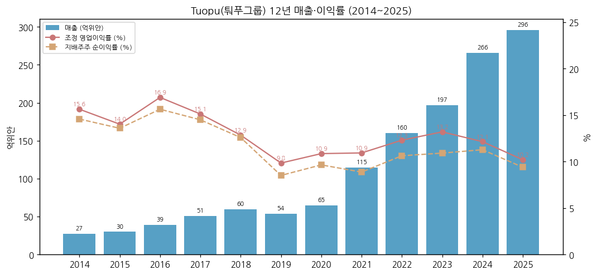

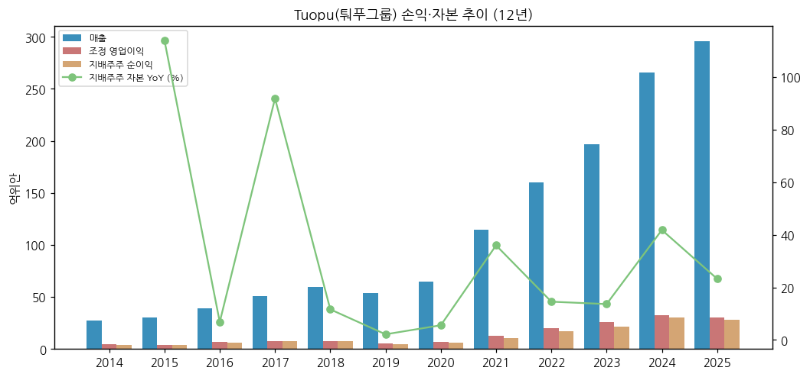

③ 회사 주가 역사

→ 2015-03 상장. 2019년 중국 자동차 역성장기에 저점, 2020~2021년 Tesla 상하이 공장 증산과 함께 재평가

→ 2023~2025년 "로봇 + 자동차 + 액랭" 3축 기대 — **장중 사상 최고 86.88위안 (2025-09-18)** [Yahoo 일간]

→ 2026년 하락: 이익 하향(1Q -2.4%, 2Q -35.5%) → 2026-09 월말 43.08위안. 3Q26 발표 후 10/30 -3.1%, 이후 반등해 11/13 50.28위안 (고점 대비 -42.1%)

→ 시총: 약 874억위안 [계산]. 과거 시총 시계열은 주식 수 이력(2018·2023년 10주당 4.5주 무상증자)을 반영하지 못해 미작성

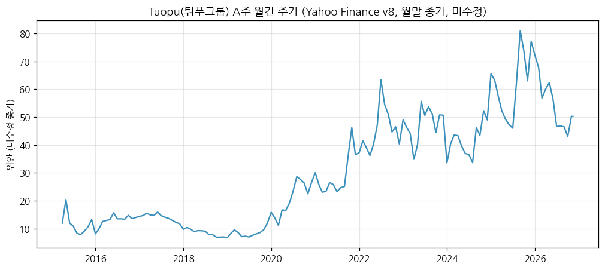

④ 주요 연혁

| 시점 | 사건 |
|---|---|
| 1980년대 | 닝보에서 NVH(방진 고무) 부품으로 창업 — "설립 40여 년" (2025 연간 보고서) |
| 2015-03 | 상해거래소 상장 (601689) |
| 2017 | 유상증자 — 경량화 섀시·전자 브레이크(IBS) 투자 [공개 정보, 세부 미대조] |
| 2018·2023 | 결산 시 10주당 4.5주 무상증자 (배당 공시) |
| 2021~2022 | Tesla·신흥 EV 증산으로 매출 +76%·+40% |
| 2023 | 로봇 "전동구동 시스템" 매출 처음 표기 (2023 연간, 185만위안 [계산]) |
| 2025 | 로봇 액추에이터 사업부 분리 설립, 제품명 "机器人执行器"로 변경. 芜湖长鹏(현 芜湖拓普) 인수 — Chery·Leapmotor 고객 확대 |
| 2026-08 | 반기 보고서: 직선·회전 액추에이터·영교수 모터 소량 납품, 로봇 부품 산업기지 1기 완공, 액랭 등 누적 수주 17.5억위안 |
| 2026-09 | Tesla Optimus 3세대 공급사 실사 — 회사 "Tesla 연구개발 인력 정기 상주, 액추에이터 공동 개발" (TrendForce 9/21) |

## ③ 비즈니스 모델

① 실적 추이 통합 (제품별 주영업수입, 억위안 / 괄호 = 매출총이익률 %)

| 제품 | 2021 | 2022 | 2023 | 2024 | 2025 | 1H25 | **1H26** | 1H26 YoY |
|---|---|---|---|---|---|---|---|---|
| 내장 기능부품 | 35.8 (17.2) | 54.6 (19.0) | 65.8 (20.0) | 84.3 (18.1) | 96.7 (16.9) | 43.7 (16.1) | **47.7 (17.0)** | +9.2 |
| 섀시(경량화) | 26.2 (17.7) | 44.5 (21.2) | 61.2 (23.2) | 82.0 (20.4) | 87.2 (19.1) | 37.1 (18.1) | **42.4 (17.7)** | +14.4 |
| NVH 감쇠 | 33.5 (23.8) | 38.7 (24.1) | 43.0 (24.3) | 44.0 (21.1) | 42.6 (20.3) | 20.4 (20.1) | **21.1 (20.9)** | +3.6 |
| 자동차 전자 | 1.8 (26.3) | 1.9 (25.2) | 1.8 (21.9) | 18.2 (19.4) | 27.7 (16.5) | 10.8 (17.3) | **11.1 (16.4)** | +3.1 |
| 열관리 시스템 | 12.9 (17.8) | 13.7 (18.6) | 15.5 (18.9) | 21.4 (17.1) | 20.9 (16.3) | 9.8 (16.5) | **10.2 (16.1)** | +3.8 |
| **로봇 액추에이터** | — | — | **0.02** | **0.13** | **0.14 (28.2)** | **0.08 (30.6)** | **0.14 (27.0)** | **+83.4** |
| 기타(비주력) | 4.5 | 6.5 | 9.7 | 15.9 | 20.6 | 7.6 | **9.4** | +23.7 |
| 합계 | 114.6 | 159.9 | 197.0 | 266.0 | 295.8 | 129.3 | **142.0** | +9.8 |
| 지역(주영업): 국내 | — | 108.9 | 129.6 | 188.0 | 213.0 | 92.7 | **99.4** | +7.2 |
| 지역(주영업): 해외 | — | 44.5 | 57.7 | 62.2 | 62.2 | 29.1 | **33.3** | +14.4 |

→ (출처: 东方财富 主营构成(회사 연간·반기 보고서 "主营业务分产品/分地区" 집계), 2025·1H26 원문 대조. 2021 = 1H + 2H [계산]. "减震器/减震系统" 동일 매핑, 로봇 액추에이터 = 2024년까지 "电驱系统". 자동차 전자는 2024년 에어서스펜션·IBS 등 편입으로 규모가 커졌다(분류 변경 추정 [판단]). 지역은 기타 제외 주영업 기준)

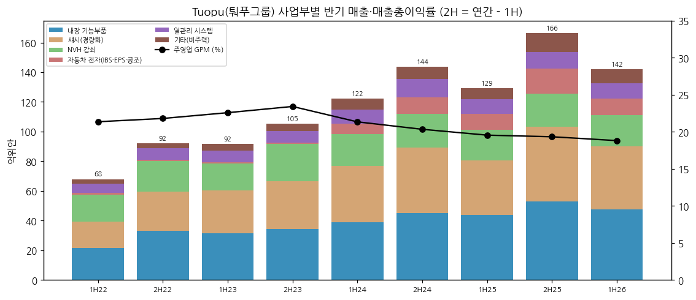

① 12분기 시계열 (억위안, 분기 단독 = 누적 차감)

| 분기 | 4Q23 | 1Q24 | 2Q24 | 3Q24 | 4Q24 | 1Q25 | 2Q25 | 3Q25 | 4Q25 | 1Q26 | 2Q26 | 3Q26 |
|---|---|---|---|---|---|---|---|---|---|---|---|---|
| 매출 | 55.5 | 56.9 | 65.3 | 71.3 | 72.5 | 57.7 | 71.7 | 79.9 | 86.5 | 66.3 | 75.7 | 84.2 |
| 조정 영업이익 | 7.9 | 7.5 | 7.8 | 8.7 | 8.3 | 5.0 | 7.2 | 7.9 | 10.1 | 5.9 | 6.3 | 7.8 |
| 조정 OPM (%) | 14.2 | 13.1 | 12.0 | 12.2 | 11.4 | 8.7 | 10.1 | 9.8 | 11.7 | 8.9 | 8.4 | 9.3 |
| 지배주주 순이익 | 5.54 | 6.45 | 8.11 | 7.78 | 7.67 | 5.65 | 7.29 | 6.72 | 8.13 | 5.52 | 4.71 | 6.40 |
| 순이익률 (%) | 10.0 | 11.3 | 12.4 | 10.9 | 10.6 | 9.8 | 10.2 | 8.4 | 9.4 | 8.3 | 6.2 | 7.6 |
| 매출총이익률 (%) | 23.6 | 22.4 | 20.4 | 20.9 | 19.8 | 19.9 | 19.3 | 18.6 | 20.0 | 19.3 | 18.4 | 18.1 |
| 매출 YoY (%) | +13.5 | +27.3 | +39.3 | +42.9 | +30.6 | +1.4 | +9.7 | +12.1 | +19.4 | +14.9 | +5.6 | +5.3 |
| 순이익 YoY (%) | +12.6 | +43.4 | +25.9 | +54.6 | +38.5 | -12.4 | -10.0 | -13.7 | +6.0 | -2.4 | -35.5 | -4.8 |

→ (출처: 실적 리뷰 `2026-Q3_601689.SS_리뷰.md` 1-① 표와 동일)

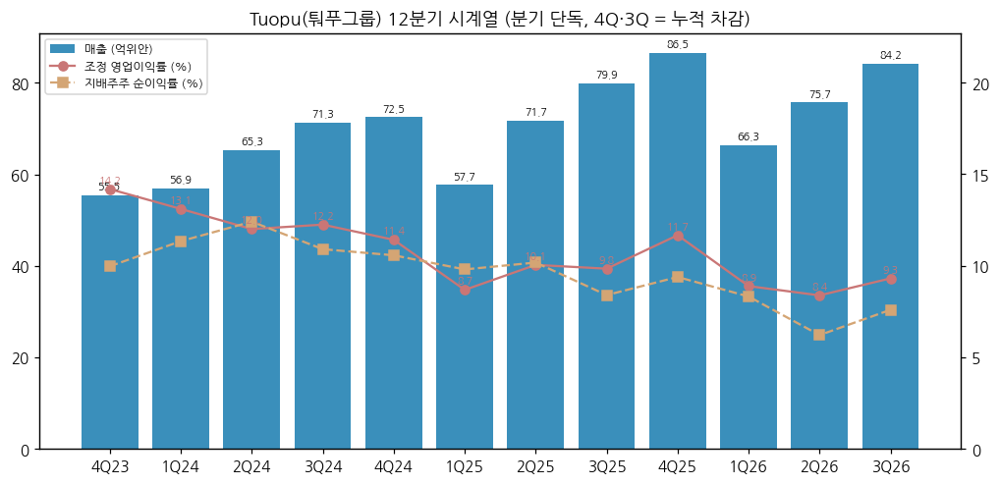

→ 분기 15년(60분기) 사업부 시계열은 회사가 분기 제품별 매출을 공시하지 않아 만들 수 없다. 반기 제품별 시계열(1H22~1H26)로 대체했다

② 사업부별 개요 (매출 비중 순, 2025)

→ **내장 기능부품 (32.7%)**: 차체 내장 모듈·방음재 등. 芜湖拓普(구 芜湖长鹏) 편입으로 Chery·Leapmotor 확대 (2026 반기 보고서)

→ **섀시(경량화) (29.5%)**: 알루미늄 경량 섀시 부품·서브프레임 — Tesla·Rivian 모듈 공급의 핵심

→ **NVH 감쇠 (14.4%)**: 창업 사업(방진 고무·쇼크업소버). 이익률 가장 높은 본업(20~24%)

→ **자동차 전자 (9.4%)**: 에어서스펜션·IBS·EPS·스마트 콕핏. "전면 양산 수확 단계"(회사), 다음 세대 액티브 서스펜션·EMB·RBS 준비

→ **열관리 시스템 (7.1%)**: 열관리 2.0 모듈 핵심 부품 전량 자체 개발. 2026년 上海爱卫蓝(전동 스크롤 컴프레서) 전략 투자로 "컴프레서 + 히트펌프" 통합 (2026 반기 보고서)

→ **로봇 액추에이터 (0.05%, 1H26 0.1%)**: 직선·회전 액추에이터, 영교수 모터·총성, 몸체 구조물, 발 충격흡수기, 전자 유연 피부. 강점으로 회사는 ① 영구자석 서보·프레임리스 모터 자체 개발 ② 모터·감속기·컨트롤러 통합 경험 ③ 정밀 가공 ④ 연구개발·시험 자원 협업을 든다 (2025 연간 보고서)

③ 사업부별 디테일

→ 로봇 액추에이터 GPM 28.2%(2025)·27.0%(1H26)는 전사(18.8%)보다 높지만 매출이 작아 의미 있는 이익 기여는 없다 [계산]
→ 마진 하락의 중심은 내장(20.0% → 16.9%)과 자동차 전자(21.9% → 16.5%) — 2023 → 2025 [계산]

④ 주요 경쟁사

→ 로봇 액추에이터: Sanhua(002050, 같은 서브섹터), 기타 중국 공급사
→ 자동차 부품: 현대모비스(한국, 같은 서브섹터 — 모듈), 한온시스템(열관리), Bosch·Continental·ZF(전자·섀시), 중국 경량화·NVH 부품사

⑤ 주요 매출처

→ 상위 5개 고객 매출 194.6억위안(65.8%, 2025), 관계사 0%. 고객명 미공시 (2025 연간 보고서)
→ 회사가 반기 보고서에 적는 고객: 국내 Seres·Xiaomi·Geely·BYD·Chery·Li Auto·NIO·Great Wall·Xpeng / 해외 "미국 혁신 차기업 A 고객"·Rivian·Ford·GM·BMW·Stellantis·Mercedes-Benz (2026 반기 보고서)
→ 상위 5개 공급사 매입 37.9억위안(20.5%)

⑥ 생산 CAPA + 임직원

→ 국내: 杭州湾 9기·광저우 공장 가동(1H26). 해외: 멕시코(가동률 상승, 2기 준비), 폴란드(2기 설계), 태국 1기(일부 가동), 미국 켄터키(2026년 내 설비 조정 완료 예정). 로봇 부품 산업기지 1기 완공·생산 가능 (2026 반기 보고서)
→ 임직원 26,123명(2025 말), 연구개발 4,466명(17.1%) (2025 연간 보고서)

## ④ 재무 구조

① 손익계산서 — ② 표 참고

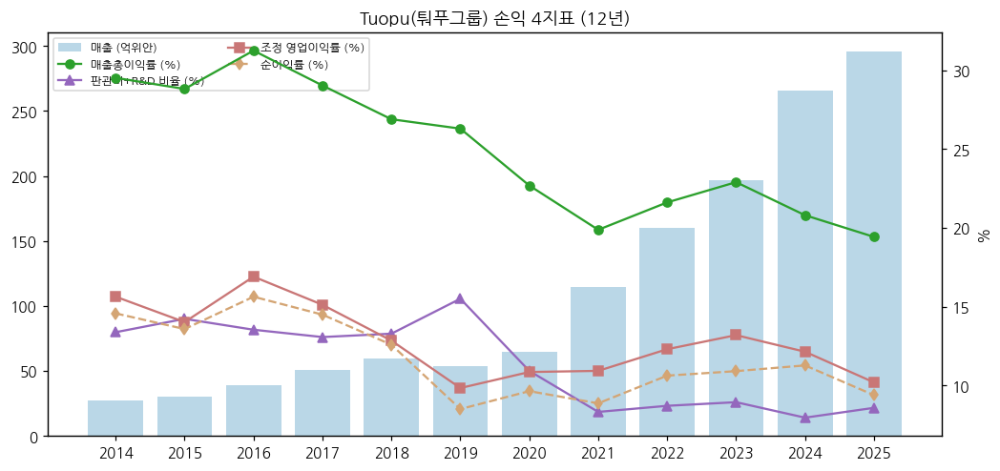

② 재무상태표 (억위안)

| 연도 | 총자산 | 부채 | 지배주주 자본 | 부채/자산 | 현금 | 차입금(단기+장기+사채+유동성장기) | 순현금 |
|---|---|---|---|---|---|---|---|
| 2014 | 25.4 | 10.4 | 14.8 | 40.9 | 0.9 | 2.5 | -1.6 |
| 2015 | 41.3 | 9.5 | 31.6 | 23.0 | 4.2 | 0.0 | 4.2 |
| 2016 | 49.5 | 15.5 | 33.7 | 31.3 | 3.3 | 2.0 | 1.3 |
| 2017 | 107.3 | 42.4 | 64.7 | 39.5 | 14.7 | 8.1 | 6.6 |
| 2018 | 109.0 | 36.5 | 72.2 | 33.5 | 10.9 | 6.6 | 4.3 |
| 2019 | 112.3 | 38.3 | 73.8 | 34.1 | 8.2 | 7.5 | 0.8 |
| 2020 | 121.2 | 43.0 | 77.9 | 35.5 | 7.9 | 4.0 | 3.9 |
| 2021 | 186.8 | 80.6 | 105.9 | 43.2 | 12.7 | 15.4 | -2.7 |
| 2022 | 275.1 | 153.5 | 121.3 | 55.8 | 28.0 | 63.4 | -35.4 |
| 2023 | 307.7 | 169.6 | 137.8 | 55.1 | 28.6 | 72.3 | -43.8 |
| 2024 | 375.4 | 179.6 | 195.5 | 47.8 | 39.9 | 69.0 | -29.1 |
| 2025 | 439.3 | 198.0 | 241.0 | 45.1 | 52.2 | 47.6 | 4.6 |
| 2026-09 | 435.5 | 187.7 | 247.4 | 43.1 | 45.1 | 53.7 | -8.6 |

→ (출처: 东方财富 F10 재무상태표, 2026 3분기 보고서(총자산 435.50·지배주주 자본 247.42억위안) 대조. 2022~2024 사채 23.6~25.1억위안은 2025년 말 소멸 — 전환사채 전환으로 추정 [판단])

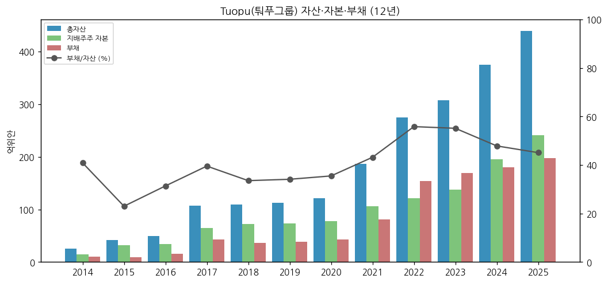

③ 현금흐름표 (억위안)

| 연도 | 영업CF | 투자CF | 재무CF | 유·무형자산 취득(CapEx) | FCF [계산] | CapEx/매출 | 연구개발비 | R&D/매출 |
|---|---|---|---|---|---|---|---|---|
| 2014 | 4.6 | -3.8 | -1.3 | 3.8 | 0.8 | 13.9 | 관리비 포함 | — |
| 2015 | 2.4 | -9.4 | 10.1 | 4.3 | -1.9 | 14.3 | 관리비 포함 | — |
| 2016 | 2.8 | -1.6 | -2.0 | 7.4 | -4.7 | 18.8 | 관리비 포함 | — |
| 2017 | 9.3 | -29.2 | 29.4 | 12.9 | -3.6 | 25.3 | 2.3 | 4.5 |
| 2018 | 6.1 | -8.9 | -2.5 | 13.3 | -7.2 | 22.2 | 2.9 | 4.8 |
| 2019 | 12.4 | -10.3 | -2.4 | 9.4 | 3.0 | 17.5 | 3.1 | 5.9 |
| 2020 | 11.2 | -5.9 | -5.6 | 14.1 | -2.8 | 21.6 | 3.5 | 5.4 |
| 2021 | 11.9 | -37.4 | 28.2 | 35.2 | -23.3 | 30.7 | 5.0 | 4.4 |
| 2022 | 22.8 | -51.1 | 43.0 | 54.3 | -31.4 | 33.9 | 7.5 | 4.7 |
| 2023 | 33.7 | -34.1 | -0.7 | 31.8 | 1.9 | 16.1 | 9.9 | 5.0 |
| 2024 | 32.4 | -37.3 | 21.9 | 31.5 | 0.9 | 11.8 | 12.2 | 4.6 |
| 2025 | 44.8 | -30.2 | -9.2 | 35.0 | 9.8 | 11.8 | 15.0 | 5.1 |

→ (출처: 东方财富 F10 현금흐름표·손익(회사 연간 보고서 집계). 9M26 영업CF 29.76억위안(+0.2%) (3분기 보고서))
→ 12년 누적 FCF는 사실상 0 근처 — 매출을 4.5배로 키우는 동안 영업현금을 거의 전부 공장(CapEx)에 재투자했다 [계산·판단]

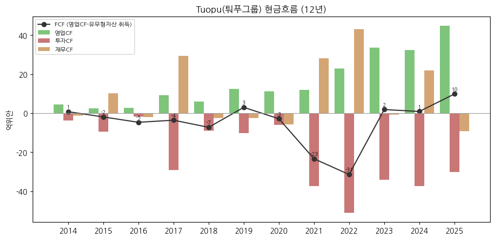

④ CapEx — ③ 표. 2021~2022년 연 35~54억위안(매출 대비 31~34%)으로 정점, 2023~2025년 연 31~35억위안(12~16%). 감가상각이 이익을 누르는 원인 (회사)

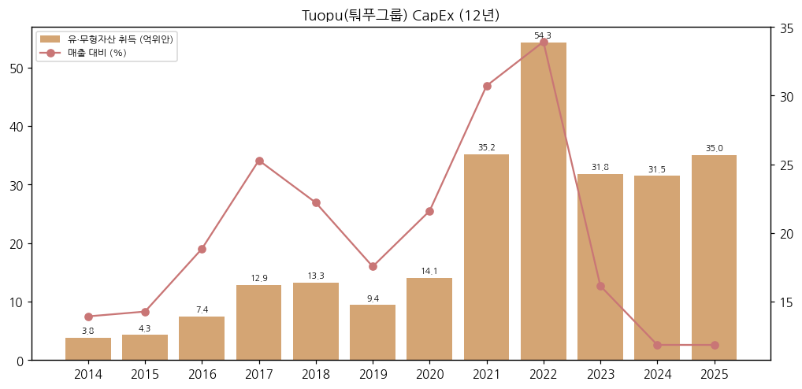

⑤ 부채구조 — 2026-09 말 순차입 8.6억위안(단기차입 39.1억 중심). 사채 잔액 없음 (东方财富 재무상태표)

⑥ 배당 (주당 현금배당, 위안, 세전 — 회계연도 결산)

| 회계연도 | 주당 배당 | 비고 |
|---|---|---|
| 2021 | 0.278 | |
| 2022 | 0.463 | |
| 2023 | 0.556 | + 10주당 4.5주 무상증자 |
| 2024 | 0.519 | |
| 2025 | 0.490 | 총액 약 8.5억위안 [계산 — 1,737.84백만주], 배당성향 약 31% [계산] |

→ (출처: 东方财富 배당 집계(회사 권익분배 실시 공고), 2025 권익분배 실시 공고(2026-05-14). 중간배당 없음)

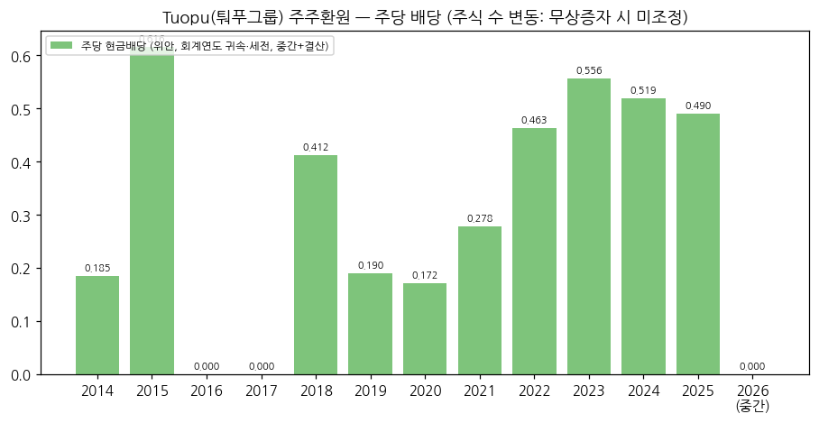

⑦ 재무비율: ROE 2025 12.7% [계산, 평균 지배주주 자본], 9M26 가중평균 ROE 6.83%(-2.12%p, 회사), 부채/자산 43.1%(2026-09)

## ⑤ 지배 구조

① 그룹 관계: 우젠수(邬建树) → 迈科国际控股(香港) 57.88% → 본사

② 주주 (2026-09 말, 보통주 주주 208,994명)

| 주주 | 지분율 (%) |
|---|---|
| 迈科国际控股(香港) | 57.88 |
| 홍콩중앙결산 (북향 외국인) | 2.12 |
| 华夏 중증로봇 ETF | 0.90 |
| 우젠수(邬建树) | 0.52 |
| 易方达 국증로봇산업 ETF | 0.50 |
| 중국인수보험 | 0.50 |
| 天弘 중증로봇 ETF | 0.31 |
| 아부다비투자청(ADIA) | 0.27 |
| 易方达 소비업종 펀드 | 0.22 |
| 杭玉夫 | 0.21 |

→ (출처: 2026 3분기 보고서. 상위 10대 주주에 로봇 ETF 3개(합 1.71%) [계산]. 외국인·기관·개인 분리 시계열 미확보 → chart5 미작성)

③ 임원: 회장 우젠수(邬建树, 62세, 2008-07부터 회장, 홍콩 국적). 재무 책임자 홍톄양(洪铁阳) (2025 연간 보고서)

## ⑥ 기타 팩트

① R&D: 2025 연구개발 투자 14.96억위안(매출 5.06%), 인력 4,466명. 1H26 연구개발비 7.91억위안(+12.2%, 매출 5.57%). 신규 연구개발 빌딩(7.1만㎡, 2,500명 수용) 가동 (2026 반기 보고서)

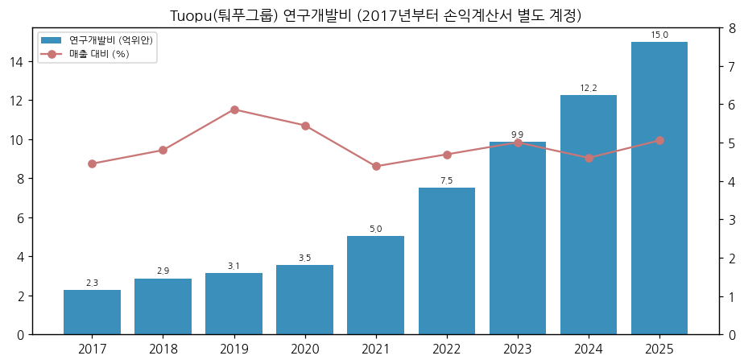

② Corporate action: 2025 芜湖长鹏 인수(현 芜湖拓普), 2026 上海爱卫蓝 전략 투자, 로봇 액추에이터 사업부 분리 설립(2025)

③ R&D 마일스톤: IBS 다수 프로젝트 대량 양산, 에어서스펜션·EPS 양산, 열관리 2.0 핵심 부품 전량 자체 개발, 직선·회전 액추에이터·영교수 모터 소량 납품(1H26), 액랭 펌프·밸브

④ 주요 리스크
→ 고객 집중: 상위 5개 고객 65.8%
→ 해외 공장 램프업 지연 → 감가상각 부담 장기화 (회사)
→ 원재료(알루미늄 등)·환율 — 9M26 재무비용 2.71억위안(+2.39억, 환차손 중심) [화안 보도 인용]
→ 로봇: Optimus 양산 일정 의존

⑤ ESG 등급: 미확보

⑥ 인증: 미정리

## Version Log

→ **v1.0 (2026-11-14)**: 최초 작성. 로봇 부품 글로벌 피어 편입. 회사 원문 4건(2026 3Q·반기, 2025 연간, 2025 경영실적 예고) + 东方财富 F10 재무 API + Yahoo 주가. 로봇 액추에이터 반기 매출 별도 행. 차트 11종(chart1·1b·2·4·6·7·8·9·10·11·12)
→ 잔여 보완 후보: ① 2014~2020 연간 보고서 원문 대조 ② 주주 구성 시계열(chart5) ③ 시가총액 시계열(주식 수 이력) ④ 자동차 전자 2024년 분류 변경 원문 확인 ⑤ ESG 등급·인증 ⑥ 2026 연간 보고서(2027-03) 반영
