> Ticker: **TSE: 6752 — Panasonic Holdings Corporation** (도쿄증권거래소 프라임) / 분석 단위: **Energy 부문 = Panasonic Energy Co., Ltd. (100% 자회사)**
> Entity: **Panasonic Energy Co., Ltd.** (본사 오사카 모리구치) — 원통형 리튬이온 전지 세계 최대급 메이커. 차재(테슬라 2170, 미국 Nevada·Kansas 공장)와 산업·민생(데이터센터용 BBU 축전 시스템, 건전지·소형전지) 2축. 모회사 Panasonic Holdings는 6개 보고 세그먼트(Connect·Electric Works·HVAC&CC·Energy·Industry·Smart Life)의 멀티 세그먼트 지주회사
> Sector: 배터리 — 서브섹터 **배터리 셀 글로벌** (한국 셀 2사 LG에너지솔루션·삼성SDI와 비교)
> 작성 시각: **2026-11-14 KST** (**v1.0** — Phase 1 Source 수집 + audit + 15종 차트)
> 적용 구조: v4.8 (6개 섹션) + 멀티 세그먼트 피어 룰(해당 섹터 부문만 추출, 그룹 숫자는 맥락용)
> 회계연도: **3월 결산 (FY3/27 = 2026-04~2027-03)**. 분기 매핑: FY3/27 1Q = 2026-Q2(4~6월), **FY3/27 2Q = 2026-Q3(7~9월)**. 본문 분기 라벨은 **캘린더 기준(예: 3Q26)** + 회계 분기 병기
> 데이터 범위: **Energy 부문 분기 22Q (FY3/22 1Q~FY3/27 2Q = 2Q21~3Q26)** + 하위 사업(In-vehicle / Industrial·Consumer) 매출 22Q·조정 영업이익 18Q + **IRA 45X 세액공제 14Q (총액·고객 공유분·영업이익 반영분·북미 판매 GWh)** + Energy 연간 FY3/22~FY3/26 + FY3/27 회사 계획 / 그룹 10년(FY3/17~FY3/26, 맥락용) / 6752.T 주가 2000~2026-11
> 출처: **Panasonic HD IR — Supplemental Financial Data (FY3/23 결산·FY3/24 결산·FY3/25 3Q·FY3/26 2Q·FY3/26 결산·FY3/27 1Q·FY3/27 2Q), 결산 설명 자료(FY3/26 2Q·FY3/26 결산·FY3/27 1Q·FY3/27 2Q note판), FY3/27 2Q 결산 Q&A 요지(2026-10-30), FY3/27 2Q 결산단신(News Release), Integrated Report 2026(10년 재무 요약·주주 구성·Energy 전략), Annual Report 2022** / Yahoo Finance 6752.T·JPYKRW=X / SNE Research(헤럴드경제 2026-11-02 인용) / 보도(Reuters 2026-10-30, Automotive World 2026-05-12, HPPR 2026-06-18, Lawrence Times 2026-02-03, battery-tech.net 2025-07-15)
> 원화 환산 참고: **3Q26 평균 ₩8.89/¥** (Yahoo JPYKRW=X 2026-07-01~09-30 일평균 [계산]), 시가총액은 11/13 현물 ₩8.34/¥
> ⚠️ 다음 실적: **FY3/27 3Q(=4Q26) 결산 — 2027-02 초 예상 (회사 미공지, 전년 2026-02-04 기준)** / 그룹 Investor Day 2026-12 (Solutions 영역 중심) / 중기 목표 재설정 2027-05 예고

# Panasonic Energy 기업 개요 (v1.0 — 배터리 셀 글로벌 / 테슬라 원통형 셀 + AI 데이터센터 BBU / IRA 45X 의존 차재 + 고마진 DC ESS)
> **Fact verify cutoff**: 2026-11-14 (주가 2026-11-13 종가 **¥3,193** [Yahoo Finance 6752.T], 시가총액 ≈ **¥7.46조 (≈ ₩62조)** [계산: ¥3,193 × 유통주식 2,335.1백만주(발행 2,454.7백만 − 자사주 119.6백만, 2026-09말 결산단신)], **ATH ¥4,982 (2026-08-14 장중)** [Yahoo 일간 — 2000년 이후 데이터 기준 최고], 52주 고/저 ¥4,982 / ¥1,700 [Yahoo]. 글로벌 EV 배터리 사용량 점유율 2026-1~9월 **3.6% (7위, 35.6GWh, YoY −0.8%)** [SNE Research, 헤럴드경제 2026-11-02])

> ⚠️ **분석 단위·표시 기준 4건 — 모든 표·차트 해석 시 주의**
> ① **멀티 세그먼트 모회사** — 본 리포트의 손익 숫자는 **Panasonic HD 'Energy' 보고 세그먼트**(= Panasonic Energy Co., Ltd., 관리회계 기준)다. Energy는 그룹 매출의 12%(FY3/26), 3Q26 조정 영업이익의 27% [계산]. 그룹 전사 숫자는 ② 회사 개요·④ 재무 구조의 맥락용으로만 사용
> ② **이익 지표 = '조정 영업이익(Adjusted operating profit)'** = 매출 − 매출원가 − 판관비 (회사 정의, 일본 기업의 '영업이익'과 달리 기타손익 제외). 한국식 영업이익에 가장 가깝다. IFRS 영업이익(Operating profit)은 여기에 기타손익을 더한 값으로 병기
> ③ **IRA 45X(AMPC) 회계 처리** — 세액공제 총액의 **약 절반을 '고객과의 유효 활용분'으로 매출에서 차감**하고, 나머지가 조정 영업이익에 남는다 (회사 공시 "Half of total tax credit amount recorded in adjusted OP"). 한국 LGES의 IR 'AMPC 효과'(당사 귀속분)와 같은 개념. 본 리포트는 **'IRA 포함'(보고) / 'IRA 제외'(조정 영업이익 − IRA 영업이익 반영분, 매출은 차감분을 되돌린 값)** 2개 기준을 병기
> ④ **세그먼트 재편** — 2022-04 지주회사 체제 전환 때 Energy 세그먼트 신설 (FY3/22는 회사 재작성치). 그 이전 배터리 사업은 Automotive & Industrial Systems·Automotive 부문 등에 나뉘어 있어 **FY3/21 이전 Energy 부문 손익은 비교 가능한 공시 없음 [미확보]** → 연간 시계열은 FY3/22~ 5개년 + FY3/27 계획. 2026-01·04 그룹 조직 재편으로 FY3/26 분기는 회사 재작성치 사용 (Energy 수치 변동 없음 확인)

## Phase 1 Source Audit

```
=== 자료 수집 audit (Panasonic Holdings — Energy 세그먼트) ===

✅ 확보 (17개 파일, 저장: company-overview-source/6752.T_Panasonic/)
- Supplemental Financial Data 7건: FY3/23 결산(FY3/22·FY3/23 분기), FY3/24 결산(FY3/23·FY3/24 분기), FY3/25 3Q, FY3/26 2Q, FY3/26 결산, FY3/27 1Q, FY3/27 2Q
  → Energy 분기 매출·조정OP·OP·EBITDA, In-vehicle / Industrial·Consumer 매출·조정OP, 세그먼트 CapEx·감가상각, IRA 45X 분기 표(총액·매출 차감·OP·순이익·GWh)
- 결산 설명 자료 4건: FY3/26 2Q, FY3/26 결산, FY3/27 1Q, FY3/27 2Q(note판) — Energy 증감 요인, 데이터센터 매출, 북미 GWh, 공장별 CAPA 표, 관세 환급
- FY3/27 2Q 결산 Q&A 요지 (2026-10-30), FY3/27 2Q 결산단신 (주식수·세그먼트 이익)
- Integrated Report 2026 (10년 재무 요약, 주주 구성·대주주, 신용등급, Energy CEO 대담·FY3/29 목표), Annual Report 2022 (Energy 세그먼트 출범)
- Yahoo Finance 6752.T 월간(2000~)·일간(2y), JPYKRW=X 일간(1y)

❌ 누락 (5)
- FY3/21 이전 Energy 세그먼트 손익: 비교 가능한 공시 없음 (구 Automotive & Industrial Systems 등에 분산) → 12년 시계열 대신 Energy 5개년 + 그룹 10년
- Panasonic Energy 단독 재무상태표·현금흐름·R&D·임직원 수: 세그먼트 공시 범위 밖 (Panasonic Energy 통합보고서 미수집) → 그룹 수치로 대체
- 그룹 재무활동 현금흐름 10년: 통합보고서 요약표 미수록
- 컨퍼런스콜 전문 트랜스크립트: Q&A 요지(회사 작성)로 대체
- Energy 부문 셀사이드 컨센서스: 집계 출처 미확보

⚠️ 결과 영향
- IRA 45X: FY3/23 4Q(=1Q23) 첫 계상분 ¥40.0bn은 법인세 단계(순이익)로 처리 → 조정 영업이익 반영은 FY3/24 1Q(=2Q23)부터
- FY3/25 3Q(=4Q24) IRA ¥64.4bn에는 전극 활물질 생산비 공제의 과년도분 일괄 계상 포함 (회사 주석)
- In-vehicle·I/C 매출 합은 Energy 매출과 ±3bn 차이 (세그먼트 내 조정) — 회사 표 그대로 사용
- FY3/26 4Q(=1Q26) In-vehicle 적자에는 과거 제조공정 문제 관련 일회성 비용(FY3/26 연간 −¥40.0bn, 회사)이 포함 — 분기 귀속은 4Q로 판단 ⚠️추정

Source 6종 audit:
[V] (1) 정기 보고 (Supplemental 7건 + 결산단신) ✓
[V] (2) IR 실적 발표 자료 4건 + Q&A 요지 ✓ / 트랜스크립트 원문 ✗
[△] (3) 지속가능성·Panasonic Energy 통합보고서 — 그룹 통합보고서만
[V] (4) 주가 (Yahoo 6752.T 2000~) ✓
[V] (5) 중장기 목표 (FY3/29 DC 매출 ~¥1조, AI 인프라 ¥1.6조) ✓
[△] (6) 12년 정확값 — Energy 5개년(FY3/22~)만 비교 가능
→ 4.5/6 source 확보. 최신 분기(FY3/27 2Q = 3Q26, 2026-10-30 발표) 반영.
```

---

## ① 기업 분류

(1) Primary / Secondary 분류

**⚠️ Boundary Case — 차재(EV)는 정책·고객 1곳에 묶인 사이클, 산업·민생(DC ESS)은 AI 인프라 고성장**

**Primary 분류: 사이클 (EV 수요·IRA 정책 사이클 + 대규모 CapEx 장치산업)**

→ Energy 연간 조정 OPM **4.1%(FY3/23) ~ 14.1%(FY3/25)**, 분기 −0.9%(1Q26) ~ 19.8%(4Q24) — 분기 진폭 20%pt [계산]

→ **IRA 제외 시** 연간 조정 OPM FY3/24 **0.9%** → FY3/25 3.3% → FY3/26 **−2.7%** [계산] — FY3/26 IRA 영업이익 반영분(¥99.1bn)이 보고 조정 영업이익(¥72.1bn)의 **137%** [계산]. 차재 사업만 보면 **IRA 제외 시 4Q22 이후 14개 분기 연속 적자**

→ 차재 매출 FY3/23 ¥654bn → FY3/26 ¥434bn (−34%) — 테슬라 수요 둔화·원재료 연동 판가 인하·일본 공장 물량 감소. 9M26 EV 배터리 사용량 중 **약 98%가 테슬라 북미향** [계산: 34.9/35.6GWh, SNE Research]

**Secondary 노트: 고성장 (데이터센터 축전 시스템 = BBU)**

→ 데이터센터용 매출(DC Power Solutions BU) FY3/26 **¥322bn** → FY3/27 계획 **¥550bn (1.7x)** → FY3/29 목표 **약 ¥1조** (2026-10-30 상향, 종전 ¥950bn+)

→ Industrial/Consumer 매출 비중 FY3/23 32% → **3Q26 53%** [계산], 조정 OPM 3Q26 **18.5%** (사상 최고). IRA 제외 Energy 영업이익의 **100% 이상**이 I/C에서 나온다 [계산: 3Q26 I/C ¥32.4bn > IRA 제외 Energy ¥23.5bn]

→ 3Q26 Energy 매출 **+45.8% YoY** (¥331.9bn, 분기 최대) — 차재 +56%(Kansas 가동률 상승) + I/C +37%(DC ESS)

**사업 구조 (FY3/27 2Q = 3Q26, 십억엔)**

→ **(1) In-vehicle (차재, Mobility Energy BD)** — 매출 ¥153.6bn (46%), 조정OP ¥22.2bn (14.5%, **IRA ¥33.2bn 포함** → IRA 제외 −¥11.0bn) — 원통형 2170(테슬라 Model 3/Y), 4680(와카야마, 양산 지연), Nevada(테슬라 Gigafactory 내)·Kansas(De Soto, 2025-07 양산)·일본 스미노에·가이즈카

→ **(2) Industrial / Consumer (산업·민생, Energy Device BD + Energy Solutions BD)** — 매출 ¥175.3bn (53%), 조정OP ¥32.4bn (18.5%) — **데이터센터 BBU 모듈·시스템(DC 매출 ¥114.9bn, 이 중 일부 비DC 포함)**, 건전지·리튬 1차전지, 전동공구·소형 리튬이온, 니켈수소

(2) Summary Box (Energy 부문, FY3/22~FY3/26 5개년 + FY3/27 계획)

| 지표 | 값 |
|------|-----|
| 매출 CAGR (FY3/22→FY3/26, 4년) | **+6.2%/yr** [계산] (FY3/27 계획 +46.4%) |
| 조정 OPM 평균 (5년, IRA 포함) | **9.0%** [계산] / IRA 제외 **2.9%** [계산, FY3/22·23은 IRA 없음] |
| OPM 정점 | **14.1% (FY3/25)** — IRA 제외 3.3% |
| OPM 저점 | **4.1% (FY3/23)** — 원재료 급등·IRA 반영 전 |
| 분기 OPM 범위 | −0.9% (1Q26, 일회성 비용) ~ 19.8% (4Q24, IRA 과년도분) |
| 사이클 주기 | 테슬라 수요(2020~2023 확장 → 2024~2025 둔화) × 미국 정책(IRA 2023~, 30D 소비자 공제 2025-09 종료) × DC ESS(2025~ 급성장) |
| 사이클 회수 | 이익 저점 2회(FY3/23, FY3/26) — 두 번 모두 차재발 |

```
[Panasonic Energy 부문 연간 손익 (십억엔)]  FY3/xx = 전년 4월~당해 3월
연도      매출   조정OP  조정OPM  IRA OP  IRA제외OP  OP(IFRS)  In-veh 매출/OP   I/C 매출/OP   북미 GWh
FY3/22   772.8   70.8    9.2%     -       70.8      66.8    468.4 / [미공시]  304.9 / [미공시]   -
FY3/23   971.8   39.6    4.1%     -       39.6      33.2    654.1 / 10.7     310.7 / 28.5      -    ← 원재료 급등, 차재 저마진 (IRA 첫 계상은 순이익 단계 ¥40.0bn)
FY3/24   915.9   94.6   10.3%    86.8       7.8      88.8    605.0 / 68.1     307.1 / 26.1     37.2  ← IRA 45X 영업이익 반영 개시
FY3/25   873.2  122.7   14.1%    94.0      28.7     120.2    481.2 / 65.1     392.2 / 56.8     38.1  ← DC ESS 성장 시작, IRA 과년도분
FY3/26   984.2   72.1    7.3%    99.1     -27.0      69.8    434.1 / -11.9    544.2 / 83.7     38.7  ← 관세 −25.0, 과거 공정문제 일회성 −40.0, Kansas 램프업
FY3/27F 1,441.0 200.0   13.9%   133.0      67.0     198.0    609.0 / 66.0     823.0 / 134.0    46.0  ← 10/30 상향 (종전 1,372 / 173)
* FY3/27F 상반기 실적: 매출 645.9 (+44.5%), 조정OP 98.1 (+198%) → 하반기 계획 매출 795.1·조정OP 101.9 (OPM 12.8%) [계산]
```

**배터리 셀 피어 이익률 비교 (각사 주 지표, 3Q26 — 보조금 포함/제외)**

→ **Panasonic Energy** — 조정 OPM **17.1%** (IRA ¥33.2bn 포함) / IRA 제외 **6.4%** [계산: 23.5 / (331.9+33.1)] / 차재만 IRA 제외 **−5.9%**, I/C 18.5%

→ **LG에너지솔루션** — OPM **7.8%** (AMPC 4,169억 + 일회성 물량 보상금 포함) / AMPC 제외 **3.5%** (같은 폴더 `LG에너지솔루션_기업개요.md`)

→ **삼성SDI** — OPM **8.7%** (AMPC 1,225억 포함) / AMPC 제외 **6.1%** (같은 폴더 `삼성SDI_기업개요.md`)

→ 시사점 `[판단]`: 보조금 제외 마진은 3사가 3.5~6.4%로 비슷하지만 **이익의 원천이 다르다** — Panasonic은 DC ESS(I/C 18.5%)가 차재 적자를 메우는 구조, LGES·SDI는 ESS(LFP·북미)와 EV가 함께 회복하는 구조. Panasonic의 보고 OPM이 높은 건 **매출 대비 IRA 비중(10.0% [계산: 33.2/331.9])**이 LGES(4.3%)·SDI(2.6%)보다 큰 탓 — 북미 생산이 대부분(테슬라향)이기 때문

(3) 정량적 분류 근거

→ **IRA 45X 의존도** — 세액공제 총액 FY3/24 ¥188.2bn → FY3/26 ¥213.4bn → FY3/27 계획 **¥265.0bn** ($35/kWh × 북미 판매 GWh + 전극 활물질 생산비 10%). 영업이익 반영분 FY3/27 계획 ¥133.0bn = Energy 조정OP 계획의 **67%** [계산]

→ **45X 일몰** — 2030년 25%·2031년 50%·2032년 75% 감액, PFE(금지외국기업) 조달 비율 요건 CY2026 60% → CY2030 85% (회사 자료). 차재 사업은 2030년 전에 IRA 제외 흑자 전환이 필요하다

→ **DC ESS 레버리지** — I/C 조정OP FY3/24 ¥26.1bn → FY3/27 계획 ¥134.0bn (**5.1배**), OPM 8.5% → 16.3%

(4) 산업 분류

→ **TSE 업종** — 전기기기 / GICS — Consumer Discretionary·Household Durables (그룹 기준)

→ **지수** — 닛케이225, TOPIX Core30

→ **워치리스트** — 섹터 배터리 / 서브섹터 **배터리 셀 글로벌**

(5) 분류 결정 논리

→ 정량 룰: 연간 조정 OPM range 10.0%pt (4.1~14.1%) → 사이클 cutoff 경계, 분기 range 20.7%pt → **사이클**

→ 매출 비중이 I/C로 넘어왔지만(53%) 차재 CapEx(Kansas)·IRA·테슬라 의존이 이익 변동을 지배 → **Primary 사이클 + Secondary 고성장(DC ESS)** — LGES·삼성SDI와 같은 분류 체계

→ **대안 (Primary 고성장 재분류 조건)**: I/C 매출 비중 60%+ & IRA 제외 Energy OPM 4개 분기 연속 8%+ & DC 매출 YoY +40% 이상 지속

(6) 적정 밸류에이션 방법

→ 상장 단위가 그룹(6752.T)이라 Energy 단독 멀티플은 없다. **SOTP의 Energy 파트**로 접근

→ **1차 — EV/EBITDA (Energy 부문)**: FY3/27 계획 EBITDA ¥284.0bn. 글로벌 셀 피어 배수를 적용하되 **IRA 제외 EBITDA(¥151bn [계산: 284 − 133])**와 둘 다 계산해 보조금 할인 폭을 본다 `[판단]`

→ **2차 — 그룹 P/E**: FY3/27 회사 계획 EPS ¥231.26 → **13.8x** [계산: ¥3,193 / 231.26], PBR **1.39x** [계산: 시총 ¥7.46조 / 지배주주 자본 ¥5.37조(2026-09말)]

→ 피어 참고 (삼성SDI 기업개요 인용, stockanalysis 2026-10-15): Panasonic HD P/B 1.78배·Fwd P/E 19.2배 → 11/13 주가 기준으로 하락 (10/15 ¥3,963 → 11/13 ¥3,193, −19%)

(7) 분기 재평가 트리거 (분류 변경 조건)

→ ① **차재 IRA 제외 흑자 전환 2개 분기 연속** (Kansas 가동률 정상화 확인) → 사이클 하방 리스크 축소

→ ② **DC 매출 FY3/27 ¥550bn 달성 + FY3/28 YoY +40% 이상 가이드** → Primary 고성장 재분류 검토

→ ③ **45X 규정 변경(PFE 가이드라인 2026-12-31 발표 예정) 또는 테슬라 물량 감소로 IRA 총액 감소** → 사이클 하강 재확인

---

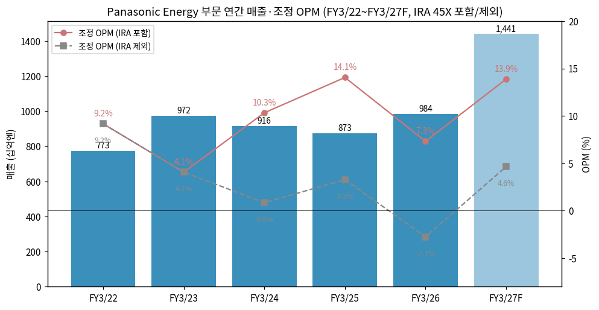

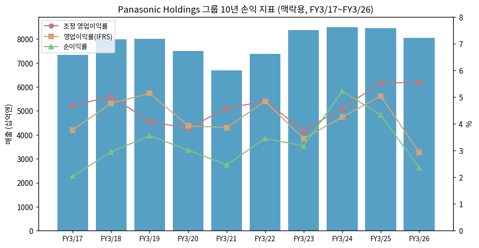

---

## ② 회사 개요

(1) 기본 정보

→ **법인명** — Panasonic Energy Co., Ltd. (パナソニック エナジー株式会社), Panasonic Holdings의 100% 자회사 (2022-04 지주회사 체제 전환으로 출범)
→ **모회사** — Panasonic Holdings Corporation, 오사카부 가도마시. 설립 1918-03 (松下電気器具製作所), 도쿄증권거래소 상장 (6752)
→ **회계연도** — 4~3월 / IFRS / 분기 결산 (결산단신 + Supplemental Financial Data에 세그먼트·임의공시 사업 숫자)
→ **사업 한 줄 정의** — **테슬라 원통형 셀의 북미 최대 공급자이자, 하이퍼스케일러 데이터센터의 배터리 백업(BBU) 1위권 공급자** — 같은 원통형 셀 기술을 EV와 AI 서버 전원 두 시장에 판다
→ **Energy CEO** — Kazuo Tadanobu (只信一生) / 그룹 CEO Yuki Kusumi (楠見雄規), 그룹 CFO Akira Waniko
→ **그룹 임직원** — 183,956명 (2026-09말, 2026-03 구조개혁으로 약 1.2만 명 감축). Panasonic Energy 단독 [미확보] / Kansas 공장 약 1,800명 (2026-06, 완전 가동 시 4,000명, HPPR)

(2) 그룹 내 Energy 비중 (십억엔)

| 항목 | FY3/24 | FY3/25 | FY3/26 | 3Q26 (FY27 2Q) | FY3/27F (10/30) |
|---|---|---|---|---|---|
| 그룹 매출 | 8,496.4 | 8,458.2 | 8,048.7 | 2,073.6 | 8,400.0 |
| Energy 매출 (비중) | 915.9 (10.8%) | 873.2 (10.3%) | 984.2 (12.2%) | 331.9 (16.0%) | 1,441.0 (17.2%) |
| 그룹 조정OP | 390.0 | 467.2 | 447.4 | 213.2 | 780.0 |
| Energy 조정OP (비중) | 94.6 (24.3%) | 122.7 (26.3%) | 72.1 (16.1%) | 56.7 (26.6%) | 200.0 (25.6%) |
| Energy CapEx (그룹 대비) | 292.1 (43.5%) | 501.1 (57.8%) | 431.6 (60.5%) | 53.1 (54.7%) | 267.0 (51.3%) |

→ (출처: 그룹 = Integrated Report 2026 10년 요약 / Energy = Supplemental Financial Data. 비중 [계산]. 그룹 FY3/27F CapEx ¥520bn)
→ Energy는 매출의 1/6이지만 **그룹 CapEx의 절반 이상**을 3년간 써 왔다 (Kansas 공장) — 그룹 FCF 약세(FY3/25 −¥63.8bn)의 주원인

(2-1) 그룹 10년 손익·자본 (맥락용, 십억엔)

```
연도     매출     조정OP  조정OPM  OP(IFRS)  순이익(지배)  지배자본   ROE   DPS(엔)  USD/JPY
FY3/17  7,343.7   343.6   4.7%     276.8     149.4      1,571.9    9.9%   25     108
FY3/18  7,982.2   401.2   5.0%     380.5     236.0      1,707.6   14.4%   30     111
FY3/19  8,002.7   327.0   4.1%     411.5     284.1      1,913.5   15.7%   30     111
FY3/20  7,490.6   286.7   3.8%     293.8     225.7      1,998.3   11.5%   30     109
FY3/21  6,698.8   307.2   4.6%     258.6     165.1      2,594.0    7.2%   20     106   ← COVID
FY3/22  7,388.8   357.7   4.8%     357.5     255.3      3,165.0    8.9%   30     112   ← Blue Yonder 인수 (2021-09)
FY3/23  8,378.9   314.1   3.7%     288.6     265.5      3,618.4    7.8%   30     135
FY3/24  8,496.4   390.0   4.6%     361.0     444.0      4,544.1   10.9%   35     145   ← IRA 45X, 차재 OP 회복
FY3/25  8,458.2   467.2   5.5%     426.5     366.2      4,694.4    7.9%   48     153
FY3/26  8,048.7   447.4   5.6%     236.4     189.5      5,211.3    3.8%   40     151   ← 구조개혁비(1.2만 명), Automotive 연결 제외
FY3/27F 8,400.0   780.0   9.3%     710.0     540.0         -        -     70     155(하반기 150 가정)
```

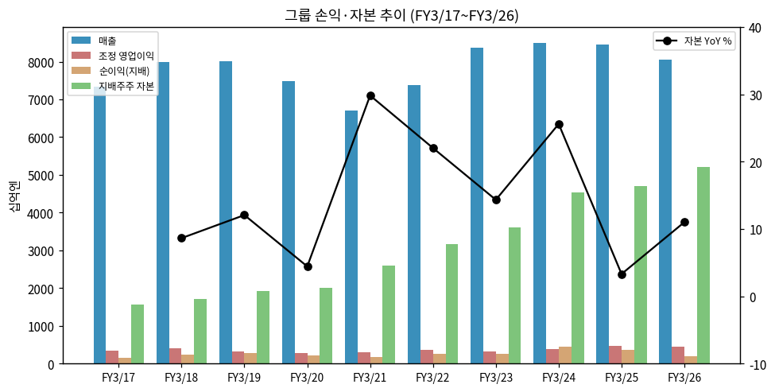

(3) 회사 주가 역사

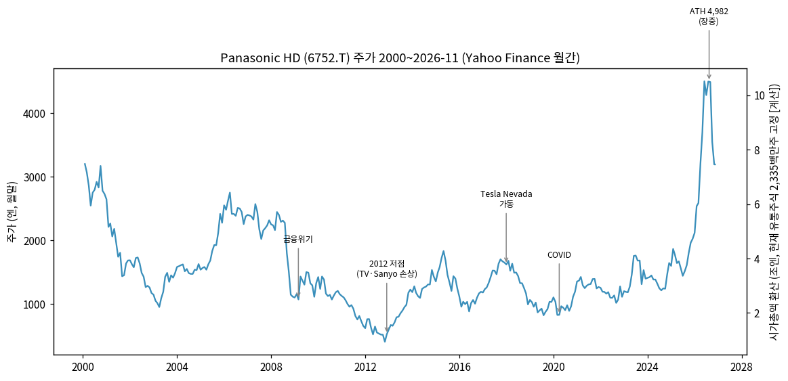

→ 2000-01 ¥3,200 (IT 버블) → 2003 ¥950 → 2006~2007 ¥2,500대 → **2012-11 ¥400대 (TV·Sanyo 손상, 2년 연속 7천억엔대 순손실)** → 2015 ¥1,700대 → 2017~2018 Tesla Nevada 가동기 ¥1,600대 → 2020-03 ¥827 (COVID)
→ 2021~2024 ¥1,000~1,800 박스 — "PBR 1배 미만 복합기업" (2024-06 주총에서 CEO가 사과, ChannelNews)
→ **2025-07 ¥1,440 → 2026-08-14 ATH ¥4,982 (장중)** — 약 13개월 3.5배 [계산]. 2026-07-31 FY3/27 1Q 결산 다음 날 **상한가(+19.5%, ¥3,584 → ¥4,284)**
→ **2026-08 고점 이후 디레이팅** — 10/30 FY3/27 2Q 결산·상향 당일 −3.7%(¥3,548), 11/5 −9.5%, 11/6 −5.1%(장중 ¥2,808) → 11/13 ¥3,193. **8/14 종가(¥4,721) 대비 −32%** [계산]. 11월 급락의 직접 원인 보도는 확인 못 함 [미확보]
→ 상승 국면의 주가 동인 `[판단]`: ① AI 인프라 관련 매출(Energy DC ESS + Industry 콘덴서·기판재료) 재평가 ② 2026-03 구조개혁(1.2만 명) 효과로 그룹 조정OP 계획 ¥600bn → ¥780bn ③ PBR 1배 → 1.4배대

```
[주가 국면 history]
[2000 ~ 2012] 가전 쇠퇴기 (¥3,200 → ¥400) — 플라즈마 TV·Sanyo 인수 손상
[2013 ~ 2020] B2B·차재 전환기 (¥600 → ¥1,800 → ¥800) — 테슬라 원통형 셀, 자동차 부품
[2021 ~ 2025-06] 복합기업 할인기 (¥1,000~1,900 박스) — Blue Yonder 인수, Kansas 투자, PBR 1배 미만
[2025-07 ~ 2026-08] AI 인프라 재평가 (¥1,440 → ATH ¥4,982) — DC BBU·콘덴서, 구조개혁, 목표 조기 달성
[2026-08 ~ 현재] 고점 조정 (¥4,982 → ¥3,193)
```

(4) 주요 연혁 (Energy 중심)

→ **1931** — 松下電器, 건전지 사업 시작 (자체 생산) / **1994** — 리튬이온 전지 개발 착수
→ **2009-12** — Sanyo Electric 자회사화 (2011 완전 자회사) — 세계 1위 소형 리튬이온·원통형 셀 사업 확보
→ **2010** — 테슬라에 $30m 출자, Model S용 원통형 셀(18650) 공급
→ **2014** — 테슬라와 Gigafactory Nevada 협력 계약 / **2017-01** — Nevada에서 2170 셀 양산 개시
→ **2020~2021** — Nevada 흑자 정착, 테슬라 지분 매각 (보도)
→ **2022-04** — 지주회사 체제 전환, **Panasonic Energy Co., Ltd. 출범**
→ **2022-07** — 미국 Kansas(De Soto) 공장 투자 결정 (약 $4bn, "Kansas 역사상 최대 경제개발 사업")
→ **2023-01** — IRA 45X 시행 → FY3/23 4Q부터 세액공제 계상
→ **2024-09** — 와카야마 공장 4680 셀 생산 개시식 — 이후 양산 2회 연기 (2026-03 목표도 미달, 주 고객 발주 확정 대기 — Automotive World 2026-05-12)
→ **2025-07-14** — **Kansas 공장 양산 개시** (계획 32GWh/년, Nevada 약 41GWh와 합산 미국 약 73GWh)
→ **2025-09-30** — 미국 EV 소비자 세액공제(30D) 종료 → 3Q25 미국 EV 판매 선수요 후 급감
→ **2026-03** — 그룹 구조개혁(약 1.2만 명) 완료. FY3/26 Energy에 과거 제조공정 문제 일회성 비용 −¥40.0bn
→ **2026-04** — 스미노에(오사카) 차재 라인을 데이터센터용으로 전환, 출하 개시
→ **2026-05-12** — 그룹 성장전략: AI 인프라 사업 FY3/29 매출 ¥1.38조, Energy에 3년 약 ¥350bn 투자 (Kansas 공용 인프라 포함), DC ESS FY3/29 매출 ¥950bn+
→ **2026-06** — Kansas 일부 라인 DC용 전환 계획 발표 (DC 셀 양산 FY3/29)
→ **2026-09** — 멕시코 BBU 모듈 2공장 양산 개시 (3공장 FY3/28)
→ **2026-10-30** — FY3/27 2Q: Energy 조정OP ¥56.7bn (분기 최대), 연간 계획 ¥173bn → ¥200bn, DC ESS FY3/29 목표 약 ¥1조

---

## ③ 비즈니스 모델

(1) 실적 추이 통합 표 (십억엔)

| 항목 | FY3/23 | FY3/24 | FY3/25 | FY3/26 | 1H FY3/26 | **1H FY3/27** | FY3/27F |
|------|------|------|------|------|------|------|------|
| **Energy 매출** | **971.8** | **915.9** | **873.2** | **984.2** | **446.9** | **645.9** | **1,441.0** |
| └ In-vehicle (차재) | 654.1 | 605.0 | 481.2 | 434.1 | 204.7 | 295.3 | 609.0 |
| └ Industrial / Consumer | 310.7 | 307.1 | 392.2 | 544.2 | 239.7 | 346.0 | 823.0 |
| &nbsp;&nbsp;&nbsp;&nbsp;└ 데이터센터 (DC Power Solutions BU) | [미공시] | [미공시] | [미공시] | 322.0 | — | 227.9 [계산] | 550.0 |
| (참고) IRA 고객 공유분 (매출 차감) | — | −101.4 | −110.8 | −114.3 | −55.7 | −62.7 | −132.0 |
| **조정 영업이익 (OPM)** | **39.6 (4.1%)** | **94.6 (10.3%)** | **122.7 (14.1%)** | **72.1 (7.3%)** | **32.9 (7.4%)** | **98.1 (15.2%)** | **200.0 (13.9%)** |
| └ In-vehicle | 10.7 (1.6%) | 68.1 (11.3%) | 65.1 (13.5%) | −11.9 (−2.7%) | 1.3 | 36.8 (12.5%) | 66.0 (10.8%) |
| └ Industrial / Consumer | 28.5 (9.2%) | 26.1 (8.5%) | 56.8 (14.5%) | 83.7 (15.4%) | 31.4 | 58.9 (17.0%) | 134.0 (16.3%) |
| IRA 영업이익 반영분 | — | 86.8 | 94.0 | 99.1 | 48.3 | 62.9 | 133.0 |
| **IRA 제외 조정 영업이익** | **39.6** | **7.8** | **28.7** | **−27.0** | **−15.4** | **35.2** | **67.0** |
| └ In-vehicle IRA 제외 | 10.7 | −18.7 | −28.9 | −111.0 | −47.0 | −26.1 | −67.0 |
| EBITDA | 98.5 | 160.4 | 189.9 | 133.1 | 61.5 | 136.5 | 284.0 |
| CapEx (발생 기준) | 90.6 | 292.1 | 501.1 | 431.6 | 240.7 | 112.6 | 267.0 |
| 북미 판매량 (GWh) | — | 37.2 | 38.1 | 38.7 | 19.9 | 21.6 | 46.0 |

> 출처: Supplemental Financial Data 각 분기. In-vehicle IRA 제외 = In-vehicle 조정OP − IRA 영업이익 반영분 [계산] (IRA는 전액 차재 귀속, 회사 주석 "In-vehicle include impact of US IRA"). 1H DC 매출 = 1Q ¥113.0bn(회사 Key Points) + 2Q ¥114.9bn [계산]. FY3/23 In-vehicle IRA 제외 = 보고값(IRA는 순이익 단계)

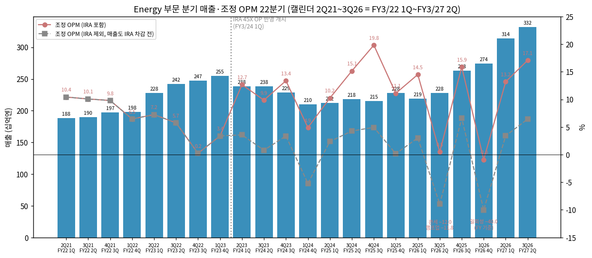

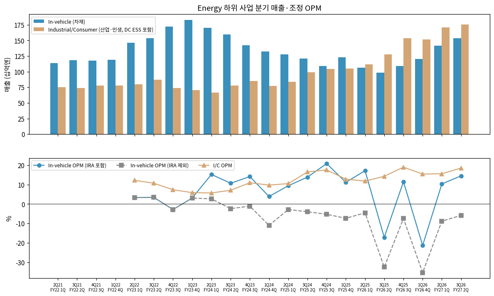

① 22분기 시계열 (십억엔, 캘린더 분기 / 회계 분기)

| 분기 | 회계 | 매출 | 조정OP | OPM | IRA OP | IRA 제외 OP | In-veh 매출 | In-veh OP | I/C 매출 | I/C OP | 북미 GWh |
|---|---|---|---|---|---|---|---|---|---|---|---|
| 2Q21 | FY22 1Q | 188.0 | 19.6 | 10.4% | — | 19.6 | 113.4 | — | 75.5 | — | — |
| 3Q21 | FY22 2Q | 189.6 | 19.1 | 10.1% | — | 19.1 | 118.6 | — | 73.7 | — | — |
| 4Q21 | FY22 3Q | 196.9 | 19.3 | 9.8% | — | 19.3 | 117.6 | — | 77.6 | — | — |
| 1Q22 | FY22 4Q | 198.3 | 12.8 | 6.5% | — | 12.8 | 118.8 | — | 78.1 | — | — |
| 2Q22 | FY23 1Q | 227.8 | 16.5 | 7.2% | — | 16.5 | 146.4 | 4.8 | 79.8 | 9.7 | — |
| 3Q22 | FY23 2Q | 242.0 | 13.9 | 5.7% | — | 13.9 | 153.2 | 5.2 | 87.0 | 9.3 | — |
| 4Q22 | FY23 3Q | 247.4 | 0.6 | 0.2% | — | 0.6 | 171.9 | −4.9 | 73.7 | 5.4 | — |
| 1Q23 | FY23 4Q | 254.6 | 8.6 | 3.4% | (순이익 40.0) | 8.6 | 182.6 | 5.6 | 70.2 | 4.1 | 8.6 |
| 2Q23 | FY24 1Q | 238.4 | 30.2 | 12.7% | 20.8 | 9.4 | 170.2 | 25.9 | 66.8 | 3.8 | 9.4 |
| 3Q23 | FY24 2Q | 238.4 | 23.5 | 9.9% | 21.4 | 2.1 | 159.7 | 17.0 | 78.0 | 5.5 | 9.2 |
| 4Q23 | FY24 3Q | 228.8 | 30.6 | 13.4% | 22.0 | 8.6 | 142.5 | 20.1 | 85.1 | 9.3 | 9.3 |
| 1Q24 | FY24 4Q | 210.3 | 10.3 | 4.9% | 22.6 | −12.3 | 132.6 | 5.1 | 77.2 | 7.5 | 9.3 |
| 2Q24 | FY25 1Q | 211.9 | 21.7 | 10.2% | 16.2 | 5.5 | 127.9 | 12.0 | 84.0 | 8.8 | 8.7 |
| 3Q24 | FY25 2Q | 218.5 | 33.1 | 15.1% | 22.6 | 10.5 | 120.9 | 16.7 | 98.8 | 16.3 | 9.4 |
| 4Q24 | FY25 3Q | 214.9 | 42.6 | 19.8% | 30.3* | 12.3 | 109.3 | 22.7 | 104.5 | 18.3 | 10.0 |
| 1Q25 | FY25 4Q | 227.9 | 25.3 | 11.1% | 24.9 | 0.4 | 123.1 | 13.7 | 104.9 | 13.4 | 10.0 |
| 2Q25 | FY26 1Q | 219.3 | 31.8 | 14.5% | 24.3 | 7.5 | 106.3 | 18.2 | 112.0 | 13.2 | 10.1 |
| 3Q25 | FY26 2Q | 227.6 | 1.1 | 0.5% | 24.0 | −22.9 | 98.4 | −16.9 | 127.7 | 18.2 | 9.8 |
| 4Q25 | FY26 3Q | 262.8 | 41.7 | 15.9% | 22.6 | 19.1 | 108.8 | 12.5 | 153.2 | 29.0 | 8.9 |
| 1Q26 | FY26 4Q | 274.5 | −2.5 | −0.9% | 28.2 | −30.7 | 120.6 | −25.7 | 151.3 | 23.3 | 9.9 |
| 2Q26 | FY27 1Q | 314.0 | 41.4 | 13.2% | 29.7 | 11.7 | 141.7 | 14.6 | 170.7 | 26.5 | 10.2 |
| **3Q26** | **FY27 2Q** | **331.9** | **56.7** | **17.1%** | **33.2** | **23.5** | **153.6** | **22.2** | **175.3** | **32.4** | **11.4** |

→ (출처: Supplemental Financial Data FY3/23 결산(FY3/22·23), FY3/24 결산, FY3/25 3Q, FY3/26 결산, FY3/27 2Q. IRA 제외 [계산]. \*4Q24 IRA에는 전극 활물질 과년도분 포함)

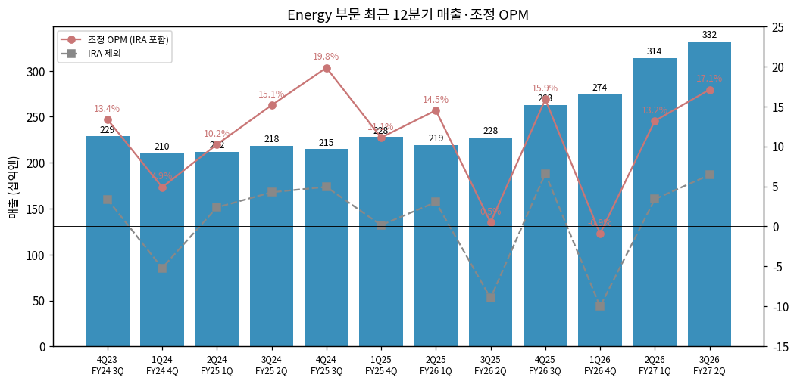

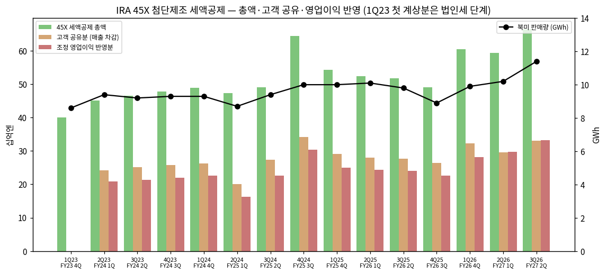

② 사업별 개요 (매출 비중 순, 3Q26 기준)

**Industrial / Consumer (산업·민생) — 53%**

"하이퍼스케일러 AI 서버 랙에 들어가는 배터리 백업 장치(BBU)를 만들어 파는 사업이 이익의 중심. 셀은 일본(스미노에·가이즈카·도쿠시마)에서, 모듈·시스템은 멕시코에서 조립해 미국 데이터센터로 보낸다."

→ **DC ESS (BBU)** — 정전·전압 강하 시 서버에 전력을 대는 랙 단위 리튬이온 백업 + 피크 전력 완화(peak shaving). 하이퍼스케일러와 10년 이상 거래, 차세대 AI 서버 아키텍처 초기 설계부터 참여 (그룹 CEO Q&A 2026-10-30)
→ **원가 구조** — "BBU에서 셀은 총원가의 20% 미만, 가치는 모듈·시스템에 있다" (그룹 CFO Q&A) → 차재처럼 대형 셀 공장 신설이 필요 없고 기존 차재 라인 전환·Kansas 활용으로 대응
→ **신제품** — CBU(Capacitor Backup Unit, Panasonic Industry 리튬이온 커패시터 내장) FY3/27 양산, HVDC 대응 BBU 양산 준비 FY3/27 완료
→ **기타** — 건전지·리튬 1차전지·전동공구/LEV용 원통형·니켈수소 (FY3/24 I/C OPM 8.5% 수준의 저성장 사업)

**In-vehicle (차재) — 46%**

"테슬라 Model 3/Y용 2170 원통형 셀을 미국 Nevada(테슬라 Gigafactory 내 Panasonic 라인)와 Kansas에서 만든다. 북미 생산분은 IRA 45X로 kWh당 $35 세액공제를 받는다."

→ **북미 판매량** — FY3/26 38.7GWh → 3Q26 **11.4GWh (+16% YoY, 분기 최대)** → FY3/27 계획 46GWh. Kansas 가동률 상승이 동인
→ **일본 공장** — 스미노에·가이즈카 차재 라인은 DC용으로 전환 중 / 와카야마 4680 양산 지연 / 오이즈미(군마) 일본 고객용 FY3/29 이후 양산 협의
→ **수익성** — IRA 포함 OPM 10~15%, **IRA 제외 시 2Q23 이후 매 분기 적자** (3Q26 −¥11.0bn)

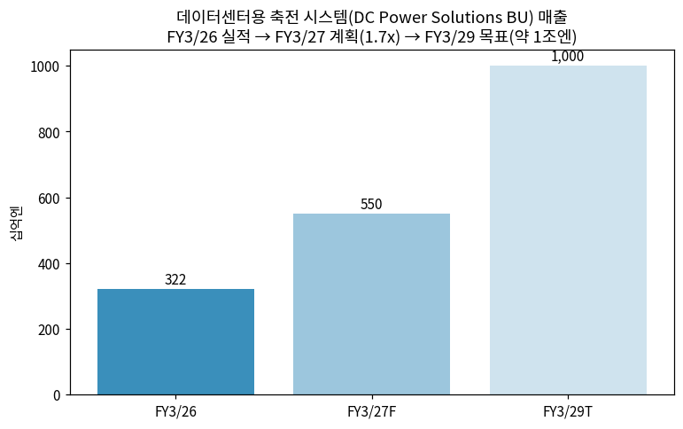

③ 사업별 디테일 (top-seller, growth, 이익 outlier)

→ **성장 1위**: DC ESS — FY3/26 ¥322bn (1.6x YoY 수준), 3Q26 ¥114.9bn (+58% YoY [계산: 114.9/72.7]), 1Q26→3Q26 QoQ 거의 정체(¥113.0 → ¥114.9bn) — 회사는 "고객 납기 타이밍, 수요 모멘텀 약화 없음"
→ **이익 outlier (−)**: 3Q25 In-vehicle −¥16.9bn (미국 관세 −¥12.0bn·Kansas·와카야마 램프업 비용 −¥11.8bn, YoY 요인), 1Q26 In-vehicle −¥25.7bn (과거 제조공정 문제 일회성, FY −¥40.0bn)
→ **이익 outlier (+)**: 4Q24 Energy OPM 19.8% (IRA 과년도분), 3Q26 In-vehicle 증익에 **미국 관세 영향 YoY +¥15.5bn**(환급 포함 — 그룹 2Q 관세 환급 ¥14.7bn, 회사 slide)
→ **I/C 마진** — 3Q26 18.5%로 사상 최고. 회사: 분기 변동은 믹스·관세 영향, 연간 계획(16.3%) 궤도

④ 주요 경쟁사

| 사업 | 경쟁사 | 비고 |
|---|---|---|
| EV 원통형 셀 | LG에너지솔루션(2170·46시리즈), 삼성SDI(46파이), CATL·EVE(46계열), Tesla 내재화(4680) | 2026-1~9월 글로벌 EV 사용량 7위(3.6%), 10위권 중 중국계 다수 (SNE) |
| EV 배터리 전체 | CATL(39.1%), BYD(15.2%), LGES(8.2%), Gotion, CALB, EVE, SK온(2.8%) | Panasonic −0.8% YoY vs 전체 +19.7% (SNE 9M26) |
| DC BBU·축전 | LG에너지솔루션, 삼성SDI(BBU), 중국 셀+대만 전원 업체 [판단] | 회사: 하이퍼스케일러와 공동 설계·미국 내 공급망이 차별점 |
| 소형·1차전지 | Murata, Duracell·Energizer, 중국 업체 | 저성장·안정 |

⑤ 주요 매출처

→ **In-vehicle** — 테슬라("strategic customer", 회사 공식 표현). 9M26 EV 사용량 35.6GWh 중 34.9GWh가 테슬라 북미향 (SNE Research) → 사실상 단일 고객. Lucid(2170 공급 계약, 보도), Mazda·Subaru(일본 생산 협의 — 회사 "Japanese customers"), Zoox(보도) 등 다변화 시도는 아직 숫자로 미확인
→ **DC ESS** — "특정 하이퍼스케일 고객" (그룹 CEO Q&A) — 고객명 미공시. 회사는 Industry(다수 EMS·PCB 고객)와 달리 **Energy DC는 고객 투자계획에 좌우**된다고 명시
→ 매출처 집중도: 차재·DC 모두 소수 고객 의존 — 공시상 고객별 매출 [미공시]

⑥ 생산 CAPA + 임직원

| 공장 | 용도 | 상태 (FY3/27 1Q 자료·보도) |
|---|---|---|
| Nevada (미국, 테슬라 Gigafactory) | 차재 2170 | 약 41GWh/년 → FY3/31 44GWh 목표 (FY3/24 대비 +15%, 고용량화) |
| Kansas (De Soto, 미국) | 차재 2170 + 향후 DC 셀 | 2025-07 양산, 계획 32GWh/년. 2026-02 4개 라인·약 50% 가동 목표, 2동 4개 라인 중 2개 2027 가동 / DC 셀 FY3/29 양산 |
| 와카야마 (일본) | 4680 | 2024-09 개시식, 양산 2회 연기 (주 고객 발주 대기) |
| 스미노에·가이즈카 (오사카) | 차재 → DC 셀 전환 | 2026-04 DC 출하 개시, 일본 DC CAPA 약 3배 (vs FY3/26) |
| 도쿠시마 | DC 셀 | 안정 가동 |
| 오이즈미 (군마) | 차재 (일본 고객) | FY3/29 이후 양산 협의 |
| 멕시코 (모듈) | BBU 모듈 | 2공장 2026-09 양산, 3공장 FY3/28 |

→ (출처: FY3/27 1Q 결산 자료 "Progress in Developing Production Capabilities in Energy", FY3/27 2Q 자료, battery-tech.net 2025-07-15, Lawrence Times 2026-02-03, HPPR 2026-06-18)
→ 2025-03 기준 누적 약 190억 개 셀 공급, EV 약 370만 대분 (battery-tech.net)

---

## ④ 재무 구조

> Panasonic Energy 단독 재무상태표·현금흐름표는 공시되지 않는다 → **(1) 손익은 Energy 부문, (2)~(7)은 그룹 기준**(맥락용)

(1) 손익 — Energy 부문은 ③ (1) 통합 표 참조. 그룹 10년은 ② (2-1)

(2) 재무상태표 (그룹, 십억엔)

| 항목 | FY3/22 | FY3/23 | FY3/24 | FY3/25 | FY3/26 | 2026-09말 |
|---|---|---|---|---|---|---|
| 총자산 | 8,023.6 | 8,059.5 | 9,411.2 | 9,343.2 | 10,172.4 | 10,307.6 |
| 자본총계 | 3,347.2 | 3,790.0 | 4,721.9 | 4,874.8 | 5,382.0 | 5,528.2 |
| 지배주주 자본 | 3,165.0 | 3,618.4 | 4,544.1 | 4,694.4 | 5,211.3 | 5,366.8 |
| 자기자본비율 | 39.4% | 44.9% | 48.3% | 50.2% | 51.2% | 52.1% |
| 이자부채 | 1,897.3 | 1,457.1 | 1,626.3 | 1,568.2 | 1,603.2 | 1,591.4 |
| 순현금(차입) | — | — | — | — | −756.7 | −743.4 |

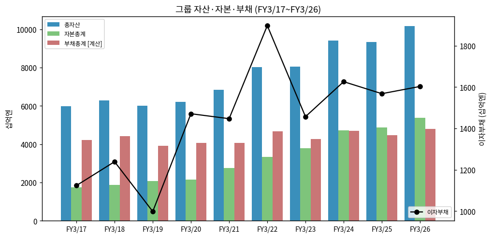

(3) 현금흐름 (그룹, 십억엔)

→ 영업CF FY3/24 ¥866.9bn (IRA 양도 현금화) → FY3/26 ¥624.3bn / FCF FY3/25 −¥63.8bn → FY3/26 ¥16.9bn — Kansas CapEx가 FCF를 눌렀다
→ FY3/27 1Q 영업CF ¥372.0bn에 **FY3/25분 IRA 직접환급(direct pay) 순 ¥108.8bn** 유입 (회사). IRA는 P/L 계상과 현금화 사이에 시차가 있다
→ FY3/27 2Q 영업CF −¥48.9bn (운전자본 증가, 재고일수 56.1일)

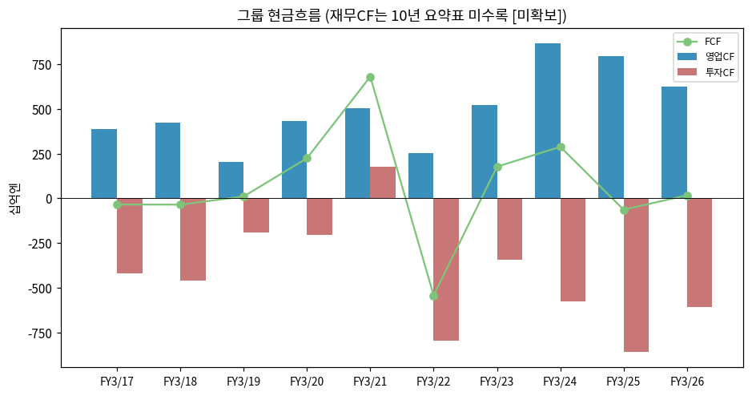

(4) CapEx

→ Energy CapEx FY3/22 ¥36.1bn → FY3/25 **¥501.1bn (피크)** → FY3/26 ¥431.6bn → FY3/27 계획 ¥267.0bn (7월 ¥238bn → 10월 ¥267bn 상향) — **Kansas 사이클 종료, DC 증설로 재가속 여부가 관건**
→ 감가상각(유형) FY3/22 ¥19.8bn → FY3/27 계획 ¥74.0bn (3.7배) — Kansas 상각 부담이 차재 마진을 누르는 구조
→ FY3/27~FY3/29 AI 인프라 투자 약 ¥500bn 중 Energy 약 ¥350bn (Kansas 공용 인프라 포함, 통합보고서 2026)

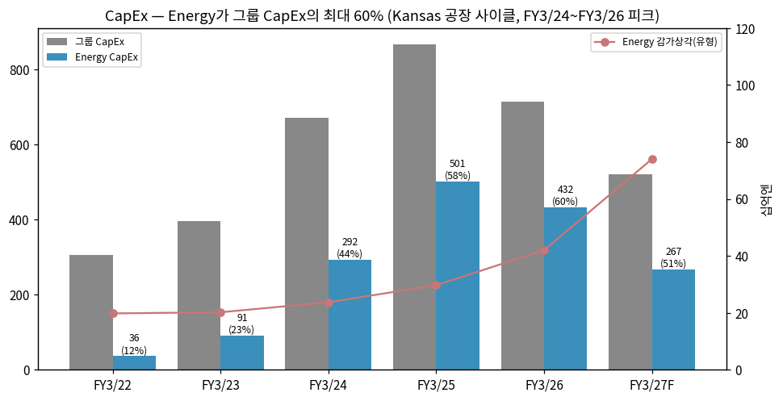

(5) 부채 구조 — 신용등급 R&I A / S&P A− / Moody's Baa1 (통합보고서 2026). 이자부채 ¥1.59조 (리스부채 ¥244bn 포함, 2026-09말)

(6) 배당·자사주

→ DPS FY3/24 ¥35 → FY3/25 ¥48 → FY3/26 ¥40 → **FY3/27 계획 ¥70** (중간 ¥27 확정, 10/30 기말 ¥43으로 상향, 배당성향 30.3%) — 자사주 매입 프로그램 없음 (자사주 119.6백만주 보유)

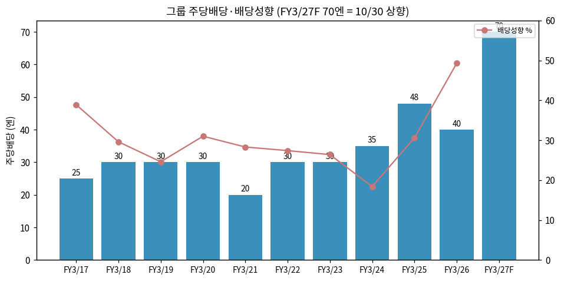

(7) 재무비율 (그룹)

| 항목 | FY3/22 | FY3/23 | FY3/24 | FY3/25 | FY3/26 |
|---|---|---|---|---|---|
| ROE | 8.9% | 7.8% | 10.9% | 7.9% | 3.8% |
| 영업이익률(IFRS) | 4.8% | 3.4% | 4.2% | 5.0% | 2.9% |
| 이자부채/총자산 | 23.6% | 18.1% | 17.3% | 16.8% | 15.8% |
| PBR (기말) | 0.88 | 0.76 | 0.74 | 0.88 | 1.16 |
| 배당성향 | 27.4% | 26.4% | 18.4% | 30.6% | 49.3% |

→ (출처: Integrated Report 2026 10년 요약)

---

## ⑤ 지배 구조

(1) 그룹·계열 관계

→ Panasonic Holdings(지주) → **Panasonic Energy Co., Ltd. (100%)** → Panasonic Energy of North America(Nevada·Kansas), 멕시코 모듈 법인 등
→ 관련: Prime Planet Energy & Solutions(토요타 JV, 각형 배터리 — Panasonic 지분 소수, 그룹 Energy 세그먼트 외) [판단: 지분율 미확인]
→ 그룹 내 시너지: Panasonic Industry(커패시터) — CBU 공동 개발

(2) 주주 구분 (Panasonic HD, 2026-03말)

| 구분 | 2016/3 | 2020/3 | 2024/3 | 2026/3 |
|---|---|---|---|---|
| 외국인 | 31.2% | 30.3% | 37.0% | **45.9%** |
| 국내 금융기관 | 30.6% | 34.7% | 32.4% | 29.6% |
| 개인 등 | 25.9% | 24.0% | 20.0% | 15.4% |
| 기타 법인 | 6.9% | 6.1% | 5.0% | 4.2% |
| 자사주 | 4.9% | 4.9% | 4.9% | 4.9% |

→ 대주주 (자사주 제외 비율): 마스터트러스트신탁(신탁) 15.06%, 일본커스터디(신탁) 7.53%, State Street 3.33%, 일본생명 2.07%, Moxley 2.05%, 스미토모생명 1.60%, JP Morgan 1.42%, BNYM 1.40%, 노르웨이 정부 1.32%, 마쓰시타 부동산 1.24% — **지배주주 없음**, 창업가 계열 1% 수준
→ 주주 수 385,608명

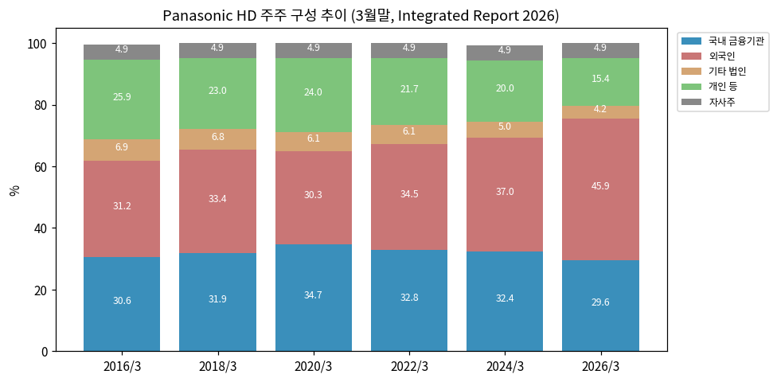

(3) 임원

→ 그룹 CEO **Yuki Kusumi** (2021-06~) — 구조개혁·포트폴리오 매각(Automotive, 주택설비, 전동공구, 차재 모터 등) 주도 / 그룹 CFO Akira Waniko / 그룹 CSO Kazuyo Sumida
→ Energy CEO **Kazuo Tadanobu** — 통합보고서 2026 대담: "DC용 전원 솔루션 제공자", FY3/29 DC ESS 매출 ¥950bn+ 목표 (이후 ~¥1조로 상향)

---

## ⑥ 기타 팩트

(1) R&D

→ 그룹 R&D FY3/26 ¥426.4bn (매출의 5.3%) — 부문별 미공시 [미확보]

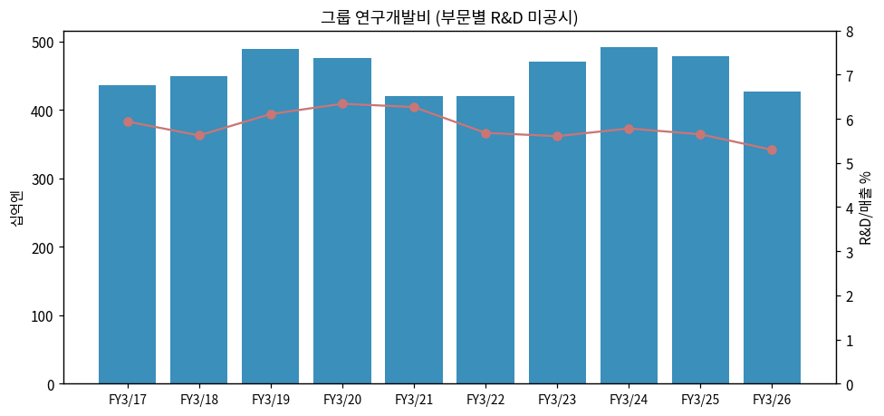

(2) 진행 중 corporate action

→ 2026-03 전동공구 사업 Makita 매각 (2026-09-01 종결) / 차재 모터·냉각팬 MinebeaMitsumi 매각 (2027-03-01 예정) / 차재 BDU 등 Midas Atlantic 매각 (2027-02-01 예정) — 모두 Energy 외
→ Energy: Kansas 2동 건설, 멕시코 모듈 3공장(FY3/28), Kansas DC 셀 라인(FY3/29)

(3) 기술 마일스톤

→ 2170 고용량화 (Nevada FY3/31 44GWh) / 4680 (와카야마, 양산 지연) / 무코발트·고니켈 양극재 / CBU(리튬이온 커패시터) FY3/27 양산 / HVDC BBU FY3/27 준비 완료

(4) 주요 리스크

→ **IRA 45X 정책** — OBBBA(2025-07) 이후 PFE 조달 요건 강화(2026 60% → 2030 85%), 가이드라인 2026-12-31 발표 예정. 2030년부터 단계 감액
→ **테슬라 의존** — 차재 물량 사실상 단일 고객. 4680 발주 미확정
→ **DC ESS 고객 집중** — 특정 하이퍼스케일러 투자계획에 좌우. 데이터센터 전력·인력 제약에 따른 프로젝트 지연, 메모리 등 타 부품 병목이 BBU 출하를 제약할 가능성 (그룹 CEO Q&A)
→ **미국 관세** — FY3/26 Energy 관세 영향 −¥25.0bn, FY3/27 환급 반영 (그룹 환급 계획 ¥24bn)
→ **환율** — USD 1엔 엔고 시 그룹 조정OP −¥3.0bn (회사 감응도)
→ **제조 품질** — FY3/26 과거 제조공정 문제 일회성 비용 ¥40.0bn

(5) ESG — 그룹 RE100·Panasonic GREEN IMPACT. Panasonic Energy 통합보고서 별도 발간 (미수집 ⚠️)

(6) 인증·라이선스 — 미국 45X 적격 생산자(세포·전극 활물질). 세부 [미확보]

---

## Version Log

→ **v1.0** (2026-11-14) — 초안. Supplemental Financial Data 7건 + 결산 자료 4건 + Q&A 요지 + 통합보고서 2026 수집. Energy 22분기(매출·조정OP·OP·EBITDA) + 하위 사업 2개 + IRA 45X 14분기(포함/제외) + 그룹 10년 + 15종 차트. LGES·삼성SDI와 보조금 포함/제외 OPM 비교
→ **잔여 보완 (v1.1)**: Panasonic Energy 통합보고서(임직원·R&D·CAPA 상세) / FY3/21 이전 배터리 사업 손익 재구성(Annual Report 2018~2021 세그먼트 주석) / Energy 컨센서스 집계 / 11월 주가 급락 원인 / 2026-12 Investor Day / FY3/27 3Q(2027-02) 반영 / 45X PFE 가이드라인(2026-12-31)
