> Ticker: **SSE STAR Market: 688005 (688005.SS) — 宁波容百新能源科技股份有限公司 (Ningbo Ronbay New Energy Technology Co., Ltd., 약칭 容百科技 / Ronbay)**
> Entity: 본사 저장성 닝보(余姚), 2014-09 설립, 2019-07-22 상해거래소 과창판(STAR) 1호 상장 25개사 중 하나. 하이니켈 삼원계(NCM811·Ni90+) 양극재 전문 → 2025~26 LFP·LMFP·나트륨(钠电) 양극재까지 넓힌 "멀티 케미스트리 양극재 플랫폼"
> Sector: 배터리 — 서브섹터 **양극재 글로벌** (한국 양극재 3사 에코프로비엠·포스코퓨처엠·엘앤에프와 비교)
> 작성 시각: **2026-11-14 KST** (**v1.0** — Phase 1 Source 전수 수집 + audit + 13종 차트)
> 적용 구조: v4.8 (6개 섹션) + v1.5 ① 기업 분류 표준
> 데이터 범위: **연간 10년 (2016~2025, 12월 결산; 2016~2018은 상장 전 재무 — 투자설명서 기준치)** + **9M26 (1~3Q26)** + **분기 35Q (1Q18~3Q26, 분기 단독 손익)** + 판매량 7년 (2019~2025) + 주가 (2019-07 상장 ~ 2026-11-13)
> 출처: **회사 정기보고서 원문 (상해거래소 공고, 东方财富 공고 미러 pdf.dfcfw.com 경유)** — 2026 3분기 보고서(2026-10-31 게재), 2026 반기 보고서(07-23), 2026 1분기 보고서(04-30), 2025·2024·2023·2022·2021·2020·2019 연간 보고서, 2025 3분기 보고서, 2026 반기 실적예고 / 분기 단독 손익·재무상태·현금흐름 시계열 = **东方财富 F10 재무 API (회사 공시치 집계 — 연간·9M 합계를 원문과 대조해 일치 확인)** / 회사 공고 2026-059 (한국 자회사 임대·무형자산 양도 관련 거래, cninfo 2026-10-22) / **Yahoo Finance 688005.SS** / 东吴证券 3Q26 점평(2026-11-03) / SNE리서치 (헬로티 2026-08-11, 아시아경제 2026-10-12) / 腾讯新闻 (2026-04-18) / 每日经济新闻 (2026-10-21) / 同花顺 (2026-10-24)

# Ronbay(容百科技) 기업 개요 (v1.0 — 양극재 글로벌 / 삼원계 출하 세계 1위 → 북미 규제(PFE)로 한국 공장 분리 + LFP·나트륨으로 체질 전환 중)
> **Fact verify cutoff**: 2026-11-14 (주가 2026-11-13 종가 **CNY 17.76** [Yahoo Finance], 52주 고가 40.80 (2026-05-08 장중) / 52주 저가 17.53 (2026-11-02 장중) [Yahoo Finance], 시가총액 **약 CNY 126.9억 (≈ 2.54조원)** [계산: 총발행 714,618,752주 × 17.76, 원화는 CNY/KRW 200.32 (Yahoo 2026-11-13)] — 교차검증: 东吴证券 총시가 128.06억위안 (11/03 종가 17.92 기준))

## Phase 1 Source Audit

```
=== 자료 수집 audit (Ronbay / 容百科技, 688005.SS) ===

✅ 확보 (저장: company-overview-source/688005.SS_Ronbay/)
- 정기보고서 원문 PDF 11건: 2019~2025 연간 7건, 2025 3Q, 2026 1Q·반기·3Q + 2026 반기 실적예고
- 东方财富 F10 재무 API: 분기 단독 손익 35Q (1Q18~3Q26), 연간 손익 10년 (2016~2025), 재무상태표·현금흐름표 (2016~3Q26)
  → 검증: 2019~2025 분기 합계 = 연간 매출·营业利润 일치, 9M26 营业利润 0.48억 = 3Q26 보고서 원문 47,529,443.98위안 일치
- 회사 공고 2026-059 (한국 JS 공장 → 관련회사 AKB 임대, 2026-10-21 이사회)
- Yahoo Finance 688005.SS 월간 (2019-07~) + 일간 1년, USD/KRW·USD/CNY 일간 2년 (원·위안 분기 평균 환산용)
- 东吴证券 3Q26 점평 (2026-11-03, 2026~28E) / SNE리서치 1H26·1~8월 삼원계 순위 (기사 경유)

❌ 누락 (5)
- 2014~2015 재무: 상장 전, 투자설명서 미수집 → 연간 시계열 10년 (12년 표준 대비 −2년)
- 분기 판매량(톤): 회사는 분기별 절대치를 일관 공시하지 않음 → 2025~2026 일부 분기만 회사 증감률로 역산 ⚠️추정
- 제품별 분기 매출 (삼원 vs LFP vs 나트륨 vs LMFP): 미공시 → 연간 정극/전구체 구분만
- 고객 실명: 연간보고서는 "客户一~五"로 익명 공시 → 정성 단서만 (아래 ③(5))
- 컨퍼런스콜(业绩说明会) Q&A 원문: 미확보

⚠️ 결과 영향
- 이익 지표 이원화: 중국 회계 营业利润(투자수익·기타수익·자산/신용손상·재무비용 포함)과 한국식 영업이익 근사(=매출총이익−세금및부가−판매비−관리비−R&D)를 병기
- 한국식 근사치는 재고평가손실(存货跌价, 중국 회계상 资产减值损失)을 빼지 않은 값 → K-IFRS 영업이익보다 높게 나온다 (재고손실이 큰 분기일수록 과대: 3Q26 약 0.8억위안)
- 판매량 단위 변경: 2019~2020 "삼원 정극"만 → 2021~ "正极材料" 전체 (2022 LMFP 인수 이후 LMFP 포함, 2025~ 나트륨 포함)
- 2025-03 자본공적금 전증(10주당 4.9주) → 주당 지표·주가는 조정 기준

Source 6종 audit:
[V] (1) 정기 보고서 (연간 7년 + 분기·반기) ✓
[V] (2) 최신 분기 (3Q26, 2026-10-31 게재) ✓ — 컨콜 Q&A ✗
[△] (3) Sustainability: 연간보고서 ESG 장 (별도 ESG 보고서 미수집)
[V] (4) 주가 (Yahoo 688005.SS) ✓
[✗] (5) IR Day·전략 발표 자료: 미수집
[△] (6) 12년+ 시계열: 연간 10년 (2016~2025) / 분기 35Q
```

---

## ① 기업 분류

(1) Primary / Secondary 분류

**Primary 분류: 사이클 (메탈가 연동 가공 마진 + 고객 집중)**

→ 매출 2016 8.9억위안 → **2022 301.2억 (정점)** → 2025 122.7억 (정점 대비 −59%) → 9M26 146.0억 (+62.5% YoY) [계산]
→ 매출은 메탈가(리튬·니켈·코발트) 전가로 출렁이고, 이익은 가공 마진(spread)이라 얇다 — 한국식 OPM 10년 평균 **5.0%**, 정점 8.9% (2018), 2025 −0.6% [계산]
→ 판매량은 2019 2.2만톤 → 2024 12.2만톤으로 5.6배, 2025 10.4만톤 (−14.6%) — "볼륨은 크게 늘었는데 ASP 하락(2022 30.6 → 2025 11.3만위안/톤)이 매출을 깎는" 구조

**Secondary 노트: 고객 집중 + 지정학 (북미 규제)**

→ 1위 고객 매출 비중 2021 63.1% → 2025 55.1% — 한 고객의 주문이 실적을 좌우 (연간보고서 "客户一")
→ 2025년 미국 「One Big Beautiful Bill Act」의 금지외국기관(PFE) 조항 → 중국계 지분 25% 초과 기업의 북미향 공급 제한 → **한국 충주 공장(6.7만톤)을 실소유주 관련회사(AKB)에 임대·분리**하는 구조조정 진행 중 (2026-10 공고)

**사업 구조 (2025 연간, 주영업 매출 118.4억위안)**

→ **(1) 정극재(正极材料)** — 117.3억 (99.1%), GPM 6.5% — 삼원(하이니켈·중니켈), LMFP, 나트륨, LFP(2026 하반기 양산 시작)
→ **(2) 전구체(前驱体)** — 1.0억 (0.9%), GPM −10.9% — 대부분 자체 공급 (2025 생산 2.69만톤 중 외부판매 0.15만톤)
→ 제품별 매출(삼원/LFP/나트륨/LMFP)은 미공시. 2025 삼원 출하 약 10만톤 (연간보고서 MD&A) vs 정극 전체 판매 10.39만톤 → 매출의 대부분이 삼원 [계산]

(2) Summary Box (10년 시계열)

| 지표 | 값 |
|------|-----|
| 매출 CAGR (2016→2025, 9년) | **+33.9%/yr** [계산] — 상장 후 (2019→2025) +19.6% |
| OPM 평균 (한국식 근사, 10년) | **5.0%** [계산] |
| OPM 정점 | 2018 8.9% · 2021 8.6% |
| OPM 저점 | 2025 −0.6% (첫 연간 적자) · 2016 2.9% |
| GPM 평균 (10년) | 12.0% (2018 16.6% → 2025 7.4%, 구조적 하향) [계산] |
| 사이클 주기 | 2019~20 (보조금 축소·COVID) 저점 → 2021~22 리튬 슈퍼사이클 → 2023~25 역래깅·해외 부진 → 2026 볼륨 회복 |
| 국면 | 매출 반등 3개 분기 (1Q26 +28% → 3Q26 +115%) / 이익은 3Q26 재차 적자 (营业利润 −1.19억) |

```
[Ronbay 10년 손익 (억위안, 12월 결산, 중국 기업회계준칙)]
연도     매출   한국식OP  OPM    营业利润  지배순이익  판매량(톤)
2016     8.85    0.26   2.9%    0.08     0.07       —
2017    18.79    0.81   4.3%    0.48     0.31       —
2018    30.41    2.70   8.9%    2.35     2.13       —        ← NCM811 대량 양산 (중국 최초권)
2019    41.90    2.90   6.9%    0.99     0.87    21,854      ← 7월 STAR 상장 / 4Q 매출채권 대손 1.74억
2020    37.95    1.68   4.4%    2.53     2.13    26,267      ← 보조금 축소·COVID
2021   102.59    8.85   8.6%   10.16     9.11    52,342      ← 고객 1위 비중 63%, 하이니켈 수요 폭증
2022   301.23   17.62   5.8%   16.18    13.53    89,050      ← 리튬가 정점, 매출 사상 최대 / LMFP(斯科兰德) 인수
2023   226.57   10.64   4.7%    7.44     5.81    99,446      ← 메탈가 급락 → 4Q 재고손실
2024   150.88    5.38   3.6%    4.30     2.96   121,689      ← 판매량 사상 최대, ASP 11.8만/톤
2025   122.67   -0.71  -0.6%   -1.17    -1.87   103,899      ← 해외 부진·북미 PFE, 첫 연간 적자 (4Q 흑자 전환)
9M26   146.04    3.09   2.1%    0.48    -0.16   삼원 ~9만톤  ← 판매량·가격 동반 상승, 3Q 재고손실로 적자
```
> 한국식 OP = 매출 − 매출원가 − 세금및부가 − 판매비 − 관리비 − 연구개발비 [계산, 东方财富 F10 = 회사 원문 계정]. 营业利润 = 회사 공시 (투자수익·기타수익·손상·재무비용 포함).

**한국 양극재 3사 대비 위치 (3Q26)** [판단]

| 항목 | **Ronbay** | 에코프로비엠 | 포스코퓨처엠 | 엘앤에프 |
|---|---|---|---|---|
| 3Q26 매출 | **58.83억위안 (≈ 1조 2,364억원)** | 5,579억원 | 8,348억원 (양극재 4,323억) | 8,744억원 [잠정] |
| 매출 YoY | **+114.9%** | −10.8% [계산] | −4.6% (양극재 −14.9% [계산]) | +34.0% |
| 영업이익 (OPM) | 한국식 0.19억위안 (**0.3%**) / 营业利润 −1.19억 (−2.0%) | 120억 (2.2%) | 821억 (9.8%; 에너지소재 518억, 11.3%, 보상금 포함) | −265억 (−3.0%) |
| 영업이익 YoY | 흑자전환 (3Q25 −1.41억, 한국식) | −76.2% | +23.1% | 적자전환 |
| 판매량 증가율 | **삼원 +81% YoY, +36% QoQ** (3.8만톤+) | [미공시] (EV 매출 −34% QoQ) | [미공시] | NCM +10% YoY, −5% QoQ |
| SNE 1H26 삼원계 순위 (적재량 기준) | **1위 6.9만톤** | 8위 2.8만톤 (에코프로) | 10위 2.4만톤 | 3위 4.0만톤 (+53.8%) |

→ (출처: Ronbay = 3Q26 분기보고서·东方财富 F10 [계산], 원화 = 3Q26 평균 CNY/KRW 210.16 [계산: Yahoo USD/KRW ÷ USD/CNY 일별 평균]. 한국 3사 = 각 사 기업개요 (2026-11-14 작성, DART·IR). SNE리서치 = 헬로티 2026-08-11 기사)
→ 볼륨은 Ronbay가 한국 3사 어느 곳보다 빠르게 늘지만 마진은 비슷하거나 낮다 — 성장률(+115%)은 메탈가 상승분 전가 + 저기저(3Q25 −38%) 효과가 크다
→ 공통점: 4사 모두 3Q26에 메탈가(리튬) 하락에 따른 재고평가손실을 맞았다 (Ronbay 0.8억위안, 엘앤에프 −426억원, 에코프로비엠 저마진)

(3) 산업 분류

→ **회사 자체 정의** — 锂电正极材料 (리튬·나트륨 전지 정극재)
→ **시장** — 상해거래소 과창판 (후구퉁 대상 — HKSCC 1.13% 보유)
→ **워치리스트** — 섹터 배터리 / 서브섹터 양극재 글로벌

(4) 분류 결정 논리

(1) 매출 기준: 정극재 99% — 단일 제품군. 다만 삼원 → LFP·나트륨·LMFP로 케미스트리 분산 진행 (2026 하반기부터 실적 반영)
(2) 성장 변수: 판매량 (삼원 9M26 +25%, 3Q26 +81%) × 메탈가 (전가) — 두 변수가 같은 방향일 때만 매출·이익이 같이 오른다
(3) 이익 변수: 가공 마진 + 재고 래깅 — 메탈가 상승기에는 저가 재고로 마진 확대(1H26), 하락기에는 재고손실(3Q26). 고정비 흡수(가동률)가 2차 변수
→ 결론: 성장 국면이 있어도 이익의 방향은 메탈가 사이클이 정한다 → **사이클**

(5) 적정 밸류에이션 방법

→ **1차 — P/B**: 이익이 적자~저수익을 오가 PER은 의미가 약하다. 시총 126.9억 / 3Q26 지배자본 79.8억 = **1.59배** [계산] — 2022-07 고점 시총 약 760억위안 [계산: 원주가 약 168위안 × 당시 약 4.51억주] 대비 1/6 수준
→ **2차 — Forward PER**: 东吴证券 2026E 지배순이익 1.28억 → **약 99배**, 2027E 4.53억 → **약 28배** [계산, 현재가 기준] (2026-11-03 추정치, 직전 4/8/10억에서 하향)
→ **3차 — EV/EBITDA**: 东吴证券 2025A EBITDA 7.65억 → EV 약 180억 [계산: 시총 126.9 + 순차입 53.8] / 7.65 = 약 24배

(6) 분기 재평가 트리거

→ ① LFP(34만톤 프로젝트) 대형 고객 양산 공급 + 나트륨 2027 7~8만톤 출하(东吴 추정) 달성 → 삼원 단일 → "멀티 케미스트리 성장" 재분류 검토
→ ② 한국 공장 AKB 임대가 확정되면 2027 연결 매출 감소 (东吴 2027E −23.5%) → 볼륨 지표를 "연결 판매량"이 아닌 "그룹 출하(AKB 포함)"로 따로 봐야 함
→ ③ 2개 분기 연속 한국식 OPM 4%+ & 재고손실 없이 → 마진 레벨 재평가

---

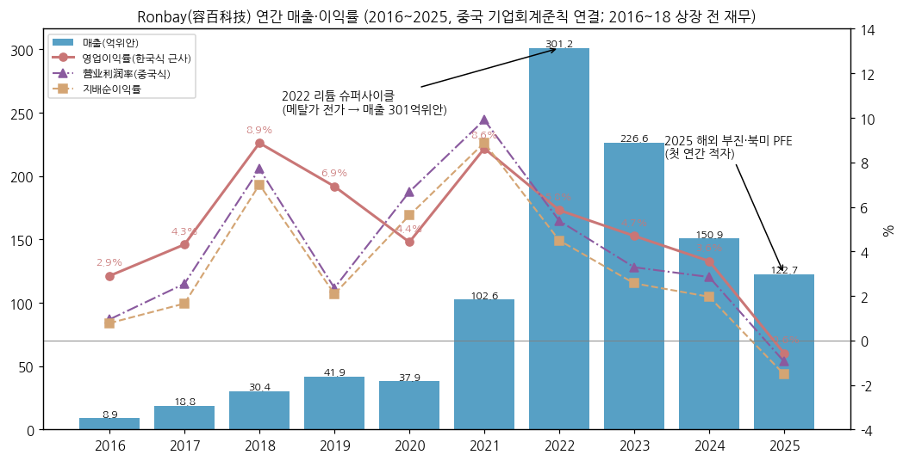

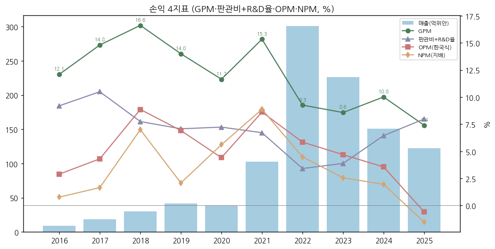

---

## ② 회사 개요

(1) 기본 정보

- **법인명** — 宁波容百新能源科技股份有限公司 (Ningbo Ronbay New Energy Technology Co., Ltd.), 설립 2014-09-22
- **본사** — 저장성 닝보시 위야오(余姚) / 생산기지 — 후베이 어저우(鄂州)·셴타오(仙桃), 구이저우 쭌이(遵义)·비제(毕节, 新仁), 저장 닝보, **한국 충주(忠州)**, 폴란드(2026 말 준공 예정)
- **상장** — 2019-07-22 상해거래소 과창판 (STAR Market 개장 첫날 상장 25개사), 총발행 714,618,752주 (2026-09말, 자사주 10,090,435주 = 1.41%)
- **사업 한 줄 정의** — 리튬·나트륨 배터리의 "+극" 소재(양극재)를 만드는 회사. 하이니켈 삼원계 세계 최대 출하 업체에서 LFP·나트륨까지 모든 화학계를 파는 플랫폼으로 바꾸는 중
- **회장 겸 총경리 (실소유주)** — 白厚善 (1964년생, 중남대 유색야금, 전 北京当升(이스프링) 부사장급 → 2014 Ronbay 창업)
- **부회장** — 刘相烈 (1960년생 한국 국적, 한양대, **전 엘앤에프 양극재 사업부 총괄 (2005~2009)**, 2010 EMT 창업) — 한국 사업의 축
- **재무책임자** — 张慧清 (2026-02~ 대행)
- **임직원** — 3,962명 (2025말), 정점 4,644명 (2022말)

(2) 핵심 KPI (2025 연간 + 3Q26 + 9M26)

| 항목 | 2025 | 3Q26 | 9M26 | 9M26 YoY |
|---|---|---|---|---|
| 매출 (억위안) | 122.67 | 58.83 | 146.04 | **+62.5%** |
| 매출총이익률 | 7.4% | 5.3% | 7.8% | +0.5%p |
| 영업이익 (한국식 근사) | −0.71 | 0.19 (0.3%) | 3.09 (2.1%) | 흑자전환 (9M25 −0.96) |
| 营业利润 (중국식) | −1.17 | −1.19 | 0.48 | 흑자전환 (9M25 −1.66) |
| 지배순이익 | −1.87 | −1.25 | −0.16 | 적자 축소 (9M25 −2.04) |
| 扣非 순이익 (비경상 제외) | −2.17 | −1.15 | −0.13 | 적자 축소 |
| 영업활동 CF | 11.35 | −2.54 | −4.26 | 적자전환 (9M25 +13.71) |
| 삼원 판매량 (톤) | 약 10만 | 3.8만+ | 약 9만 | +25% (3Q +81%) |
| 재고자산 (기말) | 21.4 | 50.0 | — | 연초 대비 +134% |

→ (출처: 회사 3Q26·2025 연간보고서, 东方财富 F10 분기 단독 손익 [한국식 OP 계산])

(3) 주요 연혁

**1기 (2014~2019) — 하이니켈 삼원 전업 + 상장**
→ **2014-09** — 白厚善 등 이스프링(当升) 출신 경영진이 닝보에서 설립, 刘相烈 부회장 합류 (2014-10). 한국 EMT(전구체, 2010 刘相烈 창업)·JS(载世能源, 양극재)를 자회사로 편입 (편입 시점 [미확보])
→ **2016~2018** — 후베이 어저우 기지 가동, NCM811 양산, 2018 매출 30.4억
→ **2019-07-22** — 과창판 상장 (개장 1호 배치) / 4Q19 일부 고객 매출채권 대손 1.74억 → 순이익 −59%

**2기 (2020~2022) — 리튬 슈퍼사이클 + 1위 고객 동반 성장**
→ **2020** — 보조금 축소·COVID로 매출 −9%, 하반기 회복
→ **2021** — 매출 102.6억 (+170%), 1위 고객 비중 63.1%, 한국 충주 증설
→ **2022** — 매출 301.2억 (사상 최대), 순이익 13.5억 / **天津斯科兰德(LMFP) 인수** → LMFP 진입
→ **(시점 [미확보])** — Umicore 특허소송, 회사 "최종 승소" 기재 (2025 연간보고서)

**3기 (2023~2025) — 역래깅·해외 부진**
→ **2023-09** — 정향증자 13.25억 / 메탈가 급락 → 4Q23 순손실
→ **2024-01** — **LG화학, 한국 특허 5건 침해 주장** (무역위원회 조사 → 2024-11 중지, 서울중앙지법 본안·가처분 계속)
→ **2024** — 판매량 12.2만톤 (사상 최대), 매출 −33% (ASP 하락)
→ **2025-03** — 자본공적금 전증 10:4.9 / 2025 「OBBBA」 PFE 조항 → 북미향 한국 공장 공급 차질
→ **2025** — 첫 연간 적자 (−1.87억), 4Q25 흑자 전환 / 貴州新仁 인수로 LFP 6만톤 확보 ("一步法" 공정)
→ **2025-11** — CATL과 나트륨 양극재 장기협약 ("钠电正极 1순위 공급사", CATL 총구매의 60% 이상)

**4기 (2026~) — 멀티 케미스트리 + 한국 분리**
→ **2026-01** — CATL과 LFP 장기 구매협약 (2026~2031 약 305만톤, 회사 추정 매출 1,200억위안+) → 거래소 문의 → **2026-04-10 증감회 닝보국 처분** (공시 오해 소지: 회사 450만위안, 白厚善 300만, 이사회비서 200만 벌금 — 腾讯新闻 2026-04-18)
→ **2026-03** — 한국 JS 분할(JS Old / JS New) 후 JS Old 지분을 싱가포르·한국 AKB(Amkobay)에 0.97억달러에 매각 결의 → **미교부** (인수자 자금 조달 지연)
→ **2026-1H** — 매출 87.2억 (+39.6%), 순이익 1.09억 흑자 / 삼원 5.2만톤, 2·3위 고객 해외 (합산 30%+)
→ **2026-07~10** — 셴타오 나트륨 30만톤 계약 (7/30), 샹양 나트륨 20만톤 계획 (10월), 고객 선수금 6.4억
→ **2026-10-21** — 한국 공장을 **AKB(실소유주 白厚善 관련회사)에 임대** (월 38.84억원, 10년 의향, 상한 23.7억위안) + 수탁가공 계약 — 관련거래로 주총 부의
→ **2026-10-31** — 3Q26: 매출 +115%, 순이익 −1.25억 (재고손실)

(4) 회사 주가 역사

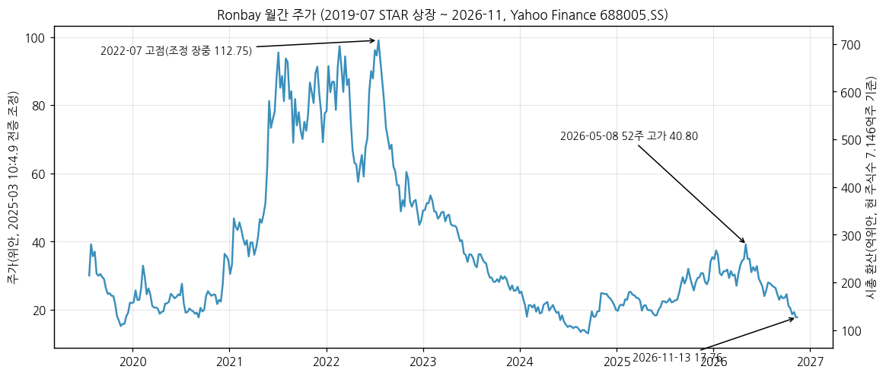

- 2019-07 상장 후 20~30위안대 → 2021~2022 리튬 슈퍼사이클로 급등
- **ATH: 2022-07 장중 112.75위안 (2025-03 전증 조정치)** [Yahoo Finance] — 원주가 기준 약 168위안 [계산: ×1.49]
- 2023~2024 하락 → 2024-08 저점 14위안대 (조정) → 2025 하반기~2026-05 반등 (52주 고가 **40.80, 2026-05-08**)
- 2026-05 이후 하락: CATL LFP 협약 공시 처분(4월) 여진, 2Q 이후 메탈가 반락, 한국 공장 관련회사 임대(10/21), 3Q 적자 → **2026-11-13 종가 17.76위안 (52주 고가 대비 −56%, ATH 대비 −84%)** [계산]
- 시총 약 126.9억위안 (≈ 2.54조원) [계산]

---

## ③ 비즈니스 모델

(1) 실적 추이 통합 표 (억위안)

| 항목 | 2021 | 2022 | 2023 | 2024 | 2025 | 9M26 |
|---|---|---|---|---|---|---|
| **매출** | 102.59 | 301.23 | 226.57 | 150.88 | 122.67 | 146.04 |
| └ 정극재 (주영업) | 95.75 | 272.47 | 209.67 | 143.57 | 117.34 | [미공시] |
| └ 전구체 (외부판매) | 1.54 | 1.31 | 1.44 | 1.05 | 1.05 | [미공시] |
| └ 중국 대륙 | 96.14 | 265.31 | 206.53 | 139.57 | 104.88 | [미공시] |
| └ 중국 대륙 외 (해외) | 1.14 (1.2%) | 8.48 (3.1%) | 4.60 (2.2%) | 5.07 (3.5%) | **13.52 (11.4%)** | [미공시] |
| **정극재 판매량 (톤)** | 52,342 | 89,050 | 99,446 | 121,689 | 103,899 | 삼원 약 9만 |
| └ 판매량 YoY | +99.3% | +70.1% | +11.7% | +22.4% | −14.6% | 삼원 +25% |
| **정극 ASP (만위안/톤)** [계산] | 18.29 | 30.60 | 21.08 | 11.80 | 11.29 | ⚠️ 3Q26 약 14 |
| **매출총이익 (GPM)** | 15.74 (15.3%) | 27.91 (9.3%) | 19.44 (8.6%) | 15.11 (10.0%) | 9.09 (7.4%) | 11.33 (7.8%) |
| └ 정극재 GPM | 15.5% | 8.6% | 7.6% | 9.3% | 6.5% | — |
| **영업이익 한국식 (OPM)** | 8.85 (8.6%) | 17.62 (5.8%) | 10.64 (4.7%) | 5.38 (3.6%) | −0.71 (−0.6%) | 3.09 (2.1%) |
| **营业利润 (이익률)** | 10.16 (9.9%) | 16.18 (5.4%) | 7.44 (3.3%) | 4.30 (2.8%) | −1.17 (−1.0%) | 0.48 (0.3%) |
| 1위 고객 비중 | 63.1% | 62.8% | 62.6% | 54.5% | 55.1% | — |
| 상위 5대 고객 비중 | 84.2% | 83.4% | 85.9% | 79.1% | 77.7% | — |

> 출처: 각 연간보고서 "主营业务分产品/分地区"·"产销量情况分析表"·"前五名客户". 정극·전구체·지역 매출은 주영업 기준(합계 = 매출 − 기타업무). 2019~2020 판매량은 "삼원 정극" 21,854톤·26,267톤. ASP = 정극 매출 ÷ 정극 판매량 [계산] — LMFP·나트륨 포함 블렌디드. 3Q26 ASP ⚠️추정 = 매출 58.83억 ÷ (삼원 3.8만 + 나트륨 0.2만 + LMFP 0.15만톤 [东吴 추정]) ≈ 14만위안/톤.
> 해외 매출 비중이 낮게 보이는 이유: 한국 충주 공장 매출은 "대륙 외"로 잡히지만, 중국 공장에서 해외 셀메이커의 중국 공장으로 가는 물량은 "중국 대륙"으로 잡힌다.

**분기 판매량 (삼원, 톤) — ⚠️추정 (회사 증감률 역산)**

| 분기 | 3Q25 | 4Q25 | 1Q26 | 2Q26 | **3Q26** |
|---|---|---|---|---|---|
| 삼원 판매량 | 약 2.1만 | 약 2.8만 | 약 2.4만 (정극 전체 약 2.5만, 회사) | 약 2.8만 | **3.8만+ (회사)** |
| 산출 근거 | 3Q26 ÷ 1.81 | 2025 약 10만 − 9M25 약 7.2만 | 1H26 5.2만 − 2Q26 | 3Q26 ÷ 1.36 | 3Q26 보고서 |

> 9M25 약 7.2만톤 = 9M26 약 9만톤 ÷ 1.25 [계산]. 회사 원문: 1Q26 "正极出货约2.5万吨", 1H26 "三元正极材料销量约5.2万吨", 3Q26 "三元正极材料销量超过3.8万吨，环比增长约36%，同比增长约81%；前三季度累计销量约9万吨，同比增长约25%".

(1-1) 분기 시계열

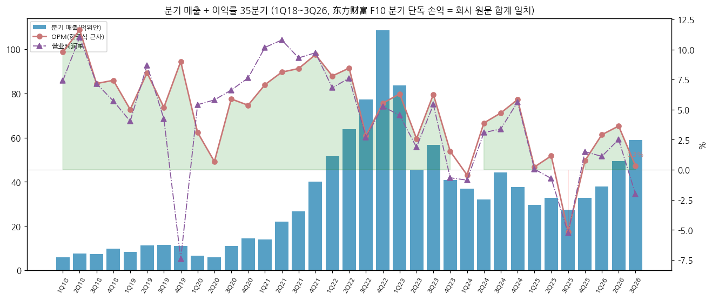

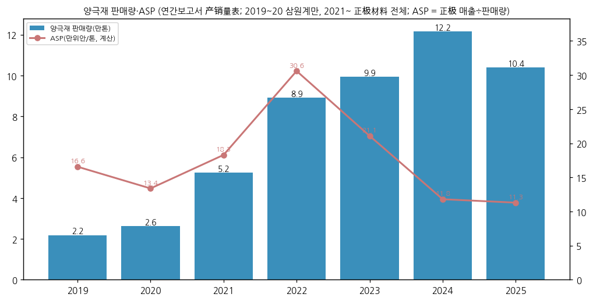

**최근 12분기 (억위안)**

| 분기 | 4Q23 | 1Q24 | 2Q24 | 3Q24 | 4Q24 | 1Q25 | 2Q25 | 3Q25 | 4Q25 | 1Q26 | 2Q26 | **3Q26** |
|---|---|---|---|---|---|---|---|---|---|---|---|---|
| 매출 | 40.83 | 36.92 | 31.96 | 44.36 | 37.64 | 29.64 | 32.85 | 27.37 | 32.82 | 37.81 | 49.40 | **58.83** |
| GPM | 8.0% | 5.2% | 10.8% | 11.2% | 12.7% | 8.2% | 8.9% | 4.3% | 7.7% | 9.4% | 9.4% | **5.3%** |
| 영업이익 한국식 | 0.63 | −0.16 | 1.24 | 2.09 | 2.20 | 0.07 | 0.38 | −1.41 | 0.25 | 1.10 | 1.80 | **0.19** |
| OPM 한국식 | 1.5% | −0.4% | 3.9% | 4.7% | 5.8% | 0.2% | 1.2% | −5.2% | 0.8% | 2.9% | 3.6% | **0.3%** |
| 营业利润 | −0.27 | −0.32 | 0.99 | 1.50 | 2.12 | 0.02 | −0.24 | −1.44 | 0.49 | 0.42 | 1.24 | **−1.19** |
| 자산·신용손상 | −0.77 | −0.15 | −0.17 | −0.49 | −0.13 | 0.00 | −0.60 | −0.17 | 0.00 | −0.03 | −0.27 | **−1.12** |
| 지배순이익 | −0.35 | −0.37 | 0.48 | 1.06 | 1.80 | −0.15 | −0.53 | −1.35 | 0.16 | 0.12 | 0.98 | **−1.25** |

> 출처: 东方财富 F10 분기 단독 손익 (회사 공시 집계), 한국식 OP·OPM·손상 합계 [계산]. 3Q26 손상 1.12억 중 재고평가손실 약 0.8억 (东吴证券 2026-11-03).

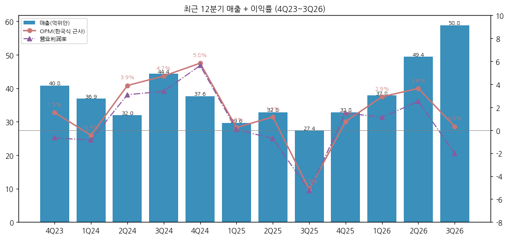

(2) 사업(케미스트리)별 개요 — 매출 비중 큰 순 [정성, 회사 MD&A]

**삼원 정극 (매출 대부분)** — "전기차용 고에너지 배터리의 +극 소재"
- 제품: NCM811, NCA, **Ni90+ 초고니켈** (46계 대원통형·고급 EV), 중니켈 고전압 6계 (2026-06 천톤급 출하 개시)
- 1H26: 판매 약 5.2만톤, **9계 고니켈 비중 약 35%**, 6월 월간 판매 사상 최대. 3Q26: 3.8만톤+ (+81% YoY), 그중 한국 공장 약 1만톤+ (东吴 추정)
- 차세대: 8계 신형(증정형 EV "大电池小油箱" 겨냥) 고객 라인 검증, 9계 신규 고니켈 고객 라인 검증 (3Q26)
- 생산: 중국 (후베이·구이저우·닝보) + **한국 충주 6.7만톤 (2.7만 + 4.0만톤 라인)** + 폴란드 2.5만톤 (2026 말 라인 인도 예정)

**LMFP (磷酸锰铁锂)** — "LFP에 망간을 섞어 에너지밀도를 15~20% 높인 소재"
- 2022 斯科兰德 인수로 진입. 2025 동력 배터리 시장 출하 1위 (회사), 3Q25부터 분기 흑자
- 1H26 판매 +약 50%, 풀가동 / 3Q26 리튬가 하락·소형 동력 고객 인수 연기로 판매 감소 (东吴 추정 1,400~1,500톤)
- 해외 주요 완성차그룹 PHEV 전 차종 공급 (회사, 2026-1H), 상용차 차량 인증 통과 (3Q26)

**나트륨 정극 (钠电)** — "리튬 대신 나트륨을 쓰는 저가·저온 배터리용 소재" (폴리음이온 NFPP)
- 2025-11 CATL 장기협약 (CATL 나트륨 정극 총구매의 60% 이상) / 3Q26 판매 약 2천톤, 2026E 약 5천톤, 2027E 7~8만톤 (东吴 추정)
- 캐파: 1.8만톤/년 (구이저우 新仁 1.2만 + 셴타오 0.6만톤 시험라인) → 셴타오 30만톤 (5/10/15만톤 3단계, 1기 2027-05 완공 예정) + 샹양 20만톤 (2026-11 착공 예정, 주총 승인 필요)
- 3Q26 분기 약 1천만위안 적자 (东吴 추정), 2027 흑자 전환 기대

**LFP (磷酸铁锂)** — "가장 많이 쓰이는 저가 정극" — 신규
- "一步法" 공정 (15공정 → 6공정, 톤당 투자비 약 −40%, 에너지 −30%, 회사)
- 2025 貴州新仁 인수 (6만톤) → **34만톤 프로젝트** (2026-04 착공, 3Q26 1차 라인 시운전), 2027E 유효 캐파 약 30만톤 (东吴)
- 2026-01 CATL과 2026~2031 약 305만톤 장기협약 (최소 70% 구매 의무, 금액 미확정)

**전구체 (前驱体)** — 대부분 자체 공급. 중국 3만톤 (2025 동력형 기지 1기 6→3만톤 축소), 한국 EMT 6천톤

**신소재** — 전고체용 고니켈 정극 (십톤급 출하), 리튬리치 망간(LMR) 중시험, 황화물 전해질 소시험, 실리콘-카본 음극 해외 소량 납품

(3) 사업별 디테일 (3Q26 기준)

**현재 가장 잘나가는 것**
- **삼원 볼륨**: 3Q26 3.8만톤+ (+81% YoY, +36% QoQ) — 핵심 고객 증량 + 해외 고객(2·3위 고객) 확대
- **나트륨**: 분기 2천톤 근접, CATL 장기협약 + 고객 선수금 6.4억 확보

**성장 기대**
- LFP 34만톤 + 나트륨 50만톤(셴타오+샹양) — 2027~2028 실적에 들어올 신사업
- 폴란드 2.5만톤 — 유럽 현지 공급 (2026 말 라인 인도, 2027 고객 인증)

**이익 outlier**
- 3Q26 GPM 5.3% (2Q26 9.4% → −4.1%p): 메탈가 반락 + 재고평가손실 약 0.8억 (东吴), 회사 "원재료 가격 하락 → 판매 이익 감소, 재고손실 증가, 해외 기지 관리비 증가"
- 관리비 3Q26 1.53억 (+16% YoY [계산]) — 해외 기지 운영 확대 (회사)
- 한국 공장: 유휴 시 연 2억위안+ 손실 (회사 공고) → 임대로 전환 시 연 순이익 약 2,587만위안 (회사 추정, 东吴 인용)

(4) 주요 경쟁사 — **한국 3사 겹침 굵게**

- **하이니켈 삼원 (EV·46계)** — **에코프로비엠 (NCA·NCM 하이니켈, 헝가리)**, **엘앤에프 (Ni95 단결정·46계 북미)**, **포스코퓨처엠 (NCMA, 북미 GM 합작)**, LG화학 (자체 양극재), Umicore, 当升(Easpring), 长远锂科, 巴莫(B&M), 厦钨新能
- **중니켈·고전압** — 中伟·华友 계열, 振华新材, 当升
- **LFP** — 湖南裕能, 德方纳米, 富临精工, 万润新能 (중국 점유 90%+), **엘앤에프 (LFP 북미 ESS, 2026)**, **포스코퓨처엠 (LFP 전환 예정)**
- **LMFP** — 德方纳米, 力泰锂能
- **나트륨** — 振华新材, 当升, 湖南钠能 등

**SNE리서치 삼원계 양극재 적재량 순위** (EV 배터리에 실제 탑재된 양 기준 — 회사 판매량과 다름)
→ 1H26: **1위 Ronbay 6.9만톤** / 3위 엘앤에프 4.0만톤 (+53.8%) / 7위 LG화학 3.2만톤 / 8위 에코프로 2.8만톤 / 10위 포스코퓨처엠 2.4만톤 — 삼원 전체 50.0만톤 (+10.1%) (헬로티 2026-08-11)
→ 1~8월: 1위 Ronbay, 2위 Leshine, 3위 Libode, 4위 엘앤에프 (+36.5%), 7위 LG화학, 8위 에코프로 (아시아경제 2026-10-12)
→ 2023 출하량 기준: 1위 에코프로 12만톤 / **2위 Ronbay 9.95만톤** / 3위 B&M / 4위 엘앤에프 8.6만톤 (디지털데일리 2024-06-17, 엘앤에프 기업개요 재인용)

**한국 3사와의 경쟁 구도 요약** [판단]
→ 직접 경쟁: 하이니켈 삼원(특히 46계 대원통형·Ni90+)에서 **엘앤에프·에코프로비엠**과 정면으로 겹친다. 북미 고객 공급은 한국 공장으로 해왔는데 PFE 규제로 이 경로가 막혔다 → 이 공백이 한국 3사의 북미 기회
→ 차이: Ronbay는 중국 내수 1위 고객(55%) 물량 + LFP·나트륨으로 볼륨을 키우는 쪽, 한국 3사는 비중국(Non-FEOC) 공급망 지위로 북미·유럽을 지키는 쪽. 같은 "양극재"여도 성장 동력이 다르다
→ 특허: **LG화학이 2024-01부터 Ronbay·한국 JS를 상대로 한국 특허 5건 침해 소송·가처분** (회사 연간보고서) — 2026-01 LG화학이 JS 대상 가처분 신청, 인용 시 한국 7만톤 라인 운영 영향 (회사)

(5) 주요 매출처

> 연간보고서는 "客户一~五"로 익명 공시. 아래는 공시 단서 + [추정].

- **1. 客户一 — 2025 매출의 55.1% (67.6억위안)** — 중국 최대 셀메이커로 추정 [추정: 업계 통설, CATL과 나트륨·LFP 장기협약 체결 사실 (회사 공시)]
- **2. 客户二 — 11.6% (14.2억)** / **3. 客户三 — 4.4%** — 1H26 "2·3위 고객은 해외 고객, 합산 30% 초과" (회사 반기보고서) → 2026 해외 고객 비중 급상승
- 공시 단서: 모회사 매출채권 2위 **LG Energy Solution 1.54억위안** (2025말, 모회사 재무제표 주석), 2019 연간보고서 용어 정의에 SKI·삼성SDI 등장, 북미 고객 대응 위해 한국 공장 사용 (회사·同花顺 2026-10-24)
- 상위 5대 고객 77.7% (2025) — 하락 추세 (2023 85.9%)

(6) 생산 CAPA + 임직원

| 항목 | 캐파 | 상태 |
|---|---|---|
| 정극 전체 | **30만톤+** (2025말, 회사) | 2025 판매 10.4만톤 → 가동률 약 35% [계산] |
| 한국 충주 삼원 | 6.7만톤 (2.7 + 4.0) + 전구체 0.6만톤 (EMT) | 2026-10~ AKB 임대·수탁가공 전환 |
| 폴란드 삼원 | 2.5만톤 | 2026 말 라인 인도 예정 |
| LFP | 6만톤 (新仁) → 34만톤 프로젝트 | 1차 라인 시운전 (3Q26) |
| 나트륨 (NFPP) | 1.8만톤 → 셴타오 30만 + 샹양 20만톤 | 2027-05 셴타오 1기 |
| 전구체 (중국) | 3만톤 (동력형 기지 1기) | 운영 중 |

- 임직원: 2019 2,015 → 2022 **4,644** → 2025 3,962명

---

## ④ 재무 구조

(1) 손익계산서 (10년, 억위안)

| 연도 | 매출 | 매출총이익 | GPM | 영업이익(한국식) | OPM(한국식) | 营业利润 | 营业利润率 | 지배순이익 | NPM | 扣非 순이익 | ROE |
|---|---|---|---|---|---|---|---|---|---|---|---|
| 2016 | 8.85 | 1.07 | 12.1% | 0.26 | 2.9% | 0.08 | 0.9% | 0.07 | 0.8% | 0.11 | — |
| 2017 | 18.79 | 2.78 | 14.8% | 0.81 | 4.3% | 0.48 | 2.5% | 0.31 | 1.7% | 0.92 | 3.5% |
| 2018 | 30.41 | 5.05 | 16.6% | 2.70 | 8.9% | 2.35 | 7.7% | 2.13 | 7.0% | 2.03 | 9.1% |
| 2019 | 41.90 | 5.87 | 14.0% | 2.90 | 6.9% | 0.99 | 2.4% | 0.87 | 2.1% | 0.56 | 2.3% |
| 2020 | 37.95 | 4.42 | 11.7% | 1.68 | 4.4% | 2.53 | 6.7% | 2.13 | 5.6% | 1.60 | 4.8% |
| 2021 | 102.59 | 15.74 | 15.3% | 8.85 | 8.6% | 10.16 | 9.9% | 9.11 | 8.9% | 8.08 | 18.4% |
| 2022 | 301.23 | 27.91 | 9.3% | 17.62 | 5.8% | 16.18 | 5.4% | 13.53 | 4.5% | 13.17 | 21.8% |
| 2023 | 226.57 | 19.44 | 8.6% | 10.64 | 4.7% | 7.44 | 3.3% | 5.81 | 2.6% | 5.15 | 7.4% |
| 2024 | 150.88 | 15.11 | 10.0% | 5.38 | 3.6% | 4.30 | 2.8% | 2.96 | 2.0% | 2.44 | 3.5% |
| **2025** | **122.67** | **9.09** | **7.4%** | **−0.71** | **−0.6%** | **−1.17** | **−1.0%** | **−1.87** | **−1.5%** | **−2.17** | **−2.3%** |
| 9M26 | 146.04 | 11.33 | 7.8% | 3.09 | 2.1% | 0.48 | 0.3% | −0.16 | −0.1% | −0.13 | — |

> ROE = 지배순이익 ÷ 평균 지배자본 [계산]. 2019 营业利润이 한국식 OP보다 크게 낮은 이유: 매출채권 대손(信用减值) 1.55억. 2020~2021은 반대로 대손 환입·기타수익으로 营业利润 > 한국식 OP.

(2) 재무상태표 (억위안)

| 연도 | 자산총계 | 부채총계 | 자본총계 | 지배자본 | 부채/자산 | 현금 | 차입금 | 순현금(+)/순차입(−) | 재고 | 매출채권·어음 | 유동비율 |
|---|---|---|---|---|---|---|---|---|---|---|---|
| 2018 | 42.6 | 11.3 | 31.3 | 31.3 | 26.5% | 2.3 | 1.1 | +1.2 | 4.6 | 17.5 | 2.78 |
| 2019 | 58.5 | 15.3 | 43.2 | 43.1 | 26.2% | 10.6 | 2.7 | +7.9 | 5.9 | 17.0 | 2.78 |
| 2020 | 61.4 | 16.4 | 44.9 | 44.8 | 26.8% | 14.1 | 0.2 | +13.9 | 5.8 | 15.8 | 2.81 |
| 2021 | 147.0 | 92.7 | 54.3 | 54.3 | 63.0% | 25.9 | 12.4 | +13.5 | 16.7 | 44.7 | 1.10 |
| 2022 | 256.6 | 171.1 | 85.5 | 69.6 | 66.7% | 50.0 | 50.4 | −0.4 | 33.0 | 76.4 | 1.21 |
| 2023 | 246.4 | 143.7 | 102.7 | 87.0 | 58.3% | 56.7 | 55.2 | +1.5 | 15.3 | 69.9 | 1.62 |
| 2024 | 246.2 | 154.4 | 91.9 | 84.4 | 62.7% | 29.5 | 63.7 | −34.2 | 22.2 | 77.9 | 1.29 |
| 2025 | 229.7 | 148.0 | 81.6 | 79.9 | 64.5% | 28.9 | 68.0 | −39.1 | 21.4 | 62.7 | 1.19 |
| 2026-06 | 263.3 | 182.5 | 80.8 | 77.7 | 69.3% | 25.4 | 78.2 | −52.8 | 43.6 | 56.1 | 1.03 |
| **2026-09** | **281.4** | **195.9** | **85.6** | **79.8** | **69.6%** | **36.4** | **90.3** | **−53.8** | **50.0** | **51.1** | **1.08** |

> 차입금 = 단기차입 + 장기차입 + 1년내 만기 비유동부채 [계산]. 매출채권·어음 = 应收票据及账款 + 应收款项融资. 2022 비지배지분 증가(15.9억) = 자회사 지분 투자유치. 2016~2017 생략 (자산 8.0억·21.9억).

→ 3Q26 재고 50.0억 (연초 21.4억 대비 +134%) — "고객 주문 대응 사전 비축" (회사) + 메탈가 상승분. 메탈가 하락 시 추가 재고손실 위험
→ 순차입 53.8억 (3Q26) — 2023말 순현금 +1.5억에서 2년 만에 순차입 전환 (증설·운전자본)

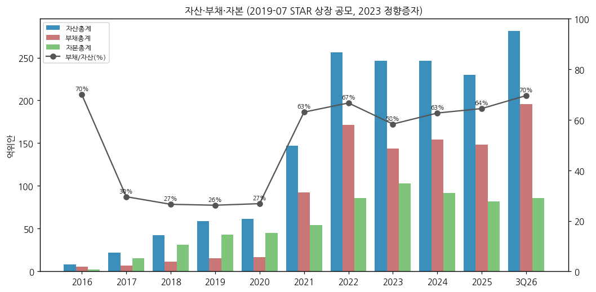

(3) 현금흐름 (10년, 억위안)

| 연도 | 영업CF | 투자CF | 재무CF | CapEx | FCF (영업CF−CapEx) |
|---|---|---|---|---|---|
| 2016 | −0.63 | −1.28 | 1.65 | 0.48 | −1.11 |
| 2017 | −6.38 | −3.10 | 10.03 | 2.06 | −8.44 |
| 2018 | −5.43 | −8.70 | 14.28 | 8.24 | −13.67 |
| 2019 | 1.17 | −5.35 | 12.13 | 2.63 | −1.46 |
| 2020 | 7.08 | −2.06 | −2.98 | 3.14 | 3.93 |
| 2021 | −1.92 | −17.55 | 18.97 | 19.04 | −20.96 |
| 2022 | −2.41 | −30.62 | 44.77 | 30.91 | −33.32 |
| 2023 | 17.95 | −16.92 | 13.89 | 16.37 | 1.58 |
| 2024 | 5.23 | −23.07 | −5.64 | 17.76 | −12.52 |
| 2025 | 11.35 | −2.78 | −4.80 | 5.70 | 5.65 |
| 9M26 | −4.26 | −12.60 | 19.77 | 9.28 | −13.54 |

→ 10년 누적 FCF 약 −80억위안 (2016~2025) [계산] — 증설을 증자·차입으로 메워온 구조
→ 영업CF가 손익보다 크게 출렁이는 이유: 판매대금을 **은행인수어음**으로 받고 필요에 따라 할인 (회사 3Q26 설명) — 할인 여부에 따라 영업CF가 바뀐다

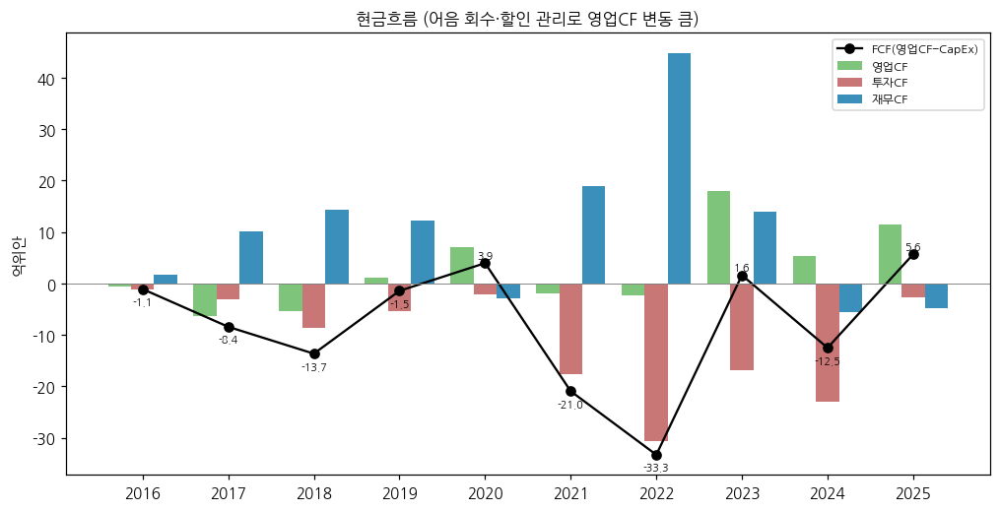

(4) CapEx

→ 2021~2022 증설 피크 (각 19.0억·30.9억, 한국 충주 2기·구이저우·후베이) → 2025 5.7억 (최저) → **9M26 9.3억 (+55%)** — LFP 34만톤·나트륨·폴란드
→ 东吴 추정 2026E 21.0억, 2027E 17.0억 — 3년 누적 약 50억 [東吳 2026-11-03]

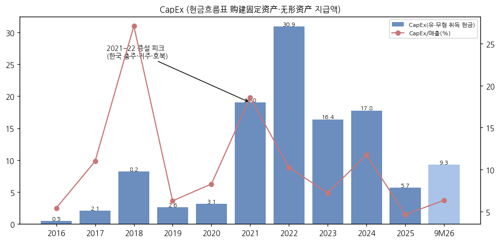

(5) 부채 구조

- 차입금 90.3억 (3Q26) — 장기차입 50.4·단기 16.6·1년내 만기 23.3억 / 회사채 없음
- 부채/자산 69.6% (상장 후 최고) — 매입채무·어음(운전자본) 비중이 크다
- 2023-09 정향증자 13.25억 이후 주식 발행 없음. 해외 지분 투자유치(海外股权融资) 추진 중 (회사 반기보고서)
- 한국 공장 임대 시 "운영자금 약 10억위안 회수" 예상 (회사 공고 2026-059)

(6) 배당·자사주

| 항목 | 2019 | 2020 | 2021 | 2022 | 2023 | 2024 | 2025 |
|---|---|---|---|---|---|---|---|
| DPS (위안, 세전, 당시 주식 기준) | 0.090 | 0.090 | 0.205 | 0.302 | 0.303 | 0.370 | **0** |
| 배당총액 (억위안) [계산] | 0.40 | 0.40 | 0.92 | 1.36 | 1.45 | 2.61 | 0 |
| 배당성향 [계산] | 46% | 19% | 10% | 10% | 25% | 88% | — |

→ 2025 적자로 무배당 (2025 연간보고서). 2024는 순이익의 88% 배당 (회사)
→ 자사주 10,090,435주 (1.41%) 보유 — 소각 공시 없음

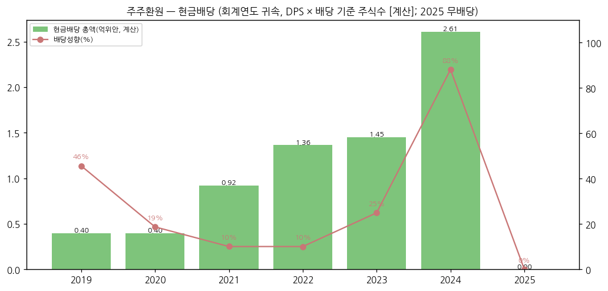

(7) 재무비율

| 연도 | ROE | 부채/자산 | 유동비율 | GPM | CapEx/매출 |
|---|---|---|---|---|---|
| 2021 | 18.4% | 63.0% | 1.10 | 15.3% | 18.6% |
| 2022 | 21.8% | 66.7% | 1.21 | 9.3% | 10.3% |
| 2023 | 7.4% | 58.3% | 1.62 | 8.6% | 7.2% |
| 2024 | 3.5% | 62.7% | 1.29 | 10.0% | 11.8% |
| 2025 | −2.3% | 64.5% | 1.19 | 7.4% | 4.6% |
| 9M26 | — | 69.6% | 1.08 | 7.8% | 6.4% |

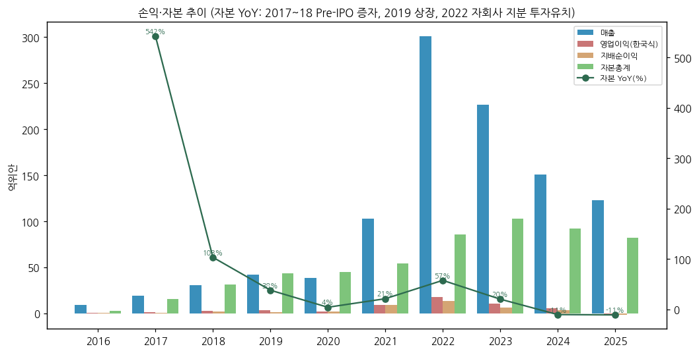

---

## ⑤ 지배 구조

(1) 그룹·계열 관계

- **실소유주 白厚善 (회장 겸 총경리)** — 上海容百新能源投资企业(26.90%), 北京容百新能源投资发展(2.91%), 北京容百新能源投资管理(1.83%), 北京容百新能源科技投资管理(1.72%, 일부 동결 274.7만주), 遵义容百新能源投资中心(1.56%)를 지배 → **합산 34.92%** [계산] + 직원지분 플랫폼 共青城容诚(1.13%) 유한파트너
- 주요 자회사: 湖北容百, 贵州容百, 容百材料(닝보), 天津斯科兰德(LMFP, 지배), 贵州新仁(LFP), **载世能源 JS(한국, 2026 JS Old / JS New 분할)**, EMT(한국 전구체), JSE(폴란드), 미국 지주·사무소
- **관련회사 AKB (Amkobay)** — 싱가포르 AKB 지분 75.1% = 싱가포르 지주(등기주주 白厚善, 白·刘相烈·Jonathan Krane 85:5:10 권익 약정), 24.9% = 한국 JS → **한국 공장 임차인이 실소유주 관련회사** (회사 공고 2026-059)

(2) 주주 구분 (2026-09-30, 3Q26 분기보고서)

| 주주 | 지분 % |
|---|---|
| 上海容百新能源投资企业 (白厚善 지배) | 26.90 |
| 北京容百新能源投资发展 (동) | 2.91 |
| 谢瑞涵 (개인, 신용계좌) | 2.40 |
| 北京容百新能源投资管理 (동) | 1.83 |
| 北京容百新能源科技投资管理 (동) | 1.72 |
| 遵义容百新能源投资中心 (동) | 1.56 |
| 兴全趋势投资混合型펀드 | 1.39 |
| 香港中央结算 (후구퉁 외국인) | 1.13 |
| 共青城容诚 (직원지분) | 1.13 |
| 자사주 계좌 | 1.41 |

→ 보통주 주주 수 38,543명 (2026-09말) / 외국인(후구퉁) 1.13% — 1H26 중 −395.7만주 (반기보고서), 3Q26 추가 −11.8만주 [계산]

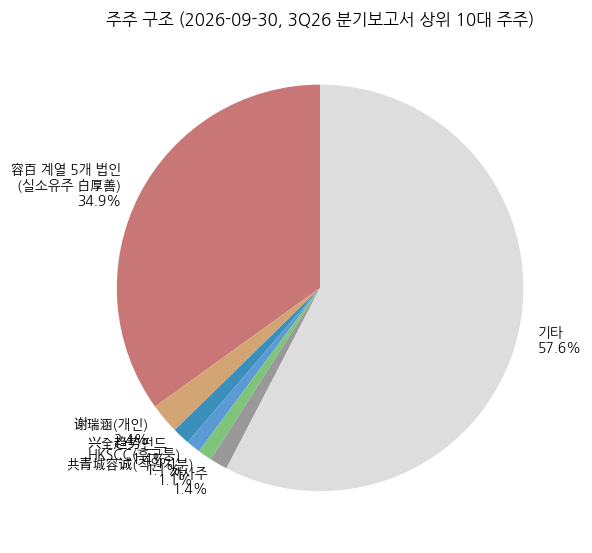

(3) 경영진·이사회

- **白厚善** — 회장 겸 총경리, 1964년생, 미국 영주권. 중남대 유색야금·동북대 중금속 화법제련. 전 北京当升材料 생산·운영 총괄 → 2014 창업. 2026-04 공시 위반으로 개인 벌금 300만위안
- **刘相烈** — 부회장, 1960년생 한국 국적. 한양대 물리 대학원, 전 엘앤에프 양극재 사업부 총괄(2005~2009), 2010 EMT 창업. AKB 권익 5% 약정 당사자
- **张慧清** — 이사·부총경리, 2026-02부터 재무책임자 대행 (전 当升 생산총괄)
- **俞济芸** — 이사회비서, 2026-04 개인 벌금 200만위안
- 회장·총경리 겸직에 대해 회사는 "발전 과정상 필요" 설명 (2025 연간보고서)

---

## ⑥ 기타 팩트

(1) 시가총액·밸류에이션 스냅샷 (2026-11-13 종가 기준)

- 주가 17.76위안 / 시총 약 126.9억위안 (≈ 2.54조원) [계산] / 순차입 53.8억 (3Q26)
- P/B 1.59배 [계산: 지배자본 79.8억] / 2026E P/E 약 99배, 2027E 약 28배 [계산: 东吴 1.28억·4.53억]
- 东吴证券: 매수 유지, 2026~2028E 지배순이익 1.3/4.5/5.2억 (직전 4/8/10억에서 하향, 2026-11-03)

(2) R&D

| 연도 | 2019 | 2020 | 2021 | 2022 | 2023 | 2024 | 2025 | 9M26 |
|---|---|---|---|---|---|---|---|---|
| 연구개발비 (억위안, 비용) | 1.65 | 1.46 | 3.60 | 4.87 | 3.54 | 4.24 | 4.22 | 3.21 |
| R&D/매출 | 3.9% | 3.8% | 3.5% | 1.6% | 1.6% | 2.8% | 3.4% | 2.2% |

→ 연구개발 투입 전액 비용 처리 (자본화 0%, 2025 연간보고서)
→ 특허 누적 출원 1,793건·등록 840건 (2026-06말) — 고니켈·LMFP·나트륨·고체전해질·LMR

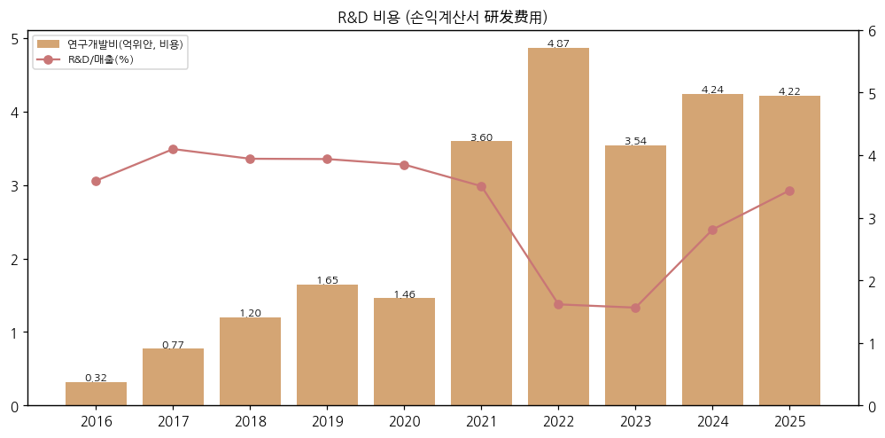

(3) 진행 중 corporate action

- **한국 JS 구조조정** — ① 2026-03 JS Old 지분 AKB 매각(0.97억달러) 결의 → 미교부 ② 2026-10 공장 임대(월 38.84억원, 첫 6개월 233.04억원, 10년 의향 4,660.8억원 ≈ 22.79억위안) + 무형자산 양도 1,350만달러 + 수탁가공(약 1,867만달러, 3개월) — **주총 승인 필요** (회사 공고 2026-059)
- 나트륨 샹양 20만톤 프로젝트 — 주총 승인 필요 (3Q26 보고서)
- 폴란드 2.5만톤 — 2026 말 라인 인도
- 미국 회수(리사이클링) 기업 지분 투자 (2025 연간보고서)

(4) 주요 리스크

- **북미 규제 (PFE)** — 중국계 지분 25% 초과 → 한국 공장의 북미향 공급 제한. 임대 구조가 규제 당국 기준을 충족할지, 세부 규칙(연말 예정) 불확실 (同花顺 2026-10-24)
- **관련거래·지배구조** — 한국 핵심 자산을 실소유주 관련회사에 장기 임대 (갱신 주도권은 임차인 쪽, 회사 공고) / 2026-04 공시 위반 처분
- **LG화학 특허 소송** — 한국 특허 5건, 가처분 인용 시 한국 7만톤 라인 영향 (회사)
- **메탈가·재고** — 재고 50억, 리튬가 하락 시 재고손실 반복 (3Q26 0.8억)
- **고객 집중** — 1위 고객 55%
- **LFP 후발 진입** — 선발 업체 대비 규모·원가 열위 가능성 (회사 리스크 고지)

(5) ESG

- 연간보고서 ESG 장 기재, 한국·폴란드 현지 EHS 체계 구축 (반기보고서) / 별도 ESG 등급 [미확보]

(6) 인증·라이선스

- 고신기술기업 (容百材料 등) — 법인세 15%
- 한국 자회사 법인세는 한국 세율, 폴란드 JSE 19% (반기보고서)

---

## Activity 보고 (v1.0)

### ✅ 확보 자료
- 정기보고서 원문 11건 (2019~2025 연간, 2025 3Q, 2026 1Q·반기·3Q) + 반기 실적예고 + 회사 공고 2026-059
- 东方财富 F10 분기 단독 손익 35Q·재무상태·현금흐름 / Yahoo 주가·환율 / 东吴证券 3Q26 점평 / SNE리서치 기사

### ❌ 누락
- 2014~2015 재무, 분기 판매량 절대치(일부 역산), 제품별 분기 매출, 고객 실명, 컨콜 Q&A, ESG 등급

### ⚠️ 추정·계산 표시
- [계산]: 한국식 OP, CAGR, ASP, 순차입, 시총, P/B, P/E, 배당총액·성향, 원화 환산
- ⚠️추정: 분기 삼원 판매량 (회사 증감률 역산), 3Q26 ASP, 1위 고객 = CATL
- [판단]: 기업 분류, 한국 3사 경쟁 구도

### 🔗 핵심 source URL
- 3Q26 분기보고서: https://pdf.dfcfw.com/pdf/H2_AN202610301831242431_1.pdf
- 2026 반기보고서: https://pdf.dfcfw.com/pdf/H2_AN202607221827264332_1.pdf
- 2025 연간보고서: https://pdf.dfcfw.com/pdf/H2_AN202604101821124156_1.pdf
- 한국 자회사 임대 관련거래 공고 (2026-059): https://static.cninfo.com.cn/finalpage/2026-10-22/1225614990.PDF
- 东吴证券 3Q26 점평: https://pdf.dfcfw.com/pdf/H3_AP202611031831350486_1.pdf

### Data Quality Confidence: **85%** (손익·재무 원문 대조 완료, 판매량·고객은 공시 한계)

---

## Version Log

- **v1.0** (2026-11-14) — 초안. 연간 10년 (2016~2025) + 9M26, 분기 35Q, 판매량 7년, 13종 차트 + 다크 .html. 营业利润과 한국식 영업이익 근사 병기, 한국 양극재 3사 3Q26 비교 표 포함
- **잔여 보완 (v1.1, 2027-04 2026 연간보고서 후)**: 2026 연간 확정·제품별 판매량, 한국 AKB 임대 확정 후 연결 범위·매출 영향, 2014~2015 투자설명서 재무 보강
