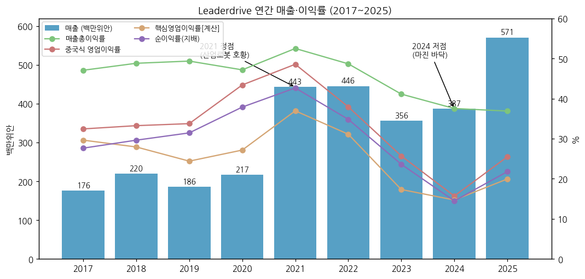
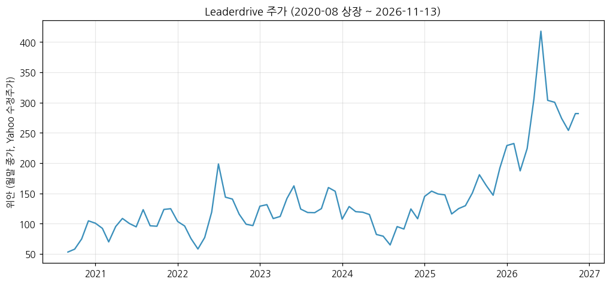
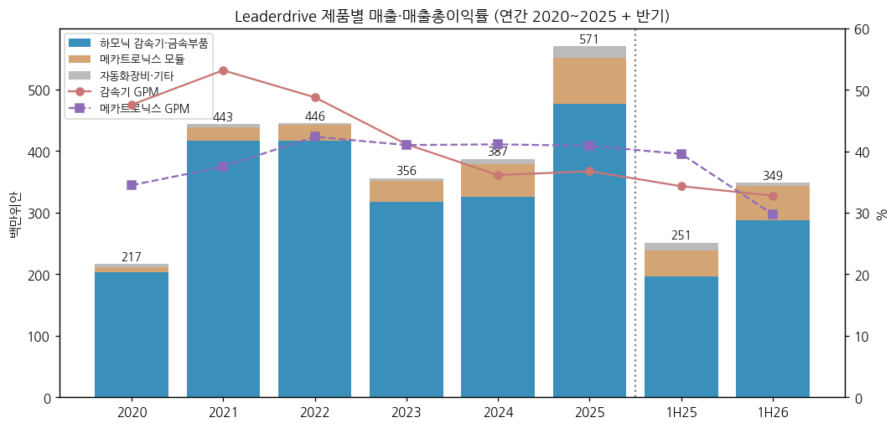
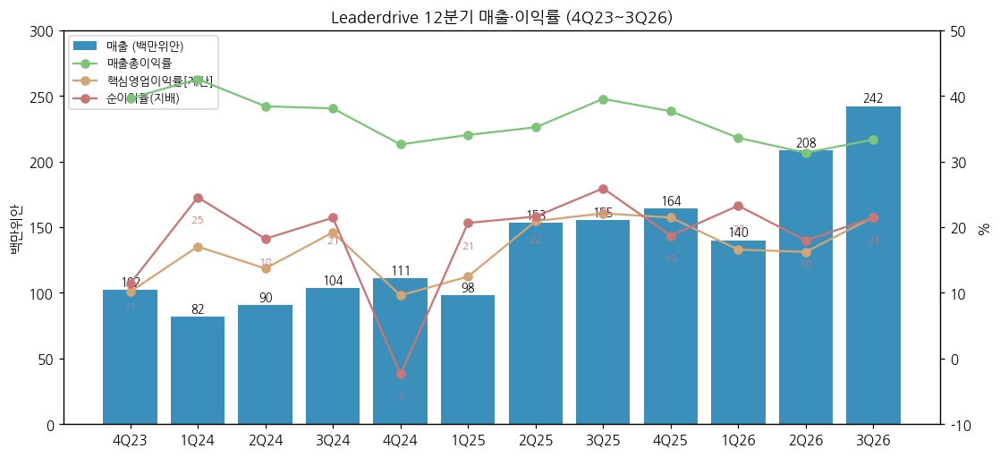
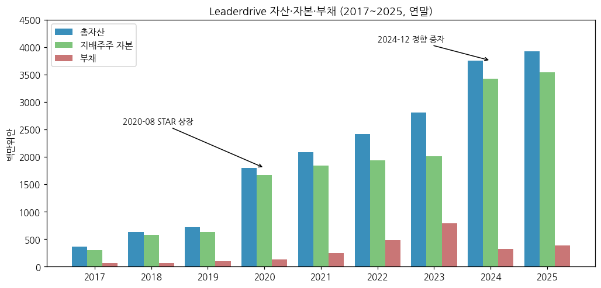
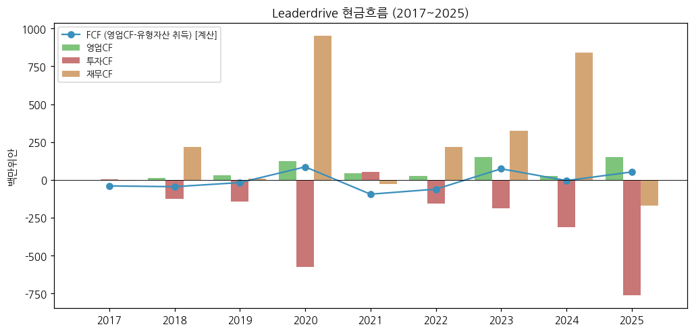

> Ticker: **688017.SH (상해거래소 과창판 STAR, 파일 키 688017.SS)** / 苏州绿的谐波传动科技股份有限公司 Leader Harmonious Drive Systems Co., Ltd. (약칭 绿的谐波, 영문 브랜드 Leaderdrive)
> Sector: 로봇 — 서브섹터: 로봇 부품 (확장, 글로벌 피어)
> 작성 시각: 2026-11-14 19:50 KST (**v1.0**)
> 적용 구조: v4.8 (6개 섹션) — 해외 종목이라 12종 차트 중 데이터로 만들 수 있는 6종만 작성 (chart1·2·4·6·10·11)
> 데이터: 연간 9년(2017~2025, 2020-08 상장 전 2017~2019 포함) + 분기 단독 20개(4Q21~3Q26) + 반기 제품별 + 월간 주가(2020-08~)
> 출처: **회사 원문(상해거래소 공고 PDF, 东方财富 공고 미러 경유)** — 2025 연간 보고서(更正后, 2026-07-10), 2026 반기 보고서(2026-08-27), 2026 1분기 보고서(2026-04-23), 2026 3분기 보고서(更正后, 2026-11-03 — 정정은 주주표만, 재무 수치 변동 없음), 2025 반기·3분기 보고서 / **东方财富 F10 재무 API**(연간·분기 단독 손익·재무상태·현금흐름, 主营构成 — 회사 공시 집계, 원문과 대조) / **Yahoo Finance v8 월간 주가** / 보도·리서치 인용: 群益证券(香港) 3Q26 리뷰(2026-11-02), 东吴证券 3Q26 리뷰(2026-10-30), stockanalysis.com 시총
> 단위: **백만위안(CNY M)** — 중국 기업회계준칙. 회사는 분기 사업부를 공시하지 않고 반기·연간만 제품별 매출을 낸다

# Leaderdrive (绿的谐波, 688017) 기업 개요 (v1.0 — 중국 1위 하모닉 감속기, 로봇 관절 부품)
> **Fact verify cutoff**: 2026-11-14 (주가 11/13 종가 281.80위안 [Yahoo Finance], 총주식 1억 8,333만주 → 시총 약 516.6억위안 [계산] / stockanalysis.com 2026-10-22 시총 474.5억위안)

> **기준 단절**: ① 2020-08 과창판 상장(공모) ② 2022-06 자본공적금 전증(10주당 4주, 총주식 1.20억 → 1.69억주) ③ 2024-12 정향 증자 1,444.9만주(총 1.83억주). 주가 차트는 Yahoo 수정주가라 ②가 소급 반영돼 있다

## ① 기업 분류

(1) Primary / Secondary 분류

**Primary 분류: 사이클 (산업용 로봇 설비투자 사이클) — 9년 순이익률 14.5% ~ 42.7%, 레인지 28%p**

→ 매출은 2021년 산업로봇 호황에 2배(+104.8%)가 됐다가 2023년 -20.1%, 2024년 순이익률 14.5%로 바닥을 찍었다. 2025년부터 다시 매출 +47.3%, 순이익 +121.4%로 업턴이다 [계산]

→ 매출총이익률은 2021년 52.5% → 2025년 36.9% → 9M26 32.7%로 4년째 내려왔다. 판가 경쟁과 증설 감가상각(회사 설명: "产能快速扩张阶段")이 원인이다

**Secondary 노트: 꿈 (휴머노이드·구현형 AI 로봇 관절)**

→ 회사는 2026년 실적 증가 이유로 "工业机器人行业份额提升以及具身智能机器人业务规模大幅增长"(산업로봇 점유율 상승 + 구현형 AI 로봇 사업 규모 급증)을 반복해서 적는다 (2026 반기·3분기 보고서). 구현형 AI 매출 비중은 공시하지 않는다

→ 시장은 PER 300배 안팎을 준다 (아래 (6)). 이익이 아니라 휴머노이드 양산 옵션에 가격이 매겨져 있다 [판단]

(2) Summary Box (9년, 백만위안)

| 지표 | 9년 평균 (2017~2025) | 정점 | 저점 | 2025년 |
|---|---|---|---|---|
| 매출 | 333.4 [계산] | 570.7 (2025) | 175.7 (2017) | **570.7** |
| 매출 CAGR | 15.9% (2017→2025) [계산] | +104.8% (2021) | -20.1% (2023) | **+47.3%** |
| 지배주주 순이익 | 95.9 [계산] | 189.2 (2021) | 48.6 (2017) | **124.4** |
| 지배주주 순이익률 | 29.3% [계산] | 42.7% (2021) | 14.5% (2024) | **21.8%** |
| 매출총이익률 | 45.5% [계산] | 52.5% (2021) | 36.9% (2025) | **36.9%** |

```
[Leaderdrive 9년 손익 (백만위안)]
연도   매출    GPM    중국식영업이익  지배순이익  순이익률
2017   175.7   47.1%      57.0        48.6     27.7%
2018   219.5   48.8%      73.0        65.1     29.6%
2019   185.9   49.4%      62.8        58.5     31.5%   ← 산업로봇 조정
2020   216.5   47.2%      94.0        82.1     37.9%   ← 2020-08 과창판 상장
2021   443.4   52.5%     215.4       189.2     42.7%   ← 정점 (중국 산업로봇 호황)
2022   445.7   48.7%     169.2       155.3     34.8%
2023   356.2   41.1%      91.6        84.2     23.6%   ← 하강
2024   387.4   37.5%      60.8        56.2     14.5%   ← 바닥 (4Q24 자산손상 23.9로 분기 적자)
2025   570.7   36.9%     145.5       124.4     21.8%   ← 업턴 (산업로봇 회복 + 구현형 AI)
9M26   590.9   32.7%     140.6       122.1     20.7%   ← 매출 +45.3%, 순이익 +30.3%
```



(3) 정량적 분류 근거

→ 순이익률 레인지 14.5% ~ 42.7%(28%p) — 사이클 cutoff(±10%p) 초과

→ 사이클 회수: 2019 조정 → 2020~2021 상승(정점) → 2022~2024 하강 → 2025~ 업턴. 중국 산업로봇 생산량과 같은 방향이다 (2026년 1~9월 중국 산업로봇 생산 79.5만대 +29.1% — 群益 인용) [보도 인용]

→ 매출총이익률은 사이클과 별개로 2021년부터 하락 추세. 이익률이 사이클 고점을 다시 못 넘는 구조인지가 핵심 변수다 [판단]

(4) 산업 분류

→ 중국증감회 업종: 通用设备制造业(범용설비 제조업)

→ 워치리스트 섹터: 로봇 / 서브섹터: 로봇 부품 (확장) — 같은 칸: Sanhua(002050.SZ), Tuopu(601689.SS), 현대모비스, 로보티즈, 에스비비테크

(5) 분류 결정 논리

→ 매출의 83.5%(2025)가 하모닉 감속기·금속부품 — 로봇 관절 1개당 들어가는 정밀 감속기라 로봇 출하량이 매출을 정한다

→ 구현형 AI(휴머노이드)는 아직 분리 공시가 없어 Primary를 바꾸지 않는다. 회사가 매출 비중을 공시하거나 반기 매출 YoY가 산업로봇 생산 증가율을 2배 이상 웃돌면 "고성장"으로 재분류 검토

(6) 적정 밸류에이션 방법

→ 1차 — Forward PER: 주가 281.80위안 기준 2026E 群益 순이익 183백만위안 → PER 282배, 东吴 211.6백만위안 → 244배 [계산]. TTM(4Q25~3Q26) 순이익 152.8백만위안 → 338배 [계산]

→ 2차 — PBR: 14.3배 (시총 516.6억위안 / 지배주주 자본 3,618.4백만위안, 2026-09 말) [계산]

→ 셀사이드: 群益 매수·목표가 305위안(2026-11-02), 东吴 增持(2026-10-30) [보도 인용]

(7) 분기 재평가 트리거 (분류 변경 조건)

→ ① 반기 매출 YoY +50% 이상 2개 반기 연속 + 구현형 AI 매출 비중 공시 → "고성장" 재분류

→ ② 분기 매출총이익률 30% 미만 2개 분기 연속 → 가격 경쟁 심화로 사이클 하강 검토

→ ③ 분기 매출 YoY 마이너스 전환 → 하강 사이클 진입 검토

## ② 회사 개요

① 기본 사항

→ 회사명: 苏州绿的谐波传动科技股份有限公司 (Leader Harmonious Drive Systems), 장쑤성 쑤저우. 상해거래소 과창판 688017

→ 지배주주: 좌욱욱(左昱昱, 회장, 17.30%) + 좌정(左晶, 부회장, 17.30%) = 34.60% (2026-09 말, 둘 다 境外自然人으로 공시). 회장은 전신 격인 恒加金属 총경리 출신으로 2011년부터 회사 집행이사 (2025 연간 보고서 임원 약력)

→ 사업 한 줄: 하모닉 감속기(谐波减速器)를 핵심으로 행성 롤러 스크루, 메카트로닉스 모듈(감속기+모터+드라이브 일체형 관절), 자동화 장비를 만든다. 회사는 "국내에서 처음 하모닉 감속기를 공업화·대량 생산해 국제 브랜드 독점을 깼다", "전 세계에서 유일하게 하모닉 감속기 전 부품을 자체 공급한다"고 쓴다 (2026 반기 보고서, 회사 주장)

→ 규모(2025): 매출 570.7, 총자산 3,929.1, 임직원 1,087명, 연구개발 인력 184명(16.9%)

→ **한국 로봇 부품사와의 경쟁 지점 (어디서 맞붙나)**

| 제품 | Leaderdrive | 한국 경쟁·비교 | 경쟁 구도 [판단] |
|---|---|---|---|
| 하모닉 감속기 (로봇 관절) | 2025 판매 42.5만대(+72.5%), 산업로봇·협동로봇·휴머노이드 | 에스비비테크(하모닉 감속기) | 중국 내수 가격·물량 우위. 한국 업체는 국산화·소량 고정밀에서 경쟁 |
| 관절 일체형 모듈 (감속기+모터+드라이브) | 메카트로닉스 2025 판매 1.22만세트(+72.1%), 자회사 开璇智能 | 로보티즈(액추에이터), 현대모비스(휴머노이드 액추에이터 개발) | 휴머노이드 관절 모듈 표준화 경쟁. 직접 납품 경쟁보다는 고객(휴머노이드 완성체) 확보 경쟁 |
| 행성 롤러 스크루 (휴머노이드 선형 관절) | 신제품, 매출 미분리 | 국내 볼스크루 업체 | 아직 초기 [판단] |

→ 글로벌 1위 하모닉 감속기 업체는 일본 Harmonic Drive Systems(6324.T)다. Leaderdrive는 중국 내 대체 수요를 주로 가져가는 위치다 [판단]

② 9년 손익·자본 추이 (백만위안)

| 연도 | 매출 | 매출 YoY | GPM | 중국식 영업이익 | 핵심영업이익 [계산] | 지배주주 순이익 | 순이익 YoY | 순이익률 | 지배주주 자본 |
|---|---|---|---|---|---|---|---|---|---|
| 2017 | 175.7 | — | 47.1 | 57.0 | 52.1 | 48.6 | — | 27.7 | 296.8 |
| 2018 | 219.5 | +24.9 | 48.8 | 73.0 | 61.4 | 65.1 | +34.0 | 29.6 | 572.8 |
| 2019 | 185.9 | -15.3 | 49.4 | 62.8 | 45.4 | 58.5 | -10.1 | 31.5 | 631.8 |
| 2020 | 216.5 | +16.5 | 47.2 | 94.0 | 58.8 | 82.1 | +40.3 | 37.9 | 1,675.8 |
| 2021 | 443.4 | +104.8 | 52.5 | 215.4 | 163.9 | 189.2 | +130.4 | 42.7 | 1,836.8 |
| 2022 | 445.7 | +0.5 | 48.7 | 169.2 | 138.7 | 155.3 | -17.9 | 34.8 | 1,936.1 |
| 2023 | 356.2 | -20.1 | 41.1 | 91.6 | 61.7 | 84.2 | -45.8 | 23.6 | 2,013.4 |
| 2024 | 387.4 | +8.8 | 37.5 | 60.8 | 57.0 | 56.2 | -33.3 | 14.5 | 3,424.8 |
| 2025 | 570.7 | +47.3 | 36.9 | 145.5 | 113.9 | 124.4 | +121.4 | 21.8 | 3,536.8 |

→ (출처: 东方财富 F10 연간 손익·재무상태(회사 연간 보고서 집계). 2025는 연간 보고서 원문과 대조. **중국식 영업이익(营业利润)**은 투자수익·공정가치 변동·정부보조금·자산손상을 포함한다. **핵심영업이익** = 매출 − 매출원가 − 세금 − 판매비 − 관리비 − 연구개발비 [계산], K-IFRS 영업이익에 가깝다)

→ 2020·2024 자본 급증은 각각 2020 IPO, 2024-12 정향 증자 때문이다. 2018년 증가(+276)는 상장 전 증자로 보인다 [판단, 원문 미대조]

③ 회사 주가 역사

→ 2020-08 과창판 상장. 2021년 산업로봇 호황 국면 고점, 2022~2024년 하락

→ 2025년 휴머노이드 테마로 재평가 → **2026-06 장중 고점 495.66위안**(Yahoo 수정주가) → 시총 약 908억위안 [계산, 1.83억주 기준] → 2026-11-13 종가 281.80위안(고점 대비 -43%)

→ 연말 시총 (stockanalysis.com): 2021 210.2억 / 2022 163.2억 / 2023 258.9억 / 2024 182.4억 / 2025 352.2억위안 / 2026-10-22 474.5억위안

→ 2026-08-27 홍콩 H주 상장 추진 공시 (东吴 리뷰 인용) [보도 인용]



④ 주요 연혁

| 시점 | 사건 |
|---|---|
| 2011 | 회사 설립 (전신 恒加金属 기술진 — 임원 약력 기준) |
| 2020-08 | 상해거래소 과창판 상장 (688017) |
| 2022-06 | 자본공적금 전증 10주당 4주 (총주식 1.69억주) |
| 2024-12 | 정향 증자 1,444.9만주 (총 1.83억주) — 자금 용도 "新一代精密传动装置智能制造项目" |
| 2025 | 신공장 착공, 하모닉 감속기 판매 42.5만대(+72.5%) |
| 2026 | SKF(斯凯孚)와 로봇 관절 정밀 베어링 합작사 설립 (群益: 회사 지분 40%) |
| 2026-08-27 | H주 홍콩 상장 추진 공시 [보도 인용] |
| 2026-10 | 群益: 신공장 완공 목표를 2026년 말 → 2028년 말로 연기, 기존 캐파 우선 가동 [보도 인용] |

## ③ 비즈니스 모델

① 실적 추이 통합 (주영업 매출, 백만위안 / GPM %)

| 제품·지역 | 2021 | 2022 | 2023 | 2024 | 2025 | 1H25 | 1H26 | 1H26 YoY |
|---|---|---|---|---|---|---|---|---|
| 하모닉 감속기·금속부품 | 416.2 (53.2) | 416.4 (48.8) | 317.3 (41.2) | 325.4 (36.1) | 476.5 (36.8) | 196.9 (34.3) | **288.1 (32.8)** | +46.3% |
| 메카트로닉스 모듈 | 22.5 (37.5) | 25.7 (42.4) | 33.6 (41.0) | 52.6 (41.1) | 74.3 (40.9) | 41.6 (39.6) | **54.7 (29.8)** | +31.5% |
| 자동화 장비·기타 | 4.6 | 3.6 | 5.3 | 9.4 | 19.9 | 12.8 | **5.7** | -55.5% |
| 지역: 내수 | 366.5 (53.1) | 379.1 (48.9) | 323.1 (41.3) | 337.8 (36.9) | 507.4 (36.8) | 222.9 (34.7) | **297.7 (30.2)** | +33.6% |
| 지역: 수출 | 76.9 (49.9) | 63.1 (45.2) | 30.0 (35.0) | 44.9 (37.4) | 58.3 (35.2) | 28.5 (35.4) | **50.9 (44.6)** | +78.6% |

→ (출처: 东方财富 F10 主营构成(회사 연간·반기 보고서 집계). 2025·1H26은 원문(2025 연간 보고서 主营业务分产品, 2026 반기 보고서 营业收入分解)과 대조. 연간은 주영업, 반기는 营业收入 기준이라 기타가 조금 다르다)



→ 1H26 메카트로닉스 GPM이 39.6% → 29.8%로 9.8%p 떨어졌다. 수출 GPM은 44.6%로 내수(30.2%)보다 14%p 높다

① 12분기 시계열 (백만위안, %)

| 분기 | 4Q23 | 1Q24 | 2Q24 | 3Q24 | 4Q24 | 1Q25 | 2Q25 | 3Q25 | 4Q25 | 1Q26 | 2Q26 | 3Q26 |
|---|---|---|---|---|---|---|---|---|---|---|---|---|
| 매출 | 102.2 | 81.9 | 90.5 | 103.5 | 111.5 | 98.0 | 153.4 | 155.2 | 164.1 | 140.1 | 208.4 | **242.3** |
| 매출총이익률 | 39.7 | 42.6 | 38.4 | 38.1 | 32.6 | 34.1 | 35.2 | 39.6 | 37.7 | 33.6 | 31.3 | **33.4** |
| 핵심영업이익 [계산] | 10.4 | 14.0 | 12.4 | 19.9 | 10.7 | 12.2 | 32.1 | 34.3 | 35.2 | 23.3 | 33.9 | **52.2** |
| 지배주주 순이익 | 11.7 | 20.1 | 16.5 | 22.2 | -2.7 | 20.2 | 33.2 | 40.3 | 30.7 | 32.6 | 37.5 | **52.0** |
| 순이익률 | 11.4 | 24.6 | 18.2 | 21.5 | -2.4 | 20.7 | 21.6 | 25.9 | 18.7 | 23.3 | 18.0 | **21.4** |
| 매출 YoY | +0.9 | -7.5 | +9.0 | +25.6 | +9.1 | +19.7 | +69.5 | +49.9 | +47.2 | +43.0 | +35.9 | **+56.1** |

→ (출처: 东方财富 F10 분기 단독 손익 — 3Q26은 3분기 보고서 "本报告期"와 일치. 실적 리뷰 `2026-Q3_688017.SS_리뷰.md` 1-① 표와 동일)



→ 분기 15년 시계열(60분기)은 상장(2020-08)이 짧아 만들지 않았다. 东方财富 분기 단독 손익은 4Q21부터 확보

② 제품별 개요 (매출 비중 순)

→ **하모닉 감속기·금속부품 (83.5%, 2025)**: 로봇 관절용 정밀 감속기. 파동 발생기·유연 기어(柔轮)·강성 기어(刚轮) 3부품 구조, 회사 자체 "P형 치형". 금속부품은 감속기 부품 단품 판매. 2025 생산 43.4만대 / 판매 42.5만대 / 재고 1.8만대

→ **메카트로닉스 모듈 (13.0%)**: 감속기 + 토크 모터 + 서보 드라이브 일체형 관절 모듈, 미세 전기유압 서보. 자회사 开璇智能(1H26 매출 54.2, 순이익 7.5)

→ **자동화 장비 (2.6%)**: 자체 생산라인 노하우를 외부 판매. 2025 GPM 11.5%로 수익 기여 미미

→ **신제품**: 행성 롤러 스크루(휴머노이드 선형 관절·전동화 유압 대체) — 회사는 "2023년 글로벌 시장 규모는 작지만 구현형 AI 로봇 확산으로 성장" 전망만 적었다 (2026 반기 보고서)

③ 이익 디테일

→ 3Q26 판관비율(판매·관리·연구개발·재무) 11.8%, 전년 17.9%에서 -6.1%p — 규모의 경제 [계산]. 연구개발비율 6.72%(-4.08%p, 회사)

→ 영업외성 이익이 크다: 9M26 투자수익 22.5, 공정가치 변동 12.9, 기타수익(보조금 등) 18.4 → 합계 53.7백만위안 = 순이익의 44% [계산]. 비경상 손익(扣除항목)은 9M26 17.4

④ 주요 경쟁사

→ 일본: Harmonic Drive Systems(6324.T, 하모닉 감속기 원조·글로벌 1위), Nidec Drive Technology(구 Nidec-Shimpo)

→ 중국: 来福谐波, 同川精密 등 하모닉 신규 진입자, 中大力德(002896.SZ)·双环传动(002472.SZ, RV 감속기) [판단 — 회사는 "부분 경쟁자 진입이 회사 지위에 영향을 줄 수 있다"고만 기재]

→ 한국: 에스비비테크(하모닉 감속기), 로보티즈(액추에이터)

⑤ 주요 매출처

→ 상위 5개 고객 매출 194.4백만위안(34.05%, 2025), 1위 고객 7.51%, 2위 7.33%. 고객명 비공개, 관계사 매출 0 (2025 연간 보고서)

→ 상위 5개 공급사 매입 71.7백만위안(34.58%)

→ 판매 방식: 직销 91%(GPM 35.8%), 经销 8%(GPM 47.1%) (2025)

⑥ 생산 CAPA + 임직원

→ 캐파 수치는 공시하지 않는다. 2025 생산 43.4만대(+72.3%). 회사: "产能实现大幅爬升 … 产能利用率持续改善"(1H26)

→ 2024-12 증자 자금 사업 "新一代精密传动装置智能制造项目" 2025년 착공. 群益은 완공 목표가 2028년 말로 연기됐다고 썼다 [보도 인용]. 건설중인자산 184.2(2025 말) → 326.1(2026-09 말)

→ 임직원 1,087명(2025 말), 연구개발 184명(전년 118명)

## ④ 재무 구조

① 손익계산서 — ② 표 참고. 2025 비용 구조: 매출원가 63.1%, 연구개발비 9.4%, 관리비 4.6%, 판매비 2.3%, 재무비 0.3% [계산]

② 재무상태표 (백만위안)

| 연도 | 총자산 | 부채 | 지배주주 자본 | 부채/자산 | 현금 | 거래성 금융자산 | 재고 | 유형자산 | 건설중 |
|---|---|---|---|---|---|---|---|---|---|
| 2017 | 366 | 70 | 297 | 19.1 | 24 | 0 | 79 | 85 | 9 |
| 2018 | 635 | 64 | 573 | 10.1 | 126 | 0 | 124 | 99 | 37 |
| 2019 | 727 | 98 | 632 | 13.5 | 26 | 195 | 137 | 187 | 18 |
| 2020 | 1,799 | 126 | 1,676 | 7.0 | 525 | 457 | 127 | 180 | 53 |
| 2021 | 2,084 | 250 | 1,837 | 12.0 | 642 | 552 | 179 | 331 | 99 |
| 2022 | 2,415 | 481 | 1,936 | 19.9 | 729 | 304 | 249 | 348 | 141 |
| 2023 | 2,812 | 794 | 2,013 | 28.2 | 969 | 130 | 254 | 392 | 98 |
| 2024 | 3,755 | 325 | 3,425 | 8.7 | 1,525 | 182 | 246 | 405 | 89 |
| 2025 | 3,929 | 386 | 3,537 | 9.8 | 746 | 1,015 | 285 | 426 | 184 |
| 2026-09 | 4,223 | 595 | 3,618 | 14.1 | 392 | 1,065 | 427 | 461 | 326 |

→ (출처: 东方财富 F10 재무상태표, 2026 3분기 보고서. 차입금 0 — 무차입. 2026-09 말 현금 + 거래성 금융자산 + 1년내 만기 비유동자산(439.3) + 채권투자(300.2) = 2,196.8 [계산])

→ 2026-09 말 재고 427.0(연초 대비 +49.8%), 매출채권 301.6(+55.0%), 매입채무 299.1(+166%) — 증설·출하 확대 국면의 운전자본 팽창



③ 현금흐름표 (백만위안)

| 연도 | 영업CF | 투자CF | 재무CF | 유형자산 취득 | FCF [계산] | 배당 지급 |
|---|---|---|---|---|---|---|
| 2017 | 0 | 4 | -4 | 40 | -40 | 4 |
| 2018 | 11 | -124 | 217 | 56 | -45 | 33 |
| 2019 | 32 | -142 | 9 | 50 | -18 | 6 |
| 2020 | 126 | -577 | 952 | 40 | 86 | 0 |
| 2021 | 46 | 53 | -26 | 140 | -94 | 31 |
| 2022 | 26 | -157 | 216 | 87 | -61 | 80 |
| 2023 | 149 | -188 | 323 | 76 | 73 | 27 |
| 2024 | 28 | -312 | 840 | 32 | -4 | 63 |
| 2025 | 152 | -762 | -168 | 100 | 52 | 22 |
| 9M26 | -71 | -237 | -41 | 141 | -212 | 38 |

→ (출처: 东方财富 F10 현금흐름표, 2026 3분기 보고서. 9M26 영업CF 마이너스는 "판매 대금으로 받은 은행 인수어음을 장기자산 구매에 배서하고, 영업 매입채무를 지급어음으로 결제해 만기 지급 시 영업CF가 줄었다" — 회사 설명)

→ 순이익 대비 영업CF 전환율이 낮다 (2021~2025 누적 순이익 609 vs 영업CF 401) [계산]



④ CapEx — ③ 표 유형자산 취득. 2021년 140, 2025년 100, 9M26 141(연환산 최대). 신공장 공사 진행

⑤ 부채구조 — 무차입. 부채는 매입채무·지급어음·이연수익(정부보조금 104.2) 위주

⑥ 배당

| 회계연도 | 10주당 현금배당 (위안) | 총액 (백만위안) | 배당성향 |
|---|---|---|---|
| 2025 결산 | 2.10 | 38.5 | 30.96% |

→ (출처: 2025 연간 보고서. 2026-07-06 실시 공고. 과거 배당 지급액은 ③ 표 참고, 자사주 매입 없음)

⑦ 재무비율: 2025 ROE 약 3.6%(순이익 124.4 / 평균 지배주주 자본 3,481) [계산], 9M26 가중평균 ROE 3.42%(회사). 부채/자산 14.1%(2026-09). ROE가 낮은 것은 증자 자금(현금성 자산 22억위안)이 자본에 쌓여 있기 때문이다

## ⑤ 지배 구조

① 그룹 관계: 독립 민영 기업. 좌욱욱·좌정 2인이 각 17.30% (공동 지배 — 2025 연간 보고서 "控股股东、实际控制人" 항목)

② 주주 (2026-09 말, 보통주 주주 61,901명)

| 주주 | 지분율 (%) |
|---|---|
| 좌욱욱 (左昱昱, 회장) | 17.30 |
| 좌정 (左晶, 부회장) | 17.30 |
| 홍콩중앙결산 (외국인 북향) | 3.99 |
| 孙雪珍 | 1.86 |
| 永赢先进制造智选 펀드 | 1.30 |
| 易方达 国证机器人 ETF | 1.26 |
| 华夏 中证机器人 ETF | 1.26 |
| 李谦 (이사·부총경리) | 0.85 |
| 国器元禾 工业母机 산업기금 | 0.78 |
| 鹏华 碳中和 펀드 | 0.68 |

→ (출처: 2026 3분기 보고서(更正后). 정정 공고는 "前10名无限售条件股东" 표의 수치 오기만 바로잡았다. 2025년 중 회장·부회장 각 약 274만주 감액(2025 연간 보고서))

→ 로봇 ETF 2개가 상위 10대 주주 — 테마 자금 유출입이 주가 변동성을 키우는 구조 [판단]

③ 임원: 회장 좌욱욱(56세), 부회장 좌정(61세, 전 쑤저우 세무 공무원 경력), 이사·부총경리 이겸(李谦), 재무 책임자 沈燕 (2025 연간 보고서, 2026 3분기 보고서)

## ⑥ 기타 팩트

① R&D: 연구개발비 2017 16.2 → 2021 41.2 → 2025 53.9(매출 9.4%) → 9M26 50.9(+27.9%, 매출 8.61%). 장쑤성 하모닉 감속기 공정연구센터, 장쑤성 구현형 AI 로봇 기술 중점실험실 보유 (회사)

② Corporate action: 2020 IPO, 2022 전증, 2024-12 정향 증자, 2026 SKF 베어링 합작, 2026-08 H주 상장 추진

③ R&D 마일스톤: P형 치형 하모닉 감속기, 초소형·경량 감속기(휴머노이드 손·관절용), 감속기·모터·드라이브 일체 모듈, 행성 롤러 스크루 (2026 반기 보고서 핵심기술 표)

④ 주요 리스크
→ 가격 경쟁 심화 — 신규 진입자 증가 (회사 리스크 항목)
→ 휴머노이드 양산 지연 시 밸류에이션 조정 (群益·东吴 리스크) [보도 인용]
→ 증설 감가상각 부담과 매출총이익률 하락 (회사: "产能爬坡期设备折旧费用上升")
→ 영업CF 마이너스·운전자본 팽창 (9M26)
→ 외화(유로·달러) 매출 환율 (회사)

⑤ ESG 등급: 미확보

⑥ 인증·라이선스: 미정리

## Version Log

→ **v1.0 (2026-11-14)**: 최초 작성. 로봇 섹터 글로벌 피어(서브섹터: 로봇 부품, 확장) 편입. 회사 원문 6건(2025 연간 更正后, 2026 반기·1Q·3Q 更正后, 2025 반기·3Q) + 东方财富 F10 재무·主营构成 API + Yahoo 월간 주가 + 증권사 리뷰 2건(보도 인용). 차트 6종(chart1·2·4·6·10·11)
→ 잔여 보완 후보: ① 2017년 이전 연간(상장 전 투자설명서) ② 구현형 AI 매출 비중(회사 미공시 — 공시 시 반영) ③ 주주 구성 시계열(chart5) ④ 캐파 수치 ⑤ H주 상장 진행 상황 ⑥ ESG 등급 ⑦ 2026 연간 보고서(2027-04) 반영
