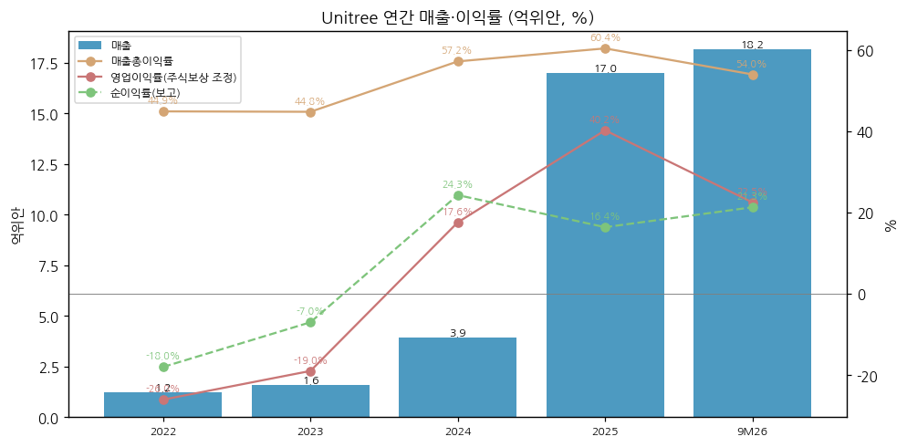
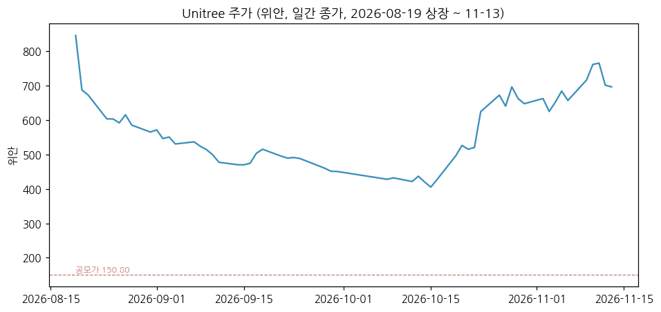
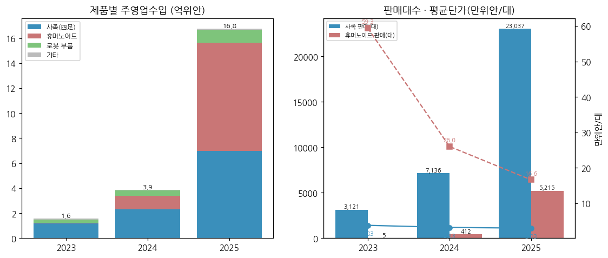
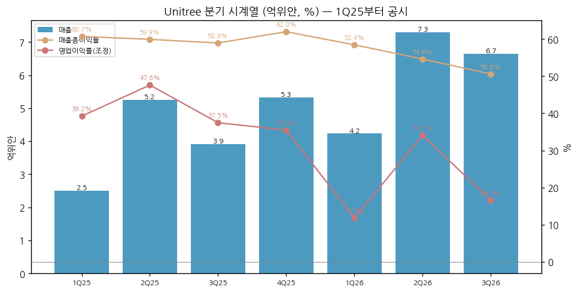
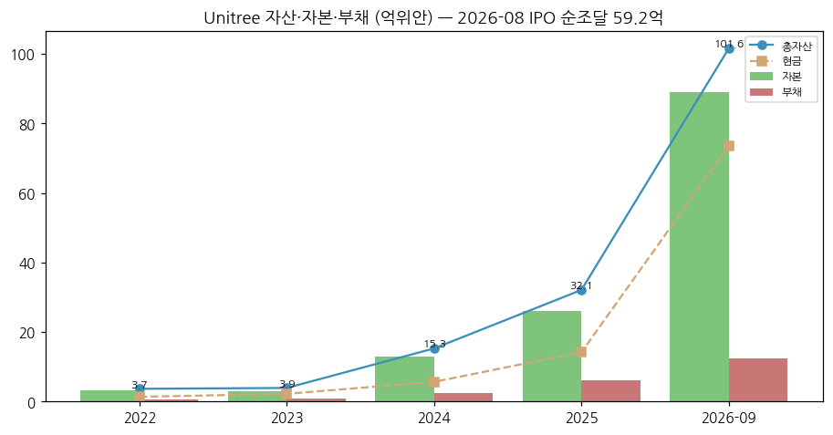
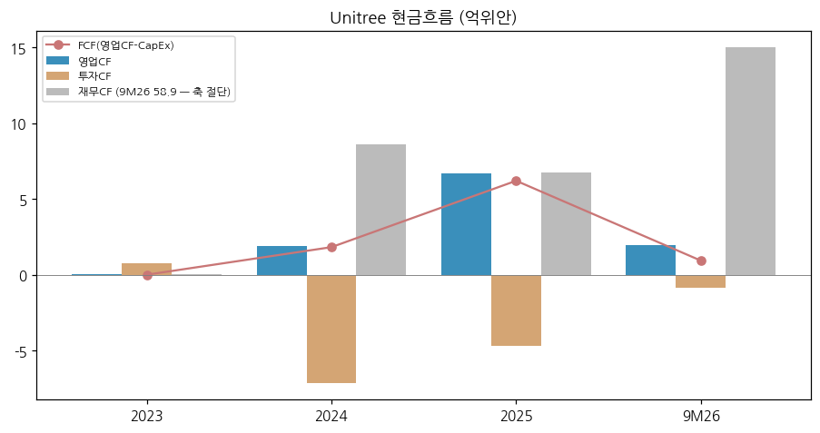

> Ticker: **688836.SH (상해거래소 과창판 STAR Market, 파일 키 688836.SS)** / 宇树科技股份有限公司 Unitree Robotics Co., Ltd. (약칭 宇树科技)
> Sector: 로봇 — 서브섹터: 휴머노이드 완성체 (핵심 글로벌 피어)
> 작성 시각: 2026-11-14 KST (**v1.0**)
> 적용 구조: v4.8 (6개 섹션) — 2026-08-19 상장 직후라 공시 재무가 2022년부터만 있다. 연간 4년(2022~2025) + 9M26, 분기 7개(1Q25~3Q26), 12종 차트 중 데이터로 만들 수 있는 7종만 작성
> 데이터: 연간 2022~2025(투자설명서 감사치) + 분기 1Q25~3Q26(분기 단독, 2026 3분기 보고서·상장공고서·투자설명서) + 제품별 연간 2023~2025 + 판매대수·평균단가 + 일간 주가(상장 후)
> 출처: **회사 원문(상해거래소 공고 PDF)** — 招股说明书(최종본, 2026-08-14), 上市公告书(2026-08-18, 1H26 재무 포함), 2026년 3분기 보고서(2026-10-29) / **东方财富 F10 재무 API**(연간·분기 손익·재무상태·현금흐름, 회사 공시 집계 — 원문과 대조) / **Yahoo Finance**(일간 주가) / 보도 인용: 雷峰网(新浪 전재, 10/30), 凤凰网科技(10/29), 每日经济新闻(10/28)

# Unitree (宇树科技, 688836) 기업 개요 (v1.0 — 휴머노이드 완성체, 휴머노이드·사족보행 로봇 출하량 글로벌 1위 상장사)
> **Fact verify cutoff**: 2026-11-14 (주가 11/13 종가 696.00위안, 시총 약 2,815억위안 [계산: 696.00 × 4.0446억주] — 每日经济新闻 10/28 보도 시총 2,815억위안(695.90위안)과 일치. 상장 후 장중 최고 1,100위안(2026-08-19), 최저 404.03위안(2026-10-15) [Yahoo Finance 52주 범위])

> **기준 메모**: ① 분기 단독 실적은 1Q25부터만 공시돼 2024년 이전 분기 YoY가 없다 ② 2Q25에 일회성 주식보상비용 3.49억위안(관리비)이 잡혀 2Q25 보고 이익이 적자다 — 이 문서의 "조정" 영업이익은 이 금액을 더한 값이다 [계산] ③ 이익 지표는 K-IFRS에 가깝게 매출 − 원가 − 세금 − 판매비 − 관리비 − 연구개발비로 다시 계산했다 [계산]. 중국식 营业利润(투자수익·기타수익 포함)과 차이는 분기 0.1억위안 안팎으로 작다

## ① 기업 분류

(1) Primary / Secondary 분류

**Primary 분류: 고성장 (휴머노이드 상용화 초기 선도주) — 매출 2023 1.59억 → 2025 16.99억위안(2년 10.7배), 2024년 흑자 전환**

→ 2025년 매출 YoY +332.6%, 9M26 +55.7%. 2026년 들어 매출 증가율은 낮아졌고(고기저) 영업이익은 역성장 중이다 (2026 3분기 보고서, 상장공고서)

→ 매출총이익률 60.4%(2025) — 상장 휴머노이드 피어(UBTech 37.7%, 越疆 46.5%)보다 높다. 회사 설명: 전기모터·감속기·관절 모듈까지 전 스택을 자체 개발·조립해 원가가 낮다 (투자설명서)

**Secondary 노트: "꿈(밸류에이션 선반영)" 성격**

→ 시총 2,815억위안은 2025 매출의 166배, TTM 매출(23.5억위안 [계산])의 120배다. 숫자보다 "중국 A주 유일의 휴머노이드 선도 순수 플레이" 희소성이 가격을 정한다 [판단]

(2) Summary Box (억위안, %)

| 지표 | 2022 | 2023 | 2024 | 2025 | 9M26 |
|---|---|---|---|---|---|
| 매출 | 1.23 | 1.59 | 3.93 | **16.99** | 18.17 |
| 매출 YoY | — | +29.5 | +146.8 | **+332.6** | +55.7 |
| 매출총이익률 | 44.9 | 44.8 | 57.2 | **60.4** | 54.0 |
| 영업이익 (조정) [계산] | -0.32 | -0.30 | 0.69 | **6.84** | 4.09 |
| 영업이익률 (조정) | -26.0 | -19.0 | 17.6 | **40.2** | 22.5 |
| 지배주주 순이익 (보고) | -0.22 | -0.11 | 0.95 | 2.78 | 3.87 |
| 비경상 제외 순이익 (扣非) | -0.08 | -0.18 | 0.78 | **5.91** | 3.49 |

→ (출처: 2022~2025 투자설명서 감사치(东方财富 F10 집계와 대조), 9M26 2026 3분기 보고서. 2025 조정 영업이익 = 보고 3.35억 + 주식보상 3.49억 [계산])

```
[Unitree 손익 (억위안)]
연도   매출    매출총이익률  영업이익(조정)  지배주주순이익  비경상제외순이익
2022    1.23    44.9%        -0.32         -0.22          -0.08   ← 사족 중심, 적자
2023    1.59    44.8%        -0.30         -0.11          -0.18   ← H1 첫 휴머노이드 5대 판매
2024    3.93    57.2%         0.69          0.95           0.78   ← G1 출시(2024-05), 흑자 전환
2025   16.99    60.4%         6.84          2.78           5.91   ← 춘완 공연·휴머노이드 5,215대, 주식보상 3.49억
9M26   18.17    54.0%         4.09          3.87           3.49   ← 매출 +55.7%, 이익률 하락(연구개발·판매비 급증)
```

(3) 정량적 분류 근거

→ 매출 CAGR(2023~2025) +226.8% [계산] — 고성장 기준 충족
→ 영업이익률(조정) -26.0% → 40.2% → 22.5%(9M26): 2025년이 정점, 2026년은 연구개발(대형 모델·컴퓨팅) 투자로 이익률을 낮추는 국면 [판단]
→ 휴머노이드 판매 5대(2023) → 412대(2024) → 5,215대(2025), 평균단가 59.3 → 26.0 → 16.6만위안/대 — 물량은 늘고 단가는 내리는 보급형(G1) 확산 구조 (투자설명서)

(4) 산업 분류

→ 중국증감회 업종: 컴퓨터·통신·기타 전자설비 제조업 계열 과창판 (투자설명서상 "고성능 범용 로봇" 업종)
→ 워치리스트 섹터: 로봇 / 서브섹터: 휴머노이드 완성체 (산업 대분류: 모빌리티·에너지전환)

(5) 분류 결정 논리

→ 2025년 주영업수입의 51.8%가 휴머노이드, 41.6%가 사족보행 — 두 제품군이 매출의 93%다
→ 고객 대부분이 연구·교육 기관이라(2025 1~9월 휴머노이드 매출의 73.6% [보도 인용, 투자설명서 원출처]) 산업 현장 대량 도입 전 단계다. "사이클"이 아니라 "상용화 초기 고성장"으로 분류

(6) 적정 밸류에이션 방법

→ 1차 — PSR: 공모가 기준 35.9배(2025 매출, 발행 후 주식수 — 상장공고서), 현재 약 120배(TTM 매출 23.5억위안 [계산])
→ 2차 — PER: 공모가 기준 219.2배(2025 순이익, 발행 후) / 103.3배(2025 扣非) (상장공고서). 현재 TTM 扣非 5.09억위안 기준 약 553배 [계산]. 雷峰网(10/30)은 롤링 PER 약 465배로 보도 [보도 인용]
→ PBR 31.6배 [계산] (시총 / 지배주주 자본 89.10억위안, 2026-09 말)
→ 현재 이익으로는 설명되지 않는 가격이다. 분기 휴머노이드 출하·산업 고객 비중이 멀티플을 지지하는지 확인하는 방식이 맞다 [판단]

(7) 분기 재평가 트리거 (분류 변경 조건)

→ ① 분기 매출 YoY +30% 미만 2개 분기 연속 → 고성장 → 성장 둔화 재분류 검토
→ ② 조정 영업이익률 15% 미만 2개 분기 연속 → "투자 국면 장기화" 명시
→ ③ 휴머노이드 매출 중 산업 응용 비중 30% 이상 공시 → 상용화 단계 상향

## ② 회사 개요

① 기본 사항

→ 회사명: 宇树科技股份有限公司 (Unitree Robotics), 2016-08-26 설립, 본사 항저우. 2025-05-16 주식회사 전환
→ 창업자·실질지배자: 왕싱싱(王兴兴, 회장·CEO·핵심 기술인) — 직접 21.44% + 상하이위이(上海宇翼, 왕싱싱 지배) 9.85%. 특별의결권(AB주) 구조로 상장 후 의결권 65.31% 이하 (투자설명서, 3분기 보고서)
→ 사업 한 줄: 사족보행 로봇(Go2·B2·A2), 휴머노이드(G1·H1·H2·R1), 로봇 부품(로봇팔·4D 라이다·고성능 연산 모듈), 구현형 AI 모델(UnifoLM)을 자체 개발·생산
→ 규모(2025): 매출 16.99억위안, 총자산 32.09억위안, 임직원 516명(연구개발 184명, 35.7%)
→ IPO: 2026-08-19 과창판 상장, 공모가 150.80위안, 신주 4,044.6만주(발행 후 10%), 총조달 60.99억 / 순조달 59.17억위안. 공모 자금 용도 = 지능형 로봇 모델 연구개발, 로봇 본체 연구개발, 신형 로봇 제품 개발, 제조기지 건설 (상장공고서)

→ **한국 로봇 기업과의 경쟁 지점 (어디서 맞붙나)**

| 제품 | Unitree 주력 | 한국 경쟁사 | 경쟁 구도 [판단] |
|---|---|---|---|
| 연구·교육용 휴머노이드 | G1(중형, 2025 주력), H1·H2(풀사이즈) | 레인보우로보틱스(HUBO 계열), 로보티즈(연구용 휴머노이드·액추에이터) | Unitree가 가격(G1 평균 16.6만위안 수준)과 물량(2025 5,215대)에서 압도 — 한국은 연구용 시장에서 가격 경쟁이 어렵다 |
| 사족보행 로봇 | Go2(소비자), B2·B2-W(산업), A2 | 레인보우로보틱스(RBQ), 현대차그룹(보스턴다이내믹스 Spot) | 2025 사족 판매 23,037대 — 산업 점검용 B2 확대가 Spot·RBQ와 직접 경쟁 |
| 로봇 부품(관절·감속기·라이다) | 자체 관절 모듈·4D 라이다 L1 | 로보티즈(다이나믹셀 액추에이터), 에스피지·하이젠 등 | 자체 조달 비중이 높아 외부 판매 부품(2025 1.04억위안)은 작다 |
| 협동로봇 | 해당 없음 | 두산로보틱스 | 직접 경쟁 없음 |

② 손익·자본 추이 (억위안)

| 연도 | 매출 | 매출총이익률 | 영업이익(조정) | 지배주주 순이익 | 순이익률 | 지배주주 자본 | 임직원 |
|---|---|---|---|---|---|---|---|
| 2022 | 1.23 | 44.9 | -0.32 | -0.22 | -18.0 | 3.10 | 209 |
| 2023 | 1.59 | 44.8 | -0.30 | -0.11 | -7.0 | 2.99 | 264 |
| 2024 | 3.93 | 57.2 | 0.69 | 0.95 | 24.3 | 12.81 | 328 |
| 2025 | 16.99 | 60.4 | 6.84 | 2.78 | 16.4 | 26.05 | 516 |
| 9M26 | 18.17 | 54.0 | 4.09 | 3.87 | 21.3 | 89.10 | 미공시 |

→ (출처: 투자설명서 감사치, 2026 3분기 보고서, 东方财富 F10. 2025 순이익률이 낮은 것은 주식보상 3.49억위안 때문. 2026-09 자본 급증은 IPO 순조달 59.17억위안)



③ 회사 주가 역사

→ 2026-08-19 상장일 시가 부근 1,100위안(공모가 대비 +629%), 장중 시총 4,400억위안 이상 → 종가 845위안 [보도 인용 雷峰网, Yahoo 종가]
→ 2026-10-15 종가 404.03위안 저점(고점 대비 -60% 이상), 시총 약 2,800억위안 증발 [보도 인용]
→ 10/16부터 반등: 10/21 H2-X 공개, 10/22 물리AI 생태 대회(왕싱싱 "물리 AI 1~3년 내 돌파 가능"), "宇创计划"(5년간 200개 이상 생태 기업 육성) → 10/28 695.90위안(10거래일 +65.7%), 회사 이상 변동 공시(10/21·10/27) [보도 인용 每日经济新闻·雷峰网]
→ 2026-11-13 종가 696.00위안, 시총 약 2,815억위안 [계산]. 상장 이력이 짧아 20년 시가총액 차트(chart11)는 상장 후 일간 주가로 대체



④ 주요 연혁

| 시점 | 사건 |
|---|---|
| 2016-08 | 항저우에서 설립 (왕싱싱) |
| 2017~2021 | 사족보행 Laikago → A1(2020, 최고 3.3m/s) → Go1(2021, 4.7m/s) |
| 2023 | 첫 풀사이즈 휴머노이드 H1 출시, 5대 판매 |
| 2024-05 | 중형 휴머노이드 G1 출시 → 주력 기종 |
| 2025-01 | CCTV 춘절 갈라쇼(춘완) 휴머노이드 공연 → 국내 인지도 급상승 |
| 2025 | 휴머노이드 출하 5,511대(순수 휴머노이드, 바퀴형 제외), 회사 주장 출하량 글로벌 1위 |
| 2025-05 | 주식회사 전환 |
| 2026-01~09 | UnifoLM-VLA-0(1월), UnifoLM-WLA-1.0(9월, 60억 파라미터) 오픈소스 공개, G1+(9월) 출시 |
| 2026-08-19 | 상해거래소 과창판 상장 (공모가 150.80위안, 조달 60.99억) |
| 2026-10-21 | 풀사이즈 고동적 휴머노이드 H2-X 공개 |

→ (출처: 투자설명서, 상장공고서, 보도 인용 雷峰网 10/30)

## ③ 비즈니스 모델

① 실적 추이 통합 (주영업수입, 억위안 — 분기·반기 제품별 매출은 상장 후 미공시)

| 구분 | 2023 | 2024 | 2025 | 2025 비중 | 2025 YoY | 2025 매출총이익률 |
|---|---|---|---|---|---|---|
| 휴머노이드 | 0.03 | 1.07 | **8.68** | 51.8% | +708.8% | 63.2% (2024 69.3) |
| 사족보행 | 1.19 | 2.31 | **6.98** | 41.6% | +202.6% | 56.7% (2024 51.7) |
| 로봇 부품 | 0.27 | 0.45 | **1.04** | 6.2% | +132.9% | 59.4% |
| 기타 | 0.08 | 0.05 | 0.07 | 0.4% | — | 33.5% |
| **합계** | 1.58 | 3.88 | **16.76** | 100% | +332.4% | **60.1%** |
| 지역: 중국 내 | 0.70 | 1.72 | 9.44 | 56.4% | — | — |
| 지역: 해외 | 0.88 | 2.16 | 7.32 | 43.6% | — | — |

→ (출처: 투자설명서 "主营业务收入构成" "主营业务毛利率" "市场区域构成". YoY는 [계산])

| 판매 | 2023 | 2024 | 2025 |
|---|---|---|---|
| 휴머노이드 판매대수 (출하) | 5 (9) | 412 (537) | **5,215 (5,511)** |
| 휴머노이드 평균단가 (만위안/대) | 59.34 | 26.04 | **16.64** |
| 사족 판매대수 | 3,121 | 7,136 | **23,037** |
| 사족 평균단가 (만위안/대) | 3.83 | 3.23 | **3.03** |

→ (출처: 투자설명서. 출하 > 판매는 고객 검수 전 미인식분. 2025 사족 생산·판매 차이는 京东 위탁재고(정산 후 인식) 때문)



① 분기 시계열 (억위안, %) — 1Q25부터 분기 단독 공시

| 분기 | 1Q25 | 2Q25 | 3Q25 | 4Q25 | 1Q26 | 2Q26 | 3Q26 |
|---|---|---|---|---|---|---|---|
| 매출 | 2.51 | 5.25 | 3.91 | 5.32 | 4.23 | 7.29 | **6.65** |
| 매출총이익률 | 60.7 | 59.9 | 58.9 | 62.0 | 58.4 | 54.6 | **50.6** |
| 영업이익 (조정) | 0.98 | 2.50 | 1.47 | 1.89 | 0.50 | 2.49 | **1.10** |
| 영업이익률 (조정) | 39.2 | 47.6 | 37.5 | 35.5 | 11.9 | 34.1 | **16.6** |
| 지배주주 순이익 | 0.96 | -1.28 | 1.36 | 1.74 | 0.50 | 2.24 | **1.13** |
| 연구개발비 / 매출 | 9.9 | 5.5 | 9.3 | 10.3 | 14.9 | 10.0 | **19.1** |
| 매출 YoY | — | — | — | — | +68.5 | +39.0 | **+69.9** |
| 영업이익 YoY (조정) | — | — | — | — | -49.1 | -0.4 | **-24.9** |

→ (출처: 실적 리뷰 `2026-Q3_688836.SS_리뷰.md` 1-① 표와 동일. 东方财富 F10 분기 단독 손익 — 1H26 합계는 상장공고서 1H26 营业利润 3.02억위안과 일치 확인)



→ 분기 15년(60분기) 시계열은 공시 기간이 짧아 작성 불가 — 1Q25부터 누적

② 사업부별 개요 (매출 비중 순, 2025)

→ **휴머노이드 (51.8%)**: G1(중형, 2024-05 출시 — 판매 주력), H1·H2(풀사이즈), R1(보급형). 2025 1~9월 휴머노이드 매출 구성은 연구·교육 73.6%, 상업·소비(전시·공연 등) 17.4%, 산업 응용 9.0% [보도 인용, 투자설명서 원출처]
→ **사족보행 (41.6%)**: Go2(소비자·교육), B2·B2-W(산업 점검·소방·구조), A2. 2025년부터 京东 자영몰 위탁 판매
→ **로봇 부품 (6.2%)**: 로봇팔, 4D 라이다, 고성능 연산 모듈 — 외부 판매
→ **구현형 AI 모델**: UnifoLM 시리즈(세계 모델·VLA·WLA) 오픈소스. 매출 기여는 미미하나 2026년 연구개발비 증가의 주 원인 (3분기 보고서 "구현형 대형 모델 관련 연구개발과 컴퓨팅 투자 대폭 증가")

③ 사업부별 디테일

→ 휴머노이드 매출총이익률 87.7%(2023, H1 5대) → 69.3%(2024) → 63.2%(2025): G1 비중 확대와 2025년 판매가 인하 (투자설명서)
→ 사족 매출총이익률 43.7% → 51.7% → 56.7%: 생산·구매 원가 절감 + 산업용 B2 비중 상승 (투자설명서)
→ 2026년 분기 매출총이익률 58.4% → 54.6% → 50.6%: 제품별 공시가 없어 원인을 분리할 수 없다. 보도는 휴머노이드 양산 수율 변동·일부 모델 가격 인하·연산/핵심 부품 원가 상승·저마진 산업 주문 비중 확대를 추정 [보도 인용 雷峰网, 회사 확인 없음]

④ 주요 경쟁사

→ 중국: UBTech(9880.HK, 풀사이즈 산업용 Walker S), 智元(AgiBot, 비상장), 云深处(Deep Robotics, 사족), 乐聚智能(Leju), 越疆(Dobot, 2432.HK)
→ 미국: Tesla Optimus, Figure, Agility Robotics, Boston Dynamics(현대차그룹) — 투자설명서는 2025년 Figure·Agility 출하량이 각 150대 안팎이라고 인용 (회사 확인 안 된 업계 추정)
→ 한국: 레인보우로보틱스(삼성전자 최대주주), 로보티즈, 두산로보틱스

| 회사 | 2025 매출 | 2025 매출총이익률 |
|---|---|---|
| Unitree | 16.99억위안 | 60.4% |
| UBTech | 20.01억위안 | 37.7% |
| 越疆 Dobot | 4.93억위안 | 46.5% |
| 云深处 | 3.37억위안 | 52.8% |
| 乐聚智能 | 2.58억위안 | 40.8% |

→ (출처: 투자설명서 "同行业公司毛利率比较")

⑤ 주요 매출처

→ 상위 5개 고객 매출 2.05억위안(12.1%, 2025) — 해외 고객 N(유럽) 3.1%, 京东 2.9%, 해외 고객 A(아시아) 2.5%, 北京朝元时代 1.8%, 해외 고객 B(아시아) 1.8%. 고객 분산도가 높다 (투자설명서)
→ 판매 채널(2025): 오프라인 89.3%(직판 51.1%, 대리점 38.2%), 온라인 10.7% (투자설명서)
→ 해외 비중 43.6%(2025), 미국·유럽·일본 고객. 수입 부품 조달 약 20%(국내 대리상 경유) — 미국 수출 통제·제재 목록 편입 리스크를 회사가 명시 (투자설명서 리스크 요인)

⑥ 생산 CAPA + 임직원

→ 유연 생산(라인 간 인력 전환) — 회사는 "확정된 설계 캐파 없음"이라고 밝힘. 2025 생산 휴머노이드 5,716대·사족 26,032대 (투자설명서)
→ 공모 자금으로 제조기지 건설 예정. G1 누적 생산 1~2만대 [보도 인용 凤凰网, 회사 확인 없음]
→ 임직원 209명(2022) → 264명 → 328명 → 516명(2025, 연구개발 184명)

## ④ 재무 구조

① 손익계산서 — ② 표 참고. 2025 비용 구조: 매출원가 39.6%, 판매비 8.3%, 관리비 23.5%(주식보상 3.49억 포함, 제외 시 3.0%), 연구개발비 8.5% [계산]. 9M26: 판매비 12.7%, 연구개발비 14.5% [계산]

② 재무상태표 (억위안)

| 시점 | 총자산 | 부채 | 지배주주 자본 | 부채/자산 | 현금 | 재고 | 계약부채 |
|---|---|---|---|---|---|---|---|
| 2022 | 3.66 | 0.56 | 3.10 | 15.4 | 1.36 | 0.78 | 0.12 |
| 2023 | 3.91 | 0.92 | 2.99 | 23.6 | 2.22 | 0.79 | 0.29 |
| 2024 | 15.28 | 2.47 | 12.81 | 16.2 | 5.66 | 1.41 | 0.93 |
| 2025 | 32.09 | 6.04 | 26.05 | 18.8 | 14.19 | 3.68 | 1.37 |
| 2026-09 | 101.56 | 12.45 | 89.10 | 12.3 | 73.54 | 10.19 | 2.33 |

→ (출처: 东方财富 F10 재무상태표, 2026 3분기 보고서. 2024 자본 증가는 사전 투자 유치, 2026-09는 IPO)
→ 무차입. 현금 73.5억 + 채권투자 7.2억 + 단기 금융자산 2.5억위안 (2026-09 말). 재고 10.19억위안은 연초 대비 +177% — 매출(+55.7%)보다 빠르다 [계산]



③ 현금흐름표 (억위안)

| 기간 | 영업CF | 투자CF | 재무CF | CapEx(유형·무형 취득) | FCF [계산] |
|---|---|---|---|---|---|
| 2023 | 0.05 | 0.78 | 0.03 | 0.05 | 0.00 |
| 2024 | 1.92 | -7.14 | 8.60 | 0.10 | 1.82 |
| 2025 | 6.70 | -4.72 | 6.75 | 0.50 | 6.20 |
| 9M26 | 1.94 | -0.89 | 58.85 | 1.01 | 0.93 |

→ (출처: 东方财富 F10 현금흐름표, 2026 3분기 보고서. 9M26 영업CF -54.7% YoY — 회사: 원재료 구매·인건비·판매비·연구개발비 지급 증가)



④ CapEx — 매출 대비 3% 미만으로 낮다(2025 0.50억위안). 공모 자금 제조기지 투자로 2027년부터 증가 예상 [전망]

⑤ 부채구조 — 차입금 없음. 부채는 매입채무(6.93억)·계약부채(2.33억) 등 영업부채 (2026-09)

⑥ 배당·자사주 — 상장 전후 배당·자사주 매입 없음

⑦ 재무비율: 가중평균 ROE 13.52%(2025), 11.19%(9M26, 회사) / 부채비율(부채/자산) 12.3%(2026-09)

## ⑤ 지배 구조

① 그룹 관계: 독립 기업 (그룹 계열 없음). 실질지배자 왕싱싱, 특별의결권 주식 보유

② 주주 (2026-09 말, 보통주 주주 48,007명)

| 주주 | 지분율 (%) |
|---|---|
| 왕싱싱 (창업자) | 21.44 |
| 上海宇翼 (왕싱싱 지배 유한합자) | 9.85 |
| 汉海信息技术 (美团 계열) | 6.85 |
| 宁波红杉科盛 (红杉中国) | 5.59 |
| Astrend IV (Hong Kong) Alpha | 3.98 |
| 南京经纬创壹号 | 3.83 |
| 金石成长 (中信) | 3.74 |
| 北京机器人产业发展投资基金 | 3.44 |
| 嘉兴骅茂 | 2.87 |
| 天津君万弘毅 | 2.76 |
| 상위 10대 주주 합계 | 64.35 [계산] |

→ (출처: 2026 3분기 보고서. 상위 10대 주주 전원 보호예수 중. 유통주는 공모 물량 일부라 상장 초기 유통 비율 7.44% (상장공고서). 汉海信息=美团 계열은 공개 정보 [보도 기반, 회사 표기는 법인명만])

③ 임원: 회장·CEO 왕싱싱. 핵심 기술인 3명(왕싱싱·杨知雨 등, 2023년 이후 변동 없음) (투자설명서). 이사회 약력 상세 미정리

## ⑥ 기타 팩트

① R&D: 연구개발비 0.30억(2022) → 0.50억 → 0.70억 → 1.45억위안(2025) → 9M26 2.63억위안(+191.5%, 매출 대비 14.5%). 3Q26 단독 1.27억위안(+249.6%, 19.1%) — 구현형 대형 모델·컴퓨팅·인력 확대 (3분기 보고서)

② Corporate action: 2026-08 IPO / 2026-10-29 참여회사 증자(관계자 거래 — 항저우 구현형 AI 시험기지, 자회사 2,000만위안 출자, 지분 10% 유지) / 2026-10-28 红杉中国와 "杉宇·创计划" 초기 투자 프로그램 [보도 인용] / 2026-10-22 "宇创计划" 생태 기업 200개 육성

③ R&D 마일스톤: Go1 4.7m/s(2021) → H1(2023) → G1(2024) → UnifoLM-WMA-0 오픈소스(2025-09) → UnifoLM-VLA-0(2026-01) → UnifoLM-WLA-1.0(2026-09, 실제 로봇 데이터 약 2,500시간) → H2-X(2026-10, 31 자유도, 8시간 구동 주장) [보도 인용 雷峰网]

④ 주요 리스크 (투자설명서·3분기 보고서)
→ 성장 둔화·이익 감소: 회사 스스로 "업계 열기 완화·경쟁 심화로 2026년 증가율 둔화, 기간비용 증가로 순이익 감소"를 공시
→ 미국 제재·수출 통제: 미국 정부의 제재 목록 편입 시 해외(매출 43.6%) 판매·수입 부품(구매의 약 20%) 차질 가능
→ 환율: 해외 판매 대부분 달러 결제
→ 지배구조: 특별의결권으로 창업자 의결권 65% 수준
→ 밸류에이션: 상장 후 고점 대비 -60% 하락 이력(8~10월)

⑤ ESG 등급: 미확보
⑥ 인증·라이선스: 과창판 "과학기술 혁신 속성" 기준 충족(연구개발 인력 35.7%) — 세부 인증 미정리

---

## Version Log

→ **v1.0 (2026-11-14)**: 최초 작성. 회사 원문 3건(투자설명서 최종본, 상장공고서, 2026 3분기 보고서) + 东方财富 F10 재무 API + Yahoo 일간 주가. 2Q25 주식보상 3.49억위안 조정, K-IFRS식 영업이익 재계산. 차트 7종(chart1·2·4·6·10·11 + 제품별 판매대수)
→ 잔여 보완 후보: ① 2026 연간 보고서(2027-03~04)로 제품별 매출·휴머노이드 판매대수 갱신 — 상장 후 분기 보고서는 제품별을 공시하지 않음 ② 분기 판매대수(회사가 IR 활동 기록에서 밝히면 반영) ③ 이사회·임원 약력 ④ 사족·휴머노이드 시장 점유율(제3자 리서치 GGII·IDC) ⑤ ESG 등급
