> Ticker: **TSE: 7011 — Mitsubishi Heavy Industries, Ltd. (三菱重工業)** (도쿄증권거래소 프라임) / 분석 단위: **원자력 사업 = Energy Systems 부문 내 'Nuclear Power' 사업 (Nuclear Energy Systems)**
> Entity: **Mitsubishi Heavy Industries, Ltd.** (본사 도쿄 마루노우치, 원자력 사업 본거지 고베 조선소·고베 공장) — 일본 가압경수로(PWR) 24기 전량을 지은 **일본 유일의 PWR 플랜트 벤더**. 원자로 설계 + 원자로용기·증기발생기 등 주기기 제작 + 재가동·정비 공사 + 롯카쇼 재처리공장 등 핵연료 사이클 시설 공사를 한 회사가 수직통합. 모회사 MHI는 4개 보고 세그먼트(Energy Systems·Plants & Infrastructure·Industrial Solutions·Aircraft, Defense & Space)의 멀티 세그먼트 기업
> Sector: 원전 — 서브섹터 **원전 기자재 글로벌 (핵심, 합산 포함)** — 같은 서브섹터 BWXT, 한국 비교 대상 두산에너빌리티(원전 기자재)·한전기술(원전 설계)
> 작성 시각: **2026-11-15 KST** (**v1.0** — Phase 1 Source 수집 + audit + 15종 차트)
> 적용 구조: v4.8 (6개 섹션) + 멀티 세그먼트 피어 룰 (해당 섹터 부문만 추출, 그룹 숫자는 맥락용. 이번 분기 모회사 트리거 2건 발동 → ⑤ (4)에 모회사 컨텍스트 별도 항목)
> 회계연도: **3월 결산 (MHI 표기 'FY2026' = 2026-04\~2027-03)**. 분기 매핑: FY26 1Q = 2Q26(4\~6월), **FY26 2Q = 3Q26(7\~9월)**. 본문 분기 라벨은 **캘린더 기준(예: 3Q26)** + 회계 분기 병기. 연간은 MHI 표기(FY25 = 2025-04\~2026-03) 그대로 사용
> 데이터 범위: **원자력 수주·매출 분기 26Q (FY20 1Q\~FY26 2Q = 2Q20\~3Q26)** + 원자력 연간 FY19\~FY25 + FY26 회사 계획 / **Energy Systems 부문 분기 30Q (FY19 1Q\~FY26 2Q, 수주·매출·사업이익)** / 그룹 12년 (FY14\~FY25, 맥락용) / 7011.T 주가 2000-02\~2026-11-13
> 단위: **십억엔 (¥bn)**. 원화 환산은 참고용 — 2026-11-13 현물 **₩8.34/¥** (Yahoo JPYKRW=X)
> 출처: **MHI IR — 결산 설명자료(presentation) 19건 (FY20 1Q\~FY26 2Q 전 분기 + FY19·FY21·FY22·FY23·FY24 결산), 결산단신 FY25 결산·FY26 2Q, 결산 Q&A 요지 FY25 2Q\~FY26 2Q, Nuclear Power Strategy Briefing (2023-06-05) + Q&A, 2020 원자력 사업 설명회, MHI REPORT 2025 (11년 재무·주주 구성), FY25 Financial Section (2026)** / Yahoo Finance 7011.T·JPYKRW=X / MHI 보도자료 (2025-07-02, 2025-09-18, 2026-08-05, 2026-10-15) / 보도 (World Nuclear News 2025-11-05, Reuters·Newsweek Japan 2026-03-04, 교도·구마니치 2026-06-08, nippon.com 2026-10-06, 닛칸공업 2026-02-05) / Framatome 지배구조 페이지 / stockanalysis.com
> ⚠️ 다음 실적: **FY26 3Q(=4Q26) 결산 — 2027-02 초 예상 (회사 미공지, 전년 2026-02-04 기준)** / 롯카쇼 재처리공장 준공 목표(2027-03) 재연기 여부 / 간사이전력 미하마 신설 사전조사 완료(2027-03 전후)

# Mitsubishi Heavy Industries — 원자력 사업 기업 개요 (v1.0 — 원전 기자재 글로벌 / 일본 PWR 독점 벤더 + 핵연료 사이클 + SRZ-1200 신규 건설 옵션 / 재가동·연료사이클 주도 매출 레벨업)
> **Fact verify cutoff**: 2026-11-15 (주가 2026-11-13 종가 **¥2,920.5** [Yahoo Finance 7011.T, 당일 −7.4%], 유통주식 3,361.5백만주 [발행 3,373.6백만 − 자사주 12.2백만, 2026-09말 결산단신] → 시가총액 **≈ ¥9.82조 (≈ ₩81.9조)** [계산]. **사상 최고 종가 ¥5,195 (2026-03-02, 장중 ¥5,208)** [Yahoo 일간] → 당시 시총 ≈ ¥17.5조 [계산]. 고점 대비 **−43.8%**. 52주 고/저 종가 ¥5,195 / ¥2,912.5 (2026-11-06) [Yahoo]. 교차 확인: 2026-09-28 시총 ¥13.06조 (주가 ¥3,886) [stockanalysis.com]. 원자력 사업 단독 점유율 통계는 공식 집계 없음)

> ⚠️ **분석 단위·표시 기준 4건 — 모든 표·차트 해석 시 주의**
> ① **멀티 세그먼트 모회사** — 본 리포트의 핵심 숫자는 **Energy Systems 부문 'Nuclear Power' 사업의 수주·매출**이다. 원자력은 FY25 Energy Systems 매출의 **17.5%**, 그룹 매출의 **7.3%** [계산]. Energy Systems 부문 합계는 '포함 부문'으로, 그룹 전사 숫자는 맥락 행으로만 쓴다
> ② **원자력 단독 이익·수주잔고는 미공시** — MHI는 원자력 사업의 사업이익(Business Profit)과 수주잔고를 따로 내지 않는다. 이익률은 **Energy Systems 부문 사업이익률**로 대신 보고, 원자력의 수익성은 회사·애널리스트 발언("이미 높은 마진", FY25 결산 Q&A)으로만 확인된다. 섹터 델타 비교에는 **원자력 매출·수주 YoY**를 쓴다
> ③ **분기 숫자는 누적 공시에서 차감** — 회사는 1Q·1H·9M·연간 누적만 공시한다. 분기 단독값은 차감 [계산]. 일본 전력사 공사 특성상 **회계연도 4Q(1\~3월)에 매출이 몰린다** (FY25 4Q 매출 ¥184.5bn = 연간의 51%) → 분기 YoY는 같은 회계 분기끼리만 비교
> ④ **세그먼트 재편** — FY23·FY24·FY25(2025-04)·FY26(2026-04) 조직개편으로 Energy Systems 합계가 일부 소급 조정됐다 (FY23 수주 2,428.0 → 2,412.2 등). **원자력 수치는 재작성 전후 동일** (FY24 390.8/299.0 원·재작성 일치 확인). FY23 분기 Energy 합계는 원 공시치(미조정). FY25 그룹 수치는 Logisnext(2026-05-01 매각 완료) 중단사업 제외 기준

## Phase 1 Source Audit

```
=== 자료 수집 audit (Mitsubishi Heavy Industries — 원자력 사업 / Energy Systems) ===

✅ 확보 (저장: company-overview-source/7011.T_MHI/raw/)
- 결산 설명자료(presentation) 19건: FY20 1Q·2Q·3Q·4Q, FY21 1Q·2Q·3Q·4Q, FY22 4Q, FY23 1Q·2Q·3Q·4Q, FY24 4Q, FY25 1Q·2Q·3Q·4Q, FY26 1Q·2Q
  → 'Main Businesses' 표: GTCC·Steam Power·Aero Engines·Nuclear Power 수주·매출 (누적), 세그먼트 수주·매출·사업이익, 수주잔고, 애프터서비스 매출비율
  → FY25 결산 자료 p.7 "Nuclear Power Order Intake and Revenue" (원자력 매출 구성 막대 = 국내 경수로/핵연료 사이클/차세대로·기타)
- 결산단신 2건 (FY25 결산 2026-05-12, FY26 2Q 2026-11-06) — 주식수·배당·가이던스·자사주 매입
- 결산 Q&A 요지 5건 (FY25 2Q·3Q·4Q, FY26 1Q·2Q)
- Nuclear Power Strategy Briefing (2023-06-05) 본문 + Q&A, 2020 원자력 사업 설명회 자료
- MHI REPORT 2025 (11년 재무 FY14~FY24, 주주 구성, 대주주), FY25 Financial Section (Orano·JNFL 지분 공정가치)
- Yahoo Finance 7011.T 월간(2000-02~)·일간(2y), JPYKRW=X

❌ 누락 (5)
- 원자력 사업 단독 사업이익·수주잔고·임직원 수: 회사 미공시 (Energy Systems 합계로 대체)
- FY18 이전 원자력 수주·매출 정확값: 옛 '파워 도메인' 체계, 일본어 설명자료 텍스트 추출 불가 → 회사 설명회 범위 표기("FY11~19 평균 약 ¥200bn")로 대체
- FY19 원자력 분기값: FY20 자료에 전년 비교 미수록 → 연간만
- 원자력 매출 구성(경수로/연료사이클/차세대로) 정확값: 막대 차트만 공시 → 판독 추정치(~)
- 셀사이드 원자력 컨센서스: 집계 출처 미확보

⚠️ 결과 영향
- 12년 시계열 대신 원자력 7개년(FY19~FY25) + FY26 계획 + 분기 26Q. 그룹 12년(FY14~FY25)은 맥락용
- FY14~FY16 그룹 수치는 JGAAP(영업이익), FY17~는 IFRS(사업이익) — 연속성 단절
- 원자력 이익 부재로 ① 기업 분류의 OPM 지표는 Energy Systems 부문 이익률로 대체

Source 6종 audit:
[V] (1) 정기 보고 (결산단신·Financial Section) ✓
[V] (2) IR 실적 발표 자료 19건 + Q&A 5건 ✓ / 컨콜 전문 ✗ (Q&A 요지로 대체)
[V] (3) 원자력 사업 설명회 (2023·2020) ✓ / 통합보고서 2025 ✓
[V] (4) 주가 (Yahoo 7011.T 2000~) ✓
[△] (5) 중장기 목표 — 2024 중기경영계획(FY24~26) 그룹 수치·원자력 증설 투자 ¥100bn ✓ / 원자력 단독 중기 목표는 CFO 인터뷰(보도)만
[△] (6) 12년 정확값 — 원자력은 7개년만
→ 5/6 source 확보. 최신 분기(FY26 2Q = 3Q26, 2026-11-06 발표) 반영.
```

---

## ① 기업 분류

(1) Primary / Secondary 분류

**⚠️ Boundary Case — 10년 가까이 '연 3,000억엔 박스권' 지속성장이었다가 FY25부터 레벨업 구간 진입**

**Primary 분류: 지속성장 (일본 PWR 독점 정비·재가동 + 핵연료 사이클 장기 공사형)**

→ 원자력 매출 FY19 ¥256.7bn → FY20\~FY24 **¥284\~315bn 박스** (5년간 진폭 ±5%) → FY25 **¥361.1bn (+21%)**. FY19→FY25 6년 CAGR **+5.9%** [계산]. 회사 설명: 매출 수준이 FY11\~19 평균 약 ¥200bn → FY20\~24 약 ¥300bn → FY25\~ ¥360bn 이상으로 계단식 상승 (FY25 결산 자료 p.7)

→ 매출의 **71%가 애프터서비스(정비·개조 등)** (FY25·1H FY26, 회사 'After-Sales Services Revenue Ratio') — 일본 PWR 24기 전부를 지은 벤더라 가동 원전의 정기검사·증기발생기 교체·안전대책 공사를 사실상 독점

→ 수요는 경기가 아니라 **일본 원전 재가동 일정·원자력규제위원회(NRA) 심사·롯카쇼 재처리공장 공정**에 연동. 2011 후쿠시마 이후 매출이 꺼졌다 재가동과 함께 회복한 '정책 사이클'이 한 번 있었지만, 그 뒤 10년은 저변동

**Secondary 노트: 고성장 진입 (FY25\~) + 꿈 (SRZ-1200 신규 건설)**

→ 수주 FY22 ¥268.7bn → FY25 **¥540.6bn (2.0배)** → FY26 계획 **¥600bn**. 수주/매출 비율(Book-to-bill) FY23 1.74 · FY24 1.31 · FY25 1.50 · 1H FY26 **1.83** [계산] — 매출보다 수주가 빠르게 쌓이는 중

→ FY26 원자력 매출 계획 **¥550bn (+52% YoY)** (2026-11-06 상향, 종전 ¥400bn). 1H FY26 실적 매출 ¥152.1bn (+48%), 수주 ¥278.4bn (+53%)

→ **꿈**: 간사이전력이 미하마 1호기 대체 신규 원전 부지조사를 2025-11 개시, MHI의 차세대 경수로(SRZ-1200)를 후보로 거론 (WNN 2025-11-05·Reuters 2026-03-04). 신규 건설 매출은 **2030년대 후반부터** (CFO, Reuters 2026-03-04)

**사업 구조 (원자력 매출 구성, FY25 ¥361.1bn — 회사 막대 차트 판독 추정치)**

→ **(1) 국내 경수로 (PWR + BWR)** — 약 ¥195bn (54%) — PWR 재가동·특정중대사고처리시설(특중시설, 테러·항공기 충돌 대비 시설) 공사, 증기발생기·원자로 내부구조물 교체, 정기검사, BWR 재가동 지원(오나가와 2·시마네 2·가시와자키가리와 등)

→ **(2) 핵연료 사이클** — 약 ¥109bn (30%) — 일본원연(JNFL) 롯카쇼 재처리공장·MOX 연료가공공장(J-MOX) 건설·인허가 지원, 사용후핵연료 건식 캐스크, 우라늄 농축 공장 지원

→ **(3) 차세대로·기타** — 약 ¥58bn (16%) — 고속로·고온가스로 실증로 설계(정부 사업 중핵기업), SRZ-1200 개발, 해외 기자재(EDF 교체용 증기발생기 등), ITER 핵융합 부품

(2) Summary Box (원자력 사업, FY19\~FY25 7개년 + FY26 계획)

| 지표 | 값 |
|------|-----|
| 매출 CAGR (FY19→FY25, 6년) | **+5.9%/yr** [계산] (FY26 계획 +52.3%) / 수주 CAGR **+9.8%/yr** [계산] |
| 이익률 평균 | **원자력 단독 미공시** — 포함 부문 Energy Systems 사업이익률 7개년 평균 **7.8%** [계산] (FY21 5.2% \~ FY25 13.0%) |
| 이익률 정점 | Energy Systems **13.0% (FY25)** — GTCC 가격 개선 + 원자력 매출 증가 / FY26 계획 14.3% |
| 이익률 저점 | Energy Systems **4.9% (FY22)** — 증기발전(석탄) 축소·일회성 비용 |
| 사이클 주기 | 원자력 매출 기준 뚜렷한 사이클 없음 (FY20\~24 박스) — **정책 사이클 1회**: 2011 후쿠시마 → 2015 센다이 1호기 재가동부터 회복 |
| 사이클 회수 | 0회 (FY19 이후 원자력 매출 역성장 2회: FY22 −9.8%, FY24 −0.6% — 모두 공사 진행 타이밍) |

```
[MHI 원자력 연간 수주·매출 (십억엔)]  FY = 당해 4월 ~ 익년 3월
연도     수주    매출    매출YoY   B/B   Energy매출  원자력비중  Energy BP  Energy BPM  그룹매출  원자력/그룹
FY19    308.0   256.7     -      1.20   1,590.2    16.1%      144.3      9.1%      4,041.3    6.4%   ← 2019-12 미하마·다카하마 등 재가동 공사 + 롯카쇼 공사 본격화
FY20    236.0   292.6   +14.0%   0.81   1,546.0    18.9%      127.6      8.3%      3,699.9    7.9%   ← 특중시설 공사 매출 인식, COVID
FY21    249.2   315.2    +7.7%   0.79   1,651.0    19.1%       86.2      5.2%      3,860.2    8.2%   ← 미하마 3호기 재가동(40년 초과 첫 사례)
FY22    268.7   284.4    -9.8%   0.94   1,738.6    16.4%       85.1      4.9%      4,202.7    6.8%   ← PWR 특중시설 5기 완공, 공사 공백
FY23    522.2   300.8    +5.8%   1.74   1,761.5    17.1%      141.5      8.0%      4,657.1    6.5%   ← 수주 2배: 다카하마 3·4 SG 교체, BWR 특중시설, 연료사이클 추가 공사
FY24    390.8   299.0    -0.6%   1.31   1,815.7    16.5%      205.3     11.3%      5,027.1    5.9%   ← 오나가와 2·시마네 2(BWR) 재가동, 고속로·고온가스로 실증 설계
FY25    540.6   361.1   +20.8%   1.50   2,062.6    17.5%      267.2     13.0%      4,974.1    7.3%   ← 사상 최대 매출·수주, 연료사이클 수주 확대 (그룹은 Logisnext 제외)
FY26F   600.0   550.0   +52.3%   1.09   2,650.0    20.8%      380.0     14.3%      6,000.0    9.2%   ← 2026-11-06 상향 (원자력 수주 450→600, 매출 400→550)
* 1H FY26 실적: 수주 278.4 (+52.6%) / 매출 152.1 (+48.1%) → 하반기 계획 매출 397.9 (전년 하반기 258.4 대비 +54%) [계산]
* FY23 Energy는 원 공시치 (FY24 조직개편 소급 시 수주 2,412.2 / 매출 1,723.6 / BP 149.8)
```

**원전 기자재·설계 피어 비교 (각사 최근 연간, 원화 환산은 참고)**

→ **MHI 원자력** — FY25 매출 **¥361.1bn (≈ ₩3.0조)**, 수주 ¥540.6bn (≈ ₩4.5조), FY26 계획 매출 ¥550bn (≈ ₩4.6조) [환산: ₩8.34/¥ 현물, 계산]. 이익 미공시

→ **두산에너빌리티** — 원자력 매출 2025 **약 1.5조원** (키움 추정 분해, DART 미공시) / 원자력 수주 2025 6.8조원(체코 두코바니 포함) → 2026 9M 0.4조원 (계획 4.9조원) (같은 폴더 `두산에너빌리티_기업개요.md`, 3Q26 IR)

→ **한전기술** — 원전(원자력 A/E + 원자로 NSSS 설계) 매출 2025 **4,410억원**, 전사 OPM 6.8% (같은 폴더 `한전기술_기업개요.md`)

→ **BWXT** — 9M26 Commercial Operations(상업 원전) 매출 $900M, OPM 8.3% (같은 폴더 `BWXT_기업개요.md`)

→ 시사점 `[판단]`: MHI 원자력 매출은 두산 원자력의 약 2배다. 차이는 **설치 기반(installed base)**에서 나온다. MHI는 일본 PWR 24기 전체의 정비·개조를 맡고(애프터서비스 비중 71%) 연료사이클 공사도 진행 중이다. 두산은 국내 신규 호기·체코 수출 주기기가 매출의 중심이다. 그래서 MHI는 재가동·연료사이클이 받쳐 주는 **저변동 매출**이고, 두산은 **신규 건설 수주에 따라 크게 움직이는 매출**이다. 신규 건설 옵션(SRZ-1200)은 MHI 쪽이 아직 수주 전 단계다

(3) 정량적 분류 근거

→ **재가동 진행률** — 일본 원전 재가동 15기 누적 (2026-01 가시와자키가리와 6호기 포함, nippon.com 2026-10-06). 이 중 **PWR 12기는 모두 MHI 건설** (오이 3·4, 센다이 1·2, 다카하마 1\~4, 이카타 3, 겐카이 3·4, 미하마 3). 남은 PWR 도마리 1\~3·쓰루가 2, BWR 다수가 FY24\~FY30 공사 파이프라인 (2023 Strategy Briefing)

→ **애프터서비스 비중** — 원자력 매출 중 애프터서비스 1H FY25 71% → FY24 77% → FY25 71% → 1H FY26 71% (결산 자료 Appendix). 신규 설비 비중은 30% 미만

→ **수주 > 매출 누적** — FY20\~1H FY26 누적 수주 ¥2,485.9bn vs 누적 매출 ¥2,005.2bn → **수주 초과 ¥480.7bn** [계산] — 공시되지 않는 원자력 수주잔고가 그만큼 쌓였다는 근사 지표

(4) 산업 분류

→ **TSE 업종** — 기계 / 닛케이225·TOPIX Core30 구성종목

→ **워치리스트** — 섹터 원전 / 서브섹터 **원전 기자재 글로벌** (핵심, 섹터 합산 포함 — 원자력 매출 YoY로 델타 산출). 워치리스트 표기 "Mitsubishi Heavy(원자력 부문)"

→ **MHI 내부 분류** — 'Growing Core Businesses'(GTCC·원자력·방산) 3개 중 하나 (2024 중기경영계획)

(5) 분류 결정 논리

(1) **가장 매출 큰 사업 기준**: 국내 경수로(약 54%) — 가동 원전 정비·재가동 공사는 원전 수명(60년+) 동안 이어지는 **설치 기반 매출** → 지속성장

(2) **이익 비중 sub-rule**: 원자력 이익 미공시라 적용 불가. 대신 포함 부문(Energy Systems)의 이익 변동은 **GTCC·증기발전이 결정**(FY26 2Q 증기발전 IGCC 손실로 부문 이익률 7.5%) — 원자력이 부문 이익률을 흔든 사례는 공시상 확인되지 않음

(3) **Boundary case**: Primary 지속성장 + Secondary 고성장(FY25\~). FY26 매출 +52% 계획이 실현되고 FY27에도 +20% 이상이 이어지면 Primary를 고성장으로 올린다. 반대로 롯카쇼 준공(공사 종료)·재가동 공사 일단락 뒤 신규 건설 착공까지 공백이 생기면 FY20\~24식 박스로 되돌아갈 수 있다

(4) **글로벌 피어 cross-ref**:
→ BWXT = 지속성장 (미 해군 원자로 독점 장기계약) — MHI 원자력과 '독점 설치 기반'이라는 구조가 같다
→ 두산에너빌리티 = 사이클 + Secondary 꿈 — 신규 건설 수주 사이클 노출이 MHI보다 크다
→ 한전기술 = 사이클 (원전 건설 프로그램 연동 설계 물량) — MHI는 설계·제작·정비를 다 가진 수직통합이라 한전기술보다 변동이 작다

(6) 적정 밸류에이션 방법

→ 상장 단위가 그룹(7011.T)이라 원자력 단독 멀티플은 없다. **SOTP의 원자력 파트**로 접근

→ **1차 — EV/Sales 또는 이익 가정 P/E (원자력 파트)**: 이익이 미공시라 Energy Systems 이익률(FY26 계획 14.3%)을 상한 가정으로 두고 원자력 매출 ¥550bn에 적용하는 방식 `[판단]`. 애프터서비스 비중이 높은 원자력은 신규 설비 위주의 GTCC보다 마진이 높다는 게 시장 해석이다 (FY25 결산 Q&A 질문자 "이미 높은 마진")

→ **2차 — 그룹 P/E·PBR (맥락)**: FY26 회사 계획 EPS ¥130.91 → **22.3x** [계산: ¥2,920.5 / 130.91], FY25 실적 기준 29.5x, PBR **3.05x** [계산: 시총 ¥9.82조 / 지배주주 자본 ¥3.217조(2026-09말)]

→ 피어: BWXT(지속성장 프리미엄)·두산에너빌리티(수주 옵션 프리미엄)와 달리 MHI 그룹 밸류는 **GTCC(가스터빈)·방산이 주가를 결정** — 원자력은 그룹 매출의 7%라 SOTP 기여가 제한적. 원자력 섹터 내 비교는 **원자력 매출 성장률**로 한다

(7) 분기 재평가 트리거 (분류 변경 조건)

→ ① **원자력 매출 YoY +20% 이상이 FY26·FY27 2개 연도 연속** → Primary 지속성장 → 고성장 재분류

→ ② **SRZ-1200 첫 정식 수주(간사이 미하마 등) 또는 국내 신규 건설 착공 결정** → Secondary 꿈 → 고성장(잔고 기반) 격상

→ ③ **원자력 연간 매출이 ¥300bn 아래로 복귀 + 수주 B/B 1.0 미만 2년 연속** → Secondary 고성장 삭제, 지속성장(박스) 재확인

→ ④ **회사가 원자력 사업이익을 별도 공시하기 시작** → 이익률 기준으로 분류 재평가

---

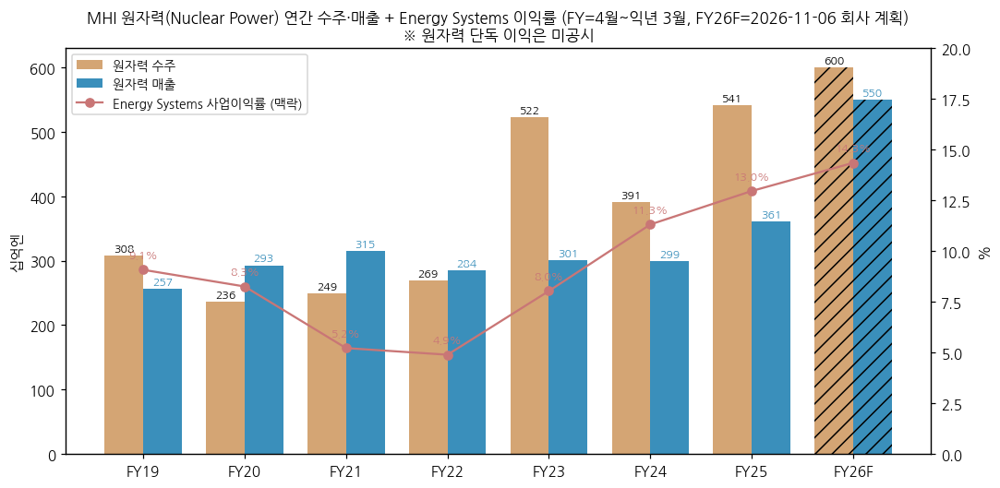

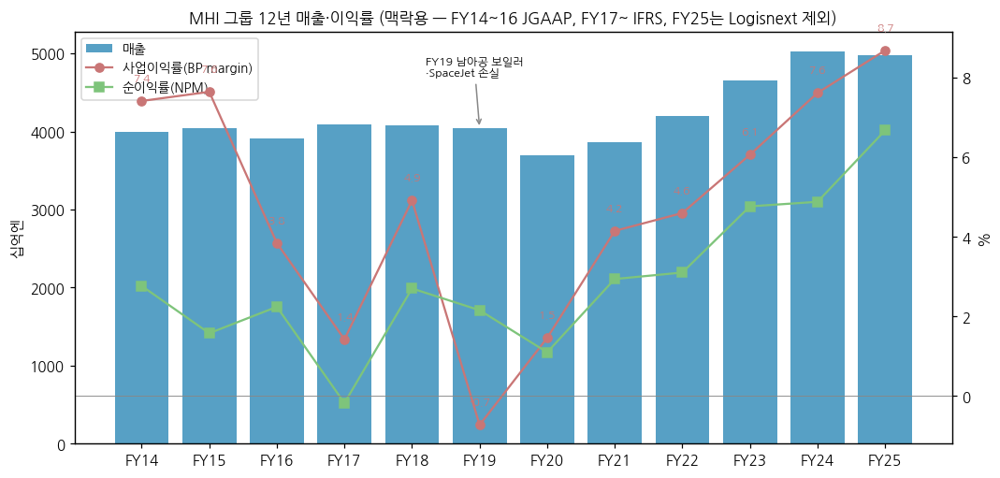

---

## ② 회사 개요

(1) 기본 정보

→ **법인명** — Mitsubishi Heavy Industries, Ltd. (三菱重工業株式会社). 설립 1950-01-11 (재벌 해체 후 3사 분할 → 1964 재합병). 기원은 1884년 나가사키 조선소 (MHI REPORT 2025)
→ **원자력 사업 조직** — Energy Systems 부문 내 Nuclear Energy Systems. 원자로 설계·주기기 제작은 고베 조선소(Kobe Shipyard & Machinery Works), 핵연료 제조는 그룹 자회사 미쓰비시원자연료(MNF) (지분율 미검증 — 비공식 출처)
→ **회계연도** — 4\~3월 / IFRS / 분기 결산. 원자력은 결산 설명자료 'Main Businesses' 표에 수주·매출만 공시
→ **사업 한 줄 정의** — **일본 PWR 24기를 모두 지은 유일한 PWR 벤더로서, 그 설치 기반의 재가동·정비·수명연장과 국가 핵연료 사이클 시설 공사를 맡고, 다음 세대 원전(SRZ-1200)·SMR·고속로·고온가스로·핵융합까지 개발한다**
→ **경영진** — 사장 겸 CEO **Eisaku Ito (伊藤栄作)**, CFO **Hiroshi Nishio (西尾浩)** / 원자력 사업 책임자는 2023 설명회 당시 Akihiko Kato (현직 여부 미검증)
→ **그룹 임직원** — 77,274명 연결 / 22,347명 단독 (2025-03말, MHI REPORT 2025). 원자력 인력은 미공시 — FY25\~27 중기계획 기간 원자력 인력 **약 10% 증원** 계획, FY24 약 200명 채용 (CFO, Reuters 2026-03-04)

(2) 그룹 내 원자력 비중 (십억엔)

| 항목 | FY23 | FY24 | FY25 | 1H FY26 | FY26F (11/06) |
|---|---|---|---|---|---|
| 그룹 수주 | 6,684.0 | 7,071.2 | 7,653.6 | 3,612.5 | 8,000.0 |
| 그룹 매출 | 4,657.1 | 5,027.1 | 4,974.1 | 2,523.2 | 6,000.0 |
| 그룹 사업이익 (이익률) | 282.5 (6.1%) | 383.1 (7.6%) | 432.2 (8.7%) | 249.3 (9.9%) | 600.0 (10.0%) |
| Energy Systems 매출 (그룹 대비) | 1,761.5 (37.8%) | 1,815.7 (36.1%) | 2,062.6 (41.5%) | 1,122.5 (44.5%) | 2,650.0 (44.2%) |
| Energy Systems 사업이익 (이익률) | 141.5 (8.0%) | 205.3 (11.3%) | 267.2 (13.0%) | 145.1 (12.9%) | 380.0 (14.3%) |
| **원자력 수주** | **522.2** | **390.8** | **540.6** | **278.4** | **600.0** |
| **원자력 매출 (그룹 대비)** | **300.8 (6.5%)** | **299.0 (5.9%)** | **361.1 (7.3%)** | **152.1 (6.0%)** | **550.0 (9.2%)** |
| 원자력 매출 / Energy 매출 | 17.1% | 16.5% | 17.5% | 13.6% | 20.8% |
| Energy Systems 수주잔고 (기말) | 4,283.8 | 4,918.4 | 6,983.2 | 8,064.0 | - |

→ (출처: 결산 설명자료 각 분기. 비중 [계산]. FY25·1H FY26 그룹은 Logisnext 제외, FY24는 원 공시치(Logisnext 제외 재작성 시 수주 6,405.1 / 매출 4,361.1 / BP 354.9))
→ 원자력은 그룹 매출의 6\~9%. Energy Systems 안에서는 GTCC(FY25 매출 ¥992.2bn)·증기발전(¥367.5bn)에 이어 **3번째로 큰 사업** (항공엔진 ¥274.1bn보다 크다)

(2-1) 그룹 12년 손익·자본 (맥락용, 십억엔)

```
연도     수주      매출     사업이익  이익률   순이익(지배)  자본총계   ROE    DPS(엔)  회계
FY14   4,699.1   3,992.1    296.1    7.4%      110.4     2,120.0    6.5%    11.0   JGAAP (영업이익)
FY15   4,485.5   4,046.8    309.5    7.6%       63.8     1,999.7    3.7%    12.0   JGAAP
FY16   4,275.6   3,914.0    150.5    3.8%       87.7     2,104.1    5.1%    12.0   JGAAP   ← MRJ(SpaceJet) 손실, 크루즈선 손실
FY17   3,868.7   4,085.6     58.1    1.4%       -7.3     1,693.8   -0.5%    12.0   IFRS    ← 순손실, 남아공 보일러 분쟁
FY18   3,853.4   4,078.3    200.5    4.6%      110.2     1,728.6    7.9%    13.0   IFRS
FY19   4,168.6   4,041.3    -29.5   -0.7%       87.1     1,290.0    6.6%    15.0   IFRS    ← SpaceJet 손상, 남아공 채권 상계
FY20   3,336.3   3,699.9     54.0    1.5%       40.6     1,439.3    3.1%     7.5   IFRS    ← COVID, SpaceJet 개발 동결 (2020-10)
FY21   4,067.7   3,860.2    160.2    4.2%      113.5     1,662.5    7.7%    10.0   IFRS    ← 2021 중기계획: 원자력·GTCC·방산 성장 축
FY22   4,501.3   4,202.7    193.3    4.6%      130.4     1,833.9    7.9%    13.0   IFRS    ← 일본 방위비 증액, SpaceJet 철수(2023-02)
FY23   6,684.0   4,657.1    282.5    6.1%      222.0     2,360.6   11.1%    20.0   IFRS    ← 방산·GTCC·원자력 수주 급증
FY24   7,071.2   5,027.1    383.1    7.6%      245.4     2,469.8   10.7%    23.0   IFRS    ← 2024-04 1:10 주식분할
FY25   7,653.6   4,974.1    432.2    8.7%      332.1     3,228.4   12.2%    25.0   IFRS    ← Logisnext 중단사업 제외, 영업CF ¥942.6bn
FY26F  8,000.0   6,000.0    600.0   10.0%      440.0        -       14%     29.0   IFRS    ← 2026-11-06 상향 + 자사주 최대 ¥300bn
* DPS는 2017-10 1:10 병합·2024-04 10:1 분할 소급. 출처: MHI REPORT 2025 11년 재무, FY25·FY26 결산단신·설명자료. FY25 ROE는 회사 표기
```

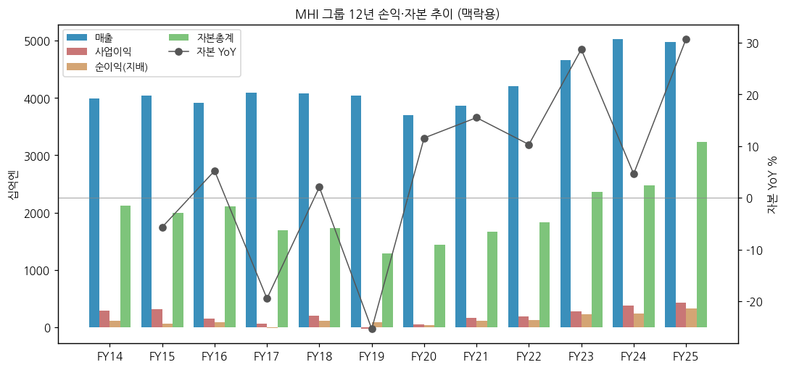

(3) 회사 주가 역사

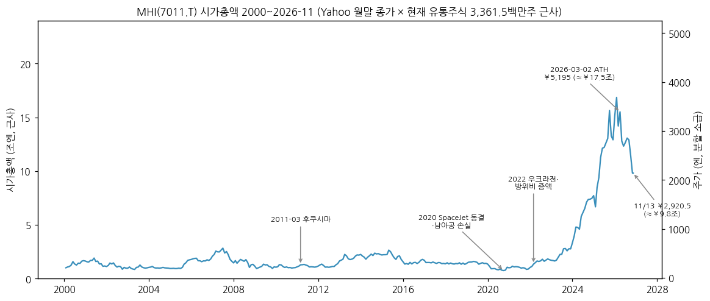

→ 2000\~2012: 주가 ¥250\~850 박스 (분할 소급). 2007-07 ¥843 고점 → 2009-02 ¥278 (금융위기) → **2011-03 후쿠시마** 이후 원자력 매출 급감, 주가는 ¥300\~400대
→ 2013\~2015: 아베노믹스·GTCC(히타치 화력 통합, 2014 MHPS 출범) → 2015-05 ¥789
→ **2016\~2021 장기 침체**: MRJ(SpaceJet) 개발 손실 누적, 남아공 보일러 분쟁, 크루즈선 손실 → **2020-10 ¥223 (2000년 이후 최저, SpaceJet 동결)** → 2021-12 ¥266
→ **2022\~2026-03 재평가**: 우크라이나 전쟁 후 일본 방위비 증액(방산), 북미 데이터센터발 가스터빈 수요(GTCC), 원전 재가동·연료사이클(원자력)이 겹쳤다. 연말 시총 2021 ¥0.89조 → 2023 ¥2.77조 → 2024 ¥7.48조 → 2025 ¥12.90조 [stockanalysis.com] → **2026-03-02 사상 최고 종가 ¥5,195 (시총 ≈ ¥17.5조)** [Yahoo, 계산]. 2021-12 대비 약 19.5배 [계산]
→ **2026-03 이후 조정**: 2026-05 ¥3,806 → 2026-10 ¥3,413 → FY26 2Q 결산(11/06, 가이던스 상향 + 자사주 ¥300bn) 당일 **−4.6%** (¥3,052 → ¥2,912.5), 11/13 **−7.4%** (¥3,155 → ¥2,920.5). 고점 대비 −43.8%. 11월 급락의 직접 원인 보도는 확인 못 함 [미확보]
→ 원자력 사업이 주가를 움직인 국면은 제한적 `[판단]` — 주가 동인은 GTCC·방산이 먼저이고, 원자력은 '재가동·신규 건설 옵션' 테마로 부수적으로 반영

```
[주가 국면 history]
[2000 ~ 2010] 중공업 박스기 (¥250 ~ 850) — 발전·조선·항공 혼합
[2011 ~ 2015] 후쿠시마 쇼크 → 아베노믹스 회복 (¥300 → ¥789)
[2016 ~ 2021] 대형 프로젝트 손실기 (¥790 → ¥223) — SpaceJet·남아공·크루즈선
[2022 ~ 2026-03] 방산·GTCC·원자력 3중 재평가 (¥266 → ATH ¥5,195, 약 19.5배)
[2026-03 ~ 현재] 고점 조정 (¥5,195 → ¥2,920.5, −43.8%)
```

(4) 주요 연혁 (원자력 중심)

→ **1970** — 간사이전력 미하마 1호기 (MHI 첫 PWR, 미국 Westinghouse 기술 도입) 상업운전
→ **1970\~2009** — 일본 PWR **24기 전량** 건설 (2023 Strategy Briefing)
→ **2007** — 프랑스 Areva(현 Framatome)와 합작사 **ATMEA** 설립, 1,100MWe급 'ATMEA1' 공동 개발
→ **2008\~2013** — 미국형 대형로 US-APWR 인허가 추진 (텍사스 Comanche Peak 3·4) → 사실상 중단 (보도 기반, 세부 일정 미검증)
→ **2012** — 미국 San Onofre 원전에 공급한 교체용 증기발생기 전열관 마모 사고 → 원전 영구정지(2013), 중재 결과 MHI 배상 책임 한도 내 확정 (2017, 보도 기반 — 금액 미검증)
→ **2011-03** — 후쿠시마 사고. 일본 전 원전 정지
→ **2013-05** — 일본·터키 정부 협정, 터키 **시노프(Sinop) 원전** ATMEA1 4기 사업 MHI 컨소시엄 우선협상 → 사업비 급증으로 **2018-12 사실상 포기** (보도 기반)
→ **2015-08** — 규슈전력 센다이 1호기 재가동 (신규제기준 첫 재가동, MHI PWR)
→ **2018-01·02** — **Framatome 지분 19.5%**(EDF 80.5%) 및 **Orano 지분 5%**(일본원연도 5%) 취득 (Framatome 지배구조 페이지, WNN 2018). FY25말 원자력 관련 비상장 지분(JNFL·Orano) 공정가치 ¥52.5bn (FY25 Financial Section)
→ **2019** — EDF에서 교체용 증기발생기 수주 (누적 9기 수주 — 2026-10-15 보도자료)
→ **2021-06** — 간사이전력 미하마 3호기 재가동 (운전 40년 초과 원전 첫 재가동)
→ **2022-09** — 간사이·홋카이도·시코쿠·규슈전력 4사와 **차세대 경수로 SRZ-1200** 공동 개발 발표 (2023-06 시점 표준 플랜트 기본설계 80% 완료)
→ **2023-07** — 경제산업성 실증로 사업에서 **고속로·고온가스로 실증로 설계 중핵기업**으로 선정 (2026-08-05 보도자료에서 재확인)
→ **2023-04** — 다카하마 3·4호기 증기발생기 교체 수주 (2023 Strategy Briefing)
→ **2024** — BWR 오나가와 2호기(도호쿠)·시마네 2호기(주고쿠) 재가동 — MHI가 BWR 재가동·특중시설 공사도 지원
→ **2025-07-02** — 중국 산먼 5·6호기(화룽1호) 순환수펌프 4대 수주 (둥팡전기와 협력 첫 수주)
→ **2025-07-22 / 11-05** — 간사이전력, 미하마 1호기 대체 신규 원전 부지조사 재개 발표 → 현장 조사 착수. 사전조사 2027-03 전후 완료, 상세조사 2027-04\~2030 (WNN 2025-11-05). 후보 노형 SRZ-1200 거론 (Reuters)
→ **2025-09-18** — ITER 다이버터 외측 수직 타깃 20기 추가 수주 (총 58기 중 38기 담당). 앞서 ITER 토로이달 자장 코일 19기 중 5기 납품 (2023)
→ **2026-01** — 도쿄전력 가시와자키가리와 6호기 재가동 (BWR, 일본 15번째 재가동)
→ **2026-05-12** — FY25 결산: 원자력 매출 ¥361.1bn·수주 ¥540.6bn 사상 최대
→ **2026-07-31 / 08-05** — 정부 '향후 원자력 정책 방향과 행동지침'에서 차세대 경수로·SMR을 사회실장 단계로 규정 → MHI 3개 과제(SRZ 요소기술·표준로형 / 국산 소형경수로(SMR) / 공급망 고도화) 경산성 보조사업 채택
→ **2026-10-15** — EDF 크뤼아스(Cruas) 2호기용 교체 증기발생기 3기 납품. 나머지 6기는 2028년부터 납품
→ **2026-11-06** — FY26 2Q 결산: 원자력 수주 계획 ¥450bn → **¥600bn**, 매출 ¥400bn → **¥550bn** 상향 ("further nuclear fuel cycle work")

---

## ③ 비즈니스 모델

(1) 실적 추이 통합 표 (십억엔)

| 항목 | FY21 | FY22 | FY23 | FY24 | FY25 | 1H FY25 | **1H FY26** | FY26F |
|------|------|------|------|------|------|------|------|------|
| **원자력 수주** | **249.2** | **268.7** | **522.2** | **390.8** | **540.6** | **182.4** | **278.4** | **600.0** |
| **원자력 매출** | **315.2** | **284.4** | **300.8** | **299.0** | **361.1** | **102.7** | **152.1** | **550.0** |
| └ 국내 경수로 (PWR+BWR) ~ | [미공시] | 약 145 | 약 152 | 약 149 | 약 195 | - | - | - |
| └ 핵연료 사이클 ~ | [미공시] | 약 121 | 약 125 | 약 102 | 약 109 | - | - | - |
| └ 차세대로·기타 ~ | [미공시] | 약 19 | 약 24 | 약 48 | 약 58 | - | - | - |
| 원자력 매출 YoY | +7.7% | −9.8% | +5.8% | −0.6% | +20.8% | −7.4% | **+48.1%** | +52.3% |
| 원자력 수주 YoY | +5.6% | +7.8% | +94.3% | −25.2% | +38.3% | +31.7% | **+52.6%** | +11.0% |
| Book-to-bill | 0.79 | 0.94 | 1.74 | 1.31 | 1.50 | 1.78 | **1.83** | 1.09 |
| 애프터서비스 매출비율 | - | - | - | 77% | 71% | 71% | 71% | - |
| **Energy Systems 매출** | **1,651.0** | **1,738.6** | **1,761.5** | **1,815.7** | **2,062.6** | **871.0** | **1,122.5** | **2,650.0** |
| └ GTCC | 616.8 | 736.8 | 735.6 | 790.7 | 992.2 | 427.3 | 587.1 | 1,280.0 |
| └ 증기발전 (Steam Power) | 479.8 | 429.3 | 389.8 | 352.4* | 367.5 | 180.3 | 175.9 | 400.0 |
| └ 항공엔진 | 71.6 | 126.5 | 157.4 | 212.3 | 274.1 | 125.7 | 171.3 | 330.0 |
| └ 원자력 | 315.2 | 284.4 | 300.8 | 299.0 | 361.1 | 102.7 | 152.1 | 550.0 |
| **Energy Systems 사업이익 (이익률)** | **86.2 (5.2%)** | **85.1 (4.9%)** | **141.5 (8.0%)** | **205.3 (11.3%)** | **267.2 (13.0%)** | **80.7 (9.3%)** | **145.1 (12.9%)** | **380.0 (14.3%)** |
| (맥락) 그룹 매출 | 3,860.2 | 4,202.7 | 4,657.1 | 5,027.1 | 4,974.1 | 2,113.7 | 2,523.2 | 6,000.0 |

> 출처: 결산 설명자료 각 분기 'Main Businesses' 표·세그먼트 표. "~" 행 = FY25 결산 자료 p.7 막대 차트 픽셀 판독 추정치 (합계는 공시값과 ±1 이내로 맞춤, 정확값 아님). \*FY24 증기발전은 2025-04 조직개편 소급치(원 공시 376.4는 수주). YoY·B/B [계산]

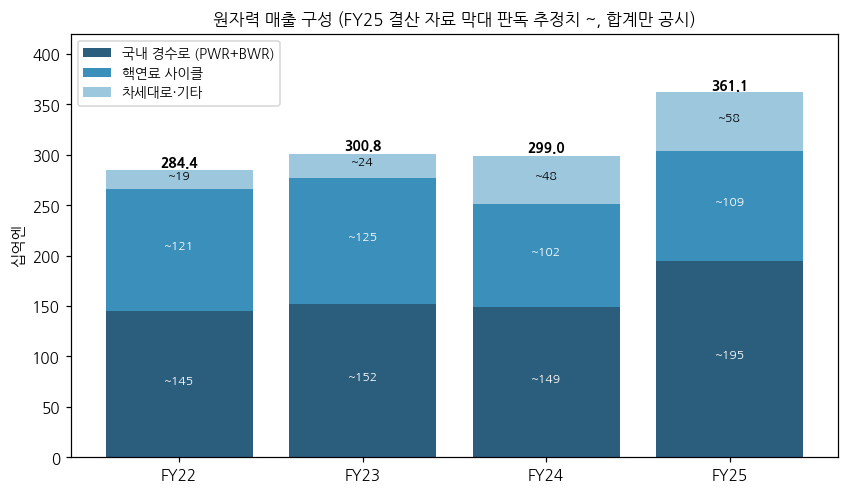

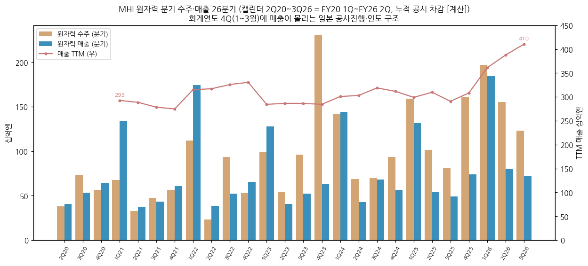

① 원자력 분기 시계열 26Q (십억엔, 누적 공시 차감 [계산])

| 분기 | 회계 | 수주 | 매출 | 매출 YoY | 매출 TTM | Energy 매출 | Energy BP | Energy BPM |
|---|---|---|---|---|---|---|---|---|
| 2Q20 | FY20 1Q | 38.1 | 40.8 | - | - | 314.0 | 0.3 | 0.1% |
| 3Q20 | FY20 2Q | 73.5 | 53.6 | - | - | 348.5 | −12.7 | −3.6% |
| 4Q20 | FY20 3Q | 56.8 | 64.5 | - | - | 378.9 | 90.8 | 24.0% |
| 1Q21 | FY20 4Q | 67.6 | 133.7 | - | 292.6 | 504.6 | 49.2 | 9.8% |
| 2Q21 | FY21 1Q | 32.6 | 36.9 | −9.6% | 288.7 | 337.0 | 8.7 | 2.6% |
| 3Q21 | FY21 2Q | 47.8 | 43.3 | −19.2% | 278.4 | 336.8 | −8.6 | −2.6% |
| 4Q21 | FY21 3Q | 56.8 | 60.9 | −5.6% | 274.8 | 399.9 | 13.7 | 3.4% |
| 1Q22 | FY21 4Q | 112.0 | 174.1 | +30.2% | 315.2 | 577.3 | 72.4 | 12.5% |
| 2Q22 | FY22 1Q | 23.2 | 38.7 | +4.9% | 317.0 | 349.5 | −2.4 | −0.7% |
| 3Q22 | FY22 2Q | 93.7 | 52.2 | +20.6% | 325.9 | 419.5 | 22.0 | 5.2% |
| 4Q22 | FY22 3Q | 52.9 | 65.5 | +7.6% | 330.5 | 430.4 | 19.2 | 4.5% |
| 1Q23 | FY22 4Q | 98.9 | 128.0 | −26.5% | 284.4 | 539.2 | 46.3 | 8.6% |
| 2Q23 | FY23 1Q | 53.7 | 40.8 | +5.4% | 286.5 | 366.1 | 24.5 | 6.7% |
| 3Q23 | FY23 2Q | 96.4 | 52.1 | −0.2% | 286.4 | 411.1 | 10.8 | 2.6% |
| 4Q23 | FY23 3Q | 230.0 | 63.5 | −3.1% | 284.4 | 453.4 | 42.2 | 9.3% |
| 1Q24 | FY23 4Q | 142.1 | 144.4 | +12.8% | 300.8 | 530.9 | 64.0 | 12.1% |
| 2Q24 | FY24 1Q | 68.6 | 43.0 | +5.4% | 303.0 | 391.5 | 50.3 | 12.8% |
| 3Q24 | FY24 2Q | 69.9 | 67.9 | +30.3% | 318.8 | 440.6 | 52.9 | 12.0% |
| 4Q24 | FY24 3Q | 93.3 | 56.4 | −11.2% | 311.7 | 446.7 | 51.3 | 11.5% |
| 1Q25 | FY24 4Q | 159.0 | 131.7 | −8.8% | 299.0 | 536.9 | 50.8 | 9.5% |
| 2Q25 | FY25 1Q | 101.4 | 53.7 | +24.9% | 309.7 | 423.2 | 56.4 | 13.3% |
| 3Q25 | FY25 2Q | 81.0 | 49.0 | −27.8% | 290.8 | 447.8 | 24.3 | 5.4% |
| 4Q25 | FY25 3Q | 161.2 | 73.9 | +31.0% | 308.3 | 483.7 | 66.0 | 13.6% |
| 1Q26 | FY25 4Q | 197.0 | 184.5 | +40.1% | 361.1 | 707.9 | 120.5 | 17.0% |
| 2Q26 | FY26 1Q | 155.5 | 80.3 | +49.5% | 387.7 | 536.3 | 101.3 | 18.9% |
| **3Q26** | **FY26 2Q** | **122.9** | **71.8** | **+46.5%** | **410.5** | **586.2** | **43.8** | **7.5%** |

→ (출처: 결산 설명자료 FY20 1Q\~FY26 2Q 'Main Businesses' 누적표. 분기값·YoY·TTM [계산]. Energy 2Q24\~1Q25는 2025-04 조직개편 소급치, 2Q23\~1Q24는 원 공시치. 3Q26 Energy 이익률 급락은 증기발전 IGCC 관련 충당금(그룹 Q&A: 약 ¥60\~70bn 규모 부품 교체 비용) 때문 — 원자력과 무관)
→ **4개 분기 연속 매출 YoY +30% 이상** (4Q25 +31% → 1Q26 +40% → 2Q26 +50% → 3Q26 +47%), TTM 매출 ¥410.5bn 사상 최고 [계산]

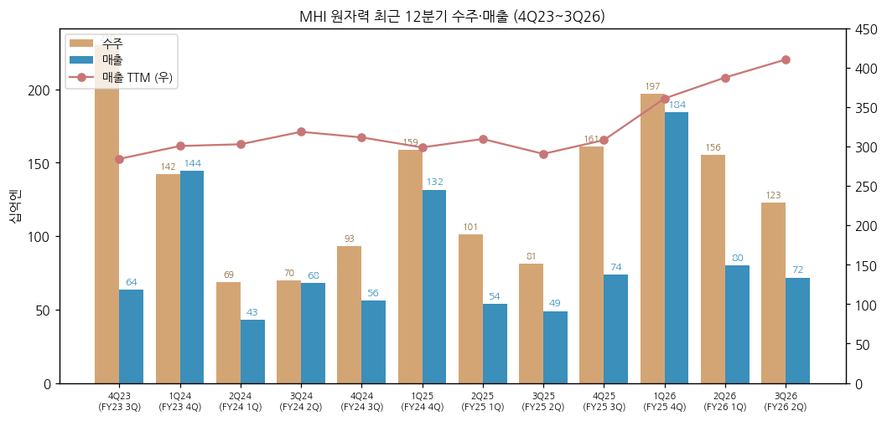

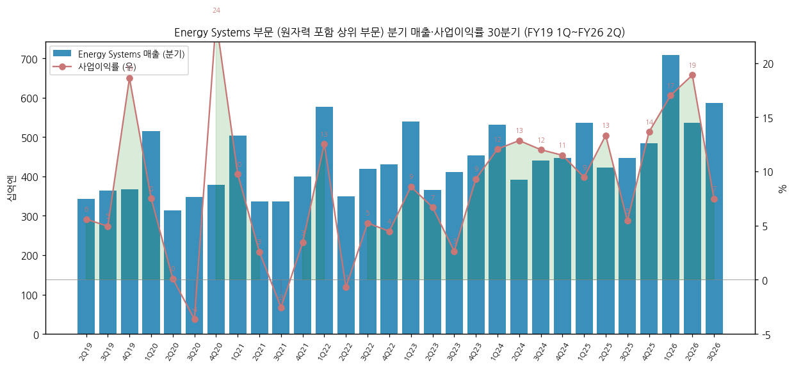

② 사업별 개요 (원자력 매출 비중 순, FY25 판독 추정)

**국내 경수로 (PWR + BWR) — 약 54%**

"일본 원전을 다시 돌리고 오래 쓰게 하는 공사. 재가동 전 안전대책·특중시설을 짓고, 재가동 뒤에는 정기검사·대형 부품 교체(증기발생기·원자로 내부구조물·제어반)로 60년 운전을 받친다."

→ **PWR** — 재가동 12기 + 미재가동 PWR(도마리 1\~3, 쓰루가 2)의 재가동 공사. 도마리 3호기는 홋카이도 지사 동의(2025-12) 후 **2027년 초 재가동 예정** (nippon.com 2026-10-06)
→ **BWR** — 원래 히타치·도시바 영역이지만 후쿠시마 이후 MHI가 PWR 경험으로 BWR 사업자의 인허가 지원·내진 보강·특중시설 공사를 수주 (오나가와 2, 시마네 2 등). 2023 설명회 기준 BWR 관련 공사는 FY30 무렵까지 이어질 전망
→ **대형 정비** — 다카하마 3·4 증기발생기 교체(2023-04 수주), 다카하마 원자로 내부구조물 교체 등 (MHI REPORT 2025)

**핵연료 사이클 — 약 30%**

"일본의 사용후핵연료 재처리 체계를 완성하는 국가 사업. 일본원연(JNFL)의 롯카쇼 재처리공장과 MOX 연료공장 건설·인허가를 지원하고, 준공 뒤에는 대형 정비·설비 고도화로 이어진다."

→ **롯카쇼 재처리공장(RRP)** — 1993 착공, **준공 목표 27차례 연기**, 현 목표 FY2026 내(2027-03). NRA 설계·공사계획 설명이 2026-06-08 끝났으나 예정(2025-11)보다 반년 이상 늦었고, 보정 신청서 작성에만 3\~4개월이 걸려 **추가 연기가 불가피하다는 관측** (교도 2026-06-08)
→ 시사점 `[판단]`: 준공 지연은 MHI에 단기적으로 **추가 공사(NRA 심사 반영분)**를 만든다 — FY25 3Q·FY26 2Q에 원자력 수주 상향 사유가 모두 "핵연료 사이클 관련 프로젝트 증가"였다 (Q&A 2026-02, 설명자료 2026-11-06). 준공 후에는 40년 운전용 정비·고도화 매출로 전환 (2023 Strategy Briefing)
→ **J-MOX** — MOX 연료 가공공장 공사 피크 (2023 Q&A) / **건식 캐스크** — 사용후핵연료 중간저장용 수송·저장 겸용 / 우라늄 농축 공장 지원

**차세대로·기타 — 약 16%**

→ **SRZ-1200** — 1,200MWe급 차세대 경수로. 4개 전력사 공동 개발, 코어캐처·방사성 희가스 포집·지하 매립 구조·부하추종(출력 변동 3%/분) 등. 상업 운전 목표 2030년대 중반 (2023 Briefing). 기본설계 완료, 다음은 상세설계·건설 (CFO 2026-03)
→ **실증로** — 고속로·고온가스로(수소 생산용 900℃+) 실증로 설계 중핵기업 (경산성 GX 사업) — FY25 수주 증가 요인으로 명시 (FY25 결산 자료 p.7)
→ **SMR·마이크로로** — 300MWe급 소형 경수로(일체형, 자연순환 냉각), 선박용 SMR, 고체 노심 마이크로로. CFO: "SMR은 아직 멀거나 경제성 정당화가 어렵다" (Reuters 2026-03-04)
→ **해외 기자재** — EDF 교체용 증기발생기(누적 15기 납품 + 크뤼아스 2호기 3기 2026-10 납품, 잔여 6기 2028\~), 중국 화룽1호 순환수펌프, 유럽 신규 원전용 펌프·기자재 (영국 Sizewell C 등 — 2023 Briefing 수주 추진)
→ **핵융합** — ITER 토로이달 자장 코일 5기 납품, 다이버터 38기 담당

③ 사업별 디테일 (top-seller, growth, 이익 outlier)

→ **성장 1위**: 국내 경수로 — FY24 약 ¥149bn → FY25 약 ¥195bn (+31% 판독 추정). 재가동 PWR 대형 정비 + BWR 공사 확대
→ **성장 2위**: 차세대로·기타 — FY22 약 ¥19bn → FY25 약 ¥58bn (3배, 판독 추정). 실증로 설계·해외 기자재
→ **수주 outlier**: 4Q23(FY23 3Q) **¥230.0bn** 단일 분기 — FY23 수주 2배(522.2)의 대부분. 회사는 "원자력 수주 대폭 증가"로만 설명 (개별 프로젝트명 미공시)
→ **매출 계절성**: 회계연도 4Q(1\~3월) 매출이 연간의 41\~55% (FY20 46%, FY21 55%, FY22 45%, FY23 48%, FY24 44%, FY25 51%) [계산] — 전력사 정기검사·공사 준공이 연도 말에 몰리는 구조
→ **이익**: 원자력 사업이익 미공시. 1H FY26 그룹 설명자료는 "GTCC와 원자력에서 사업이익이 크게 증가"라고만 기술

④ 주요 경쟁사

| 사업 | 경쟁사 | 비고 |
|---|---|---|
| 일본 PWR (설계·주기기·정비) | 사실상 없음 (일본 PWR 24기 전부 MHI) | 독점 설치 기반. 연료는 MNF·Global Nuclear Fuel-Japan 등 |
| 일본 BWR 재가동·정비 | 히타치GE 뉴클리어 에너지, 도시바 에너지시스템즈 | BWR 원 벤더. MHI는 안전대책·특중시설로 진입 |
| 핵연료 사이클 시설 | 일본원연(발주자) 아래 히타치·도시바 등과 분담 [판단] | 롯카쇼는 프랑스 Orano 기술 기반 |
| 해외 PWR 주기기 (증기발생기·원자로용기) | Framatome(佛), Westinghouse(美), **두산에너빌리티(韓)**, BWXT(加 CANDU SG), 중국 둥팡·상하이전기 | MHI는 Framatome 지분 19.5% 보유 — 경쟁 겸 협력 |
| 대형로 신규 노형 | Westinghouse AP1000, EDF EPR/EPR2, 한국 APR1400, 중국 화룽1호 | SRZ-1200은 아직 수주 실적 없음, 국내 시장 중심 |
| 대형 단조품 (원자로용기 소재) | 일본제강소(JSW), 두산, 중국 일중·이중 | MHI는 단조 소재를 외부 조달 [판단] |

→ **한국 피어와의 포지셔닝** `[판단]`:
→ **vs 두산에너빌리티 (주기기)** — 둘 다 원자로용기·증기발생기를 직접 만드는 몇 안 되는 회사다. 두산은 한국형(APR1400) 신규 호기·수출(체코)이 매출을 이끌고, MHI는 일본 설치 기반 정비·연료사이클이 이끈다. 해외 증기발생기 교체 시장(EDF 등)에서는 직접 겹친다
→ **vs 한전기술 (PWR 설계)** — 한전기술의 원자로계통(NSSS) 설계·종합설계(A/E) 기능을 MHI는 사내에 갖고 있다. 즉 MHI 원자력 = 한국의 **한전기술(설계) + 두산(주기기) + 한전KPS(정비) 일부를 합친 수직통합 PWR 벤더**에 가깝다. 그래서 한전기술보다 매출 변동이 작고, 신규 노형 개발 주도권도 전력사와 함께 MHI가 갖는다

⑤ 주요 매출처

→ **일본 전력사 9곳 + 일본원자력발전** — PWR 4사(간사이·규슈·시코쿠·홋카이도), BWR 사업자(도호쿠·주고쿠·도쿄 등). 고객별 매출 미공시
→ **일본원연(JNFL)** — 롯카쇼 재처리·J-MOX. MHI는 JNFL 주주이기도 하다 (FY25 Financial Section)
→ **정부·연구기관** — 경산성(실증로·차세대로 보조사업), 양자과학기술연구개발기구(QST, ITER), 일본원자력연구개발기구(JAEA, 고온가스로 HTTR)
→ **해외** — EDF(교체 SG), 중국(둥팡전기 통해 펌프), 유럽 신규 원전(펌프·기자재)
→ 원자력 매출의 지역별 분해는 미공시. Energy Systems 1H FY26 지역 매출: 일본 ¥318.4bn·미주 ¥464.0bn 등 (GTCC 영향이 큼)

⑥ 생산 CAPA + 인력

→ **고베 조선소** — 원자로용기·증기발생기·원자로 내부구조물 제작 (EDF SG 6기 제작 중). 증기발생기 누적 수주 130기 이상, 해외 교체 SG 30기 이상 납품 (2026-10-15 보도자료)
→ **증설 투자** — 2024 중기계획 기간 이후 원자력 생산능력에 **약 ¥100bn** 투자 계획 (신규 건설 대비 대형 복합 공작기계 갱신 포함) — GTCC 약 ¥500bn, 방산 ¥250bn과 함께 'Growing Core' 증설 (1H FY26 설명자료 Capital Allocation)
→ **인력** — 원자력 인력 FY25\~27 약 10% 증원, FY24 약 200명 채용, FY25 추가 채용 (CFO, Reuters 2026-03-04). 2023 설명회: PWR 재가동 인력을 BWR 공사로 이동 배치

---

## ④ 재무 구조

> 원자력 사업 단독 재무상태표·현금흐름은 공시되지 않는다 → **(1) 손익은 원자력 수주·매출 + Energy Systems 부문, (2)\~(7)은 그룹 기준** (맥락용)

(1) 손익 — 원자력은 ③ (1) 통합 표·① 분기 표 참조. 그룹 12년은 ② (2-1)

(2) 재무상태표 (그룹, 십억엔)

| 항목 | FY19 | FY20 | FY21 | FY22 | FY23 | FY24 | FY25 | 2026-09말 |
|---|---|---|---|---|---|---|---|---|
| 총자산 | 4,985.6 | 4,810.7 | 5,116.3 | 5,474.8 | 6,256.2 | 6,658.9 | 8,269.7 | 8,314.2 |
| 자본총계 | 1,290.0 | 1,439.3 | 1,662.5 | 1,833.9 | 2,360.6 | 2,469.8 | 3,228.4 | 3,280.7 |
| 자기자본비율 | 24.4% | 28.4% | 30.8% | 31.8% | 35.9% | 35.2% | 37.3% | 38.7% |
| 이자부채 | 598.2 | 905.6 | 734.9 | 742.4 | 728.9 | 651.3 | 515.7 | 482.7 |
| D/E | 0.46 | 0.63 | 0.44 | 0.40 | 0.31 | 0.26 | 0.16 | 0.15 |
| 계약부채(선수금 등) | 835.4 | 731.8 | - | - | - | - | 2,161.8 | 2,573.3 |

→ (출처: MHI REPORT 2025 11년 재무, 결산 설명자료. 2026-09말 현금성자산 ¥1,706.7bn > 이자부채 → 순현금 [계산]. 선수금 ¥2.6조 — GTCC·방산 선수금이 대부분)

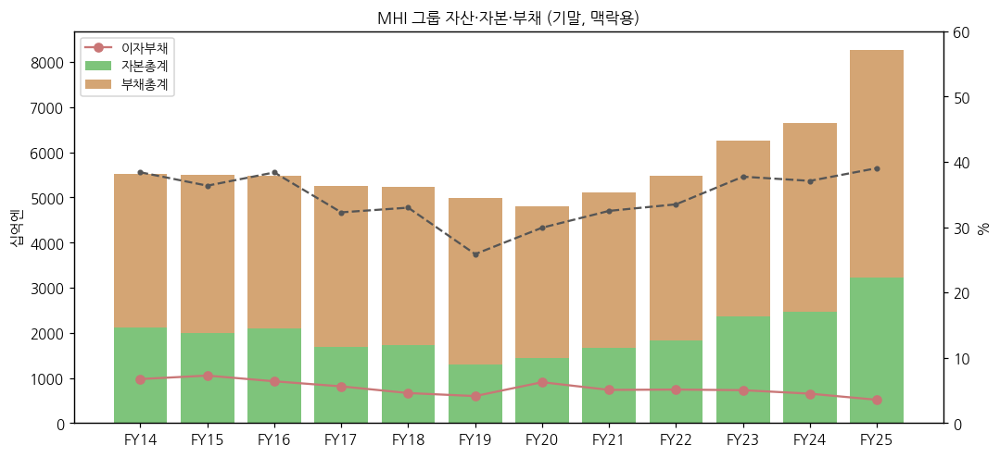

(3) 현금흐름 (그룹, 십억엔)

→ 영업CF FY20 −¥94.9bn → FY24 ¥530.4bn → **FY25 ¥942.6bn** / FCF FY25 **¥893.5bn** [계산] — Growing Core 사업(GTCC·방산) 선수금 유입 (1H FY26 설명자료)
→ 1H FY26 영업CF ¥394.5bn, FCF ¥468.3bn (투자CF +¥73.8bn — Logisnext 매각 대금 포함). FY26 FCF 계획 ¥800bn

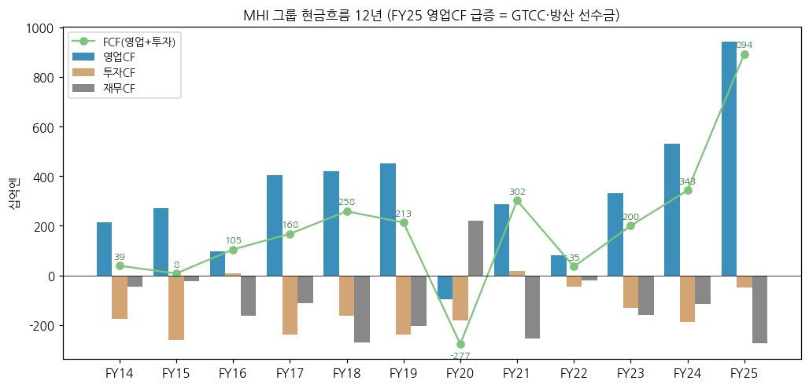

(4) CapEx

→ 그룹 CapEx FY21 ¥122.8bn → FY25 ¥183.9bn → FY26 계획 ¥210bn. 원자력 단독 CapEx 미공시 — 중기 원자력 생산능력 투자 약 ¥100bn (② (6) 참조)

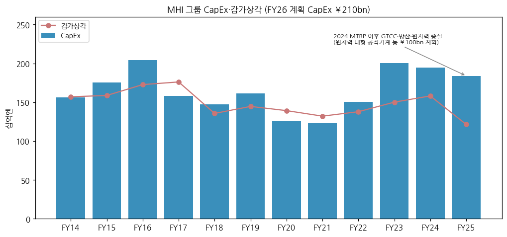

(5) 부채 구조 — 이자부채 ¥482.7bn, D/E 0.15 (2026-09말). 순현금 전환. 신용등급 [미확보]

(6) 배당·자사주

→ DPS (분할 소급) FY21 ¥10 → FY23 ¥20 → FY25 ¥25 → **FY26 계획 ¥29** (중간 ¥14 확정, 기말 ¥15). 배당성향 FY25 25.3% [계산]
→ **2026-11-06 자사주 매입 최대 ¥300bn / 1.2억 주(자사주 제외 발행주식의 3.6%)**, 2026-11-09\~2027-11-08 시장 매입, 매입분 전량 소각 — 2024 중기계획 주주환원 배분 ¥550bn의 일부

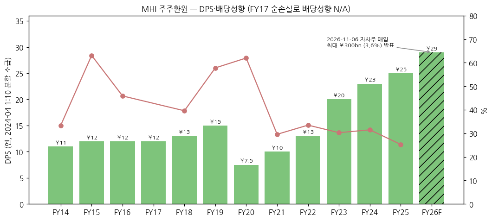

(7) 재무비율 (그룹)

| 항목 | FY20 | FY21 | FY22 | FY23 | FY24 | FY25 | FY26F |
|---|---|---|---|---|---|---|---|
| ROE | 3.1% | 7.7% | 7.9% | 11.1% | 10.7% | 12.2% | 14% |
| 사업이익률 | 1.5% | 4.2% | 4.6% | 6.1% | 7.6% | 8.7% | 10.0% |
| EBITDA (이익률) | - | 292.4 (7.6%) | 331.1 (7.9%) | 432.6 (9.3%) | 469.9 (10.8%) | 553.7 (11.1%) | 720.0 (12.0%) |
| 배당성향 | 62.0% | 29.6% | 33.5% | 30.3% | 31.5% | 25.3% | - |

→ (출처: MHI REPORT 2025, 결산 설명자료. FY24 EBITDA는 Logisnext 제외 재작성치. FY25 배당성향 [계산])

---

## ⑤ 지배 구조

(1) 그룹·계열 관계

→ MHI는 미쓰비시 그룹(옛 미쓰비시 재벌 계열)의 핵심 제조사지만 **지배주주가 없다** — 최대주주는 신탁은행 계정
→ 원자력 관련 그룹·지분 관계: 미쓰비시원자연료(MNF, 핵연료 제조), **Framatome 19.5%**(EDF 80.5%), **Orano 5%**, 일본원연(JNFL) 출자, ATMEA(Framatome과 합작) — Framatome·Orano 지분은 프랑스 원전 공급망과의 기술·사업 협력 축

(2) 주주 구분 (2025-03말, MHI REPORT 2025)

| 구분 | 비중 |
|---|---|
| 외국인 (법인·개인) | **42.2%** |
| 금융기관 | 29.2% |
| 개인·기타 | 22.5% |
| 기타 법인 | 4.0% |
| 증권사 | 1.8% |

→ 대주주 (보유 주식수, 2025-03말): 마스터트러스트신탁(신탁) 529.2백만주(15.7%), 일본커스터디(신탁) 188.5백만(5.6%), State Street 505001 89.0백만(2.6%), 메이지야스다생명 80.0백만(2.4%), State Street West Client 64.8백만(1.9%), BNY Mellon(DR) 52.2백만, 노르웨이 정부 52.0백만(1.5%), BNY Mellon(DR) 46.9백만, JP Morgan 45.3백만, 종업원지주회 39.0백만(1.2%) [비율 계산: 발행주식 3,373.6백만 기준]
→ 주주 수 501,945명 (2025-03말)

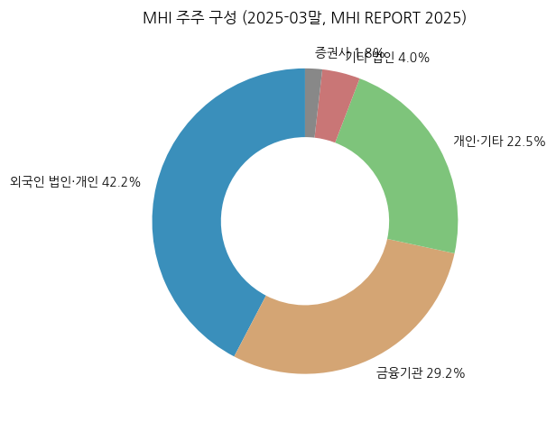

(3) 임원

→ 사장 겸 CEO **Eisaku Ito (伊藤栄作)** / CFO **Hiroshi Nishio (西尾浩)** — 결산 설명회 화자 (2026-11-06 Q&A)
→ 원자력 사업 책임자 — 2020·2023 설명회 화자 Akihiko Kato (상무집행임원, Nuclear Energy Systems 총괄) — 2026년 현직 여부 [미확보]

(4) 모회사 컨텍스트 — **트리거 발동 2건 (FY26 2Q)**

→ **(2-2) 그룹 자본배분 변화** — 2026-11-06 **자사주 매입 최대 ¥300bn** 결의 (MHI의 대규모 시장 매입 소각). 2024 중기계획(FY24\~26) 자본배분: 현금 유입 ¥2.9조 → 성장 투자 ¥1.6조, 주주환원 ¥550bn, 현금 증가 ¥1.3조 (1H FY26 설명자료)
→ **(2-4) 그룹 가이던스 큰 변화** — FY26 매출 ¥5.4조 → **¥6.0조 (+11%)**, 사업이익 ¥540bn → **¥600bn (+11%)**, 순이익 ¥380bn → ¥440bn. 회사: "사업이익 ¥700bn 이상으로의 지속 성장 궤도" (설명자료 p.17). 정상화 이익 약 ¥690bn(IGCC 충당금 약 ¥70bn + 리스크 버퍼 ¥20bn 가산)이라는 질문에 CFO 동의 (Q&A 2026-11-06)
→ (2-1) M&A — Logisnext(지게차) 매각 2026-05-01 완료, 현금 유입 약 ¥120bn (설명자료 Capital Allocation) — $3B 미만으로 트리거 미발동
→ 원자력 관련 함의 `[판단]`: 그룹 현금이 풍부해져(순현금, 선수금 ¥2.6조) 원자력 생산능력 투자(약 ¥100bn)는 자금 제약이 없다. 원자력의 그룹 내 우선순위는 GTCC(약 ¥500bn 투자)보다 낮다

---

## ⑥ 기타 팩트

(1) R&D

→ 그룹 R&D(수탁연구 포함) FY24 ¥218.6bn → FY25 ¥289.0bn → **FY26 계획 ¥350bn**. 원자력 R&D 단독 미공시
→ 원자력 R&D는 상당 부분이 **정부 보조·수탁 사업** (경산성 차세대 혁신로 보조사업 3건 2026-08 채택, 고속로·고온가스로 실증로 GX 사업, JAEA HTTR 수소 실증)

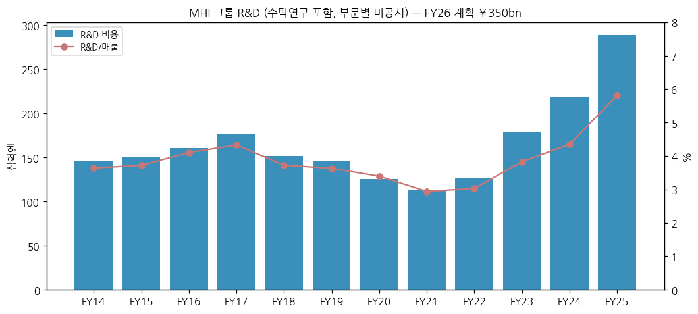

(2) 진행 중 corporate action

→ 자사주 ¥300bn 매입·소각 (2026-11\~2027-11) / Logisnext 매각 완료(2026-05) / 원자력 생산능력 투자 약 ¥100bn (FY27\~)
→ 원자력 사업 M&A는 최근 10년 없음. 지분 투자: Framatome 19.5%·Orano 5% (2018)

(3) R&D·사업 마일스톤 (원자력, 10년)

→ 2015 센다이 1호기 재가동 (신규제기준 1호) → 2016\~2021 PWR 특중시설 공사 (센다이·다카하마·이카타·오이·겐카이·미하마 완공, 2023 Briefing)
→ 2018 Framatome·Orano 지분 투자 / Sinop 사실상 포기
→ 2020 차세대 경수로 개발 방향 발표 ("세계 최고 안전", 2030년대 중반 상업운전 목표)
→ 2022-09 SRZ-1200 4개 전력사 공동 개발 발표
→ 2023-06 원자력 사업 설명회 (중기 매출 ¥300bn+ → 2030년대 ¥400bn 수준 언급, Q&A)
→ 2023-07 고속로·고온가스로 실증로 중핵기업 선정
→ 2025-11 간사이 미하마 신설 부지조사 착수 (SRZ-1200 후보)
→ 2026-03 CFO "원자력 매출 FY26 약 ¥400bn 사상 최대 가능 — 당초 2030년 예상 수준" (Reuters) → 2026-11 FY26 계획 **¥550bn**으로 상향 — 2023 설명회 중기 목표(¥400bn, 2030년대 초)를 **약 7년 앞당겨 초과** [판단: 계획 기준]
→ 2026-08 SRZ·SMR·공급망 경산성 보조사업 3건 채택

(4) 주요 리스크

→ **롯카쇼 준공 지연·사업 재검토** — 27차례 연기. 지연은 단기 공사 증가 요인이지만, 정책 재검토 시 연료사이클 매출(약 30%) 공백 리스크
→ **재가동 파이프라인 차질** — 주부전력 하마오카 내진 데이터 조작(2026-01 발각) → 2026-09 사장·회장 사임, 3·4호기 심사 신청 철회 (nippon.com) — BWR 안전대책 공사 파이프라인 축소 요인. 2023 설명회는 하마오카·시카를 향후 BWR 수주 후보로 언급했었다
→ **신규 건설 불확실성** — SRZ-1200 첫 수주 시점 미정. 미하마 상세조사 2030년까지, 매출은 2030년대 후반 (CFO). 일본 정부 지원(장기탈탄소전원 경매 등)·지역 동의 필요
→ **해외 사업 이력** — 터키 시노프 포기(2018), 미국 US-APWR 중단, San Onofre SG 사고(2012) — 해외 대형 신규 건설 수주 실적이 없다
→ **이익 비공시** — 원자력 이익 미공시로 마진 변화를 외부에서 확인할 수 없음
→ **그룹 리스크 전이** — 증기발전 IGCC 충당금(FY26 2Q), 과거 SpaceJet·남아공·크루즈선 손실처럼 다른 사업 손실이 그룹 주가를 좌우
→ **환율** — FY26 가정 USD ¥150 / EUR ¥180. 원자력은 국내 매출 중심이라 환율 민감도 낮음 [판단]

(5) ESG — MHI REPORT 2025: Scope 1·2 CO2 FY24 518kt, 2030년 50% 감축(2014 대비) 목표. 원자력은 회사 탈탄소 전략('Energy Transition')의 핵심 사업. 외부 ESG 등급 [미확보]

(6) 인증·라이선스 — 일본 원자력규제위원회 체계 하 PWR 설계·제작 / 프랑스 원자력안전청(ASN) 적합 인증(EDF 교체 SG, 2026-02) / ASME N-stamp 등 [미확보]

---

## Version Log

→ **v1.0** (2026-11-15) — 초안. 결산 설명자료 19건(FY20 1Q\~FY26 2Q 전 분기) + 결산단신 2건 + Q&A 5건 + 원자력 설명회 2건 + MHI REPORT 2025 수집. 원자력 수주·매출 26분기·7개년 + FY26 계획, Energy Systems 30분기, 그룹 12년(맥락), 15종 차트. 멀티 세그먼트 피어 룰 적용 — 모회사 트리거 2건(자사주 ¥300bn, 가이던스 +11%) 발동으로 ⑤ (4) 추가. 두산에너빌리티·한전기술·BWXT 포지셔닝 비교
→ **잔여 보완 (v1.1)**: FY18 이전 원자력 매출 정확값(일본어 결산 설명자료 OCR) / 원자력 수주 주요 프로젝트명(4Q23 ¥230bn 등) / MNF 지분율·원자력 인력 / 원자력 사업 책임자 현직 / 11/13 주가 급락 원인 / FY26 3Q(2027-02) 반영 / 롯카쇼 준공 목표 재연기 여부 / 간사이 미하마 노형 확정 / 신용등급·ESG 등급
