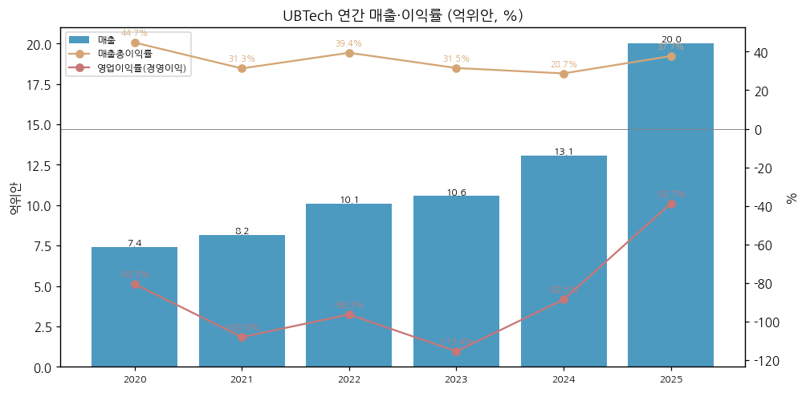
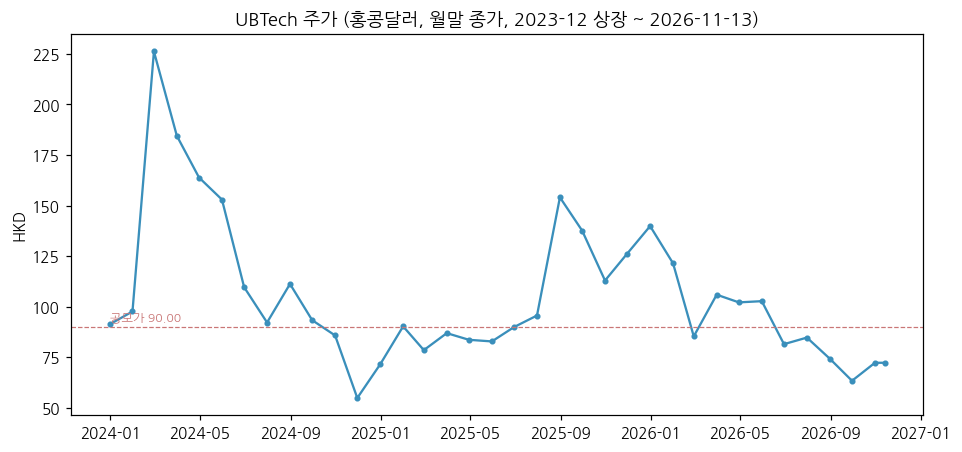
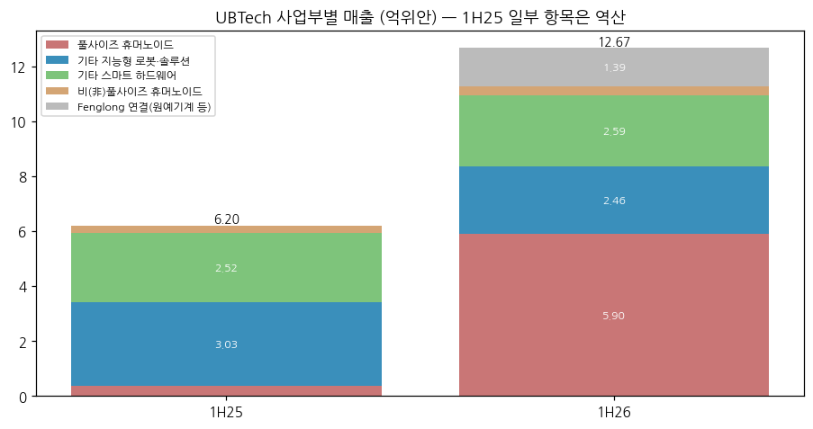
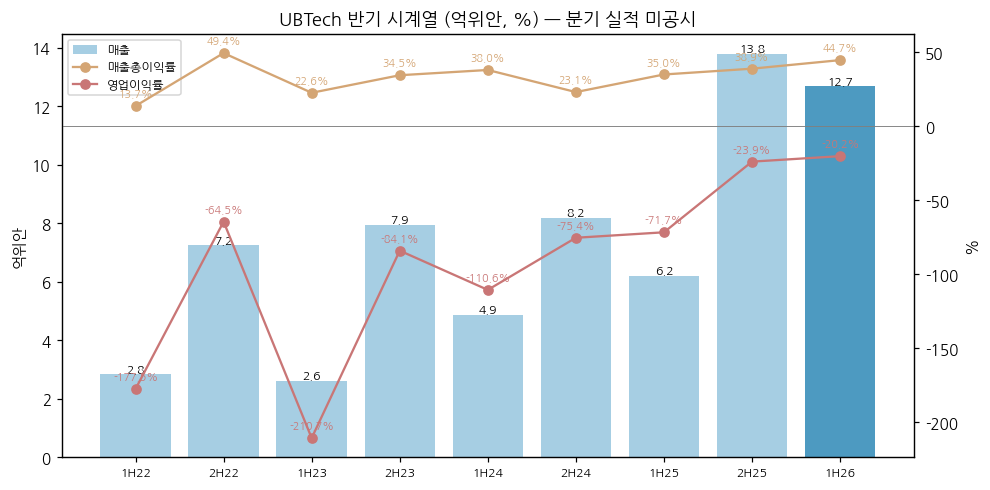
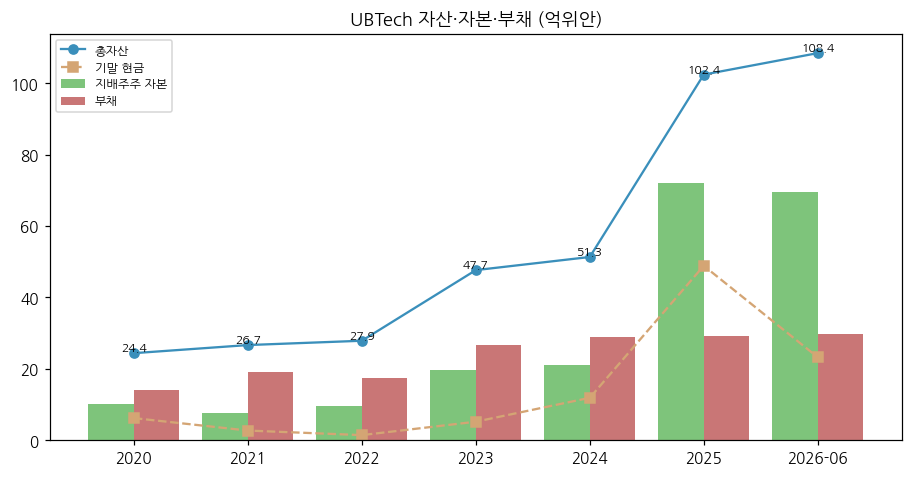
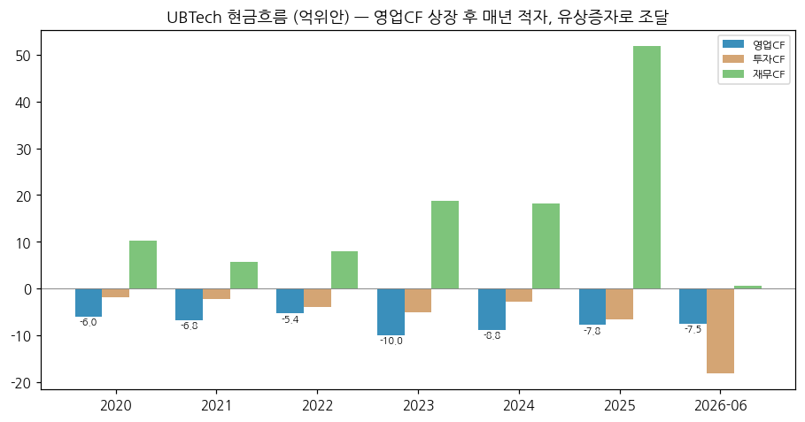

> Ticker: **9880.HK (홍콩거래소 메인보드 H주)** / 深圳市优必选科技股份有限公司 UBTech Robotics Corp Ltd (약칭 优必选)
> Sector: 로봇 — 서브섹터: 휴머노이드 완성체 (핵심 글로벌 피어)
> 작성 시각: 2026-11-14 KST (**v1.0**)
> 적용 구조: v4.8 (6개 섹션) — 홍콩 상장사라 **분기 실적이 없고 반기·연간만 공시**한다. 연간 6년(2020~2025) + 반기 9개(1H22~1H26) + 사업부(2025·1H26), 12종 차트 중 데이터로 만들 수 있는 6종만 작성
> 데이터: 연간 2020~2025, 반기 1H22~1H26 (2H = 연간 − 1H [계산]), 사업부별 매출(2025 연간·1H26), 월간 주가(상장 후)
> 출처: **东方财富 HK F10 재무 API**(회사 연간·중기 보고 집계 — 손익·재무상태·현금흐름) / **Yahoo Finance**(월간 주가) / **Unitree 투자설명서**(2026-08, 同行业 비교표의 UBTech 2023~2025 매출·이익률·휴머노이드 비중) / 보도 인용: 澎湃新闻(1H26 사업부·수주·锋龙 인수, 8/31), 虎嗅(8/31), 同花顺(8/29), 36氪(2025 연간·2026 이익률 목표, 4/1), 北京日报(4/1). HKEX 원문 PDF는 직접 받지 못해 숫자는 F10 집계 + 보도로 교차 확인

# UBTech (优必选, 9880.HK) 기업 개요 (v1.0 — 휴머노이드 완성체, 풀사이즈 산업용 휴머노이드 매출 1위 주장 · 홍콩 첫 휴머노이드 상장사)
> **Fact verify cutoff**: 2026-11-14 (주가 11/13 종가 72.35홍콩달러, 시총 약 365.6억홍콩달러 [东方财富 집계, 발행주식 5.054억주 × 72.35]. 52주 범위 60.20~156.40홍콩달러 [Yahoo Finance]. 상장 후 월말 종가 최고 226.20홍콩달러(2024-02))

> **기준 메모**: ① 분기 실적 미공시 — 2026-Q3 실적 리뷰는 작성하지 않았다(섹터 델타 비교 제외) ② 2026-04부터 锋龙股份(002931.SZ, 원예기계·자동차 부품) 43.01% 인수로 연결 편입 — 1H26 매출에 1.39억위안 포함, 2H26부터 6개월치가 들어와 YoY가 부풀려진다 ③ 영업이익 = 홍콩 공시 "经营溢利"(F10 표준 항목)

## ① 기업 분류

(1) Primary / Secondary 분류

**Primary 분류: 고성장 전환기 (적자 축소 중) — 매출 2023 10.56억 → 2025 20.01억위안, 상장 후 매년 영업적자**

→ 2025 매출 +53.3%, 1H26 +104.2% YoY. 풀사이즈 휴머노이드(Walker S 시리즈) 매출이 2025년 8.20억위안(+2,203.7%)으로 최대 사업이 됐다 (36氪·北京日报 4/1 보도, 회사 연간 실적 인용)
→ 영업이익률 -115.4%(2023) → -38.7%(2025) → -20.2%(1H26): 적자는 줄고 있으나 흑자 전환 전이다

**Secondary 노트: 레거시 교육·소비 로봇 + M&A로 확장한 복합 구조**

→ 1H26 기준 휴머노이드 46.5%, 기타 지능형 로봇·솔루션(교육·물류 등) 19.4%, 기타 스마트 하드웨어 20.4%, 锋龙 연결 11.0% [보도 인용 澎湃新闻]

(2) Summary Box (억위안, %)

| 지표 | 2020 | 2021 | 2022 | 2023 | 2024 | 2025 | 1H26 |
|---|---|---|---|---|---|---|---|
| 매출 | 7.40 | 8.17 | 10.08 | 10.56 | 13.05 | **20.01** | 12.69 |
| 매출 YoY | — | +10.4 | +23.4 | +4.7 | +23.6 | **+53.3** | +104.2 |
| 매출총이익률 | 44.7 | 31.3 | 39.4 | 31.5 | 28.7 | **37.7** | 44.7 |
| 영업이익 (经营溢利) | -5.96 | -8.83 | -9.71 | -12.18 | -11.55 | **-7.75** | -2.57 |
| 영업이익률 | -80.5 | -108.0 | -96.3 | -115.4 | -88.5 | **-38.7** | -20.2 |
| 지배주주 순이익 | -7.07 | -9.20 | -9.75 | -12.34 | -11.24 | **-7.03** | -3.11 |

→ (출처: 东方财富 HK F10 연간·중기 손익 집계. 2025 매출·매출총이익률은 Unitree 투자설명서 비교표(200,099.90만위안, 37.67%)·36氪 보도와 일치)

```
[UBTech 손익 (억위안)]
연도   매출    매출총이익률  영업이익   지배주주순이익
2020    7.40   44.7%        -5.96      -7.07   ← 교육·소비 로봇 중심
2021    8.17   31.3%        -8.83      -9.20
2022   10.08   39.4%        -9.71      -9.75
2023   10.56   31.5%       -12.18     -12.34   ← 2023-12 홍콩 상장 (공모가 90홍콩달러)
2024   13.05   28.7%       -11.55     -11.24   ← Walker S 공장 실증
2025   20.01   37.7%        -7.75      -7.03   ← 풀사이즈 휴머노이드 1,079대·8.20억 (+2,203.7%)
1H26   12.69   44.7%        -2.57      -3.11   ← 휴머노이드 921대·5.90억, 锋龙 연결 편입
```

(3) 정량적 분류 근거

→ 매출 CAGR(2020~2025) +22.0% [계산], 최근 2개 기간 가속(+53.3% → +104.2%)
→ 적자 축소: 영업적자 -12.18억(2023) → -7.75억(2025), 1H26 -2.57억(1H25 -4.45억 대비 42% 축소 [계산])
→ 영업CF 6년 연속 적자(2020 -6.03억 ~ 2025 -7.84억), 1H26 -7.49억위안 — 성장 자금은 유상증자(상장 후 6회, 누계 70억홍콩달러 이상 [보도 인용 36氪])로 조달

(4) 산업 분류

→ 홍콩거래소: 18C(특수 기술) 아닌 메인보드 일반 상장 (2023-12)
→ 워치리스트 섹터: 로봇 / 서브섹터: 휴머노이드 완성체 (산업 대분류: 모빌리티·에너지전환)

(5) 분류 결정 논리

→ 이익이 없어 사이클·지속성장 분류 대상이 아니다. 매출 성장 + 적자 축소 속도가 주가를 정하는 "고성장 전환기"로 분류
→ 핵심 동인은 풀사이즈 산업용 휴머노이드(자동차·3C·물류 공장)의 수주·인도 — Unitree(연구·교육용 중형 중심)와 고객층이 다르다

(6) 적정 밸류에이션 방법

→ 1차 — PSR: 시총 365.6억홍콩달러 ≈ 316억위안 [계산, 1홍콩달러 = 0.8656위안 — 2026-08-05 인민은행 기준환율, Unitree 상장공고서 인용] / TTM 매출 26.49억위안(2H25 13.80 + 1H26 12.69 [계산]) = 약 11.9배. Unitree(약 120배)의 1/10 수준
→ 2차 — 회사 목표 기반: 2026 매출 목표 35~40억위안 [보도 인용 澎湃新闻] 기준 Forward PSR 7.9~9.0배 [계산]
→ PBR 약 4.5배 [계산] (316억 / 지배주주 자본 69.66억위안, 2026-06 말)

(7) 반기 재평가 트리거 (분류 변경 조건)

→ ① 반기 영업이익 흑자 전환 → 고성장 흑자 기업으로 재분류
→ ② 휴머노이드 매출 YoY +100% 미만 + 매출총이익률 40% 미만 → 성장 둔화 검토
→ ③ 锋龙 등 비로봇 연결 매출 비중 20% 이상 → 복합 기업 할인 검토

## ② 회사 개요

① 기본 사항

→ 회사명: 深圳市优必选科技股份有限公司 (UBTech Robotics), 2012년 선전 설립. 창업자 저우젠(周剑) 회장·CEO
→ 상장: 2023-12-29 홍콩거래소, 공모가 90.00홍콩달러 — 홍콩 첫 휴머노이드 상장사로 불린다. 이후 6회 유상 배정(2025년 3회, 2025-11 최대 31.09억홍콩달러) [보도 인용 36氪]
→ 사업 한 줄: 풀사이즈 산업용 휴머노이드(Walker S·S1·S2), 소형 휴머노이드(Alpha 등), 교육 로봇·솔루션, 물류 로봇, 소비자 기기(로봇 청소기·잔디깎이·수영장 로봇·반려 기기), 정서 교감 로봇(U1, 2026-09 인도 시작)
→ 규모(2025): 매출 20.01억위안(중국 본토 15.26억 / 홍콩·해외 4.75억), 연구개발비 5.07억위안(매출 25.3%), 총자산 102.41억위안 [보도 인용 36氪, F10]
→ 2026: 锋龙股份 43.01% 인수(현금 16.65억위안 — 3월 협의 양수 29.99% + 4월 공개매수 13.02%), 4월부터 연결. 영업권 11.24억위안 [보도 인용 澎湃新闻]

→ **한국 로봇 기업과의 경쟁 지점 (어디서 맞붙나)**

| 제품 | UBTech 주력 | 한국 경쟁사 | 경쟁 구도 [판단] |
|---|---|---|---|
| 산업용 풀사이즈 휴머노이드 (공장 투입) | Walker S2 (자율 배터리 교체, 자동차·3C 공장) | 현대차그룹(보스턴다이내믹스 Atlas, 메타플랜트 투입 계획), 레인보우로보틱스(삼성), 두산로보틱스(휴머노이드 개발) | UBTech는 중국 자동차·전자 공장 수주(1H26 신규 1억위안 이상 3건) 선점. 한국은 아직 실증 단계 — 대량 인도 실적에서 UBTech가 앞선다 |
| 교육·연구용 로봇 | Alpha·Yanshee, 교육 솔루션 | 로보티즈 | 교육 매출은 감소 중(1H26 -49.1%) |
| 서비스·물류 로봇 | Cruzr, 물류 로봇 | 레인보우로보틱스·두산로보틱스(협동로봇 기반) | 직접 경쟁 제한적 |

② 손익·자본 추이 (억위안)

| 연도 | 매출 | 매출총이익률 | 영업이익 | 지배주주 순이익 | 판매비 | 관리비 | 연구개발비 | 지배주주 자본 |
|---|---|---|---|---|---|---|---|---|
| 2020 | 7.40 | 44.7 | -5.96 | -7.07 | 3.13 | 2.12 | 4.29 | 10.19 |
| 2021 | 8.17 | 31.3 | -8.83 | -9.20 | 3.58 | 3.26 | 5.17 | 7.52 |
| 2022 | 10.08 | 39.4 | -9.71 | -9.75 | 3.73 | 4.10 | 4.28 | 9.61 |
| 2023 | 10.56 | 31.5 | -12.18 | -12.34 | 5.06 | 4.00 | 4.91 | 19.60 |
| 2024 | 13.05 | 28.7 | -11.55 | -11.24 | 5.24 | 3.70 | 4.78 | 21.12 |
| 2025 | 20.01 | 37.7 | -7.75 | -7.03 | 4.71 | 3.36 | 5.07 | 72.18 |
| 1H26 | 12.69 | 44.7 | -2.57 | -3.11 | 2.38 | 1.49 | 3.03 | 69.66 |

→ (출처: 东方财富 HK F10 손익·재무상태 집계. 2025 자본 급증은 유상 배정)



③ 회사 주가 역사

→ 2023-12-29 상장(공모가 90.00홍콩달러) → 2024-02 월말 226.20홍콩달러(상장 후 월말 최고) → 2024-11 54.95홍콩달러(월말 최저)
→ 2025-08 154.10홍콩달러(휴머노이드 수주 기대), 2025-12 139.90 → 2026-09 63.45 → 2026-11-13 72.35홍콩달러 [Yahoo Finance 월말 종가]
→ 2026년 들어 -48%(2025-12 말 대비) [계산] — 锋龙 인수(비핵심 M&A), 현금 감소, 휴머노이드 인도 지연(광시 공장 2~3개월 지연 [보도 인용 澎湃新闻]) 시기와 겹친다



④ 주요 연혁

| 시점 | 사건 |
|---|---|
| 2012 | 선전에서 설립 (저우젠) |
| 2016~2021 | Alpha 소형 휴머노이드, Cruzr 서비스 로봇, 교육 로봇 사업 확장 |
| 2023-12-29 | 홍콩거래소 상장 (공모가 90.00홍콩달러) |
| 2024 | Walker S, 자동차 공장(NIO·BYD 등) 실증 [보도 기반] |
| 2025 | Walker S2 양산·인도 시작(2025-11 누적 수주 8억위안 이상 — 회사 보도자료), 풀사이즈 휴머노이드 1,079대 판매 |
| 2026-03~04 | 锋龙股份 43.01% 인수 (16.65억위안) |
| 2026-08 | 1H26 매출 12.69억(+104.2%), 휴머노이드 921대 |
| 2026-09 | 광시 공장 인도 시작(지연), U1 정서 교감 로봇 인도 시작(사전 예약 13,361대) |

→ (출처: 회사 보도자료(Kyodo/PR Newswire 2025-11-17), 보도 인용 澎湃新闻·虎嗅·36氪. 2024 고객사 실증 명단은 보도 기반, 회사 공시 미대조)

## ③ 비즈니스 모델

① 실적 추이 통합 (사업부별 매출, 억위안)

| 사업부 | 2025 | 2025 비중 | 2025 YoY | 1H25 [계산] | **1H26** | 1H26 YoY | 1H26 비중 |
|---|---|---|---|---|---|---|---|
| 풀사이즈 구현형 휴머노이드 | 8.20 | 41.0% | +2,203.7 | 0.38 | **5.90** | +1,445.0 | 46.5% |
| 기타 지능형 로봇·솔루션 (교육·물류 등) | 6.29 | 31.4% | 감소 | 3.03 | **2.46** | -18.8 | 19.4% |
| └ 교육 로봇 | — | — | — | 2.40 | **1.22** | -49.1 | — |
| 기타 스마트 하드웨어 (소비자 기기) | 4.99 | 24.9% | 소폭 증가 | 2.52 | **2.59** | +2.9 | 20.4% |
| 비(非)풀사이즈 휴머노이드 | 0.53 [차액] | 2.6% | — | 0.27 | **0.33** | +21.9 | 2.6% |
| 锋龙 연결 (원예기계·자동차·유압 부품) | — | — | — | — | **1.39** | 신규 | 11.0% |
| **합계** | **20.01** | 100% | +53.3 | **6.21** | **12.69** | +104.2 | 100% |

→ (출처: 2025 = 36氪·北京日报 4/1 보도(회사 연간 실적 인용), 1H26 = 澎湃新闻 8/31·同花顺 8/29 보도(회사 중기 실적 인용). 1H25는 1H26 금액과 YoY에서 역산 [계산]. 2025 비풀사이즈 휴머노이드 0.53억은 합계 − 3개 사업부 차액 [계산])

| 판매 | 2024 | 2025 | 1H25 | **1H26** |
|---|---|---|---|---|
| 풀사이즈 휴머노이드 판매대수 | 3 [계산] | **1,079** | 45 [계산] | **921** |
| 평균단가 (만위안/대) | — | 약 76 | — | **약 64** |
| 풀사이즈 휴머노이드 매출총이익률 | — | 54.6% | 47.3% [계산] | **66.8%** |

→ (출처: 판매대수·이익률 = 회사 실적 인용 보도(北京日报·36氪·澎湃新闻·虎嗅). 2024·1H25 대수는 YoY에서 역산, 평균단가는 보도 계산 [보도 인용])



① 반기 시계열 (억위안, %) — 분기 실적 미공시

| 반기 | 1H22 | 2H22 | 1H23 | 2H23 | 1H24 | 2H24 | 1H25 | 2H25 | **1H26** |
|---|---|---|---|---|---|---|---|---|---|
| 매출 | 2.84 | 7.25 | 2.61 | 7.95 | 4.87 | 8.18 | 6.21 | 13.80 | **12.69** |
| 매출총이익률 | 13.7 | 49.4 | 22.6 | 34.5 | 38.0 | 23.1 | 35.0 | 38.9 | **44.7** |
| 영업이익 | -5.03 | -4.67 | -5.50 | -6.68 | -5.39 | -6.17 | -4.45 | -3.30 | **-2.57** |
| 영업이익률 | -177.5 | -64.5 | -210.7 | -84.1 | -110.6 | -75.4 | -71.7 | -23.9 | **-20.2** |
| 매출 YoY | — | — | -7.9 | +9.7 | +86.6 | +2.9 | +27.5 | +68.7 | **+104.2** |

→ (출처: 东方财富 HK F10 중기·연간 손익, 2H = 연간 − 1H [계산]. 매출은 하반기 집중 — 2022~2025년 하반기 비중 63~75%)



(1) 수주·목표 (회사 공시·보도)

| 항목 | 내용 |
|---|---|
| Walker S2 누적 수주 | 2025-11 기준 8억위안 이상 (회사 보도자료) |
| 1H26 신규 수주 | 10억위안 이상, 1억위안 이상 대형 계약 3건 [보도 인용 — 财通证券 집계 인용, 澎湃新闻] |
| 2026 매출 목표 | 35~40억위안 (2H26 22~27억 필요) [보도 인용 澎湃新闻] |
| 2026 휴머노이드 목표 | 양산 약 1만대 [澎湃新闻] / 출하 5,000대 [虎嗅] — 보도 간 수치가 다르다, 회사 원문 미대조 |
| 2026 매출총이익률 목표 | 40~43% [보도 인용 36氪] |
| 생산 | 광시 공장 2~3개월 지연 후 9월 중하순부터 일괄 인도, 선전에 긴급 캐파 추가 [보도 인용 澎湃新闻] |

② 사업부별 개요 (1H26 매출 비중 순)

→ **풀사이즈 휴머노이드 (46.5%)**: Walker S·S1·S2. 자동차(완성차·부품)·3C 전자·물류 공장의 운반·분류·검사. Walker S2는 자율 배터리 교체로 연속 작업
→ **기타 스마트 하드웨어 (20.4%)**: 로봇 청소기·잔디깎이·수영장 로봇·반려 기기 등 소비자 기기
→ **기타 지능형 로봇·솔루션 (19.4%)**: 교육 로봇·솔루션(1H26 -49.1%), 물류 로봇, 서비스 로봇(Cruzr)
→ **锋龙 연결 (11.0%)**: 원예기계·자동차 부품·유압 부품 — 비핵심 사업, 1H26 이익률 10년 최저 [보도 인용 澎湃新闻]
→ **비풀사이즈 휴머노이드 (2.6%)**: 160cm 미만 소형·완구형. 2025 판매 12,759대 [보도 인용 北京日报]

③ 사업부별 디테일

→ 휴머노이드 매출총이익 약 3.9억위안 = 1H26 전사 매출총이익(5.67억)의 약 70% [보도 인용 澎湃新闻] — 이익 개선을 휴머노이드가 혼자 끈다
→ 평균단가 약 76만(2025) → 64만위안(1H26) [보도 계산] — Unitree 휴머노이드 평균 16.6만위안(2025)의 약 4배, 풀사이즈 산업용이라 제품군이 다르다
→ U1 정서 교감 로봇: 사전 예약 13,361대(11.98만~99만위안), 2026 인도 1,500~2,000대 예상 [보도 인용 澎湃新闻·虎嗅]

④ 주요 경쟁사

→ 중국: Unitree(688836.SS — 연구·교육 중형 중심), 智元(AgiBot, 비상장 — 산업용 풀사이즈 직접 경쟁), 乐聚, 越疆(2432.HK)
→ 미국: Tesla Optimus, Figure(BMW), Agility(Digit), Apptronik
→ 한국: 현대차그룹(보스턴다이내믹스), 레인보우로보틱스, 두산로보틱스

⑤ 주요 매출처

→ 고객 명단·상위 고객 비중 미확보 (HKEX 연간 보고 원문 미확보). 자동차·3C 제조사, 정부 교육 조달, 소비자 채널
→ 매출채권 총액 22.25억위안(1H26 말), 1년 초과 7.67억위안 — 2025 말 매출채권 18.42억 중 대손충당 약 29% [보도 인용 澎湃新闻·虎嗅]. 1H26 신용손상 0.91억위안(전년 0.013억)

⑥ 생산 CAPA + 임직원

→ 광시 공장(연 1만대 규모 — 보도) 2026-08 가동, 증산 초기 [보도 인용 虎嗅]. 선전 긴급 캐파 추가
→ 연구개발 인력 1,103명(1H26) [보도 인용 虎嗅]. 전체 임직원 미확보

## ④ 재무 구조

① 손익계산서 — ② 표 참고. 2025 비용 구조: 판매비 23.5%, 관리비 16.8%, 연구개발비 25.3%, 손상·충당 9.5% [계산]

② 재무상태표 (억위안)

| 시점 | 총자산 | 부채 | 지배주주 자본 | 부채/자산 | 기말 현금 |
|---|---|---|---|---|---|
| 2020 | 24.40 | 14.16 | 10.19 | 58.0 | 6.22 |
| 2021 | 26.67 | 19.07 | 7.52 | 71.5 | 2.73 |
| 2022 | 27.88 | 17.34 | 9.61 | 62.2 | 1.45 |
| 2023 | 47.66 | 26.77 | 19.60 | 56.2 | 5.21 |
| 2024 | 51.34 | 28.86 | 21.12 | 56.2 | 11.91 |
| 2025 | 102.41 | 29.15 | 72.18 | 28.5 | 48.88 |
| 2026-06 | 108.43 | 29.84 | 69.66 | 27.5 | 23.26 |

→ (출처: 东方财富 HK F10. 2026-06 현금 급감은 锋龙 인수 16.65억위안. 보도(澎湃新闻)는 2026-06 현금 23.81억 / 2025 말 49.19억위안으로 집계 기준이 약간 다르다)
→ 재고 9.85억위안(1H26, +70.9%) [보도 인용]



③ 현금흐름표 (억위안)

| 기간 | 영업CF | 투자CF | 재무CF |
|---|---|---|---|
| 2020 | -6.03 | -1.89 | 10.28 |
| 2021 | -6.81 | -2.27 | 5.60 |
| 2022 | -5.39 | -3.94 | 8.03 |
| 2023 | -10.00 | -5.06 | 18.80 |
| 2024 | -8.84 | -2.76 | 18.26 |
| 2025 | -7.84 | -6.61 | 51.84 |
| 1H26 | -7.49 | -18.15 | 0.62 |

→ (출처: 东方财富 HK F10. 1H26 영업CF 적자가 1H25(-3.71억)의 2배 — 재고·매출채권 증가 [계산])



④ CapEx — 별도 시계열 미확보. 1H26 투자CF -18.15억위안의 대부분이 锋龙 인수
⑤ 부채구조 — 부채/자산 27.5%(2026-06). 차입 세부 미확보
⑥ 배당·자사주 — 무배당. 자본 조달은 상장 후 6회 유상 배정 누계 70억홍콩달러 이상 [보도 인용 36氪]
⑦ 재무비율: 영업CF/매출 -59.0%(1H26) [계산], 부채/자산 27.5%

## ⑤ 지배 구조

① 그룹 관계: 창업자 저우젠이 회장·CEO. 2026-04 이후 锋龙股份(002931.SZ)의 지배주주가 UBTech, 실질지배자 저우젠 [보도 인용 36氪]
② 주주: 저우젠 지분율·주요 기관 주주 미확보 (HKEX 권익 공시 원문 미확보 — 다음 버전 보완)
③ 임원: 저우젠(회장·CEO) 외 이사회 약력 미정리

## ⑥ 기타 팩트

① R&D: 연구개발비 4.29억(2020) → 5.17억 → 4.28억 → 4.91억 → 4.78억 → 5.07억위안(2025, 25.3%) → 1H26 3.03억(23.9%). 특허 3,112건(2026-06 말), Thinker-VLA 모델(추론 효율 +176%, 단말 GPU 메모리 64GB → 32GB), 실제 로봇 데이터 약 1,100만 건(80% 이상 산업 현장) [보도 인용 同花顺]
② Corporate action: 2023-12 상장 / 상장 후 유상 배정 6회(2025년 3회) / 2026-03~04 锋龙股份 43.01% 인수(16.65억위안, 영업권 11.24억)
③ R&D 마일스톤: Walker(2018~2019 CES 공개 [공개 정보]) → Walker S(2023, 공장 실증) → Walker S1 → Walker S2(2025, 자율 배터리 교체·양산) → U1 정서 교감 로봇(2026-09 인도)
④ 주요 리스크
→ 현금 소진: 영업CF 매년 적자, 1H26 현금 23.3억위안 vs 반기 영업CF -7.5억 — 추가 조달 가능성 [판단]
→ 매출채권 회수: 1년 초과 채권 7.67억위안, 신용손상 급증
→ M&A 영업권: 锋龙 영업권 11.24억위안(인수가의 67.5%)
→ 인도 지연: 광시 공장 2~3개월 지연
→ 미중 기술 통제·부품 조달
⑤ ESG 등급: 미확보
⑥ 인증·라이선스: 미정리

---

## Version Log

→ **v1.0 (2026-11-14)**: 최초 작성. 东方财富 HK F10(손익·재무상태·현금흐름 2020~1H26) + Yahoo 월간 주가 + Unitree 투자설명서 비교표 + 보도 인용(1H26·2025 사업부·수주·목표). 차트 6종(chart1·2·4·6·10·11). 분기 실적 미공시 → 2026-Q3 리뷰 미작성
→ 잔여 보완 후보: ① HKEX 원문(2025 연간 보고서, 2026 중기 보고서) 직접 확보 — 사업부 영업이익·고객 집중도·주주 구성 대조 ② 2026 휴머노이드 목표(5,000대 vs 1만대) 회사 원문 확인 ③ 상장 후 유상 배정 6회 일자·주수·가격 표 ④ 2026 연간 실적(2027-03) 반영 ⑤ CapEx 시계열
