> Ticker: **Borsa Istanbul: ASELS — ASELSAN Elektronik Sanayi ve Ticaret A.Ş.** (BIST 상장 1990, 통화 TRY)
> Entity: **Aselsan** (본사 Ankara Macunköy, 튀르키예) — 튀르키예 최대 방산 전자 기업. 최대주주 튀르키예 군 강화재단(TSKGV) 74.20%. 통신·레이더·전자전·방공·전자광학·유도·해상 전투체계를 만드는 "튀르키예판 LIG D&A + 한화시스템"
> Sector: 방산 — 서브섹터 **방산 글로벌** (한국 5사 LIG D&A·한화시스템·한화에어로스페이스·현대로템·한국항공우주와 비교)
> 작성 시각: **2026-11-14 KST** (**v1.0** — Phase 1 Source 수집 + audit + 12종 차트)
> 적용 구조: v4.8 (6개 섹션) + ENR v1.0 해외 기업 형식
> 데이터 범위: **연간 FY23~FY25 + 9M26 (IAS 29 재무제표)** + **USD 매출·세전이익 2014~2022 (역사원가, companiesmarketcap)** + **분기 11Q (1Q24~3Q26)** + **ASELS.IS 주가 (2006-11 ~ 2026-11-13)**
> 출처: **KAP 공시 재무제표 영문 번역본 (FY2024 감사보고서, 9M25·1Q26·1H26 검토 재무제표)**, 회사 보도자료 (1H26 2026-08-04, 9M26 2026-10-27), **İş Yatırım 실적 분석 5건 (2Q25·3Q25·4Q25·2Q26·3Q26)**, Vakıf Yatırım 3Q25, İnfo Yatırım 4Q25·2Q26, Deniz Yatırım 3Q26 노트(보도), **Yahoo Finance ASELS.IS·TRY=X**, companiesmarketcap, 보도 (Hürriyet Daily News·Daily Sabah·Defence Industry Europe·BloombergHT·CNBC-e)
> ⚠️ **IAS 29 (TAS 29, 초인플레이션 회계) 적용 — FY2023 결산부터.** 모든 재무제표는 "보고 기간 말 TL 구매력"으로 재작성된다. 같은 보고서 안의 당기·전기 비교는 실질 비교, 서로 다른 보고서의 숫자는 기준 시점이 달라 바로 비교할 수 없다. 이 문서의 TL 숫자는 각 기간 말 구매력 기준, USD 숫자는 [계산] (분기 = 해당 분기말 구매력 TL ÷ 분기 평균 USDTRY)
> 다음 실적: **FY2026 / 4Q26 — 2027년 2월 하순 예상** (FY25는 2026-02-25 발표)

# Aselsan 기업 개요 (v1.0 — 방산 글로벌 / 방공·레이더·전자전 / 수주잔고 $30.7B 고성장)
> **Fact verify cutoff**: 2026-11-14 (주가 2026-11-13 종가 TL 345.50 [Yahoo Finance ASELS.IS], 시가총액 TL 1조 5,755억 = **$31.3B** [계산: 45.6억 주 × 345.50 ÷ USDTRY 50.28], companiesmarketcap 2026-11 $32.1B. 52주 고가 TL 450.00 (2026-05-06 장중) / 저가 TL 171.50 (2025-11-14 장중) [Yahoo Finance])


## Phase 1 Source Audit

```
=== 자료 수집 audit (Aselsan) ===

✅ 확보 (총 19개 파일, 저장: company-overview-source/ASELS/)
- KAP 재무제표 영문 번역본 4건: FY2024 감사보고서 (FY23 비교 포함), 9M25, 1Q26, 1H26 검토보고서 — 손익·재무상태·현금흐름·CPI 재작성 계수·주주·임직원
- 회사 보도자료: 1H26 (2026-08-04) / 9M26 수치는 보도 (APDR·Defence Industry Europe·BloombergHT 2026-10-27~28)로 확인
- İş Yatırım 실적 분석 5건 (2Q25·3Q25·4Q25·2Q26·3Q26) — 분기 손익 요약표 (TAS 29), 컨센서스, TP
- Vakıf Yatırım 3Q25, İnfo Yatırım 4Q25·2Q26 (수출·잔고 통화 구성)
- Yahoo Finance v8: ASELS.IS 월간 20년 + 일간 1년, TRY=X 월간 20년 + 일간 3년
- companiesmarketcap: USD 매출·세전이익 2010~2025, 연말 시가총액

❌ 누락 (6)
- aselsan.com 투자자관계 페이지: JS 렌더링(Next.js) 페이지라 web_fetch로 PDF 링크 추출 불가 → 투자자 프레젠테이션(사업 분야별 매출 비중) 미확보
- 9M26 (3Q26) 재무제표 원문: KAP 원문 미확보 → İş Yatırım 3Q26 요약표 + 회사 발표 수치(보도)로 대체
- FY2025 감사보고서 원문: 미확보 → İş Yatırım 4Q25 + 1Q26·1H26 재무제표의 전기 비교 컬럼으로 대체
- FY2022 이전 TL 재무제표: 미확보 → USD 매출·세전이익(companiesmarketcap, 반올림)으로만 장기 시계열
- 사업부별 손익: 회사가 단일 보고부문으로 공시 (사업부 손익 미공시) → 내수·수출 매출 분해로 대체
- 컨퍼런스콜 트랜스크립트: 미확보

⚠️ 결과 영향
- 연간 정확값은 FY23~FY25 3개년 + 9M26 — 12년 시계열 불가 (IAS 29 도입 전 역사원가 TL은 인플레 때문에 비교 의미도 작음)
- 이익 지표: 회사 주 지표는 EBITDA. 본 문서 "핵심 영업이익" = 매출총이익 − (일반관리비+마케팅비+R&D비). 재무제표 "OPERATING PROFIT"은 환차익 등 기타영업손익 포함이라 사용 안 함
- USD 환산은 [계산] — IAS 29 수치(기말 구매력)를 평균 환율로 나누므로 소폭 과대 가능. 3Q26 매출 USD YoY: 평균 환율 +49.4% vs 기말 환율 +48.6% (İş Yatırım 공시 +49%와 정합)
- FY24 CapEx USD: 재무제표 환산 $644M vs İş Yatırım $589M (환산 방식 차이)

Source 6종 audit:
[V] (1) 정기 보고서 (KAP 재무제표 4건) ✓ / FY25 감사보고서·9M26 원문 ✗
[△] (2) IR 프레젠테이션·실적 발표 — 보도자료 1건 + 보도 수치 (IR 사이트 PDF 미확보)
[✗] (3) Sustainability Report — 미확보
[V] (4) 주가 (Yahoo ASELS.IS·TRY=X) ✓
[V] (5) 셀사이드 (İş·Vakıf·İnfo·Deniz) ✓
[△] (6) 12년 시계열 — USD 매출·세전이익만 2014~, 정확값은 FY23~
→ 3.5/6 source 확보. 최신 분기 (3Q26) 확보 — 최근 분기 누락 없음.
```

---

## ① 기업 분류

(1) Primary / Secondary 분류

**Primary 분류: 고성장 (수주잔고 주도형)**

→ 수주잔고 **$30.7B** (3Q26 말, 회사) = 2025년 매출(USD 환산 $4.2B)의 약 7배. 9M26 신규수주 **$14.0B** (9M25 $5.7B), Book-to-bill **4.4x**

→ 9M26 매출 실질 +28%, USD 환산 +42%, EBITDA 마진 26.8% (+1.9%p) — 회사 2026 가이던스(실질 매출 +10% 초과, EBITDA 마진 24% 초과)를 크게 웃도는 속도

**Secondary 노트: 국가 예산 연동 (튀르키예 국방 예산 + Çelik Kubbe/Steel Dome) + 수출 초기 확장**

→ 매출의 80% 이상이 내수 (주 고객: 튀르키예 방위산업청 SSB·군), 수주잔고의 97%가 방산 (2Q26, İnfo Yatırım)

→ 수출 비중이 2025년 3Q 6% → 2026년 3Q 19%로 커지는 중 (İş Yatırım) — 내수 정책 의존에서 수출 성장주로 넘어가는 초기 국면 `[판단]`

(2) Summary Box

| 지표 | 값 |
|------|-----|
| 매출 CAGR (USD, 2014→2025, 11년) | **+12.8%/yr** [계산: $1.12B → $4.23B. 2014~22 companiesmarketcap, 2023~25 IAS 29 USD 환산] |
| 이익률 평균 | 세전이익률 2014~2022 평균 **24.8%** (역사원가) / 핵심 OPM FY23~9M26 **17.2% → 22.4% → 23.2% → 21.6%** |
| 이익률 정점 | 세전이익률 2021 36.3% (리라 급락 환차익 포함) / EBITDA 마진 3Q26 **27.6%** (분기 최고) |
| 이익률 저점 | 세전이익률 2014~15 약 11% / 핵심 OPM FY23 17.2% (IAS 29 도입 첫해) |
| 사이클 | 매출은 2014~2025 중 USD 기준 감소 2회 (2015 −11%, 2021 −13%) — 모두 **리라 급락** 영향, 실수요 감소 아님 |
| 주가 사이클 | USD 시총 2017 고점 → 2021 저점 (리라 위기·미국 CAATSA 제재 2020-12) → 2025~26 재평가 (10배) |

```
[Aselsan 손익 시계열]
연도      매출(USD)  지표          이익률   비고
2014      $1.12B    세전 10.7%           ← 역사원가 TL (companiesmarketcap USD)
2015      $1.00B    세전 11.0%           ← 리라 약세로 USD 매출 감소
2016      $1.19B    세전 20.2%
2017      $1.47B    세전 25.2%           ← 시총 1차 고점 (~$10B)
2018      $1.80B    세전 30.6%           ← 리라 위기 1차 (환차익)
2019      $2.25B    세전 26.2%
2020      $2.23B    세전 31.8%           ← 미국 CAATSA 제재 (SSB 대상, 2020-12)
2021      $1.93B    세전 36.3%           ← 리라 급락 → USD 매출 −13%, 시총 저점 ~$3.7B
2022      $1.99B    세전 31.2%
FY23      $3.04B    핵심OPM 17.2%  EBITDA 21.8%   ← IAS 29 도입 (기준 단절). TL 73.6bn (Dec-23 구매력)
FY24      $3.35B    핵심OPM 22.4%  EBITDA 25.2%   ← 실질 매출 +13%, 핵심 영업이익 +48%. TL 120.2bn (Dec-24)
FY25      $4.23B    핵심OPM 23.2%  EBITDA 26.2%   ← 실질 매출 +15%, 잔고 $20.4B (+46%), Çelik Kubbe 대형 수주. TL 180.4bn (Dec-25)
9M26      $3.14B    핵심OPM 21.6%  EBITDA 26.8%   ← 실질 매출 +28%, USD +42%. 잔고 $30.7B. TL 151.5bn (Sep-26)

* USD 2023~ = [계산] (FY23 연평균 환율, FY24~ 분기 합산). 2014~2022와 2023~는 회계 기준이 달라 이익률을 직접 비교하지 않는다
```

**한국 방산 5사 + 글로벌 피어와의 위치 (제품 겹침 기준)**

→ **LIG D&A**: 가장 직접적 경쟁자 — 중거리 방공(천궁-II vs HİSAR-O+/SİPER), 레이더, 전자전, 유도무기. 중동(사우디·UAE·이라크·카타르) 방공 수출 시장이 정면 충돌 지점

→ **한화시스템**: 다기능 레이더(천궁 MFR vs Aselsan 방공 레이더), 전투기 AESA 레이더(KF-21 vs Aselsan MURAD — KAAN·F-16 개량), 해상 전투체계(한화 Naval Shield vs Aselsan GENESIS/ADVENT), 전술통신(TICN vs Aselsan 무전기)

→ **현대로템·한국항공우주**: 플랫폼사. Aselsan은 경쟁 플랫폼(Altay 전차·KAAN 전투기·Hürjet)의 사격통제·레이더·전자전을 공급 → 동남아·중동 패키지 경쟁에서 간접 경쟁

→ **한화에어로스페이스**: 직접 겹침 적음 (자주포 사격통제·무인포탑 일부)

(3) 분류 결정 논리

→ 수주잔고/매출 7배, 신규수주/매출 4.4배 — 향후 2~3년 매출 성장의 상당 부분이 이미 계약으로 확보됨 → "고성장" `[판단]`

→ 다만 잔고의 다수가 단일 국가 프로그램(Çelik Kubbe)이고 고객이 정부라 예산·재정 여건에 묶인다 → "국가 예산 연동" Secondary

→ 리라 변동성 때문에 TL 명목 성장률은 의미가 작다. **실질 TL YoY(같은 보고서 내 비교) + USD 환산 YoY 두 축으로 판단**

(4) 적정 밸류에이션 방법

→ 1순위 **EV/EBITDA** (회사 주 지표 = EBITDA, İş Yatırım 2026T 19.6x / 2027T 14.4x — 글로벌 피어 대비 14%/22% 할인, 2026-10-28)

→ 2순위 **EV/수주잔고** (Aselsan 1.05x vs 피어 1.18x, İş Yatırım) — 잔고 성장주라 보조 지표로 유효

→ P/E (2026T 24.2x, 2027T 17.7x — USD 기준, İş Yatırım)는 IAS 29 화폐성 손익(parasal kayıp)과 이연법인세 변동이 커서 보조로만

(5) 분기 재평가 트리거

→ ① 수출 비중이 연간 20%를 넘는지 (2025 15% [계산: 27.5/180.4]) ② EBITDA 마진이 가이던스(24%)를 계속 2~3%p 넘는지 ③ 순차입금이 EBITDA 1x를 넘는지 (3Q26 0.8x) — ①② 확인 시 수출형 고성장으로 상향, ③ 돌파 시 투자 부담 재평가

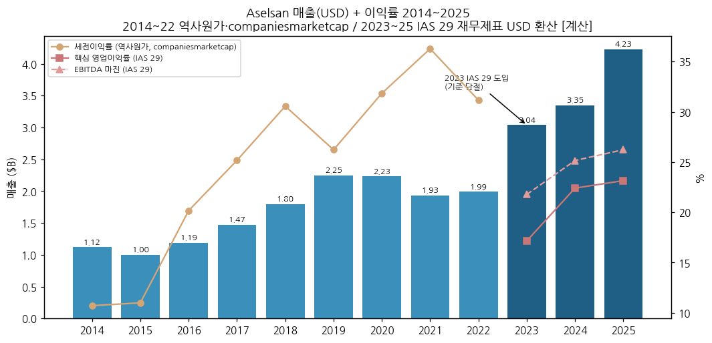

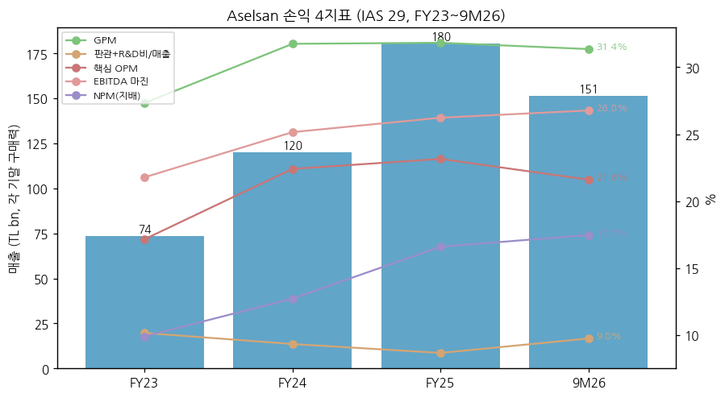

---

## ② 회사 개요

① 기본 사항

| 항목 | 내용 |
|---|---|
| 회사명 | ASELSAN Elektronik Sanayi ve Ticaret A.Ş. |
| 설립 | 1975년 말 (튀르키예 육군재단이 설립), 1979년 Macunköy 공장 생산 개시 |
| 상장 | 1990년 Borsa Istanbul (유통주식 25.80%) |
| 본사·거점 | Ankara Macunköy (본사), Akyurt·Gölbaşı·Temelli·Malatya 캠퍼스, Oğulbey Technology Base (2025 기공, $1.5B, 2026 3Q 1단계 가동) |
| 임직원 | 17,024명 (2026-06 평균), 14,143명 (2025), 12,014명 (2024), 11,550명 (2023) — KAP 재무제표 |
| 사업 한 줄 | 방산 전자 시스템 — 통신·레이더·전자전·방공·전자광학·유도·해상 전투체계, 일부 민수(철도 신호·의료·에너지·보안) |
| 순위 | Defense News Top 100 40위 (2026), Forbes Global 2000 첫 편입 (2026) |

② 손익·자본 추이 (IAS 29, TL m, 각 기간 말 구매력)

| 항목 | FY23 (Dec-23) | FY24 (Dec-24) | FY25 (Dec-25) | 9M26 (Sep-26) |
|---|---|---|---|---|
| 매출 | 73,593 | 120,206 | 180,445 | 151,486 |
| 매출총이익 | 20,106 | 38,158 | 57,427 | 47,496 |
| 핵심 영업이익 | 12,626 | 26,935 | 41,780 | 32,723 |
| EBITDA | 16,028 | 30,235 | 47,329 | 40,555 |
| 지배 순이익 | 7,291 | 15,299 | 29,950 | 26,471 |
| 자본총계 | 88,382 | 141,359 | 251,787 | 308,525 (2Q26) |
| 매출 실질 YoY | — | +13.1% | +14.7% | +28.5% |
| 핵심 영업이익 실질 YoY | — | +47.8% | +18.5% | +33.3% |
| 매출 USD [계산] | $3.04B | $3.35B | $4.23B | $3.14B (+42%) |

→ (출처: FY23·FY24 = KAP FY2024 감사보고서 (FY23은 Dec-24 구매력 → ×0.69263로 Dec-23 환산 [계산]), FY25 = İş Yatırım 4Q25 분석(2026-02-25)·지배순이익은 Net Kar 기준, 9M26 = İş Yatırım 3Q26 분석(2026-10-28)·회사 발표. 실질 YoY = 같은 보고서 내 동일 구매력 비교. 2Q26 자본 = KAP 1H26 재무제표)

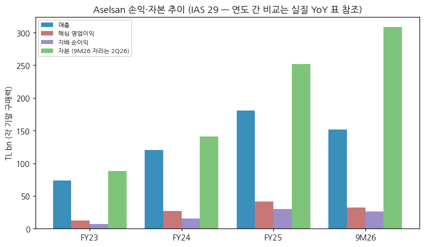

③ 주가 역사

→ 2006~2016: USD 시총 $0.3~4B. 2017년 튀르키예 방산 국산화·주가 랠리로 1차 고점 (~$10B)

→ 2018~2021: 리라 위기 2회(2018·2021)와 미국 CAATSA 제재(2020-12, SSB 대상)로 USD 시총 $3.7B까지 하락 — TL 주가는 올라도 USD로는 정체

→ 2022~2024: 국방 예산 확대·IAS 29 도입 후 이익 가시성 개선, $7~11B

→ **2025~2026: 3배 재평가** — 유럽 재무장, 튀르키예 통합방공 Çelik Kubbe(Steel Dome) 대형 계약, 수출 급증. 2025년 말 $24.6B [계산], 2026-05-06 장중 TL 450 고점, 현재 $31.3B (고점 대비 TL −23%)

→ 2026 YTD: TL +49% (231.70 → 345.50), USD 기준 약 +27% [계산]. STOXX 유럽 방산지수가 연초 대비 −7%일 때 USD +26% (İş Yatırım, 2026-10-28 기준)

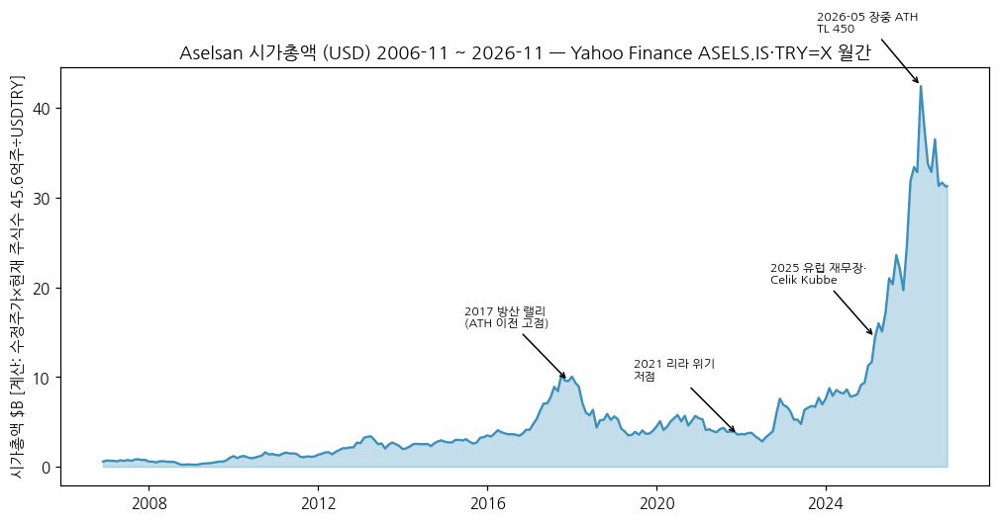

④ 주요 연혁

| 연도 | 사건 |
|---|---|
| 1975 | 튀르키예 육군재단이 설립 (키프로스 분쟁 후 무기 금수 대응, 군 통신 국산화 목적) |
| 1979 | Macunköy 공장 생산 개시 |
| 1990 | Borsa Istanbul 상장 |
| 1987~ | TSKGV(군 강화재단) 출범 후 최대주주 (현재 74.20%) |
| 2020-12 | 미국 CAATSA 제재 (S-400 도입 관련, SSB 대상) — 미국산 부품 수입 제약 |
| 2023 | IAS 29 초인플레이션 회계 도입 (FY23 결산부터) |
| 2024-08 | Çelik Kubbe (Steel Dome) 통합방공 계획 공개 — Aselsan이 센서·C2·지상체계 핵심 |
| 2025 | 사상 최대 실적 (매출 TL 180.4bn, 잔고 $20.4B), Oğulbey Technology Base 기공 ($1.5B) |
| 2026-07 | NATO Ankara Summit — 통합방공·레이더·전자전이 NATO 우선순위로 |
| 2026-09~10 | 6주간 $6B+ 계약 (SSB 하이브리드 방공 €2.46B, 장거리 방공 양산 €1B+, Roketsan €1.23B, 해외 방공 €488.5M) → 3Q26 잔고 $30.7B |
| 2026-11 | 해외 방공 수출 $1.1B (11/3, 고객 비공개) |

---

## ③ 비즈니스 모델

① 실적 추이 통합 (매출 구성, TL m — 각 보고서 구매력)

| 구분 | FY23 | FY24 | 9M25 | FY25 | 1H26 | 3Q26 |
|---|---|---|---|---|---|---|
| 내수 | 97,020 | 103,962 | 82,332 | 152,945 [계산] | 73,279 | 47,263 [계산] |
| 수출 | 9,344 | 17,146 | 8,541 | 27,500 | 15,215 | 10,800 [계산] |
| 수출 비중 | 8.8% | 14.3% | 9.4% | 15.2% | 17.2% | **18.6%** |
| 기간 인식 / 시점 인식 | — | — | 62% / 38% | — | — | — |

→ (출처: FY23·FY24 = KAP FY2024 감사보고서 Note 20 (Dec-24 구매력), 9M25 = KAP 9M25 Note 14, FY25 수출 27.5bn = İnfo Yatırım 4Q25, 1H26 = KAP 1H26 Note 14, 3Q26 수출 비중 18.6% = İş Yatırım 3Q26. 9M25 매출의 62%가 진행기준(over time) 인식 — 대형 장기 계약 비중이 높다)

→ **사업부(VP) 6개 — 손익 미공시**: 회사는 단일 보고부문으로 공시. 조직상 사업부는 HBT(통신·정보기술), MEOS(마이크로전자·전자광학), AGS(항전·유도), SST(통합 방위체계 — 방공·무기체계), REHİS(레이더·전자전), UGES(교통·보안·에너지·자동화·헬스케어, 민수) — KAP 9M25 재무제표 Note 1

→ 방산 합계 = 전사로 본다. 민수(UGES·자회사 ASELSANNET 일부)는 수주잔고의 약 3% (2Q26, İnfo Yatırım), 9M25 기준 2% (Vakıf Yatırım)

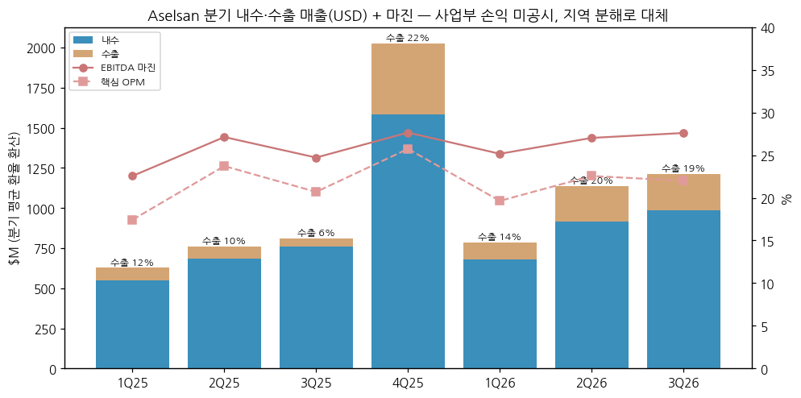

① 분기 시계열 (USD 환산 + 마진)

| 분기 | 1Q24 | 2Q24 | 3Q24 | 4Q24 | 1Q25 | 2Q25 | 3Q25 | 4Q25 | 1Q26 | 2Q26 | 3Q26 |
|---|---|---|---|---|---|---|---|---|---|---|---|
| 매출 ($M) | 489 | 596 | 650 | 1,612 | 628 | 761 | 812 | 2,025 | 785 | 1,137 | 1,213 |
| 핵심 OPM | 17.9% | 22.5% | 19.4% | 25.2% | 17.4% | 23.7% | 20.7% | 25.7% | 19.6% | 22.6% | 22.0% |
| EBITDA 마진 | 22.4% | 26.0% | 22.6% | 26.8% | 22.6% | 27.1% | 24.7% | 27.7% | 25.2% | 27.0% | 27.6% |
| USDTRY 평균 | 30.94 | 32.39 | 33.54 | 34.55 | 36.28 | 38.84 | 40.82 | 42.27 | 43.72 | 45.55 | 47.88 |

→ (출처: İş Yatırım 실적 분석 5건 + KAP 1Q26 재무제표, CPI 재작성 계수로 각 분기말 구매력 환산 후 Yahoo TRY=X 분기 평균 환율로 나눔 [계산]. 1Q24 = 1H24 − 2Q24)

→ **4분기 계절성**: 연간 매출의 약 47~48%가 4Q에 몰린다 (FY24·FY25) (연말 인도·인수 집중) — 분기 YoY는 4Q 기저를 반드시 같이 본다

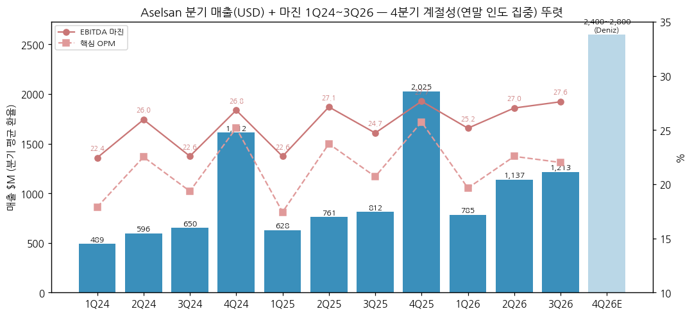

② 사업 분야별 개요 (회사 보도자료·재무제표 기준, 매출 비중 미공시)

→ **방공 (SST 중심)**: Çelik Kubbe 통합방공의 센서·사격통제·C2·지상체계. KORKUT(35mm 대공포), HİSAR-A+/O+ 지상체계(단·중거리), SİPER(장거리, Roketsan·TÜBİTAK SAGE와 공동). 2026년 신규 계약의 최대 비중

→ **레이더·전자전 (REHİS)**: 지상·해상 감시 레이더, 함정 다기능 레이더 ÇAFRAD, 전투기 AESA MURAD, 지상·공중 전자전 체계(KORAL 등), 대드론 체계

→ **통신·정보기술 (HBT)**: 군 전술무전기·위성통신·암호. 2026년 LEO 위성 통신(ASTRALINK) 신규 추진

→ **전자광학·유도 (MEOS·AGS)**: 조준·감시 카메라, 항전, 유도키트·시커, 스마트 탄약 (2026년 유도탄약 생산센터 가동)

→ **해상 체계**: 함정 전투체계·소나·수중 체계 (2026년 수중체계 생산·시험센터 가동)

→ **민수 (UGES)**: 무인 지하철 신호(Halkalı–Istanbul 공항선), 인공심폐기 등 의료, 에너지·보안

③ 이번 성장 국면의 디테일

→ **Çelik Kubbe (Steel Dome)**: 2025~2026 SSB 대형 계약이 잇따름 (2026-06 $905M, 2026-09~10 €1B+·€2.46B 등). 3Q26 신규수주 $9.12B 중 대부분이 내수 방공 (İş Yatırım은 10월 상반 계약 포함 약 $7.9B 공개 계약 추정)

→ **수출**: 9M26 신규 수출 계약 $1.93B (+34%), FY25 $2.1B (+104%), 2025년 수출 인도 $958M (+89%), 16개 제품 첫 수출 (İnfo Yatırım). 고객은 대부분 비공개("foreign end user")

→ **증설**: 2026 CapEx 가이던스 TL 50bn 초과. 9M26 설비 투자 $684M (+228%), R&D $1.3B (+36%). 1H26에 로봇 자동화 라인 19개 신설

④ 주요 경쟁사 (분야별)

| 분야 | Aselsan 제품 | 한국 경쟁 | 글로벌 경쟁 |
|---|---|---|---|
| 중·장거리 방공 | HİSAR-O+, SİPER, Çelik Kubbe C2 | **LIG D&A 천궁-II (M-SAM)** — 사우디·UAE·이라크 수출, 한화시스템 MFR | Raytheon Patriot·NASAMS(Kongsberg 공동), MBDA, Diehl IRIS-T SLM, Rafael·IAI |
| 단거리·대공포·대드론 | KORKUT, HİSAR-A+, 대드론 체계 | LIG D&A 신궁·천마, 한화에어로 비호 | Rheinmetall Skyranger, Saab RBS 70 |
| 레이더 | 방공·감시 레이더, ÇAFRAD, MURAD AESA | **한화시스템** (천궁 MFR·KF-21 AESA), LIG D&A | Thales, Hensoldt, Saab, Leonardo, Elta(IAI) |
| 전자전 | KORAL 등 지상·공중 EW | **LIG D&A**, 한화시스템 | Elbit, L3Harris, Leonardo |
| 함정 전투체계 | GENESIS/ADVENT | 한화시스템, LIG D&A (소나) | Thales, Saab, Lockheed |
| 전술통신 | 군 무전기·위성통신 | 한화시스템 (TICN), LIG D&A | L3Harris, Elbit, Thales |

→ 수출 경쟁 지역: **중동(사우디·UAE·카타르·이라크)과 동남아(인도네시아·말레이시아)** — 한국 방공(천궁-II)·레이더와 튀르키예 방공·EW가 같은 입찰에 오르는 시장 `[판단]`

→ 튀르키예 강점: 정부 대 정부 패키지(Baykar 드론·함정·전투기와 묶음), 미국 ITAR 부품 의존 축소. 약점: 실전 운용 이력(HİSAR·SİPER 수출 이력 제한), 서방 제재 리스크

⑤ 주요 매출처

→ 튀르키예 방위산업청(SSB)·군·Roketsan 등 국내 방산 생태계가 내수 매출의 대부분 (관계사 TSKGV 계열 포함) `[추정]` — 개별 고객 비중 미공시

→ 수출 고객은 계약 공시에서 "foreign end user"로만 표기. 보도상 중동·아시아·아프리카·유럽 다수 국가 `[추정]`

⑥ 생산 CAPA + 임직원

→ 임직원 11,550명(2023) → 12,014명(2024) → 14,143명(2025) → 17,024명(2026-06) — 2년 반 동안 +47%. 1H26 신규 채용 1,000명+ (15%는 해외 귀국 인력)

→ 1H26 스마트 탄약·방공·수중체계 생산·시험센터 17,360㎡ 가동 ($40M), Oğulbey 1단계 3Q26 가동

---

## ④ 재무 구조

① 손익계산서 (TL m, IAS 29)

| 항목 | FY23 | FY24 | FY25 | 9M26 |
|---|---|---|---|---|
| 매출 | 73,593 | 120,206 | 180,445 | 151,486 |
| GPM | 27.3% | 31.7% | 31.8% | 31.4% |
| 판관+R&D비/매출 | 10.2% | 9.3% | 8.7% | 9.8% |
| 핵심 OPM | 17.2% | 22.4% | 23.2% | 21.6% |
| EBITDA 마진 | 21.8% | 25.2% | 26.2% | 26.8% |
| 지배 NPM | 9.9% | 12.7% | 16.6% | 17.5% |

→ (출처: ② 표와 동일. 순이익은 IAS 29 화폐성 손실(parasal kayıp — 9M26 TL −7.9bn, 9M25 −20.4bn)과 이연법인세가 크게 흔든다 → 영업 단계 지표로 판단)

② 재무상태표 (TL m, 각 기말 구매력)

| 항목 | FY23 | FY24 | FY25 | 2Q26 |
|---|---|---|---|---|
| 자산총계 | 150,580 | 242,798 | 431,588 | 549,748 |
| 자본총계 | 88,382 | 141,359 | 251,787 | 308,525 |
| 부채총계 | 62,198 | 101,439 | 179,801 | 241,223 |
| 부채/자본 | 70% | 72% | 71% | 78% |
| 현금 | — | 16,637 | 29,087 | 39,469 |
| 차입금 | — | 32,563 | 43,056 | 73,293 |

→ (출처: KAP FY2024 감사보고서, KAP 1H26 재무제표 (FY25 = Jun-26 구매력 ÷ 1.17758 [계산]). 순차입금 3Q26 말 TL 55.2bn (2Q26 35.7bn) = 약 $1.13B, 순차입금/EBITDA 0.8x — İş Yatırım)

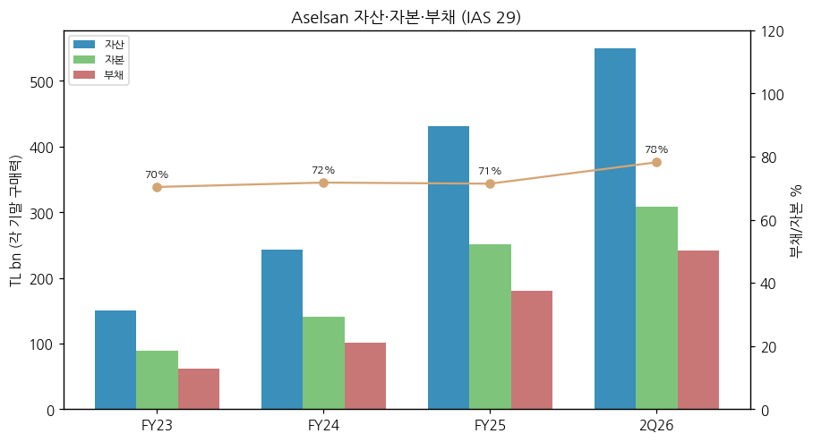

③ 현금흐름 ($M)

| 항목 | FY23 | FY24 | FY25 | 9M26 |
|---|---|---|---|---|
| 영업현금흐름 | 346 [계산] | 627 | 1,149 [계산] | 479 [계산] |
| CapEx | 514 [계산] | 589 | 912 | 1,284 [계산] |
| FCF | −168 | 38 | 237 | −805 |

→ (출처: FY24·FY25 = İş Yatırım 4Q25 (USD, FY25 OCF = CapEx + FCF 역산), FY23 = KAP FY2024 감사보고서 TL ÷ 연평균 환율, 9M26 = 1H26 재무제표 + 3Q26 İş Yatırım (OCF 6.94bn, CapEx 26.0bn TL)). 영업현금흐름/EBITDA 52%(2023) → 74%(2024) → 104%(2025) 후 2026년 운전자본 TL 10.7bn 증가 + 투자 2배로 FCF 적자 전환

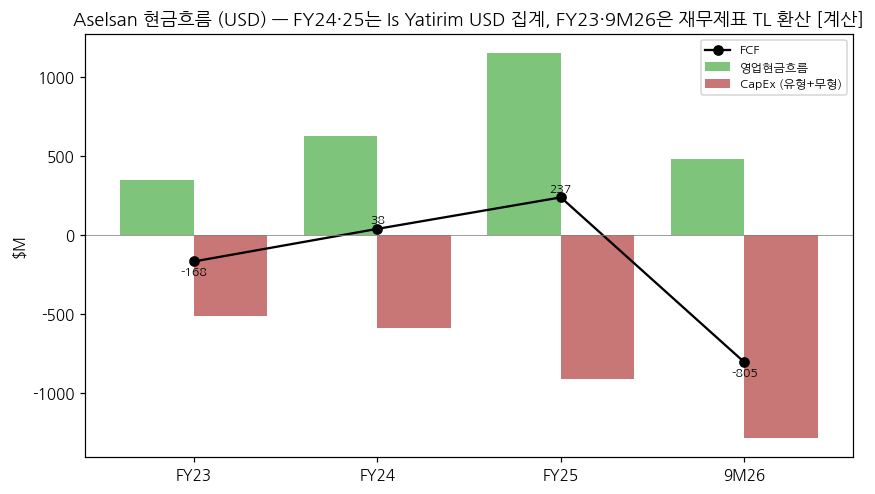

④ CapEx

→ FY23 $514M → FY24 $644M (재무제표 환산; İş $589M) → FY25 $912M → 9M26 $1,284M [계산]. 무형자산(개발비 자본화) 비중이 높다 — FY24 무형 TL 15.3bn vs 유형 6.0bn

→ 2026 가이던스 CapEx TL 50bn 초과 → 9M에 이미 약 TL 60bn [계산] 집행

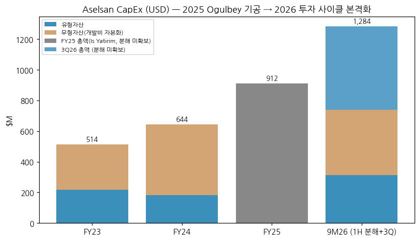

⑤ 부채 구조

→ 차입금 대부분 단기 (2Q26 단기 차입 25.4bn + 유동성 장기 39.3bn / 장기 8.6bn, TL m). USD 은행 대출 비중 높음 (9M25 주석: USD 스팟 대출 TL 12.7bn)

→ 수주잔고 통화: USD 54%, EUR 42%, TL 4% (2Q26, İnfo Yatırım) — 외화 매출 vs 외화 차입 자연 헤지 구조

⑥ 배당·자사주

→ 배당 지급 FY23 TL 317m·FY24 TL 170m (Dec-24 구매력) — 이익 대비 미미. 1H26 배당 지급 없음, 자사주 매입 없음. 투자 우선 기조

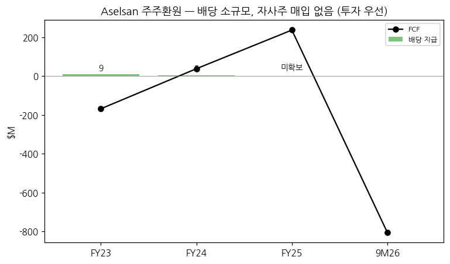

⑦ 재무비율

| 비율 | FY24 | FY25 | 2026 |
|---|---|---|---|
| ROE | 11.4% [계산] | 13.7% [계산] | 16.6% (9M26, 회사) |
| 자기자본비율 | 58% | 58% | 56% (1H26, 회사) |
| 순차입금/EBITDA | 0.53x [계산] | 0.30x [계산] | 0.8x (3Q26, İş) |
| 금융부채/총자산 | 13% | 10% | 14% (9M26, 회사) |

---

## ⑤ 지배 구조

① 그룹·계열 관계

→ 최대주주 **TSKGV (Türk Silahlı Kuvvetlerini Güçlendirme Vakfı, 튀르키예 군 강화재단)** 74.20% — 1987년 법률 3388호로 설립된 재단, Roketsan·Havelsan·Aspilsan 등 튀르키예 방산 다수의 주주. 실질적으로 정부(국방부) 통제

→ 주요 자회사: ASELSANNET(통신·보안·인프라), ASELSAN Global(수출 중개), ASELSAN Baku(아제르바이잔) 등 — KAP 1H26 재무제표

② 주주 구분

| 주주 | 지분 | 비고 |
|---|---|---|
| TSKGV | 74.20% | 1990 상장 이후 변동 없음 |
| 유통주식 | 25.80% | 시가 약 TL 4,004억 (İş Yatırım 2026-10-28) |
| 유통주식 중 외국인 | 약 51% (전체의 약 13%) | İş Yatırım 2026-10-28 |

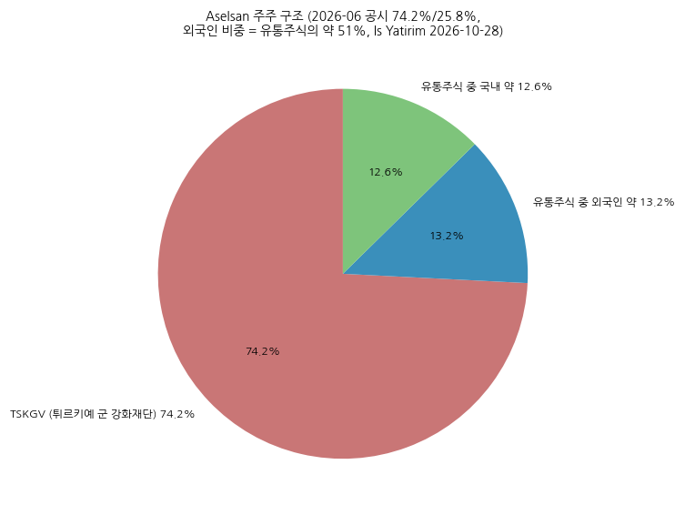

③ 경영진

→ CEO **Ahmet Akyol** (2023 취임) — 2025~2026 결과 발표에서 "수주잔고를 납기 내 인도와 생산 능력 확대로 전환"을 최우선 과제로 제시 (2026-10-28 Defence Industry Europe)

→ 이사회는 TSKGV·국방부 추천 인사 중심 (상세 명단 미추출)

---

## ⑥ 기타 팩트

① R&D

→ R&D 지출 (고객 자금 프로젝트 R&D 포함): FY25 **$1.36B** (자체 자금 $250M), 1H26 $804M (+41%), 9M26 **$1.3B** (+36%) — 매출의 약 40%. 엔지니어 고용·R&D 프로젝트 수 튀르키예 1위 (회사)

→ 2026 R&D 집중 분야: LEO 위성, 양자, 수중 체계, 고출력 마이크로파, 마이크로전자, 스마트 탄약, 추진 체계

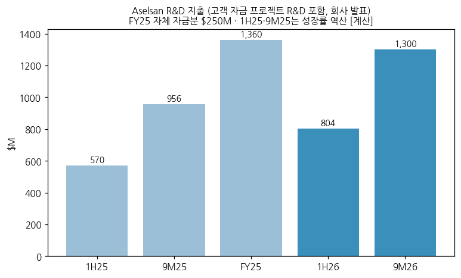

② 진행 중 corporate action

→ Oğulbey Technology Base ($1.5B, 2025 기공 → 2026 3Q 1단계 가동) — Çelik Kubbe 구성품 대량 생산 기지

→ M&A는 소규모 (자회사·합작 중심). 대형 인수 없음

③ R&D·제품 마일스톤 (최근)

→ 2025: 16개 제품 첫 수출, 14개 신규 생산시설·10개+ 로봇 라인 가동

→ 2026: 유도탄약 생산센터·방공·수중체계 시험센터 가동, LEO 위성통신 ASTRALINK 공개 (Antalya 우주회의)

④ 주요 리스크

→ **리라·인플레이션**: IAS 29 화폐성 손실, 운전자본(재고 TL 106bn, 2Q26) 인플레 부담. 3년 누적 CPI 상승률 222% (2025-09 기준, KAP 9M25)

→ **고객 집중·재정**: 내수 매출 80% 이상이 튀르키예 정부. 재정 긴축 시 대금 지연 가능

→ **제재**: 미국 CAATSA (2020-12, SSB 대상) — 미국산 부품·수출 허가 제약. 서방 시장 진입 제한

→ **실행 리스크**: 잔고 $30.7B 인도를 위한 2배 증설 — 인력(+47%)·CapEx 급증 구간에서 납기·마진 관리

→ **투자기 현금흐름**: 9M26 FCF 약 −$0.8B, 순차입금 1분기 만에 +54%

⑤ ESG

→ ESG 등급 미확보 (KAP 지속가능성 보고 존재 — 미추출)

⑥ 인증·라이선스

→ NATO 공급망 등록, 튀르키예 방산 보안 인가 (세부 미추출)

---

## Activity 보고 (v1.0 finalize)

### ✅ 확보 자료 (19개 파일)

→ KAP 재무제표 4건, 회사 보도자료 1건, 셀사이드 PDF 8건 (İş 5·Vakıf 1·İnfo 2), Yahoo 시세 4건, 웹 페이지 보조 (companiesmarketcap·보도)

### ❌ 누락 자료

→ IR 투자자 프레젠테이션 (사업 분야별 매출 비중), FY25 감사보고서·9M26 재무제표 원문, FY22 이전 TL 재무제표, 컨콜 트랜스크립트, ESG 등급

### ⚠️ 추정·계산 데이터 표시

→ [계산]: USD 환산 전체, FY23 Dec-23 구매력 환산, FY25 재무상태표 환산, 3Q26 내수·수출 금액, 9M26 현금흐름, ROE, 시가총액

→ [추정]: 매출처 구성, 수출 고객 지역

→ 기준 단절: 2014~2022 역사원가 (companiesmarketcap USD) ↔ 2023~ IAS 29

### 🔗 핵심 source URL

→ KAP 1H26 재무제표: https://kap.org.tr/en/api/file/download/4028328c9f52dc40019fcd5c3b1e7298
→ İş Yatırım 3Q26 분석: https://arastirma.isyatirim.com.tr/wp-content/uploads/2026/10/ASELS_3C26_Kar_Analizi_281026-2.pdf
→ 9M25 재무제표 (영문): https://www.edrmagazine.eu/wp-content/uploads/2025/11/Q3-25-Aselsan.pdf
→ 1Q26 재무제표 (영문): https://www.edrmagazine.eu/wp-content/uploads/2026/04/Q1-26-Aselsan.pdf
→ 9M26 발표 보도: https://asiapacificdefencereporter.com/aselsan-says-revenue-rose-28-in-first-nine-months/

### Data Quality Confidence: **80%**

→ 분기·연간 손익 (재무제표·İş Yatırım 요약표): 95% / USD 환산 [계산]: 85% / 2014~2022 USD 시계열 (외부 집계, 반올림): 70% / 사업 분야 구성: 60%

---

## Version Log

→ **v1.0** (2026-11-14) — 초안. KAP 재무제표 4건 + 셀사이드 8건 + Yahoo 시세 수집. IAS 29 연간 FY23~FY25 + 9M26, 분기 11Q (USD 환산·실질 YoY), USD 매출 2014~. 한국 5사 경쟁 매핑. 12종 차트 + 다크 .html

→ **잔여 보완 (v1.1, FY2026 발표 후 — 2027-02 하순)**: FY26 감사보고서로 연간 확정, IR 프레젠테이션의 사업 분야별 매출 비중 확보, FY22 이전 TL 재무제표(사업보고서) 보강, ESG 등급
