> Ticker: **NASDAQ: AVGO — Broadcom Inc.** (S&P 500·Nasdaq-100 편입)
> Entity: **Broadcom Inc.** (Delaware 법인, 본사 Palo Alto, 캘리포니아 — 2018-04 싱가포르에서 미국으로 재법인화) — 반도체(커스텀 AI 가속기 XPU·이더넷 스위치·브로드밴드·무선·스토리지) + 인프라 소프트웨어(VMware·메인프레임·보안)
> Sector: 반도체 — 서브섹터 **커스텀 ASIC** (핵심 종목, Marvell과 함께 신규 편입) / 사업 축은 AI 반도체(XPU + AI 네트워킹)와 VMware 중심 인프라 소프트웨어 2개
> 작성 시각: **2026-11-15 KST** (**v1.0** — Phase 1 Source 수집 + audit + 13종 차트)
> 적용 구조: v4.8 (6개 섹션) — 미국 기업 SEC XBRL·10-K/10-Q/8-K/DEF 14A + 실적 보도자료 + 컨콜 기반
> 데이터 범위: **연간 12년 (FY2014\~FY2025, 10월 말·11월 초 일요일 결산 — FY2025 = 2024-11-04 ～ 2025-11-02, FY2026 = 2025-11-03 ～ 2026-11-01)** / **분기 손익 FQ1 FY10\~FQ3 FY26** (XBRL 67Q) / **사업부별 분기 매출 35Q (FQ1 FY18\~FQ3 FY26)**, 사업부 영업이익 27Q (FQ1 FY20\~) / AI 반도체 매출 10Q (FQ1 FY24\~FQ3 FY26, 회사 언급치) / Non-GAAP 연간 12년·분기 12Q
> 출처: **SEC EDGAR** — XBRL companyfacts(Broadcom Inc. CIK 0001730168 + 구 Broadcom Ltd. CIK 0001649338 + 구 Avago CIK 0001441634), 10-K 8건(2018\~2025-12-18), 10-Q 26건(2018\~2026-09-10), 8-K 42건(2023-03\~2026-10-27), DEF 14A 8건(2019\~2026-03-02) / 실적 보도자료 18건(investors.broadcom.com, PR Newswire 게재본 — SEC Ex-99.1 원문은 접근 차단) / 컨콜 11건(FQ1 FY24\~FQ3 FY26: Motley Fool·Benzinga) / Yahoo Finance v8(주가 2009-09\~) / stockanalysis.com(시가총액 교차 확인)
> ⚠️ **FQ4·FY2026 실적은 2026-12-09(수) 미국 장 마감 후 발표 예정 = 한국 2026-12-10** (FQ3 컨콜 IR 공지) — 발표 후 v1.1 갱신

# Broadcom 기업 개요 (v1.0 — 커스텀 ASIC / AI 가속기(XPU)·AI 네트워킹 1위권 + VMware 인프라 소프트웨어 / 지속성장형 + 반도체 사이클 잔존)
> **Fact verify cutoff**: 2026-11-15 (주가 2026-11-13 종가 **$347.01** [Yahoo Finance v8] × 발행주식 4,773,629,865주 [FQ3 FY26 10-Q 표지, 2026-08-28 기준] = 시가총액 **약 $1.66T** [계산] — stockanalysis.com 2026-10-30 기준 $1.56T(종가 $326.08)와 같은 주식 수 기준으로 일치 / 종가 기준 사상 최고 **2026-06-02 $481.57** (× 4,757,580,198주 [FQ2 FY26 10-Q 표지, 2026-05-29] = 시총 **약 $2.29T** [계산]) [Yahoo v8 일간, Schaeffer's·finviz 2026-06-01\~02 "사상 최고가" 보도와 일치] — 장중 최고 **2026-06-03 $495.00** (FQ2 실적 발표일 장중) / 종가 고점 대비 **−27.9%** / 52주 종가 범위 $291.53(2026-11-05)\~$481.57 / 커스텀 ASIC 시장점유율: 공식 통계 없음 — 미확보)

## Phase 1 Source Audit

```
=== 자료 수집 audit (Broadcom Inc.) ===

✅ 확보
- SEC XBRL companyfacts 3개 법인(Avago FY2009~FY2015, Broadcom Ltd FY2016~FY2017, Broadcom Inc FY2016~): 연간·분기 손익·재무상태·현금흐름
- 10-K 8건(FY2018~FY2025): 사업부 연간 매출·영업이익, 10% 고객(FY23 21%·FY24 28%·FY25 32%), 임직원, 인수 대가
- 10-Q 26건(FQ2 FY18~FQ3 FY26): 사업부 분기 매출·영업이익(비교기간 포함 FQ1 FY18~), 잔여이행의무(RPO) $179.2B
- 실적 보도자료 18건: Q4·연간(FY15·17·18·19·21·23·24·25) + 분기(FQ1 FY24~FQ3 FY26) → 조정 EBITDA·Non-GAAP 영업이익·EPS·가이던스
- 컨콜 11건(FQ1 FY24~FQ3 FY26): AI 반도체 매출·XPU 고객·VMware 전환
- 8-K: CFO 교체(2026-04-02), Google TPU 장기계약·Anthropic 확대(2026-04-06), Apple 커스텀 ASIC 장기계약(2026-07-06), 잔존가치 보증 Backstop(2026-10-27)
- DEF 14A 2026-03-02: 5% 주주·이사회 / Yahoo Finance v8: 월간 2009-09~, 일간 2024-11-14~2026-11-13

❌ 누락
- SEC Ex-99.1 원문(www.sec.gov Archives 403) → Broadcom IR 사이트·PR Newswire 게재본으로 대체
- 조정 EBITDA FY2014~FY2017(해당 연도 보도자료에 미표기), FQ3 FY26(회사가 지표를 Non-GAAP 영업이익으로 전환)
- AI 반도체 매출 FQ3 FY24(회사 미언급), FY2023 이전(공시 없음)
- 사업부 영업이익 FY2018~FY2019(사업부 재편 전후 기준 상이), 무형상각 FY2020~FY2022(XBRL 태그 불일치)
- 커스텀 ASIC·이더넷 스위치 시장점유율 공식 통계, ESG 등급

⚠️ 주의
- 2024-07 10:1 액면분할 — 주당 수치(EPS·DPS·주가)는 전부 분할 조정. FY2021 이전 원 공시 EPS는 ÷10
- 기준 단절: FY2016 BRCM 인수(Avago→Broadcom Ltd), FY2019 CA 인수로 소프트웨어 사업부 신설(FY2018 이전은 반도체 중심 4개 사업부), FY2020부터 IP 라이선스를 반도체에 통합, **FY2024 VMware 인수**(소프트웨어 매출 3배)
- FY2018·FY2024는 53주 회계연도
- 회사 주 지표: FY2025까지 **조정 EBITDA**, FQ2 FY26 병기 → **FQ3 FY26부터 Non-GAAP 영업이익**으로 가이던스 전환
- FY2018 순이익 $12.3B는 미국 세제개편 법인세 환입($8.1B) 효과, FQ3 FY24 순손실은 IP 내부 이전 관련 법인세 비용 — 영업 실적 아님
```

---

## ① 기업 분류

### Primary: **지속성장형** (AI 커스텀 가속기·AI 네트워킹의 구조적 성장 + 구독형 인프라 소프트웨어) / Secondary: **반도체 사이클형 잔존** (Non-AI 반도체 재고 사이클 + 소수 AI 고객의 CapEx 집중)

| Summary Box (FY2014\~FY2025, 12년) | 값 |
|---|---|
| 매출 CAGR | **+27.9%** (FY2014 $4.27B → FY2025 $63.89B, 대형 인수 6건 포함) / 최근 6년 FY2019→FY2025 **+18.9%** [계산] |
| OPM 평균 | GAAP **23.9%** (12년 단순평균) / Non-GAAP **52.3%** (회사 공시 Non-GAAP 영업이익 기준 12년 평균) [계산] |
| OPM 정점 평균 | GAAP **44.0%** (FY2022 42.8%·FY2023 45.2%) / Non-GAAP **63.8%** (FY2023 61.8%·FY2025 65.7%) |
| OPM 저점 평균 | GAAP **11.5%** (FY2016 −3.1%·FY2024 26.1% — 둘 다 대형 인수 직후 무형상각 급증 연도) / Non-GAAP **37.9%** (FY2014 35.6%·FY2016 40.2%) |
| 사이클 주기 | 전사 = **N/A (secular + M&A 계단식 성장)** / 반도체 사업부 = 약 4\~5년 (FY2019\~FY2020 저점 → FY2022\~FY2023 정점 → FY2024\~FY2025 Non-AI 저점) |
| 사이클 회수 (12년) | 전사 매출 역성장 **0회** / 반도체 매출 역성장 2회 (FY2019 −8.1%·FY2020 −1.4%) + Non-AI 반도체 역성장 1회 (FY2024\~FY2025, AI 제외 계산 시 FY23 약 $24.4B → FY25 약 $16.7B) [계산] |

#### 12년 손익 (사이클·M&A annotation)

| 연도 (FY) | 매출 ($M) | YoY | 영업이익 GAAP ($M) | OPM | Non-GAAP 영업이익 ($M) | Non-GAAP OPM | 조정 EBITDA ($M) | EBITDA 마진 | 순이익 ($M) | 비고 |
|---|---|---|---|---|---|---|---|---|---|---|
| 2014 | 4,269 | - | 438 | 10.3% | 1,521 | 35.6% | 미확보 | - | 263 | ← **LSI 인수**(2014-05, 인수 현금지출 $5.96B) — 엔터프라이즈 스토리지 진입 |
| 2015 | 6,824 | 59.9% | 1,632 | 23.9% | 2,926 | 42.9% | 미확보 | - | 1,364 | ← Emulex 인수(2015-05, $0.59B) |
| 2016 | 13,240 | 94.0% | −409 | −3.1% | 5,320 | 40.2% | 미확보 | - | −1,739 | ← **Broadcom Corp(BRCM) 인수**(2016-02-01, $35.7B) — 매출 +94%, 무형상각·구조조정으로 GAAP 영업적자 |
| 2017 | 17,636 | 33.2% | 2,371 | 13.4% | 8,011 | 45.4% | 미확보 | - | 1,692 | ← BRCM 통합 1년차, GAAP OPM 13% |
| 2018 | 20,848 | 18.2% | 5,135 | 24.6% | 10,424 | 50.0% | 11,080 | 53.1% | 12,259 | ← Brocade 인수(2017-11, $6.0B) / 미국 재법인화(2018-04) / 세제개편 법인세 환입 $8.1B로 순이익 급증 |
| 2019 | 22,597 | 8.4% | 3,444 | 15.2% | 11,929 | 52.8% | 12,579 | 55.7% | 2,724 | ← **CA Technologies 인수**(2018-11, $18.8B) — 소프트웨어 사업부 출범 / 반도체 매출 −8% (**반도체 저점**) |
| 2020 | 23,888 | 5.7% | 4,014 | 16.8% | 12,939 | 54.2% | 13,643 | 57.1% | 2,960 | ← Symantec 기업보안 인수(2019-11, $10.7B) / 반도체 매출 −1% (저점 2년차) |
| 2021 | 27,450 | 14.9% | 8,519 | 31.0% | 15,912 | 58.0% | 16,571 | 60.4% | 6,736 | ← 반도체 업사이클 (반도체 매출 +18%) |
| 2022 | 33,203 | 21.0% | 14,225 | 42.8% | 20,294 | 61.1% | 21,029 | 63.3% | 11,495 | ← 반도체 정점 (매출 +21%) |
| 2023 | 35,819 | 7.9% | 16,207 | 45.2% | 22,125 | 61.8% | 23,213 | 64.8% | 14,082 | ← **GAAP OPM 정점 45.2%** (VMware 인수 직전) |
| 2024 | 51,574 | 44.0% | 13,463 | 26.1% | 30,736 | 59.6% | 31,897 | 61.8% | 5,895 | ← **VMware 인수**(2023-11-22, 총대가 $86.3B) — 매출 +44%, 무형상각으로 GAAP OPM 26% / AI 매출 $12.2B |
| 2025 | 63,887 | 23.9% | 25,484 | 39.9% | 41,997 | 65.7% | 43,004 | 67.3% | 23,126 | ← AI 반도체 $20.2B(+65%), Non-GAAP OPM 65.7% 사상 최고 |

> Non-GAAP = 인수 무형상각·SBC·구조조정·인수 비용 등 제외 (회사 정의). FY2014\~FY2019 Non-GAAP은 계속사업 기준. 조정 EBITDA는 FY2018부터 회사 보도자료에 표기. FY2017 GAAP 영업이익은 최신 제출(XBRL) 기준 $2,371M(원 공시 $2,383M).

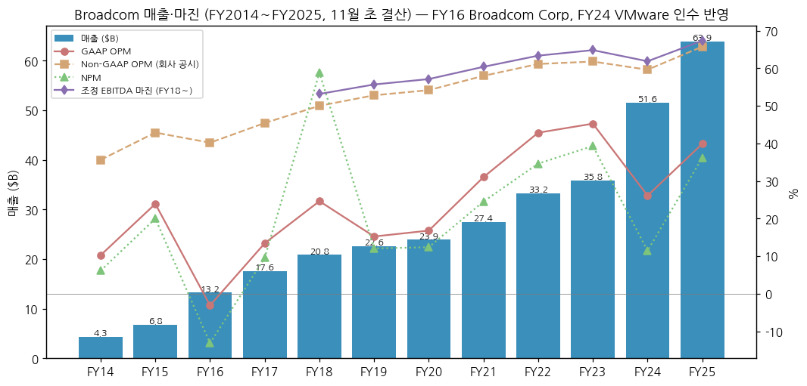

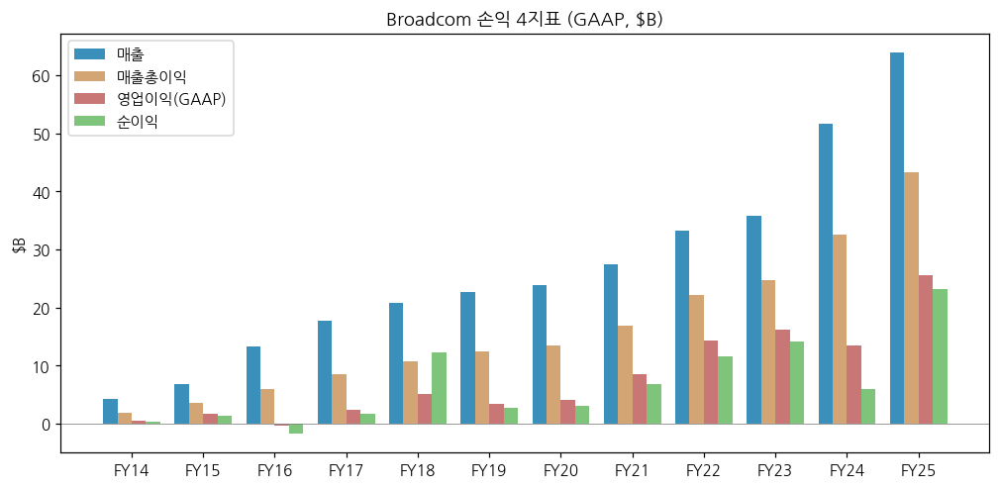

### ② 산업 분류
- SEC SIC 3674 (Semiconductors & Related Devices) / GICS 정보기술 — 반도체
- 워치리스트: **반도체 섹터 — 서브섹터 "커스텀 ASIC"** (핵심 종목, Marvell과 함께). 같은 반도체 섹터의 NVIDIA·AMD(범용 GPU), TSMC(파운드리), SK하이닉스·Micron(HBM)과 AI 가속기 공급망에서 맞물린다 — Broadcom은 하이퍼스케일러·AI 연구소가 직접 설계 주도권을 갖는 **맞춤형 가속기(XPU)** 진영의 1위 설계 파트너

### ③ 분류 결정 논리
(1) **가장 큰 사업부 기준**: 반도체 솔루션이 매출의 **70%**(FQ3 FY26, FY2025 58%). 그 안에서 AI 반도체가 $16.7B로 반도체 매출의 80%, 전사 매출의 56% (FQ3 FY26 컨콜). AI 매출은 FY2024 $12.2B → FY2025 $20.2B → FY2026 약 $58B(회사 전망) → FY2027 약 $115B·FY2028 약 $230B(회사 전망, FQ3 FY26 컨콜)로 매년 2배 이상 → **지속성장**.
(2) **이익 비중 우선 sub-rule**: 사업부 영업이익은 FY2025 반도체 $21.2B : 소프트웨어 $20.8B로 반반이었으나, 9M FY26은 반도체 $29.6B(62%) : 소프트웨어 $18.3B(38%)로 AI 쪽이 커졌다 [계산]. 경기에 민감한 **Non-AI 반도체**(브로드밴드·무선·서버 스토리지·산업)는 분기 약 $4.2B(FQ3 FY26, 전사 매출의 14%)로 이익 기여가 작다 → 전통 반도체 재고 사이클은 Secondary로 내려간다. 소프트웨어(사업부 OPM 84%, FQ3 FY26)는 VMware 구독 전환 후 ARR이 +15\~19% 성장(FY26 분기별 컨콜)하는 안정 현금원.
(3) **Boundary case**: AI 매출이 **소수 고객**(XPU 고객 6곳, 단일 고객이 FY2025 매출의 32%)에 몰려 있고, 이들의 데이터센터 CapEx·전력·부지(land, power, shell) 일정에 따라 출하가 움직인다. 2026년부터는 AI 연구소(Anthropic·OpenAI) 랙 금융을 위한 **AI XPV 플랫폼·잔존가치 보증(Backstop 최대 약 $43B, 2026-10-27 8-K)**까지 떠안았다 → "AI CapEx 사이클형"으로 넘어갈 수 있는 경계에 있어 Secondary에 반도체 사이클·고객 집중을 병기.
(4) **글로벌 피어 대비**: NVIDIA는 범용 GPU + CUDA 소프트웨어로 다수 고객에 판매, Broadcom은 고객별 맞춤 설계(XPU) + 이더넷 스위치(Tomahawk)·광 DSP·레이저까지 묶어 공급 — 회사는 "XPU는 GPU 대비 절반 이하 비용"이라고 주장(FQ3 FY26 컨콜). 같은 서브섹터 Marvell은 인터커넥트 중심이고 GAAP 적자 이력이 있는 반면, Broadcom은 **소프트웨어 현금흐름(FCF 마진 40%대)**이 받쳐 이익 변동성이 작다. 전통 아날로그·MCU 업체(TI 등)처럼 재고 사이클에 실적이 좌우되는 구조는 아니다.

### ④ 적정 밸류에이션 방법
- **사업 mix**: 반도체 70% / 인프라 소프트웨어 30% (FQ3 FY26 매출) — 반도체 안에서 AI 80%. 이익은 반도체 62% / 소프트웨어 38% (9M FY26 사업부 영업이익) [계산]. AI XPU 비중이 커질수록 Non-GAAP 매출총이익률은 내려가고(FQ3 75% → FQ4 가이던스 약 73%, HBM 등 메모리 원가 포함) 영업이익률은 유지되는 구조(회사: "총이익률 말고 영업이익률을 보라")
- **Non-GAAP PER 우선** — GAAP 이익은 인수 무형상각(분기 약 $2.0B)·SBC(분기 약 $2.0\~2.3B)로 깎이고, 회사·셀사이드 모두 Non-GAAP EPS 기준. TTM Non-GAAP EPS **$9.76** (FQ4 FY25 $1.95 + FQ1 FY26 $2.05 + FQ2 $2.44 + FQ3 $3.32) → 2026-11-13 종가 $347.01 기준 **TTM P/E 약 35.6배** (GAAP TTM EPS $7.83 기준 44.3배) [계산]. 회사는 "FY2028 EPS $30 초과"를 제시(FQ3 FY26 컨콜) → 이 목표 기준 약 11.6배 [계산, 회사 목표치]
- **EV/Non-GAAP 영업이익 보조** — 회사가 FQ3 FY26부터 가이던스를 조정 EBITDA에서 Non-GAAP 영업이익으로 바꿨다. EV 약 $1,692B (시총 $1,656.5B + 차입 $59.4B − 현금 $24.0B, FQ3 FY26말) / TTM Non-GAAP 영업이익 $59.8B → **약 28.3배**, EV/TTM 매출 약 19.0배 [계산]
- **P/FCF 보조** — CapEx가 매출의 1\~2%(팹라이트)라 FCF 전환율이 높다. TTM FCF $39.4B(영업CF $40.7B − CapEx $1.25B) → **P/FCF 약 42배, FCF 수익률 2.4%** [계산]. 단, FQ4 FY26 CapEx 가이던스 $1.4B(기판·레이저 증설)로 CapEx 비중이 오르는 중
- **Sum-of-Parts 검토용** — 소프트웨어(사업부 OPM 80%대, 구독 ARR)는 소프트웨어 멀티플, 반도체는 AI 성장률 기반 멀티플로 나눠 보는 방식이 가능하나 회사가 사업부별 상각·SBC 배분을 하지 않아(미배분 비용 분기 약 $4.1B) 정밀 분해는 어렵다
- **PBR 부적합** — 자본 $99.7B보다 영업권($97.8B)+무형($26.3B)이 커 유형 순자산이 음수 (FQ3 FY26말)
- **피어와의 차이**: 같은 서브섹터 Marvell은 TTM Non-GAAP P/E 약 47.5배(2026-11-13, MRVL 기업개요 v1.0) — Broadcom은 이익 규모·소프트웨어 안정성으로 성장률 대비 낮은 배수. 범용 GPU(NVIDIA)와의 배수 비교는 이번 버전에서 시장 데이터 미검증으로 생략

### ⑤ 분기 재평가 트리거 (분류 자체가 바뀌는 조건)
- **AI 반도체 매출 2개 분기 연속 QoQ 감소** 또는 회사가 FY2027 AI 전망(약 $115B)을 **하향** → 지속성장형 → AI CapEx 사이클형으로 재분류 검토
- **잔존가치 보증(Backstop) 실제 손실 인식** 또는 AI 랙(시스템) 매출 확대로 Non-GAAP OPM이 2개 분기 연속 **60% 미만** → 팹리스 설계사 → 시스템·금융 결합형으로 Primary 재설정 검토
- **대형 소프트웨어 인수**(VMware급) 발표 또는 소프트웨어 매출 비중이 다시 **40% 이상** → 반도체/소프트웨어 복합형(Boundary)으로 격상
- **단일 고객 매출 비중 50% 초과**(FY2025 32%) → 고객 집중 리스크형 Secondary 격상

---

## ② 회사 개요

### ① 기본 사항
- 회사명: Broadcom Inc. (2009-08 Avago Technologies로 나스닥 상장 → 2016-02 Broadcom Corporation 인수 후 Broadcom Limited → 2018-04 미국 재법인화로 Broadcom Inc.)
- 사업 한 줄 정의: **하이퍼스케일러·AI 연구소용 맞춤형 AI 가속기(XPU)와 데이터센터 네트워킹 칩을 설계하고, VMware 등 기업용 인프라 소프트웨어를 구독으로 파는 회사**
- 기원: Hewlett-Packard 반도체 사업(Agilent → Avago) + AT&T(LSI) + Broadcom Corp + Brocade + CA + Symantec 기업보안 + VMware (10-K FY2025)
- 생산: 웨이퍼 대부분 외주(TSMC 등), 조립·테스트도 TSMC·ASE·Foxconn·Amkor·SPIL 외주. FBAR 필터·GaAs/InP 레이저(VCSEL·EML)는 자체 팹. 싱가포르 기판(substrate) 공장 FY2027 가동 예정 (FQ3 FY26 컨콜)
- 임직원: 약 **33,000명** (2025-11-02, R&D 인력 57%) — FY2018 15,000 → FY2023 20,000 → FY2024 37,000(VMware) → FY2025 33,000 (각 연도 10-K)
- CEO **Hock E. Tan** (2006-03\~), 이사회 의장 **Henry Samueli** (Broadcom Corp 공동창업자), CFO **Amie Thuener** (2026-06-12\~, Kirsten Spears 은퇴 승계 — 8-K 2026-04-02)

### ② 12년 손익·자본 추이 ($M)

| 연도 | 매출 | 영업이익(GAAP) | Non-GAAP 영업이익 | 순이익 | 자본총계 | 총자산 |
|---|---|---|---|---|---|---|
| 2014 | 4,269 | 438 | 1,521 | 263 | 3,243 | 10,491 |
| 2015 | 6,824 | 1,632 | 2,926 | 1,364 | 4,714 | 10,515 |
| 2016 | 13,240 | −409 | 5,320 | −1,739 | 21,876 | 49,966 |
| 2017 | 17,636 | 2,371 | 8,011 | 1,692 | 20,285 | 54,418 |
| 2018 | 20,848 | 5,135 | 10,424 | 12,259 | 26,657 | 50,124 |
| 2019 | 22,597 | 3,444 | 11,929 | 2,724 | 24,941 | 67,493 |
| 2020 | 23,888 | 4,014 | 12,939 | 2,960 | 23,874 | 75,933 |
| 2021 | 27,450 | 8,519 | 15,912 | 6,736 | 24,962 | 75,570 |
| 2022 | 33,203 | 14,225 | 20,294 | 11,495 | 22,709 | 73,249 |
| 2023 | 35,819 | 16,207 | 22,125 | 14,082 | 23,988 | 72,861 |
| 2024 | 51,574 | 13,463 | 30,736 | 5,895 | 67,678 | 165,645 |
| 2025 | 63,887 | 25,484 | 41,997 | 23,126 | 81,292 | 171,092 |

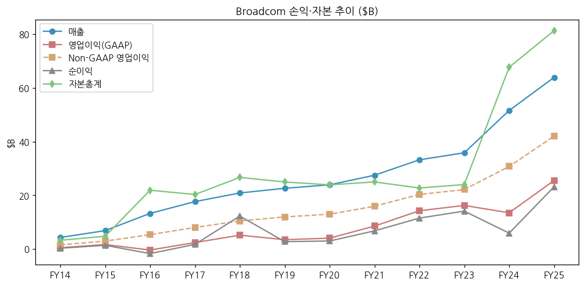

### ③ 회사 주가 역사

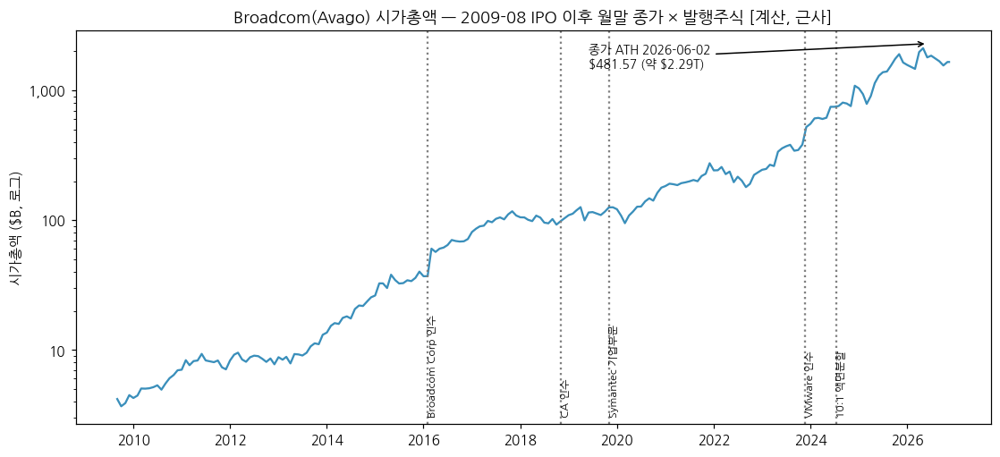

> 월말 종가(분할 조정) × 당시 10-Q/10-K 표지 발행주식 수 [계산, 근사 — 2016-05\~2018-06은 표지 주식 수 공백 구간이라 선형 보간]. 연말 시총은 stockanalysis.com(Nasdaq Data Link) 수치와 1% 이내로 일치.

- 2009-08 Avago Technologies 나스닥 IPO (상장 시 시총 약 $3.81B, stockanalysis.com) — 2009-12 월말 종가 $1.83 (분할 조정)
- 2014\~2016 LSI·Broadcom Corp 인수로 "인수 후 비용 절감" 모델 확립 — 2015-12 월말 $14.52 → 2017-12 $25.69
- 2017-11 Qualcomm 적대적 인수 제안 → 2018-03 미국 대통령 행정명령으로 저지 [공개 보도] → 2018-04 미국 재법인화, 이후 CA(2018-11)·Symantec 기업보안(2019-11)으로 소프트웨어 확장
- 2022-12 월말 $55.91 (시총 약 $234B) → 2023-11 VMware 인수 + AI 가속기 부각 → 2023-12 $111.62 (약 $523B)
- 2024-07 10:1 액면분할 → **2024-12 시총 $1T 돌파** (월말 $231.84, 약 $1.09T)
- **2026-06-02 종가 $481.57 사상 최고 (시총 약 $2.29T)** [Yahoo v8] → 6/3 장 마감 후 FQ2 FY26 발표(FQ3 가이던스 $29.4B 서프라이즈)에도 6/4 **−12.6%**($418.91)
- 2026-09-02 FQ3 FY26 발표(AI $16.7B, FY2027·2028 AI 전망 제시) → 이후 3개월 하락. **2026-11-05 −10.4%, 종가 $291.53 (52주 최저)** — 반도체 업종 동반 급락(2차 보도: Trefis 2026-11-06 "데이터센터 둔화 우려") → 2026-11-13 $347.01 (고점 대비 −27.9%)

### ④ 주요 연혁
| 시기 | 이벤트 |
|---|---|
| 2005 이전 | HP 반도체 사업 → Agilent Technologies 반도체 부문 (10-K: "HP·AT&T 기원 50년+ 역사") |
| 2005-12 | KKR·Silver Lake가 Agilent 반도체 부문 인수 → Avago Technologies 출범 [공개 자료] |
| 2006-03 | Hock Tan CEO 취임 |
| 2009-08 | 나스닥 IPO |
| 2014-05 | LSI 인수 (엔터프라이즈 스토리지·네트워킹) |
| 2016-02-01 | **Broadcom Corporation 인수 ($35.7B)** → 사명 Broadcom Limited |
| 2017-11-17 | Brocade 인수 ($6.0B, FC SAN) |
| 2018-03 | Qualcomm 인수 시도 무산 (미국 정부 저지) [공개 보도] |
| 2018-04 | 싱가포르 → 미국(Delaware) 재법인화, Broadcom Inc. |
| 2018-11-05 | **CA Technologies 인수 ($18.8B)** — 인프라 소프트웨어 사업부 출범 |
| 2019-11-04 | Symantec 기업보안 사업 인수 ($10.7B) |
| 2023-11-22 | **VMware 인수 (총대가 $86.3B — 현금 $30.8B + 주식 5.44억 주[분할 조정], 공정가치 $53.4B)** |
| 2024-07 | 10:1 액면분할 |
| 2024-12 | FY2024 AI 매출 $12.2B(+220%) 공개, 시총 $1T 돌파 |
| 2026-04-06 | Google과 차세대 TPU 장기공급계약(LTA, 최장 2031) + Anthropic 약 3.5GW 확대 (8-K) |
| 2026-06 | AI XPV 플랫폼 출범 (1차 $35B, Anthropic 1GW) / CFO 교체(Amie Thuener) |
| 2026-07-06 | Apple과 커스텀 ASIC 장기계약 2031년까지 확대 (8-K) |
| 2026-09-02 | FQ3 FY26: AI $16.7B, FY2027 AI 약 $115B·FY2028 약 $230B 전망 |
| 2026-10-26 | AI 랙 리스 관련 잔존가치 보증(Backstop) — 최대 잠재 부담 약 $43B (8-K 2026-10-27) |

---

## ③ 비즈니스 모델

### ① 실적 추이 통합 표 — 사업부 연간 ($M)

| 구분 | FY18 | FY19 | FY20 | FY21 | FY22 | FY23 | FY24 | FY25 | 9M FY25 | 9M FY26 | 9M YoY |
|---|---|---|---|---|---|---|---|---|---|---|---|
| 반도체 솔루션 매출 | 19,068 | 17,514 | 17,267 | 20,383 | 25,818 | 28,182 | 30,096 | 36,858 | 25,786 | 48,363 | 87.6% |
| 인프라 소프트웨어 매출 | 1,780 | 5,156 | 6,621 | 7,067 | 7,385 | 7,637 | 21,478 | 27,029 | 20,086 | 22,726 | 13.1% |
| 반도체 영업이익 | 미확보 | 미확보 | 8,576 | 10,976 | 15,075 | 16,486 | 16,759 | 21,232 | 14,729 | 29,554 | 100.7% |
| 소프트웨어 영업이익 | 미확보 | 미확보 | 4,363 | 4,936 | 5,219 | 5,639 | 13,977 | 20,765 | 15,347 | 18,295 | 19.2% |
| 미배분 비용(상각·SBC 등) | 미확보 | 미확보 | −8,925 | −7,393 | −6,069 | −5,918 | −17,273 | −16,513 | −12,100 | −12,543 | - |
| 반도체 사업부 OPM | - | - | 49.7% | 53.8% | 58.4% | 58.5% | 55.7% | 57.6% | 57.1% | 61.1% | |
| 소프트웨어 사업부 OPM | - | - | 65.9% | 69.8% | 70.7% | 73.8% | 65.1% | 76.8% | 76.4% | 80.5% | |
| 소프트웨어 매출 비중 | 8.5% | 22.7% | 27.7% | 25.7% | 22.2% | 21.3% | 41.6% | 42.3% | 43.8% | 32.0% | |

> 사업부 영업이익은 각 연도 다음 해 10-K의 재분류 수치. 미배분 비용 = 인수 무형상각·SBC·구조조정 등(회사가 사업부에 배분하지 않음). FY2018 소프트웨어는 CA 인수 전(Brocade FC SAN 등), FY2019\~FY2020 이후 IP 라이선스는 반도체에 포함. FY2019 사업부 영업이익은 재분류 전후 기준이 달라 미기재.

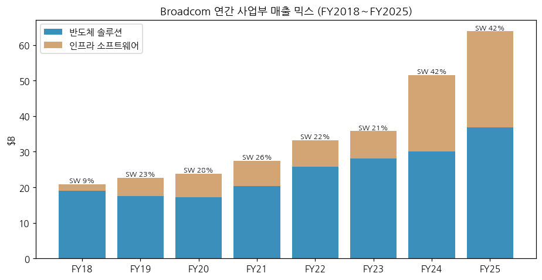

### ① 사업부별 분기 시계열 (FQ1 FY18\~FQ3 FY26) + AI 반도체 매출

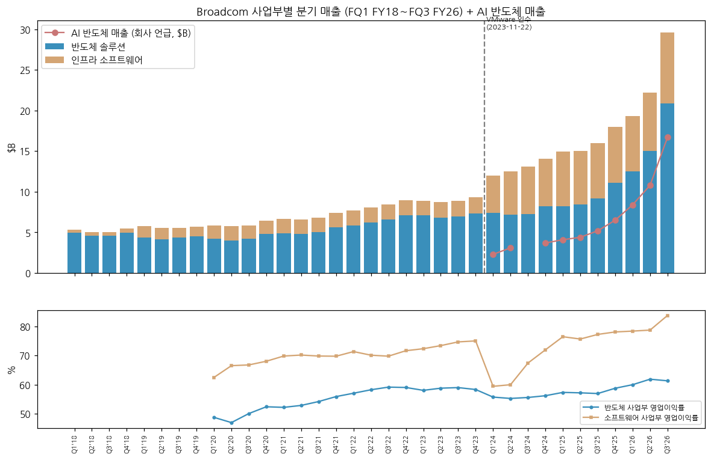

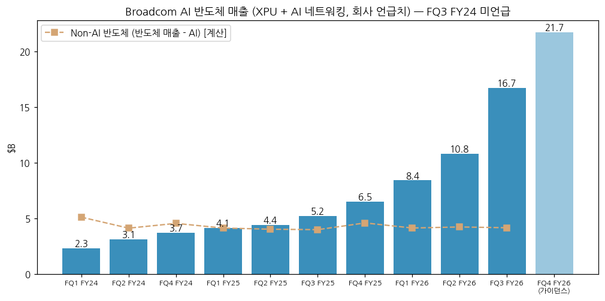

> AI 반도체 매출 = 커스텀 가속기(XPU) + AI 네트워킹(이더넷 스위치·광 DSP 등). 회사가 보도자료·컨콜에서 말한 수치만 기재(FQ3 FY24는 회사 미언급). Non-AI 반도체 = 반도체 사업부 매출 − AI [계산].

<details><summary>사업부 분기 원자료 (FQ1 FY18\~FQ3 FY26, $M)</summary>

| 회계분기 | 캘린더 기간 | 반도체 매출 | 소프트웨어 매출 | 합계 | AI 반도체 매출 ($B) | 반도체 OI | 소프트웨어 OI | 미배분 | 반도체 OPM | SW OPM |
|---|---|---|---|---|---|---|---|---|---|---|
| FQ1 FY18 | 2017.11～2018.01 | 4,999 | 328 | 5,327 | - | - | - | - | - | - |
| FQ2 FY18 | 2018.02～04 | 4,567 | 447 | 5,014 | - | - | - | - | - | - |
| FQ3 FY18 | 2018.05～07 | 4,571 | 492 | 5,063 | - | - | - | - | - | - |
| FQ4 FY18 | 2018.08～10 | 4,931 | 513 | 5,444 | - | - | - | - | - | - |
| FQ1 FY19 | 2018.11～2019.01 | 4,398 | 1,403 | 5,801 | - | - | - | - | - | - |
| FQ2 FY19 | 2019.02～04 | 4,120 | 1,413 | 5,533 | - | - | - | - | - | - |
| FQ3 FY19 | 2019.05～07 | 4,397 | 1,140 | 5,537 | - | - | - | - | - | - |
| FQ4 FY19 | 2019.08～10 | 4,526 | 1,200 | 5,726 | - | - | - | - | - | - |
| FQ1 FY20 | 2019.11～2020.01 | 4,191 | 1,667 | 5,858 | - | 2,043 | 1,041 | −2,370 | 48.7% | 62.4% |
| FQ2 FY20 | 2020.02～04 | 4,027 | 1,715 | 5,742 | - | 1,891 | 1,140 | −2,265 | 47.0% | 66.5% |
| FQ3 FY20 | 2020.05～07 | 4,219 | 1,602 | 5,821 | - | 2,112 | 1,069 | −2,173 | 50.1% | 66.7% |
| FQ4 FY20 | 2020.08～10 | 4,830 | 1,637 | 6,467 | - | 2,530 | 1,113 | −2,117 | 52.4% | 68.0% |
| FQ1 FY21 | 2020.11～2021.01 | 4,908 | 1,747 | 6,655 | - | 2,561 | 1,219 | −1,943 | 52.2% | 69.8% |
| FQ2 FY21 | 2021.02～04 | 4,820 | 1,790 | 6,610 | - | 2,547 | 1,255 | −1,827 | 52.8% | 70.1% |
| FQ3 FY21 | 2021.05～07 | 5,021 | 1,757 | 6,778 | - | 2,720 | 1,226 | −1,820 | 54.2% | 69.8% |
| FQ4 FY21 | 2021.08～10 | 5,634 | 1,773 | 7,407 | - | 3,148 | 1,236 | −1,803 | 55.9% | 69.7% |
| FQ1 FY22 | 2021.11～2022.01 | 5,873 | 1,833 | 7,706 | - | 3,349 | 1,307 | −1,548 | 57.0% | 71.3% |
| FQ2 FY22 | 2022.02～04 | 6,229 | 1,874 | 8,103 | - | 3,626 | 1,313 | −1,545 | 58.2% | 70.1% |
| FQ3 FY22 | 2022.05～07 | 6,624 | 1,840 | 8,464 | - | 3,916 | 1,283 | −1,462 | 59.1% | 69.7% |
| FQ4 FY22 | 2022.08～10 | 7,092 | 1,838 | 8,930 | - | 4,184 | 1,316 | −1,514 | 59.0% | 71.6% |
| FQ1 FY23 | 2022.11～2023.01 | 7,107 | 1,808 | 8,915 | - | 4,123 | 1,307 | −1,327 | 58.0% | 72.3% |
| FQ2 FY23 | 2023.02～04 | 6,808 | 1,925 | 8,733 | - | 4,000 | 1,412 | −1,404 | 58.8% | 73.4% |
| FQ3 FY23 | 2023.05～07 | 6,941 | 1,935 | 8,876 | - | 4,092 | 1,444 | −1,680 | 59.0% | 74.6% |
| FQ4 FY23 | 2023.08～10 | 7,326 | 1,969 | 9,295 | - | 4,271 | 1,476 | −1,507 | 58.3% | 75.0% |
| FQ1 FY24 | 2023.11～2024.01 | 7,390 | 4,571 | 11,961 | 2.3 | 4,116 | 2,715 | −4,748 | 55.7% | 59.4% |
| FQ2 FY24 | 2024.02～04 | 7,202 | 5,285 | 12,487 | 3.1 | 3,978 | 3,168 | −4,181 | 55.2% | 59.9% |
| FQ3 FY24 | 2024.05～07 | 7,274 | 5,798 | 13,072 | - | 4,042 | 3,906 | −4,160 | 55.6% | 67.4% |
| FQ4 FY24 | 2024.08～10 | 8,230 | 5,824 | 14,054 | 3.7 | 4,623 | 4,188 | −4,184 | 56.2% | 71.9% |
| FQ1 FY25 | 2024.11～2025.01 | 8,212 | 6,704 | 14,916 | 4.1 | 4,706 | 5,122 | −3,568 | 57.3% | 76.4% |
| FQ2 FY25 | 2025.02～04 | 8,408 | 6,596 | 15,004 | 4.4 | 4,806 | 4,987 | −3,964 | 57.2% | 75.6% |
| FQ3 FY25 | 2025.05～07 | 9,166 | 6,786 | 15,952 | 5.2 | 5,217 | 5,238 | −4,568 | 56.9% | 77.2% |
| FQ4 FY25 | 2025.08～10 | 11,072 | 6,943 | 18,015 | 6.5 | 6,503 | 5,418 | −4,413 | 58.7% | 78.0% |
| FQ1 FY26 | 2025.11～2026.01 | 12,515 | 6,796 | 19,311 | 8.4 | 7,503 | 5,323 | −4,263 | 60.0% | 78.3% |
| FQ2 FY26 | 2026.02～04 | 15,009 | 7,178 | 22,187 | 10.8 | 9,281 | 5,647 | −4,140 | 61.8% | 78.7% |
| FQ3 FY26 | 2026.05～07 | 20,839 | 8,752 | 29,591 | 16.7 | 12,770 | 7,325 | −4,140 | 61.3% | 83.7% |

> FQ4 수치는 연간(10-K) − FQ1\~FQ3 [계산]. FY2018\~FY2019 반도체 매출은 IP 라이선스 합산(이후 재분류 기준과 맞춤). 사업부 영업이익은 FQ1 FY20부터(재분류 기준 일치 구간).

</details>

### ① 12분기 시계열 (FQ4 FY23\~FQ3 FY26)

| 회계분기 | 캘린더 기간 | 매출 ($M) | YoY | AI 반도체 ($B) | 영업이익 GAAP | OPM | Non-GAAP OI | Non-GAAP OPM | 조정 EBITDA | 순이익 | GAAP EPS | Non-GAAP EPS | 비고 |
|---|---|---|---|---|---|---|---|---|---|---|---|---|---|
| FQ4 FY23 | 2023.08～10 | 9,295 | 4.1% | 미언급 | 4,240 | 45.6% | 5,747 | 61.8% | 6,048 | 3,524 | 0.82 | 1.11 |  |
| FQ1 FY24 | 2023.11～2024.01 | 11,961 | 34.2% | 2.3 | 2,083 | 17.4% | 6,831 | 57.1% | 7,156 | 1,325 | 0.28 | 1.10 | **VMware 첫 반영** (소프트웨어 매출 2.5배), 상각·구조조정으로 GAAP OPM 17% |
| FQ2 FY24 | 2024.02～04 | 12,487 | 43.0% | 3.1 | 2,965 | 23.7% | 7,146 | 57.2% | 7,429 | 2,121 | 0.44 | 1.10 |  |
| FQ3 FY24 | 2024.05～07 | 13,072 | 47.3% | 미언급 | 3,788 | 29.0% | 7,948 | 60.8% | 8,223 | −1,875 | −0.40 | 1.24 | IP 내부 이전 관련 법인세 비용으로 순손실 |
| FQ4 FY24 | 2024.08～10 | 14,054 | 51.2% | 3.7 | 4,627 | 32.9% | 8,811 | 62.7% | 9,089 | 4,324 | 0.90 | 1.42 |  |
| FQ1 FY25 | 2024.11～2025.01 | 14,916 | 24.7% | 4.1 | 6,260 | 42.0% | 9,828 | 65.9% | 10,083 | 5,503 | 1.14 | 1.60 |  |
| FQ2 FY25 | 2025.02～04 | 15,004 | 20.2% | 4.4 | 5,829 | 38.8% | 9,793 | 65.3% | 10,001 | 4,965 | 1.03 | 1.58 |  |
| FQ3 FY25 | 2025.05～07 | 15,952 | 22.0% | 5.2 | 5,887 | 36.9% | 10,455 | 65.5% | 10,702 | 4,140 | 0.85 | 1.69 |  |
| FQ4 FY25 | 2025.08～10 | 18,015 | 28.2% | 6.5 | 7,508 | 41.7% | 11,921 | 66.2% | 12,218 | 8,518 | 1.74 | 1.95 | AI $6.5B |
| FQ1 FY26 | 2025.11～2026.01 | 19,311 | 29.5% | 8.4 | 8,563 | 44.3% | 12,826 | 66.4% | 13,128 | 7,349 | 1.50 | 2.05 | 6번째 XPU 고객 확보 언급 |
| FQ2 FY26 | 2026.02～04 | 22,187 | 47.9% | 10.8 | 10,788 | 48.6% | 14,928 | 67.3% | 15,244 | 9,310 | 1.91 | 2.44 | Google LTA·Anthropic 확대(2026-04-06 8-K) |
| FQ3 FY26 | 2026.05～07 | 29,591 | 85.5% | 16.7 | 15,955 | 53.9% | 20,095 | 67.9% | 미공시 | 13,088 | 2.68 | 3.32 | **AI $16.7B(+221%)**, 매출 첫 $29B대, Non-GAAP OPM 67.9% |
| **FQ4 FY26 (가이던스)** | 2026.08～10 | **약 34,800** | +93% | **21.7** | - | - | 약 66% 마진 | 약 66% | 미제시 | - | - | - | 반도체 약 $26.1B·소프트웨어 약 $8.7B, GPM 약 73% (컨콜) |

> GAAP EPS FQ4는 보도자료 수치, 나머지 XBRL. EPS는 10:1 분할 조정(FQ4 FY23·FQ1\~2 FY24 Non-GAAP EPS 원 공시 $11.06·$10.99·$10.96 ÷10). FQ3 FY26부터 조정 EBITDA 미공시.

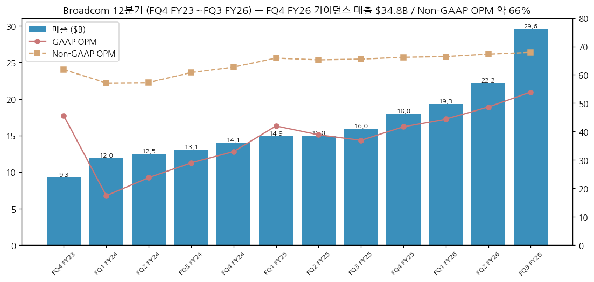

### ② 사업부별 개요 (매출 비중 순)
**반도체 솔루션 (매출 70% / 9M FY26 사업부 영업이익 62%)** — ① **AI 반도체**: 고객 맞춤 AI 가속기(XPU — Google TPU, Meta MTIA, OpenAI 1세대 가속기 등)와 AI 네트워킹(Tomahawk 6 이더넷 스위치·Tomahawk Ultra 스케일업 스위치·PCIe 스위치·광 DSP·EML/VCSEL/CW 레이저). FQ3 FY26 XPU가 AI 매출의 73%, XPU 출하 YoY 3.5배 이상, AI 네트워킹 2.5배 이상 (컨콜). ② **Non-AI 반도체**: 브로드밴드(셋톱·PON), 무선(FBAR 필터 — Apple 장기계약), 서버 스토리지(SAS/RAID·FC), 산업·엔터프라이즈 네트워킹. FQ3 FY26 $4.2B(+5% YoY), FQ4 가이던스 약 $4.3B.

**인프라 소프트웨어 (매출 30% / 사업부 영업이익 38%)** — VMware Cloud Foundation(VCF, 프라이빗 클라우드), 메인프레임 소프트웨어(CA), 사이버보안(Symantec 기업부문), FC SAN(Brocade). VMware 인수 후 영구 라이선스 → 구독 전환: 상위 1만 고객 중 VCF 채택 "90% 훨씬 넘음"(FQ3 FY25 컨콜), ARR 성장 +19%(FQ1 FY26)·+17%(FQ2)·+15%(FQ3). FQ3 FY26 매출 $8.8B(+29%, 사업부 OPM 84%), FQ4 가이던스 약 $8.7B. 소프트웨어 백로그 $73B (FQ4 FY25 컨콜).

### ③ 세그먼트별 디테일 — AI XPU 고객 (공시·컨콜 범위)
| 고객 | 회사 공시·컨콜 내용 | 출처 |
|---|---|---|
| **Google** | TPU 설계·공급 10년 파트너. Ironwood(TPU v7) 대량 출하, 차세대 TPU v8i 생산 출하 시작(FQ3 FY26). 차세대 TPU 장기공급계약 + AI 랙용 네트워킹 공급보장 계약(최장 2031) | 8-K 2026-04-06, FQ3 FY26 컨콜 |
| **Anthropic** | FQ4 FY25 컨콜에서 4번째 고객으로 공개 — TPU Ironwood 랙 $10B 주문 + 추가 $11B. 2026년 1GW → 2027년 TPU v8i 5GW → 2028년 추가 10GW, "2027년 최대 XPU 고객" 전망. 2027년부터 Broadcom 통해 약 3.5GW 접근 | 8-K 2026-04-06, FQ4 FY25·FQ3 FY26 컨콜 |
| **OpenAI** | 10GW 협약 내 1세대 XPU "Jalapeno" 출하 시작, 2027년 1.3GW·2028년 5GW 이상, 2세대 테이프아웃 임박·3세대 개발 중. "2028년 2번째 XPU 고객" 전망 | FQ2·FQ3 FY26 컨콜 |
| **Meta** | MTIA 가속기 — 2027년 말까지 3개 세대 공급, 2028년까지 3GW | FQ2·FQ3 FY26 컨콜 |
| 5·6번째 고객 | 5번째 고객 $1B 주문(FQ4 FY25 컨콜, 회사는 고객명 미확인), 6번째 고객 확보(FQ1 FY26 컨콜) — 이름 비공개 | 컨콜 |
| ByteDance | 회사 공시·검토한 컨콜에서 고객명 언급 없음 — 시장에서 거론되는 고객 **[추정]** | - |

- **단일 고객 비중**: 한 고객이 매출의 21%(FY23) → 28%(FY24) → **32%(FY25)**, 반도체 사업부 소속 (10-K FY2025, 고객명 미공시 — Google로 보는 시각이 일반적 **[추정]**). 상위 5개 최종 고객 약 40%, 유통사 경유 매출 48% (FY2024\~FY2025)
- **잔여이행의무(RPO) $179.2B** (2026-08-02, 반도체·소프트웨어 확정 계약, 이 중 약 25%가 12개월 내 매출 인식) — FQ2 FY26에 체결한 커스텀 가속기 장기계약 포함 (10-Q FQ3 FY26)
- **AI XPV 플랫폼**: 금융 파트너(컨콜: Apollo·Blackstone)가 AI 연구소용 XPU 컴퓨팅 설비 자금을 대고 Broadcom이 기술 제공, 2028년까지 20GW 이상 목표. 1차 $35B(2026-06, Anthropic 1GW). Broadcom은 필요 시 잔존가치 보증 — 2026-10-26 Backstop 최대 약 $43B (리스 미지급액의 72.5% − 랙 처분가치)

### ④ 주요 경쟁사
| 영역 | 경쟁사 |
|---|---|
| 커스텀 AI 가속기(XPU) | Marvell, MediaTek(구글 TPU 일부 세대 — 컨콜에서 "MediaTek 버전" 언급), Alchip·GUC(대만 디자인하우스), 고객 자체 설계팀 / 대체재: NVIDIA·AMD 범용 GPU |
| AI 네트워킹 | NVIDIA(InfiniBand·Spectrum-X·NVLink), Marvell(광 DSP), Cisco(Silicon One), Arista(시스템) |
| Non-AI 반도체 | Qualcomm·Skyworks·Qorvo(무선 RF), Marvell·Microchip(스토리지), MaxLinear·Realtek(브로드밴드) |
| 인프라 소프트웨어 | Nutanix·Red Hat(OpenShift)·퍼블릭 클라우드(AWS·Azure·GCP), IBM(메인프레임), 보안 업체 |

### ⑤ 주요 매출처·지역
- 단일 고객 32%(FY25), 상위 5개 최종 고객 약 40%, 유통사 경유 48% (10-K FY2025)
- 반도체는 유통사·OEM·CM 경유 비중이 높아 선적지 기준 지역 매출은 최종 수요지와 다르다

### ⑥ 가이던스·중기 전망 (회사 제시치 — 시점 명시)
| 항목 | 값 | 제시 시점 |
|---|---|---|
| FQ4 FY26 매출 | 약 $34.8B (+93% YoY) | 2026-09-02 |
| FQ4 FY26 AI 반도체 | $21.7B (+236% YoY) | 2026-09-02 컨콜 |
| FQ4 FY26 Non-GAAP OPM / GPM | 약 66% / 약 73% | 2026-09-02 |
| FY2026 AI 반도체 | 약 $58B (+186%, 직전 $56B에서 상향) | 2026-09-02 컨콜 |
| FY2027 AI 반도체 | 약 $115B (공급 확보 완료) | 2026-09-02 컨콜 |
| FY2028 AI 반도체 | 약 $230B / EPS $30 초과 | 2026-09-02 컨콜 |
| 기가와트당 Broadcom 콘텐츠 | $20\~30B 수준 유지 | 2026-09-02 컨콜 |

---

## ④ 재무 구조 (12년, $M)

### ① 손익계산서

| 연도 | 매출 | 매출원가(상각 포함) | 매출총이익 | R&D | SG&A | 무형상각(전체) | 구조조정 등 | 영업이익 | 이자비용 | 법인세 | 순이익 | 희석 EPS ($, 분할조정) | GPM | OPM | NPM |
|---|---|---|---|---|---|---|---|---|---|---|---|---|---|---|---|
| 2014 | 4,269 | 2,392 | 1,877 | 695 | 407 | 197 | 140 | 438 | 110 | 33 | 263 | 0.10 | 44.0% | 10.3% | 6.2% |
| 2015 | 6,824 | 3,271 | 3,553 | 1,049 | 486 | 249 | 137 | 1,632 | 191 | 76 | 1,364 | 0.48 | 52.1% | 23.9% | 20.0% |
| 2016 | 13,240 | 7,300 | 5,940 | 2,674 | 806 | 2,640 | 996 | −409 | 585 | 642 | −1,739 | −0.49 | 44.9% | −3.1% | −13.1% |
| 2017 | 17,636 | 9,127 | 8,509 | 3,302 | 789 | 4,286 | 161 | 2,371 | 454 | 35 | 1,692 | 0.40 | 48.2% | 13.4% | 9.6% |
| 2018 | 20,848 | 10,115 | 10,733 | 3,768 | 1,056 | 3,566 | 219 | 5,135 | 628 | −8,084 | 12,259 | 2.84 | 51.5% | 24.6% | 58.8% |
| 2019 | 22,597 | 10,114 | 12,483 | 4,696 | 1,709 | 5,239 | 736 | 3,444 | 1,444 | −510 | 2,724 | 0.64 | 55.2% | 15.2% | 12.1% |
| 2020 | 23,888 | 10,372 | 13,516 | 4,968 | 1,935 | 미확보 | 198 | 4,014 | 1,777 | −518 | 2,960 | 0.63 | 56.6% | 16.8% | 12.4% |
| 2021 | 27,450 | 10,606 | 16,844 | 4,854 | 1,347 | 미확보 | 148 | 8,519 | 1,885 | 29 | 6,736 | 1.50 | 61.4% | 31.0% | 24.5% |
| 2022 | 33,203 | 11,108 | 22,095 | 4,919 | 1,382 | 미확보 | 57 | 14,225 | 1,737 | 939 | 11,495 | 2.65 | 66.5% | 42.8% | 34.6% |
| 2023 | 35,819 | 11,129 | 24,690 | 5,253 | 1,592 | 3,247 | 244 | 16,207 | 1,622 | 1,015 | 14,082 | 3.30 | 68.9% | 45.2% | 39.3% |
| 2024 | 51,574 | 19,065 | 32,509 | 9,310 | 4,959 | 9,267 | 1,533 | 13,463 | 3,953 | 3,748 | 5,895 | 1.23 | 63.0% | 26.1% | 11.4% |
| 2025 | 63,887 | 20,593 | 43,294 | 10,977 | 4,211 | 8,062 | 591 | 25,484 | 3,210 | −397 | 23,126 | 4.77 | 67.8% | 39.9% | 36.2% |

> 매출원가·영업비용에 인수 무형상각 포함(GAAP). 무형상각 FY2020\~FY2022 미확보(XBRL 태그 불일치). 희석 EPS는 10:1 분할 조정(FY2021 이전 ÷10). FY2018 순이익은 세제개편 법인세 환입 $8.1B 포함.

### ② 재무상태표

| 회계연도말 | 총자산 | 유동자산 | 현금 | 재고 | 영업권 | 무형자산 | 유동부채 | 총차입(장·단기) | 부채총계 | 자본총계 |
|---|---|---|---|---|---|---|---|---|---|---|
| 2014 | 10,491 | 3,835 | 1,604 | 519 | 1,596 | 3,617 | 1,016 | 4,589 | 7,248 | 3,243 |
| 2015 | 10,515 | 3,759 | 1,822 | 524 | 1,674 | 3,277 | 1,119 | 3,872 | 5,801 | 4,714 |
| 2016 | 49,966 | 7,125 | 3,097 | 1,400 | 24,732 | 15,068 | 3,078 | 13,642 | 28,090 | 21,876 |
| 2017 | 54,418 | 15,823 | 11,204 | 1,447 | 24,706 | 10,832 | 2,529 | 17,548 | 31,232 | 20,285 |
| 2018 | 50,124 | 9,107 | 4,292 | 1,124 | 26,913 | 10,762 | 2,338 | 17,493 | 23,467 | 26,657 |
| 2019 | 67,493 | 9,917 | 5,055 | 874 | 36,714 | 17,554 | 6,899 | 32,798 | 42,523 | 24,941 |
| 2020 | 75,933 | 11,895 | 7,618 | 1,003 | 43,447 | 16,782 | 6,371 | 41,062 | 52,032 | 23,874 |
| 2021 | 75,570 | 16,586 | 12,163 | 1,297 | 43,450 | 11,374 | 6,281 | 41,499 | 50,581 | 24,962 |
| 2022 | 73,249 | 18,504 | 12,416 | 1,925 | 43,614 | 7,111 | 7,052 | 39,478 | 50,540 | 22,709 |
| 2023 | 72,861 | 20,847 | 14,189 | 1,898 | 43,653 | 3,867 | 7,405 | 39,184 | 48,873 | 23,988 |
| 2024 | 165,645 | 19,595 | 9,348 | 1,760 | 97,873 | 40,583 | 16,697 | 67,540 | 97,967 | 67,678 |
| 2025 | 171,092 | 31,573 | 16,178 | 2,270 | 97,801 | 32,273 | 18,514 | 65,136 | 89,800 | 81,292 |
| **FQ3 FY26** (2026-08-02) | 188,148 | 52,173 | 23,975 | 4,523 | 97,801 | 26,325 | 20,838 | 59,419 | 88,458 | 99,690 |

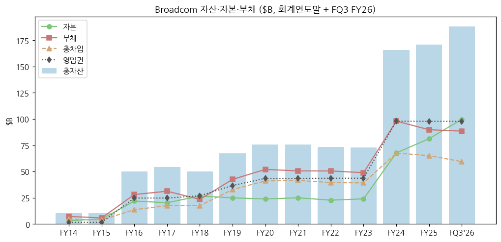

> 총자산의 약 3분의 2가 영업권·무형자산(인수 누적, FQ3 FY26말 66%) [계산]. FQ3 FY26 재고 $4.5B로 FY25말 대비 2배 — AI 출하 대비 (컨콜).

### ③ 현금흐름표 · ④ CapEx

| 연도 | 영업CF | 투자CF | 재무CF | CapEx | FCF (영업CF−CapEx) | FCF 마진 | 인수(순현금) | 배당 | 자사주(프로그램) | 원천징수용 주식매입 | SBC |
|---|---|---|---|---|---|---|---|---|---|---|---|
| 2014 | 1,175 | −5,885 | 5,329 | 409 | 766 | 17.9% | 5,961 | 284 | 12 | 미확보 | 163 |
| 2015 | 2,318 | −241 | −1,859 | 593 | 1,725 | 25.3% | 394 | 408 | 0 | 미확보 | 232 |
| 2016 | 3,411 | −9,840 | 7,704 | 723 | 2,688 | 20.3% | 10,055 | 716 | 0 | 미확보 | 679 |
| 2017 | 6,551 | −674 | 2,230 | 1,069 | 5,482 | 31.1% | 40 | 1,653 | 0 | 0 | 921 |
| 2018 | 8,880 | −4,674 | −11,118 | 635 | 8,245 | 39.5% | 4,800 | 2,921 | 7,258 | 56 | 1,227 |
| 2019 | 9,697 | −15,422 | 6,488 | 432 | 9,265 | 41.0% | 16,033 | 4,235 | 5,435 | 972 | 2,185 |
| 2020 | 12,061 | −11,109 | 1,611 | 463 | 11,598 | 48.6% | 10,872 | 5,235 | 0 | 765 | 1,976 |
| 2021 | 13,764 | −245 | −8,974 | 443 | 13,321 | 48.5% | 8 | 5,913 | 0 | 1,299 | 1,704 |
| 2022 | 16,736 | −667 | −15,816 | 424 | 16,312 | 49.1% | 246 | 6,733 | 7,000 | 1,455 | 1,533 |
| 2023 | 18,085 | −689 | −15,623 | 452 | 17,633 | 49.2% | 53 | 7,645 | 5,824 | 1,861 | 2,171 |
| 2024 | 19,962 | −23,070 | −1,733 | 548 | 19,414 | 37.6% | 25,978 | 9,814 | 7,176 | 5,216 | 5,741 |
| 2025 | 27,537 | −580 | −20,127 | 623 | 26,914 | 42.1% | 0 | 11,142 | 2,450 | 3,860 | 7,568 |

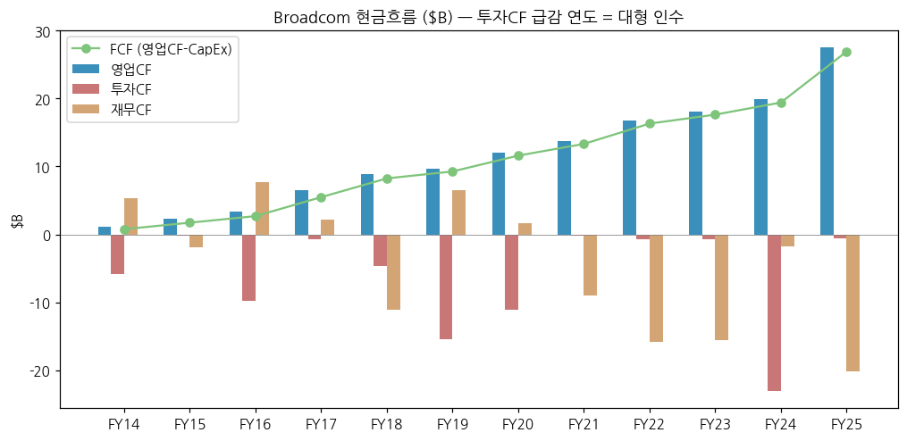

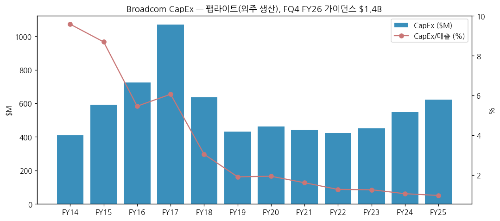

> 투자CF가 크게 음수인 해(FY2014·FY2016·FY2019·FY2020·FY2024)가 대형 인수 연도. CapEx는 매출의 1\~2% 수준이었으나 FQ3 FY26 $532M, FQ4 가이던스 $1.4B로 증가 — 기판(싱가포르)·InP 레이저 공장 증설(컨콜). 9M FY26 영업CF $33.0B, CapEx $1.0B.

### ⑤ 부채 구조
- 총차입 $59.4B (원금 $61.1B, FQ3 FY26말) / 현금 $24.0B → 순차입 약 $35.4B [계산]
- 고정금리 차입 원금 $59.6B, 가중평균 쿠폰 4%, 잔존 만기 7.4년 (FQ3 FY26 컨콜). FQ3에 $5.6B 상환, 분기 후 $1.5B 추가 상환
- VMware 인수 차입(FY2024 신규 차입 $40.0B)을 2년간 줄여 순차입/조정 EBITDA 1.8배(FY24) → 1.1배(FY25) [계산]
- 부외 의무: AI XPV 잔존가치 보증 — 2026-10-26 Backstop 최대 약 $43B(비할인), 회사는 "발생 가능성 낮은 우발부채"로 설명

### ⑥ 배당·자사주
- **분기 배당 $0.65** (FY2026, FY2025 $0.59) — 주당 연간 지급액(분할 조정) FY2014 $0.11 → FY2020 $1.30 → FY2025 $2.36 (12년 매년 증가) [XBRL]
- 배당 총액 FY2025 $11.1B, 9M FY26 $9.3B
- 자사주: $10B 프로그램(2025-04, 2026-12-31까지 연장·$11B로 증액) + 신규 $10B(2026-03, 2026-12-31까지). 9M FY26 매입 $8.45B (FQ1 $7.85B 집중)
- 주식보상 원천징수용 주식 매입(FY2024 $5.2B·FY2025 $3.9B)도 실질 환원 성격

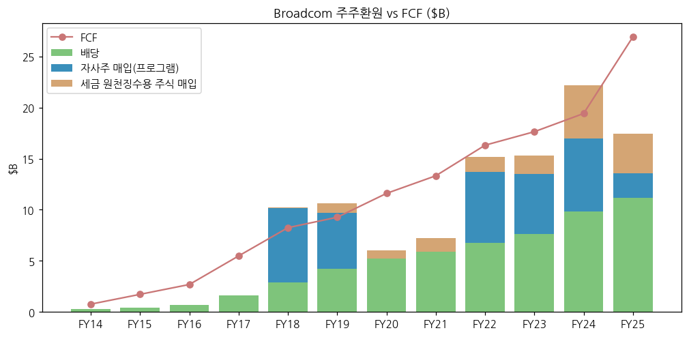

### ⑦ 재무비율

| 연도 | 총차입 | 순차입(차입−현금) | 유동비율 | 이자보상(GAAP OI/이자) | Non-GAAP OI/이자 | 순차입/조정 EBITDA | ROA | ROE | 부채비율(부채/자본) |
|---|---|---|---|---|---|---|---|---|---|
| 2014 | 4,589 | 2,985 | 3.77 | 4.0x | 13.8x | - | 2.5% | 8.1% | 223% |
| 2015 | 3,872 | 2,050 | 3.36 | 8.5x | 15.3x | - | 13.0% | 28.9% | 123% |
| 2016 | 13,642 | 10,545 | 2.31 | −0.7x | 9.1x | - | −3.5% | −7.9% | 128% |
| 2017 | 17,548 | 6,344 | 6.26 | 5.2x | 17.6x | - | 3.1% | 8.3% | 154% |
| 2018 | 17,493 | 13,201 | 3.90 | 8.2x | 16.6x | 1.2x | 24.5% | 46.0% | 88% |
| 2019 | 32,798 | 27,743 | 1.44 | 2.4x | 8.3x | 2.2x | 4.0% | 10.9% | 170% |
| 2020 | 41,062 | 33,444 | 1.87 | 2.3x | 7.3x | 2.5x | 3.9% | 12.4% | 218% |
| 2021 | 41,499 | 29,336 | 2.64 | 4.5x | 8.4x | 1.8x | 8.9% | 27.0% | 203% |
| 2022 | 39,478 | 27,062 | 2.62 | 8.2x | 11.7x | 1.3x | 15.7% | 50.6% | 223% |
| 2023 | 39,184 | 24,995 | 2.82 | 10.0x | 13.6x | 1.1x | 19.3% | 58.7% | 204% |
| 2024 | 67,540 | 58,192 | 1.17 | 3.4x | 7.8x | 1.8x | 3.6% | 8.7% | 145% |
| 2025 | 65,136 | 48,958 | 1.71 | 7.9x | 13.1x | 1.1x | 13.5% | 28.4% | 110% |

---

## ⑤ 지배 구조

### ① 그룹·계열 관계
- 지배주주 없음 (분산 소유). 2018-04 재법인화 때 Broadcom Cayman L.P. 교환가능 파트너십 지분을 보통주로 1:1 교환 → 단일 보통주 구조
- 2019\~2022 발행했던 의무전환우선주(8.00% Series A)는 2022에 보통주 전환 완료 (우선주 배당 FY2020\~FY2022 연 약 $0.3B)

### ② 주주 구분
| 주주 | 보유 주식 | 지분율 | 출처 |
|---|---|---|---|
| The Vanguard Group | 468,544,898 | **9.9%** | DEF 14A 2026-03-02 (2026-02-24 기준) |
| BlackRock, Inc. | 347,023,720 | 7.3% | DEF 14A 2026-03-02 (13G/A 2024-01-26 기준) |
| Henry Samueli (의장) | 85,559,569 | 1.8% | DEF 14A 2026-03-02 |
| Hock E. Tan (CEO) | 908,474 | 1% 미만 | DEF 14A 2026-03-02 |
| 이사·임원 전체(13명) | 89,467,014 | 1.9% | DEF 14A 2026-03-02 |
| 기타 기관·개인 | — | 약 80.9% | [계산] |

### ③ 임원·이사회
- **Hock E. Tan** — President & CEO (2006-03\~), 이사. 전 Integrated Circuit Systems CEO
- **Amie Thuener** — CFO (2026-06-12\~). 전임 Kirsten Spears는 2026-06-12 은퇴, 2027-03-15까지 자문 (8-K 2026-04-02)
- **Charlie B. Kawwas, Ph.D.** — President, Semiconductor Solutions Group / **Mark D. Brazeal** — Chief Legal & Corporate Affairs Officer
- 이사회 8명(2026-04-20 주총 후, Eddy Hartenstein 은퇴로 9→8명): Diane Bryant, Gayla Delly, Kenneth Hao, Check Kian Low, Justine Page, Henry Samueli(의장), Hock Tan, Harry You — Tan 외 7명 독립 (DEF 14A 2026)

---

## ⑥ 기타 팩트

### ① R&D

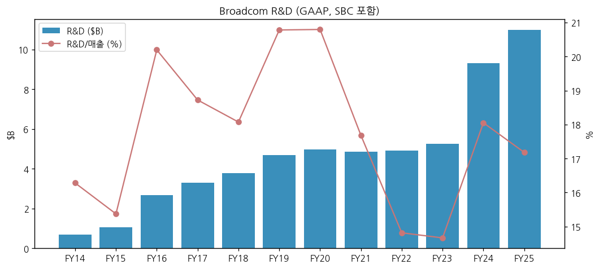

- R&D 비용 FY2025 **$11.0B** (매출의 17.2%, SBC 포함) — FY2023 $5.3B에서 VMware 편입으로 2배. 9M FY26 $8.9B (분기 약 $2.9\~3.0B로 정체, 매출 급증으로 비중은 FQ3 9.8%까지 하락) [계산]
- R&D 인력이 임직원의 57% (FY2025). 반도체 사업부 영업비용은 매출의 6%(FQ3 FY26 컨콜)

### ② 진행 중 Corporate Action (M&A 10년)
| 연도 | 내용 |
|---|---|
| 2016 | Broadcom Corporation ($35.7B) |
| 2017 | Brocade ($6.0B) — 2018 비핵심 사업 매각 |
| 2018 | CA Technologies ($18.8B) |
| 2019 | Symantec 기업보안 ($10.7B) |
| 2023 | VMware (총대가 $86.3B) — 2024 EUC(최종사용자 컴퓨팅) 사업 매각 |
| 2026 | 대형 인수 없음. 대신 AI XPV 플랫폼(금융 파트너 결합)·잔존가치 보증, 기판·레이저 자체 증설, Google·Apple 장기계약 |

### ③ 주요 리스크
- **고객 집중**: 단일 고객 32%(FY25), XPU 고객 6곳 — 고객의 자체 설계 내재화·경쟁 디자인하우스(MediaTek 등) 전환 시 매출 공백
- **AI 연구소 신용·우발부채**: Anthropic·OpenAI 랙 금융 구조에 잔존가치 보증(최대 약 $43B) — 고객 리스 불이행 시 손실 가능 (8-K 2026-10-27, 10-Q 위험요인)
- **공급 병목**: 첨단 웨이퍼(TSMC)·기판·HBM·레이저 — 회사 스스로 "다차원 병목"이라 언급, 데이터센터 부지·전력 일정이 출하 시점을 좌우 (FQ3 FY26 컨콜)
- **마진 희석**: XPU·메모리 포함 랙 매출 확대로 GPM 하락(FQ4 가이던스 73% vs 1년 전 78%)
- **VMware 고객 이탈**: 영구 라이선스 → 구독 전환·가격 정책에 대한 고객 반발 [공개 보도 기반, 수치 미확보]
- **부채**: 총차입 $59.4B — 이자비용 연 $3.2B(FY25)
- **지정학**: 미중 수출통제, 대만 생산 집중

### ④ ESG
- 미수집 (Data gap)

### ⑤ 인증·라이선스
- 반도체 IP(SerDes·패키징·FBAR 등) 특허 포트폴리오, 소프트웨어는 라이선스·구독 계약 기반 — 별도 인허가 사업 아님

---

## Activity 보고 (v1.0)

### ✅ 확보 — SEC XBRL 3개 법인 연간·분기 + 10-K 8건 + 10-Q 26건 + 8-K 42건 + DEF 14A 8건 + 실적 보도자료 18건 + 컨콜 11건 + Yahoo 주가 2009\~
### ❌ 누락 — 조정 EBITDA FY2014\~FY2017·FQ3 FY26, AI 매출 FQ3 FY24, 사업부 영업이익 FY2018\~FY2019, 무형상각 FY2020\~FY2022, 커스텀 ASIC 점유율, ESG 등급, SEC Ex-99.1 원문(403 — IR 사이트 게재본으로 대체)
### ⚠️ 추정·계산 — [계산] CAGR·마진·배수·Q4 차감·Non-AI 반도체·시총(종가×표지 주식, 2016\~2018 보간) / [추정] 32% 고객=Google, ByteDance 고객 여부 / [공개 보도] Qualcomm 인수 저지(2018), 2026-11-05 급락 원인(Trefis)
### 🔗 핵심 source
- SEC EDGAR AVGO (CIK 0001730168): 10-K 2025-12-18, 10-Q 2026-09-10, 8-K 2026-04-02·04-06·07-06·09-02·10-27, DEF 14A 2026-03-02 / 구 Avago CIK 0001441634, 구 Broadcom Ltd CIK 0001649338 XBRL
- investors.broadcom.com 실적 보도자료(FQ2 FY26 등), PR Newswire 게재본(placera.se, FQ1·FQ3 FY26)
- 컨콜: Benzinga/Webull(FQ3 FY26), Motley Fool(FQ1 FY24\~FQ2 FY26)
- Yahoo Finance v8 AVGO 주가 / stockanalysis.com/stocks/avgo/market-cap (2026-10-30 시총 $1.56T)

### Data Quality Confidence: **87%** (손익·재무 SEC XBRL 원문, 사업부 10-Q·10-K 원문 파싱, Non-GAAP·AI 매출 회사 보도자료·컨콜 원문 / 2014\~2017 EBITDA 공백, 일부 컨콜은 자동 전사본)

---

## Version Log
- **v1.0 (2026-11-15)**: 최초 작성 — FY2014\~FY2025 12년 + 사업부 분기 FQ1 FY18\~FQ3 FY26 + AI 반도체 10Q + 13종 차트. FQ4 FY26 가이던스·FY2027\~2028 AI 전망·Backstop(2026-10-27) 반영
- 잔여 보완 후보: FQ4·FY2026 실적(2026-12-09 미국 / 12-10 KST) 반영, 조정 EBITDA FY2014\~FY2017, AI 매출 FQ3 FY24, 사업부 영업이익 FY2018\~FY2019 재구성, 무형상각 FY2020\~FY2022, 커스텀 ASIC 점유율(외부 리서치), ESG 등급, NVIDIA 등 피어 밸류에이션 배수 검증, FY2026 10-K(2026-12 중순) 고객 집중도 갱신
