> Ticker: **LSE: BA. — BAE Systems plc** (FTSE 100, GBP·pence 거래) / OTC ADR: BAESY (1 ADR = 4주)
> Entity: **BAE Systems plc** (본사 London, 6 Carlton Gardens) — 1999-11 British Aerospace + Marconi Electronic Systems 합병으로 출범한 유럽 최대·세계 6~7위권 방산 기업. 영국 정부 황금주(Special Share) 보유
> Sector: 방산 — 서브섹터 **방산 글로벌** (한국 5사 = 한화에어로스페이스·현대로템·한화시스템·LIG D&A·한국항공우주와 제품·입찰 겹침)
> 작성 시각: **2026-11-14 KST** (**v1.0** — Phase 1 Source 수집 + audit + 12종 차트 + v1.5 ① 기업 분류 5요소)
> 적용 구조: v4.8 (6개 섹션) + v1.5 ① 기업 분류 표준
> 데이터 범위: **연간 12년 (2014~2025, 12월 결산)** + **반기 11개 (H1 2021 ~ H1 2026)** + **사업부 반기 9개 (H1 2022 ~ H1 2026, 5개 sector)** + **BA.L 월간 주가 (2006-12 ~ 2026-11-13)**
> 출처: **Annual Report 2015·2017·2019·2021·2022·2023·2024·2025 (annualreports.com 미러)**, **Half-yearly Report 2022~2026 원문 (Investegate RNS)**, **Market update 2026-11-12 (Investegate RNS)**, Trading statement 2026-05-07 (보도 요약), H1 2026 컨퍼런스콜 정리 (Investing.com), **Yahoo Finance BA.L**, 보도 (Breaking Defense·LRT 등)
> 다음 실적: **2026 연간 예비실적 2027-02-19** (3Q 손익 미공시 — 반기·연간만 손익 공개, 5월·11월은 trading update)

# BAE Systems 기업 개요 (v1.0 — 방산 글로벌 / 유럽 1위 다각화 방산 프라임 / 지속성장형)
> **Fact verify cutoff**: 2026-11-14 (주가 2026-11-13 종가 **1,886p** [Yahoo Finance BA.L], 52주 고가 **2,360p** (2026-03) / 저가 **1,529p** [Yahoo Finance], 시가총액 약 **£56.5bn** [계산: 1,886p × 가중평균 주식수 약 2.996bn주 — 2025 underlying earnings £2,253m ÷ EPS 75.2p], 2026 연초 대비 +10% / ATH 대비 -20% [계산])


## Phase 1 Source Audit (메모리 룰)

```
=== 자료 수집 audit (BAE Systems plc) ===

✅ 확보 (저장: company-overview-source/BAE/)
- Annual Report 8개 (2015·2017·2019·2021·2022·2023·2024·2025) — 각 2개년 비교 → 2014~2025 12년 손익·재무상태·현금흐름·세그먼트 정확값
- Half-yearly Report 원문 5개 (2022·2023·2024·2025·2026, Investegate RNS HTML) — H1 2021~H1 2026 반기 손익·세그먼트·수주
- Market update 2026-11-12 원문 (Investegate RNS) — FY26 가이던스·H2 수주·FCF 상향
- Yahoo Finance v8 BA.L 월간 (2006-12~) + 일간 1년
- 주주: AR2025 DTR 5 공시 (Capital Group·BlackRock·FMR·Washington IM)
- 웹: H1 2026 컨콜 Q&A 정리(Investing.com), 미 육군 자주포 선정(Breaking Defense 2026-08), CV90 북유럽 공동구매(LRT 2026-06)

❌ 누락 (4)
- investors.baesystems.com PDF 직접 다운로드: 403 (봇 차단) → AR은 annualreports.com 미러, 반기·trading update는 Investegate RNS 원문으로 대체
- Annual Report 2016·2018·2020 단독본: 미수집 (2017·2019·2021 AR 전년 비교 컬럼으로 대체 — 시계열 공백 없음)
- 분기(3개월) 손익: 회사가 공시하지 않음 (반기·연간만) → 분기 시계열 불가, 반기로 대체
- 2014·2015 자체 R&D, 2014·2016·2018·2020 임직원 수: 미확보

⚠️ 결과 영향
- 이익 지표 정의 단절 1회: 2014~2019 Underlying EBITA → 2020~ Underlying EBIT (소프트웨어·개발 무형자산 상각 포함, 2020 재표시). 2020 EBIT £2,037m는 신기준
- 2018 IFRS 15 도입 → Revenue(IFRS) 2018 감소 (Sales 기준은 영향 작음)
- 세그먼트: 2017까지 P&S(US/UK/International) 구조 → 2018~ ES·C&I·P&S·Air·Maritime 5개 → 2022 호주 사업 Air→Maritime 이관 → **2027-01부터 4개 (C&I를 P&S·Maritime에 분산)**
- 회사 FCF 정의: 2014~2019 Operating business cash flow, 2020~ Free cash flow (KPI 교체) — 차트에 병기
- 시가총액·P/E 등은 [계산]

Source 6종 audit:
[V] (1) 정기 보고서 (AR 8개) ✓
[V] (2) 반기 보고서 원문 5개 + 11월 Market update ✓ (IR PDF는 미러 경로)
[△] (3) 지속가능 보고서 — 미수집 (AR 내 non-financial statement로 대체)
[V] (4) 주가 (Yahoo BA.L 20년) ✓
[△] (5) Investor Day·프레젠테이션 — HY26 컨콜은 기사 정리본만
[V] (6) 12년 정확값 시계열 ✓
→ 5/6 source 확보. 최신 공시(2026-11-12 Market update)까지 반영.
```

---

## ① 기업 분류

(1) Primary / Secondary 분류

**Primary 분류: 지속성장 (방산 장기 프로그램형 컴파운더)**

→ 12년 Underlying EBIT(A) 마진 **9.4~10.8%** 안에서만 움직였다 — 변동폭 1.4%p. 매출은 2018 한 해(-6%, Typhoon·사우디 인도 감소)를 빼고 매년 증가

→ 2020~2025 5년 매출 CAGR **+8.0%**, EBIT CAGR **+10.3%** [계산] — 우크라이나 전쟁(2022) 이후 수주가 연 £21bn → £37bn대로 레벨업하며 성장률이 한 단계 올라감

→ 수주잔고 **£84.0bn (2026-06말)** = 2025 매출의 **2.7년치** [계산]. Dreadnought(영국 핵잠)·SSN-AUKUS·Typhoon·GCAP·F-35 등 수십 년짜리 프로그램이 매출의 바닥

**Secondary 노트: 사이클 성분은 "국방예산 사이클"뿐 — 이익 진폭 작음**

→ 2014~2017 Typhoon 감산·사우디 인도 공백으로 정체(마진 9.4~10.4%), 2018 매출 역성장 → 그래도 적자·대규모 손실 없음

→ 성장 가속 구간은 2022~ (유럽 재무장·미국 탄약 증산·우주) → 성장률은 사이클을 타되 마진은 사이클을 타지 않는 구조

**5개 사업부 구조 (2025 연간, Sales 기준 — Underlying EBIT / 마진)**

→ **(1) Air** — £9,299m (29%), EBIT £1,108m, **11.9%** — Typhoon(사우디·유럽·튀르키예), F-35 후동체(13~15%), MBDA 37.5% 지분, GCAP(Edgewing 33%), 사우디 지원

→ **(2) Electronic Systems (ES)** — £7,528m (24%), EBIT £1,162m, **15.4%** — 전자전(F-35 AN/ASQ-239·F-15 EPAWSS), APKWS 정밀유도키트, THAAD 적외선 탐색기, **우주(SMS, 구 Ball Aerospace)**, 상업 항공전자 (ES 매출의 11%가 민수)

→ **(3) Maritime** — £6,797m (21%), EBIT £457m, **6.7%** — 영국 핵잠(Dreadnought·Astute·SSN-AUKUS), Type 26 호위함(영국·캐나다 River·호주 Hunter), 호주 사업

→ **(4) Platforms & Services (P&S)** — £5,039m (16%), EBIT £576m, **11.4%** — 미국 CMS(Bradley·M109A7·AMPV·ACV), **스웨덴 Hägglunds(CV90·BvS10)·Bofors(Archer 자주포·40/57mm 함포·TRIDON)**, 미 탄약공장 GOCO(Holston·Radford), 미 해군 수리조선

→ **(5) Cyber & Intelligence (C&I)** — £2,397m (8%), EBIT £223m, **9.3%** — 미 정보기관 IT·분석, 영국 Digital Intelligence

(2) Summary Box (12년 시계열 + 사이클 통계)

| 지표 | 값 |
|------|-----|
| 매출 CAGR (2014→2025, 11년) | **+5.7%/yr** [계산] (2020→2025 5년 **+8.0%**, 2026 가이던스 **+8~10%** cc) |
| EBIT(A) 마진 평균 (12년) | **10.3%** [계산] |
| 마진 정점 | **10.8%** (2025 · 시계열 최고, H1 2026도 10.8%) |
| 마진 저점 | **9.4%** (2015 · Typhoon 감산·호주 조선소 손상) |
| 사이클 주기 | 뚜렷한 이익 사이클 없음 — 매출 역성장 1회(2018), EBIT 역성장 3회(2015 -1%, 2018 -5%, 2020 -4% 단 2020은 지표 교체 영향) |
| 사이클 회수 (12년) | 정체 국면 1회(2014~2018) → 가속 국면 1회(2022~현재) |

```
[BAE Systems 12년 손익 시계열 (£m, 12월 결산)]  * 이익 = 2014~19 Underlying EBITA / 2020~ Underlying EBIT
연도   Sales    이익   마진   순이익(IFRS)  수주잔고(£bn)
2014  16,637  1,702  10.2%     752    40.5   ← Typhoon·사우디 인도 감소 시작, 미국 예산 시퀘스터 여파
2015  17,904  1,683   9.4%     943    36.8   ← 저점: Typhoon 감산·호주 조선소 손상, Applied Intelligence 정체
2016  19,020  1,905  10.0%     938    42.0   ← 파운드 약세(브렉시트) 환산 효과
2017  19,626  2,034  10.4%     884    41.2   ← Woodburn CEO 취임(7월), Applied Intelligence 영업권 손상 £384m (IFRS 순이익 감소)
2018  18,407  1,928  10.5%   1,033    48.4   ← 유일한 매출 역성장(-6%), IFRS 15 도입, 카타르 Typhoon 24대 수주
2019  20,109  2,117  10.5%   1,532    45.4   ← 미국 사업 성장, Rheinmetall BAE Systems Land(RBSL) JV
2020  20,862  2,037   9.8%   1,371    45.2   ← COVID, 연금 £1bn 출연, Collins 군용 GPS·Raytheon 무전기 인수 / EBIT 신기준 전환
2021  21,310  2,205  10.3%   1,912    44.0   ← 자사주 매입 재개, Filton·Broughton 부지 매각이익
2022  23,256  2,479  10.7%   1,674    58.9   ← 러시아 우크라이나 침공 → 수주 £37.1bn (+73%), 호주 사업 Maritime 이관
2023  25,284  2,682  10.6%   1,940    69.8   ← SSN-AUKUS·Dreadnought 대형 수주, Ball Aerospace 인수 발표($5.55bn)
2024  28,335  3,015  10.6%   2,041    77.8   ← Ball 인수 완료(2월) → SMS 편입, 매출 +14% cc
2025  30,662  3,322  10.8%   2,151    83.6   ← 튀르키예 Typhoon 20대(£4.6bn), 유럽 지상(Hägglunds·Bofors) +32%, 마진 시계열 최고
H1'26 15,772  1,701  10.8%   1,054*   84.0   ← 매출 +9%·EBIT +11% cc, FY 가이던스 상향 (*IFRS 지배+비지배 [계산])

매출 CAGR 11년: +5.7%/yr [계산] / 마진 range 9.4%~10.8% = 1.4%p [계산]
사이클 cutoff (±10%p): 미충족 → "사이클"이 아닌 "지속성장"
```

**한국 방산 5사 + 글로벌 피어 이익률 비교 (각사 주 지표, 최근 공시 기준)**

- **현대로템 AD&RH(방산)**: OPM 28.1% (3Q26) — 폴란드 K2 수출 마진
- **한화에어로스페이스 지상방산**: OPM 25.3% (2Q26) — 폴란드 K9·천무
- **BAE ES**: 15.5% (H1 26) — 전자전·우주·정밀유도
- **BAE P&S (CV90·Archer·M109)**: 11.9% (H1 26)
- **BAE 그룹**: **10.8%** (H1 26, Underlying EBIT)
- **LIG D&A**: OPM 9.5% (2Q26)
- **BAE Maritime**: 6.1% (H1 26)

→ (출처: BAE HY2026 Report, 한국사 수치는 earnings_calendar.md 기록·각사 리뷰. 기준이 다른 지표 — 방향 비교용)

**피어 비교 시사점**

→ BAE의 지상 장비(P&S) 마진 11~12%는 한국 지상방산 수출 마진(25~28%)의 절반 이하 — 한국사의 고마진은 폴란드 대형 일괄 수출의 일시적 믹스, BAE는 미 정부 원가가산 계약(CMS) 비중 48%가 마진 상한 `[판단]`

→ 반대로 BAE의 강점은 **마진 안정성 + 잔고 깊이(2.7년치)** — 한국사가 "수출 2호 계약 공백"으로 잔고가 줄 때 BAE는 잔고가 매년 늘었다 (2021 £44.0bn → 2026-06 £84.0bn)

(3) 정량적 분류 근거

→ **수주 레벨업** — 연 수주 2014~2021 평균 약 £20bn → 2022~2025 평균 **£36.3bn** [계산], 2026은 11/12 기준 이미 **£33bn**

→ **마진 = 프로그램 성숙도 함수** — ES 15%대·Air 12%대·P&S 11%대·C&I 9%대는 안정, Maritime만 Type 26·Hunter·Dreadnought 초도함 단계로 6%대 (회사 장기 목표 7% 초과)

→ **현금흐름** — 2021~2025 회사 FCF 누적 **£11.1bn** [계산], 2026 가이던스 약 **£3.0bn** (선수금 포함)

(4) 산업 분류

→ GICS: Industrials / Aerospace & Defense
→ 워치리스트: 섹터 **방산** / 서브섹터 **방산 글로벌** (earnings_calendar.md "유럽 방산, 자주포·장갑차, 해군/전자전 (반기 실적)")
→ 매출 지역 (2025): **미국 43% · 영국 27% · 유럽 12% · 사우디 9% · 호주 4% · 기타 5%** (AR2025) — 유럽 본토 비중은 12%로 생각보다 작다. "유럽 방산주"이지만 실제로는 **미·영 정부 의존 85%**

(5) 분류 결정 논리

(1) **가장 큰 사업부 기준**: Air 29% ≈ ES 24% > Maritime 21% > P&S 16% → 단일 사업 의존 없음 (최대 사업부 29%)

(2) **secular 변수 sub-rule**: 이익 비중 ES 35%·Air 33% (2025, HQ 제외 합계 대비) [계산] — 전자전·우주·정밀유도는 미국 국방예산 우선순위(탄약 12종 중 10종 공급, 미사일경보 위성)와 직결된 성장형

(3) **Boundary case**: Maritime(21%)은 영국·호주 핵잠·호위함 장기 프로그램으로 "규제형 저마진 + 확실한 매출" — 지속성장 판정을 흔들지 않음

(4) **글로벌 피어 cross-ref**: Rheinmetall(고성장·유럽 재무장 직결)·Hanwha Aerospace(고성장·수출)와 달리 BAE는 **미·영 장기 프로그램 컴파운더** — 성장률은 한 자릿수 후반~10% 초반, 대신 변동성 최저

(6) 적정 밸류에이션 방법

→ 1순위 **P/E (Underlying EPS)**: 2025 EPS 75.2p 기준 **25.1배**, 2026E (가이던스 중간값 +12%) 84.2p 기준 **22.4배** [계산]
→ 2순위 **FCF yield**: 2026 FCF 가이던스 약 £3.0bn / 시총 £56.5bn = 약 **5.3%** (선수금 포함이라 정상화 시 3~4%대) [계산]
→ 배당수익률 1.9% (DPS 36.3p) [계산] — 배당 커버 2배 정책
→ EV/EBIT은 연금·리스 조정 필요해 보조 지표

(7) 분기 재평가 트리거 (분류 변경 조건)

→ **상향 (고성장 재분류)**: 매출 YoY 가 2개 반기 연속 cc +12% 이상 + 마진 11% 돌파 (탄약 프레임워크·CV90 5개국·GCAP 본격화가 동시에 숫자로 확인될 때)
→ **하향 (정체 재분류)**: 미국 FY27 국방예산 삭감·연속예산(CR) 장기화로 ES·P&S 미국 매출 YoY 마이너스 전환, 또는 Maritime 마진 5% 하회 지속
→ **구조 변경**: 2027-01 4개 세그먼트 전환 — 재표시 수치로 사업부 시계열 다시 연결 필요

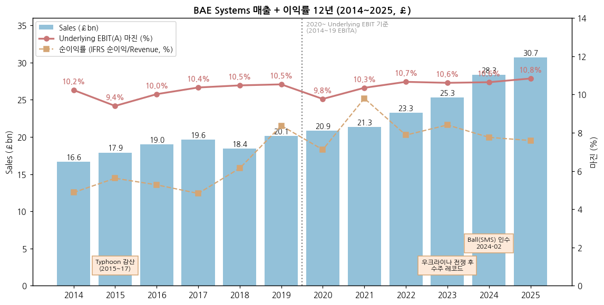

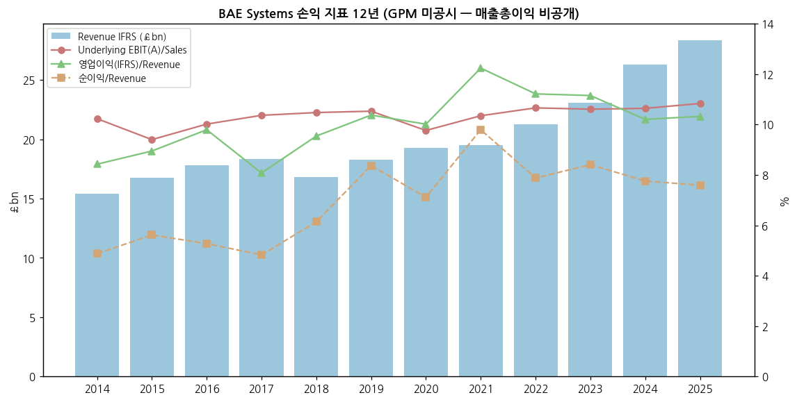

---

## ② 회사 개요

(1) 기본 정보

| 항목 | 내용 |
|---|---|
| 회사명 | BAE Systems plc (LSE: BA., FTSE 100) |
| 설립 | 1999-11-30 (British Aerospace + Marconi Electronic Systems 합병) |
| 본사 | London, UK (등기 6 Carlton Gardens) |
| 임직원 | **112,400명** (2026-06말, 지분법 포함) — 영국 48%·미국 32%·유럽 7%·사우디 6%·호주 6% (2025말) |
| 회장 / CEO / CFO | Cressida Hogg CBE / Dr Charles Woodburn CBE (2017-07~) / Brad Greve |
| 미국 법인 | BAE Systems, Inc. (CEO Tom Arseneault) — 미 국방부 SSA(Special Security Arrangement)로 영국 본사와 분리 운영 |
| 사업 한 줄 | 미·영·유럽·사우디·호주 정부에 전투기·잠수함·장갑차·자주포·전자전·우주·정보 시스템을 설계·생산·유지보수 |
| 특이 사항 | 영국 정부 Special Share(황금주) — 외국인 단일 지분 15% 상한 등 |

(2) 핵심 KPI 요약 (2025 실적 + H1 2026 + 2026 가이던스)

| 지표 | 2025 | H1 2026 | 2026 가이던스 (2026-11-12 기준) |
|---|---|---|---|
| Sales | £30,662m (+10% cc) | £15,772m (+9% cc) | +8~10% cc ($1.32 기준) |
| Underlying EBIT | £3,322m (+12% cc) | £1,701m (+11% cc) | +10~12% cc |
| 마진 (RoS) | 10.8% | 10.8% | — |
| Underlying EPS | 75.2p | 38.9p (+13%) | +11~13% |
| FCF | £2,158m | £1,791m | **약 £3.0bn (11/12 상향, 이전 >£2.0bn)** |
| 수주 / 잔고 | £36.8bn / £83.6bn | £16.4bn / £84.0bn | 연초 이후 £33bn (11/12) |
| 순차입금 (리스 제외) | £3,844m | £3,173m | — |
| DPS | 36.3p | 중간 15.0p | 2026 주주환원 약 £1.6bn (자사주 약 £0.5bn) |

→ (출처: AR2025, HY2026 Report 2026-07-30, Market update 2026-11-12)

(3) 주요 연혁

| 시기 | 사건 |
|---|---|
| 1999 | British Aerospace + Marconi Electronic Systems 합병 → BAE Systems |
| 2004 | Alvis 인수 → **Hägglunds(스웨덴, CV90)** 편입 |
| 2005 | United Defense 인수($4.2bn) → **Bradley·M109·Bofors(스웨덴)** 편입 — 미 지상장비 사업의 뿌리 |
| 2006 | Airbus 지분 20% 매각 → 민항기 이탈, 방산 전업화 |
| 2007 | Armor Holdings 인수 (FMTV 트럭·방호장비) |
| 2012 | EADS(현 Airbus)와 합병 추진 → 독일 정부 반대로 무산 |
| 2017 | Charles Woodburn CEO 취임 |
| 2019 | Rheinmetall BAE Systems Land JV (영국 전차·장갑차, BAE 45%) |
| 2020 | Collins Aerospace 군용 GPS($1.9bn)·Raytheon 전술무전기 인수 |
| 2021 | 영국 Type 26 · 호주 Hunter · 캐나다 River class 설계 공유 프로그램 진행 |
| 2022 | GCAP(영·이·일 6세대 전투기) 출범, 우크라이나 전쟁 후 수주 급증 |
| 2023 | SSN-AUKUS 설계, **Ball Aerospace 인수 발표 ($5.55bn)**, 체코 CV90 MkIV 246대 |
| 2024 | Ball 인수 완료(2월) → Space & Mission Systems, Kirintec(대드론 EW) 인수 |
| 2025 | 튀르키예 Typhoon 20대(£4.6bn), Edgewing(GCAP 3사 JV) 출범, 미 우주군 Epoch 2 미사일 경보 위성($1.2bn) |
| 2026 | 미 육군 자주포 경쟁(SPH-M)에서 Archer 탈락 — **한화 차륜형 K9 선정**(8월), CV90 5개국 공동구매 협상(6월 이행협정), 11월 FCF 가이던스 £3bn 상향, 2027-01 4개 세그먼트 개편 예고 |

(4) 회사 주가 역사 (narrative 영역)

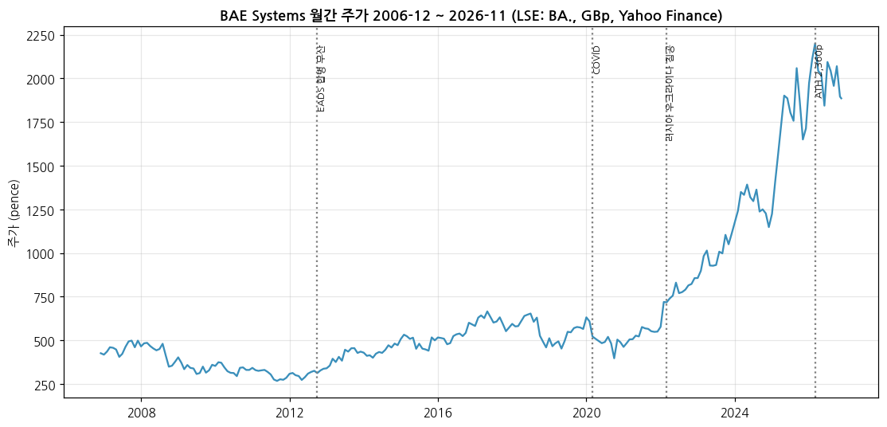

→ **2006~2013 장기 정체 (285~500p)**: 이라크·아프간 철수 후 미 국방예산 시퀘스터, 2012 EADS 합병 무산 — 연말 저점 2011년 285p
→ **2014~2021 박스권 (460~600p)**: 매출 정체·마진 10% 고정, 배당주로 취급 (연말 2021년 550p)
→ **2022-02 이후 재평가**: 우크라이나 전쟁 → 2022년말 856p(+56%), 2023년말 1,110p, 2024년말 1,148p, **2025년말 1,714p(+49%)** — 유럽 재무장·NATO 3.5% 목표
→ **2026**: 3월 ATH 2,360p(장중 월간 고가) → 11월 13일 1,886p (ATH 대비 -20%). 11월 초 미 중간선거 후 "미 국방비 증액 둔화" 우려로 방산주 일제히 하락(11/3 2,075p → 11/6 1,846p)
→ 2021년말 대비 **3.4배** [계산] — 같은 기간 EPS는 47.8p → 75.2p(1.6배) → **상승의 절반 이상이 멀티플 확장** (P/E 약 11배 → 25배) `[판단]`

---

## ③ 비즈니스 모델

(1) 실적 추이 통합 표 (5년, 사업부별 — Sales / Underlying EBIT, £m)

| 사업부 | 2021 | 2022 | 2023 | 2024 | 2025 | 2025 마진 |
|---|---|---|---|---|---|---|
| Electronic Systems | 4,491 / 766 | 5,057 / 838 | 5,458 / 878 | 7,189 / 1,071 | **7,528 / 1,162** | 15.4% |
| Platforms & Services | 3,395 / 259 | 3,688 / 326 | 3,922 / 354 | 4,390 / 448 | **5,039 / 576** | 11.4% |
| Air | 8,321 / 856 | 7,698 / 849 | 8,058 / 949 | 8,519 / 1,007 | **9,299 / 1,108** | 11.9% |
| Maritime | 3,416 / 288 | 4,598 / 356 | 5,536 / 425 | 6,187 / 474 | **6,797 / 457** | 6.7% |
| Cyber & Intelligence | 1,752 / 156 | 2,205 / 232 | 2,321 / 199 | 2,411 / 199 | **2,397 / 223** | 9.3% |
| HQ | 307 / (120) | 420 / (122) | 471 / (123) | 203 / (184) | 232 / (204) | — |
| 내부거래 | (372) | (410) | (482) | (564) | (630) | — |
| **합계** | **21,310 / 2,205** | **23,256 / 2,479** | **25,284 / 2,682** | **28,335 / 3,015** | **30,662 / 3,322** | **10.8%** |

→ (출처: 각 연도 AR segmental note. 2021은 호주 사업이 Air 소속(2022 Maritime 이관) — 2021→2022 Air 감소·Maritime 증가는 재분류 영향)

**사업부 내 라인 (2025 매출 비중, AR2025)**

| 사업부 | 구성 |
|---|---|
| ES | 전자전(Electronic Combat) 24% · 우주(SMS) 22% · C4ISR 15% · 정밀타격·센서(APKWS 등) 15% · 항공전자 12% · 대응책·전자공격 11% · 동력 1% / **방산 89 : 민수 11** |
| P&S | 미 CMS(Bradley·M109A7·AMPV) 48% · **Hägglunds(CV90) 17%** · 미 해군 수리 14% · 미 탄약공장(OSI) 11% · **Bofors(Archer) 6%** · 영국 무기 4% |
| Air | 사우디 30% · 유럽·국제(Typhoon) 24% · MBDA 20% · 미국 프로그램(F-35 등) 12% · FCAS(GCAP) 11% · FalconWorks 3% |
| Maritime | 잠수함 44% · 호주 19% · 방산 솔루션 18% · 수상함 17% · RBSL 2% |
| C&I | 미 정부 65% · 영국 등 정부 33% · 기타 2% |

(2) 사업부별 개요 (매출 비중 큰 순서)

→ **Air (29%)**: 영국 Warton·Samlesbury 전투기 공장 + 사우디 현지 지원. Typhoon 연간 생산 12~14대 → "20대 후반"으로 증산 예정(H1 26 컨콜). MBDA는 지분법이라 Sales엔 포함·Revenue엔 미포함(Sales와 Revenue 차이의 주원인)
→ **ES (24%)**: 미국 New Hampshire 본거지. F-35·F-15·F-16 전자전, 정밀유도 로켓 APKWS, 우주 SMS(구 Ball). 그룹 최고 마진
→ **Maritime (21%)**: Barrow(핵잠)·Glasgow(호위함)·호주 Osborne. 정부 규제 이익률(영국 SSRO) 영향으로 저마진·고확실성
→ **P&S (16%)**: 미국 York(PA) 장갑차·자주포, 스웨덴 Örnsköldsvik(Hägglunds)·Karlskoga(Bofors). **한국 지상방산과 정면 경쟁하는 사업부**
→ **C&I (8%)**: 미 정보기관 IT 서비스 + 영국 사이버. 2027년 해체·재배치 예정

(3) 사업부별 디테일 (top-seller·growth·outlier)

→ **Growth 1위 — 우주(SMS)**: H1 26 cc +29%, 미 우주군 미사일 경보·추적 위성(Epoch 2 $1.2bn), 기밀 국가 우주 프로그램
→ **Growth 2위 — 유럽 지상 (Hägglunds·Bofors)**: 2025 +32%, H1 26 약 +30%. Hägglunds 연 생산 약 300대(2026) → 400대 이상(2027) 계획, 5개국 CV90 딜 별도 (H1 26 컨콜)
→ **Growth 3위 — 미 탄약**: 미 국방부 증산 우선 12종 중 10종 공급(THAAD 탐색기 4배 증산 7년 프레임워크, APKWS) — 프레임워크 5건 체결·3건 협상 중
→ **Outlier (저마진)** — Maritime 6.1% (H1 26): Type 26·Hunter·Dreadnought 초도함 학습곡선. 회사는 H2 개선, 중기 7% 초과 목표

(4) 주요 경쟁사 (사업부별) — **한국 5사 겹침 표시**

| BAE 제품·시장 | 글로벌 경쟁사 | **한국 경쟁 (겹치는 제품·입찰)** |
|---|---|---|
| **M109A7 자주포 (미 육군)** | — (미 육군 독점 공급) | **한화에어로 K9**: 미 육군 차세대 자주포(SPH-M, M109A7·M777 대체) 경쟁에서 **2026-08 한화 차륜형 K9 시제 6대(최대 $233m) 선정, BAE Archer 탈락** (Breaking Defense) → M109 후속 시장 직접 위협 |
| **Archer 차륜 자주포 (Bofors)** | KNDS Caesar, Rheinmetall RCH155, Elbit Sigma | **한화 K9 (궤도·차륜)**: 북유럽 K9 채택국(노르웨이·핀란드·에스토니아)과 Archer 채택국(스웨덴·영국 임시) 양분. H1 26 Archer 스웨덴 추가 $200m+ |
| **CV90 보병전투차 (Hägglunds)** | Rheinmetall Lynx·Puma, GDELS ASCOD | **한화 레드백 / 현대로템·한화 K21**: 호주 LAND 400 Ph3는 레드백 선정. 북유럽·발트·체코·슬로바키아는 CV90 사실상 표준 — 2026-06 리투아니아·네덜란드·핀란드·노르웨이·스웨덴 등 6개국 CV90 MkIV 공동구매 이행협정(LRT). EU 역내 조달(SAFE) 블록화가 한국에 불리 |
| Bradley·AMPV (미 육군) | GD (Stryker), Oshkosh | 현대로템·한화 — 미 시장 직접 경쟁 제한적 |
| 전자전 (F-35 ASQ-239, EPAWSS) | L3Harris, Northrop, Elettronica | **한화시스템**(KF-21 AESA 레이더·전자광학) / **LIG D&A**(KF-21 전자전 장비) — 수출 전투기 패키지 단위 경쟁 |
| Typhoon·Hawk (Air) | Dassault Rafale, Saab Gripen, Lockheed F-16 | **KAI FA-50·KF-21** — 훈련기·경공격기·4.5세대 수출 시장 (폴란드·중동·동남아) |
| 해군 함정 (Type 26 계열) | Naval Group, Fincantieri, TKMS | HD현대중공업·한화오션 (5사 외) — 캐나다·호주 함정 시장 |
| 대공·대드론 (Bofors TRIDON, 40/57mm) | Rheinmetall Skynex, Kongsberg | **한화에어로 비호·LIG D&A 천궁** — 중동·유럽 단거리 방공 |

(5) 주요 매출처 (공개 정보 기반 — 매출 순위 아님)

→ 고객별 공시: **미국 정부 43% · 영국 MoD 27% · 사우디 정부 9%** 수준 (2025 지역 매출 기준 [추정])
→ 핵심 프로그램: Dreadnought(£5.9bn·£4.3bn 추가 펀딩, 2026) · Typhoon 사우디 지원(Salam) · 튀르키예 Typhoon 20대(£4.6bn, 2025-10) · F-35 · AMPV · M109A7 · GCAP · SSN-AUKUS · 체코·스웨덴 CV90

(6) 생산 CAPA + 임직원 추이

| 연도 | 2015 | 2017 | 2019 | 2021 | 2022 | 2023 | 2024 | 2025 | 2026-06 |
|---|---|---|---|---|---|---|---|---|---|
| 임직원 (명) | 82,500 | 83,200 | 87,800 | 90,500 | 93,100 | 99,800 | 107,400 | 111,400 | 112,400 |

→ (출처: 각 AR·HY2026, 지분법 포함)
→ CAPA 투자: Hägglunds 5년 $300m+ (2026 완료), 미 정밀유도탄 Texas·New Hampshire $135m, Endicott(NY) 확장, Barrow 조선소 Dreadnought·AUKUS, Glasgow 함정 조립동

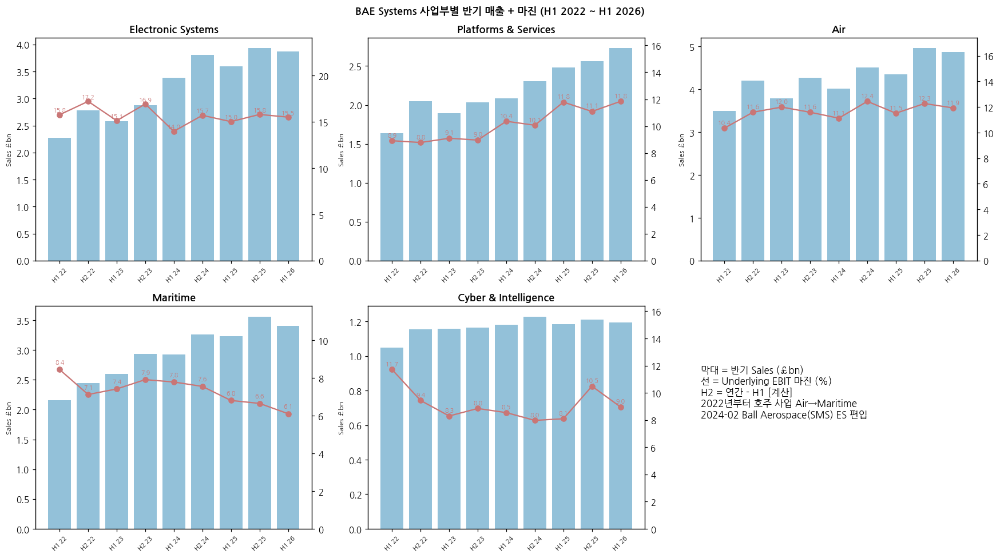

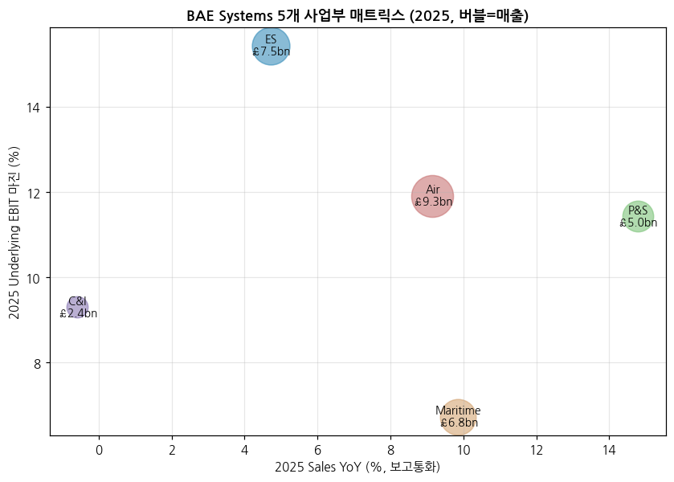

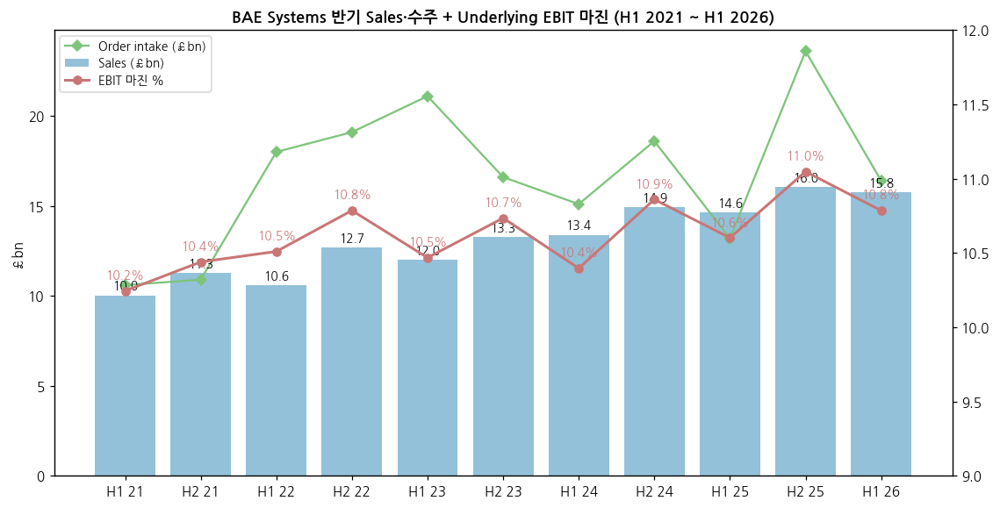

**반기 시계열 (H1 2021 ~ H1 2026, £m)**

| 반기 | Sales | Underlying EBIT | 마진 | Sales YoY | EBIT YoY | 수주 (£bn) | 잔고 (£bn) |
|---|---|---|---|---|---|---|---|
| H1 21 | 10,035 | 1,028 | 10.2% | — | — | 10.6 | 44.6 |
| H2 21 | 11,275 | 1,177 | 10.4% | — | — | 10.9 | 44.0 |
| H1 22 | 10,581 | 1,112 | 10.5% | +5.4% | +8.2% | 18.0 | 52.7 |
| H2 22 | 12,675 | 1,367 | 10.8% | +12.4% | +16.1% | 19.1 | 58.9 |
| H1 23 | 12,018 | 1,258 | 10.5% | +13.6% | +13.1% | 21.1 | 66.2 |
| H2 23 | 13,266 | 1,424 | 10.7% | +4.7% | +4.2% | 16.6 | 69.8 |
| H1 24 | 13,399 | 1,393 | 10.4% | +11.5% | +10.7% | 15.1 | 74.1 |
| H2 24 | 14,936 | 1,622 | 10.9% | +12.6% | +13.9% | 18.6 | 77.8 |
| H1 25 | 14,621 | 1,550 | 10.6% | +9.1% | +11.3% | 13.2 | 75.4 |
| H2 25 | 16,041 | 1,772 | 11.0% | +7.4% | +9.2% | 23.6 | 83.6 |
| **H1 26** | **15,772** | **1,701** | **10.8%** | **+7.9%** | **+9.7%** | **16.4** | **84.0** |

→ (출처: HY2022~2026 Report, H2 = 연간 - H1 [계산]. YoY는 보고통화 [계산] — 회사 발표 cc 기준은 H1 26 Sales +9%·EBIT +11%)

---

## ④ 재무 구조

(1) 손익계산서 (12년, £m)

| 연도 | Sales | Revenue (IFRS) | Underlying EBIT(A) | 영업이익 (IFRS) | 순이익 (IFRS) | Underlying EPS (p) | Basic EPS (p) |
|---|---|---|---|---|---|---|---|
| 2014 | 16,637 | 15,430 | 1,702 | 1,300 | 752 | 38.0 | 23.4 |
| 2015 | 17,904 | 16,787 | 1,683 | 1,502 | 943 | 40.2 | 29.0 |
| 2016 | 19,020 | 17,790 | 1,905 | 1,742 | 938 | 40.3 | 28.8 |
| 2017 | 19,626 | 18,322 | 2,034 | 1,480 | 884 | 43.5 | 26.8 |
| 2018 | 18,407 | 16,821 | 1,928 | 1,605 | 1,033 | 42.9 | 31.3 |
| 2019 | 20,109 | 18,305 | 2,117 | 1,899 | 1,532 | 45.8 | 46.4 |
| 2020 | 20,862 | 19,277 | 2,037 | 1,930 | 1,371 | 44.3 | 40.7 |
| 2021 | 21,310 | 19,521 | 2,205 | 2,389 | 1,912 | 47.8 | 55.2 |
| 2022 | 23,256 | 21,258 | 2,479 | 2,384 | 1,674 | 55.5 | 51.1 |
| 2023 | 25,284 | 23,078 | 2,682 | 2,573 | 1,940 | 63.2 | 61.3 |
| 2024 | 28,335 | 26,312 | 3,015 | 2,685 | 2,041 | 68.5 | 64.9 |
| 2025 | 30,662 | 28,336 | 3,322 | 2,925 | 2,151 | 75.2 | 68.8 |

→ (출처: 각 AR. Sales = Revenue + MBDA 등 지분법 매출 몫 - 지분법 대상 매출. 2014~19 EBITA / 2020~ EBIT. Underlying EPS 2019는 일회성 세금이익 제외 45.8p(포함 50.8p), 2022는 신기준 55.5p)
→ 매출총이익(GPM) 미공시 — 손익 4지표 차트는 EBIT·영업이익·순이익 마진으로 대체

(2) 재무상태표 (12년, £m) + chart4

| 연도 | 2014 | 2015 | 2016 | 2017 | 2018 | 2019 | 2020 | 2021 | 2022 | 2023 | 2024 | 2025 |
|---|---|---|---|---|---|---|---|---|---|---|---|---|
| 자산총계 | 19,788 | 20,083 | 22,976 | 22,453 | 24,746 | 25,630 | 27,530 | 27,135 | 31,462 | 32,064 | 38,142 | 37,679 |
| 부채총계 | 17,911 | 17,081 | 19,512 | 17,669 | 19,128 | 20,119 | 22,609 | 19,467 | 20,062 | 21,341 | 26,365 | 25,742 |
| 자본총계 | 1,877 | 3,002 | 3,464 | 4,784 | 5,618 | 5,511 | 4,921 | 7,668 | 11,400 | 10,723 | 11,777 | 11,937 |
| 순차입금 | (1,032) | (1,422) | (1,542) | (752) | (904) | (743) | (2,718) | (2,160) | (2,023) | (1,022) | (4,945) | (3,844) |

→ (출처: 각 AR 연결 재무상태표. 순차입금 2014~2019 회사 정의(고객 예치금 포함), 2020~ 리스 부채 제외)
→ 2014~2020 자본이 작았던 건 **연금 적자**(2020말 그룹 몫 -£4.5bn) 때문 → 2021~22 금리 상승으로 연금 흑자 전환하며 자본 2배 이상 증가. 2024 순차입금 급증은 Ball 인수($5.55bn)

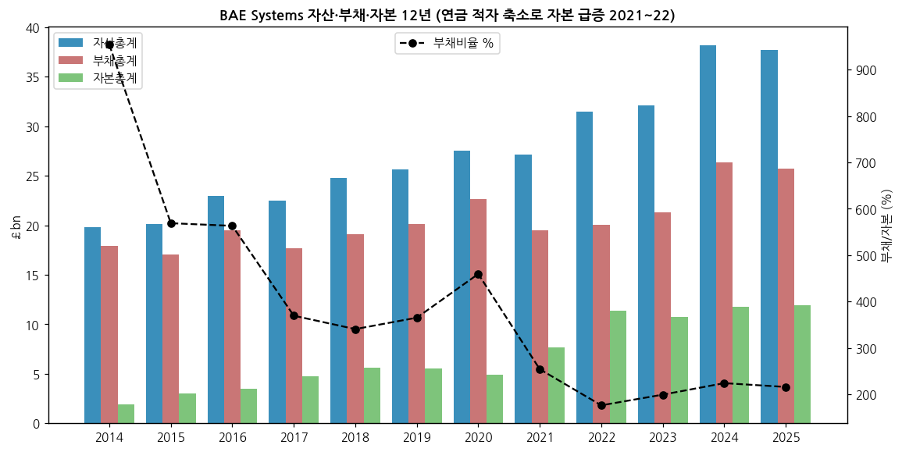

(3) 현금흐름표 (12년, £m) + chart6

| 연도 | 영업CF | 투자CF | 재무CF | 회사 FCF* | CapEx (유형+무형) |
|---|---|---|---|---|---|
| 2014 | 669 | 55 | (638) | 1,191 | 322 |
| 2015 | 628 | (220) | (189) | 681 | 413 |
| 2016 | 1,229 | (396) | (675) | 1,004 | 490 |
| 2017 | 1,897 | (360) | (995) | 1,752 | 476 |
| 2018 | 1,200 | (358) | (915) | 993 | 497 |
| 2019 | 1,597 | (232) | (1,962) | 1,307 | 470 |
| 2020 | 1,166 | (2,037) | 973 | 367 | 477 |
| 2021 | 2,447 | 66 | (2,256) | 1,864 | 462 |
| 2022 | 2,839 | (422) | (2,333) | 1,950 | 693 |
| 2023 | 3,760 | (541) | (2,188) | 2,593 | 957 |
| 2024 | 3,925 | (5,269) | 695 | 2,505 | 1,163 |
| 2025 | 3,432 | (541) | (2,774) | 2,158 | 1,103 |

→ *2014~2019 = Operating business cash flow, 2020~ = Free cash flow (회사 KPI 교체). 2020 FCF는 영국 연금 £1bn 일시 출연 포함
→ 2026 H1 FCF £1,791m (선수금 £1.6bn 순유입, 대부분 Air) / 2026 연간 약 £3.0bn 가이던스

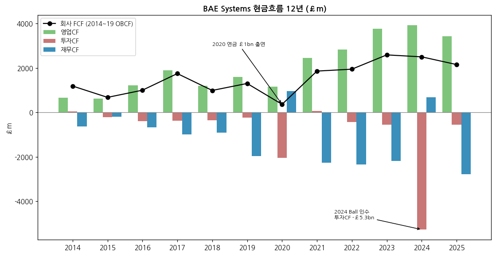

(4) CapEx + chart8

→ CapEx/Sales: 2014~2021 약 2.0~2.6% → 2023~2025 **3.6~4.1%** [계산] — Dreadnought·AUKUS 조선소, 탄약 증산, Hägglunds 공장
→ H1 26 컨콜: 미국 CapEx 2026년 약 +40% (대부분 탄약)

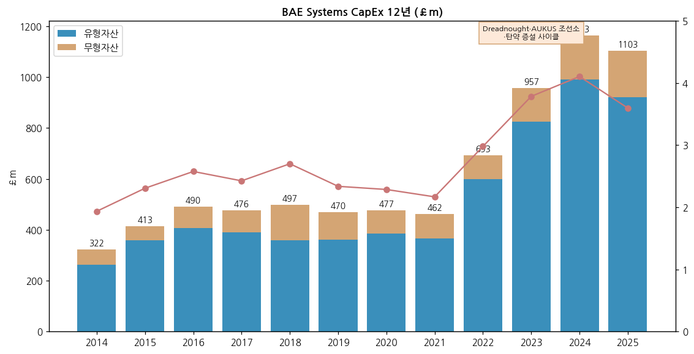

(5) 부채 구조

→ 2025말 차입금 £7,285m (비유동 £7,190m + 유동 £95m), 현금 £3,438m → 순차입금 £3,844m (리스 제외). 2026-06말 순차입금 £3,173m, 현금 £4,200m
→ 2024 Ball 인수 자금으로 USD·GBP 채권 발행 → 2025 $750m 3.85% 채권 상환
→ 신용등급: 투자등급 (구체 등급은 이번 수집 범위에서 미검증 ⚠️)

(6) 배당·자사주 + chart9

| 연도 | 2014 | 2015 | 2016 | 2017 | 2018 | 2019 | 2020 | 2021 | 2022 | 2023 | 2024 | 2025 |
|---|---|---|---|---|---|---|---|---|---|---|---|---|
| DPS (p) | 20.5 | 20.9 | 21.3 | 21.8 | 22.2 | 23.2 | 23.7 | 25.1 | 27.0 | 30.0 | 33.0 | 36.3 |
| 배당 지급 (£m) | 642 | 655 | 670 | 684 | 703 | 724 | 746 | 777 | 802 | 857 | 937 | 1,027 |
| 자사주 (£m) | 281 | 0 | 0 | 0 | 0 | 0 | 0 | 368 | 788 | 561 | 555 | 502 |

→ 정책: 배당 커버 약 2배 진행형 배당 + 잉여현금 자사주. 2022 이후 3년 £1.5bn 프로그램 반복, H1 26 컨콜 "발행주식의 약 10%를 소각" — 2026 주주환원 약 £1.6bn 예상

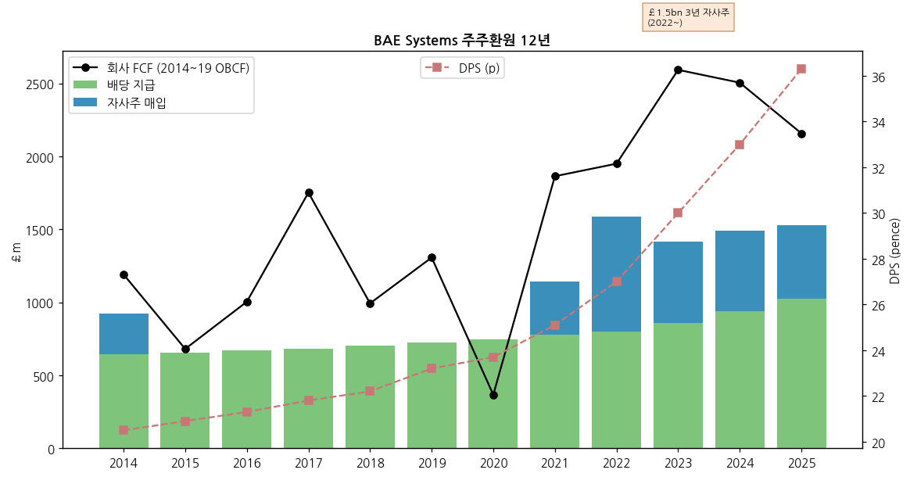

(7) 재무비율 (12년, [계산])

| 연도 | 2014 | 2016 | 2018 | 2020 | 2021 | 2022 | 2023 | 2024 | 2025 |
|---|---|---|---|---|---|---|---|---|---|
| EBIT(A) 마진 | 10.2% | 10.0% | 10.5% | 9.8% | 10.3% | 10.7% | 10.6% | 10.6% | 10.8% |
| ROE (순이익/평균자본) | — | 29.0% | 19.9% | 26.3% | 30.4% | 17.6% | 17.5% | 18.1% | 18.1% |
| 부채/자본 | 954% | 563% | 340% | 459% | 254% | 176% | 199% | 224% | 216% |
| 순차입금/EBIT | 0.6x | 0.8x | 0.5x | 1.3x | 1.0x | 0.8x | 0.4x | 1.6x | 1.2x |

→ ROE·부채비율이 2021년 이전 극단값인 건 연금 적자로 자본이 작았기 때문 — 의미 있는 비교는 2022년 이후

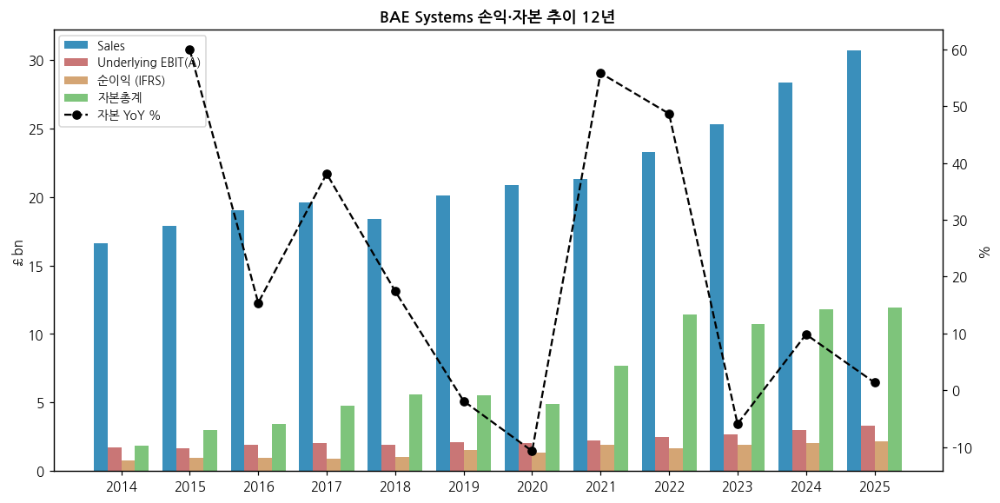

---

## ⑤ 지배 구조

(1) 그룹·계열 관계

→ 지배주주 없음 (분산 소유). 영국 정부 **Special Share** — 외국인 지분 상한(15%)·이사회 국적 요건 등에 거부권
→ 주요 JV·지분법: **MBDA 37.5%** (Airbus 37.5%·Leonardo 25%), **Eurofighter GmbH 33%**, **Edgewing 33.3%** (GCAP, Leonardo·JAIEC), Rheinmetall BAE Systems Land 45%, Air Astana 잔여 7%(2025 일부 매각)
→ 미국 BAE Systems, Inc.: SSA로 운영 — 미국 이사회·보안 분리

(2) 주주 구분 + chart5

| 주주 | 지분 | 공시일 |
|---|---|---|
| The Capital Group Companies | 11.04% | 2026-01-23 |
| BlackRock, Inc. | 9.90% | 2021-06-29 |
| FMR LLC | 4.96% | 2024-12-23 |
| Washington Investment Management | 3.98% | 2025-11-14 |

→ (출처: AR2025 Directors' report — DTR 5 통지 기준이라 현재 지분과 다를 수 있음 ⚠️)

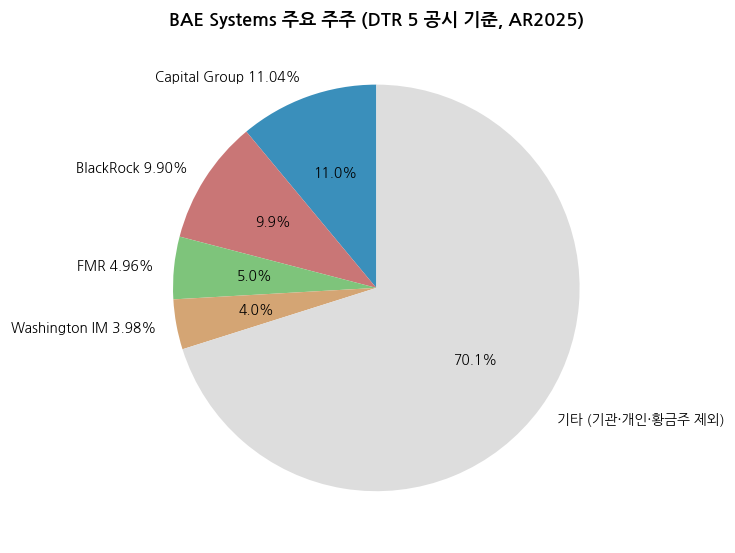

(3) 경영진

→ **Dr Charles Woodburn CBE** (CEO, 2017-07~): 2016 COO 입사, 전 Expro International CEO
→ **Brad Greve** (CFO): 미국 출신, 이전 BAE Systems, Inc. CFO
→ **Tom Arseneault** (BAE Systems, Inc. President & CEO, 이사회 멤버)
→ **Cressida Hogg CBE** (Chair)

---

## ⑥ 기타 팩트

(1) 시가총액·밸류에이션 스냅샷 (2026-11-13 종가 기준, [계산])

| 항목 | 값 |
|---|---|
| 주가 | 1,886p |
| 시가총액 | 약 £56.5bn |
| P/E (2025 Underlying EPS 75.2p) | 25.1배 |
| P/E (2026E 84.2p, 가이던스 중간값) | 22.4배 |
| 배당수익률 (DPS 36.3p) | 1.9% |
| 2026 FCF yield (약 £3.0bn) | 약 5.3% (선수금 포함) |
| 52주 범위 | 1,529p ~ 2,360p |

(2) R&D 인프라 + chart7

→ 자체 펀딩 R&D: 2016 £206m → 2021 £251m → 2024 £365m → **2025 £407m** (Sales 대비 1.3%) — 총 R&D £3,165m 중 고객 펀딩 £2,758m (87%)
→ 혁신 조직: FalconWorks(Air, 중기 £1bn+ 매출 목표), FAST Labs(미국), Launchpad(2026 스타트업 인큐베이터), 유럽 방산 VC 펀드 €50m 출자

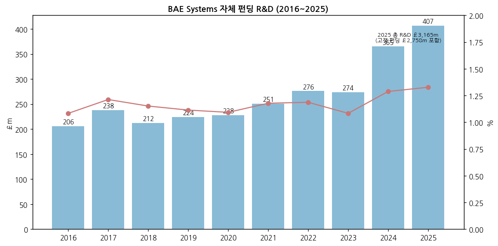

(3) 진행 중 corporate action

→ 2027-01 세그먼트 5개 → 4개 (C&I 해체·분산)
→ CV90 MkIV 6개국 공동구매 프레임워크 (2026 말 국가별 계약 목표, LRT)
→ 미 탄약 다년 프레임워크 (THAAD 탐색기 7년, 5건 체결·3건 협상)
→ 2026 자사주 약 £0.5bn, M&A는 "판매자 시장"이라 신중 (H1 26 컨콜)

(4) 주요 리스크

→ **미국 예산**: 매출 43%가 미국 — 연속예산(CR)·의회 구성 변화. 2026-11 초 "미 국방비 증액 둔화" 우려로 방산주 급락
→ **Maritime 실행**: Type 26·Hunter·Dreadnought 초도함 원가, AUKUS 정치 리스크
→ **한국·유럽 경쟁**: 미 육군 자주포 경쟁 패배(한화 K9), 유럽 IFV·자주포 입찰에서 한화·Rheinmetall·KNDS와 경쟁
→ **환율**: $5센트 변동 → 매출 약 £500m·EBIT 약 £70m (회사 가이던스)
→ **수출 통제·윤리**: 사우디 매출 9% — 영국 수출허가·정치 리스크
→ **연금**: 현재 IAS 19 흑자지만 금리 하락 시 재적자 가능

(5) ESG

→ 방산 업종 특성상 일부 ESG 펀드 배제 대상. 2025 AR 기후·인권 공시 — 상세 등급 미수집 ⚠️

(6) 인증·라이선스

→ 미 국방부 SSA·FOCI 관리, 영국 핵잠 원자력 규제(ONR) 대상 사업장(Barrow), ITAR·영국 수출통제 라이선스

---

## Activity 보고 (v1.0 finalize)

### ✅ 확보 자료
- AR 8개 (2015~2025 격년 + 2022·2024), HY Report 5개, Market update 2026-11-12, Yahoo BA.L 월간·일간

### ❌ 누락 자료 (4)
- 회사 IR PDF 직접 다운로드(403), AR 2016·2018·2020 단독본, 분기 손익(미공시), 일부 연도 R&D·임직원

### ⚠️ 추정·계산 데이터 표시
- 시가총액·P/E·FCF yield·CAGR·ROE·H2 반기 수치 = [계산]
- 고객별 매출 비중·한국 경쟁 구도 해석 = [추정]/[판단]
- 신용등급·ESG 등급 = 미검증

### 🔗 핵심 source
- Investegate RNS: 반기보고서 2022(7181805)·2023(7669964)·2024(8342413)·2025(9011324)·2026(9694659), Trading statement 2026-11-12(9871216)
- annualreports.com: LSE_BA_2015~2025
- Breaking Defense 2026-08 (미 육군 SPH-M 한화 K9 선정), LRT 2026-06-18 (CV90 공동구매)

### Data Quality Confidence: **90%**

---

## Version Log

| 버전 | 일자 | 내용 |
|---|---|---|
| v1.0 | 2026-11-14 | 최초 작성 — 12년 연간·11개 반기·5개 사업부 반기 시계열, 12종 차트(+chart3), 한국 5사 겹침 매핑 |

→ 잔여 보완 후보: 2026 연간 실적(2027-02-19) 반영 v1.1, 2027 4개 세그먼트 재표시 연결, 신용등급·ESG 검증
