# BGF리테일 — 기업 개요 (v1.0)

> 마지막 update: 2026-11-25 (v1.0 — 첫 작성. 3Q26 분기보고서(2026-11-16 제출)·IR 3Q26(2026-11-11)까지 반영)
> 입력 source: OpenDART fnlttSinglAcntAll (연결 CFS 36개 JSON: 신설법인 2017 사업보고서(11\~12월)\~3Q26 / 별도 OFS 36개 / **분할 전 구 BGF리테일(현 BGF, 027410) 연결 44개 JSON: 2015\~2Q17 — 2014는 2015 사업보고서 전기 컬럼**) + DART 정기공시 원문 XML 52건 다운로드·본문 14건 파싱 (사업보고서 2017\~2025, 2023은 기재정정본 / 분기·반기 1Q18·3Q25·1Q26·2Q26(정정)·3Q26) + OpenDART 기업개황·최대주주·임원·직원·배당·자기주식·주식총수 (2025 사업보고서) + BGF리테일 IR 실적발표 PDF 31건 수집·23건 텍스트 추출 (4Q19\~3Q26, irgo 경유. 2021-08·2021-11 3건 다운로드 실패, 1Q24·1Q25 실적 PDF 미게시) + BGF 그룹 지속가능경영보고서 2025-2026 (bgf.co.kr) + Yahoo Finance (282330.KS 일간 2017-12-11\~2026-11-25) + 언론·리포트 (이투데이 시세, 바이라인네트워크 2026-11-05, 미래에셋증권 2026-10-30, 시사경제 2025-11-20, 스마트투데이 2026-05-12)
> 갱신 주기: 매분기 (실적 리뷰 모드 호출 시)
> 워치리스트: **여행·레저·유통 섹터 / 서브섹터: 유통** (`earnings/watchlist.md` 102·103행, 2순위 섹터 — 4Q26부터 리뷰, 2026-11-23 추가)
> **Fact verify cutoff**: 2026-11-25 (주가 **2026-11-24 종가 133,400원** [Yahoo Finance 282330.KS, 이투데이 시세 "전일 종가 133,400원" 동일], 발행주식 17,283,906주 [DART 분기보고서(2026.09), 자기주식 8,891주 포함] → 시가총액 **2.31조원** [계산]. **2017-12 재상장 이후 최고가: 2017-12-11 종가 248,500원** (재상장 직후, DART 분기보고서(2018.03) 2017년 12월 최고가 248,500원과 일치) → 당시 시총 **4.30조원** [계산]. 고점 대비 **-46.3%**, YTD **+27.3%** (2025-12-30 종가 104,800원), 1년 **+21.1%** (2025-11-24 종가 110,200원). 52주 종가 최고 153,100원 (2026-08-07) / 최저 102,000원 (2026-01-07) [Yahoo, 미래에셋 2026-10-30 52주 범위 동일]. 2026-11-25 장중 142,400원(+6.75%, 이투데이)은 cutoff 이후라 미반영. ※ 분할 전 구 BGF리테일(027410, 2014-05 상장) 시세는 분할 비율·주식수가 달라 "사상 최고가"로 채택하지 않음)

---

## 1. 기업 분류

- **Primary 분류: 지속성장 — 가맹 플랫폼형 생활밀착 유통 (저마진·고ROE, 경기 방어형)** — 매출은 비교 가능한 11개 연도 모두 증가(2014→2025 CAGR **+9.4%**, 2018→2025 신설법인 기준 +6.6%), OPM은 **2.6\~4.3%의 좁은 박스**. 성장 엔진은 경기보다 **점포수(8,408 → 18,711점)와 점당 매출**이고, 이익 변동은 담배 세금·최저임금·코로나 특수입지 같은 **제도·외부 충격**에서 나온다
- **Secondary 노트: 점포 성숙기 진입 → "양에서 질" 전환 + 인바운드(외국인) 옵션** — 연간 순증이 2020 +1,046점 → 2025 **+253점**으로 둔화된 반면, 점당 매출 [계산]은 2020 4.28억 → 2025 4.77억으로 회복. 3Q26 외국인 매출 +66.8% YoY, 전체 매출의 2.5% [IR 3Q26]. 아직 연결 이익 성격을 바꿀 규모는 아님

### ① 정량 근거

**📊 Summary Box (12년, 2014\~2025 연결 — 2017 분할 연도 제외 11개 연도):**

| 지표 | 값 |
|------|-----|
| 매출 CAGR (2014→2025, 11년) | **+9.4%** (3.37조 → 9.06조) — 2015 담뱃값 인상(+28.7%) 포함. 신설법인 기준 2018→2025 **+6.6%** |
| OPM 평균 | **3.3%** (range 2.6\~4.3%, 폭 1.7%p) |
| OPM 정점 평균 | **4.3%** (2015 4.2% · 2016 4.3%) — 담뱃값 인상 직후 + 출점 고성장기. 신설법인 이후 정점은 2018·2019·2022 3.3% |
| OPM 저점 평균 | **2.7%** (2020 2.6% · 2025 2.8%) — 2020 코로나 특수입지 부진, 2025 1H 동일점 역성장(-2.1%) |
| 사이클 주기 | **N/A — 경기 사이클 약함** (사업보고서: "경기변동 및 소비심리의 변화에 덜 민감한 업태" [DART 사업보고서(2025.12) II]). 대신 **분기 계절성**이 뚜렷: 1Q OPM 1.1\~2.2% / 3Q 3.6\~4.5% |
| 사이클 회수 (12년) | **N/A** (OPM 고점 2회·저점 2회는 제도·외부 충격 주기) |

```
[전사 OPM 시계열 (12년, 연결, DART) — 2014~2016 구 BGF리테일(027410), 2018~ 신설 BGF리테일(282330)]
연도   매출(조)  영업이익(억)  순이익(억)  OPM    NPM   점포수   비고
2014    3.37       1,241       1,015     3.7    3.0    8,408  ← 구 BGF리테일 상장 첫 해(2014-05), CU 8,408점
2015    4.33       1,836       1,528     4.2    3.5    9,409  ← 담뱃값 인상(2015-01) → 매출 +28.7%, OPM 4.2%
2016    5.05       2,172       1,846     4.3    3.7   10,857  ← 점포 +1,448점 출점 경쟁 정점, OPM 4.3% (12년 최고)
2017     -          -           -        -      -    12,503  ← 분할 연도(11-01 인적분할, 12-08 재상장) — 연간 손익 미확보
2018    5.78       1,895       1,542     3.3    2.7   13,169  ← 신설법인 첫 풀이어, 최저임금 +16.4% → 가맹점 지원금
2019    5.95       1,966       1,514     3.3    2.5   13,877  ← IFRS16 도입(리스), 점포 순증 둔화
2020    6.18       1,622       1,227     2.6    2.0   14,923  ← 코로나 — 특수입지(학교·관광지) 부진, OPM 2.6% 저점
2021    6.78       1,994       1,476     2.9    2.2   15,855  ← 회복 국면, 점포 +932
2022    7.62       2,524       1,935     3.3    2.5   16,787  ← 리오프닝 + 점포 +932, OP 2,500억대 진입
2023    8.19       2,532       1,958     3.1    2.4   17,762  ← 매출 8조 돌파, OP 정체 시작
2024    8.70       2,516       1,952     2.9    2.2   18,458  ← BGF네트웍스 편입(7월), 판관비율 15.8%
2025    9.06       2,539       1,953     2.8    2.2   18,711  ← 동일점 역성장(1H) → 하반기 소비쿠폰, OP 2,539억 최대

OPM range: 2.6% ~ 4.3% = 1.7%p  (11개 연도, 2017 제외 — 매출은 매년 증가, OPM은 2~4% 박스)
```

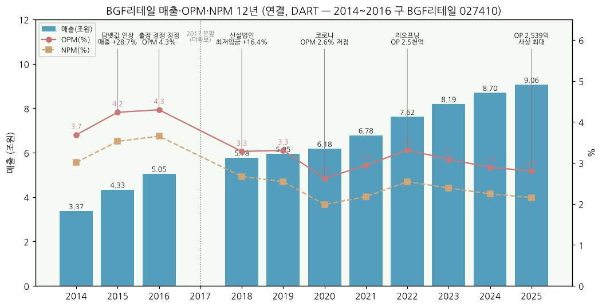

(**2017 이전 시계열 처리**: 신설 BGF리테일(282330)은 2017-11-01 구 BGF리테일(현 ㈜BGF, 027410)에서 편의점 사업부문이 인적분할되어 설립됐다(순자산 35% 승계) [DART 사업보고서(2017.12) I·III]. 따라서 ① **2014\~2016 = 분할 전 구 BGF리테일 연결 재무제표**(편의점 사업이 사실상 전부, 2014는 2015 사업보고서 전기 컬럼) ② **2017 = 연간 손익 미확보** — 신설법인 재무제표는 11\~12월 2개월(매출 9,387억, 영업이익 265억)뿐이고, 구법인 2017 연결은 편의점 부문을 중단영업으로 재분류해 1\~10월 편의점 손익이 별도 표시되지 않음(1H17까지만 분기 공시: 매출 26,286억, 영업이익 1,137억). 7\~10월 4개월이 빠져 2017은 12년 평균·차트에서 제외 ③ **2018\~ = 신설법인 연결**. 2015 이전 OPM은 IFRS16(2019) 이전 기준이라 리스 회계가 다름 — 연도 간 비교 시 주의)

### ② 산업 분류

- 산업: **편의점 체인화사업(CVS 가맹본부)** — 가맹점이 상품을 팔아 남긴 매출총이익을 본부·가맹점이 일정 비율로 나누는 구조 (타 프랜차이즈의 로열티 방식과 다름) [DART 사업보고서(2025.12) II-7]
- DART 업종: 47122 체인화 편의점 [OpenDART 기업개황]. 영업부문은 **단일 부문** [DART 사업보고서(2025.12) 연결 주석 40]
- 워치리스트 섹터: **여행·레저·유통** / 서브섹터: **유통**
- 시장 지위: CU 국내 점포 **18,711점 (2025말)**, 점포수 점유율 35% (편의점 4사 53,266점 대비, 산업통상부 기준) [DART 사업보고서(2025.12)]. 2Q26말 18,807점 [미래에셋증권 2026-10-30]. 국내 점포수 1위 (GS25와 양강)

### ③ 분류 결정 논리

(1) **가장 매출 큰 사업부 기준** 적용 시: 편의점(BGF리테일 별도) 8.86조 = 법인별 매출 합계(내부거래 제거 전 9.66조)의 **91.7%** [DART 사업보고서(2025.12) II-1, 계산]. 매출 구성은 담배 37.0%·가공식품 44.1%·식품 13.7%·비식품 5.2% — 생활필수 소량구매 → 수요는 경기에 둔감, 성장은 **점포수 × 점당 매출** 함수 → **지속성장**
(2) **이익 비중 sub-rule**: 연결 영업이익 2,539억 중 별도(편의점) 2,220억 = **87.4%**, 연결−별도 차이(종속회사 + 연결조정) 319억 = 12.6% (2025) [OpenDART 연결·별도 분기 합, 계산]. 편의점 부문 OPM 2.5% (2025 별도) — 연결 성격 = 편의점 성격 → **지속성장 유지**
(3) **Boundary case 처리 — 점포 포화와 "질적 성장"**: 국내 편의점 4사 점포수는 2025년 처음 감소(-2.9%, 53,266점) [DART 사업보고서(2025.12), 산업통상부]. CU 순증도 +253점으로 둔화. 이 구간에서 성장의 축이 **출점(양) → 동일점·점당 매출(질)** 로 이동 — 2Q26 동일점 +4.2%, 3Q26 +0.9%, 신규점 일매출이 기존점 대비 98.3% [IR 2Q26·3Q26]. 점포가 줄기 시작하고 점당 매출도 꺾이면(⑤ 트리거) Primary를 "성숙·배당형"으로 바꿀 검토 대상
(4) **국내 유통 피어 cross-ref**:
→ **GS리테일(GS25)**: 같은 편의점 양강이지만 슈퍼·홈쇼핑 등이 섞인 복합 유통 — 순수 편의점 플레이는 BGF리테일 쪽. 비교 수치는 ④-1 공통 비교 박스 및 같은 서브섹터 각 종목 기업개요 참조
→ **이마트·롯데쇼핑 등 대형 유통**: 할인점은 기존점 역성장·온라인 잠식 국면인 반면 편의점은 근거리 소량구매로 매출 성장이 이어짐 (사업보고서 "오프라인 업태 중 편의점만이 꾸준한 성장세") — 업태 차이가 분류 차이
→ 글로벌: 일본 세븐&아이·로손·패밀리마트도 "가맹 플랫폼 + 점포 포화 후 점당 매출·PB 경쟁" 경로 — BGF리테일은 일본 대비 10\~15년 늦은 성숙 단계 (정성 비교, 수치 미수집)

### ④ 적정 밸류에이션 방법

- **PER + 배당수익률 우선, PBR-ROE 보조**
→ 이익 변동성이 작고(OPM 2.6\~4.3%) 순현금 구조라 **PER이 가장 직관적**. 현재 **PER 11.0배** [계산: 시총 2.31조 / LTM 지배순이익 2,100억(4Q25 498 + 1Q26 293 + 2Q26 568 + 3Q26 741억)]. 신설법인 연말 PER 밴드 **9.1배(2024) \~ 22.9배(2018)**
→ **배당수익률 3.1%** [계산: 2025 DPS 4,100원 / 133,400원]. 연결 배당성향 30\~36% 유지(2018\~2025), DPS는 2022부터 4,100원 4년 동결 [DART 배당에 관한 사항]
- **PBR 밴드 (연말 종가 × 발행주식 / 지배자본 [계산])**: 고점 **6.76배 (2018)** → 저점 **1.38배 (2025)** → 현재 **1.65배** (2.31조 / 3Q26 지배자본 1.40조). ROE 15.6\~33.9% (2018\~2025)로 높지만 하락 추세 — PBR 디레이팅은 ROE 하락 + 성장 둔화가 동시에 반영된 결과
- **EV 참고**: 순현금 **4,677억** [계산: 현금 3,824 + 단기금융상품 230 + FVPL 991 − 장기차입금 368억, 리스부채 8,171억 제외, 3Q26] → EV(리스 제외) 약 1.84조 = LTM 영업이익의 **6.4배** [계산]. 리스부채를 부채로 넣으면 EV 2.66조
- **피어 차별화**: 편의점은 가맹점 투자 구조라 본부 CapEx/매출이 2\~3%로 낮고 FCF가 꾸준 → **FCF−리스상환 수익률**(2025 1,883억 / 시총 = 8.2% [계산])이 할인율 판단의 핵심. 자사주 매입·소각 이력이 없다는 점은 주주환원 측면 약점

#### ④-1 유통 공통 비교 박스 (통일 기준, 2026-11-28 통합 검수)

> 다섯 문서(이마트·BGF리테일·GS리테일·롯데쇼핑·현대백화점)에 **같은 표**를 넣었다. 본문 ④의 회사별 수치는 각 사 고유 정의라 이 표와 소수점 차이가 날 수 있음 — **5사 비교는 이 표 기준**.

| 지표 (2026-11-24 종가, 3Q26 말 기준) | 이마트 | BGF리테일 | GS리테일 | 롯데쇼핑 | 현대백화점 |
|---|---|---|---|---|---|
| 시가총액 (조원) / 종가 (원) | 1.74 / 62,900 | 2.31 / 133,400 | 1.72 / 20,550 | 2.20 / 77,900 | 1.97 / 91,400 |
| LTM 매출 (조원, 4Q25\~3Q26) | 28.84 | 9.35 | 12.37 | 14.24 | 4.23 |
| LTM 영업이익 (억원) / OPM | 1,715 / 0.6% | 2,881 / 3.1% | 3,531 / 2.9% | 7,461 / 5.2% | 3,786 / 8.9% |
| 3Q26 영업이익 YoY | -69.6% | +3.3% | +18.9% | +34.5% | +30.1% |
| 2025 매출 (조원) / OPM | 28.97 / 1.1% | 9.06 / 2.8% | 11.96 / 2.4% | 13.74 / 4.0% | 4.23 / 8.9% |
| 12년 OPM 평균 (범위) | 1.9% (-0.2\~4.4%) | 3.3% (2.6\~4.3%) | 2.6% (2.0\~3.6%) | 3.0% (1.3\~4.2%) | 13.6% (6.0\~23.4%) |
| **PER** (시총 / LTM 지배순이익) | **N/M** (LTM 적자) | **11.0배** | **19.6배** | **6.0배** | **8.3배** |
| **PBR** (시총 / 3Q26 지배자본) | **0.15배** | **1.65배** | **0.51배** | **0.15배** | **0.42배** |
| **배당수익률** (2025 DPS / 종가) | **4.0%** (2,500원) | **3.1%** (4,100원) | **2.9%** (600원) | **5.1%** (4,000원) | **2.4%** (2,150원) |
| 순차입금 (조원, 리스 제외 · 음수 = 순현금) | 7.58 | -0.47 | 0.21 | 8.38 | 2.18 |
| 부채비율 (3Q26) | 156% | 166% | 120% | 124% | 84% |
| ROE (2025, 지배) | 1.2% | 15.6% | 1.3% | 0.3% | 4.6% |
| 상장 후 고점 대비 | -81.0% | -46.3% | -61.5% | -85.4% | -55.8% |
| Primary 분류 | 턴어라운드 | 지속성장 | 지속성장(저성장) | 사이클(턴어라운드) | 사이클 |

(출처·정의는 위 5사 박스와 같음. **순차입금 정의 차이**: 리스부채는 5사 모두 제외 — BGF리테일은 현금+단기금융+FVPL 차감(순현금), 이마트·GS리테일·롯데쇼핑은 단기금융상품 제외(보수적), 현대백화점은 현금성자산만 차감(FVPL 1.73조 차감 시 0.45조). **연결범위 변경이 큰 종목**: 이마트(2025-11 G마켓 연결 제외→지분법, 2025-02 신세계건설 완전자회사), GS리테일(2024-12 호텔·후레쉬미트 인적분할, 중단영업 3년 연속 재분류), 롯데쇼핑(2017 지주 분할 — 12년 CAGR 비교 불가, 2024-12 토지 재평가로 PBR 단절), 현대백화점(2022 지누스 연결로 OPM 레벨 다운), BGF리테일(2017-11 분할 신설 — 2017 연간 미확보, 11개 연도 평균). 이마트 PER은 LTM 지배순이익 적자(-2,458억)로 산정 불가, 롯데쇼핑 PER에는 3Q26 주식처분이익 726억 포함, 롯데쇼핑·GS리테일 배당성향은 순이익 급감으로 100% 초과. 고점 대비: GS리테일은 2024-12 분할 수정계수(0.7984) 적용 추정, 롯데쇼핑은 2011-06 명목 최고가 기준(분할 후 최고 2018-04 264,000원 대비 -70.5%), 현대백화점 고점은 2026-06-17.)

→ **읽는 법**: ① **편의점 2강(BGF리테일·GS리테일)** = OPM 2\~3%대 좁은 밴드의 지속성장형 — BGF리테일은 순현금·ROE 15.6%로 PBR 1.65배 프리미엄, GS리테일은 멀티채널(수퍼·홈쇼핑) 구조조정 중이라 PBR 0.51배·ROE 1.3%. ② **백화점 중심(현대백화점·롯데쇼핑)** = 3Q26 OP +30%·+35%로 이익 개선이 가장 뚜렷, 둘 다 부동산 자산 대비 PBR 0.15\~0.42배의 자산가치 구간. 롯데쇼핑은 이익의 80\~90%가 백화점 집중·순차입금 8.4조가 부담. ③ **이마트** = 별도(할인점·트레이더스)는 3Q26 OP +46%로 회복했지만 스타벅스·G마켓 등 자회사 손실로 연결 OP -70%·LTM 적자 — PBR 0.15배로 5사 중 최저(롯데쇼핑과 공동).

### ⑤ 분기 재평가 트리거 (분류 변경 조건)

- **CU 연간 순증이 2년 연속 마이너스 + 점당 매출 YoY 마이너스** (현재 순증 +253점, 점당 +0.5%) → Primary를 "성숙·배당형"으로 변경 검토
- **동일점 성장률 2개 분기 연속 -2% 이하** (1H25 -2.1% 사례) → 이익 정체 국면 태그
- **외국인 매출 비중 5%+** (3Q26 2.5%) 또는 해외 마스터 프랜차이즈(몽골·말레이시아·카자흐스탄·하와이) 로열티가 연결 영업이익의 5%+ → Secondary를 "인바운드·해외 성장 옵션"으로 격상
- **담배 구성비 35% 하회** (9M26 36.2%) — 담배는 저마진·고회전 상품이라 비중 하락 = 매출총이익률 개선 요인. 반대로 **담배 세금 인상**(2015 사례: 매출 +28.7%) 같은 제도 변화가 오면 매출·마진 구조 재평가
- **최저임금 두 자릿수 인상** (2018 +16.4% 사례 → 가맹점 상생 지원 비용) 시 → 가맹점 수익성·출점 여력 재평가

---

## 2. 회사 개요

### ① 기본 사항

- **회사명**: ㈜비지에프리테일 (BGF retail CO., LTD.) / KRX 282330 (유가증권시장) — 편의점 브랜드 **CU**
- **본사**: 서울특별시 강남구 테헤란로 405 BGF사옥 [OpenDART 기업개황]
- **설립**: 2017-11-01 ㈜BGF(舊 BGF리테일)에서 편의점 사업부문 인적분할 신설 → 2017-12-08 KOSPI 재상장 [DART 사업보고서(2025.12) I-2]. 사업 기원은 1990-10 1호점(가락시영점, 보광 훼미리마트) → 2012 일본 훼미리마트와 라이선스 종료, 독자 브랜드 **CU** 런칭
- **지배구조**: 최대주주 ㈜BGF 30.00% (5,185,172주) — 2018-03 공개매수 4,417,687주 + 2018-11 시간외 대량매매 767,380주로 확보. 특수관계인 포함 **45.63%** (3Q26말, [계산] — 2025말 51.35%에서 2026 오너 일가 장내 매도) [DART 분기보고서(2026.09) VII]
- **사업 한 줄 정의**: 국내 점포수 1위 편의점 CU의 가맹본부. 상품 소싱·PB 개발·물류(BGF로지스)·간편식 제조(BGF푸드)·택배/광고(BGF네트웍스)를 수직계열화해 가맹점에 공급하고, 가맹점 매출총이익을 나눠 갖는 구조
- **고객·규모**: 국내 18,711점 (2025말), 해외 마스터 프랜차이즈 몽골(2018)·말레이시아(2021)·카자흐스탄(2024)·미국 하와이(2025) [DART 사업보고서(2025.12) II]. 3Q26 외국인 매출 비중 2.5%, 외국인 매출 발생 점포 98.3% [IR 3Q26]
- **대표이사**: 민승배 (1971-08생, 舊 BGF리테일 개발지원팀장·BGF 인사총무실장·BGF리테일 영업·개발부문장 → 2023-11 대표이사) [OpenDART exctvSttus 2025]
- **신용등급**: 기업신용평가 **AA (나이스디앤비, 2023-06·2024-06·2025-06 본평가)** — 입찰·업체 심사용 등급으로 회사채 등급과 별개. **회사채 발행 이력 없음** [DART 사업보고서(2025.12) I]

### ② 최근 12년 손익·자본 추이 (연결, DART)

| 연도 | 매출(조) | 영업이익(억) | OPM | 순이익(억) | 지배자본(억) | 자본 YoY | ROE(지배) | 기준 |
|---|---|---|---|---|---|---|---|---|
| 2014 | 3.37 | 1,241 | 3.7% | 1,015 | 5,590 | - | - | 구 BGF리테일(027410) 연결 |
| 2015 | 4.33 | 1,836 | 4.2% | 1,528 | 7,732 | +38.3% | - | 구 BGF리테일(027410) 연결 |
| 2016 | 5.05 | 2,172 | 4.3% | 1,846 | 9,240 | +19.5% | - | 구 BGF리테일(027410) 연결 |
| 2017 | 미확보 | 미확보 | - | 미확보 | 3,886 | - | - | 분할 연도(1H17 구법인 2.63조 + 11\~12월 신설 0.94조, 7\~10월 미확보) |
| 2018 | 5.78 | 1,895 | 3.3% | 1,542 | 5,217 | +34.2% | - | 282330 연결 |
| 2019 | 5.95 | 1,966 | 3.3% | 1,514 | 6,226 | +19.3% | 26.5% | 282330 연결 |
| 2020 | 6.18 | 1,622 | 2.6% | 1,227 | 6,968 | +11.9% | 18.6% | 282330 연결 |
| 2021 | 6.78 | 1,994 | 2.9% | 1,476 | 8,093 | +16.1% | 19.6% | 282330 연결 |
| 2022 | 7.62 | 2,524 | 3.3% | 1,935 | 9,626 | +18.9% | 21.8% | 282330 연결 |
| 2023 | 8.19 | 2,532 | 3.1% | 1,958 | 10,745 | +11.6% | 19.2% | 282330 연결 |
| 2024 | 8.70 | 2,516 | 2.9% | 1,952 | 11,841 | +10.2% | 17.3% | 282330 연결 |
| 2025 | 9.06 | 2,539 | 2.8% | 1,953 | 13,131 | +10.9% | 15.6% | 282330 연결 |

(ROE = 지배순이익 / 평균 지배자본 [계산]. 2015\~2016 ROE는 구법인 기준. 2017 자본 3,886억은 분할로 순자산 35%만 승계된 결과라 2018 자본 YoY·ROE 비교가 왜곡됨 → 2018 ROE 33.9%는 분할 직후 작은 자본 기준)

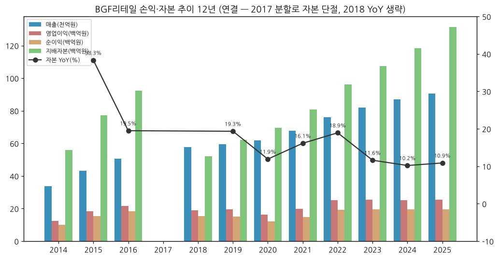

### ③ 회사 주가 역사 ★ narrative 영역

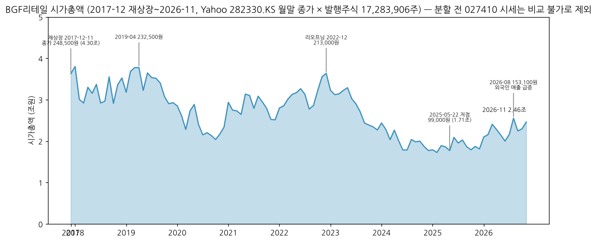

(시가총액 시계열은 2017-12 재상장 이후 **약 9년**만 확보 — 표준 20년 미달 사유: 신설법인 상장일이 2017-12-08이고, 분할 전 구 BGF리테일(027410, 2014-05 상장)은 주식수·분할 비율이 달라 같은 시가총액 시계열로 이을 수 없음. Yahoo 첫 데이터 2017-12-11)

(1) **2017-12 \~ 2019: 재상장 고점 → 최저임금 충격 → 반등**
→ 재상장 직후 2017-12-11 종가 **248,500원(시총 4.30조)** 이 현재까지 최고가. 2018년 최저임금 +16.4% 인상으로 가맹점 수익성 우려 + 출점 둔화 → 2018-07 149,500원까지 하락
→ 2019-04 232,500원 재반등 (담배 기저 해소·점포 순증) 후 연말 169,500원

(2) **2020 \~ 2021: 코로나 — 특수입지 타격**
→ 2020-03-19 109,000원. 학교·관광지 등 특수입지 점포 손익 악화 [IR 1Q20], OPM 2.6% (12년 저점)
→ 2021 주택가 중심 점포 순증(+932점)과 회복 기대로 192,000원(2021-06)

(3) **2022 \~ 2023-01: 리오프닝 — 영업이익 2,500억 진입**
→ 2022 매출 +12.3%, 영업이익 +26.6% (2,524억). 주가 2022-12-20 213,000원 (시총 3.68조)

(4) **2023 \~ 2025-05: 이익 정체 + 점포 포화 → 장기 하락**
→ 2023\~2025 영업이익 2,516\~2,539억으로 3년 정체, 업태 점포수 감소 전환(2025 -2.9%). PER 9배대까지 디레이팅
→ 2025-05-22 종가 **99,000원 (시총 1.71조)** — 재상장 이후 최저

(5) **2025-06 \~ 2026-11: 소비쿠폰 → 동일점 회복 + 외국인 매출 → 재평가**
→ 2025-07 민생회복 소비쿠폰 효과로 3Q25 동일점 반등 [IR 3Q25], 1Q26 +2.7%·2Q26 +4.2% 동일점 성장, 영업이익 1Q26 +68.4%·2Q26 +22.2% YoY
→ 외국인 매출 +53.3% → +60.9% → +66.8% (1Q\~3Q26) [바이라인네트워크 2026-11-05]. 2026-08-07 153,100원(52주 최고) → 2026-11-24 133,400원 (YTD +27.3%)

### ④ 회사의 주요 연혁

| 일자 | 내용 | 출처 |
|---|---|---|
| 1990-10 | 보광 훼미리마트 1호점(가락시영점) 오픈, 편의점 체인화사업 시작 | DART 사업보고서(2025.12) II |
| 2012 | 일본 훼미리마트 라이선스 종료, 독자 브랜드 **CU** 런칭 | DART 사업보고서(2025.12) II |
| 2014-05 | 구 BGF리테일(027410) 유가증권시장 상장 | Yahoo 027410.KS 첫 데이터 |
| 2015-01 | 담뱃값 인상(2,500→4,500원) — 2015 매출 +28.7% | DART 연결 손익(구법인) |
| 2016-04·08 | BGF로지스 지역 물류법인 흡수합병, BGF푸드 제주 흡수합병 | DART 사업보고서(2025.12) I-2 |
| 2017-11-01 | 인적분할 — 존속법인 ㈜BGF(지주), 신설법인 ㈜BGF리테일(편의점) | DART 사업보고서(2017.12) |
| 2017-12-08 | 신설 BGF리테일 KOSPI 재상장 | DART 사업보고서(2017.12) |
| 2018-03·11 | ㈜BGF 공개매수 + 시간외 매입으로 지분 30.00% 확보, 공정위 지주회사 요건 충족 | DART 사업보고서(2025.12) I-2 |
| 2018 | 몽골 CU 1호점 (마스터 프랜차이즈), 진천 중앙물류센터(CDC) 설립 | DART 사업보고서(2025.12) II, BGF 지속가능경영보고서 2026 |
| 2019-01 | IFRS16 리스 기준 적용 — 사용권자산·리스부채 인식 | DART 사업보고서(2019.12) |
| 2021 | 말레이시아 진출 | DART 사업보고서(2025.12) II |
| 2023-11 | 민승배 대표이사 선임 (이건준 대표 사임) | DART 사업보고서(2025.12) I-2 |
| 2024 | 카자흐스탄 진출. 2024-07-01 ㈜BGF로부터 **BGF네트웍스 100% 인수(720억)** — 광고·택배·전자상거래 | DART 사업보고서(2025.12) I-2 |
| 2025 | 미국 하와이 진출 (BGF RETAIL HAWAII CORP. 종속회사), KCGS ESG 통합 **A+** 첫 획득 | DART 분기보고서(2026.09), 시사경제 2025-11-20 |
| 2026-3Q | 부산 중앙물류센터 준공·저온센터 가동 (연면적 3.9만 평, 진천 CDC의 2배 이상) | IR 3Q26 |

---

## 3. 비즈니스 모델

### ① 실적 추이 (연결 → 법인별 사업부문 → 편의점 상품 MIX 3단계 위계)

> **사업부 구조 주의**: BGF리테일은 K-IFRS 영업부문이 **단일 부문**이다 [DART 사업보고서(2025.12) 연결 주석 40]. 사업부별 영업이익은 공시되지 않으므로 ① **법인별 매출**(DART 사업보고서 "매출실적 요약", 내부거래 제거 전) ② **편의점 별도 vs 연결 차이**(OpenDART 별도·연결 분기 재무, [계산]) ③ **상품 구성비**(DART, %)의 3단계로 대체한다. 세그먼트 매핑: 2018\~2022 "기타 부문" = 씨펙스로지스틱·BGF푸드·BGF휴먼넷 합산 → 2023부터 "식품 제조/유통(BGF푸드)" 분리 표시, 2024-07 BGF네트웍스 편입으로 "광고/택배/전자상거래" 신설 (2025 사업보고서에서 2023 재분류: 식품 1,643억 + 기타 914억 = 구 기타 2,556억)

**(1) 법인별 사업부문 매출 (억원, 내부거래 제거 전)**

| 연도 | 편의점(BGF리테일 별도) | 물류(BGF로지스) | 식품제조/유통(BGF푸드) | 광고/택배/전자상거래(BGF네트웍스) | 기타(휴먼넷·하와이 등) | 내부거래 제거 | 연결 매출 | 편의점 비중(제거 전) |
|---|---|---|---|---|---|---|---|---|
| 2018 | 57,742 | 1,496 | (기타 포함) | - | 568 | -2,047 | 57,759 | 96.5% |
| 2019 | 59,434 | 1,806 | (기타 포함) | - | 639 | -2,419 | 59,461 | 96.0% |
| 2020 | 61,678 | 2,044 | (기타 포함) | - | 1,201 | -3,110 | 61,813 | 95.0% |
| 2021 | 67,621 | 2,304 | (기타 포함) | - | 1,574 | -3,687 | 67,812 | 94.6% |
| 2022 | 75,778 | 2,755 | (기타 포함) | - | 2,162 | -4,537 | 76,158 | 93.9% |
| 2023 | 81,317 | 3,092 | 1,643 | - | 914 | -5,018 | 81,948 | 93.5% |
| 2024 | 85,921 | 3,338 | 1,856 | 409 | 881 | -5,419 | 86,988 | 93.0% |
| 2025 | 88,581 | 3,631 | 2,033 | 796 | 1,521 | -5,950 | 90,612 | 91.7% |
| 9M26 | 68,974 | 3,073 | 1,436 | 580 | 1,143 | -4,581 | 70,624 | 91.7% |

(출처: DART 사업보고서 각 연도 II-1 "연결기준 매출실적 요약", 분기보고서(2026.09). 연결 매출 = 합계 − 내부거래 제거 — OpenDART 연결 매출과 2018\~2025 모두 일치 확인. 2018\~2020 편의점 매출 중 용역(가맹점 수수료 등) 매출은 7,387억(2018)·7,438억(2019)·7,490억(2020), 나머지는 직영/가맹점 상품 판매 [DART 사업보고서(2020.12) II-4])

**(2) 분기 시계열 — 연결 / 편의점(별도) / 종속·조정 (억원)**

| 분기 | 연결 매출 | 연결 영업이익 | OPM | 매출 YoY | 영업이익 YoY | 별도(편의점) 매출 | 별도 영업이익 | 별도 OPM | 종속·조정 매출 [계산] | 종속·조정 영업이익 [계산] |
|---|---|---|---|---|---|---|---|---|---|---|
| 1Q16 | 10,923 | 277 | 2.5% | - | - | 구법인 연결 | - | - | - | - |
| 2Q16 | 12,725 | 627 | 4.9% | - | - | 구법인 연결 | - | - | - | - |
| 3Q16 | 13,722 | 712 | 5.2% | - | - | 구법인 연결 | - | - | - | - |
| 4Q16 | 13,157 | 555 | 4.2% | - | - | 구법인 연결 | - | - | - | - |
| 1Q17 | 12,156 | 396 | 3.3% | - | - | 구법인 연결 | - | - | - | - |
| 2Q17 | 14,130 | 741 | 5.2% | - | - | 구법인 연결 | - | - | - | - |
| 3Q17\~4Q17 | 미확보 | 미확보 | - | - | - | - | - | - | - | - |
| 1Q18 | 13,166 | 261 | 2.0% | - | - | 13,161 | 278 | 2.1% | 5 | -17 |
| 2Q18 | 14,785 | 564 | 3.8% | - | - | 14,780 | 554 | 3.7% | 5 | 10 |
| 3Q18 | 15,394 | 656 | 4.3% | - | - | 15,390 | 651 | 4.2% | 4 | 5 |
| 4Q18 | 14,413 | 414 | 2.9% | - | - | 14,410 | 419 | 2.9% | 3 | -5 |
| 1Q19 | 13,498 | 263 | 1.9% | +2.5% | +0.8% | 13,494 | 286 | 2.1% | 4 | -23 |
| 2Q19 | 15,165 | 610 | 4.0% | +2.6% | +8.2% | 15,161 | 604 | 4.0% | 4 | 6 |
| 3Q19 | 15,827 | 648 | 4.1% | +2.8% | -1.2% | 15,817 | 639 | 4.0% | 10 | 9 |
| 4Q19 | 14,970 | 445 | 3.0% | +3.9% | +7.5% | 14,962 | 426 | 2.8% | 8 | 19 |
| 1Q20 | 13,931 | 185 | 1.3% | +3.2% | -29.7% | 13,921 | 232 | 1.7% | 10 | -47 |
| 2Q20 | 15,492 | 446 | 2.9% | +2.2% | -26.9% | 15,466 | 449 | 2.9% | 26 | -3 |
| 3Q20 | 16,827 | 636 | 3.8% | +6.3% | -1.9% | 16,774 | 610 | 3.6% | 53 | 26 |
| 4Q20 | 15,563 | 356 | 2.3% | +4.0% | -20.0% | 15,516 | 346 | 2.2% | 47 | 10 |
| 1Q21 | 15,012 | 216 | 1.4% | +7.8% | +16.8% | 14,977 | 246 | 1.6% | 35 | -30 |
| 2Q21 | 17,004 | 586 | 3.4% | +9.8% | +31.4% | 16,957 | 567 | 3.3% | 47 | 19 |
| 3Q21 | 18,366 | 695 | 3.8% | +9.1% | +9.3% | 18,320 | 657 | 3.6% | 46 | 38 |
| 4Q21 | 17,430 | 497 | 2.9% | +12.0% | +39.6% | 17,367 | 502 | 2.9% | 63 | -5 |
| 1Q22 | 16,922 | 378 | 2.2% | +12.7% | +75.0% | 16,866 | 388 | 2.3% | 56 | -10 |
| 2Q22 | 19,186 | 708 | 3.7% | +12.8% | +20.8% | 19,094 | 707 | 3.7% | 92 | 1 |
| 3Q22 | 20,557 | 916 | 4.5% | +11.9% | +31.8% | 20,436 | 889 | 4.4% | 121 | 27 |
| 4Q22 | 19,492 | 523 | 2.7% | +11.8% | +5.2% | 19,382 | 508 | 2.6% | 110 | 15 |
| 1Q23 | 18,496 | 370 | 2.0% | +9.3% | -2.1% | 18,384 | 398 | 2.2% | 112 | -28 |
| 2Q23 | 20,982 | 781 | 3.7% | +9.4% | +10.3% | 20,819 | 715 | 3.4% | 163 | 66 |
| 3Q23 | 22,068 | 870 | 3.9% | +7.4% | -5.0% | 21,875 | 808 | 3.7% | 193 | 62 |
| 4Q23 | 20,402 | 511 | 2.5% | +4.7% | -2.3% | 20,240 | 494 | 2.4% | 162 | 17 |
| 1Q24 | 19,538 | 326 | 1.7% | +5.6% | -11.9% | 19,500 | 334 | 1.7% | 38 | -8 |
| 2Q24 | 22,029 | 762 | 3.5% | +5.0% | -2.4% | 21,743 | 694 | 3.2% | 286 | 68 |
| 3Q24 | 23,256 | 912 | 3.9% | +5.4% | +4.8% | 22,908 | 824 | 3.6% | 348 | 88 |
| 4Q24 | 22,165 | 516 | 2.3% | +8.6% | +1.0% | 21,771 | 452 | 2.1% | 394 | 64 |
| 1Q25 | 20,165 | 226 | 1.1% | +3.2% | -30.7% | 19,753 | 232 | 1.2% | 412 | -6 |
| 2Q25 | 22,901 | 694 | 3.0% | +4.0% | -8.9% | 22,383 | 602 | 2.7% | 518 | 92 |
| 3Q25 | 24,622 | 976 | 4.0% | +5.9% | +7.0% | 24,058 | 835 | 3.5% | 564 | 141 |
| 4Q25 | 22,924 | 643 | 2.8% | +3.4% | +24.6% | 22,387 | 551 | 2.5% | 537 | 92 |
| 1Q26 | 21,204 | 381 | 1.8% | +5.2% | +68.6% | 20,698 | 340 | 1.6% | 506 | 41 |
| 2Q26 | 24,268 | 849 | 3.5% | +6.0% | +22.3% | 23,727 | 807 | 3.4% | 541 | 42 |
| 3Q26 | 25,153 | 1,008 | 4.0% | +2.2% | +3.3% | 24,549 | 872 | 3.6% | 604 | 136 |

(출처: OpenDART fnlttSinglAcntAll 연결·별도. 1Q\~3Q = 분기 3개월, 4Q = 연간 − 3Q 누적. 1Q16\~2Q17 = 분할 전 구 BGF리테일(027410) **연결** 기준(편의점 사업 + 당시 종속회사) — 신설법인 별도와 기준이 달라 비교용. 3Q17\~4Q17은 분할로 구법인 편의점 실적이 중단영업 처리되고 신설법인은 11\~12월만 있어 분기 단위 **미확보**. 확보 분기: 연결 6+35 = **41개 분기** (표준 60+분기 미달 — 사유: 신설법인 2017-11 설립 + OpenDART 재무 API 2015년부터 제공 + 구법인 2015 분기 JSON 미제공). 연간 합 = 분기 합 (2018\~2025, 반올림 오차 ±1억 이내 확인))

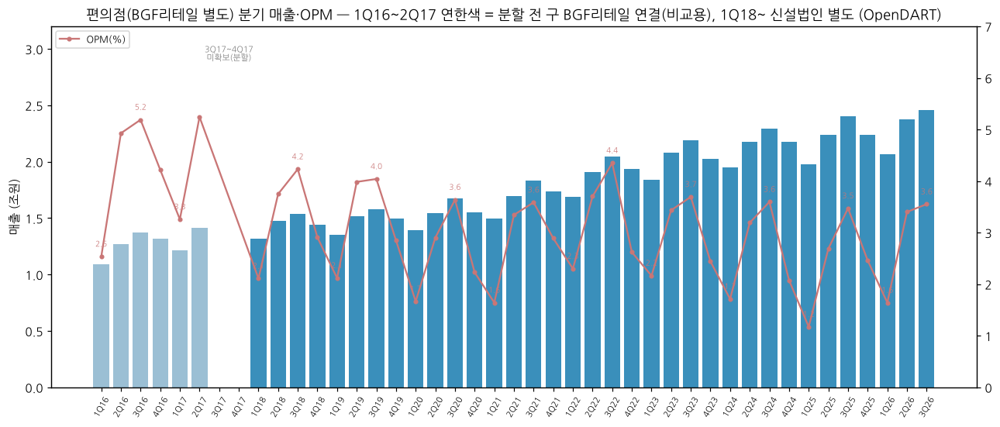
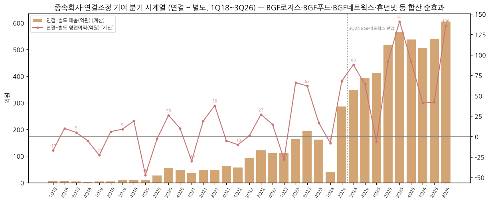
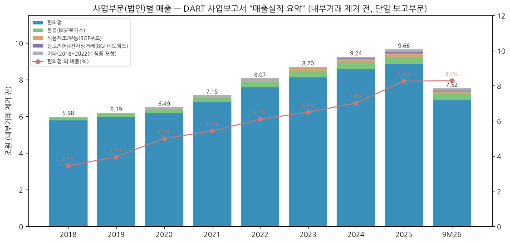

**(3) 편의점 상품 매출 구성비 (%)**

| 연도 | 식품(FF·HMR) | 가공식품(주류·스낵·유제품 등) | 담배 | 비식품(OTC·잡화) |
|---|---|---|---|---|
| 2017 | 12.7% | 40.1% | 41.5% | 5.7% |
| 2018 | 13.1% | 39.9% | 41.0% | 6.0% |
| 2019 | 13.3% | 40.7% | 40.1% | 5.9% |
| 2020 | 12.8% | 40.4% | 40.8% | 6.0% |
| 2021 | 12.4% | 42.5% | 39.5% | 5.6% |
| 2022 | 12.8% | 42.8% | 37.8% | 6.6% |
| 2023 | 13.3% | 43.5% | 37.3% | 5.9% |
| 2024 | 13.2% | 44.5% | 37.1% | 5.2% |
| 2025 | 13.7% | 44.1% | 37.0% | 5.2% |
| 9M26 | 13.8% | 44.9% | 36.2% | 5.1% |

(출처: DART 사업보고서 II-2 "주요 상품의 매출 구성비" — 2017은 분할 전 구법인 편의점 부문 포함 1\~12월. 2017 사업보고서는 Fresh Food 6.4·식품 25.7·담배 41.5 등 9개 분류였고 2018 사업보고서부터 4개 분류로 재분류됨 — 위 2017 값은 2019 사업보고서의 4분류 재작성치. 9M26 = 분기보고서(2026.09). IR 3Q26 분기 단독 기준: 식품 13.3·가공식품 45.9·담배 35.9·비식품 4.9)

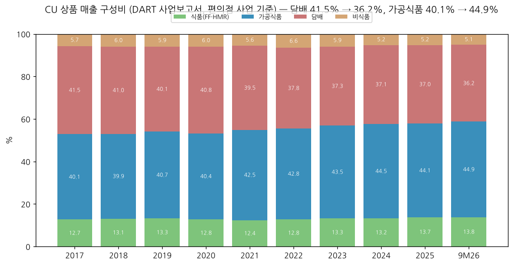

**(4) 12분기 rolling (연결, 억원)**

| 분기 | 매출(억) | 영업이익(억) | OPM | 매출총이익률(IR) | 판관비율(IR) | 매출 YoY | 영업이익 YoY |
|---|---|---|---|---|---|---|---|
| 4Q23 | 20,402 | 511 | 2.5% | 18.4% | 15.9% | +4.7% | -2.3% |
| 1Q24 | 19,538 | 326 | 1.7% | 18.5% | 16.8% | +5.6% | -11.9% |
| 2Q24 | 22,029 | 762 | 3.5% | 18.9% | 15.4% | +5.0% | -2.4% |
| 3Q24 | 23,256 | 912 | 3.9% | 18.9% | 15.0% | +5.4% | +4.8% |
| 4Q24 | 22,165 | 516 | 2.3% | 18.4% | 16.1% | +8.6% | +1.0% |
| 1Q25 | 20,165 | 226 | 1.1% | 18.3% | 17.2% | +3.2% | -30.7% |
| 2Q25 | 22,901 | 694 | 3.0% | 18.8% | 15.7% | +4.0% | -8.9% |
| 3Q25 | 24,622 | 976 | 4.0% | 18.8% | 14.9% | +5.9% | +7.0% |
| 4Q25 | 22,924 | 643 | 2.8% | 18.5% | 15.7% | +3.4% | +24.6% |
| 1Q26 | 21,204 | 381 | 1.8% | 18.4% | 16.7% | +5.2% | +68.6% |
| 2Q26 | 24,268 | 849 | 3.5% | 19.1% | 15.6% | +6.0% | +22.3% |
| 3Q26 | 25,153 | 1,008 | 4.0% | 19.2% | 15.2% | +2.2% | +3.3% |

(매출총이익·판관비 = IR 분기 손익계산서 [IR 3Q24·3Q26 Appendix]. 4Q는 IR 표 기준)

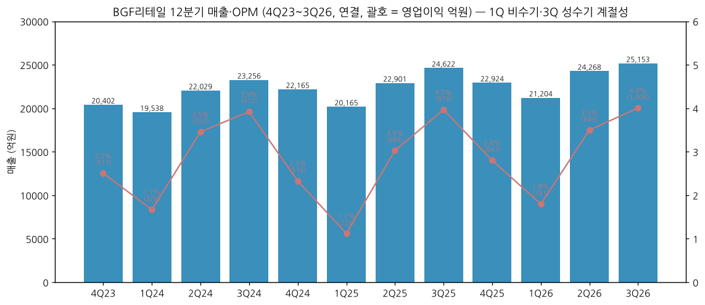

→ **계절성**: 1Q 매출이 연중 최저·OPM 1.1\~2.2%, 3Q가 최대·OPM 3.6\~4.5% (음료·아이스크림·행락 수요). 판관비는 분기 3,500\~3,800억으로 고정비 성격이 강해 매출 변동이 그대로 OPM 변동으로 이어짐
→ **3Q26**: 매출 25,152억(+2.1%) / 영업이익 1,008억(+3.2%) / 매출총이익률 19.2%(+0.3%p). 동일점 +0.9%는 전년 소비쿠폰 기저 영향 — 유가 인상에 따른 물류비, 외환차손 등 금융원가 증가로 세전이익 -3.9% [IR 3Q26]
→ **9M26 누계**: 매출 70,624억(+4.3%), 영업이익 2,238억(+18.0%), 매출총이익률 18.9%(+0.3%p) [OpenDART, 계산]

### ② 사업부별 개요 (매출 비중 큰 순서, 2025)

| 사업 | 법인 | 2025 매출(억, 제거 전) | 비중 | 역할 | 비고 |
|---|---|---|---|---|---|
| 편의점 | ㈜BGF리테일 (지배기업) | 88,581 | 91.7% | CU 가맹본부 — 상품 공급·가맹점 운영 지원·PB 개발 | 별도 영업이익 2,220억 (OPM 2.5%) |
| 물류 | ㈜BGF로지스 (주요 종속) | 3,631 | 3.8% | CU 가맹점 물류(섬 지역·제주 포함 전국) + 3PL·수출입 대행 | 물류 용역 99.9% (9M26 기타 5.3%로 상승) |
| 식품 제조/유통 | ㈜BGF푸드 (주요 종속) | 2,033 | 2.1% | 도시락·김밥·샌드위치 등 간편식(HMR) 제조, CK(양념육) 외부 납품 | 간편식 80.4%·MK 4.8%·CK 5.0%·상품유통 9.7% (2025) |
| 광고/택배/전자상거래 | ㈜BGF네트웍스 | 796 | 0.8% | CU 택배(반값택배 등)·디지털 사이니지 광고·모바일 상품권 | 2024-07 ㈜BGF로부터 720억에 인수 |
| 기타 | ㈜BGF휴먼넷, BGF RETAIL HAWAII | 1,521 | 1.6% | 특수입지 점포 운영 인력·위탁 / 하와이 편의점 가맹 | 2025 기타 급증(+72.6%) |

(출처: DART 사업보고서(2025.12) II-1·II-2. 비중 = 내부거래 제거 전 합계 9.66조 대비 [계산]. 편의점 2025 매출 88,581억은 OpenDART 별도 분기 합과 일치)

### ③ 사업부별 디테일

(1) **편의점 — 점포 순증 둔화, 점당 매출은 회복**

| 연도 | CU 점포수(연말) | 순증 | 증가율 | 편의점 매출(억, 별도) | 점당 연매출(억, 평균점포 기준) [계산] | 점당 매출 YoY | 점포수 점유율 |
|---|---|---|---|---|---|---|---|
| 2014 | 8,408 | - | - | 33,680 (구법인 연결) | - | - | - |
| 2015 | 9,409 | +1,001 | +11.9% | 43,343 (구법인 연결) | 4.87 | - | 32.5% |
| 2016 | 10,857 | +1,448 | +15.4% | 50,526 (구법인 연결) | 4.99 | +2.5% | 33.3% |
| 2017 | 12,503 | +1,646 | +15.2% | - | - | - | 33.9% |
| 2018 | 13,169 | +666 | +5.3% | 57,741 | 4.50 | - | - |
| 2019 | 13,877 | +708 | +5.4% | 59,434 | 4.40 | -2.3% | - |
| 2020 | 14,923 | +1,046 | +7.5% | 61,677 | 4.28 | -2.5% | - |
| 2021 | 15,855 | +932 | +6.2% | 67,621 | 4.39 | +2.6% | 38% |
| 2022 | 16,787 | +932 | +5.9% | 75,778 | 4.64 | +5.7% | 37% |
| 2023 | 17,762 | +975 | +5.8% | 81,318 | 4.71 | +1.4% | 37% |
| 2024 | 18,458 | +696 | +3.9% | 85,922 | 4.74 | +0.8% | 34% |
| 2025 | 18,711 | +253 | +1.4% | 88,581 | 4.77 | +0.5% | 35% |

(점포수: DART 사업보고서 각 연도 II "회사의 현황" + IR 3Q24 연도별 점포수(2014 8,408점). 점당 연매출 = 편의점 매출 / ((기초+기말 점포수)/2) [계산] — 2015\~2016은 구법인 **연결** 매출 기준이라 2018\~ 별도 기준과 직접 비교 불가. 점포수 점유율은 협회·산업통상부 기준 변경(2024부터 이마트24 포함 4사)으로 연도 간 불연속)

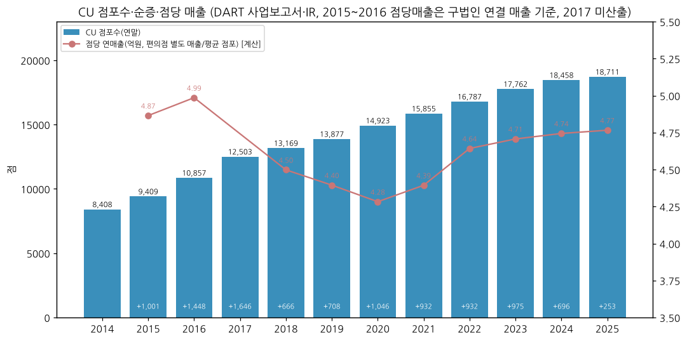

→ **2015\~2017 출점 경쟁기**: 연 +1,000\~1,650점 순증. 담뱃값 인상과 1인 가구 증가로 업태 전체가 고성장 (업태 점포수 2015 +11.4%, 2016 +12.5% [DART 사업보고서(2021.12), 한국편의점산업협회])
→ **2018\~2019 조정**: 최저임금 급등(2018 +16.4%)과 가맹점 수익성 우선 기조로 순증 +666\~708점으로 반감. 점당 매출 4.50 → 4.40억
→ **2020\~2023 주택가 순증 재가속**: 연 +932\~1,046점. 코로나로 점당 매출 2020 4.28억 저점 → 2023 4.71억 회복
→ **2024\~2026 "양에서 질"**: 순증 +696 → +253점. 회사는 "우량점 중심의 선별적 출점 기조"를 공식화 [IR 2Q26·3Q26]. 3Q26 신규점 일매출이 기존점 대비 98.3%(+4.7%p), 중대형 개점 구성비 21.0% [IR 3Q26]
→ **동일점 성장률 (IR, YoY)**: 1Q25 -2.1% · 2Q25 -2.1% · 3Q25 -0.2% · 4Q25 +0.4% · 1Q26 +2.7% · 2Q26 +4.2% · 3Q26 +0.9% [IR 2Q26·3Q26 차트 판독]. 2Q26은 객수 +3.0%가 견인, 3Q26은 객단가 +1.2%가 견인. 업태 대비 초과 성장 갭 FY2025 +2.7%p, 3Q26 +1.3%p (당사 점포매출 성장률 − 편의점 업태 성장률, 산업통상부 주요 유통업체 매출동향 기준) [IR 3Q26]
→ 2021 이전 분기별 동일점 성장률은 IR PDF가 이미지·정성 서술 위주라 **미확보**

(2) **상품 MIX — 담배 비중 하락 = 마진 개선**
→ 담배 구성비 41.5%(2017) → 36.2%(9M26), 가공식품 40.1% → 44.9%. 담배는 세금 비중이 높아 매출총이익률이 낮은 상품 → 담배 비중 하락이 연결 매출총이익률 상승(2018 17.7% → 9M26 18.9% [계산])의 핵심 요인
→ 3Q26 카테고리 성장: 과자류 +13.4%, 식재료 +7.7%, 빵/떡/디저트 +7.6%. 차별화 상품 성장률 과자류 +61.1%·식재료 +15.7%·즉석조리 +9.5% [IR 3Q26]. 히트 상품 예: 자일리톨 커피캔디(캔디 매출 +36.8%)
→ **장보기 상품**(밑반찬·맛살·1차 축산물·치즈 등) 3Q26 +7.8%, 누계 +12.7% — 전체 매출 성장률(+2.9%) 상회 [IR 3Q26]

(3) **인바운드(외국인) — 3분기 연속 가속**
→ 외국인 매출 YoY (해외 발행 결제수단 기준): 2Q25 +45.9% · 3Q25 +46.5% · 4Q25 +41.8% · 1Q26 +53.3% · 2Q26 +60.9% · 3Q26 **+66.8%**. 전체 매출 내 비중 2.5% (+1.0%p YoY) [IR 3Q26 차트 판독]
→ 국적: 미국 +144.6%·대만 +119.6%·중국 +70.4%(최대 국적). 지역: 비수도권 +80.3%·수도권 +59.7%, 부산 +133.3%. 3Q26 점포 총매출 증가분 중 외국인 기여 35.5% [IR 3Q26, 바이라인네트워크 2026-11-05]
→ 대응: TAX 즉시환급 약 800점, 관광지 데이터 기반 상품 / 거주 외국인용 해외 식재료·금융·행정 서비스 [IR 3Q26]

(4) **종속회사 — 연결 영업이익 기여 2025 12.6% · 9M26 9.8% [계산]**
→ 연결 − 별도 영업이익 [계산]: 2018 -7억 → 2021 +22억 → 2023 +117억 → 2024 +212억 → 2025 +319억 → 9M26 +219억. 2024-3Q부터 BGF네트웍스(택배·광고) 편입 효과가 반영되며 기여 확대
→ BGF로지스: 2025 매출 3,631억(+8.8%). 2026-3Q 부산 중앙물류센터 저온센터 가동, 4Q 상온 CDC·RDC 전체 순차 가동 예정 [IR 3Q26]
→ BGF푸드: 2025 매출 2,033억(+9.5%). 간편식 비중 61.1%(2023) → 80.4%(2025)로 편의점 전용 HMR 중심 재편, 해외소싱 B2B 상품 매출 감소 [DART 사업보고서(2025.12) II]

(5) **해외 — 로열티형 마스터 프랜차이즈**
→ 몽골(2018)·말레이시아(2021)·카자흐스탄(2024)·하와이(2025). 현지 파트너가 투자·운영, BGF리테일은 브랜드·시스템·노하우 제공 후 로열티 수취 — "투자 리스크 없음" [DART 사업보고서(2025.12) II]
→ 몽골 파트너 Premium Nexus JSC에 2020-09 50억 투자, 하와이 파트너(CU HAWAII)에는 첫 점포 개점 1년 후 1년간 지분 10% 한도 콜옵션 보유 [DART 분기보고서(2026.09) II-6]. 해외 로열티 금액은 **미공시**

### ④ 주요 경쟁사 (사업별)

| 사업 | 국내 경쟁사 | 비고 |
|---|---|---|
| 편의점 | GS리테일(GS25), 코리아세븐(세븐일레븐 — 바이더웨이·미니스톱 인수), 이마트24 | 사업보고서: "실질적으로 4개 사업자가 국내 편의점 시장을 주도". 업태 점포수 53,266점 (2025, 4사) |
| 근거리 장보기 | 기업형 슈퍼마켓(GS더프레시·롯데슈퍼·이마트에브리데이), 퀵커머스(쿠팡이츠마트·배민B마트 등) | 장보기 상품 성장 전략과 직접 경합 (정성) |
| 물류 | CJ대한통운 등 3PL | BGF로지스는 CU 물량 기반 캡티브 |
| 택배(C2C 점포 택배) | GS25 반값택배, CJ대한통운 | BGF네트웍스 |

(업태 점포수 성장률: 2021 +5.8% · 2022 +8.7% · 2023 +4.6% · 2024 +14.1%(이마트24 포함 기준 변경) · 2025 -2.9% / 업태 매출 성장률: 2021 +6.8% · 2022 +10.8% · 2023 +8.0% · 2024 +3.9% · 2025 +0.1% [DART 사업보고서(2025.12), 산업통상부])

### ⑤ 주요 매출처

- **매출처 = 불특정 다수 소비자** (가맹점·직영점에서 대면 판매, 현금·카드·상품권 결제) — 특정 거래처 의존 없음 [DART 사업보고서(2025.12) II-4]. 총 매출의 5%를 넘는 개별 품목도 없음
- 회계상 매출 구조: 가맹점 상품 판매(총액 인식) + 가맹점 용역 수수료. 가맹점에는 계약 시 보증금을 받아 신용위험을 보강 [DART 사업보고서(2025.12) 연결 주석 금융위험관리]
- 종속회사 매출처: BGF로지스·BGF푸드 매출의 대부분은 BGF리테일 향 내부거래 (2025 연결 내부거래 제거 5,950억 = 제거 전 합계의 6.2%)
- 주요 매입처: 담배(KT&G·필립모리스 등)·주류·가공식품 제조사 — 개별 매입 비중은 **미공시**

### ⑥ 생산 CAPA + 임직원

- **물류 인프라**: 진천 중앙물류센터(CDC, 2018) + 전국 지역 물류센터(RDC) — 중부(화성)·안성·나주·진주·강릉·서귀포·대전·부산 등 [DART 사업보고서(2025.12) II-3]. 2026-3Q 부산 중앙물류센터(연면적 3.9만 평) 가동 [IR 3Q26]
- **2026 투자계획 (편의점)**: 유형자산 등 2,598억 (3Q 누계 1,945억), 보증금 259억 [DART 분기보고서(2026.09) II-3]
- **식품 제조**: BGF푸드 진천 Central Kitchen 등 (HACCP) [DART 사업보고서(2025.12) II, BGF 지속가능경영보고서 2026]

**임직원 (BGF리테일 별도, DART 직원 현황):**

| 연도 | 직원 합계 | 정규직 | 기간제 | 평균 근속(년) | 연간 급여총액(억) | 1인 평균 급여(백만원) |
|---|---|---|---|---|---|---|
| 2017 | 2,737 | 1,944 | 793 | 0.2 | 265 (2개월) | 14 (2개월) |
| 2018 | 2,753 | 1,999 | 754 | 1.1 | 1,101 | 55 |
| 2019 | 2,641 | 2,010 | 631 | 1.9 | 1,135 | 55 |
| 2020 | 2,637 | 2,124 | 513 | 2.7 | 1,200 | 56 |
| 2021 | 2,778 | 2,254 | 524 | 3.2 | 1,350 | 62 |
| 2022 | 2,948 | 2,437 | 511 | 3.6 | 1,522 | 66 |
| 2023 | 3,303 | 2,603 | 700 | 4.0 | 1,633 | 65 |
| 2024 | 3,379 | 2,605 | 774 | 4.7 | 1,767 | 68 |
| 2025 | 3,130 | 2,596 | 534 | 5.6 | 1,855 | 70 |

(평균 근속연수는 2017-11 신설법인 기준으로 재기산돼 짧게 표시됨. 기간제에는 직영점 아르바이트 포함 — 평균 근속·급여 산출에서 제외 [DART 사업보고서(2025.12) VIII]. 연결 종속회사 인원은 사업보고서에 미기재. 2014\~2016 구법인 인원은 미수집)

---

## 4. 재무 구조

> **재무제표 수치: OpenDART fnlttSinglAcntAll (연결 CFS), 2026-11-25 조회.** 2018\~ = 신설 BGF리테일(282330), 2015\~2016 = 분할 전 구 BGF리테일(027410) 연결, 2014 = 구법인 2015 사업보고서 전기 컬럼, 2017 = 신설법인 11\~12월(손익은 미확보 처리). 4Q = 연간 − 3Q 누적, 연간 = 분기 합 (2018\~2025 일치 확인). 단위 억원(표기 없으면). [계산] 표기는 DART 원수치로 직접 산출한 값

### ① 손익계산서 (12년 연결, 억원)

| 연도 | 매출 | 매출원가 | 매출총이익 | GPM | 판관비 | 판관비율 | 영업이익 | OPM | 금융원가 | 세전이익 | 순이익 | NPM | EPS(원) |
|---|---|---|---|---|---|---|---|---|---|---|---|---|---|
| 2014 | 33,680 | 25,688 | 7,992 | 23.7% | 6,751 | 20.0% | 1,241 | 3.7% | 109 | 1,362 | 1,015 | 3.0% | 미확보 |
| 2015 | 43,343 | 34,342 | 9,001 | 20.8% | 7,165 | 16.5% | 1,836 | 4.2% | 99 | 1,965 | 1,528 | 3.5% | 미확보 |
| 2016 | 50,526 | 40,485 | 10,041 | 19.9% | 7,869 | 15.6% | 2,172 | 4.3% | 133 | 2,404 | 1,846 | 3.7% | 미확보 |
| 2017 | 미확보 | | | | | | | | | | | | 1,619 (2개월) |
| 2018 | 57,759 | 47,562 | 10,196 | 17.7% | 8,254 | 14.3% | 1,895 | 3.3% | 77 | 2,025 | 1,542 | 2.7% | 8,925 |
| 2019 | 59,461 | 48,896 | 10,565 | 17.8% | 8,598 | 14.5% | 1,966 | 3.3% | 203 | 2,011 | 1,514 | 2.5% | 8,763 |
| 2020 | 61,813 | 51,295 | 10,518 | 17.0% | 8,895 | 14.4% | 1,622 | 2.6% | 235 | 1,631 | 1,227 | 2.0% | 7,103 |
| 2021 | 67,812 | 56,041 | 11,771 | 17.4% | 9,775 | 14.4% | 1,994 | 2.9% | 234 | 1,925 | 1,476 | 2.2% | 8,547 |
| 2022 | 76,158 | 62,296 | 13,862 | 18.2% | 11,330 | 14.9% | 2,524 | 3.3% | 316 | 2,541 | 1,935 | 2.5% | 11,203 |
| 2023 | 81,948 | 66,720 | 15,228 | 18.6% | 12,696 | 15.5% | 2,532 | 3.1% | 479 | 2,484 | 1,958 | 2.4% | 11,337 |
| 2024 | 86,988 | 70,730 | 16,257 | 18.7% | 13,740 | 15.8% | 2,516 | 2.9% | 516 | 2,453 | 1,952 | 2.2% | 11,301 |
| 2025 | 90,612 | 73,742 | 16,870 | 18.6% | 14,330 | 15.8% | 2,539 | 2.8% | 483 | 2,472 | 1,953 | 2.2% | 11,303 |
| 9M26 | 70,624 | 57,242 | 13,382 | 18.9% | 11,144 | 15.8% | 2,238 | 3.2% | 405 | 2,084 | 1,602 | 2.3% | - |

(판관비율 = 판매비와관리비 / 매출. 2017 EPS 1,619원은 신설법인 2개월분. 9M26 = 1Q\~3Q26 누계 — 지배순이익은 분기 합(293+568+741억). 2014\~2016 EPS는 분할 전 주식 기준이라 **미확보** 처리. 2019부터 IFRS16 적용으로 점포 임차료가 판관비(임차료) → 감가상각비(사용권자산) + 금융원가(리스 이자)로 이동 — 금융원가가 2018 77억 → 2019 203억으로 뛴 이유)

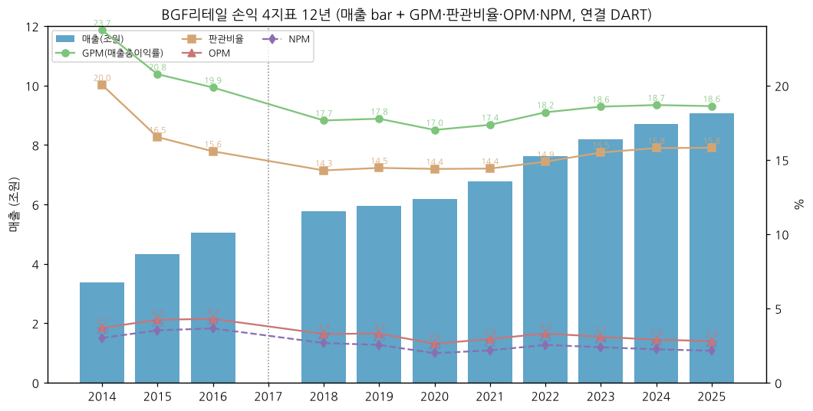

**마진 구조 읽는 법:**
→ **매출총이익률(GPM)** 17.7%(2018) → 18.6%(2025) → 18.9%(9M26): 담배 비중 하락 + PB·차별화 상품 확대. 편의점 가맹본부의 매출총이익은 가맹점 몫을 뗀 뒤 본부가 인식하는 부분
→ **판관비율** 14.3%(2018) → 15.8%(2024\~2025): 인건비(1인 평균 급여 5,500만 → 7,000만원), 사용권자산 상각, 가맹점 상생 지원 비용 증가. 판관비 증가가 GPM 개선분을 상쇄해 OPM이 2.8\~3.3% 박스에 머묾
→ **영업레버리지**: 판관비가 분기 3,500\~3,800억으로 경직적 → 동일점 성장률 1%p가 OPM을 크게 흔든다 (1Q25 동일점 -2.1% → 영업이익 -30.7% / 1Q26 +2.7% → +68.4%)

**일회성·특이 항목 정리:**

| 시점 | 항목 | 영향 | 출처 |
|---|---|---|---|
| 2015 | 담뱃값 인상(2,500→4,500원, 2015-01) | 매출 +28.7%, 담배 재고 평가이익 성격 이익 포함 가능 (정량 미확인) | DART 구법인 연결 |
| 2017-11 | 인적분할 | 신설법인 첫 회계연도 2개월, 구법인 2017 중단사업이익 3조 5,088억(분할 처분이익 포함) | OpenDART 027410 2017 FY |
| 2019 | IFRS16 리스 기준 도입 | 사용권자산 5,147억·리스부채 5,438억 인식, EBITDA·금융원가 증가 | DART 사업보고서(2019.12) |
| 3Q24 | BGF네트웍스 연결 편입 (2024-07-01 취득, 720억) | 종속 매출 +409억(2024)·+796억(2025) | DART 사업보고서(2025.12) |
| 3Q25 | 정부 민생회복 소비쿠폰 | 3Q25 매출 +5.9%, 영업이익 +7.1% — 3Q26 동일점 기저 부담 | IR 3Q25·3Q26 |
| 3Q26 | 유가 상승 물류비, 외환차손 등 금융원가 증가 | 세전이익 953억(-3.9%) | IR 3Q26 |

### ② 재무상태표 (12년 연결, 억원)

| 연도 | 자산총계 | 유동자산 | 유형자산 | 사용권자산 | 부채총계 | 유동부채 | 자본총계 | 차입금 | 리스부채 | 현금성자산(현금+단기금융+FVPL) | 부채비율 | 유동비율 |
|---|---|---|---|---|---|---|---|---|---|---|---|---|
| 2014 | 13,385 | 7,231 | 3,692 | - | 7,664 | 5,994 | 5,721 | 845 | - | 4,751 | 134.0% | 120.6% |
| 2015 | 16,216 | 9,476 | 3,743 | - | 8,479 | 6,902 | 7,737 | 645 | - | 7,020 | 109.6% | 137.3% |
| 2016 | 19,176 | 9,834 | 5,774 | - | 9,754 | 7,391 | 9,422 | 495 | - | 6,597 | 103.5% | 133.1% |
| 2017 | 12,773 | 5,666 | 4,022 | - | 8,887 | 6,814 | 3,886 | 28 | - | 2,426 | 228.7% | 83.2% |
| 2018 | 14,826 | 6,961 | 4,861 | - | 9,609 | 7,637 | 5,217 | 51 | - | 3,577 | 184.2% | 91.1% |
| 2019 | 21,724 | 7,441 | 5,498 | 5,147 | 15,498 | 9,507 | 6,226 | 117 | 5,438 | 4,472 | 248.9% | 78.3% |
| 2020 | 23,712 | 8,291 | 5,915 | 5,853 | 16,743 | 10,034 | 6,968 | 224 | 5,955 | 4,827 | 240.3% | 82.6% |
| 2021 | 25,964 | 8,083 | 6,141 | 7,148 | 17,871 | 10,165 | 8,093 | 72 | 7,012 | 4,280 | 220.8% | 79.5% |
| 2022 | 29,462 | 8,899 | 6,905 | 8,471 | 19,836 | 11,022 | 9,626 | 123 | 8,019 | 4,187 | 206.1% | 80.7% |
| 2023 | 32,191 | 9,790 | 7,764 | 9,516 | 21,446 | 11,913 | 10,745 | 107 | 8,796 | 3,731 | 199.6% | 82.2% |
| 2024 | 34,026 | 10,518 | 8,337 | 9,306 | 22,185 | 12,962 | 11,841 | 32 | 8,627 | 3,939 | 187.3% | 81.1% |
| 2025 | 35,562 | 11,804 | 8,867 | 8,957 | 22,431 | 13,283 | 13,131 | 0 | 8,436 | 4,702 | 170.8% | 88.9% |
| 3Q26 | 37,189 | 13,134 | 9,516 | 8,758 | 23,214 | 14,122 | 13,975 | 368 | 8,171 | 5,045 | 166.1% | 93.0% |

(차입금 = 단기차입금 + 장기차입금. **회사채 발행 이력 없음**. 리스부채 = 유동 + 비유동 (IR 각 4Q 재무상태표 "└ 리스부채", 기타금융부채 안에 포함) — 2018 이전은 IFRS16 이전이라 해당 없음. 현금성자산 = 현금및현금성자산 + 단기금융상품 + 당기손익-공정가치측정금융자산. 2017 부채비율 228.7%는 분할로 자본만 35% 승계되고 매입채무 등 영업부채는 그대로 이전된 결과. 3Q26 장기차입금 368억은 2026 신규 차입 [DART 분기보고서(2026.09) 연결 재무상태표])

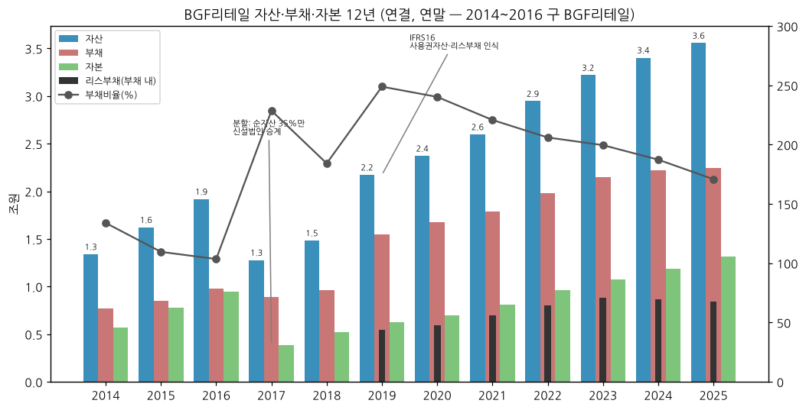

→ **부채의 성격**: 2025 부채 2.24조 중 매입채무및기타채무 6,236억 + 리스부채 8,436억 + 가맹점 보증금 등 기타금융부채 — **이자부 차입금은 사실상 0**. 편의점은 상품 대금을 가맹점 판매 후 익월 결제하는 구조라 매입채무가 운전자본을 조달 (유동비율 80\~90%대가 상시적인 이유) [DART 사업보고서(2017.12) IV 유동성]
→ **순현금**: 2025말 4,702억 [계산: 현금 4,140 + 단기금융 230 + FVPL 332, 차입금 0] → 3Q26 4,677억 (장기차입금 368억 차감)

### ③ 현금흐름표 (12년 연결, 억원)

| 연도 | 영업CF | 투자CF | 재무CF | 유형자산 취득 | 무형자산 취득 | CapEx 합계 | CapEx/매출 | FCF(영업CF−CapEx) | 리스부채 상환 | FCF−리스상환 [계산] |
|---|---|---|---|---|---|---|---|---|---|---|
| 2014 | 2,603 | -2,557 | 70 | 678 | 97 | 775 | 2.3% | 1,828 | - | 1,828 |
| 2015 | 3,593 | -4,446 | 267 | 933 | 153 | 1,086 | 2.5% | 2,507 | - | 2,507 |
| 2016 | 3,314 | -1,574 | -2,248 | 1,181 | 175 | 1,356 | 2.7% | 1,958 | - | 1,958 |
| 2017 (11\~12월) | -250 | 321 | -17 | 238 | 21 | 259 | (2개월) | -509 | - | -509 |
| 2018 | 3,458 | -3,242 | -150 | 1,806 | 122 | 1,928 | 3.3% | 1,530 | - | 1,530 |
| 2019 | 5,328 | -2,939 | -2,462 | 1,670 | 49 | 1,719 | 2.9% | 3,609 | 2,065 | 1,544 |
| 2020 | 5,073 | -2,664 | -2,450 | 1,730 | 37 | 1,767 | 2.9% | 3,307 | 2,068 | 1,239 |
| 2021 | 5,381 | -2,391 | -2,686 | 1,621 | 51 | 1,672 | 2.5% | 3,709 | 2,247 | 1,462 |
| 2022 | 6,304 | -985 | -3,176 | 2,226 | 89 | 2,315 | 3.0% | 3,990 | 2,575 | 1,415 |
| 2023 | 6,471 | -2,441 | -3,692 | 2,062 | 67 | 2,129 | 2.6% | 4,342 | 2,957 | 1,385 |
| 2024 | 7,688 | -3,460 | -4,003 | 2,190 | 56 | 2,246 | 2.6% | 5,442 | 3,220 | 2,222 |
| 2025 | 7,708 | -2,716 | -4,094 | 2,414 | 57 | 2,471 | 2.7% | 5,237 | 3,354 | 1,883 |
| 9M25 | 6,472 | -2,132 | -3,351 | 1,801 | 38 | 1,839 | 2.7% | 4,633 | 2,629 | 2,004 |
| 9M26 | 5,916 | -3,320 | -2,908 | 2,207 | 16 | 2,223 | 3.1% | 3,693 | 2,568 | 1,125 |

(FCF = 영업CF − 유·무형자산 취득. 2019 이후 IFRS16으로 점포 임차료가 영업CF에서 빠지고 재무CF "리스부채 상환"으로 이동 → **실질 FCF는 "FCF − 리스상환"** 으로 봐야 2018 이전과 비교 가능. 2017은 신설법인 11\~12월 — 분할 직후 매입채무 결제로 영업CF -250억 [DART 사업보고서(2017.12) IV])

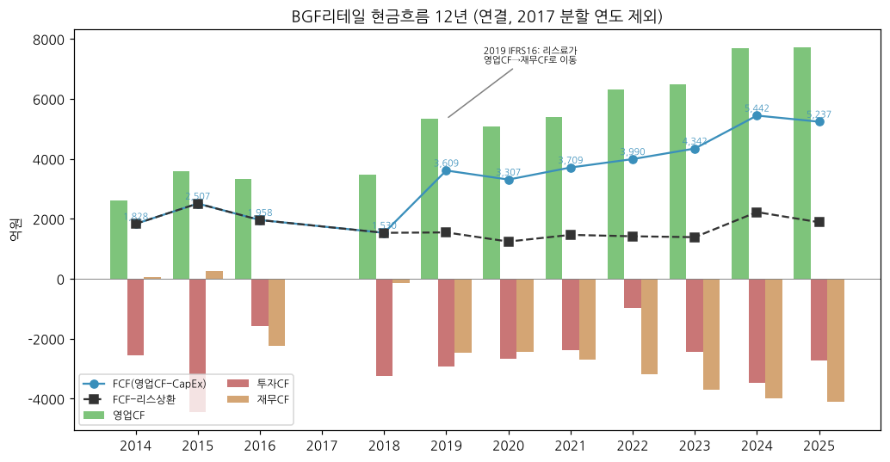

### ④ CapEx 추이 (12년, 억원)

| 연도 | 유형자산 취득 | 무형자산 취득 | 합계 | CapEx/매출 | 주요 내용 |
|---|---|---|---|---|---|
| 2014 | 678 | 97 | 775 | 2.3% | 구법인 — 점포 집기·인테리어 |
| 2015 | 933 | 153 | 1,086 | 2.5% | 출점 가속 |
| 2016 | 1,181 | 175 | 1,356 | 2.7% | 출점 정점 (+1,448점) |
| 2018 | 1,806 | 122 | 1,928 | 3.3% | 진천 중앙물류센터(CDC) |
| 2019 | 1,670 | 49 | 1,719 | 2.9% | |
| 2020 | 1,730 | 37 | 1,767 | 2.9% | |
| 2021 | 1,621 | 51 | 1,672 | 2.5% | |
| 2022 | 2,226 | 89 | 2,315 | 3.0% | 리오프닝 출점·리뉴얼 |
| 2023 | 2,062 | 67 | 2,129 | 2.6% | |
| 2024 | 2,190 | 56 | 2,246 | 2.6% | |
| 2025 | 2,414 | 57 | 2,471 | 2.7% | 부산 물류센터 건설 |
| 9M26 | 2,207 | 16 | 2,223 | 3.1% | 부산 중앙물류센터 준공(3Q26) |

(출처: OpenDART 연결 현금흐름표. 점포 CapEx = 가맹점·직영점 집기(공구기구비품)·시설인테리어 — 편의점 사업부문 2025 신규 취득 1,683억 [DART 사업보고서(2025.12) II-3]. 가맹점포 건물·임차는 가맹점주 부담이라 본부 CapEx/매출이 낮음)

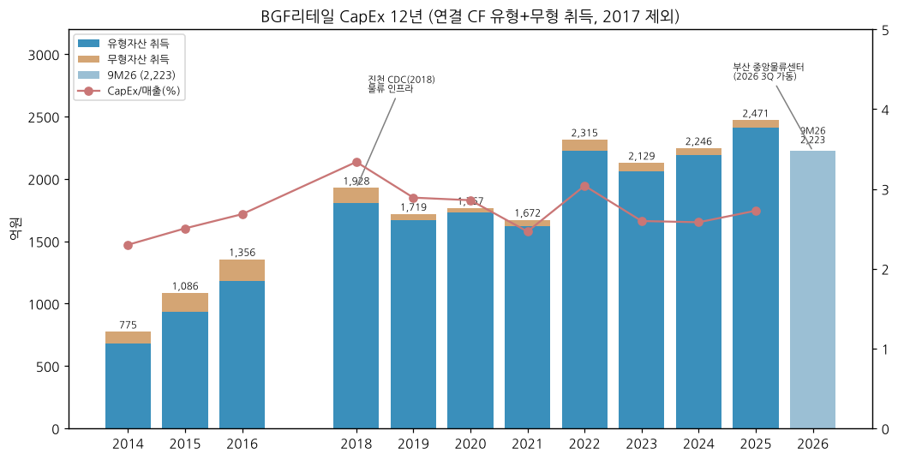

### ⑤ 부채구조 + 채무증권 발행 history

- **회사채·CP·전단채 발행 실적: 없음** (신설 이후) — 신용평가는 입찰용 기업신용평가 AA(나이스디앤비)만 보유 [DART 사업보고서(2025.12) I]
- 차입금: 단기차입금 2018 51억 → 2024 32억 → 2025 0 (종속회사 운영자금 성격), 3Q26 장기차입금 368억 신규 [OpenDART]
- **리스부채** (점포·물류센터 임차): 5,438억(2019) → 8,796억(2023) 정점 → 8,436억(2025) → 8,171억(3Q26) [IR 4Q19\~3Q26]. 연간 리스 상환 3,354억(2025) = 영업CF의 43.5% [계산]
- **채무보증**: 피투자회사 ㈜에이서비스 차입금(신한은행·IBK캐피탈) 관련 보유 주식 질권 설정, 채무보증금액 74.88억 (3Q26) [DART 분기보고서(2026.09) XI]
- **분할 연대책임**: 상법 제530조의9에 따라 분할 전 회사채무에 대해 ㈜BGF와 연대 변제 책임 [DART 사업보고서(2017.12) 연결 주석]

### ⑥ 배당·자사주 추이

| 사업연도 | DPS(원) | 배당총액(억) | 연결 배당성향 | EPS(원) | 연말 종가(원) | 배당수익률(연말) [계산] | 비고 |
|---|---|---|---|---|---|---|---|
| 2014 | 미확보 | - | - | - | - | - | 구 BGF리테일(027410) 시기 — 분할 전 주식 기준이라 현 주식과 비교 불가 |
| 2015 | 미확보 | - | - | - | - | - | 구 BGF리테일(027410) 시기 — 분할 전 주식 기준이라 현 주식과 비교 불가 |
| 2016 | 미확보 | - | - | - | - | - | 구 BGF리테일(027410) 시기 — 분할 전 주식 기준이라 현 주식과 비교 불가 |
| 2017 | 1,000 | 173 | 61.7% | 1,619 | 210,000 | 0.5% | 신설법인 첫 배당(2개월분 이익 대비 61.7%) |
| 2018 | 2,680 | 463 | 30.0% | 8,925 | 204,000 | 1.3% | 첫 연간 배당 |
| 2019 | 2,700 | 466 | 30.8% | 8,763 | 169,500 | 1.6% |  |
| 2020 | 2,400 | 415 | 33.8% | 7,103 | 135,500 | 1.8% |  |
| 2021 | 3,000 | 518 | 35.1% | 8,547 | 145,500 | 2.1% |  |
| 2022 | 4,100 | 708 | 35.6% | 11,203 | 210,500 | 1.9% | DPS +36.7% (3,000→4,100원), 이후 4년 동결 |
| 2023 | 4,100 | 708 | 36.2% | 11,337 | 131,300 | 3.1% |  |
| 2024 | 4,100 | 708 | 36.3% | 11,301 | 102,500 | 4.0% |  |
| 2025 | 4,100 | 708 | 36.3% | 11,303 | 104,800 | 3.9% |  |

(출처: DART 사업보고서 "배당에 관한 사항"(2019·2022·2025), OpenDART alotMatter(2025). 배당수익률(연말) = DPS / 연말 종가 [계산] — DART 공시 현금배당수익률(2025 3.3%, 2024 4.0%, 2023 3.1%)은 기간 평균 주가 기준이라 다름. 현재가 기준 배당수익률 **3.1%** (4,100원 / 133,400원))

- **자사주**: 자기주식 8,891주는 2017 분할 시 발생한 단주를 17억에 취득한 것 [DART 사업보고서(2017.12)]. 이후 **자사주 매입·소각 이력 없음** (2025 사업보고서 자기주식 변동 0)
- **분기배당**: 미실시 (연 1회 결산배당) [DART 사업보고서(2025.12) 배당에 관한 사항]
- 배당금 지급액(CF): 2019 463억 → 2023 708억 → 2025 708억 (2022 사업연도 DPS 4,100원부터 동일)

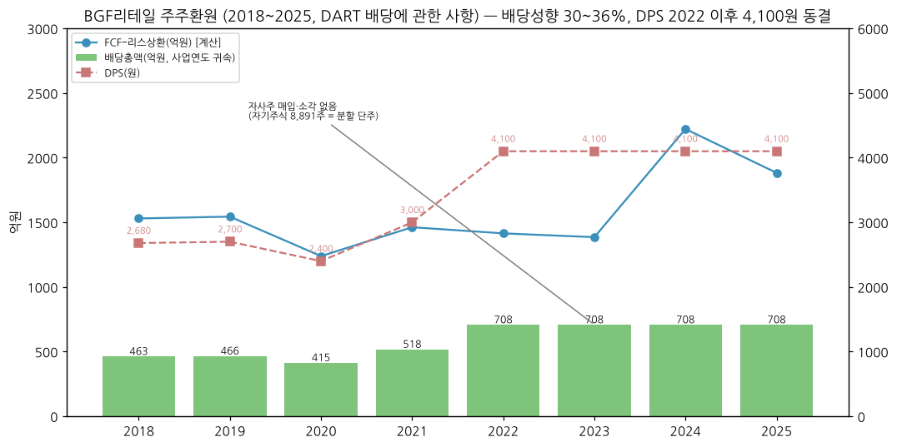

### ⑦ 재무 비율 + 밸류에이션 밴드 (12년)

| 연도 | ROE(지배) | ROA | 부채비율 | 유동비율 | OP/금융원가 | 연말 종가(원) | 연말 시총(조원) | PBR | PER |
|---|---|---|---|---|---|---|---|---|---|
| 2014 | - | - | 134.0% | 120.6% | 11.4x | - | - | - | - |
| 2015 | 22.8% | 10.2% | 109.6% | 137.3% | 18.5x | - | - | - | - |
| 2016 | 21.6% | 10.4% | 103.5% | 133.1% | 16.4x | - | - | - | - |
| 2017 | - | - | 228.7% | 83.2% | - | 210,000 | 3.63 | 9.34x | - |
| 2018 | 33.9% | 11.2% | 184.2% | 91.1% | 24.6x | 204,000 | 3.53 | 6.76x | 22.9x |
| 2019 | 26.5% | 8.3% | 248.9% | 78.3% | 9.7x | 169,500 | 2.93 | 4.71x | 19.4x |
| 2020 | 18.6% | 5.4% | 240.3% | 82.6% | 6.9x | 135,500 | 2.34 | 3.36x | 19.1x |
| 2021 | 19.6% | 5.9% | 220.8% | 79.5% | 8.5x | 145,500 | 2.51 | 3.11x | 17.0x |
| 2022 | 21.8% | 7.0% | 206.1% | 80.7% | 8.0x | 210,500 | 3.64 | 3.78x | 18.8x |
| 2023 | 19.2% | 6.4% | 199.6% | 82.2% | 5.3x | 131,300 | 2.27 | 2.11x | 11.6x |
| 2024 | 17.3% | 5.9% | 187.3% | 81.1% | 4.9x | 102,500 | 1.77 | 1.50x | 9.1x |
| 2025 | 15.6% | 5.6% | 170.8% | 88.9% | 5.3x | 104,800 | 1.81 | 1.38x | 9.3x |

**주요 비율 의미:**
- **ROE**: 지배순이익 / 평균 지배자본 [계산]. 신설법인 33.9%(2018, 분할 직후 작은 자본) → 15.6%(2025). 순이익은 1,950억대에서 정체인데 자본은 배당 후에도 매년 1,000억+ 누적 → ROE 하락. 구법인 2015\~2016은 21\~23%
- **부채비율**: 리스부채 인식(2019)으로 248.9% 정점 → 2025 170.8% → 3Q26 166.1%. 이자부 차입금이 거의 없어 신용 위험 지표로는 부적합
- **OP/금융원가**: 금융원가의 대부분이 리스 이자 → 2018 24.6x → 2024 4.9x → 2025 5.3x. 실제 차입 이자 지급은 연 1억 수준(2025 CF 이자의 지급 1억)
- **PBR·PER 밴드**: 연말 종가 × 17,283,906주 / 지배자본·지배순이익 [계산]. PER은 2018 22.9배 → 2024 9.1배로 절반 이하 디레이팅, 2025 9.3배 → 현재 11.0배 (LTM). 2014\~2016 구법인 밸류는 주식수 기준이 달라 미산출

---

## 5. 지배 구조

### ① 그룹·계열 관계

- **BGF그룹** (공정거래법상 대규모기업집단 소속): 지주회사 ㈜BGF(舊 BGF리테일 존속법인) → 유통 부문 **BGF리테일** + 소재 부문 **BGF에코머티리얼즈**(고기능성 폴리머칩) 등 [DART 분기보고서(2026.09) I, BGF 지속가능경영보고서 2026]. ㈜BGF는 2018-03-09 지주회사 요건 충족 (공정위 통지 2018-07-16)
- **BGF리테일 연결 종속회사**: BGF로지스(물류)·BGF푸드(식품 제조)·BGF네트웍스(광고·택배·전자상거래)·BGF휴먼넷(인력 파견·위탁 운영)·BGF RETAIL HAWAII CORP.(미국 가맹) [DART 분기보고서(2026.09) II-1]
- **지주회사 거래**: BGF리테일은 ㈜BGF에 브랜드 사용료·경영지원 용역료·임대료 등을 지급 [DART 사업보고서(2018.12) IV]. 2024-07 ㈜BGF로부터 BGF네트웍스 지분 100%를 720억에 매입(동일지배하 거래, 자기자본 대비 6.71%) [DART 사업보고서(2025.12) I-2]
- **오너 일가**: 홍석조 BGF그룹 회장 (BGF리테일 미등기 회장, 지분 7.36%) — 장남 홍정국 ㈜BGF 대표이사 겸 BGF리테일 사내이사 [DART 분기보고서(2026.09) VIII]

### ② 주주 구분

| 주주 | 보유주식 | 지분율 | 기준일 | 출처 |
|---|---|---|---|---|
| ㈜BGF (최대주주) | 5,185,172 | 30.00% | 2026-09-30 | DART 분기보고서(2026.09) |
| 홍석조 (회장) | 1,271,876 | 7.36% | 2026-09-30 | 〃 |
| 홍라영 | 921,322 | 5.33% | 2026-09-30 | 〃 |
| 기타 특수관계인 (홍석현 1.02%·홍정환 1.20%·신연균 0.63% 등) | 약 507,545 | 2.94% [계산] | 2026-09-30 | 〃 |
| **최대주주 + 특수관계인 합계** | 약 7,885,915 | **45.63%** [계산] | 2026-09-30 | 〃 (2025말 51.35%) |
| 국민연금공단 | 1,609,778 | 9.31% | 2026-10-02 대량보유 보고 | 〃 |
| 외국인 | - | **39.9%** | 2026-10-29 | 미래에셋증권 2026-10-30 |
| 자기주식 | 8,891 | 0.05% | 2025-12-31 | OpenDART |
| 소액주주 (1% 미만) | 6,107,481 | 35.34% (주주 19,859명) | 2025-12-31 | DART 사업보고서(2025.12) |

(**2026 특수관계인 장내 매도**: 홍석현 547,071 → 176,193주, 홍석준 295,121 → 0주, 홍승연 251,893 → 0주, 신연균 179,820 → 109,132주 — 합계 약 98.9만 주(5.7%p) [DART 분기보고서(2026.09) VII, 계산]. 외국인 39.9%와 국민연금 9.31%는 기준일이 달라 합계가 100%로 맞지 않음 — 차트의 "기타 국내 기관·개인 5.16%"는 잔여 [계산])

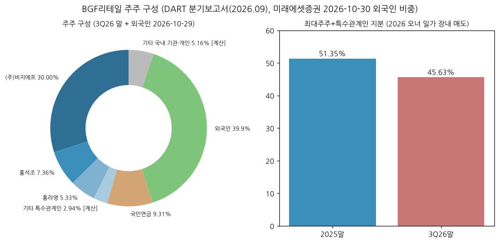

### ③ 임원·이사회

| 성명 | 구분 | 직책·담당 | 주요 경력 | 임기 만료 |
|---|---|---|---|---|
| 민승배 | 사내이사 | 대표이사 (2023-11\~) | 서울대 체육교육학, 舊 BGF리테일 개발지원팀장·사업지원실장, BGF 인사총무실장, BGF리테일 영업·개발부문장 | 2029-03-26 (2026-03 재선임) |
| 홍정국 | 사내이사 | ㈜BGF 대표이사 | 스탠포드 경제학·산업공학 석사, 와튼 MBA, BCG, 舊 BGF리테일 전략기획본부장, BGF리테일 부사장·경영전략부문장, '19\~ ㈜BGF 대표 | 2027-03-21 |
| 이윤성 | 사내이사 | 재무지원 총괄, 내부거래위원회 | 舊 BGF리테일 자금팀장, BGF 재무팀장, BGF로지스·BGF푸드 감사 | - |
| 최자원 | 독립이사 | 감사위원회 | 프린스턴 경제학 박사, 美 노동통계국, 한양대 경제금융학부 교수 | 2028-03-26 |
| 신현상 | 독립이사 | 감사위원회 | 삼정회계법인 회계사, UCLA 경영학 박사, 한양대 경영학부 교수 | - |
| 차경환 | 독립이사 | 내부거래위원회 | 대검 기획조정부장, 수원지검 검사장, 김앤장 변호사 | 2028-03-26 |
| 조자영 | 독립이사 | 감사위원회·내부거래위원회 | 삼정회계법인 파트너 부대표, 대주회계법인 회계사 | 2028-03-26 |

(출처: DART 분기보고서(2026.09) VIII 등기임원, OpenDART exctvSttus(2025). 등기이사 7명 = 사내 3 + 독립 4. 2026-03 정관 개정: 집중투표제 배제 조항 삭제, 전자주주총회 도입, 이사 충실의무 확대, 감사위원회 구성 강화, 사외이사 → "독립이사" 명칭 변경 [DART 분기보고서(2026.09) 정관 변경 이력]. 미등기임원 22명 1인 평균 급여 3.35억(2025))

---

## 6. 기타 팩트

### ① R&D 인프라

- **전담 연구개발 조직 없음** — QC팀(식품 안정성)·상품본부(PB·간편식 개발)·빅데이터팀·디지털혁신본부(가맹점 POS·본부 시스템)·Retail Tech·UX Design Lab(포켓CU 앱)이 고유 업무와 병행 [DART 사업보고서(2025.12) II-6]
- 업종 특성상 R&D 대신 **상품 개발(MD)·IT 시스템·물류 인프라**가 경쟁력의 핵심 — CapEx(2025 2,471억)가 R&D의 80배

| 연도 | 연구개발비(백만원, 별도) | R&D/매출 |
|---|---|---|
| 2017 (11\~12월) | 384 | 0.04% |
| 2018 | 1,624 | 0.03% |
| 2019 | 9,997 | 0.17% |
| 2020 | 2,666 | 0.04% |
| 2021 | 4,825 | 0.07% |
| 2022 | 9,843 | 0.13% |
| 2023 | 5,427 | 0.07% |
| 2024 | 4,350 | 0.05% |
| 2025 | 3,079 | 0.03% |

(출처: DART 사업보고서 각 연도 II-6 연구개발비용 (별도, 정부보조금 차감 전). R&D/매출은 공시 비율(별도 매출 기준). 2014\~2016 구법인 R&D는 미수집. BGF푸드도 전담 조직 없음)

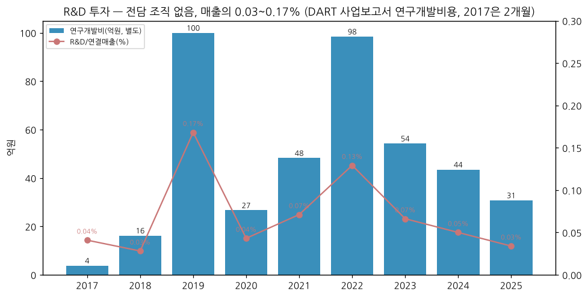

### ② 진행 중 corporate action — 10년치 주요 이벤트

| 일자 | 이벤트 | 내용 | 출처 |
|---|---|---|---|
| 2016-04 | BGF로지스 지역 물류법인 흡수합병 | 강화·양주·화성·팔탄·대구 법인 통합 | DART 사업보고서(2025.12) |
| 2016-07 | 씨펙스로지스틱 지분 취득 | 물류 | 〃 |
| 2017-11-01 | 인적분할 | 지주 ㈜BGF / 사업 ㈜BGF리테일 (순자산 65:35) | DART 사업보고서(2017.12) |
| 2018-03 | ㈜BGF 공개매수 | BGF리테일 4,417,687주 → 이후 30.00% | DART 사업보고서(2025.12) |
| 2020-09 | 몽골 파트너 투자 | Premium Nexus JSC(구 Central Express CVS)에 현금 50억 | DART 사업보고서(2025.12) |
| 2024-07-01 | BGF네트웍스 인수 | ㈜BGF로부터 100%, 720억 (현금) | 〃 |
| 2025 | 하와이 진출 | BGF RETAIL HAWAII CORP. 설립, 파트너 지분 10% 콜옵션 | DART 분기보고서(2026.09) |
| 2026-3Q | 부산 중앙물류센터 가동 | 저온센터 3Q, CDC·RDC 4Q 순차 가동 예정 | IR 3Q26 |

### ③ 상품·인프라 마일스톤 — 10년치

- 2018: 진천 중앙물류센터(CDC) — "업계 최대 규모" [BGF 지속가능경영보고서 2026]
- 2018\~2025: 해외 마스터 프랜차이즈 4개국 (몽골 → 말레이시아 → 카자흐스탄 → 하와이)
- PB 브랜드: 통합 PB **PBICK**(스낵·음료·유제품·라면), 커피 **get coffee**, 파우치 음료 **delaffee** [BGF 지속가능경영보고서 2026]. 2026-3Q PB 베이커리 Bake405 리뉴얼(빵 매출 +8.5%) [IR 3Q26]
- 앱: 포켓CU (O4O 사용자 경험·UX/UI 강화) [DART 사업보고서(2025.12) II-6]
- 2026: 인바운드 대응 — TAX 즉시환급 약 800점 [IR 3Q26]

### ④ 주요 리스크

(1) **점포 포화·업태 성장 정체**: 편의점 4사 점포수 2025 -2.9%, 업태 매출 +0.1% [DART 사업보고서(2025.12)]. CU 순증 +253점 — 출점 기반 성장 모델의 한계

(2) **규제·인건비**: 가맹사업법(가맹점 수익 배분·출점 거리), 최저임금(2018 +16.4% 사례), 담배 관련 세제·광고 규제, 식품위생법(BGF푸드), 하도급법(BGF로지스) [DART 분기보고서(2026.09) II 법규]. 공정위 과태료 2건(2024-11 262만원, 2026-10 224만원 — 기업집단현황 공시 기재 오류) [DART 분기보고서(2026.09) XI]

(3) **담배 의존도**: 매출의 36.2%(9M26)가 담배 — 금연 정책·전자담배 전환·세금 변화가 매출 규모에 직접 영향 (매출총이익 기여는 매출 비중보다 작음)

(4) **소송**: 원고 28건(35.2억), 피고 18건(39.2억) — 경영진은 재무 영향이 중요하지 않다고 판단 [DART 분기보고서(2026.09) XI]

(5) **지배구조·수급**: 2026 오너 일가 장내 매도로 특수관계인 지분 51.35% → 45.63% [계산]. 지주사 ㈜BGF와의 내부거래(브랜드 사용료 등)·계열사 지분 거래(BGF네트웍스 720억)는 이해상충 점검 대상

(6) **비용**: 유가 상승에 따른 물류비, 외환차손(해외 소싱) [IR 3Q26]. 리스부채 8,171억에 따른 금리 민감도

### ⑤ ESG 등급

| 기관 | 등급 | 시점 | 출처 |
|---|---|---|---|
| 한국ESG기준원(KCGS) 통합 | **A+** (첫 획득) — E A+ / S A+ / G A | 2025 | BGF 지속가능경영보고서 2025-2026, 시사경제 2025-11-20 |
| S&P Global 다우존스 베스트인클래스(DJBIC) 코리아 | 4년 연속 편입 (2022 편의점 업계 최초) | 2026-05 | 스마트투데이 2026-05-12 |
| MSCI ESG | 미확보 | - | - |

- 온실가스 (별도, 지역기반): 8,063 → 8,657 → 8,393 tCO2eq (2023\~2025), 집약도 0.095 tCO2eq/억원 (2025). 연결 67,026 tCO2eq (2025). 목표: 2030년 2020년 대비 원단위 10% 감축 [BGF 지속가능경영보고서 2025-2026 p.28]
- 임직원 자발적 이직률, 여성 관리자 비율 등 세부 사회 지표는 그룹 보고서 부록에 수록 (BGF리테일 전체 임직원 3,303 → 3,379 → 3,130명, 2023\~2025)
- ※ 지속가능경영보고서는 BGF 그룹 통합본(지주·BGF리테일·BGF에코머티리얼즈)이며, BGF리테일 단독 보고서(2022-2023·2023-2024판)는 KIND에 별도 게시 — 본 문서는 최신 통합본만 반영

### ⑥ 인증·라이선스

- ISO 37001(부패방지)·ISO 37301(컴플라이언스) [시사경제 2025-11-20], ISO 14001(환경)·ISO 45001(안전보건) [스마트투데이 2026-05-12]
- BGF푸드 HACCP [BGF 지속가능경영보고서 2026]
- 영업 인허가: 담배소매인 지정(점포별), 안전상비의약품 판매(점포별), 주류 판매 — 가맹점 단위로 보유 (정성)

---

## Version Log

- **2026-11-28 v1.0 통합 검수**: 유통 5사(이마트·BGF리테일·GS리테일·롯데쇼핑·현대백화점) 동시 작성 후 교차 검수 — 1장 ④-1 '유통 공통 비교 박스'(PER·PBR·배당수익률·순차입금 통일 정의, 정의 차이 각주) 5문서 동일 삽입, 피어 교차참조 문구 정리

- **v1.0 (2026-11-25)**: 첫 작성 — Phase 1 source 전수 점검을 한 번에 수행 (OpenDART 연결·별도 재무 JSON 각 36개(2017 FY\~3Q26) + 분할 전 구 BGF리테일(027410) 연결 44개(2015 FY\~2017 FY), 정기공시 XML 52건(본문 14건 파싱), 기업개황·주주·임원·직원·배당·자기주식·주식총수, IR 실적발표 PDF 31건(텍스트 23건), BGF 그룹 지속가능경영보고서 2025-2026, Yahoo 일간 시세) + v4.8 6개 섹션 + 차트 16종 (12종 표준 + chart2 4종(편의점 별도 분기·종속회사 분기·법인별 사업부문 연간·상품 MIX) + chart13 점포수·점당매출). 3Q26 분기보고서(2026-11-16)·IR 3Q26(2026-11-11) 반영
- **데이터 관례 (유통 서브섹터 교차검증용)**: ① 12년 = 2014\~2016 구법인(027410) 연결 + 2018\~2025 신설법인 연결, **2017은 분할 연도로 연간 손익 미확보 → 평균·CAGR·차트에서 제외** ② 사업 구분 = 단일 영업부문이라 법인별 매출(내부거래 제거 전) + 연결−별도 [계산]으로 대체, 사업별 영업이익 미공시 ③ 주가 = Yahoo `close`(배당 미조정), 시총 = close × DART 발행주식수 17,283,906주(자기주식 포함) ④ 배당 = 사업연도 귀속 DPS·배당총액(DART), 배당성향 = DART 연결 ⑤ CapEx = 연결 CF 유형 + 무형자산 취득 ⑥ FCF = 영업CF − CapEx, IFRS16 이후 비교는 "FCF − 리스상환" ⑦ 순현금 = 현금 + 단기금융상품 + FVPL − 차입금 (리스부채 제외) ⑧ 점당 매출 = 편의점 별도 매출 / 평균 점포수 [계산]
- **12년·60분기 미달 사유**: 분기 시계열 41개 분기(1Q16\~2Q17 구법인 6 + 1Q18\~3Q26 신설 35), 3Q17\~4Q17 미확보 — 2017-11 인적분할로 구법인 편의점 실적이 중단영업 처리됨. 2015 이전 분기는 OpenDART 재무 API 미제공
- 잔여 보완 후보: ① 2017 연간 pro-forma(구법인 2017 사업보고서 중단영업 주석의 1\~10월 편의점 손익) → 12년 시계열 완결 ② 구법인 2014\~2016 DPS·EPS(분할 전 주식 기준) ③ 2021 이전 분기 동일점 성장률·분기 점포수 (IR 이미지 PDF OCR) ④ 해외 로열티 수익 규모 ⑤ MSCI ESG 등급 ⑥ 외국인 지분율 연도별 추이 ⑦ IR 2021-08·2021-11 PDF 재다운로드 ⑧ ④-1 유통 공통 비교 박스 (통합 검수에서 삽입)

