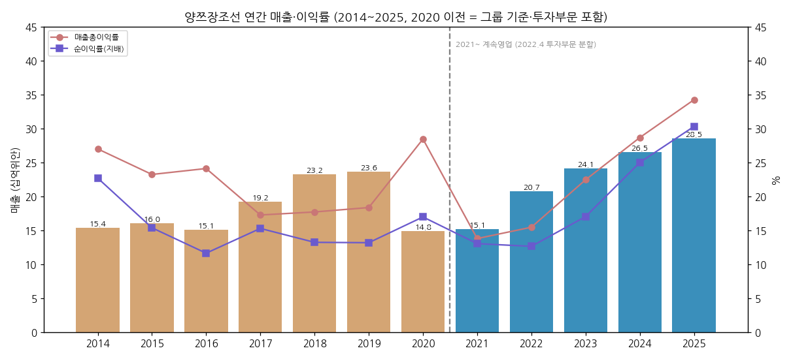
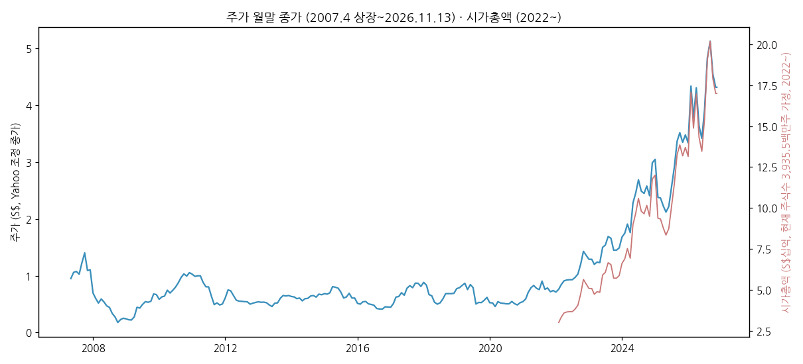
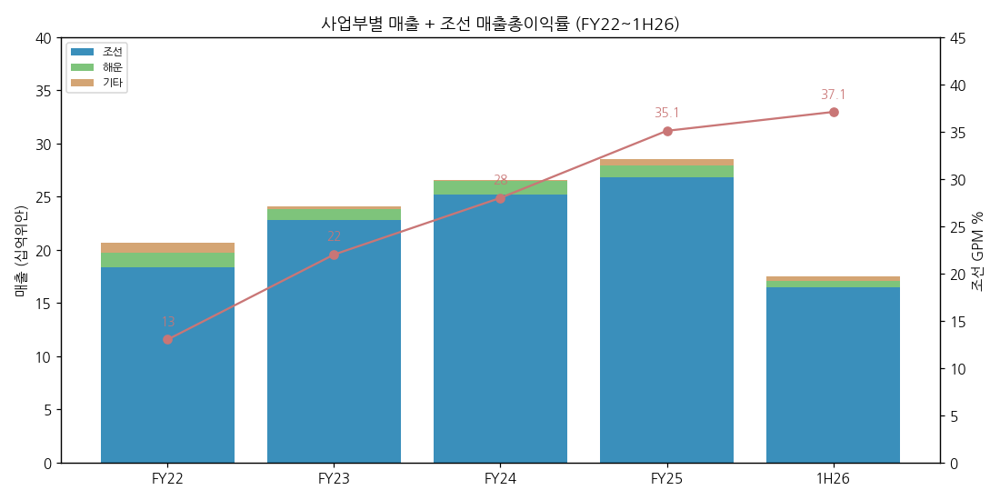
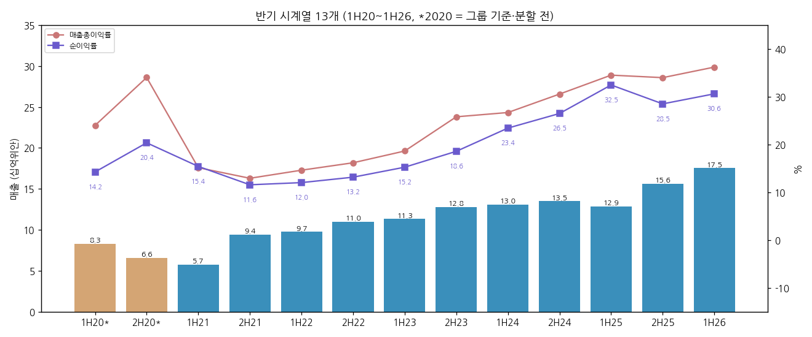
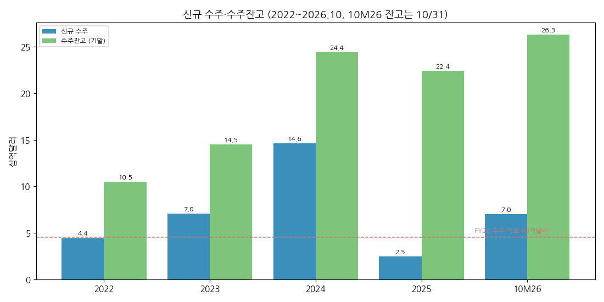
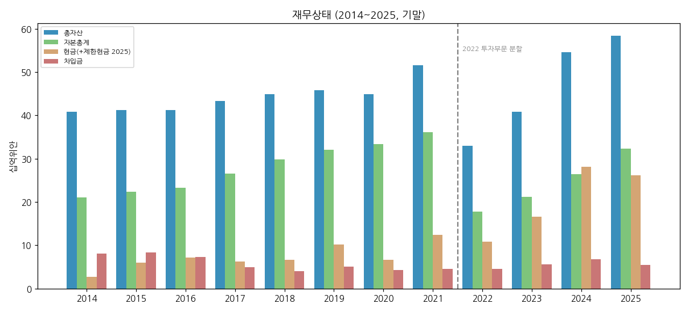
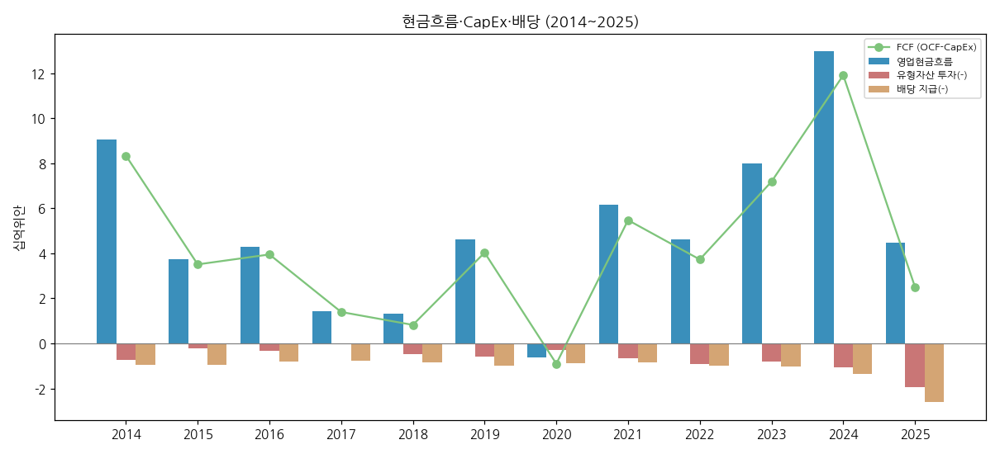

> Ticker: **SGX: BS6** (파일 키 `BS6.SI`) / Yangzijiang Shipbuilding (Holdings) Ltd. / 扬子江船业(控股)有限公司 — 싱가포르 상장(2007.04), 생산은 중국 장쑤성
> Sector: 조선 (섹터 T2 주도 후보) / 서브섹터: 조선 글로벌
> 작성 시각: 2026-11-14 KST (**v1.0** — 첫 작성)
> 적용 구조: v4.8 (6개 섹션) — 해외 종목이라 12종 차트 중 데이터로 만들 수 있는 7종만 작성
> 데이터: 연간 12년(2014~2025, 2021년부터 계속영업 기준) + 반기 13개(1H20~1H26, 반기 공시 종목) + 수주·잔고(2022~2026.10) + Yahoo 월간 주가(2007.04~2026.11)
> 출처: **SGX 공시 원문** — FY2014·2015·2017·2019·2020·2021·2022·2024·2025 연간 Announcement, 1H2022·1H2024·1H2025·1H2026 반기 Announcement, FY2023·FY2025·1H2026 Press Release, 1H2026·FY2022 Results Presentation (`company-overview-source\BS6.SI_Yangzijiang\sgx\`). **보도 인용** — 3Q26 Business Update(Baird Maritime·DBS·2Slides, 11/10~11), 1Q26 수주(Hellenic Shipping News), 증권사 코멘트(The Edge Singapore·NextInsight 발췌). **시장** — Yahoo Finance BS6.SI 월간, S&P Global 컨센(StockAnalysis 표시)
> 통화: 손익·재무 = 백만위안(RMB mn), 수주·잔고 = 억달러(US$), 주가 = 싱가포르달러(S$)

# 양쯔장조선 기업 개요 (v1.0 — 조선 글로벌, 중국 최대 민영 조선사)
> **Fact verify cutoff**: 2026-11-14 (3Q26 Business Update 11/10까지 반영. 다음 손익 갱신 = FY2026 실적, 2027년 2월 말 예상)

## ① 기업 분류

(1) Primary / Secondary 분류

**Primary 분류: 사이클 (조선 신조 사이클) — 현재 사이클 상단에서 마진 확장이 이어지는 구간**

→ 2014~2022년 매출총이익률은 13~28%를 오르내렸고 순이익은 2015년(-29%)·2016년(-29%)·2020년(-19%)에 감소했다(2021년은 분할 재작성으로 비교 불가). 2023년부터 3년 연속 순이익 +30~62% 성장, GPM 22% → 34%로 사이클 상승이 뚜렷하다
→ 매출의 94%가 조선(신조)이고 수주는 2024년 146억달러 → 2025년 24.6억달러 → 2026년 10개월 69.8억달러로 크게 출렁인다. 이익은 2~3년 전 수주 가격이 결정한다

**Secondary 노트: 고배당·순현금 + 해운(선대 28척) 일부**

→ 순현금 125억위안(2026.06), 배당성향 FY2024 38% → FY2025 50%, FY2026~27 50% 유지 가이던스(OCBC 인용)
→ 해운 부문(벌크선 중심 28척)은 매출 3% 수준의 보조 사업이다

**Entity 구조 — 기준 단절 1회**

→ **(1) 계속영업 (2021~)**: 조선(4개 야드 + 신규 훙위안) / 해운 / 기타(터미널·무역·설계·부동산)
→ **(2) 2022.04.28 투자부문 분할**: 부채투자·자산관리 등 투자 사업을 Yangzijiang Financial Holding(SGX: YF8)으로 분할 상장(현물배당 약 200억위안). 2021년 실적은 계속영업 기준으로 재작성됐고, 2020년 이전 수치에는 투자부문(2020년 매출 20.4억·부문이익 19.5억위안)이 포함돼 있다
→ **(3) 지분법 투자**: YAMIC(양쯔-미쓰이 조선 JV), 쓰네이시 저우산(34%, 2025), Poseidon Corp.(Seaspan 지주사, 10%, 2026.05)

(2) Summary Box (12년, 2014~2025)

| 지표 | 12년 평균 | 정점 | 저점 | 2025년 |
|---|---|---|---|---|
| 매출 (백만위안) | 20,195 | **28,505 (2025)** | 14,841 (2020) | **28,505** |
| 매출총이익률 (%) | 22.6 | **34.2 (2025)** | 13.8 (2021) | **34.2** |
| 지배주주 순이익 (백만위안) | 3,606 | **8,637 (2025)** | 1,752 (2016) | **8,637** |
| 순이익률 (%) | 17.2 | **30.3 (2025)** | 11.6 (2016) | **30.3** |
| ROE (%) | — | **29.5 (2025)** | 7.7 (2016·2020) | **29.5** |
| 매출 CAGR | 2014~2025 +5.8% / 2021~2025(계속영업) +17.1% | | | |
| 순이익 CAGR | 2014~2025 +8.6% / 2021~2025(계속영업) +44.7% | | | |

→ (출처: SGX 연간 공시 원문. 2020 이전 그룹 기준, 2021~ 계속영업. ROE = 지배주주 순이익 / 기초·기말 평균 자본총계 [계산]. 2021·2022년 ROE는 분할로 자본이 급감해 표시하지 않음)

```
[양쯔장조선 12년 손익 (백만위안)]
연도   매출     매출총이익  GPM    순이익   NPM
2014  15,354   4,144   27.0%  3,483  22.7%   ← 2000년대 말 수주분 인도 + 투자부문 이익
2015  16,014   3,719   23.2%  2,460  15.4%   ← 신조 침체기 진입, 선가 하락
2016  15,089   3,637   24.1%  1,752  11.6%   ← 순이익 저점 (투자부문 충당금)
2017  19,206   3,312   17.2%  2,932  15.3%   ← 저가 수주분 인도, GPM 하락
2018  23,238   4,112   17.7%  3,070  13.2%   ← 매출 확대(무역 포함)
2019  23,597   4,329   18.3%  3,105  13.2%
2020  14,841   4,222   28.4%  2,516  17.0%   ← 코로나, 인도 45척. 무역 축소로 매출 급감
------ 2022.04 투자부문 분할 → 이하 계속영업 기준 ------
2021  15,137   2,084   13.8%  1,971  13.0%   ← 컨테이너선 발주 붐 시작, 원자재 급등으로 GPM 저점
2022  20,705   3,197   15.4%  2,613  12.6%   ← 분할 완료, 인도 67척
2023  24,112   5,410   22.4%  4,102  17.0%   ← 고가 수주분 건조 + 위안 약세
2024  26,542   7,608   28.7%  6,634  25.0%   ← 수주 사상 최대 146억달러
2025  28,505   9,761   34.2%  8,637  30.3%   ← 조선 GPM 35.1%, 수주 24.6억달러로 급감
```



→ (출처: SGX 연간 공시 원문. 베이지 = 그룹 기준(투자부문 포함), 파랑 = 계속영업)

(3) 산업 분류
→ 워치리스트: 조선 (섹터 T2 주도 후보) / 서브섹터: 조선 글로벌 (2026-11 편입, 한국 조선 3사의 비교 피어)
→ 상장: SGX Mainboard, STI(스트레이츠 타임스 지수) 구성 종목. 사업·생산은 전부 중국 장쑤성 장강 연안

(4) 분류 결정 논리
→ 이익 결정 변수는 2~3년 전 수주 선가, 철강가, USD/CNY 환율이다. 세 변수 모두 사이클을 탄다. 2023~2025년의 마진 확장은 2021~2024년 고가 수주와 위안 약세·철강가 하락이 겹친 결과라 "지속성장"이 아니라 "사이클 상단"으로 분류한다
→ 다만 순현금·고배당·선별 수주 기조가 하락기 손실을 줄여 왔다(2015~2016년 침체기에도 순이익률 11% 이상)

(5) 적정 밸류에이션 방법
→ 1순위 P/E (셀사이드 표준): UOB KH는 10년 평균 6.2~6.3배, 목표 9.3~10배. CGS 11배(FY27F), OCBC 10.7배(FY27~28 평균 EPS), DBS 12배·3배 P/B (보도 인용)
→ 2순위 P/B + ROE: ROE 29.5%(2025), 1H26 연율 32.3%
→ 한국 피어 비교: 섹터 리뷰 기준 2027F PER 한국 3사 9.8~10.8배 vs 중국 8.5~9.9배(신한 Bloomberg 표). DBS는 양쯔장 FY27 PER 8배로 제시

(6) 분류 변경 조건 (재평가 트리거)
→ **지속성장으로 상향**: 수주 가격 하락기(2027~)에도 조선 GPM 30% 이상이 2년 이상 유지되고 훙위안·LNG선으로 물량이 구조적으로 늘 때
→ **사이클 하강 진입**: 반기 조선 GPM 35% 미만 + 반기 순이익 YoY 한 자릿수 + 연간 수주 목표 미달이 동시에 나올 때
→ **분류 혼합 (조선 + 투자)**: Poseidon(10%) 같은 해운사 지분 투자가 지분법이익의 큰 몫을 차지하게 될 때

(7) 한국 조선 3사와의 경쟁 지점 — 어디서 맞붙나

| 선종 | 양쯔장 위치 (잔고·수주) | 한국 3사 | 경쟁 강도 |
|---|---|---|---|
| 초대형 컨테이너선 (13,000~24,000TEU, LNG·메탄올 이중연료) | 잔고 컨테이너선 173척·194억달러(잔고의 74%). 2026년 24,000TEU LNG DF 12척 수주 | HD현대중공업·한화오션·삼성중공업 모두 수주 | **정면 경쟁** — 같은 선주(대형 정기선사) 입찰에서 슬롯·가격으로 맞붙음 |
| 중형 컨테이너선 (1,100~8,000TEU) | 1H26 신규 수주의 중심(1,100·1,900·5,900TEU) | HD현대 계열 중형 야드 | 경쟁 (중국 2선 야드와 3파전) |
| 탱커 (MR 50,000DWT·LR1 75,000DWT) | 잔고 44척, 2026년 18척 수주 | HD현대 계열 중형 야드(MR 탱커 강자) | 경쟁 |
| 가스선 (VLAC·VLEC·LPG) | 잔고 25척 22억달러, YAMIC 잔고의 53%가 가스선 | HD현대 계열·한화오션(VLAC·VLEC) | 경쟁 |
| 벌크선 (82,500~210,000DWT) | 잔고 43척, 2026년 210,000DWT 10척 | 한국은 거의 수주하지 않음 | 경쟁 약함 (중국·일본 영역) |
| 대형 LNG운반선 (174k㎥) | 해지 물량 2척 자체 건조 중, 신규 진출 시도 단계 | 한국 3사 핵심 선종 | 현재 낮음 → 잠재 위협 |
| FLNG·FPSO·해양, 군함·미 해군 MRO | 없음 | 삼성중공업 FLNG, 한화오션·HD 특수선 | 겹치지 않음 (한국만 가능 영역) |

→ (출처: 양쯔장 잔고·수주는 1H26 Results Presentation p.12·15 및 3Q26 업데이트 보도 인용. 한국 3사 선종은 섹터 리뷰·종목 리뷰 기준 [판단])
→ [판단] 양쯔장은 컨테이너선 비중이 한국 3사보다 훨씬 높다. 한국이 LNG선·해양·특수선으로 고부가 쪽에 서 있다면, 양쯔장은 컨테이너선·탱커·벌크의 대량 표준선에서 원가·속도로 이긴다. 두 회사군이 가장 직접 부딪히는 곳은 초대형 이중연료 컨테이너선 입찰이다
→ 마진 레벨: 양쯔장 1H26 조선 GPM 37.1%·부문이익률 36.9% vs 한국 3사 합산 3Q26 OPM 14.0%(섹터 리뷰). 회계 지표가 달라(GPM·부문이익 vs 영업이익) 단순 비교는 과대평가 쪽이지만, 차이가 20%p 이상이라 수익성 우위는 분명하다 [판단]

---

## ② 회사 개요

(1) 기본 사항

| 항목 | 내용 |
|---|---|
| 회사명 | Yangzijiang Shipbuilding (Holdings) Ltd. (扬子江船业) |
| 설립 | 1956년 (장쑤성 조선소 기원, 회사 소개 기준), 싱가포르 지주사 등록번호 200517636Z(2005년 등록), SGX 상장 2007년 4월 |
| 본사·생산 | 등기 본사 싱가포르, 생산 야드 중국 장쑤성 장강 연안 4곳 + 훙위안 신규 야드(2026 가동) |
| 사업 한 줄 정의 | 중국 최대 민영 조선사 중 하나 — 컨테이너선·벌크선·탱커·가스선 신조 + 해운(선대 28척) |
| 경영진 | Ren Letian(任乐天) 회장 겸 CEO. 창업자 Ren Yuanlin(任元林)의 아들 |
| 발행주식 | 39.74억주(자사주 0.38억주 제외 시 39.36억주, 2026.06) |
| 시가총액 | 약 S$170억 (S$4.32 × 39.36억주, 2026-11-13 [계산]) |
| 신용·재무 | 순현금 125억위안, 차입금 41.3억위안(전액 무담보, 2026.06) |

(2) 12년 손익·자본 추이 (백만위안)

| 연도 | 매출 | 매출총이익 | 순이익(지배) | 자본총계 | 자본 YoY |
|---|---|---|---|---|---|
| 2014 | 15,354 | 4,144 | 3,483 | 21,076 | — |
| 2015 | 16,014 | 3,719 | 2,460 | 22,359 | +6.1 |
| 2016 | 15,089 | 3,637 | 1,752 | 23,199 | +3.8 |
| 2017 | 19,206 | 3,312 | 2,932 | 26,517 | +14.3 |
| 2018 | 23,238 | 4,112 | 3,070 | 29,818 | +12.4 |
| 2019 | 23,597 | 4,329 | 3,105 | 32,055 | +7.5 |
| 2020 | 14,841 | 4,222 | 2,516 | 33,377 | +4.1 |
| 2021 | 15,137 | 2,084 | 1,971 | 36,062 | +8.0 |
| 2022 | 20,705 | 3,197 | 2,613 | 17,705 | -50.9 (분할) |
| 2023 | 24,112 | 5,410 | 4,102 | 21,143 | +19.4 |
| 2024 | 26,542 | 7,608 | 6,634 | 26,377 | +24.8 |
| 2025 | 28,505 | 9,761 | 8,637 | 32,258 | +22.3 |

→ (출처: SGX 연간 공시 원문. 2021년 손익은 계속영업 재작성치, 그룹 기준 2021년은 매출 16,768·순이익 3,699백만위안. 자본총계는 비지배지분 포함)

(3) 주가 역사



→ (출처: Yahoo Finance BS6.SI 월간. 2022년 이전 주가는 Yahoo가 투자부문 분할(현물배당)을 반영해 조정한 값이라 당시 실제 호가보다 낮다. 시가총액은 2022년 이후만 현재 주식수로 환산 [계산])
→ 2007년 상장 후 2008년 금융위기로 급락, 2011~2021년 10년간 S$0.5~1.0(조정가) 박스권. 2022년 분할 이후 컨테이너선 발주 붐과 마진 확장으로 재평가가 시작돼 2024년 S$2대, 2026년 8월 월말 S$5.13까지 올랐다. 11/13 종가 S$4.32로 8월 대비 -16%다. 52주 범위 S$3.16~5.41(DBS 11/11 인용)

(4) 주요 연혁

| 연도 | 사건 |
|---|---|
| 1956 | 장쑤성에서 조선소 기원 (회사 소개) |
| 2007.04 | SGX Mainboard 상장 |
| 2007~ | 투자부문(부채투자) 확대 — 조선 외 이익원 |
| 2019 | 미쓰이 계열과 JV YAMIC(Yangzi-Mitsui Shipbuilding) 설립 (친환경 선박) |
| 2022.04.28 | 투자부문을 Yangzijiang Financial Holding으로 분할 상장, 현물배당 약 200억위안 |
| 2021~2024 | 컨테이너선·이중연료선 수주 붐, 2024년 수주 146억달러 사상 최대 |
| 2024 | YAMIC을 고부가 가스선 중심으로 재편, 175k㎥ LNG선 2척 계약 해지(자체 건조 지속) |
| 2025 | 쓰네이시 저우산 지분 34% 인수, 순이익 86.4억위안 사상 최대, 배당성향 50% |
| 2026.05 | Poseidon Corp.(Seaspan 지주사) 지분 10% 인수 (56.3억위안, 약 8.26억달러) |
| 2026 | 훙위안 야드 가동(2Q26 첫 매출), 10월 말 수주 69.8억달러·잔고 263억달러 사상 최대 |

---

## ③ 비즈니스 모델

(1) 실적 추이 통합 표 (백만위안)

| 부문 | FY2022 | FY2023 | FY2024 | FY2025 | 1H26 |
|---|---|---|---|---|---|
| 조선 매출 | 18,372 | 22,788 | 25,216 | 26,826 | 16,513 |
| ↳ 조선 GPM (%) | 13 | 22 | 28 | 35.1 | 37.1 |
| 해운 매출 | 1,383 | 1,022 | 1,243 | 1,141 | 585 |
| 기타 매출 | 950 | 303 | 84 | 538 | 436 |
| 합계 | 20,705 | 24,112 | 26,542 | 28,505 | 17,534 |
| 조선 부문이익 | — | 4,668 | 6,971 | 9,718 | 6,098 |

→ (출처: 1H26 Results Presentation p.8~9(조선 선종별 매출·GPM, 해운 매출), FY2024·FY2025 Announcement 부문 정보. FY2022 기타는 합계 − 조선 − 해운 [계산] 선종별(컨테이너선·탱커·가스선 등) 매출은 프레젠테이션 차트 레이블 판독이 불확실해 싣지 않았다)



→ (출처: SGX 공시·1H26 Results Presentation)

(2) 반기 시계열 (13개 반기, 백만위안)

| 반기 | 매출 | 매출총이익 | GPM | 순이익(지배) | NPM | 매출 YoY | 순이익 YoY |
|---|---|---|---|---|---|---|---|
| 1H20* | 8,265 | 1,984 | 24.0 | 1,178 | 14.3 | — | — |
| 2H20* | 6,576 | 2,238 | 34.0 | 1,339 | 20.4 | — | — |
| 1H21 | 5,739 | 870 | 15.2 | 885 | 15.4 | 단절 | 단절 |
| 2H21 | 9,398 | 1,215 | 12.9 | 1,087 | 11.6 | 단절 | 단절 |
| 1H22 | 9,741 | 1,424 | 14.6 | 1,171 | 12.0 | +69.7 | +32.3 |
| 2H22 | 10,964 | 1,773 | 16.2 | 1,442 | 13.2 | +16.7 | +32.7 |
| 1H23 | 11,321 | 2,110 | 18.6 | 1,726 | 15.2 | +16.2 | +47.4 |
| 2H23 | 12,791 | 3,301 | 25.8 | 2,376 | 18.6 | +16.7 | +64.7 |
| 1H24 | 13,049 | 3,484 | 26.7 | 3,058 | 23.4 | +15.3 | +77.2 |
| 2H24 | 13,493 | 4,124 | 30.6 | 3,575 | 26.5 | +5.5 | +50.5 |
| 1H25 | 12,878 | 4,447 | 34.5 | 4,181 | 32.5 | -1.3 | +36.7 |
| 2H25 | 15,627 | 5,314 | 34.0 | 4,456 | 28.5 | +15.8 | +24.6 |
| **1H26** | **17,534** | **6,350** | **36.2** | **5,368** | **30.6** | **+36.2** | **+28.4** |

→ (출처: SGX 반기·연간 공시 원문. *2020 = 그룹 기준(투자부문 포함, FY2020·FY2021 Announcement의 2H 열과 연간에서 1H 역산 [계산]). 1H21~ 계속영업. 분기 손익은 2020년까지(FY2020 Announcement에 4Q 열) 공시했고 2021년부터 반기 결산만 한다. 1·3분기는 수주·인도·잔고 Business Update만 낸다)



→ (출처: 동일)

(3) 사업부별 개요 (매출 비중 순, 1H26)
→ **조선 (94.2%)**: 장쑤성 장강 연안 야드 4곳 + 훙위안(2026 가동) + JV YAMIC. 회사는 "컨테이너선이 최대 매출원, 그다음이 탱커"라고 설명한다(1H26 Presentation p.8). 2026년 인도 목표 58척(YAMIC 포함)
→ **해운 (3.3%)**: 벌크선 중심 선대 28척(평균 선령 8.5년, 2026.10 보도 인용). 스팟 용선 위주 운용, 노후선 매각으로 선대 교체 중
→ **기타 (2.5%)**: 터미널 서비스, 원자재 무역(관계사 쓰네이시 저우산 대상), 선박 설계, 투자부동산, 강관 말뚝 제조(Chengkang 연결)

(4) 사업부별 디테일
→ **수주 잔고 (2026.10.31, 보도 인용)**: 285척·1,265만 CGT·263억달러. 컨테이너선 173척 194억달러, 탱커 44척 24억달러, 벌크선 43척 23억달러, 가스선 25척 22억달러. 친환경 선박 비중 67%
→ **잔고 내 주력 선형 (2026.06, 회사 원문)**: LNG DF 17,000TEU 28척, LNG DF 24,000TEU 9척(이후 12척 추가), 메탄올 DF 13,000TEU 11척, LR1 탱커 75,000DWT 18척, 82,500DWT 벌크선 14척
→ **YAMIC**: 잔고 54척·31.2억달러, 가스선 비중 53%(2026.10). 2024년 고부가 가스선 중심 재편 후 지분법이익 급증(1H26 3.42억위안)
→ **이익 outlier**: 2025년 GPM 35.1%는 2021~2024년 고가 수주 + 원자재 하락. 1H26 37.1%는 초대형 컨테이너선·VLEC 믹스



→ (출처: 2022~2025 1H26 Results Presentation p.14·17, 10M26 3Q26 Business Update 보도 인용)

| 연도 | 신규 수주 (억달러) | 기말 잔고 (억달러) | 잔고 척수 | 인도 척수 |
|---|---|---|---|---|
| 2022 | 44.3 | 105 | 140 | 67 |
| 2023 | 70.5 | 145 | 182 | 56 |
| 2024 | 146.0 | 244 | 245 | 61 |
| 2025 | 24.6 | 224 | 245 | 56 |
| 2026 (10월 말) | 69.8 | 263 | 285 | 47 (목표 58) |

(5) 주요 경쟁사
→ 중국: 중국선박공업(CSSC, 국영 — 장난·후둥중화·와이가오차오 등), 헝리중공업, 신스지조선(New Times), 중국 2선 민영 야드(이른 슬롯으로 2H25 수주 확대, CGS 인용)
→ 한국: HD현대중공업·한화오션·삼성중공업(초대형 컨테이너선·가스선), HD현대 계열 중형 야드(MR 탱커·중형 컨테이너선·VLAC)
→ 일본: 이마바리·JMU(벌크선·중형 컨테이너선)

(6) 주요 고객
→ 회사는 고객별 매출을 공시하지 않는다. 2022년에는 3개 고객이 매출 113.9억위안(55%)을 차지했다(FY2022 Announcement — 이름 비공개)
→ Seaspan: Poseidon(Seaspan 지주사) 지분 10% 인수와 회장의 이사회 진입으로 "장기 파트너십"을 공식화했다. 2026년 수주 협상 대상으로 CMA CGM·HMM이 보도됐으나(Alphaliner·TradeWinds 경유 NextInsight, 9/21) 회사 확인은 없다

(7) 생산 CAPA
→ 기존 야드 4곳 + 훙위안 신규 야드(부지 866,671㎡, 투자 약 30억위안, 능력 +17~20%, 2027년 초 완전 가동·첫 인도 2027년)
→ Runze 증설안(+30%)은 보류 상태로 재가동 가능성이 거론된다(DBS)
→ 연간 인도: 2022년 67척 → 2025년 56척 → 2026년 목표 58척
→ 임직원 수: 미확보

---

## ④ 재무 구조 (12년 시계열)

(1) 손익 (①·②의 표 참고) — 연간 EBIT(회사 제시): 2023년 52.3억 → 2024년 83.0억 → 2025년 107.9억위안, 1H26 66.3억위안(EBIT 마진 37.9%, EBITDA 마진 39.7%)

(2) 재무상태표 (백만위안, 기말)

| 연도 | 총자산 | 자본총계 | 현금성자산 | 차입금 | 부채비율(부채/자본, %) |
|---|---|---|---|---|---|
| 2014 | 40,778 | 21,076 | 2,653 | 8,050 | 93.5 |
| 2015 | 41,246 | 22,359 | 5,993 | 8,282 | 84.5 |
| 2016 | 41,234 | 23,199 | 7,086 | 7,224 | 77.7 |
| 2017 | 43,373 | 26,517 | 6,195 | 4,891 | 63.6 |
| 2018 | 44,911 | 29,818 | 6,594 | 4,044 | 50.6 |
| 2019 | 45,756 | 32,055 | 10,183 | 5,033 | 42.7 |
| 2020 | 44,911 | 33,377 | 6,633 | 4,244 | 34.6 |
| 2021 | 51,612 | 36,062 | 12,363 | 4,457 | 43.1 |
| 2022 | 32,967 | 17,705 | 10,778 | 4,568 | 86.2 |
| 2023 | 40,864 | 21,143 | 16,561 | 5,595 | 93.3 |
| 2024 | 54,556 | 26,377 | 28,120 | 6,800 | 106.8 |
| 2025 | 58,334 | 32,258 | 26,144 | 5,500 | 80.8 |
| 2026.06 | 56,183 | 33,328 | 16,670 | 4,125 | 68.6 |

→ (출처: SGX 연간·반기 공시 원문 재무상태표. 현금성자산 2025·2026.06은 제한현금 포함(회사 프레젠테이션 정의). 부채비율 = 총부채/자본총계 [계산]. 2023~2024년 부채비율 상승은 선수금(계약부채) 증가 때문 — 2025년 말 계약부채 131.4억위안)



(3) 현금흐름 (백만위안)

| 연도 | 영업CF | 유형자산 투자 | FCF | 배당 지급 |
|---|---|---|---|---|
| 2014 | 9,061 | 729 | 8,332 | 953 |
| 2015 | 3,735 | 226 | 3,509 | 958 |
| 2016 | 4,288 | 338 | 3,950 | 818 |
| 2017 | 1,445 | 48 | 1,397 | 754 |
| 2018 | 1,307 | 483 | 824 | 857 |
| 2019 | 4,609 | 576 | 4,033 | 987 |
| 2020 | -612 | 288 | -900 | 885 |
| 2021 | 6,143 | 669 | 5,474 | 837 |
| 2022 | 4,632 | 905 | 3,728 | 970 |
| 2023 | 7,973 | 790 | 7,183 | 1,024 |
| 2024 | 12,961 | 1,056 | 11,905 | 1,346 |
| 2025 | 4,465 | 1,953 | 2,512 | 2,608 |
| 1H26 | 1,872 | 1,195 | 677 | 4,218 |

→ (출처: SGX 공시 원문 현금흐름표. FCF = 영업CF − 유형자산 투자 [계산]. 2025년 투자CF -84.8억위안은 제한현금(단기예금) 60.7억위안 이동 포함. 1H26 투자에는 Poseidon 56.3억위안이 별도로 있다)



(4) CapEx — 2024년까지 연 10억위안 이하였으나 2025년 19.5억위안, 1H26 12.0억위안으로 늘었다. 훙위안 야드(약 30억위안)와 LNG 터미널 전환(약 20억위안)이 원인이다

(5) 부채 구조 — 차입금 41.3억위안 전액 무담보 은행차입(2026.06), 채권 발행 이력 미확보. 순현금 125억위안

(6) 배당·자사주
→ 주당 배당: FY2024 기말 12센트(S$) → FY2025 기말 20센트(S$), 배당성향 50%, 배당수익률 5.7%(2025년 말 주가 기준, 회사 제시)
→ 자사주: 3,849만주 보유(0.97%), 2025년 1.58억위안 매입. 1H26 매입 없음

(7) 재무비율
→ ROE: 2023년 21.1%, 2024년 27.9%, 2025년 29.5% [계산], 1H26 연율 32.3%(회사)
→ 총차입금/자본: 12.4%(2026.06, 회사), 2025년 말 17.1%

---

## ⑤ 지배 구조

(1) 그룹·계열 관계
→ 런(任)씨 일가 지배. 창업자 Ren Yuanlin의 아들 Ren Letian이 회장 겸 CEO다
→ 분할 계열: Yangzijiang Financial Holding(2022 분할, 투자)은 별도 상장사다. 이후 해운 펀드 사업은 Yangzijiang Maritime Development로 다시 분리됐다(보도). 조선 회사와의 지분 관계는 미확인
→ 관계사·JV: YAMIC(미쓰이 계열과 JV), 쓰네이시 저우산(34%), Poseidon Corp.(10%), ENN Yangtze(톈진) 해운(49%, 2026 신설)

(2) 주주 구성
→ 대주주 지분율(런씨 일가 합산), 기관·개인 분포: **미확보** (FY2025 Annual Report 주주 현황 미다운로드). Simply Wall St는 Ren Yuanlin 개인 지분을 4.2%로 표시하나 일가·법인 보유분 합산이 아니어서 쓰지 않았다

(3) 임원·이사회
→ Ren Letian(任乐天): 회장 겸 CEO, 2026년 5월 Poseidon Corp. 이사회 합류. 이사회 구성·약력 상세는 미확보

---

## ⑥ 기타 팩트

(1) R&D — 1H26 관리비 증가(3.58억 → 5.29억위안)의 주원인이 R&D 확대라고 회사가 밝혔다. R&D 금액 시계열은 미공시

(2) 진행 중 corporate action

| 시점 | 내용 | 규모 |
|---|---|---|
| 2025 | 쓰네이시 저우산 지분 34% 인수 | 미확보 |
| 2026.05 | Poseidon Corp.(Seaspan 지주사) 10% 인수 | 56.3억위안 (약 8.26억달러) |
| 2026~2027 | 훙위안 야드 완공·가동 | 약 30억위안 |
| ~1H27 | LNG 터미널 전환 | 약 20억위안 |
| 준비 중 | 장쑤 양쯔 훙다 조선·수리(도킹·개조) 설립 | 미확보 |

(3) 기술 마일스톤 — LNG·메탄올 이중연료 초대형 컨테이너선(24,000TEU), VLEC(100,000㎥), VLAC(88,000㎥) 건조. 대형 LNG선(175,000㎥) 2척 자체 건조 중

(4) 주요 리스크
→ 환율: 선가 달러, 원가 위안. 위안 강세는 GPM 하락 요인(1H26 순환손실 2.27억위안). 회사는 USD/RMB 선물환·옵션으로 일부 헤지(헤지회계 미적용)
→ 원자재: 철강가 톤당 4,000~5,000위안 가정(2025-11 경영진, UOB KH 인용)
→ 수주 집중: 잔고의 74%가 컨테이너선
→ 지정학·규제: 미국의 중국 건조선 입항 수수료(USTR) 등 대중 해운 규제, 중동·호르무즈 해협 리스크(회사 8/6 언급)
→ 계약 해지 이력: 2024년 175k㎥ LNG선 2척 해지 → 재고로 건조 중(2026.06 재고 40.3억위안에 포함)

(5) ESG — 잔고의 67%가 친환경(이중연료 등) 선박(2026.10). ESG 등급: 미확보

(6) 인증·지수 — STI 구성 종목

---

## Version Log

- **v1.0 (2026-11-14)**: 첫 작성. SGX 공시 원문 17건(연간·반기 Announcement, Press Release, Results Presentation) 다운로드·대조. 연간 12년(2014~2025, 2021~ 계속영업), 반기 13개(1H20~1H26), 수주·잔고 2022~2026.10, Yahoo 월간 주가. 차트 7종(chart1·2·4·6·10·11·13). 3Q26 Business Update는 SGX 원문 PDF를 직접 받지 못해 보도 인용
  - 잔여 보완 후보: (1) 3Q26 Business Update·1Q26 Business Update SGX 원문 PDF (2) FY2025 Annual Report — 주주 구성·이사회·임직원·R&D (3) FY2016·FY2018 개별 연간 Announcement 대조(현재 FY2017·FY2019 비교 열 사용) (4) 2020년 이전 조선 부문 GPM 시계열 (5) 반기별 조선 선종별 매출 (6) FY2026 실적(2027년 2월 말) 반영
