> Ticker: **NYSE: BWXT — BWX Technologies, Inc.**
> Entity: **BWX Technologies, Inc.** (본사 Lynchburg, Virginia, USA) — 1867년 창업 보일러 회사 Babcock & Wilcox의 원자력 부문. 2015-06 발전설비 사업(BWE)을 스핀오프한 뒤 사명 변경. 미 해군 핵추진 원자로·핵연료 **단독 공급사** + 북미 유일 상업용 원전 대형 주기기(증기발생기 등) 제작사
> Sector: 원전 — 서브섹터 **원전 기자재 글로벌 (핵심)** (한국 비교 대상: 두산에너빌리티 — 서브섹터 원전 기자재)
> 작성 시각: **2026-11-15 KST** (**v1.0** — Phase 1 Source 전수 수집 + 13종 차트(12종 + 수주잔고) + v1.5 ① 기업 분류 표준)
> 적용 구조: v4.8 (6개 섹션) + v1.5 ① 기업 분류 표준 (Summary Box · 손익 narrative · 분류 sub-logic · 밸류에이션 · 분류 변경 조건 3종)
> 데이터 범위: **연간 12년 (FY2014~FY2025, 12월 결산, 계속사업 기준)** + **FY26 9M (1Q~3Q26, 10-Q 2026-11-02 제출)** + **사업부 분기 51Q (1Q14~3Q26)** + **주가 2010-09 ~ 2026-11-13 (McDermott 분리 상장 이후 전 기간)**
> 출처: **SEC EDGAR 10-K 14건 (FY2012~FY2025) · 10-Q 42건 (1Q13~3Q26)**, **SEC XBRL companyfacts (CIK 0001486957)**, **2026 Proxy Statement (DEF 14A, 2026-03-18)**, **3Q26 실적 보도자료 (Finviz 게재본, 2026-11-02)**, **3Q26 컨퍼런스콜 요약 (Webull 트랜스크립트)**, **2026 Investor Day 요약 (Quartr, 2026-09-29)**, **Yahoo Finance BWXT**, 회사 보도자료 (Bruce Power 증기발생기 계약)
> 사업부 단절: **2014~2021 = 구 3개 사업부** (Nuclear Operations Group·Nuclear Services Group(구 Technical Services)·Nuclear Power Group(구 Nuclear Energy)) → **2022-1Q부터 2개 사업부** (Government Operations = 구 NOG+NSG+선행 R&D / Commercial Operations = 구 NPG+의료 동위원소). 회사 공식 재작성은 2020(연간)·2021(분기)까지. 2014~2020 분기는 본 문서가 **NOG+NSG→Gov, NPG→Com으로 매핑** (mPower·기타 R&D 손익 제외) [매핑]. 단위 $M

# BWX Technologies 기업 개요 (v1.0 — 원전 기자재 글로벌 / 미 해군 원자로 독점 + 북미 유일 원전 주기기 / 지속성장형 정부 장기계약)
> **Fact verify cutoff**: 2026-11-15 (주가 2026-11-13 종가 **$122.97** [Yahoo Finance], 발행주식 91,625,197주 [10-Q 표지, 2026-10-30] → 시가총액 **$11.27B** [계산]. 사상 최고 종가 **$238.42 (2026-04-15)**, 장중 최고 $241.82 (2026-04-16) [Yahoo Finance 일간] → 당시 시총 약 **$21.8B** [계산: 종가 × 1Q26 표지 주식수 91.6M]. 고점 대비 **-48.4%**. 52주 최저 종가 $114.96 (2026-11-05) [Yahoo])

## Phase 1 Source Audit (메모리 룰)

```
=== 자료 수집 audit (BWX Technologies) ===

✅ 확보 (저장: company-overview-source/BWXT/)
- 10-K 14건 (2013-02 ~ 2026-02 제출, FY2012~FY2025) + 10-Q 42건 (1Q13~3Q26) — sec_edgar_download_reports
- SEC XBRL companyfacts.json (연간·분기 손익·BS·CF·RPO 정확값) — web_fetch
- DEF 14A 2건 (2025-03, 2026-03) — 5% 주주·이사회
- Yahoo Finance v8 BWXT 월간 (2010-09~) + 일간 1년 (2026-11-13까지)
- 3Q26 실적 보도자료: SEC Ex-99.1 직접 접근 403 → Finviz 게재본으로 대체 (가이던스·조정 EBITDA)
- 3Q26 컨퍼런스콜: Webull 트랜스크립트 요약 (사업 마일스톤·2027 전망·Q&A 주제)
- 2026 Investor Day (2026-09-29): Quartr 요약 (2030 목표)

❌ 누락 (4)
- SEC 8-K 보도자료 원문 (403) → 2차 게재본으로 대체
- 분기별 사업부 수주잔고 2022~2025 (10-K 연말 값과 2026 분기말만 수집)
- 의료 사업부 단독 매출·이익 (회사 미분리 공시 — Commercial 내 Nuclear Manufacturing/Services에 섞임)
- ESG 보고서·등급 미수집

⚠️ 결과 영향
- 연간 12년 = FY2014~FY2025. FY2014·FY2015 손익은 발전사업(BWE) 중단사업 재분류 후 계속사업 기준. **FY2014 재무상태표·현금흐름은 스핀오프 전 연결(발전사업 포함)** — 2015와 직접 비교 불가
- FY2014~2015 영업이익에 연금 MTM(시가평가) 손익 포함 / 2016~ ASU 2017-07 적용으로 연금 비서비스비용이 영업외로 이동 (FY2016·17은 XBRL 최신 재작성값)
- 사업부 분기 2014~2020은 구 사업부 매핑 [매핑], 2021~는 회사 공식 Gov/Com
- 조정 EBITDA·Non-GAAP EPS는 회사 보도자료 기준 (GAAP와 별도 표기)

Source 6종 audit:
[V] (1) 정기 보고서 (10-K 14 + 10-Q 42) ✓
[△] (2) IR 실적 자료 (3Q26 보도자료 2차 게재본 ✓, 과거 분기 보도자료는 10-Q로 대체)
[✗] (3) Sustainability Report ✗
[V] (4) 주가 (Yahoo 2010-09~) ✓
[V] (5) Proxy / 지배구조 ✓
[V] (6) 12년 정확값 시계열 (XBRL) ✓
→ 5/6 source 확보 (IR은 부분). 최신 분기(3Q26) 확보.
```

---

## ① 기업 분류

(1) Primary / Secondary 분류

**Primary 분류: 지속성장 (정부 독점 장기계약형 — 저변동 우상향)**

→ 매출 FY2014 $1,451M → FY2025 $3,198M, **11년 CAGR +7.5%** [계산] (스핀오프 후 첫 온전한 해 FY2015 기준 10년 CAGR +8.5%). 역성장은 FY2015(-2.4%, 스핀오프 연도) 1회, FY2021 0.0% 정체 1회

→ GAAP OPM은 스핀오프 이후(FY2015~FY2025) **12.6%~17.3%** (진폭 4.7%p) — 사이클 기준(±10%p) 한참 미달. FY2014 1.7%는 연금 MTM 손실·mPower SMR 비용으로 인한 일회성 저점

→ FY2025 매출의 **68%가 미국 정부**, Government Operations 매출의 91%가 미국 정부(대부분 DOE/NNSA 해군핵추진프로그램) [10-K FY25 Note 15]. 수요는 경기가 아니라 **미 해군 잠수함·항모 건조 계획**에 연동

**Secondary 노트: 꿈 (상업 원전 신규건설·SMR·마이크로리액터·우라늄 농축 옵션)**

→ 2024~2026 주가 급등은 이익이 아니라 **상업 원전 르네상스 옵션**에 연동 — 시총 2023말 약 $7B → 2026-04-15 사상 최고 약 $21.8B [계산]. 이후 "미국 첫 신규원전 기자재 발주"가 2026년 → **2026년말~2027년 상반기로 지연**되며 2026-11-13 $11.3B로 -48% (3Q26 컨콜)

→ Commercial Operations 매출 비중 FY2024 19% → FY2025 27% → 9M26 **33%** [계산] — Kinectrics(2025-05)·PCG(2026-07) 인수로 상업 원전 노출 확대 중

**2개 사업부 구조 (9M26 기준, 사업부 OP = GAAP 사업부 영업이익)**

→ **(1) Government Operations** — 매출 $1,818M (67%), OP $327M, OPM **18.0%** — 미 해군 원자로·핵연료(Virginia급·Columbia급 잠수함, Ford급 항모), 우라늄 처리·하향혼합, 특수소재(A.O.T.·고순도 감손우라늄), 선행 원자로 설계(Pele·BANR), 정부 사이트 운영 JV

→ **(2) Commercial Operations** — 매출 $900M (33%), OP $75M, OPM **8.3%** — 캐나다 CANDU 증기발생기·연료·연료교환기, 원전 정비·검사·수명연장 서비스(Kinectrics), 미국 중량 부품(PCG), 의료 동위원소(매각 예정)

(2) Summary Box (12년 시계열 + 사이클 통계)

| 지표 | 값 |
|------|-----|
| 매출 CAGR (FY14→FY25, 11년) | **+7.5%/yr** [계산] (FY15→FY25 **+8.5%**), FY26 가이던스 약 $3.8B (+19%, 인수 효과 포함) |
| GAAP OPM 평균 (12년) | **14.5%** [계산] (FY2014 일회성 제외 11년 평균 **15.6%**) |
| OPM 정점 | **17.3% (FY2017)** — 해군 원자로 안정 + 연금 비서비스비용 영업외 이동 효과 |
| OPM 저점 | **12.6% (FY2025)** — 저마진 서비스(Kinectrics) 편입·전사 비용 증가 (FY2014 1.7%는 연금 MTM 일회성) |
| 사이클 주기 | 뚜렷한 업황 사이클 없음 — OPM 하락은 **사업 믹스(Commercial 비중 확대)** 때문 |
| 사이클 회수 | 0회 (스핀오프 후 OPM 진폭 4.7%p, 사이클 cutoff ±10%p 미달) |

```
[BWXT 12년 손익 시계열 ($M, 12월 결산, 계속사업)]  * 사업부 OP = Gov+Com 사업부 영업이익 (2014~20 구 사업부 매핑, mPower·기타 R&D 제외), GAAP OP = 사업부 OP − 본사비용 ± 일회성
연도   매출     사업부OP  사업부OPM  GAAP OP   OPM    순이익
FY14   1,451     283    19.5%       25    1.7%     29   ← 연금 MTM 손실·mPower SMR 개발비(-$69M), 발전사업 분리 준비
FY15   1,416     277    19.6%      206   14.5%    131   ← 2015-06-30 발전사업(BWE) 스핀오프 → 순수 원자력 회사로 재출범, 사명 BWXT
FY16   1,551     323    20.8%      234   15.1%    183   ← mPower SMR 사실상 중단(Bechtel 프레임워크, -$30M), 2016-12 GE-Hitachi 캐나다(NEC) 인수
FY17   1,688     353    20.9%      292   17.3%    148   ← OPM 정점. 미 세제개편 이연법인세 재평가로 순이익 감소
FY18   1,800     344    19.1%      305   16.9%    227   ← 2018-04 Bruce Power 증기발생기 CA$642M, 2018-07 Nordion 의료 동위원소 인수
FY19   1,895     366    19.3%      326   17.2%    244   ← 해군 원자로 증산(Columbia급) 대비 CapEx 확대 시작
FY20   2,124     404    19.0%      359   16.9%    279   ← 매출 +12%, CapEx 피크권($255M), 미국 상업 서비스 사업 매각
FY21   2,124     365    17.2%      346   16.3%    306   ← 매출 정체(장기 자재 조달 타이밍), CapEx 정점 $311M
FY22   2,233     364    16.3%      349   15.6%    238   ← 2개 사업부 재편, 2022-06 국방부 Project Pele 이동형 마이크로리액터 선정
FY23   2,496     412    16.5%      383   15.3%    246   ← Gov 매출 +12% (해군 부품·특수소재·선행 원자로)
FY24   2,704     425    15.7%      381   14.1%    282   ← 본사비용 증가(-$44M), 잔고 $4.8B
FY25   3,198     453    14.2%      404   12.6%    329   ← A.O.T.(1월)·Kinectrics(5월) 인수로 매출 +18%, 전환사채 $1.25B, 잔고 $7.3B
9M26   2,715     402    14.8%      353   13.0%    282   ← PCG 인수(7월), 의료사업 $800M 매각 합의, 잔고 $8.6B 사상 최대

매출 CAGR 11년: +7.5% [계산] / OPM range (FY15~25) 12.6%~17.3% = 4.7%p [계산]
```

**두산에너빌리티(한국 원전 기자재)와의 위치 — 직접 비교는 섹터 리뷰에서 각 사 리뷰 숫자로**

→ BWXT 이익의 약 **80%가 미 해군 원자로·정부 사업** (9M26 사업부 OP $402M 중 Gov $327M, [계산]) — 상업 원전 주기기는 아직 이익 기여가 작다. 두산은 원자력이 에너빌리티 부문의 일부(가스터빈·EPC와 혼재)이고 한국·체코 대형원전 주기기 수주가 핵심

→ 두 회사 모두 **미국 대형원전(AP1000) 첫 발주 대기** 상태 — BWXT 컨콜(3Q26): "AP1000 기자재는 두산·IHI와 경쟁, 공급사 배분은 Westinghouse가 결정". 두산 쪽은 2026 9M 대형원전 수주 0.4조원 (연초 계획 4.9조) [두산에너빌리티_기업개요.md, 3Q26 IR]

(3) 정량적 분류 근거

→ **잔고 레코드** — $4.8B (FY24말) → $7.3B (FY25말) → **$8.6B (3Q26말)**. Gov $6.5B · Com $2.1B (Com은 PCG 인수 약 $0.5B 포함) [10-Q, 3Q26 컨콜]. 잔고/매출 2.3배 (잔고 $8.56B ÷ FY26 가이던스 $3.8B, [계산])

→ **해군 원자로 = Gov 매출의 77%** — Nuclear Components and Fuel 9M26 $1,398M ÷ Gov $1,818M [계산, 10-Q 제품라인]. 해군핵추진프로그램의 원자로·핵연료 **단독 공급** (10-K: "1950년대부터 공급, 기술·규제 장벽으로 경쟁 제한적")

→ **상업 원전 확장** — Commercial 매출 FY24 $524M → FY25 $853M (+63%) → 9M26 $900M (+62% YoY). 동인: Kinectrics 편입 $187M + 현장 정비·수명연장 $70M + 부품 제작 $30M + PCG $26M (9M26, 10-Q MD&A)

→ **현금 창출** — FCF FY24 $255M → FY25 $295M → FY26 가이던스 $350~360M [보도자료]

**2026 가이던스 (2026-11-02, 3Q26 발표)**

→ 매출 약 **$3.8B** (유지) / 조정 EBITDA 약 **$667M** (기존 $662~672M → 중간값 고정, 마진 약 17.5%) / Non-GAAP EPS **$4.72~4.77** (기존 $4.70~4.80) / FCF **$350~360M** (하단 상향) / CapEx 매출의 약 6% [보도자료·컨콜]

→ 2027 예비 전망: 매출 **high single digit 성장**, 조정 EBITDA·EPS high single~low double digit. Gov 매출·EBITDA high single~low double digit, Commercial은 유기적 high single digit이나 **의료사업 매각으로 전체 low single digit**, Commercial 마진 +50~100bp [3Q26 컨콜]

→ **2030 Investor Day 목표 (2026-09-29)**: 매출 $5.5~6.0B, 조정 EBITDA $1.1~1.2B (마진 2026 17.5% → 약 20%), FCF $525~575M, 2030년까지 누적 FCF $2B+ [Quartr 요약]

(4) 산업 분류

→ **GICS** — Industrials / Aerospace & Defense

→ **상장** — NYSE: BWXT (2010-08 McDermott에서 분리 상장 당시 티커 BWC → 2015-07 BWXT)

→ **워치리스트** — 섹터 원전 / 서브섹터 **원전 기자재 글로벌** (BWXT 핵심, Mitsubishi Heavy 원자력 부문) — 한국 대응 서브섹터 "원전 기자재" (두산에너빌리티) (`earnings/watchlist.md` 50행)

(5) 분류 결정 논리

(1) **가장 매출 큰 사업부 기준**: Gov 67% (해군 원자로) — 잠수함·항모 원자로는 수십 년 단위 건조 계획에 묶인 **초장기 독점 프로그램** → 지속성장

(2) **이익 비중 sub-rule**: 사업부 OP의 81%가 Gov (9M26) → 상업 원전 사이클이 전사 이익을 흔들 수준이 아직 아님

(3) **Boundary case**: Primary 지속성장 + Secondary "꿈(상업 원전·SMR·농축)". 주가는 Secondary가 결정(2026 고점 대비 -48%가 신규원전 발주 지연 뉴스에 반응). Commercial 매출 비중이 40%를 넘고 미국 신규원전 대형 주기기 수주가 잔고로 확인되면 Secondary를 "고성장"으로 격상

(4) **글로벌 피어 cross-ref**:
   - **두산에너빌리티** — 대형원전 주기기(원자로·증기발생기) 직접 경쟁(AP1000·CANDU 이외 시장). 두산은 수주→매출 2~4년 시차의 **사이클형**, BWXT는 정부 독점의 **지속성장형** — 같은 "원전 기자재"라도 이익 성격이 다르다
   - **Mitsubishi Heavy (원자력 부문)** — 일본 내 PWR 주기기, 해외는 제한적
   - **Curtiss-Wright·Leonardo DRS** — 해군 원자로 보조계통(펌프·전력) 공급사로 해군 사업 일부 겹침 [판단]
   - **Centrus·Urenco·Orano** — 농축 사업(국방용 HEU·HALEU) 진입 시 경쟁 구도 [판단]

(6) 적정 밸류에이션 방법 (단위 밸류는 분기 실적 분석, Terminal 밸류는 테마 통합 모드)

→ **1차 — Forward PER (Non-GAAP)**: 2026 EPS 가이던스 중간값 $4.745 → **25.9배** [계산: 주가 $122.97]. 정부 독점 지속성장 + 원전 옵션 프리미엄을 함께 반영하는 지표

→ **2차 — EV/EBITDA**: EV $12.72B [계산: 시총 $11.27B + 차입 $2.02B − 현금 $0.57B, 3Q26말] ÷ 2026 조정 EBITDA $667M = **19.1배**, 2030 목표 EBITDA 중간값 $1.15B 기준 **11.1배** [계산]

→ **3차 — FCF 수익률**: 2026 FCF 가이던스 중간값 $355M ÷ 시총 = **3.2%** [계산]. 배당 수익률 0.9% (분기 $0.27 × 4 ÷ $122.97, [계산])

→ **PBR 미사용 근거** — 2015 스핀오프로 자본이 $1.0B → $0.27B로 급감했고 이후 자사주·인수 영업권으로 자본이 이익 체력을 반영하지 못함 (PBR 7.9배 [계산], ROE 28~88%)

(7) 분기 재평가 트리거 (**분류 변경 조건**)

→ ① **미국 신규 대형원전(AP1000 등) 또는 SMR 주기기 첫 확정 수주 $1B+가 잔고에 반영되고 Commercial 매출 비중 40%+** → Secondary "꿈" → "고성장" 격상, 밸류 기준을 성장 프리미엄 PER로 이동

→ ② **Gov OPM이 4개 분기 연속 15% 미만** (해군 다년 가격협상 악화·고정가 손실) → Primary 지속성장의 마진 안정성 재검토

→ ③ **신규원전 발주가 2027년 하반기 이후로 다시 밀리고 Commercial 유기적 성장이 low single digit으로 둔화** → Secondary "꿈" 할인, 순수 정부 방산형 지속성장으로 재분류 (밸류 기준을 방산 프라임 PER 17~20배대로)

---

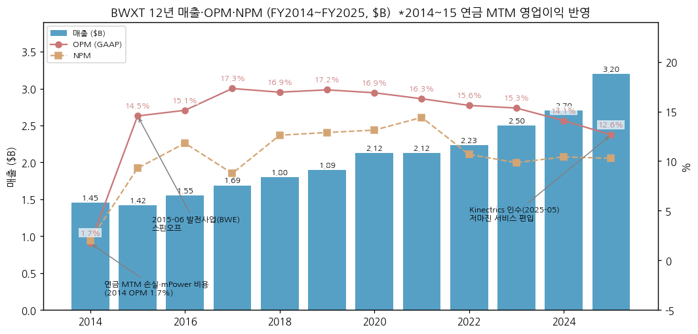

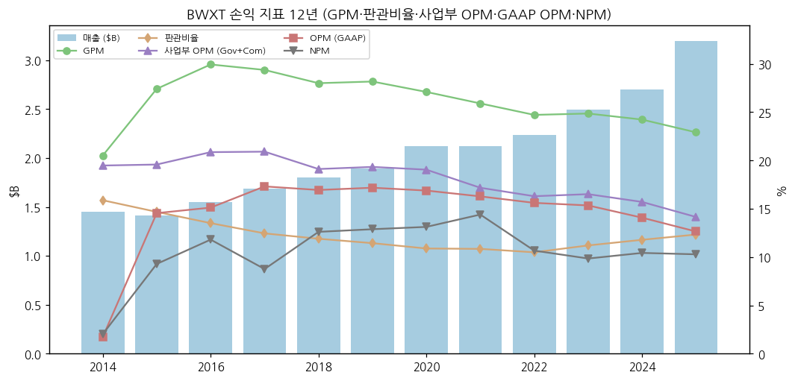

---

## ② 회사 개요

(1) 기본 정보

| 항목 | 내용 |
|---|---|
| 정식 명칭 | BWX Technologies, Inc. (Delaware 법인) |
| 본사 | Lynchburg, Virginia (워싱턴 DC 사무소 별도) |
| 뿌리 | 1867년 Babcock & Wilcox (보일러) → 1950년대부터 미 해군 원자로 부품 공급 → 2010 McDermott에서 분리 상장 (The Babcock & Wilcox Company) → **2015-06-30 발전설비 사업(BWE) 스핀오프 후 BWX Technologies로 개명** |
| 상장 | NYSE: BWXT |
| CEO | Rex D. Geveden (사장 겸 CEO) |
| CFO | Michael Fitzgerald (SVP·CFO, 3Q26 컨콜 기준) |
| 이사회 의장 | Jan A. Bertsch (독립 의장, 2015년부터 이사) |
| 임직원 | 약 **10,400명** (FY25말: 미국 6,700 · 캐나다 3,500 · 기타 200, 10-K) |
| 사업 한 줄 정의 | 미 해군 잠수함·항모용 원자로와 핵연료를 독점 생산하고, 캐나다 CANDU 원전의 증기발생기·연료·정비를 공급하며, 차세대 원자로(마이크로리액터)·TRISO 연료·우라늄 농축으로 확장하는 원자력 전문 제조사 |
| 고객 구성 (FY25) | 미국 정부 68% (Gov 매출의 91%) · 대형 전력사 4곳 17% (Com 매출의 63%) [10-K Note] |
| 지역 매출 (FY25) | 미국 76% · 캐나다 21.5% · 기타 2.6% [계산, 10-K 지역별 표] |

(2) 핵심 KPI 요약 (FY25 + 3Q26 + 9M26 + FY26 가이던스, $M)

| 지표 | FY25 | 3Q26 (YoY) | 9M26 (YoY) | FY26 가이던스 |
|---|---|---|---|---|
| 매출 | 3,198 | 953.0 (+10.0%) | 2,714.8 (+17.4%) | 약 3,800 |
| 사업부 OP (OPM) | 452.6 (14.2%) | 148.9 (15.6%) | 402.1 (14.8%) | — |
| GAAP 영업이익 (OPM) | 404.5 (12.6%) | 132.1 (13.9%) | 352.9 (13.0%) | — |
| 조정 EBITDA | 574 | 179.7 (+19%) | — | 약 667 |
| 순이익 / 희석 EPS (GAAP) | 328.9 / $3.58 | 102.0 / $1.11 | 281.8 / $3.06 | — |
| Non-GAAP EPS | $4.01 | $1.26 (+26%) | — | $4.72~4.77 |
| FCF | 295 | 150.5 (+59%) | 315.5 | 350~360 |
| 수주잔고 | 7,261 | 8,556 | — | — |

→ (출처: 10-K FY25, 3Q26 10-Q, 3Q26 보도자료(Finviz 게재본). 조정 EBITDA·Non-GAAP EPS는 회사 정의. 9M26 FCF = 영업CF $451.7M − CapEx $136.2M [계산]. 3Q26 순이익은 보도자료 BWXT 귀속분, XBRL 분기값 $101.7M)

→ 3Q26 매출은 컨센서스 대비 -4% 미달, Non-GAAP EPS $1.26은 컨센 $1.19 상회. 3Q26 신규수주 $538M (전년 $2.25B, 해군 수주 시점 차이) [Finviz/EarningsWhispers 2026-11]

(3) 주요 연혁 (시대별)

| 시기 | 사건 |
|---|---|
| 1867 | Babcock & Wilcox 창업 (수관 보일러) [web 공개 사실] |
| 1950년대~ | 미 해군 핵추진 원자로 부품·연료 공급 시작 (10-K "since the 1950s") |
| 2010 | 모회사 McDermott에서 분리 상장 (The Babcock & Wilcox Company) |
| 2014 | mPower SMR 자체 개발 축소 (FY14 mPower 손실 -$69M) |
| **2015-06-30** | **발전설비 사업 → Babcock & Wilcox Enterprises(BWE) 스핀오프**, 회사명 BWX Technologies (10-K FY15) |
| 2016 | mPower 프레임워크(Bechtel)로 SMR 사업 사실상 정리, **2016-12 GE-Hitachi Nuclear Energy Canada(NEC) 인수** — CANDU 연료·연료교환기 |
| 2018 | **Bruce Power 증기발생기 CA$642M 계약 (2018-04, Unit 5~8용 32기, Cambridge 공장)** [회사 보도자료] / **Nordion 의료 동위원소 사업 인수 (2018-07-30)** |
| 2019~2021 | 정부 수요 대응 시설 증설 + 의료 동위원소 상용화 + Cambridge 공장 확장 — CapEx 연 $182~311M |
| 2020-05 | 미국 상업 원전 서비스 사업 매각 (공장 부지와 교환) |
| 2022 | 2개 사업부(Gov/Com) 재편 / **2022-06-09 국방부 SCO, 이동형 마이크로리액터 Project Pele 설계·제작사로 BWXT 선정** [Defense News] |
| 2025-01 | **Aerojet Ordnance Tennessee(A.O.T.) 인수 $101.1M** (L3Harris 자회사, 특수소재) |
| 2025-05-20 | **Kinectrics 인수 (기업가치 CA$782.7M, 지분 대가 US$440.6M)** — 원전 수명관리·검사 서비스, 직원 1,300명 |
| 2025-11 | **0% 전환사채 $1.25B 발행 (2030 만기, 전환가 $262.51)**, $1.25B 리볼버로 재약정 |
| 2026-07-01 | **Precision Components Group(PCG) 인수 $216.8M** — 미국 중량·열교환 부품, 잔고 약 $500M (75~80% 해군) |
| 2026-07-31 | **의료사업(BWXT Medical + Kinectrics 의료 동위원소) Nordic Capital에 최대 $800M 매각 합의** (소수지분 유지, 2026년 또는 1Q27 종결) |
| 2026-09-29 | Investor Day — 2030 매출 $5.5~6.0B · 조정 EBITDA $1.1~1.2B 목표 |
| 2026-10~11 | Antares와 TRISO 연료 1톤 공급 계약, 육군 Janus 마이크로리액터(Fort Campbell)·캐나다 Prodigy 선정, Cambridge 대형 부품 생산능력 +50% 완공 [3Q26 컨콜] |

→ (출처: 10-K·10-Q 인수 주석, 회사 보도자료, 3Q26 컨콜 요약. 1867·2010 연혁은 공개 일반 사실 [web])

(4) 회사 주가 역사 (narrative 영역)

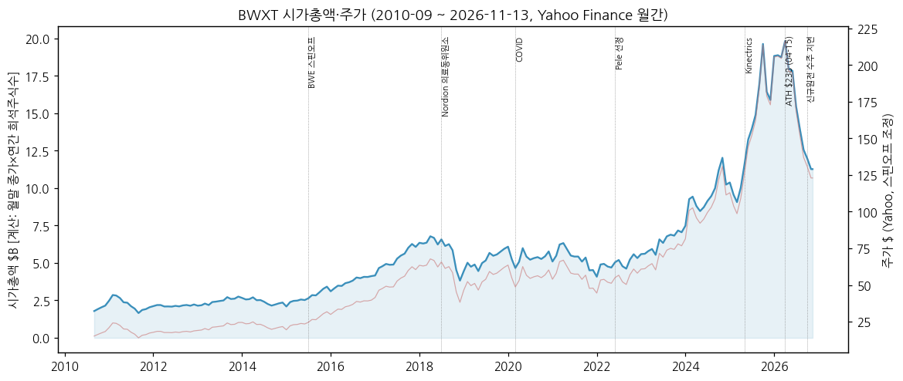

→ **2010~2014 박스권 ($15~25, Yahoo 스핀오프 조정가)** — 발전설비(석탄 보일러) 사업과 혼재, mPower SMR 비용 부담

→ **2015~2017 재평가 ($24 → $60)** — 스핀오프로 순수 해군 원자로 회사가 되며 PER 재평가. 2017-12 종가 $60.49, 시총 약 $6.1B [계산]

→ **2018~2023 박스권 ($38~78)** — 2018-12 $38.23 (2018 하반기 Gov 마진 하락, 3Q18 Gov OPM 15.0%), 이후 해군 증산 투자기. 2023-12 $76.73 (시총 약 $7.1B [계산])

→ **2024~2026-04 원전 르네상스 랠리 ($77 → $238)** — AI 데이터센터 전력 수요·미국 원전 정책 지원으로 상업 원전·마이크로리액터 옵션 부각. 2024-12 $111.39 → 2025-12 $172.84 → **2026-04-15 사상 최고 종가 $238.42 (시총 약 $21.8B)** [Yahoo, 계산]

→ **2026-04 이후 급락 (-48%)** — 2Q26(8월) 발표 후 하락 시작, 3Q26 매출 미스·미국 첫 신규원전 기자재 발주 지연(2026 → 2026말~1H27)으로 2026-11-05 종가 $114.96 (52주 최저), **2026-11-13 $122.97 (시총 $11.27B)** [Yahoo, 계산]

---

## ③ 비즈니스 모델

(1) 실적 추이 통합 표 (5년 + 9M26, 사업부·제품라인별, $M, 사업부 OP = GAAP 사업부 영업이익)

| 사업부 | 항목 | 2021 | 2022 | 2023 | 2024 | 2025 | 9M26 |
|---|---|---|---|---|---|---|---|
| **Government Operations** | 매출 | 1,725 | 1,808 | 2,031 | 2,183 | 2,350 | 1,818 |
| | └ 원자로 부품·핵연료 (Nuclear Components and Fuel) | 1,481 | 1,495 | 1,610 | 1,692 | 1,796 | 1,398 |
| | └ 우라늄 처리·원자력 서비스 | 198 | 233 | 277 | 287 | 407 | 314 |
| | └ 선행 원자로 설계·엔지니어링 | 45 | 80 | 144 | 204 | 147 | 107 |
| | 영업이익 | 330 | 337 | 375 | 378 | 395 | 327 |
| | OPM | 19.1 | 18.6 | 18.4 | 17.3 | 16.8 | 18.0 |
| | 매출 비중 | 80.9 | 80.9 | 81.3 | 80.6 | 73.4 | 66.9 |
| | 수주잔고 (연말·3Q말) | 4,532 | 3,515 | 3,217 | 3,913 | 5,541 | 6,482 |
| **Commercial Operations** | 매출 | 407 | 427 | 466 | 524 | 853 | 900 |
| | └ 원전 제조 (증기발생기·연료·부품, 의료 포함) | 246 | 221 | 232 | 289 | 429 | 400 |
| | └ 원전 서비스·엔지니어링 (Kinectrics 등) | 161 | 206 | 234 | 235 | 424 | 500 |
| | 영업이익 | 35 | 27 | 38 | 47 | 58 | 75 |
| | OPM | 8.7 | 6.4 | 8.0 | 8.9 | 6.8 | 8.3 |
| | 매출 비중 | 19.1 | 19.1 | 18.7 | 19.4 | 26.6 | 33.1 |
| | 수주잔고 (연말·3Q말) | 644 | 629 | 781 | 930 | 1,720 | 2,074 |
| **전사** | **매출** | **2,124** | **2,233** | **2,496** | **2,704** | **3,198** | **2,715** |
| | 사업부 OP 합계 | 365 | 364 | 412 | 425 | 453 | 402 |
| | 본사 비용 (Unallocated) | -19 | -15 | -29 | -44 | -48 | -49 |
| | **GAAP 영업이익** | **346** | **349** | **383** | **381** | **404** | **353** |
| | **수주잔고** | **5,176** | **4,144** | **3,998** | **4,843** | **7,261** | **8,556** |
| | 미국 / 캐나다 매출 비중 | — | — | 83% / 16% | 82% / 16% | 76% / 22% | — |

→ (출처: 각 연도 10-K 사업부·제품라인·지역 표, 9M26은 3Q26 10-Q. 2021 사업부 값은 2022 재편 후 재작성치. 매출 비중은 사업부 합계(제거 전) 기준 [계산])

**계약 유형 (FY25, 10-K)**: 고정가 인센티브(FPIF) $905M · 확정가(FFP) $1,582M · 원가가산 $421M · 시간·자재(T&M) $296M — 해군 원자로는 FPIF가 주력 (분기 중 유보금 1·3분기 증가 → 2·4분기 회수 패턴)

**잔고 미반영 옵션 (3Q26말)**: 약 $1.4B — 2030년 $0.9B · 2035년 $0.5B 발주 예상 (의회 예산 조건) [10-Q]

(2) 사업부별 개요 (매출 비중 큰 순서)

**Government Operations — 67%**

"미 해군 잠수함·항공모함에 들어가는 원자로와 그 핵연료를 만드는 유일한 회사." Virginia급·Columbia급 잠수함, Ford급 항모용 원자로 부품·연료 (DOE/NNSA 해군핵추진프로그램). 여기에 냉전기 고농축우라늄 하향혼합·우라늄 정제, 고순도 감손우라늄(HPDU, $1.6B 계약·연 300톤), 국방용 우라늄 농축(테네시 Erwin 설계, Oak Ridge 원심분리기 시제품 2026말 시험), A.O.T. 특수소재, 정부 원자력 사이트 운영 JV(지분법 이익 9M26 $66M), 선행 원자로(Project Pele·BANR) 설계

**Commercial Operations — 33%**

"캐나다 CANDU 원전의 수명연장(대규모 개보수)에 필요한 증기발생기·연료·연료교환 장비를 만들고, 원전 정비·검사를 해 주는 사업부." 북미 유일 상업용 원전 대형 주기기 제작사 (Cambridge, 온타리오). Kinectrics(2025)로 수명관리·검사·송배전 시험 서비스, PCG(2026)로 미국 내 중량 부품 공장 확보. 의료 동위원소(BWXT Medical)는 매각 진행 중 (3Q26부터 매각예정자산 분류)

(3) 사업부별 디테일 (top-seller · growth · 이익 outlier)

→ **Top-seller**: 해군 원자로 부품·핵연료 — FY25 $1,796M, 전사 매출의 56% [계산]. 연간 해군 연료 계약 $189M 수주, 차기 다년 가격 협상 중 (3Q26 컨콜)

→ **Growth (Gov)**: 우라늄 처리·원자력 서비스 FY24 $287M → FY25 $407M (+42%) — A.O.T.·농축·HPDU. 특수소재(농축·HPDU) 계약 총액 $3B+ (Investor Day)

→ **Growth (Com)**: 원전 서비스·엔지니어링 FY24 $235M → FY25 $424M (+80%, Kinectrics) → 9M26 $500M. 회사 기준 상업 서비스 매출 $70M(2020) → $600M(2026E) (Investor Day)

→ **이익 outlier (긍정)**: 3Q26 Gov OPM 19.2% (전년 15.8%) — A.O.T. 통합비용 소멸 + 농축 기여. Gov 조정 EBITDA 마진 22.6% (컨콜)

→ **이익 outlier (부정)**: Commercial OPM 1Q23 1.4%·2Q25 3.9% 등 한 자릿수 저점 반복 — 고정가 제작계약 조정, 인수·구조조정 비용 (9M26 $3.6M). 본사 비용 FY22 -$15M → 9M26 -$49M (M&A 자문·구조조정)

(4) 주요 경쟁사 (사업부별) — **한국 원전 기자재(두산에너빌리티) 겹침 포함**

| BWXT 제품·시장 | 글로벌 경쟁사 | **한국 겹침** |
|---|---|---|
| 미 해군 원자로·핵연료 | 사실상 없음 (단독 공급, 보안 인가·기술 장벽) — 보조계통은 Curtiss-Wright 등 [판단] | — (외국 기업 진입 불가 영역) |
| CANDU 증기발생기·연료·연료교환기 (캐나다 수명연장) | Framatome (캐나다 일부), SNC-Lavalin/AtkinsRéalis(CANDU 설계권) [판단] | **두산에너빌리티** — 월성 등 CANDU 주기기 제작 이력, 캐나다 시장 진입 여지 [판단] |
| 미국 대형원전(AP1000) 주기기 — 원자로용기·증기발생기 | **두산에너빌리티·IHI** (3Q26 컨콜이 직접 지목), Westinghouse가 공급사 배분 결정 | **두산에너빌리티** — Vogtle 3·4 원자로용기·증기발생기 공급 이력 [web 공개 사실] |
| SMR 주기기 (BWRX-300·Darlington 등) | 두산에너빌리티, Framatome, Mitsubishi Heavy | **두산에너빌리티** — NuScale·X-energy 등 SMR 주기기 협력 [판단, 두산 기업개요 참조] |
| 원전 정비·검사·수명관리 (Kinectrics) | Framatome, Westinghouse 서비스, Curtiss-Wright | 한전KPS (원전 정비, 해외 진출 제한적) |
| 마이크로리액터 (Pele·BANR·Janus) | Westinghouse eVinci, Radiant, X-energy, Oklo, NuScale(소형) | — |
| TRISO 연료 | X-energy TRISO-X, Standard Nuclear [판단] | — |
| 국방용 우라늄 농축 | Centrus (HALEU), Urenco USA, Orano [판단] | — |

→ (출처: 10-K 경쟁 환경, 3Q26 컨콜. 한국 매핑은 브리프 지정 + 공개 수주 사례 [판단])

(5) 주요 매출처

| 고객 | 비중 (FY25) | 비고 |
|---|---|---|
| 미국 정부 (DOE/NNSA 해군핵추진·국방부·DOE 환경관리 등) | 68% (FY24 76%, FY23 75%) | Gov 매출의 91% |
| 대형 전력사 4곳 (캐나다 Bruce Power·OPG 등 추정) | 17% (FY24 14%) | Com 매출의 63%, 3Q26 58% |
| 기타 (해외 원전·의료·민간) | 15% | 매출채권의 50%가 전력사 4곳 (FY25말) |

→ (출처: 10-K FY25 Note 1·15. 전력사 실명은 미공시 — Bruce Power는 공개 계약, OPG는 Darlington 관련 컨콜 언급 기준 [판단])

(6) 생산 CAPA + 임직원 추이

→ 16개 제조 거점 (Investor Day). 캐나다: Cambridge(대형 부품, 2026-11 생산능력 +50% 완공, 예산 내), Peterborough·Toronto(연료·연료교환기), Kanata·Vancouver·Oakville·Kitchener·Etobicoke [10-K 시설 목록]

→ 미국 대형 부품(대형 증기발생기·원자로용기) 신규 공장: 2026년말 최종투자결정(FID) 예정, 확정 수주와 무관하게 결정 (3Q26 컨콜). PCG 공장 가동률 약 50% (여유 능력)

→ TRISO 연료: Lynchburg 연 수백 kg → 최소 4배 확대 가능, Wyoming 증설은 Kairos Hermes·HALEU 수급 조건 (컨콜)

→ CapEx 가이던스: 2026·2027 매출의 약 6% (컨콜), Investor Day 5~6%

→ 임직원: 5,300 (FY15) → 6,100 (FY17) → 6,700 (FY20) → 7,000 (FY22) → 7,800 (FY23) → 8,700 (FY24) → **10,400 (FY25, Kinectrics 편입)** (10-K)

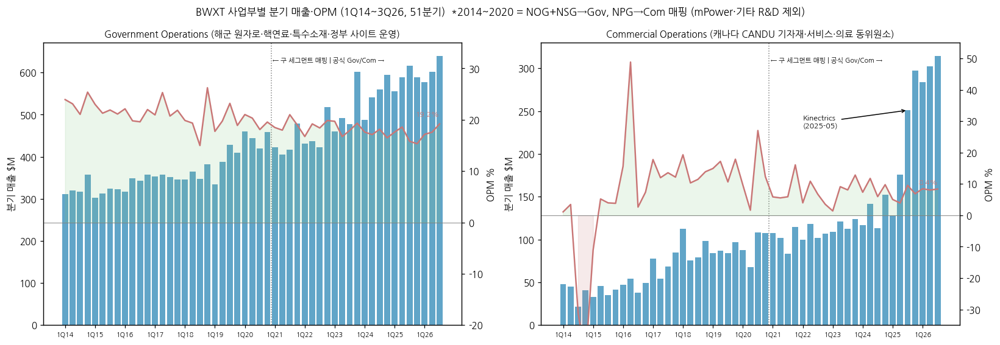

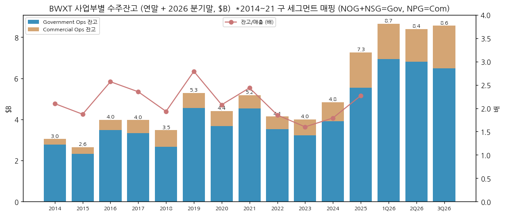

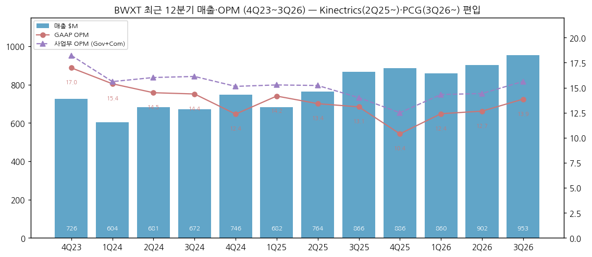

**사업부 분기 시계열 (1Q14~3Q26, 51분기, $M)** — 2014~2020 Gov = 구 NOG+NSG, Com = 구 NPG [매핑]. 전사 매출·GAAP OP·순이익은 XBRL (2014~15 순이익은 중단사업 포함)


| 분기 | 매출 | YoY | GAAP OP | OPM | 순이익 | Gov 매출 | Gov OP | Gov OPM | Com 매출 | Com OP | Com OPM |
|---|---|---|---|---|---|---|---|---|---|---|---|
| 1Q14 | 355.4 | — | 44.6 | 12.6 | 45.0 | 310.7 | 74.3 | 23.9 | 47.8 | 0.5 | 1.1 |
| 2Q14 | 362.5 | — | 27.5 | 7.6 | 26.4 | 319.5 | 73.8 | 23.1 | 44.9 | 1.5 | 3.4 |
| 3Q14 | 337.4 | — | 34.7 | 10.3 | 61.2 | 317.7 | 66.8 | 21.0 | 21.5 | -6.7 | -31.1 |
| 4Q14 | 395.4 | — | -81.7 | -20.7 | -103.3 | 357.9 | 90.8 | 25.4 | 40.5 | -18.6 | -45.9 |
| 1Q15 | 335.5 | -5.6 | 53.8 | 16.0 | 45.3 | 303.0 | 69.7 | 23.0 | 33.0 | -3.7 | -11.1 |
| 2Q15 | 357.1 | -1.5 | 11.6 | 3.2 | -17.1 | 313.3 | 66.6 | 21.3 | 45.5 | 2.4 | 5.2 |
| 3Q15 | 359.0 | 6.4 | 131.0 | 36.5 | 103.9 | 324.6 | 71.1 | 21.9 | 34.9 | 1.4 | 4.0 |
| 4Q15 | 363.9 | -7.9 | 9.6 | 2.6 | -0.5 | 322.8 | 68.1 | 21.1 | 41.7 | 1.6 | 3.8 |
| 1Q16 | 364.8 | 8.7 | 42.6 | 11.7 | 49.6 | 317.8 | 70.3 | 22.1 | 47.3 | 7.4 | 15.6 |
| 2Q16 | 402.4 | 12.7 | 88.5 | 22.0 | 58.4 | 348.8 | 69.0 | 19.8 | 54.2 | 26.5 | 48.8 |
| 3Q16 | 379.5 | 5.7 | 62.4 | 16.4 | 41.1 | 343.1 | 67.2 | 19.6 | 38.2 | 1.0 | 2.6 |
| 4Q16 | 403.9 | 11.0 | 45.8 | 11.3 | 34.0 | 356.8 | 78.4 | 22.0 | 49.5 | 3.6 | 7.4 |
| 1Q17 | 428.2 | 17.4 | 76.3 | 17.8 | 55.7 | 352.9 | 73.9 | 20.9 | 77.7 | 13.8 | 17.8 |
| 2Q17 | 410.0 | 1.9 | 85.4 | 20.8 | 61.3 | 357.7 | 90.5 | 25.3 | 54.6 | 6.5 | 12.0 |
| 3Q17 | 419.4 | 10.5 | 66.8 | 15.9 | 46.6 | 352.1 | 72.9 | 20.7 | 68.6 | 9.3 | 13.6 |
| 4Q17 | 430.1 | 6.5 | 63.7 | 14.8 | -15.7 | 346.5 | 75.7 | 21.8 | 85.0 | 10.3 | 12.2 |
| 1Q18 | 457.5 | 6.8 | 79.9 | 17.5 | 66.4 | 346.7 | 68.8 | 19.9 | 112.8 | 21.8 | 19.3 |
| 2Q18 | 438.9 | 7.1 | 71.5 | 16.3 | 60.7 | 364.7 | 70.6 | 19.3 | 75.7 | 7.8 | 10.3 |
| 3Q18 | 425.5 | 1.5 | 50.4 | 11.8 | 77.9 | 347.7 | 52.1 | 15.0 | 79.2 | 9.1 | 11.4 |
| 4Q18 | 478.0 | 11.1 | 103.1 | 21.6 | 21.9 | 382.5 | 100.3 | 26.2 | 98.2 | 13.6 | 13.9 |
| 1Q19 | 416.5 | -9.0 | 63.6 | 15.3 | 49.0 | 333.9 | 59.2 | 17.7 | 84.4 | 12.6 | 14.9 |
| 2Q19 | 471.2 | 7.4 | 80.5 | 17.1 | 58.9 | 388.2 | 76.7 | 19.8 | 86.6 | 14.9 | 17.2 |
| 3Q19 | 506.0 | 18.9 | 98.5 | 19.5 | 74.8 | 427.7 | 99.2 | 23.2 | 84.4 | 9.0 | 10.6 |
| 4Q19 | 501.2 | 4.9 | 82.9 | 16.5 | 61.4 | 410.1 | 77.5 | 18.9 | 97.2 | 17.4 | 17.9 |
| 1Q20 | 542.2 | 30.2 | 98.3 | 18.1 | 75.5 | 460.5 | 96.8 | 21.0 | 87.9 | 8.5 | 9.6 |
| 2Q20 | 504.5 | 7.1 | 82.4 | 16.3 | 64.3 | 443.6 | 90.1 | 20.3 | 68.0 | 1.1 | 1.6 |
| 3Q20 | 519.9 | 2.7 | 88.8 | 17.1 | 73.2 | 420.2 | 76.0 | 18.1 | 108.1 | 29.2 | 27.0 |
| 4Q20 | 556.9 | 11.1 | 89.1 | 16.0 | 65.7 | 458.4 | 89.6 | 19.5 | 107.3 | 13.2 | 12.3 |
| 1Q21 | 528.3 | -2.6 | 82.4 | 15.6 | 69.7 | 423.3 | 78.2 | 18.5 | 107.4 | 6.3 | 5.9 |
| 2Q21 | 505.1 | 0.1 | 73.8 | 14.6 | 59.3 | 405.5 | 72.9 | 18.0 | 101.8 | 5.6 | 5.5 |
| 3Q21 | 498.7 | -4.1 | 87.5 | 17.5 | 59.9 | 417.1 | 87.5 | 21.0 | 83.4 | 4.9 | 5.9 |
| 4Q21 | 592.0 | 6.3 | 102.2 | 17.3 | 116.9 | 479.2 | 90.9 | 19.0 | 114.5 | 18.4 | 16.1 |
| 1Q22 | 530.7 | 0.5 | 71.6 | 13.5 | 59.0 | 431.8 | 72.2 | 16.7 | 100.0 | 4.0 | 4.0 |
| 2Q22 | 554.2 | 9.7 | 95.2 | 17.2 | 74.6 | 436.5 | 83.8 | 19.2 | 118.5 | 12.9 | 10.9 |
| 3Q22 | 523.7 | 5.0 | 79.9 | 15.3 | 61.6 | 422.5 | 77.7 | 18.4 | 101.8 | 6.8 | 6.7 |
| 4Q22 | 624.2 | 5.4 | 101.9 | 16.3 | 43.0 | 517.6 | 102.8 | 19.8 | 107.1 | 3.7 | 3.5 |
| 1Q23 | 568.4 | 7.1 | 87.8 | 15.5 | 61.1 | 459.9 | 90.6 | 19.7 | 108.9 | 1.5 | 1.4 |
| 2Q23 | 612.4 | 10.5 | 86.7 | 14.2 | 58.6 | 492.0 | 82.2 | 16.7 | 120.9 | 11.0 | 9.1 |
| 3Q23 | 590.0 | 12.7 | 85.4 | 14.5 | 60.3 | 477.9 | 85.6 | 17.9 | 112.4 | 9.1 | 8.1 |
| 4Q23 | 725.5 | 16.2 | 123.2 | 17.0 | 65.9 | 601.6 | 116.3 | 19.3 | 124.1 | 15.9 | 12.8 |
| 1Q24 | 604.0 | 6.3 | 93.0 | 15.4 | 68.5 | 487.1 | 85.7 | 17.6 | 117.0 | 8.6 | 7.3 |
| 2Q24 | 681.5 | 11.3 | 98.8 | 14.5 | 73.0 | 540.8 | 92.5 | 17.1 | 141.5 | 16.6 | 11.8 |
| 3Q24 | 672.0 | 13.9 | 96.6 | 14.4 | 69.5 | 560.1 | 101.6 | 18.1 | 113.1 | 6.7 | 5.9 |
| 4Q24 | 746.3 | 2.9 | 92.3 | 12.4 | 71.0 | 595.0 | 98.1 | 16.5 | 152.3 | 14.9 | 9.8 |
| 1Q25 | 682.3 | 13.0 | 96.6 | 14.2 | 75.5 | 555.3 | 97.7 | 17.6 | 128.3 | 6.5 | 5.0 |
| 2Q25 | 764.0 | 12.1 | 102.4 | 13.4 | 78.4 | 589.0 | 109.4 | 18.6 | 176.1 | 6.9 | 3.9 |
| 3Q25 | 866.3 | 28.9 | 113.3 | 13.1 | 82.1 | 616.7 | 97.4 | 15.8 | 251.0 | 24.0 | 9.5 |
| 4Q25 | 885.8 | 18.7 | 92.1 | 10.4 | 93.0 | 589.1 | 90.3 | 15.3 | 297.6 | 20.4 | 6.9 |
| 1Q26 | 860.2 | 26.1 | 106.7 | 12.4 | 91.1 | 577.9 | 99.1 | 17.2 | 283.6 | 24.0 | 8.5 |
| 2Q26 | 901.6 | 18.0 | 114.1 | 12.7 | 89.0 | 601.3 | 105.7 | 17.6 | 302.5 | 24.3 | 8.0 |
| 3Q26 | 953.0 | 10.0 | 132.1 | 13.9 | 101.7 | 639.1 | 122.6 | 19.2 | 314.2 | 26.3 | 8.4 |

---

## ④ 재무 구조

(1) 손익계산서 (12년, $M) + chart1b

| 연도 | 매출 | 매출 YoY | 매출총이익 | GPM | 판관비 | 판관비율 | 사업부 OP 합계 | 영업이익(GAAP) | OPM | 순이익 | NPM | 희석 EPS ($) |
|---|---|---|---|---|---|---|---|---|---|---|---|---|
| 2014 | 1,451 | — | 298 | 20.5 | 230 | 15.9 | 283 | 25 | 1.7 | 29 | 2.0 | 0.27 |
| 2015 | 1,416 | -2.4 | 388 | 27.4 | 208 | 14.7 | 277 | 206 | 14.5 | 131 | 9.3 | 1.22 |
| 2016 | 1,551 | 9.5 | 464 | 29.9 | 210 | 13.5 | 323 | 234 | 15.1 | 183 | 11.8 | 1.76 |
| 2017 | 1,688 | 8.8 | 496 | 29.4 | 210 | 12.5 | 353 | 292 | 17.3 | 148 | 8.8 | 1.47 |
| 2018 | 1,800 | 6.6 | 504 | 28.0 | 214 | 11.9 | 344 | 305 | 16.9 | 227 | 12.6 | 2.27 |
| 2019 | 1,895 | 5.3 | 534 | 28.2 | 217 | 11.4 | 366 | 326 | 17.2 | 244 | 12.9 | 2.55 |
| 2020 | 2,124 | 12.1 | 575 | 27.1 | 231 | 10.9 | 404 | 359 | 16.9 | 279 | 13.1 | 2.91 |
| 2021 | 2,124 | 0.0 | 550 | 25.9 | 230 | 10.8 | 365 | 346 | 16.3 | 306 | 14.4 | 3.24 |
| 2022 | 2,233 | 5.1 | 552 | 24.7 | 234 | 10.5 | 364 | 349 | 15.6 | 238 | 10.7 | 2.60 |
| 2023 | 2,496 | 11.8 | 621 | 24.9 | 280 | 11.2 | 412 | 383 | 15.3 | 246 | 9.8 | 2.68 |
| 2024 | 2,704 | 8.3 | 655 | 24.2 | 319 | 11.8 | 425 | 381 | 14.1 | 282 | 10.4 | 3.07 |
| 2025 | 3,198 | 18.3 | 733 | 22.9 | 394 | 12.3 | 453 | 404 | 12.6 | 329 | 10.3 | 3.58 |

→ (출처: SEC XBRL companyfacts — 10-K 정확값(최신 재작성 우선). 매출총이익 = 매출 − 영업원가(CostOfRevenue). 판관비율 = SG&A/매출. 사업부 OP 합계 = Gov+Com (2014~20 구 사업부 매핑, mPower·기타 R&D 제외) [계산]. FY2014~15 GAAP 영업이익에 연금 MTM 손실(FY15 -$55M)·스핀오프 비용(FY15 -$26M)·소송 수익(FY15 +$66M) 포함 [10-K FY15 사업부 표])

→ GPM은 FY2016 29.9% → FY2025 22.9%로 하락 — 저마진 서비스(Kinectrics·현장 정비) 비중 확대와 해군 고정가 계약 믹스. 사업부 OPM은 20%대 → 14%대

(2) 재무상태표 (12년, 연말, $M) + chart4

| 연말 | 자산 | 부채 | 자본 | 현금 | 총차입 | 순차입 | 유동자산 | 유동부채 | 유동비율 | 부채/자본 | 영업권 |
|---|---|---|---|---|---|---|---|---|---|---|---|
| 2014 | 2,857 | 1,858 | 999 | 124 | 300 | 176 | 1,474 | 820 | 1.80 | 1.9x | 170 |
| 2015 | 1,375 | 1,110 | 266 | 155 | 293 | 139 | 647 | 354 | 1.83 | 4.2x | 168 |
| 2016 | 1,580 | 1,430 | 150 | 126 | 498 | 372 | 694 | 440 | 1.58 | 9.5x | 211 |
| 2017 | 1,712 | 1,427 | 285 | 203 | 481 | 278 | 873 | 528 | 1.65 | 5.0x | 218 |
| 2018 | 1,655 | 1,419 | 236 | 30 | 754 | 724 | 542 | 377 | 1.44 | 6.0x | 274 |
| 2019 | 1,909 | 1,505 | 404 | 87 | 824 | 738 | 630 | 405 | 1.56 | 3.7x | 276 |
| 2020 | 2,294 | 1,676 | 618 | 43 | 863 | 820 | 774 | 530 | 1.46 | 2.7x | 284 |
| 2021 | 2,501 | 1,864 | 637 | 34 | 1,189 | 1,155 | 774 | 460 | 1.68 | 2.9x | 286 |
| 2022 | 2,619 | 1,871 | 748 | 35 | 1,289 | 1,254 | 772 | 368 | 2.10 | 2.5x | 293 |
| 2023 | 2,747 | 1,814 | 933 | 76 | 1,210 | 1,134 | 818 | 375 | 2.18 | 1.9x | 297 |
| 2024 | 2,870 | 1,789 | 1,081 | 74 | 1,055 | 981 | 930 | 474 | 1.96 | 1.7x | 287 |
| 2025 | 4,271 | 3,039 | 1,232 | 500 | 2,016 | 1,516 | 1,560 | 672 | 2.32 | 2.5x | 501 |
| 3Q26 | 4,754 | 3,336 | 1,418 | 569 | 2,022 | 1,453 | 1,802 | 961 | 1.88 | 2.4x | 473 |

→ (출처: XBRL companyfacts. 부채 = 자산 − 자본(비지배지분 포함) [계산]. 총차입 = 장기차입 + 유동성 장기차입. **2014말은 스핀오프 전(발전사업 포함) 연결** — 2015 자산 -52%·자본 -73%는 BWE 분리 효과. 2025 총차입에 0% 전환사채 $1.25B 포함)

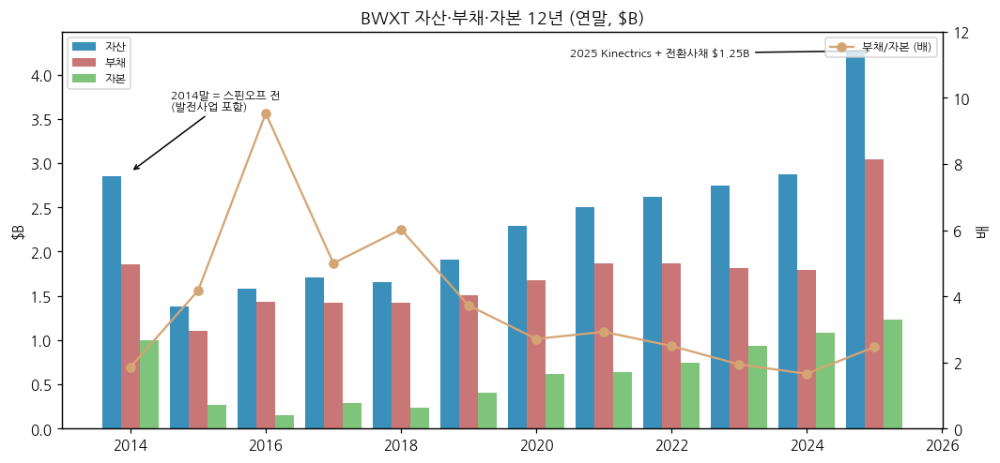

(3) 현금흐름표 (12년, $M) + chart6

| 연도 | 영업CF | 투자CF | 재무CF | CapEx | FCF | FCF/순이익 | 인수 | D&A | CapEx/매출 |
|---|---|---|---|---|---|---|---|---|---|
| 2014 | 75 | — | 105 | 76 | -1 | n/m | 128 | 106 | 5.2% |
| 2015 | 335 | -72 | -414 | 68 | 267 | 203% | 0 | 79 | 4.8% |
| 2016 | 240 | -189 | -89 | 53 | 187 | 102% | 118 | 51 | 3.4% |
| 2017 | 222 | -90 | -61 | 97 | 125 | 85% | 1 | 57 | 5.7% |
| 2018 | 169 | -327 | -9 | 109 | 60 | 26% | 213 | 60 | 6.1% |
| 2019 | 279 | -180 | -44 | 182 | 97 | 40% | 0 | 62 | 9.6% |
| 2020 | 196 | -265 | 25 | 255 | -59 | n/m | 16 | 61 | 12.0% |
| 2021 | 386 | -305 | -90 | 311 | 75 | 25% | 0 | 69 | 14.6% |
| 2022 | 245 | -256 | 14 | 198 | 46 | 19% | 47 | 74 | 8.9% |
| 2023 | 364 | -156 | -169 | 151 | 212 | 86% | 0 | 79 | 6.1% |
| 2024 | 408 | -155 | -253 | 154 | 255 | 90% | 0 | 86 | 5.7% |
| 2025 | 480 | -742 | 694 | 185 | 295 | 90% | 535 | 109 | 5.8% |

→ (출처: XBRL companyfacts. FCF = 영업CF − CapEx (회사 정의와 동일). 2014 영업CF는 발전사업 포함 연결, 투자CF는 XBRL 미태깅. 2025 인수 = A.O.T.+Kinectrics(현금 취득분 차감). 9M26: 영업CF $451.7M, CapEx $136.2M, FCF $315.5M, 인수 $187.0M(PCG) [XBRL 10-Q])

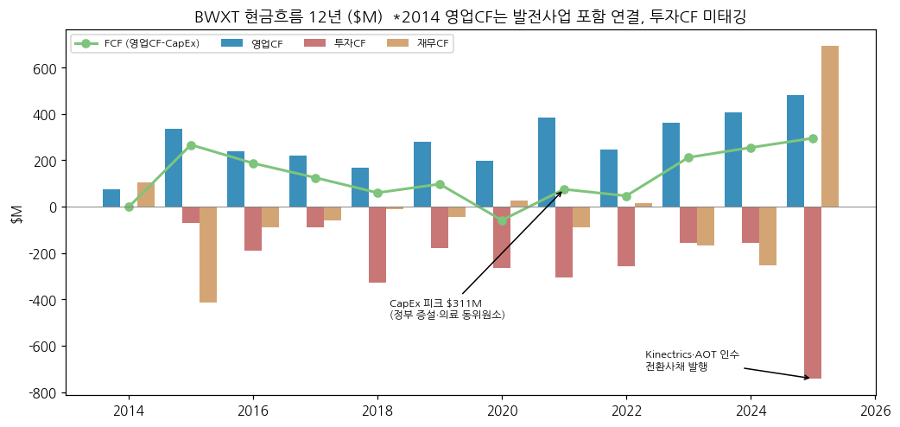

(4) CapEx + chart8

→ CapEx/매출: 3~6% (FY14~18) → **9.6~14.6% (FY19~21 증설 사이클)** → 5.7~6.1% (FY23~25). 10-K: "2017년 이후 정부 수요 대응 시설 확장, 의료 동위원소 상용화, Cambridge 대형 부품 공장 확장에 투자, 이 사이클은 대부분 완료"

→ 다음 사이클 후보: 미국 대형 부품 공장(FID 2026말), TRISO 증설, 국방용 농축 시설(Erwin), Investor Day CapEx 가이던스 매출의 5~6%

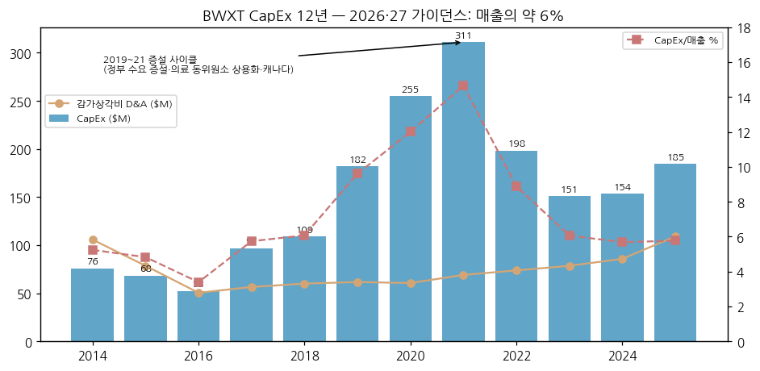

(5) 부채 구조 + 채권 history

→ 장기차입 $0.3B (FY14) → $0.5B (FY16, 스핀오프 후 자사주 재원) → $0.75B (FY18) → **4.125% 무담보채 2028 만기 $400M (2020-06 발행) + 2029 만기 $400M (2021-04 발행)** → $1.0~1.3B (FY21~24)

→ **2025-11 0% 전환사채 $1.25B (2030-11 만기, 전환가 약 $262.51)** — 기존 리볼버·Term Loan 전액 상환, 신규 $1.25B 담보 리볼버(2030 만기) 체결. FY25말 총차입 $2.0B, 현금 $0.5B [10-Q]

→ 2026-11: 신규 선순위채 발행 + 2028·2029 만기 4.125% 채권 공개매수 추진 (2026-11-04·11-11 공시, Finviz 뉴스 목록) / Fitch 첫 투자등급, Moody's 전망 '긍정적' 상향 (3Q26 컨콜)

→ 연금: Kinectrics 인수로 캐나다 연금·퇴직후급여 부채 $90.3M 승계 → 2027 FCF에 약 $10M 연금 출연 부담 (10-Q 인수 주석, 컨콜)

(6) 배당·자사주 + chart9

| 연도 | DPS 선언 ($) | 배당 지급 | 자사주 매입 | 총환원 | FCF | 환원/FCF | 희석주식수(M) |
|---|---|---|---|---|---|---|---|
| 2014 | 0.40 | 43 | 150 | 193 | -1 | n/m | 108.8 |
| 2015 | 0.32 | 34 | 70 | 104 | 267 | 39% | 107.6 |
| 2016 | 0.36 | 37 | 293 | 330 | 187 | 176% | 103.8 |
| 2017 | 0.42 | 42 | 0 | 42 | 125 | 34% | 100.4 |
| 2018 | 0.64 | 64 | 215 | 279 | 60 | 465% | 100.0 |
| 2019 | 0.68 | 65 | 20 | 85 | 97 | 88% | 95.8 |
| 2020 | 0.76 | 73 | 22 | 95 | -59 | n/m | 95.7 |
| 2021 | 0.84 | 80 | 226 | 305 | 75 | 407% | 94.5 |
| 2022 | 0.88 | 81 | 20 | 101 | 46 | 218% | 91.7 |
| 2023 | 0.92 | 85 | 0 | 85 | 212 | 40% | 91.9 |
| 2024 | 0.96 | 88 | 20 | 108 | 255 | 43% | 91.9 |
| 2025 | 0.96 | 92 | 30 | 122 | 295 | 41% | 91.9 |

→ (출처: XBRL companyfacts. 2014 FCF가 음수라 환원/FCF 비율은 의미 없음. 2026 분기 배당 $0.24 → **$0.27** (3Q26 지급 $24.7M), 2026-10-28 $0.27 선언 [보도자료])

→ 12년 누적 주주환원 $1.85B [계산] vs 누적 FCF $1.56B [계산] — 2016(스핀오프 직후 $293M)·2018·2021(ASR 포함 $226M) 대규모 자사주. 희석주식수 108.8M → 91.9M (-16%). 2027 가이던스는 "희석 상쇄 수준의 소규모 자사주" (컨콜)

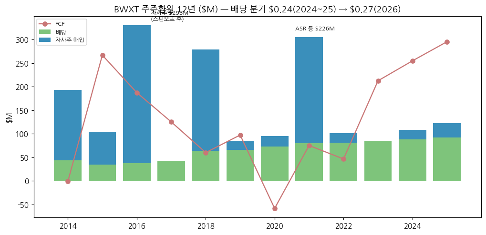

(7) 재무비율 (12년, [계산])

| 연도 | ROE (평균자본) | ROA (평균자산) | 부채비율 | 유동비율 | 이자보상배율 | 실효세율 |
|---|---|---|---|---|---|---|
| 2014 | 3% | 1.1% | 186% | 1.80 | 3.5x | 5.4% |
| 2015 | 21% | 6.2% | 418% | 1.83 | 20.2x | 38.0% |
| 2016 | 88% | 12.4% | 953% | 1.58 | 27.9x | 28.7% |
| 2017 | 68% | 9.0% | 500% | 1.65 | 19.6x | 49.9% |
| 2018 | 87% | 13.5% | 602% | 1.44 | 11.0x | 18.9% |
| 2019 | 76% | 13.7% | 372% | 1.56 | 9.2x | 22.1% |
| 2020 | 55% | 13.3% | 271% | 1.46 | 11.6x | 22.9% |
| 2021 | 49% | 12.8% | 293% | 1.68 | 9.7x | 22.6% |
| 2022 | 34% | 9.3% | 250% | 2.10 | 9.6x | 24.1% |
| 2023 | 29% | 9.2% | 194% | 2.18 | 8.1x | 23.4% |
| 2024 | 28% | 10.0% | 166% | 1.96 | 9.6x | 19.1% |
| 2025 | 28% | 9.2% | 247% | 2.32 | 9.1x | 17.2% |

→ 2014는 스핀오프 전 연결 자본·자산 기준이라 비교 불가. 스핀오프 후 자본이 작아(FY16 $150M) ROE·부채비율이 과장됨 — 비교 지표는 **ROA·이자보상배율·FCF/순이익** 권장 [판단]

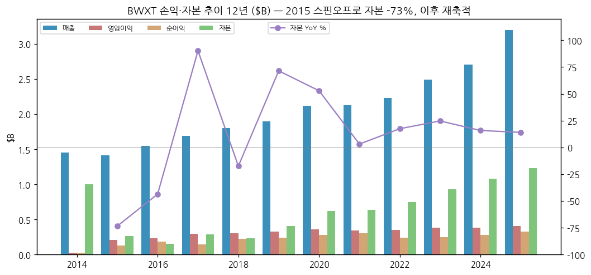

---

## ⑤ 지배 구조

(1) 그룹·계열 관계

→ 지배주주 없는 분산 소유 상장사. 정부 원자력 사이트 운영은 **비연결 JV**로 수행 (잔고 미포함, 지분법 이익 FY25 9M $56M → 9M26 $72M — Savannah River 통합임무 계약 등) [10-Q·10-K]

→ 2015 분리된 Babcock & Wilcox Enterprises(BW)와는 별개 회사

(2) 주주 구분 + chart5

| 주주 | 보유 주식 | 지분율 | 비고 |
|---|---|---|---|
| BlackRock, Inc. | 9,453,104 | 10.3% | 13G/A 2024-01-24 기준 |
| The Vanguard Group | 9,211,924 | 10.1% | 13G/A 2025-01-08 기준 (임직원 저축플랜 수탁자 겸) |
| 이사·임원 전체 | — | 각 1% 미만 | |

→ (출처: 2026 Proxy Statement (DEF 14A, 2026-03-18) — 지분율은 2026-03-06 발행주식 기준. 13G/A 시점이 오래돼 최신 지분율과 다를 수 있음)

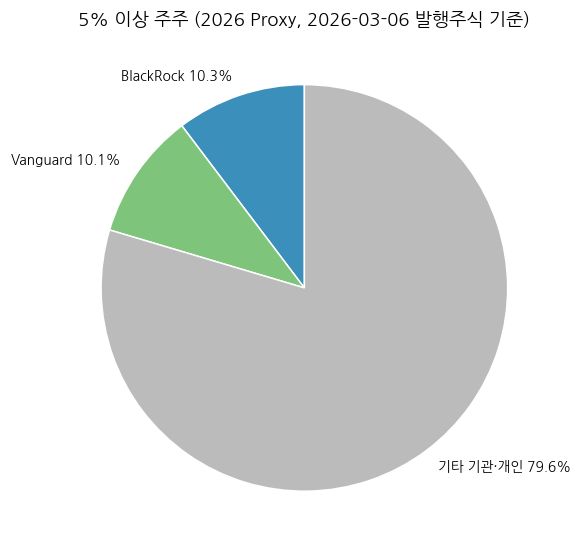

(3) 경영진·이사회

→ **Rex D. Geveden** — 사장·CEO. NASA 부국장(Associate Administrator) 출신 [web], BWXT COO를 거쳐 CEO

→ **Michael Fitzgerald** — SVP·CFO (3Q26 컨콜 발표자)

→ **Jan A. Bertsch** — 독립 이사회 의장 (2015년부터 이사). 이사 90% 독립, 전 위원회 독립 이사로 구성 (2026 Proxy)

---

## ⑥ 기타 팩트

(1) 시가총액·밸류에이션 스냅샷 (2026-11-13 종가 기준)

| 지표 | 값 |
|---|---|
| 주가 | $122.97 |
| 시가총액 | $11.27B [계산: 91.63M주] |
| EV | $12.72B [계산, 3Q26말 총차입 $2.02B − 현금 $0.57B] |
| P/E (2026 Non-GAAP EPS 가이던스 중간값 $4.745) | 25.9배 |
| P/E (FY25 GAAP EPS $3.58) | 34.3배 |
| EV / 2026 조정 EBITDA ($667M) | 19.1배 |
| EV / 2030 목표 EBITDA 중간값 ($1.15B) | 11.1배 |
| PBR (3Q26말 자본 $1.42B) | 7.9배 |
| FCF 수익률 (2026 가이던스 중간값) | 3.2% |
| 배당 수익률 | 0.9% |
| 사상 최고 종가 | $238.42 (2026-04-15) — 현재 -48.4% |

→ 모든 배수는 [계산]. 컨센서스 목표가는 본 문서에서 미수집

(2) R&D 인프라 + chart7

→ 자체 R&D 비용 FY14 $55M (mPower SMR) → FY16 $6M → FY25 **$14M** (매출 대비 0.4%). 9M26 $12.1M (Gov $8.9M · Com $3.2M) [XBRL·10-Q]

→ 실제 기술개발의 대부분은 **정부·고객이 비용을 내는 계약 개발** (Project Pele, BANR, NASA 우주 원자로, 농축 원심분리기 등)이라 매출(선행 원자로 설계·엔지니어링 FY25 $147M)로 잡힌다

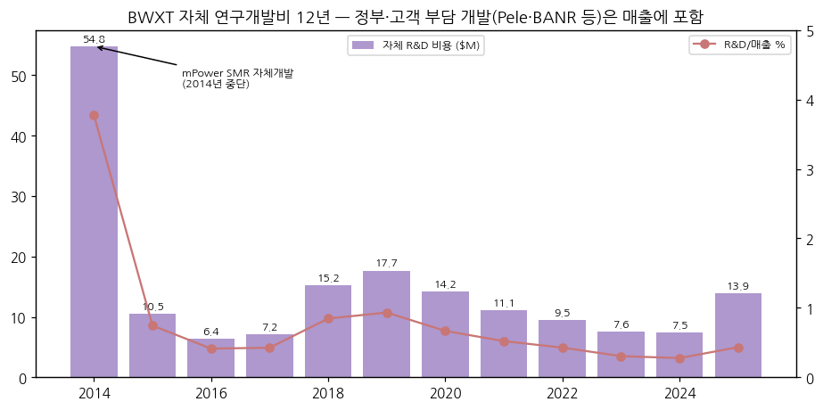

(3) 진행 중 corporate action

→ **의료사업 매각** (Nordic Capital, 최대 $800M, 소수지분 유지) — 2026년 또는 1Q27 종결 예정. 매각예정자산: 유형자산 $482M·영업권 $87M·무형 $73M 등 (10-Q). 회사는 "유의미한 처분손익 없음" 예상

→ **PCG 통합** (2026-07 인수, 잔고 약 $500M — 75~80% 해군) — 원가 시너지 선행 (컨콜)

→ **미국 대형 부품 공장 FID** — 2026년말 목표 / **폴란드** SMR·마이크로리액터 공급망 협력 검토 (투자는 확정 수주·정부 파트너십 조건) (컨콜)

→ **채권 재조달** — 신규 선순위채 + 2028·2029 만기채 공개매수 (2026-11)

(4) R&D·사업 마일스톤 (10년치)

| 시기 | 마일스톤 |
|---|---|
| 2016 | mPower SMR 프레임워크 → 자체 SMR 개발 종료 |
| 2018 | Bruce Power 증기발생기 32기 (CA$642M) 수주 / Nordion 의료 동위원소 인수 |
| 2022-06 | Project Pele (국방부 SCO 이동형 마이크로리액터) 설계·제작사 선정 |
| 2025 | A.O.T.(특수소재)·Kinectrics(수명관리 서비스) 인수 |
| 2026 | HPDU $1.6B 계약(연 300톤, Jonesborough TN 신공장), 국방용 HEU 농축 시설 설계(Erwin TN)·원심분리기 시제품 시험 2026말 (Oak Ridge) |
| 2026 | Project Pele 노심 배럴 조립 완료 → 2027 INL 인도 예정 |
| 2026-10 | Antares TRISO 연료 1톤 공급 (첫 대형 상업 고객), 육군 Janus 마이크로리액터 (5개 기지 20기+, Fort Campbell 1호) · 캐나다 Prodigy (첫 해외 마이크로리액터) 선정 — BANR(약 20MWe) |
| 2026-11 | Cambridge 대형 부품 생산능력 +50% 완공 |

→ (출처: 회사 보도자료, Defense News(2022-06-09), 3Q26 컨콜 요약. 마이크로리액터 계약은 초기 단계로 경제성 미확정 — 컨콜 "super early days")

(5) 주요 리스크

→ **미국 신규원전 발주 지연** — 첫 AP1000 기자재 발주 "2026년말 가능, 늦어도 1H27" — 걸림돌은 금융이 아니라 전력사·정부·하이퍼스케일러·기술사 간 **리스크 배분** (컨콜). AP1000 기자재는 두산·IHI와 경쟁, 배분권은 Westinghouse

→ **미 국방예산** — 계속결의안(CR)·중간선거 영향, 해군 수주의 분기 편차 (3Q26 신규수주 $538M vs 전년 $2.25B)

→ **해군 고정가 인센티브 계약** — 원가 초과 시 손익 조정 (2025 9M +$29.4M 유리한 조정처럼 양방향)

→ **캐나다 집중** — Commercial의 성장은 온타리오 CANDU 수명연장 일정·정책에 의존 (10-K 위험요인)

→ **원자력 배상 책임** — 일부 해외 국가 원전 공급 시 배상 리스크 (10-K)

→ **희석** — 전환사채 전환가 $262.51 (현 주가의 2.1배)로 단기 희석 부담은 낮음, 캡드콜 체결 (10-Q)

(6) ESG

→ 원문 미수집 (Source Audit ❌). 핵무기·해군 원자로 관련 사업 특성상 일부 ESG 펀드 편입 제외 대상 가능 [판단]

(7) 인증·라이선스

→ 미 NRC·캐나다 CNSC 원자력 인허가 시설 다수, NNSA 보안 인가 시설 (해군 원자로·고농축우라늄 취급), ITAR 등 수출 통제 하 판매 (10-K)

---

## Activity 보고 (v1.0 finalize)

### ✅ 확보 자료
→ 10-K 14 · 10-Q 42 · XBRL companyfacts · DEF 14A 2 · Yahoo 월간(2010-09~)·일간 1년 · 3Q26 보도자료(2차 게재본) · 3Q26 컨콜 요약 · Investor Day 요약 · Bruce Power 계약 보도자료

### ❌ 누락 자료 (4)
→ SEC 8-K 보도자료 원문(403) / 2022~2025 분기별 사업부 잔고 / 의료사업 단독 손익 / ESG 보고서

### ⚠️ 추정·계산 데이터 표시
→ 2014~2020 사업부 분기는 구 사업부 매핑(NOG+NSG→Gov, NPG→Com) — 회사 공식 재작성 아님. 시총·EV·배수·비중은 [계산]. 2014 재무상태표·현금흐름은 스핀오프 전 연결

### Data Quality Confidence: **88%**

---

## Version Log

| 버전 | 일자 | 내역 |
|---|---|---|
| v1.0 | 2026-11-15 | 최초 작성 — 12년 연간·51분기 사업부·13종 차트, 3Q26(10-Q 2026-11-02) 반영, 두산에너빌리티 겹침 매핑 |

→ 잔여 보완 후보: FY26 연간 확정(2027-02 10-K) 반영, 의료사업 매각 종결 후 Commercial 재작성, 미국 첫 신규원전 기자재 수주 시 ① 분류 재평가, 분기 사업부 잔고 시계열, ESG 등급, 최신 13F 지분, 컨센서스 TP
