> Ticker: **NYSE: CCJ / TSX: CCO — Cameco Corporation**
> Entity: **Cameco Corporation** (본사 Saskatoon, Saskatchewan, Canada) — 1988년 캐나다 국영 2사(SMDC·Eldorado Nuclear) 민영화·합병으로 출범한 서방 최대 상장 우라늄 생산사. 우라늄 채굴(Cigar Lake·McArthur River/Key Lake, 카자흐 JV Inkai 40%) + 정련·변환(Blind River·Port Hope) + **Westinghouse 지분 49%**(2023-11, Brookfield 51%) + GLE 레이저 농축 49%
> Sector: 원전 — 서브섹터 **원전 연료 글로벌** (핵심, Centrus와 함께). Westinghouse 상장 전까지 Westinghouse(한국 원전 수출의 주 경쟁·협력사)를 Cameco 지분 49%로 간접 추적
> 작성 시각: **2026-11-15 KST** (**v1.0** — Phase 1 Source 전수 수집 + audit + 17종 차트(12종 표준 + 사업부 3종 + 우라늄 가격·사업부 연간) + v1.5 ① 기업 분류 표준)
> 적용 구조: v4.8 (6개 섹션) + v1.5 ① 기업 분류 표준 (Summary Box · 손익 narrative · 분류 sub-logic · 밸류에이션 · 분류 변경 조건 3종)
> 데이터 범위: **연간 12년 (FY2014\~FY2025, 12월 결산)** + **FY26 9M (1Q\~3Q26, 2026-10-30 발표분)** + **전사 분기 51Q (1Q14\~3Q26)** + **사업부 분기 15Q (1Q23\~3Q26, Westinghouse 11Q)** + **CCJ 주가 20년 (2006-01 \~ 2026-11-13)**
> 출처: **SEC EDGAR 40-F 14건 (FY2012\~FY2025, 본문) · SEC XBRL companyfacts (CIK 0001009001, IFRS, FY2016\~FY2025)**, **Cameco IR MD&A·재무제표 PDF 13건** (연간 2015·2016·2018·2020·2022·2023·2024·2025, 분기 1Q\~3Q24·1Q\~3Q26), **3Q26 컨퍼런스콜 트랜스크립트 (2026-10-30)**, **2025 AIF**, **2026 Management Proxy Circular**, **Yahoo Finance CCJ**, 보도 (Bloomberg·Reuters/BNN·Neutron Bytes·StockAnalysis)
> **통화·회계: 전 재무 수치는 IFRS, 캐나다달러(C$) 백만 단위.** 우라늄 가격·실현가는 US$/lb 병기, Westinghouse 사업 프레임(백로그·파이프라인)은 Westinghouse 100% 기준 US$ — 환산 없이 원 통화 그대로 표기

# Cameco 기업 개요 (v1.0 — 원전 연료 글로벌 / 서방 1위 상장 우라늄 생산사 + Westinghouse 49% / 사이클형 원자재 + 서비스 지분)
> **Fact verify cutoff**: 2026-11-15 (주가 2026-11-13 종가 **US$70.73** (NYSE) / **C$100.80** (TSX) [Yahoo Finance·cameco.com], 발행주식 435,532,978주 [3Q26 MD&A, 2026-09-30] → 시가총액 **US$30.8B / C$43.9B** [계산]. 사상 최고가 **2026-01-29 장중 US$135.24** (종가 최고 2026-01-28 $134.09) ≈ 시총 $58.9B [계산] → 현재 고점 대비 **-47.7%** [계산]. 52주 저점 $66.06 [Yahoo Finance])


## Phase 1 Source Audit (메모리 룰)

```
=== 자료 수집 audit (Cameco) ===

✅ 확보 (저장: company-overview-source/CCJ/ , ir/)
- SEC 40-F 14건 (2013-02 ~ 2026-03 제출, FY2012~FY2025) — sec_edgar_download_reports (본문만; MD&A·FS는 Ex-99 첨부)
- SEC XBRL companyfacts.json (IFRS 태그, FY2016~FY2025 연간 정확값) — data.sec.gov
- Cameco IR MD&A+FS+Notes PDF 13건: 연간 2015/2016/2018/2020/2022/2023/2024/2025(각 연도 비교연도 포함 → FY2014~FY2025 전 연도 커버), 분기 1Q24·2Q24·3Q24·1Q26·2Q26·3Q26
- 3Q26 컨퍼런스콜 트랜스크립트 PDF (cameco.com, 2026-10-30 콜)
- 2025 Annual Information Form (광산·지분율·매장량·임직원) / 2026 Management Proxy Circular (주주·이사회·소유 제한)
- Yahoo Finance v8 CCJ 월간(max) + 일간 1년 (2026-11-13까지)

❌ 누락 (4)
- 40-F Ex-99 첨부(MD&A·FS): www.sec.gov 아카이브 직접 접근 403 → 동일 원문을 cameco.com IR PDF로 대체
- 분기 MD&A 1Q15~3Q23 (홀수 연도 분기 원본) — 전사 분기 51Q는 연간 MD&A '분기 추이' 표로 확보, 사업부 분기는 1Q23~3Q26만
- 13F 기관 보유 상세 (Proxy상 5% 이상 주주 없음만 확인)
- Westinghouse S-1 공개본 (2026-07-31 비공개 제출 후 공개 전환 미확인)

⚠️ 결과 영향
- 연간 12년 = FY2014~FY2025 (IFRS 일관). FY2014~15는 2015 연간 FS 원문, FY2016~25는 XBRL 정확값(반올림 C$M)
- 조정순이익(ANE)은 2024년 산식 변경(미실현 환손익·주식보상 조정) — FY2023부터 신 산식, FY2022 이전은 당시 공시치
- 조정 EBITDA(전사·사업부)는 FY2023부터 공시 — 이전 연도는 공시 없음
- Westinghouse는 지분법(49%) → Cameco 매출에 미포함. 'Westinghouse 부문' 숫자는 Cameco 몫(49%) 비연결 참고치

Source 6종 audit:
[V] (1) 정기 보고서 (40-F 14 + 연간·분기 MD&A/FS 13) ✓
[V] (2) IR 실적 자료 (3Q26 MD&A·트랜스크립트) ✓
[△] (3) Sustainability Report ✗ (링크만 확인)
[V] (4) 주가 (Yahoo CCJ 20년) ✓
[V] (5) Proxy / 지배구조 / AIF ✓
[V] (6) 12년 정확값 시계열 (XBRL + FS 원문) ✓
→ 5/6 source 확보. 최신 분기(3Q26) 확보.
```

---

## ① 기업 분류

(1) Primary / Secondary 분류

**Primary 분류: 사이클 (우라늄 원자재 사이클 — 장기계약으로 완충된 후행형 사이클)**

→ 매출 FY2014 C$2,398M → FY2021 C$1,475M(저점) → FY2025 **C$3,482M**. 11년 CAGR **+3.4%** [계산] — 성장보다 **진폭**이 특징

→ 매출총이익률(GPM) 12년 범위 **0.1%(FY21) \~ 27.9%(FY25)** — 진폭 27.8%p로 사이클 기준(±10%p) 크게 초과

→ 영업활동이익률(IFRS) -9.2%(FY21) \~ +17.7%(FY25), 12년 중 적자 4개년(FY16·17·20·21)

→ 이익 동인은 **우라늄 가격 × 판매량 − 단위원가**. 단, 장기계약(5년 평균 연 2,800만 lb 확정) 때문에 실현가는 스팟을 **1\~3년 후행** — 2024년 스팟 US$85.14 vs 실현가 US$58.34

**Secondary 노트: 지속성장 일부 (Fuel Services 변환 + Westinghouse 원전 서비스 지분)**

→ Fuel Services(UF6 변환 세계 1차 용량 약 18%, AIF) — GPM 20\~32%로 안정, 2025 조정 EBITDA 마진 39%

→ **Westinghouse 49%** — 세계 가동 원전 약 417기 중 약 63%를 정비, 약 40%에 연료 공급하는 반복 매출 사업(3Q26 MD&A). 2025 Cameco 몫 조정 EBITDA C$780M = 전사 조정 EBITDA C$1,929M의 **40%** [계산]

**3개 보고 부문 구조 (9M26 기준, C$)**

→ **(1) Uranium** — 매출 C$1,888M (연결 매출의 83%), 매출총이익 C$527M (GPM 28%), 조정 EBITDA C$855M (JV Inkai 지분법 C$187M 포함)

→ **(2) Fuel Services** — 매출 C$381M (17%), 조정 EBITDA C$120M (마진 31%) — 정련(UO3)·변환(UF6/UO2)·CANDU 연료 다발

→ **(3) Westinghouse (49% 지분법, 연결 매출 미포함)** — Cameco 몫 매출 C$2,627M, 순손실 C$-80M, 조정 EBITDA **C$427M** (마진 16%)

(2) Summary Box (12년 시계열 + 사이클 통계)

| 지표 | 값 |
|------|-----|
| 매출 CAGR (FY14→FY25, 11년) | **+3.4%/yr** [계산] (저점 FY21→FY25 4년 **+24.0%/yr** [계산]) |
| GPM 평균 (12년) | **17.6%** [계산] (영업활동이익률 평균 3.3%, 조정순이익률 평균 7.5%) |
| GPM 정점 평균 | **27.3%** (FY2014 26.6% · FY2025 27.9%) [계산] |
| GPM 저점 평균 | **3.0%** (FY2020 5.9% · FY2021 0.1%) [계산] |
| 사이클 주기 | 우라늄 장기 사이클 **약 15\~20년** (스팟 고점 2007 → 바닥 2016\~20 → 2024 재고점) — 12년 창 안에 **하강 1회 + 상승 1회** |
| 사이클 회수 (12년) | 정점 1회(FY2025, FY2014는 이전 사이클 잔존) / 저점 1회(FY2020\~21) |

```
[Cameco 12년 손익 시계열 (C$M, 12월 결산, IFRS)]  * 영업이익 = IFRS '영업활동이익'(손상차손 포함) / 우라늄 가격 = 연평균 US$/lb
연도   매출    매출총이익  GPM   영업이익   순이익   조정순이익  스팟  실현가
FY14  2,398    638   26.6%     38     185      412   33.2  47.5  ← Bruce Power 지분 매각(C$450M), 손상 C$327M, Cigar Lake 생산 개시
FY15  2,754    697   25.3%    246      65      344   36.6  45.2  ← NUKEM(트레이딩) 매출 C$554M 피크, 생산 28.4M lb 정점
FY16  2,431    463   19.0%   -142     -62      143   25.6  41.1  ← 스팟 붕괴, Rabbit Lake·미국 ISR 감산, 손상 C$362M
FY17  2,157    436   20.2%   -128    -205       59   21.8  36.1  ← 스팟 12년 최저 $21.78, TEPCO 계약 분쟁
FY18  2,092    296   14.1%     70     166      211   24.6  37.0  ← 2018-01 McArthur River/Key Lake 가동중단(C&M), JV Inkai 지분법 전환, NUKEM 판매 축소
FY19  1,863    242   13.0%     92      74       41   25.6  33.8  ← 생산 9.0M lb (가동중단 지속), 실현가 바닥
FY20  1,800    106    5.9%    -79     -53      -66   30.0  34.4  ← COVID로 Cigar Lake 2회 중단 → 원가 급등
FY21  1,475      2    0.1%   -136    -103      -98   35.3  34.5  ← 사이클 저점 (GPM 0.1%), Sprott 펀드 매집 시작
FY22  1,868    233   12.5%     15      89      135   49.8  44.7  ← 2022-11 McArthur 재가동, US$747.6M 증자(Westinghouse 인수용)
FY23  2,588    562   21.7%    283     361      383   62.5  49.8  ← 2023-11-07 Westinghouse 49% 인수 완료 (US$2.1B)
FY24  3,136    783   25.0%    510     172      292   85.1  58.3  ← 스팟 사상 2번째 고점권, Key Lake 세계 기록 20.3M lb(100%), WH PPA 상각으로 순이익 감소
FY25  3,482    970   27.9%    618     590      627   73.5  62.1  ← 사이클 정점권, Dukovany 대금으로 WH 몫 매출 +US$170M, 조정 EBITDA C$1,929M
9M26  2,278    614   27.0%     —      199      279   87.4  66.6  ← Key Lake 장기 정비 → 생산 -9%, WH 몫 순손실, 장기계약가 US$96 신고점

매출 CAGR 11년: +3.4% [계산] / GPM range 0.1%~27.9% = 27.8%p [계산]
* 영업활동이익은 손상차손·처분손실 포함 → 하강기 순이익·영업이익 왜곡이 커 회사는 조정순이익(ANE)·조정 EBITDA를 주 지표로 사용
```

**한국 원전 섹터와의 위치 (직접 비교는 섹터 리뷰에서 각 사 리뷰 숫자로)**

→ Cameco 자체는 한국 원전 밸류체인(설계·기자재·시공·정비)과 **직접 경쟁하지 않는 연료 공급자** — 한국수력원자력 등 전력사가 고객군

→ 경쟁 접점은 **Westinghouse 49%** — AP1000 vs 한국 APR1400/APR1000 수출 경쟁, 2025-01 KHNP·KEPCO-Westinghouse IP 분쟁 글로벌 합의, 2026-09 한미 프레임워크에서 AP1000 6기 + APR1400 2기 공동 추진 (⑥(3) 참조)

(3) 정량적 분류 근거

→ **가격 레짐 전환** — 스팟 연평균 US$21.78(FY17) → **US$85.14(FY24)**, 장기계약가 US$30.38(FY18) → **US$96.17(3Q26 평균, 12년 최고)**. Cameco 실현가 US$33.77(FY19) → **US$66.64(9M26)** [MD&A]

→ **장기계약 북** — 우라늄 확정 판매 약 1.13억 lb(FY20말, 32개 고객) → **약 2.3억 lb(FY25말, 39개 고객)**, 향후 5년 평균 연 2,800만 lb+ 인도 확정 (3Q26 MD&A). 변환(UF6) 계약 약 8,300만 kgU

→ **생산 정상화** — 자기지분 생산 5.0M lb(FY20) → 23.4M lb(FY24) → 21.0M lb(FY25), 2026 가이던스 19.5\~20.5M lb (3Q26 하향 조정)

→ **Westinghouse 이익 기여** — Cameco 몫 조정 EBITDA C$101M(FY23, 2개월) → C$483M(FY24) → **C$780M(FY25)** → 9M26 C$427M (2025 Dukovany 일회성 기저 효과)

**2026 가이던스 (2026-10-30 3Q26 MD&A, C$)**

→ 연결 매출 **C$3,320\~3,570M** (Uranium C$2,700\~2,910M / Fuel Services C$610\~650M)

→ 우라늄 판매 29.5\~30.5M lb (기존 29\~32M) / 생산 19.5\~20.5M lb (기존 19.5\~21.5M) / 평균 실현가 **C$91\~96/lb** / 평균 단위원가 C$67\~70/lb

→ CapEx C$440\~490M (Uranium 355\~385 · Fuel Services 85\~100) / 관리비 C$260\~280M

→ **Westinghouse (Cameco 몫 49%, US$)**: 조정 EBITDA **US$370\~430M**, 순손실 US$(75)\~(10)M, CapEx US$160\~200M

(4) 산업 분류

→ **GICS** — Energy / Oil, Gas & Consumable Fuels (Coal & Consumable Fuels)

→ **지수** — S&P/TSX 60 구성 [web 일반 사실]. 미국은 ADR가 아닌 보통주 직접 상장(NYSE: CCJ)

→ **워치리스트** — 섹터 원전 / 서브섹터 **원전 연료 글로벌** (Cameco·Centrus). Westinghouse는 상장 시 '원전 기자재 글로벌'로 별도 편입 예정, 그전까지 Cameco로 간접 추적 (watchlist.md 2026-11-14 결정)

(5) 분류 결정 논리

(1) **가장 매출 큰 사업부 기준**: Uranium 83%(9M26) — 원자재 가격 사이클에 이익이 좌우 → **사이클**

(2) **이익 비중 sub-rule**: 2025 조정 EBITDA 구성 = Uranium 1,255 / Fuel Services 219 / Westinghouse 780 (합계 2,254, 본사비 차감 전) → Uranium 56% · Westinghouse 35% · FS 10% [계산]. 사이클 사업부 이익이 과반 → Primary 사이클 유지

(3) **Boundary case**: Primary 사이클 + Secondary 지속성장. 장기계약 북(5년 연 2,800만 lb)이 하방을 완충해 **동일 사이클 내 일반 광산주보다 진폭이 작고 후행** — FY21 저점에도 영업현금흐름 C$458M 흑자. Westinghouse가 IPO로 시가 평가되면 Cameco 시총의 상당 부분이 '서비스·원전 건설' 성격으로 재분류될 수 있음 (분기 재평가 트리거 ③)

(4) **글로벌 피어 cross-ref**:
   - **Kazatomprom (KAP)** — 세계 1위 생산(카자흐 ISR, 저원가), JV Inkai 파트너(60%). 스팟 연동 비중이 높아 가격 민감도가 Cameco보다 큼
   - **Orano (프랑스, 비상장)** — Cigar Lake·McArthur 파트너, 변환·농축 통합
   - **Centrus (LEU)** — 같은 서브섹터, 농축(HALEU) 특화 — Cameco는 GLE 49%로 농축 옵션 보유
   - **한국** — 우라늄 생산사 없음. 연료(한전원자력연료)·설계(한전기술)·기자재(두산에너빌리티)는 Westinghouse를 통해 간접 경쟁·협력 관계

(6) 적정 밸류에이션 방법 (단위 밸류는 분기 실적 분석, Terminal 밸류는 테마 통합 모드)

→ **1차 — SOTP (우라늄·FS 자체 + Westinghouse 49% 지분가치)**: Westinghouse IPO 보도 가치 **US$50B 초과**(Bloomberg 2026-09-18) × 49% = **US$24.5B+** vs Cameco 시총 US$30.8B → 지분 단순 환산 시 **시총의 약 80%** [계산]. 단 미 정부 참여권(⑥(3)) 행사 시 희석 — US$50B 공모가 기준 미 정부 워런트 가치 약 US$6.5B [계산: 20% × (50 − 17.5)] → Cameco 몫 약 US$21B [계산, 참여권 vesting 가정]

→ **2차 — EV/조정 EBITDA**: EV 약 C$44.0B [계산: 시총 C$43.9B + 차입 C$1.0B − 현금 C$0.86B, 3Q26말] ÷ TTM 조정 EBITDA C$1,757M [계산: 4Q25 591 + 9M26 1,166] = **약 25배**

→ **3차 — P/E (조정)**: 주가 C$100.80 ÷ FY25 조정 EPS C$1.44 = **70배** / TTM 조정 EPS C$1.14 [계산: 4Q25 0.50 + 9M26 0.64] → **88배**. 사이클 정점권에서도 고PER = 시장이 Westinghouse·장기 가격을 선반영

→ **PBR 보조**: 시총 C$43.9B ÷ FY25 자본 C$6.9B = **6.4배** [계산] — 사이클 저점(2020) PBR 약 1.0배권 대비 [판단: 2020 시총 약 US$5B 수준 기준]

→ **판단**: 우라늄 단일 사이클주였던 FY2022 이전에는 PBR·NAV(매장량) 밴드가 기준이었으나, Westinghouse 편입 후에는 **SOTP가 1순위** — Westinghouse 상장 시 시가로 대체

(7) 분기 재평가 트리거 (**분류 변경 조건**)

→ ① **장기계약가(LT) 하락 전환 + 신규 계약 연 2,000만 lb 미만 2년 연속** → 사이클 하강 국면 진입, 밸류 기준을 PBR 밴드 하단으로 이동

→ ② **Westinghouse 조정 EBITDA(Cameco 몫)가 Uranium 부문 조정 EBITDA를 2개 분기 연속 상회** → Secondary 지속성장을 Primary급으로 격상 검토 (9M26 기준 427 vs 855로 아직 절반)

→ ③ **Westinghouse IPO 완료(시가 형성)** → 지분 시가를 SOTP에 직접 반영, 워치리스트 Westinghouse 별도 편입 후 Cameco는 '우라늄 순수 사이클주 + 상장 지분'으로 재분류

---

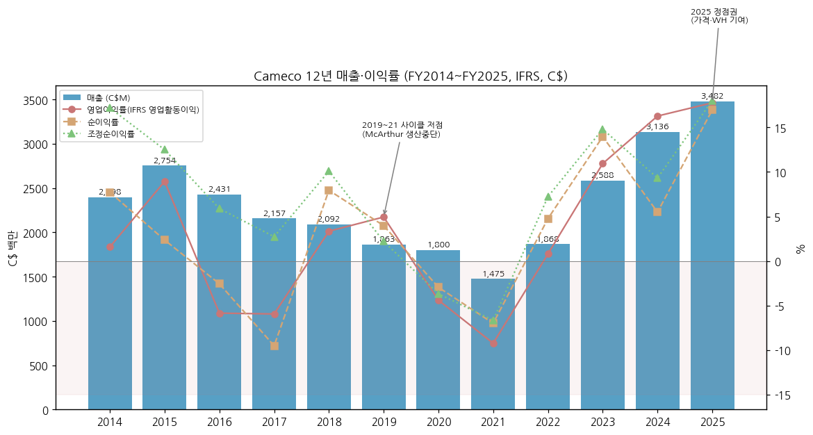

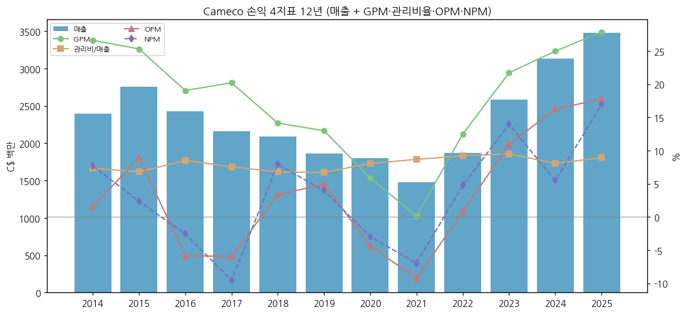

---

## ② 회사 개요

(1) 기본 정보

| 항목 | 내용 |
|---|---|
| 정식 명칭 | Cameco Corporation (Canada Business Corporations Act 법인, 1987-06-19 설립) |
| 본사 | 2121 11th Street West, Saskatoon, Saskatchewan (정관상 본사·임원 거주지 Saskatchewan 의무) |
| 출범 | 1988년 Saskatchewan Mining Development Corp.(SMDC) + Eldorado Nuclear 민영화·합병 |
| 상장 | TSX: CCO / NYSE: CCJ |
| CEO | Tim Gitzel (2011-07 사장 겸 CEO → 2025-09부터 CEO) |
| 사장·COO | Grant Isaac (2025-09 취임, 전 CFO, Westinghouse 이사) |
| CFO | Heidi Shockey (2025-09 EVP·CFO 취임) |
| 이사회 의장 | Catherine Gignac (2026 Proxy) |
| 임직원 | 3,082명 (FY25말, AIF) — Westinghouse(1.2만 명+, 2025 MD&A)는 지분법이라 미포함 |
| 사업 한 줄 정의 | 캐나다·카자흐 우라늄을 캐고, UF6로 변환해 전 세계 전력사에 장기계약으로 공급하며, 원전 서비스·신규 건설사 Westinghouse의 49%를 보유한 연료 사이클 통합 기업 |
| 고객 | 전 세계 원전 운영 전력사 — 우라늄 39개 고객(약 2.3억 lb 계약), 변환 33개 고객 (FY25 MD&A) |

(2) 핵심 KPI 요약 (FY25 + 3Q26 + 2026 가이던스, C$M)

| 지표 | FY25 | 3Q26 | 9M26 | 2026 가이던스 |
|---|---|---|---|---|
| 매출 | 3,482 | 619 (+1%) | 2,278 (0%) | 3,320\~3,570 |
| 매출총이익 (GPM) | 970 (27.9%) | 122 (19.7%) | 614 (27.0%) | — |
| 순이익 (지배) / 희석 EPS | 590 / C$1.35 | 43 / C$0.10 | 199 / C$0.46 | — |
| 조정순이익 / 조정 EPS | 627 / C$1.44 | -2 / C$0.00 | 279 / C$0.64 | — |
| 조정 EBITDA | 1,929 | 267 (-14%) | 1,166 (-13%) | — |
| 영업현금흐름 | 1,408 | 3 | 112 | — |
| 우라늄 실현가 | US$62.11 | US$65.78 | US$66.64 | C$91\~96/lb |
| Westinghouse 조정 EBITDA (49%) | 780 | 143 | 427 | US$370\~430M |

→ (출처: 2025 연간 MD&A, 3Q26 MD&A. YoY·GPM [계산])

(3) 주요 연혁 (시대별)

| 시기 | 사건 |
|---|---|
| 1987\~88 | SMDC + Eldorado Nuclear 민영화·합병으로 Cameco 출범 (AIF) |
| 1999\~2000 | McArthur River 생산 개시 — 세계 최대 고품위 우라늄 광산 [web 일반 사실] |
| 2002 | 정관 개정: 비거주자 1인 보유 한도 5% → 15%, 비거주자 의결권 한도 20% → 25% (AIF) |
| 2013\~14 | NUKEM(우라늄 트레이딩) 인수, **Cigar Lake 생산 개시(2014)**, Bruce Power 지분 31.6% C$450M 매각(2014-03) |
| 2016 | 스팟 하락 → Rabbit Lake·미국 ISR 가동 축소, 손상 C$362M |
| 2018-01 | **McArthur River/Key Lake 가동중단(care & maintenance)**, JV Inkai 지분 60% → 40% 재편(지분법 전환) |
| 2020 | COVID로 Cigar Lake 2회 생산 중단 |
| 2022-10 | **US$747.6M 공모 증자**(3,406만 주) — Westinghouse 인수 자금 |
| 2022-11 | McArthur River 재가동 (첫 광석 처리) |
| 2023-11-07 | **Westinghouse 49% 인수 완료** (Brookfield 51%, Cameco 몫 매입가 US$2.1B — 현금 US$1.5B + 텀론 US$600M) |
| 2024-12 | Key Lake 연간 20.3M lb(100%) — 세계 우라늄 정련소 연간 생산 신기록 (AIF) |
| 2025-10-28 | **미 상무부(DOC)와 Westinghouse 전략적 파트너십 구속력 있는 term sheet** — US$80B 이상 AP1000 건설 |
| 2026-06 | DOE, Westinghouse에 AP1000 최대 10기 장납기 기자재 구매용 US$17.5B 조건부 대출 약정 |
| 2026-07-02 | TEPCO의 Cigar Lake 지분 5%를 Orano와 인수 → Cameco 지분 54.547% → **57.418%** |
| 2026-07-31 | **Westinghouse, 미국 IPO용 S-1 초안 비공개 제출** |
| 2026-09 | 한미 프레임워크 — 한국 최대 US$1,200억 투자로 미국 내 대형 원전 최대 8기(AP1000 6기 + APR1400 2기) |

→ (출처: 2025 AIF, 연간·분기 MD&A, 3Q26 MD&A. 1999\~2000 McArthur 개시는 공개 일반 사실 [web])

(4) 회사 주가 역사 (narrative 영역)

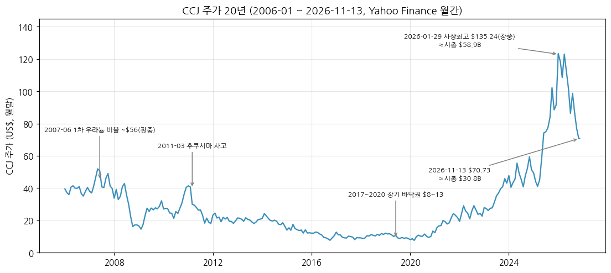

→ **2007 1차 우라늄 버블** — 스팟 US$136(2007-06) 급등과 함께 CCJ 장중 약 $56 (2007-06). 이후 금융위기로 $15대 (2008-11)

→ **2011 후쿠시마 이후 10년 하락** — 2011-03 사고 직후 $40대 → 일본 원전 정지·스팟 붕괴로 2016\~2020년 **$8\~13 장기 바닥권** (월말 종가 기준 2020년 저점권 약 $8) [Yahoo]

→ **2021\~2024 재평가** — Sprott 실물 펀드 매집·탄소중립·AI 전력 수요로 $10 → $60 (2024-05 고점권). 2023-11 Westinghouse 편입

→ **2025\~2026-01 사상 최고** — 미 정부 파트너십(2025-10)·AI 전력 테마로 **2026-01-29 장중 $135.24** (종가 최고 01-28 $134.09, 시총 약 $58.9B [계산])

→ **2026-02\~11 -48% 조정** — Westinghouse IPO 기대 선반영 후 공모 일정 지연(Bloomberg 9월 'October 공개 제출 목표' 보도 이후 공개 전환 미확인), 3Q26 Key Lake 장기 정비로 생산 -20%·조정순이익 적자 전환. 11-13 종가 **$70.73** (시총 US$30.8B) [Yahoo, 계산]

---

## ③ 비즈니스 모델

(1) 실적 추이 통합 표 (5년 + 9M26, 부문별, C$M)

| 부문 | 항목 | 2021 | 2022 | 2023 | 2024 | 2025 | 9M26 |
|---|---|---|---|---|---|---|---|
| Uranium | 매출 | 1,055 | 1,480 | 2,152 | 2,677 | 2,874 | 1,888 |
| | 매출총이익 | -108 | 121 | 444 | 681 | 803 | 527 |
| | GPM (%) | -10.2 | 8.2 | 20.6 | 25.4 | 27.9 | 27.9 |
| | 조정 EBITDA | — | 380 | 835 | 1,179 | 1,255 | 855 |
| | 생산 (자기지분, M lb) | 6.1 | 10.4 | 17.6 | 23.4 | 21.0 | 13.6 |
| | 판매 (M lb) | 24.3 | 25.6 | 32.0 | 33.6 | 33.0 | 20.5 |
| | 실현가 (US$/lb) | 34.53 | 44.73 | 49.76 | 58.34 | 62.11 | 66.64 |
| | 실현가 (C$/lb) | 43.34 | 57.85 | 67.31 | 79.70 | 87.00 | 92.05 |
| | 단위원가 (C$/lb, D&A 포함) | 47.80 | 53.13 | 53.41 | 59.47 | 62.71 | 66.36 |
| Fuel Services | 매출 | 404 | 365 | 426 | 459 | 562 | 381 |
| | 매출총이익 | 118 | 117 | 124 | 106 | 173 | — |
| | 조정 EBITDA | — | 153 | 164 | 145 | 219 | 120 |
| | 생산 (M kgU) | 12.1 | 13.0 | 13.3 | 13.5 | 14.0 | 9.5 |
| | 실현가 (C$/kgU) | 29.72 | 32.92 | 35.61 | 37.87 | 43.04 | 44.18 |
| **연결** | **매출** | **1,475** | **1,868** | **2,588** | **3,136** | **3,482** | **2,278** |
| | **조정 EBITDA** | — | — | **884** | **1,531** | **1,929** | **1,166** |
| Westinghouse (49%, 비연결) | 매출 | — | — | 521 (2개월) | 2,892 | 3,458 | 2,627 |
| | 순이익 | — | — | — | -218 | 58 | -80 |
| | 조정 EBITDA | — | — | 101 | 483 | 780 | 427 |
| | 조정 EBITDA 마진 (%) | — | — | 19 | 17 | 23 | 16 |

→ (출처: 각 연도 연간 MD&A 부문 표, 9M26은 3Q26 MD&A. FS 매출총이익 2024·2025 = 매출 − 매출원가 [계산]. 2023 Uranium 매출은 2023 MD&A 2,152 / 2024 MD&A 재표시 2,153)

**우라늄 시장 가격 vs Cameco 실현가 (연평균, US$/lb, MD&A)**

| | FY14 | FY15 | FY16 | FY17 | FY18 | FY19 | FY20 | FY21 | FY22 | FY23 | FY24 | FY25 | 9M26 |
|---|---|---|---|---|---|---|---|---|---|---|---|---|---|
| 스팟 | 33.21 | 36.55 | 25.64 | 21.78 | 24.59 | 25.64 | 29.96 | 35.28 | 49.81 | 62.51 | 85.14 | 73.54 | 87.41 |
| 장기계약 | 46.46 | 46.29 | 39.00 | 31.92 | 30.38 | 31.75 | 34.63 | 36.81 | 49.75 | 58.20 | 78.88 | 81.96 | 93.33 |
| Cameco 실현가 | 47.53 | 45.19 | 41.12 | 36.13 | 37.01 | 33.77 | 34.39 | 34.53 | 44.73 | 49.76 | 58.34 | 62.11 | 66.64 |
| 실현가/스팟 | 143% | 124% | 160% | 166% | 151% | 132% | 115% | 98% | 90% | 80% | 69% | 84% | 76% |

→ 하락기에는 과거 고가 계약이 실현가를 스팟 위로 떠받치고(FY16\~19 스팟의 132\~166%), 상승기에는 실현가가 뒤처진다(FY24 69%) [계산] — **장기계약 포트폴리오 = 사이클 완충 장치**. 계약은 base-escalated(고정+물가) + market-related(바닥·천장 있는 시장연동) 혼합

**장기 우라늄 판매 계약 잔량 (연말, MD&A)**: 약 1.9억 lb(FY15, 41개 고객) → 약 1.5억(FY16) → 1.25억+(FY18) → 1.13억+(FY20, 바닥) → 약 1.8억(FY22) → 약 2.05억(FY23) → 약 2.2억(FY24) → **약 2.3억 lb (FY25, 39개 고객)**

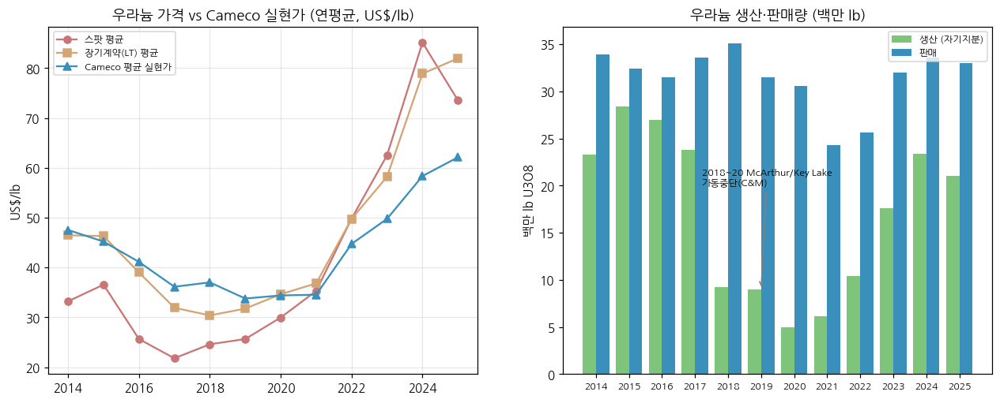

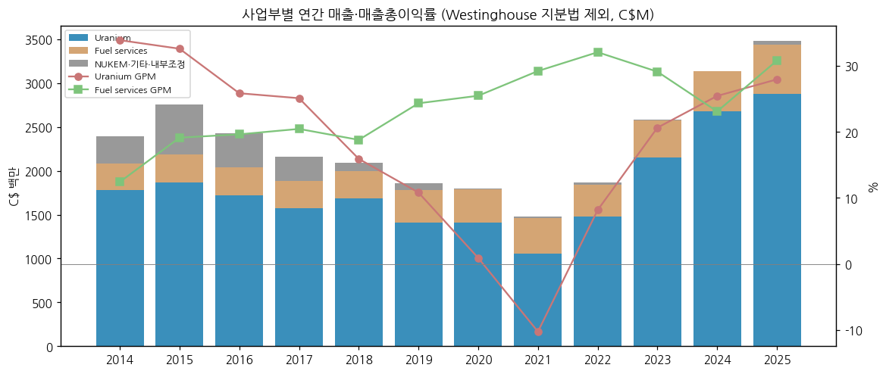

**사업부 분기 시계열 (1Q23\~3Q26, C$M — 분기 MD&A 원본 범위)**

| 분기 | U 매출 | U 매출총이익 | U GPM | 생산 (M lb) | 판매 (M lb) | 실현가 US$ | 스팟 US$ | LT US$ | FS 매출 | FS 조정EBITDA | WH 매출(49%) | WH 조정EBITDA(49%) |
|---|---|---|---|---|---|---|---|---|---|---|---|---|
| 1Q23 | 595 | 137 | 23% | 4.5 | 9.7 | 45.35 | 50.68 | 52.83 | 92 | 39 | — | — |
| 2Q23 | 369 | 72 | 20% | 4.4 | 5.5 | 49.41 | 54.53 | 54.83 | 113 | 48 | — | — |
| 3Q23 | 489 | 139 | 28% | 3.0 | 7.0 | 52.57 | 62.63 | 59.13 | 86 | 36 | — | — |
| 4Q23 | 701 | 96 | 14% | 5.7 | 9.8 | 52.35 | 82.21 | 66.00 | 135 | 43 | 521* | 101* |
| 1Q24 | 561 | 169 | 30% | 5.8 | 7.3 | 57.57 | 94.33 | 74.83 | 72 | 25 | 656 | 76 |
| 2Q24 | 481 | 144 | 30% | 7.1 | 6.2 | 56.43 | 87.88 | 78.50 | 118 | 42 | 670 | 121 |
| 3Q24 | 600 | 154 | 26% | 4.3 | 7.3 | 60.18 | 81.58 | 81.00 | 120 | 28 | 726 | 122 |
| 4Q24 | 1,035 | 213 | 21% | 6.1 | 12.8 | 58.45 | 76.75 | 81.17 | 148 | 49 | 841 | 162 |
| 1Q25 | 619 | 203 | 33% | 6.0 | 6.9 | 62.55 | 66.18 | 80.33 | 135 | 75 | 770 | 93 |
| 2Q25 | 705 | 217 | 31% | 4.6 | 8.7 | 57.35 | 72.59 | 80.00 | 162 | 57 | 1,033 | 352 |
| 3Q25 | 523 | 158 | 30% | 4.4 | 6.1 | 62.12 | 76.28 | 81.67 | 91 | 25 | 697 | 124 |
| 4Q25 | 1,027 | 225 | 22% | 6.0 | 11.2 | 65.53 | 79.12 | 85.83 | 174 | 63 | 958 | 211 |
| 1Q26 | 712 | 259 | 36% | 6.2 | 7.8 | 66.21 | 88.49 | 90.17 | 134 | 54 | 868 | 121 |
| 2Q26 | 659 | 158 | 24% | 3.9 | 7.1 | 67.79 | 85.18 | 93.67 | 152 | 42 | 863 | 163 |
| 3Q26 | 518 | 111 | 21% | 3.5 | 5.6 | 65.78 | 88.56 | 96.17 | 95 | 24 | 895 | 143 |

→ (출처: 분기 MD&A 1Q\~3Q24·1Q\~3Q26(전년 동기 비교치 포함), 연간 MD&A 4분기 표. 4Q23 U·FS = 연간 − 9M [계산], 1Q24·1Q25·1Q26 WH 조정 EBITDA = 상반기 − 2Q [계산]. *4Q23 WH = 2023-11-07\~12-31 지분법 기간)

→ **4분기 계절성**: 고객 인도 일정상 4Q 판매량이 연간의 1/3 이상 (4Q24 12.8M lb, 4Q25 11.2M lb) — 분기 실적은 연간 추세 지표로 부적합 (MD&A 명시)

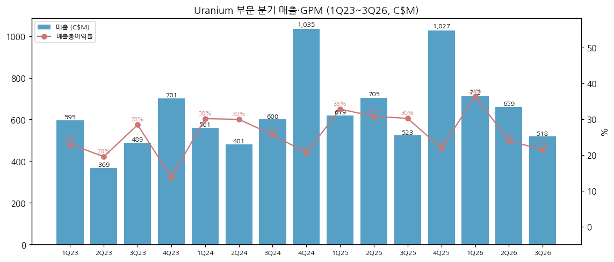

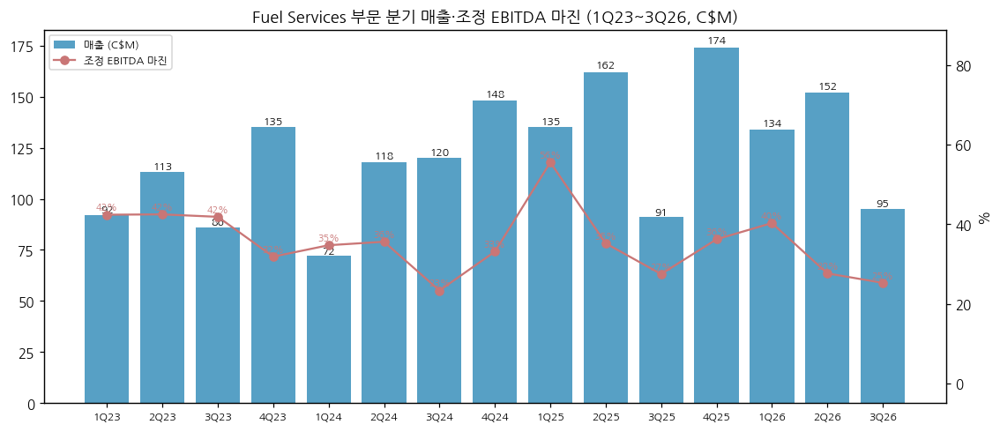

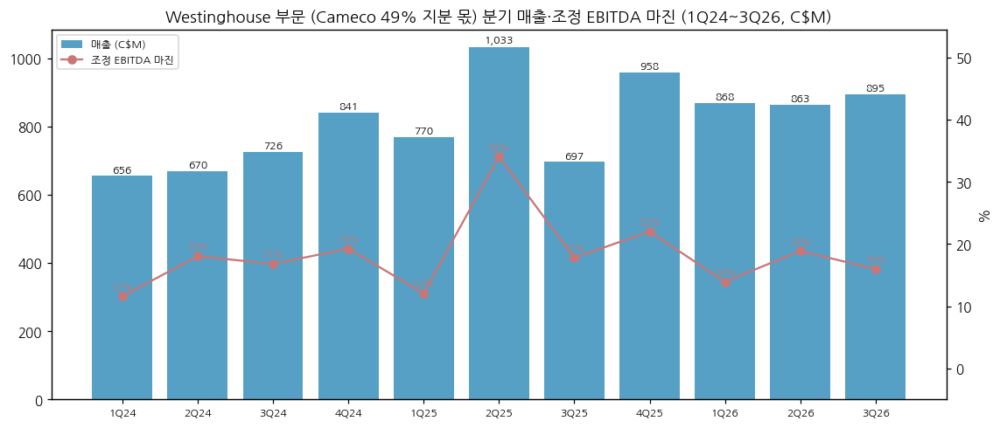

**전사 분기 시계열 (51Q, 1Q14\~3Q26, C$M — 연간 MD&A '분기 추이' 표)**

| 연도 | 매출 Q1 / Q2 / Q3 / Q4 | 순이익(지배) Q1 / Q2 / Q3 / Q4 | 조정순이익 Q1 / Q2 / Q3 / Q4 |
|---|---|---|---|
| 2014 | 419 / 502 / 587 / 889 | 131 / 127 / -146 / 73 | 36 / 79 / 93 / 205 |
| 2015 | 566 / 565 / 649 / 975 | -9 / 88 / -4 / -10 | 69 / 46 / 78 / 151 |
| 2016 | 408 / 466 / 670 / 887 | 78 / -137 / 142 / -144 | -7 / -57 / 118 / 90 |
| 2017 | 393 / 470 / 486 / 809 | -18 / -2 / -124 / -62 | -29 / -44 / -50 / 181 |
| 2018 | 439 / 333 / 488 / 831 | 55 / -76 / 28 / 160 | 23 / -28 / 15 / 202 |
| 2019 | 298 / 388 / 303 / 874 | -18 / -23 / -13 / 128 | -33 / -18 / -2 / 94 |
| 2020 | 346 / 525 / 379 / 550 | -19 / -53 / -61 / 80 | 29 / -65 / -78 / 48 |
| 2021 | 290 / 359 / 361 / 465 | -5 / -37 / -72 / 11 | -29 / -38 / -54 / 23 |
| 2022 | 398 / 558 / 389 / 524 | 40 / 84 / -20 / -15 | 17 / 72 / 10 / 36 |
| 2023 | 687 / 482 / 575 / 844 | 119 / 14 / 148 / 80 | 133 / 46 / 96 / 108 |
| 2024 | 634 / 598 / 721 / 1,183 | -7 / 36 / 7 / 135 | 46 / 65 / 24 / 157 |
| 2025 | 789 / 877 / 615 / 1,201 | 70 / 321 / 0 / 199 | 70 / 308 / 32 / 217 |
| 2026 | 845 / 814 / 619 / — | 131 / 25 / 43 / — | 204 / 77 / -2 / — |

→ (출처: 2015·2016·2018·2020·2022·2024·2025 연간 MD&A, 3Q26 MD&A. 조정순이익 2023 이후 신 산식, 2022 이전 당시 공시치)

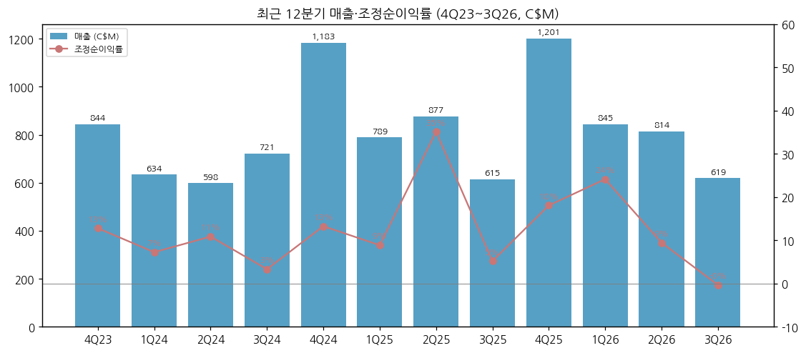

(2) 사업부별 개요 (매출 비중 큰 순서)

**Uranium — 연결 매출 83% (9M26)**

"캐나다 Athabasca 분지의 세계 최고 품위 광산에서 우라늄 정광(U3O8)을 캐서 전력사에 장기계약으로 파는 사업." 자산: **McArthur River(지분 69.805%, 운영)/Key Lake 정련소(83.33%)** — 매장량 2.419억 lb(100%), 평균 품위 6.48% / **Cigar Lake(57.418%, 운영)** — 9,410만 lb, 품위 16.33%(세계 최고) / **JV Inkai(카자흐, 40%, Kazatomprom 60%)** — 지분법, Cameco는 생산분 구매권(2026 할당 4.2M lb, 100% 생산 10.4M lb). 자기지분 P&P 매장량 약 4.33억 lb (AIF). Rabbit Lake·미국 ISR(Crow Butte·Smith Ranch-Highland)은 가동중단 상태

**Fuel Services — 17%**

"캐낸 정광을 원자로 연료 원료(UF6·UO2)로 바꾸고, 캐나다 CANDU 원전용 연료 다발을 만드는 사업." Blind River 정련소(UO3), Port Hope 변환(UF6 — 세계 1차 변환 용량 약 18%, UO2), Cameco Fuel Manufacturing (AIF). 2025 Port Hope UF6 11.2M kgU 생산 기록. 변환 시장 공급 부족으로 계약가 역사적 고점권

**Westinghouse — 지분법 (Cameco 몫 매출이 연결 매출과 비슷한 규모: 9M26 C$2,627M)**

"전 세계 가동 원전에 연료·정비·부품을 대고(Operating Plants), AP1000 신규 원전을 설계·조달하는(New Plants) 원전 서비스·원자로 회사." 세계 가동 원전 약 417기 중 약 63% 정비, 약 40%에 연료 공급, PWR 정비 점유 약 75% (3Q26 MD&A). Operating Plants 백로그 US$13.2B, New Plants 백로그 US$0.8B (2025-12-31, 100% 기준). 연료 공장: Columbia(SC)·Springfields(UK)·Västerås(스웨덴)

**기타 — GLE 49% (Silex와 합작, 레이저 농축 SILEX 기술 개발)** — 성공 시 Cameco가 채굴·변환·농축·연료까지 사이클 전체 참여

(3) 사업부별 디테일 (top-seller · growth · 이익 outlier)

→ **Top-seller**: 우라늄 정광 (FY25 33.0M lb 인도, C$2,874M). 생산 21.0M lb + 구매 9.6M lb(Inkai 포함)로 공급 — 생산보다 많이 팔고 부족분은 시장 구매·재고로 메우는 구조

→ **Growth**: Westinghouse New Plants — AP1000 파이프라인 최대 91기(105GWe): DOE 공급망 대출 최대 10기, DOC 파트너십 최대 10기, LLI/EPC 5기(미국 Fairfield SC 재착공 2기·폴란드 3기), ESC 4기(불가리아 Kozloduy 2·우크라이나 Khmelnytskyi 2), FEED 12기, Origination 50기 (3Q26 MD&A)

→ **이익 outlier (긍정)**: 2Q25 Westinghouse — **Dukovany(체코, KHNP 주계약) 참여로 Cameco 몫 매출 약 US$170M 일시 인식** → 2Q25 WH 조정 EBITDA C$352M(분기 최대), 2025-10 US$171.5M 배당 수령 → 2025 배당 조기 2배(C$0.24)

→ **이익 outlier (부정)**: 3Q26 Uranium GPM 21% — Key Lake 장기 정비로 생산 3.5M lb(-20%), 단위원가 C$72.17(+21%). 2024 Westinghouse 순손실 C$-218M — 인수가격배분(PPA) 재고 재평가·무형자산 상각

→ **Westinghouse 마진 구조**: 조정 EBITDA ↔ 순이익 괴리 큼 — 9M26 Cameco 몫 D&A C$291M·금융비용 C$137M (인수 무형자산 상각 + Westinghouse 자체 차입)

(4) 주요 경쟁사 (사업부별) — **한국 원전 겹침 포함**

| Cameco 사업 | 글로벌 경쟁사 | **한국 원전 겹침** |
|---|---|---|
| 우라늄 채굴 | Kazatomprom(세계 1위), Orano, CGN Mining, Uranium One(Rosatom), NexGen·Denison(개발 단계) | 한국 생산사 없음 — 한수원이 **수요자**(장기계약 고객군) |
| UF6 변환 | Orano(프랑스), ConverDyn(미국 Honeywell), Rosatom(TVEL) | 한국 변환 설비 없음 |
| 농축 (GLE 옵션) | Urenco, Orano, Rosatom, Centrus | — |
| Westinghouse 연료 | Framatome(EDF), GNF(GE-히타치), TVEL | **한전원자력연료** (국내 PWR 연료 — 원천기술 Westinghouse 계열에서 출발) |
| Westinghouse 정비·부품 | Framatome, GE Vernova | **한전KPS** (국내·해외 정비), **두산에너빌리티** (주기기) |
| Westinghouse AP1000 신규 건설 | EDF EPR, **KHNP APR1400/APR1000**, Rosatom VVER, CGN/CNNC Hualong One | **한국전력·한수원·한전기술·두산에너빌리티·현대건설** — 수출 직접 경쟁 + 2025 합의 후 지역 분할·협력 (⑥(3)) |

→ (출처: 3Q26 MD&A·AIF 경쟁 기술, 한국 매핑은 워치리스트 원전 섹터 기준 [판단])

(5) 주요 매출처

→ 우라늄: 전 세계 원전 전력사 39개 고객, 약 2.3억 lb 계약 (FY25 MD&A). 고객명·국가별 매출 비중 미공시 — 단일 고객 10% 이상 공시 없음

→ Fuel Services: 33개 고객, UF6 약 8,300만 kgU 계약 (FY25 MD&A). 우크라이나 Energoatom과 2035년까지 UF6 전량 공급 계약(2023-03, AIF)

→ Westinghouse: 전 세계 PWR·BWR 운영사, 신규 건설 고객(미국 전력사·폴란드 PEJ·불가리아·우크라이나·체코 Dukovany(KHNP 경유))

(6) 생산 CAPA + 임직원 추이

→ **우라늄 생산 능력 (100% 기준 면허)**: McArthur River/Key Lake 연 25M lb(면허), 현행 계획 18M lb 수준 / Cigar Lake 연 18M lb [AIF·MD&A 일반, 2026 계획 Cameco 몫 Cigar 9.5\~10.0M·McArthur 10.0\~10.5M lb]

→ **변환**: Port Hope UF6 약 12.5M kgU 면허 [web 일반 사실], 2025 실적 11.2M kgU (기록). 운영면허 2027-02 만료 → 갱신 진행 (3Q26 MD&A 리스크)

→ **재고**: 우라늄 8.5M lb (3Q26말, 평균 원가 C$58.37/lb)

→ **임직원**: 3,082명 (FY25말, AIF). 인건비 C$642M (FY25 XBRL, 2016 C$487M)

---

## ④ 재무 구조

(1) 손익계산서 (12년, C$M) + chart1b

| 연도 | 매출 | 매출 YoY | 매출총이익 | GPM | 관리비 | 관리비/매출 | 영업이익(IFRS) | OPM | 세전이익 | 순이익(지배) | NPM | 조정순이익 | 희석 EPS (C$) |
|---|---|---|---|---|---|---|---|---|---|---|---|---|---|
| 2014 | 2,398 | — | 638 | 26.6 | 176 | 7.3 | 38 | 1.6 | -119 | 185 | 7.7 | 412 | 0.47 |
| 2015 | 2,754 | 14.8 | 697 | 25.3 | 187 | 6.8 | 246 | 8.9 | -79 | 65 | 2.4 | 344 | 0.16 |
| 2016 | 2,431 | -11.7 | 463 | 19.0 | 207 | 8.5 | -142 | -5.8 | -154 | -62 | -2.6 | 143 | -0.16 |
| 2017 | 2,157 | -11.3 | 436 | 20.2 | 163 | 7.6 | -128 | -5.9 | -207 | -205 | -9.5 | 59 | -0.52 |
| 2018 | 2,092 | -3.0 | 296 | 14.1 | 142 | 6.8 | 70 | 3.3 | 40 | 166 | 7.9 | 211 | 0.42 |
| 2019 | 1,863 | -10.9 | 242 | 13.0 | 125 | 6.7 | 92 | 4.9 | 135 | 74 | 4.0 | 41 | 0.19 |
| 2020 | 1,800 | -3.4 | 106 | 5.9 | 145 | 8.1 | -79 | -4.4 | -40 | -53 | -2.9 | -66 | -0.13 |
| 2021 | 1,475 | -18.1 | 2 | 0.1 | 128 | 8.7 | -136 | -9.2 | -104 | -103 | -7.0 | -98 | -0.26 |
| 2022 | 1,868 | 26.6 | 233 | 12.5 | 172 | 9.2 | 15 | 0.8 | 85 | 89 | 4.8 | 135 | 0.22 |
| 2023 | 2,588 | 38.5 | 562 | 21.7 | 246 | 9.5 | 283 | 10.9 | 487 | 361 | 13.9 | 383 | 0.83 |
| 2024 | 3,136 | 21.2 | 783 | 25.0 | 253 | 8.1 | 510 | 16.3 | 257 | 172 | 5.5 | 292 | 0.39 |
| 2025 | 3,482 | 11.0 | 970 | 27.9 | 311 | 8.9 | 618 | 17.7 | 777 | 590 | 16.9 | 627 | 1.35 |

→ (출처: FY2014\~15 = 2015 연간 FS 원문, FY2016\~25 = SEC XBRL companyfacts(IFRS). 조정순이익 = 연간 MD&A. 비율 [계산]. 영업이익(IFRS 'Earnings from operations')은 손상차손 포함 — FY14 C$327M, FY15 C$215M, FY16 C$362M. FY2014 순이익엔 Bruce Power 매각 중단사업이익 C$127M 포함. FY2023 이후 영업이익 아래 Westinghouse·Inkai 지분법이익(FY25 C$216M) 별도)

(2) 재무상태표 (12년, 연말, C$M) + chart4

| 연말 | 자산 | 부채 | 자본 | 현금 | 단기예금 | 총차입 | 순현금(+)/순차입(−) | 유동자산 | 유동부채 | 유동비율 | 부채/자본 | 지분법투자 |
|---|---|---|---|---|---|---|---|---|---|---|---|---|
| 2014 | 8,473 | 3,029 | 5,444 | 567 | 0 | 1,491 | -924 | 2,068 | 516 | 4.01 | 56% | 3 |
| 2015 | 8,795 | 3,250 | 5,545 | 459 | 0 | 1,492 | -1,033 | 2,184 | 672 | 3.25 | 59% | 2 |
| 2016 | 8,249 | 2,990 | 5,259 | 320 | 0 | 1,493 | -1,173 | 2,042 | 469 | 4.35 | 57% | — |
| 2017 | 7,779 | 2,919 | 4,860 | 592 | 0 | 1,494 | -902 | 2,136 | 411 | 5.20 | 60% | 0 |
| 2018 | 8,019 | 3,025 | 4,994 | 712 | 391 | 1,496 | -393 | 2,083 | 876 | 2.38 | 61% | 231 |
| 2019 | 7,427 | 2,432 | 4,995 | 1,062 | 0 | 997 | 65 | 1,807 | 277 | 6.52 | 49% | 253 |
| 2020 | 7,581 | 2,622 | 4,959 | 918 | 25 | 996 | -53 | 1,945 | 304 | 6.40 | 53% | 220 |
| 2021 | 7,518 | 2,672 | 4,846 | 1,247 | 85 | 996 | 336 | 2,142 | 414 | 5.17 | 55% | 233 |
| 2022 | 8,633 | 2,797 | 5,836 | 1,144 | 1,138 | 997 | 1,285 | 3,322 | 561 | 5.92 | 48% | 211 |
| 2023 | 9,934 | 3,840 | 6,094 | 567 | 0 | 1,784 | -1,217 | 1,842 | 1,189 | 1.55 | 63% | 3,173 |
| 2024 | 9,907 | 3,543 | 6,364 | 600 | 0 | 1,281 | -681 | 1,923 | 1,186 | 1.62 | 56% | 3,218 |
| 2025 | 10,301 | 3,398 | 6,903 | 1,115 | 100 | 996 | 219 | 2,639 | 1,070 | 2.47 | 49% | 2,987 |
| 3Q26 | — | — | — | 860 | — | 약 1,000 | 약 -140 | — | — | — | — | — |

→ (출처: XBRL companyfacts, FY2014\~15 FS 원문, 3Q26 MD&A. 부채 = 자산 − 자본, 순현금 = 현금 + 단기예금 − 총차입 [계산]. 2023 지분법투자 급증 = Westinghouse 49% 인수, 2024\~25 감소는 WH 손실·배당 수령)

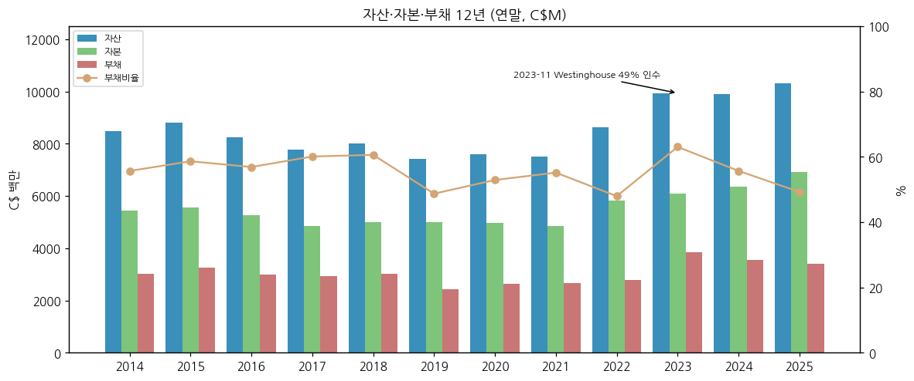

(3) 현금흐름표 (12년, C$M) + chart6

| 연도 | 영업CF | 투자CF | 재무CF | CapEx | FCF | FCF/순이익 | D&A | 배당 지급 |
|---|---|---|---|---|---|---|---|---|
| 2014 | 480 | -21 | -84 | 480 | 0 | 0% | 339 | 158 |
| 2015 | 450 | -341 | -228 | 359 | 91 | 140% | 313 | 158 |
| 2016 | 312 | -218 | -229 | 217 | 95 | n/m | 372 | 158 |
| 2017 | 596 | -93 | -228 | 114 | 482 | n/m | 330 | 158 |
| 2018 | 668 | -412 | -144 | 55 | 613 | 369% | 328 | 71 |
| 2019 | 527 | 437 | -607 | 75 | 452 | 611% | 276 | 32 |
| 2020 | 57 | -101 | -98 | 77 | -20 | n/m | 209 | 32 |
| 2021 | 458 | -80 | -47 | 99 | 359 | n/m | 190 | 32 |
| 2022 | 305 | -1,291 | 869 | 143 | 162 | 182% | 177 | 52 |
| 2023 | 688 | -2,045 | 749 | 154 | 534 | 148% | 220 | 52 |
| 2024 | 905 | -206 | -688 | 212 | 693 | 403% | 281 | 70 |
| 2025 | 1,408 | -434 | -443 | 333 | 1,075 | 182% | 293 | 104 |

→ (출처: XBRL companyfacts, FY2014\~15 FS 원문. FCF = 영업CF − 유형자산 취득 [계산]. 2014 투자CF에 Bruce Power 매각대금 C$447M 포함. 2022 투자CF = 단기예금 C$1.1B 예치, 2023 = Westinghouse 인수 C$2.0B+. 2019 투자CF 플러스 = 단기예금 회수)

→ 12년 누적 FCF C$4.54B vs 누적 배당 C$1.08B [계산] — 자사주 매입 없음, 잉여현금은 Westinghouse 인수·차입 상환에 사용

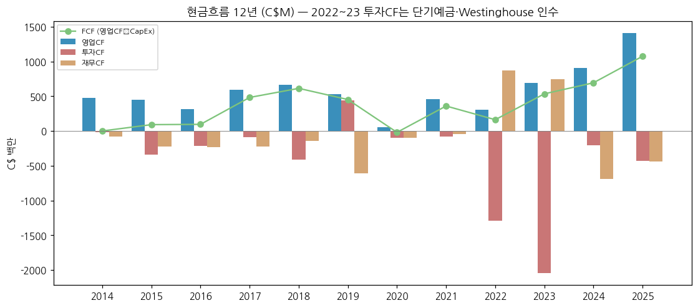

(4) CapEx + chart8

→ FY14 C$480M(Cigar Lake 개발 막바지) → FY18 **C$55M**(가동중단, 유지보수만) → FY25 C$333M → **2026 가이던스 C$440\~490M** (McArthur 증산·Key Lake 설비 교체·변환 확장). 3Q26에 일부 프로젝트 이연으로 하향 (컨콜)

→ Westinghouse CapEx(Cameco 몫)는 별도: FY25 약 C$270M대 [3Q26 9M C$146M], 2026 가이던스 US$160\~200M

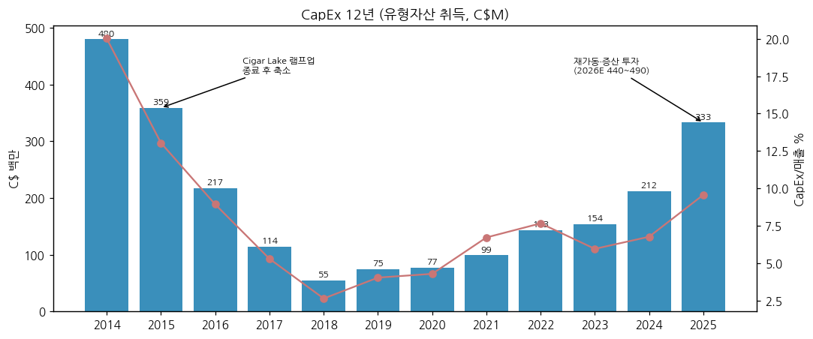

(5) 부채 구조 + 채권 history

→ 무담보 사채(debentures) 중심 C$1.0B (3Q26말) + 미사용 리볼버 C$1.0B. 2023 Westinghouse 인수 시 US$600M 텀론 차입 → **2025년 전액 상환** (MD&A)

→ 사채 이력: 2024-05 C$500M 4.94% 2031년 만기 발행 / 2024-06 C$500M 4.19% 만기 상환 (AIF). 이자비용 FY25 C$52M, 금융비용 C$115M

→ **CRA(캐나다 국세청) 이전가격 분쟁** — 스위스 자회사(Cameco Europe) 거래 관련 장기 분쟁에서 Cameco 승소(2020년 대법원 상고 기각 → 확정) 후 2023 환급 C$297M (AIF) [2020 확정은 web 일반 사실]

(6) 배당·자사주 + chart9

| 연도 | DPS (C$, 연간) | 배당 지급 (C$M) | 자사주 매입 | FCF | 배당/FCF | 연말 발행주식 (M) |
|---|---|---|---|---|---|---|
| 2014 | 0.40 | 158 | 0 | 0 | n/m | 395.8 |
| 2015 | 0.40 | 158 | 0 | 91 | 174% | 395.8 |
| 2016 | 0.40 | 158 | 0 | 95 | 166% | 395.8 |
| 2017 | 0.40 | 158 | 0 | 482 | 33% | 395.8 |
| 2018 | 0.08 | 71 | 0 | 613 | 12% | 395.8 |
| 2019 | 0.08 | 32 | 0 | 452 | 7% | 395.8 |
| 2020 | 0.08 | 32 | 0 | -20 | n/m | 396.3 |
| 2021 | 0.08 | 32 | 0 | 359 | 9% | 398.1 |
| 2022 | 0.12 | 52 | 0 | 162 | 32% | 432.5 |
| 2023 | 0.12 | 52 | 0 | 534 | 10% | 434.2 |
| 2024 | 0.16 | 70 | 0 | 693 | 10% | 435.3 |
| 2025 | 0.24 | 104 | 0 | 1,075 | 10% | 435.5 |

→ (출처: XBRL companyfacts·MD&A. 2018년 DPS C$0.40 → C$0.08 감액(2018 지급액은 2017 4분기분 포함). 2024년 '3년 배당 성장 계획'(2026년까지 2023년 C$0.12의 2배) → **2025년에 1년 앞당겨 C$0.24 달성**, 2026년 C$0.24 유지(2026-12-15 지급, 3Q26 MD&A·컨콜))

→ 배당 수익률 0.24% (C$0.24 ÷ C$100.80) [계산] — 주주환원은 부차적, 자본은 성장(Westinghouse·증산)에 배분

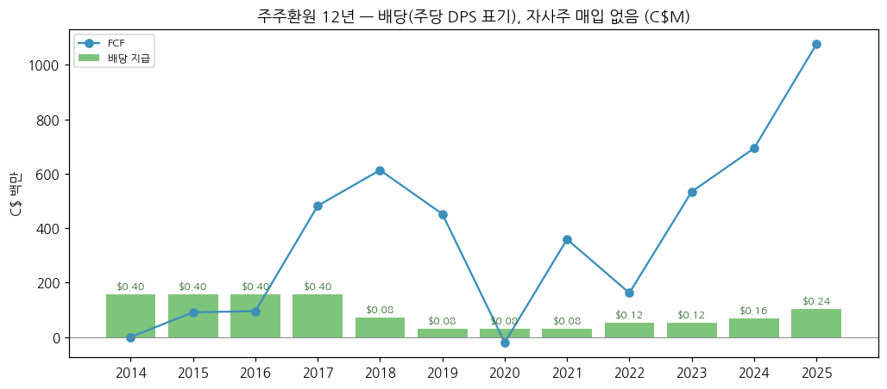

(7) 재무비율 (12년, [계산])

| 연도 | ROE (평균자본) | ROA (평균자산) | 부채비율 | 유동비율 | 이자보상배율 (세전+금융비용)/금융비용 | 실효세율 |
|---|---|---|---|---|---|---|
| 2014 | 3.4% | 2.2% | 56% | 4.01 | n/m | n/m (세금 환급) |
| 2015 | 1.2% | 0.8% | 59% | 3.25 | 0.2x | n/m |
| 2016 | -1.1% | -0.7% | 57% | 4.35 | n/m | n/m |
| 2017 | -4.1% | -2.6% | 60% | 5.20 | n/m | n/m |
| 2018 | 3.4% | 2.1% | 61% | 2.38 | 1.4x | n/m |
| 2019 | 1.5% | 1.0% | 49% | 6.52 | 2.4x | 45% |
| 2020 | -1.1% | -0.7% | 53% | 6.40 | 0.6x | n/m |
| 2021 | -2.1% | -1.4% | 55% | 5.17 | n/m | n/m |
| 2022 | 1.7% | 1.1% | 48% | 5.92 | 2.0x | n/m |
| 2023 | 6.1% | 3.9% | 63% | 1.55 | 5.2x | 26% |
| 2024 | 2.8% | 1.7% | 56% | 1.62 | 2.7x | 33% |
| 2025 | 8.9% | 5.8% | 49% | 2.47 | 7.8x | 24% |

→ 정점권 FY25에도 ROE 8.9% — 장기계약 후행 + Westinghouse PPA 상각 + 대규모 자본(매장량 장부가) 탓. 사이클 정점 ROE가 낮은 구조라 PBR보다 SOTP·EV/EBITDA가 적합 [판단]

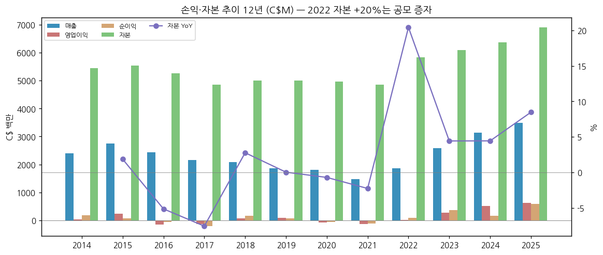

---

## ⑤ 지배 구조

(1) 그룹·계열 관계

→ 지배주주 없는 분산 소유 상장사. 주요 자회사: Cameco Europe Ltd.(스위스, 마케팅·트레이딩), Cameco U.S. Holdings(네바다) (AIF)

→ 주요 지분: **Westinghouse 49%** (Brookfield Renewable·Brookfield 컨소시엄 51%) / **JV Inkai 40%** (Kazatomprom 60%) / **GLE 49%** (Silex 51%) / Cigar Lake JV 57.418%(나머지 Orano, 2026-07 TEPCO 5% 인수 후) / McArthur River 69.805%·Key Lake 83.33% (Orano 나머지)

→ **Saskatchewan 주정부가 Class B 1주 보유** — 본사·임원 거주지 Saskatchewan 유지 조항 변경 시 거부권 (Proxy)

(2) 주주 구분 + chart5

→ **5% 이상 주주 없음** (2026-03-09 기준, 2026 Proxy)

→ **법정 소유 제한 (ENL Reorganization Act·정관)**: 캐나다 거주자 1인(특수관계 포함) 의결권 **25% 이하** / 비거주자 1인 **15% 이하** / 주총에서 비거주자 의결권 합계 **25% 상한**(초과분 비례 축소) — 사실상 **적대적 인수 불가 구조**

→ 발행주식 395.8M(2014\~2019) → 432.5M(2022, 증자) → **435.53M** (2026-09-30)

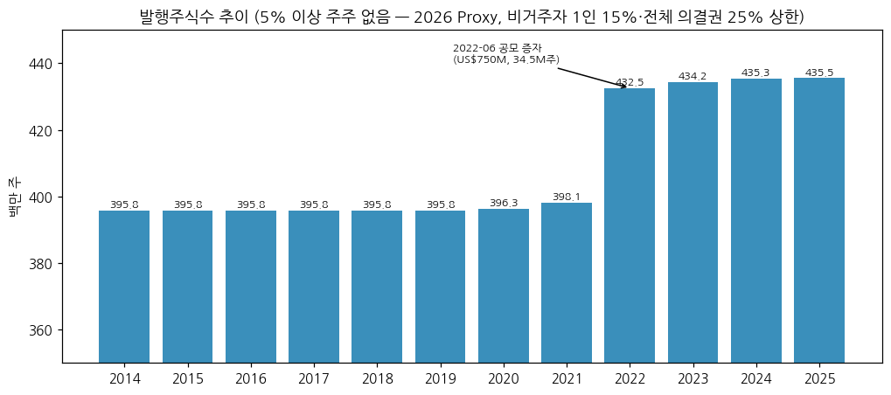

(3) 경영진·이사회

→ **Tim Gitzel** — CEO (63세). 2011-07\~2025-08 사장 겸 CEO, 이전 COO. Cameco 입사 전 Orano(옛 AREVA) 광업 부문 EVP (Proxy)

→ **Grant Isaac** — 사장 겸 COO (2025-09\~), 전 EVP·CFO. **Westinghouse 이사회 멤버** (3Q26 컨콜)

→ **Heidi Shockey** — EVP·CFO (2025-09\~)

→ 이사회 의장 Catherine Gignac (독립). CEO 외 전원 독립 이사 구성 (Proxy)

---

## ⑥ 기타 팩트

(1) 시가총액·밸류에이션 스냅샷 (2026-11-13 기준)

| 지표 | 값 |
|---|---|
| 주가 | US$70.73 (NYSE) / C$100.80 (TSX) |
| 시가총액 | **US$30.8B / C$43.9B** [계산, 435.53M주] |
| 사상 최고 (2026-01-29 장중) | US$135.24 ≈ 시총 $58.9B [계산] → 현재 -47.7% |
| EV | 약 C$44.0B [계산, 3Q26말 순차입 약 C$0.14B] |
| EV / TTM 조정 EBITDA (C$1,757M) | 약 25배 |
| P/E (FY25 조정 EPS C$1.44) | 70배 |
| P/E (TTM 조정 EPS C$1.14) | 88배 |
| PBR (FY25 자본 C$6.9B) | 6.4배 |
| 배당 수익률 | 0.24% |
| 컨센서스 | 'Buy' 21명, 평균 TP US$123.99 (StockAnalysis, 2026-10-30 기준 캐시) |

(2) R&D 인프라 + chart7

→ 연구개발비 C$5M(FY14) → **C$38M(FY25)**, 2026 가이던스 C$50\~55M — SMR·신기술(GLE 레이저 농축, 차세대 연료) 투자. 탐사비 C$47M(FY14) → C$8M(FY21) → C$28M(FY25)

→ 기술 R&D의 본체는 Westinghouse(AP1000·AP300 SMR·eVinci 마이크로원자로·AI 플랫폼) — Cameco 연결 R&D에는 미포함

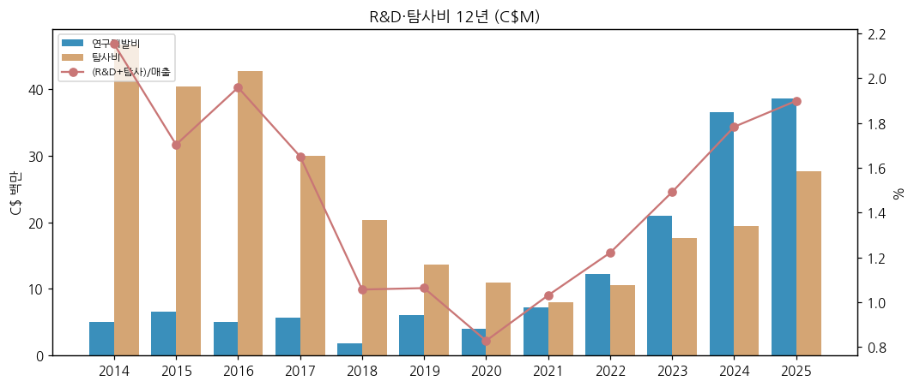

(3) 진행 중 corporate action — **Westinghouse (BT 핵심 관전 포인트: 한국 원전의 주 경쟁·협력사)**

(3-1) **Westinghouse IPO**

→ 2026-07-31 Westinghouse, 미국 IPO용 S-1 초안 **비공개 제출** — 공모 주식 수·가격 미정 (Westinghouse·Cameco 발표, Reuters/BNN)

→ 2026-09-18 Bloomberg 보도: **기업가치 US$50B 초과 목표**, 'October 공개 제출(public filing) 목표' — 일정 변동 가능

→ **2026-11-14 현재 상태: 공개 S-1·상장일·공모가 미확인** (웹 검색 기준). 3Q26 컨콜(2026-10-30) CEO: "지난 분기 S-1 초안 제출을 확인했다. 증권 규정상 그 과정에 대해 말할 수 있는 범위가 제한된다"

→ Cameco 49% 지분 장부가(지분법투자) C$2,987M (FY25말) vs 보도 가치 기준 US$24.5B+ [계산] — 상장 시 대규모 평가 차익 (회계상 지분법 유지 시 장부가 불변)

(3-2) **미 정부 전략적 파트너십 (2025-10-28 구속력 있는 term sheet, 확정 계약 협상 중)**

→ 미 상무부(DOC)가 미국 내 Westinghouse 원전 **총 US$80B 이상** 건설의 자금 조달·인허가 지원

→ 미 정부 **참여권(Participation Interest)**: FID·확정 계약(US$80B+) 시 vesting → Westinghouse의 **US$17.5B 초과 현금 배분의 20%** 수취. 2029-01 전 미 vesting 시 소멸

→ vesting 후 IPO 가치 **US$30B 이상**이면 미 정부가 IPO 요구 가능 → 참여권은 5년 만기 워런트(공모가치 − US$17.5B의 20%)로 전환 (2025 연간 MD&A)

→ 2026-06 DOE 'American Nuclear Supply Chain Loans' 조건부 US$17.5B — AP1000 최대 10기 장납기 기자재(LLI) 선구매, 2기 1사이트당 Westinghouse·전력사 지분 최대 각 약 US$500M (3Q26 MD&A)

(3-3) **한국과의 관계 — 두코바니 IP 분쟁 합의 + 2026 한미 프레임워크**

→ **2025-01 글로벌 합의**: Westinghouse ↔ KEPCO·KHNP, APR1400 기술 IP·수출통제 분쟁 종결. 공식 조건 비공개. **한국 언론·국회 감사 보도 기준**: 수출 원전 1기당 약 US$6.5억 물품·용역 + US$1.75억 기술료(합계 약 US$8.25억), 50년, KHNP의 북미·EU(체코 제외)·영국·일본·우크라이나 신규 수주 제한 (Neutron Bytes 2026-10-08, 보도 기준 — 미확정)

→ **Dukovany (체코)**: KHNP 2024-07 우선협상 → 2025-06 APR1000 2기 EPC 계약(약 4,070억 코루나). Westinghouse 참여로 **2Q25 Cameco 몫 매출 약 US$170M 인식, 2025-10 배당 US$350M(Cameco 몫 US$171.5M)** (Cameco MD&A)

→ **2026-09 한미 비구속 프레임워크**: 한국이 최대 **US$1,200억**(공사비 1,000억 + 예비비 200억) 투자 → 미국 내 대형 원전 최대 8기 = **AP1000 6기 + APR1400 2기**. **APR1400에서도 Westinghouse 범위 1기당 약 US$20억**. 2026년 말까지 선급금 US$100억 이전 예상, 그중 약 US$75억이 AP1000 장납기 기자재용 (3Q26 MD&A). 보도: APR1400 2기는 2025 합의의 1회성 예외, 한국 측 Westinghouse 지분 5\~10% 미만 추진 (Neutron Bytes, 미확정)

→ Cameco 사장 Grant Isaac (3Q26 컨콜): "수년 전 Westinghouse와 한국 간 IP 합의는 Westinghouse 기술과 한국 역량의 결합이 얼마나 강력한지 보여준다… 한국 엔지니어링·건설·제조 역량이 AP1000 기술을 보완해 실행력을 높일 수 있다"

(3-4) **기타**

→ 2026-07 TEPCO Cigar Lake 지분 5% 인수(Orano와 공동) → Cameco 57.418%

→ GLE(레이저 농축) 상업화 추진 — Cameco 오프테이크 계약 보유

→ Westinghouse AP1000 진행: 폴란드 PEJ 1호기 장납기 기자재 조달 승인·폴란드 공급사 4곳 조건부 발주(2026-10), 슬로바키아 Bohunice FEED(미 국무부 자금), NRC AP1000 설계 인증 갱신(2066년까지 유효, 2029-12-28 발효)

(4) 주요 리스크

→ **우라늄 가격·계약 타이밍** — 스팟 US$5/lb 하락 시 2026 매출 C$55M 감소 (2025 연간 MD&A 민감도)

→ **생산 집중** — 캐나다 2개 광산이 자기지분 생산 전부. Key Lake 장기 정비·Cigar Lake 지반 리스크, Port Hope 운영면허 2027-02 만료

→ **카자흐 지정학** — JV Inkai 황산 공급·운송(러시아 경유)·카자흐 세제/광업권 변경 (AIF)

→ **Westinghouse 리스크** — 고정가 신규 건설 원가 초과(과거 Vogtle·VC Summer로 2017 파산 이력), 미 정부 파트너십 확정 계약 미체결, IPO 일정·가치 불확실, 미 정부 참여권 희석

→ **미국 관세** — 캐나다산 우라늄·UF6가 에너지 관세에서 제외된다는 가정 (3Q26 MD&A)

→ **환율** — 매출 대부분 US$ 계약, 보고는 C$ (2025 평균 실현 환율 USD/CAD 1.40)

(5) ESG

→ 2025 Sustainability Report·SASB Index·성과표 공개 (cameco.com) — 원문 미수집 (Source Audit ❌). 원자력은 EU 택소노미 조건부 녹색 분류, 북부 Saskatchewan 원주민 고용·협약이 핵심 이슈 [판단]

(6) 인증·라이선스

→ 캐나다 원자력안전위원회(CNSC) 광산·정련·변환 면허, 카자흐 지하자원 이용 계약(Inkai). Westinghouse는 미국 NRC AP1000 설계 인증 보유

---

## Activity 보고 (v1.0 finalize)

### ✅ 확보 자료
→ 40-F 14 · XBRL companyfacts · 연간 MD&A/FS 8 · 분기 MD&A/FS 6 · 3Q26 트랜스크립트 · 2025 AIF · 2026 Proxy · Yahoo 20년

### ❌ 누락 자료 (4)
→ 40-F Ex-99 SEC 원본(IR PDF로 대체) / 사업부 분기 1Q14\~4Q22 / 13F 기관 보유 상세 / Westinghouse 공개 S-1·ESG 원문

### ⚠️ 추정·계산 데이터 표시
→ 시총·EV·P/E·PBR·SOTP 지분가치·미 정부 워런트 가치·4Q23 사업부·1Q WH 조정 EBITDA는 [계산]. KHNP-Westinghouse 합의 조건과 한국 측 지분 추진은 언론·국회 보도 기준(공식 미공개)

### Data Quality Confidence: **88%**

---

## Version Log

| 버전 | 일자 | 내역 |
|---|---|---|
| v1.0 | 2026-11-15 | 최초 작성 — 12년 연간(FY14\~25)·전사 51분기·사업부 15분기(WH 11분기)·17종 차트, 3Q26(2026-10-30) 반영, Westinghouse IPO·미 정부 파트너십·한미 프레임워크·KHNP 합의 정리 |

→ 잔여 보완 후보: FY26 연간 확정(2027-02 발표) 반영, Westinghouse 공개 S-1 제출 시 SOTP·지분 시가 갱신, 홀수 연도 분기 MD&A로 사업부 분기 60Q 확장, 13F 기관 지분, ESG 등급
