> Ticker: **Nasdaq: CEG — Constellation Energy Corporation**  
> Entity: **Constellation Energy Corporation** (본사 Baltimore, Maryland, USA) — 2022-02-01 Exelon에서 스핀오프된 미국 최대 원전 운영사(25기·약 22GW, 미국 원전 발전량 최대). 2026-01-07 Calpine 인수로 가스·지열 23GW와 소매 전력 62TWh를 더해 **총 55GW, 세계 최대 민간 발전사**  
> Sector: 원전 — 서브섹터 **원전 운영 (핵심: 한국전력·Constellation / 확장: Vistra)**  
> 작성 시각: **2026-11-15 KST** (**v1.0** — Phase 1 Source 전수 수집 + 14종 차트(12종 표준 + 원전 운영·PJM 용량가격) + v1.5 ① 기업 분류 표준)  
> 적용 구조: v4.8 (6개 섹션) + v1.5 ① 기업 분류 표준 (Summary Box · 손익 narrative · 분류 sub-logic · 밸류에이션 · 분류 변경 조건)  
> 데이터 범위: **연간 12년 (FY2014\~FY2025, 12월 결산)** — **FY2014\~FY2021 = 전신 Exelon Generation Company, LLC (현 Constellation Energy Generation, LLC) 연결 재무** [Exelon 10-K 공동 등록 재무제표] / FY2022\~ CEG 10-K + **9M26 (1Q\~3Q26, 10-Q 2026-11-09 제출)** + **세그먼트 분기 23Q (1Q21\~3Q26)** + **주가 2022-02 \~ 2026-11-13**  
> 출처: **SEC EDGAR CEG 10-K 5건 (FY2021\~FY2025) · 10-Q 15건 (1Q22\~3Q26) · DEF 14A 2026 (2026-03-19)**, **Exelon 10-K (FY2014\~FY2020, Generation 재무제표·Selected Financial Data·MD&A)**, **SEC XBRL companyfacts (CIK 0001868275)**, **3Q26 실적 보도자료 (회사 웹사이트, 2026-11-09)**, **4Q25 실적 보도자료 (2026-02-24)**, Yahoo Finance CEG, PJM BRA 결과 공개자료, 언론 (E&E News 2026-06-09, valuethemarkets 2026-11-10)  
> 세그먼트 기준: 지역 세그먼트 5개 (Mid-Atlantic·Midwest·New York·ERCOT·Other Power Regions) + **2026-1Q부터 Calpine 독립 세그먼트** (총 6개). 성과지표 = **RNF (Revenue Net of Fuel = 매출 − 구매전력·연료비)**. 세그먼트 매출은 세그먼트 간 거래 포함, 미실현 헤지손익·가스 도매/소매·영국 사업은 "Other". 단위 $M  

# Constellation Energy 기업 개요 (v1.0 — 원전 운영 / 미국 최대 원전 함대 + 하이퍼스케일러 장기 PPA + Calpine 가스 결합 / 지속성장 전환기 사이클주)
> **Fact verify cutoff**: 2026-11-15 (주가 2026-11-13 종가 **$280.20** [Yahoo Finance], 발행주식 351,608,504주 [10-Q 표지, 2026-10-31] → 시가총액 **$98.5B** [계산] (stockanalysis.com 2026-10-23 $89.8B — 실적 발표 후 +12% 반등 반영). 사상 최고 종가 **$403.95 (2025-10-15)**, 장중 최고 $412.70 (같은 날) [Yahoo] → 당시 시총 약 **$126.0B** [계산: 312M주]. 고점 대비 **-30.6%**, YTD -20.7% (2025말 $353.27), 1년 -17.2%. 52주 최저 종가 $236.50 (2026-07-01))  

## Phase 1 Source Audit (메모리 룰)

```
=== 자료 수집 audit (Constellation Energy) ===

✅ 확보 (저장: company-overview-source/CEG/, Exelon 10-K는 company-overview-source/EXC_EXELON CORP/)
- CEG 10-K 5건 (2022-02 ~ 2026-02 제출, FY2021~FY2025) + 10-Q 15건 (1Q22~3Q26) — sec_edgar_download_reports
- CEG 8-K 69건 (본문만, 보도자료 Ex-99.1 미포함) / DEF 14A 4건 (2023~2026)
- Exelon 10-K 13건 (FY2013~FY2025) — 스핀오프 전 Exelon Generation 재무제표 (FY2014~FY2020) 추출
- SEC XBRL companyfacts.json (CEG CIK 0001868275 — FY2020~2Q26; Generation CIK 0001168165는 역사 데이터 없음)
- Yahoo Finance v8 CEG 월간 (2022-02~) + 일간 2년 (2026-11-13까지)
- 3Q26·4Q25 실적 보도자료 (회사 웹사이트 — 조정 영업 EPS·가이던스)

❌ 누락 (4)
- 스핀오프 전 분기 세그먼트 (2014~2020) — Exelon 10-Q 미수집, 지역 RNF 연간은 2018~만 확보
- 조정 영업 EPS 2022·2023 (회사 보도자료 미수집)
- 3Q26 XBRL (companyfacts 미반영) → 10-Q 본문에서 직접 추출
- ESG 보고서·등급 미수집

⚠️ 결과 영향
- 연간 12년 = FY2014~FY2025. FY2014~2021은 Exelon Generation(현 CEG의 사업 자회사) 연결. FY2014~2020 자본 = Member's equity
- CEG는 R&D 비용을 별도 공시하지 않음 → chart7은 R&D 대신 대형 수요처 PPA 파이프라인으로 대체
- 2020-04 이후 매출채권 유동화(DPP) 회수액이 투자CF로 분류 → GAAP 영업CF가 2021~2024 음수. 조정 영업CF(=영업CF+DPP) 병기
- 영업이익·순이익은 파생상품 미실현 손익·NDT(원전해체기금) 평가손익으로 분기 변동 큼 — 회사 핵심 지표는 RNF와 조정 영업 EPS

Source 6종 audit:
[V] (1) 정기 보고서 (10-K 5 + 10-Q 15 + Exelon 10-K) ✓
[△] (2) IR 실적 자료 (3Q26·4Q25 보도자료 ✓, 과거 분기 보도자료·IR 덱 미수집)
[✗] (3) Sustainability Report ✗
[V] (4) 주가 (Yahoo 2022-02~) ✓
[V] (5) Proxy / 지배구조 ✓
[V] (6) 12년 정확값 시계열 (XBRL 2020~ + Exelon 10-K 2014~2019) ✓
→ 5/6 source 확보 (IR은 부분). 최신 분기(3Q26) 확보.
```

---

## ① 기업 분류

(1) Primary / Secondary 분류

**Primary 분류: 사이클 (전력가격·용량가격·가스가격 연동 발전사) → 지속성장 전환기**

→ 매출 FY2014 $17.4B → FY2025 $25.5B, **11년 CAGR +3.5%** [계산]. RNF(매출 − 연료·구매전력) $7.5B → $10.9B, 동일 CAGR +3.5% [계산]. 매출은 도매 전력가격(=가스가격)에 따라 ±7\~24%씩 흔들림 (2016 -7.2%, 2019 -7.4%, 2022 +24.4%)

→ GAAP OPM은 **-1.8% (FY2021) \~ 18.5% (FY2024)**, 진폭 20.3%p — 사이클 cutoff(±10%p) 초과. 2016\~2021 OPM 1.5\~7.0%의 장기 저점은 셰일가스 저가 → 원전 조기폐쇄 위기(Clinton·Quad Cities·TMI·Byron·Dresden)의 시기

→ 원전 이용률은 12년간 **93.7\~95.7%** 로 거의 일정 [Exelon·CEG 10-K] — 이익 변동은 물량이 아니라 **가격(전력·용량·정책 보조)** 에서 나온다

**Secondary 노트: 지속성장 (원전 PTC 하한 + 하이퍼스케일러 20년 PPA) + 꿈 (Crane 재가동·업레이트·데이터센터 co-location)**

→ 2024년부터 **원전 PTC(IRA 45U, 2024\~2032)** 가 전력가격 하락 시 원전 수입을 $15/MWh 한도로 보전 → 가격 하방이 막힌 구조. 2026 9M은 전력가격이 높아 PTC가 거의 0 (phase-out 구간) [10-Q Note 6]

→ **20년 장기 PPA**: Microsoft(Crane 835MW, 2024-09) · Meta(Clinton 1,092MW, 2025-06, 2027-06 개시) · Amazon(Calvert Cliffs 690MW, 2026-09) · Google(업레이트 약 890MW + 금융계약 2,700MW, 2026-10) · Walmart 등 920MW(2026-2Q) [10-K·10-Q]. 계약 물량이 늘수록 사이클 → 지속성장 성격이 강해진다

**6개 세그먼트 구조 (9M26 기준, 세그먼트 RNF 합계 $12,536M)**

→ **(1) Calpine** — RNF $4,081M (**32.6%**) — 2026-01 인수. 가스·지열·배터리 약 23GW + 소매 62TWh. CAISO·ERCOT·PJM·ISO-NE 등 전국

→ **(2) Mid-Atlantic** — RNF $2,827M (22.6%) — PJM 동부 (Calvert Cliffs·Peach Bottom·Limerick·Salem·Crane 등)

→ **(3) Midwest** — RNF $2,765M (22.1%) — PJM 서부·MISO (일리노이 원전 Byron·Braidwood·LaSalle·Dresden·Quad Cities·Clinton)

→ **(4) New York** — RNF $1,211M (9.7%) — NYISO (Nine Mile Point·FitzPatrick·Ginna, 뉴욕주 ZEC)

→ **(5) ERCOT** — RNF $838M (6.7%) — 텍사스 (STP 44% 지분 + 가스)

→ **(6) Other Power Regions** — RNF $814M (6.5%) — 뉴잉글랜드·남부·서부·캐나다 (주로 소매·구매전력)

(2) Summary Box (12년 시계열 + 사이클 통계)

| 지표 | 값 |
|------|-----|
| 매출 CAGR (FY14→FY25, 11년) | **+3.5%/yr** [계산] / RNF CAGR +3.5% / 9M26 매출 +44.8% YoY (Calpine 편입) |
| OPM 평균 (12년) | **6.6%** [계산] (RNF 마진 평균 43.0%) |
| OPM 정점 평균 | **15.2%** (FY2015 11.9% · FY2024 18.5%) |
| OPM 저점 평균 | **1.4%** (FY2016 4.6% · FY2021 -1.8%) |
| 사이클 주기 | 약 9년 (peak-to-peak 2015 → 2024) — 가스가격·PJM 용량가격·원전 정책 보조 사이클 |
| 사이클 회수 (12년) | 정점 2회 / 저점 2회 (OPM 진폭 20.3%p) |

```
[CEG 12년 손익 시계열 ($M, 12월 결산)]  *2014~2021 = Exelon Generation(현 Constellation Energy Generation LLC) 연결, NI = 지배주주
연도   매출     RNF   RNF마진   영업이익   OPM    순이익
FY14   17,393   7,468   42.9%    1,176    6.8%     835   ← 2014-04 CENG 원전 연결, 자산매각·연결 이익 $726M 포함
FY15   19,135   9,114   47.6%    2,275   11.9%   1,372   ← OPM 11.9% 1차 정점 (RNF $9.1B)
FY16   17,757   8,927   50.3%      820    4.6%     496   ← 저가 셰일가스·전력가격 하락, Clinton·Quad Cities 조기폐쇄 위기 → 일리노이 ZEC 도입
FY17   18,500   8,810   47.6%      947    5.1%   2,710   ← 세제개편 이연법인세 이익 $1.4B (NI 급증)
FY18   20,437   8,744   42.8%      975    4.8%     370   ← Oyster Creek 조기폐쇄(9월)·TMI-1 폐쇄 결정, 가속상각
FY19   18,924   8,068   42.6%    1,323    7.0%   1,125   ← TMI-1 경제성 폐쇄(9월)
FY20   17,603   8,018   45.5%      256    1.5%     589   ← COVID 전력수요 감소, 가속상각
FY21   19,649   7,486   38.1%     -346   -1.8%    -205   ← 2월 Uri 한파(ERCOT) 손실 + Byron·Dresden 폐쇄계획 가속상각 → 영업적자 (일리노이 CMC 법안으로 폐쇄 철회)
FY22   24,440   6,978   28.6%      495    2.0%    -160   ← 2022-02-01 CEG 스핀오프 상장, 가스가격 급등·NDT 평가손 -$786M
FY23   24,918   8,917   35.8%    1,610    6.5%   1,623   ← 원전 PTC(IRA) 확정, Constellation 남텍사스(STP 44%) 인수
FY24   23,568  12,149   51.5%    4,352   18.5%   3,749   ← OPM 18.5% 정점: 원전 PTC·용량가격 상승, 9월 Microsoft Crane PPA
FY25   25,533  10,852   42.5%    3,086   12.1%   2,319   ← PJM 용량가격 $270, Meta Clinton PPA, Calpine 인수 발표(1월), 원전 PTC 수익 감소
9M26   28,176  13,401   47.6%    5,404   19.2%   3,938   ← 2026-01-07 Calpine 인수 완료, Google·Amazon 원전 PPA, 9M 자사주 $3.0B
```

→ (출처: FY2014\~2020 Exelon 10-K의 Generation 손익계산서·Selected Financial Data (최신 재작성값 우선), FY2021\~ CEG 10-K, 9M26 = 3Q26 10-Q. RNF = 매출 − 구매전력·연료비 (계열사분 포함) [계산])

**한국전력(한국 원전 운영)과의 위치 — 직접 비교는 섹터 리뷰에서 각 사 리뷰 숫자로**

→ 같은 "원전 운영"이지만 **수익 구조가 정반대**: CEG는 원전 전력을 **시장가격(도매·용량시장) + 장기 PPA** 로 파는 **비규제 발전사** — 전력가격이 오르면 이익이 늘어남. 한국전력은 **규제 요금의 판매사** — 연료·구입전력비가 오르면 이익이 줄어듦 [판단]

→ CEG 원전 발전량 **183TWh (2025)** 는 미국 원전 발전량의 약 1/4 수준 [10-K "nation's largest"]. 한국전력(한수원 포함) 원전 발전량과 비교 시 규모가 비슷한 대형 원전 함대 [판단 — 한전 수치는 한전 리뷰 참조]

(3) 정량적 분류 근거

→ **원전 이용률** — 94.1\~95.7% (2017\~2025), 업계 평균 대비 약 4%p 높음, 평균 계획정비 기간 22일 (업계 33\~38일) [10-K FY25]

→ **용량가격 급등** — PJM RTO 낙찰가 $28.92 (2024/25) → **$269.92 (2025/26)** → $329.17 (2026/27) → $333.44 (2027/28) → $325.00 (2028/29, 상한) [PJM·10-Q]. Mid-Atlantic·Midwest 세그먼트 RNF 마진 상승의 직접 동인

→ **RNF 마진 회복** — 2022 28.6% (저점) → 2024 51.5% → 9M26 47.6%. 세그먼트 합계 RNF 2021 $6.2B → 2025 $10.7B (+72%) [계산]

→ **사업 믹스 변화 (Calpine)** — 자사 발전량 중 원전 비중 **89% (2025) → 56% (9M26)** [계산: 원전 135.5TWh / (원전 135.5 + 가스·석유·재생 107.7)]. 설비 기준 원전 약 22GW / 총 55GW (40%)

**2026 가이던스 (2026-11-09, 3Q26 발표)**

→ 조정 영업 EPS **$12.50\~12.80** (중간값 $12.65, 직전 $11.50\~12.50 대비 중간값 +$0.65) [회사 보도자료, valuethemarkets 2026-11-10]. 2025 실적 $9.39 · 2024 $8.67 [4Q25 보도자료] → 2026 중간값 기준 **+35% YoY** [계산]

→ 3Q26 조정 영업 EPS **$5.06** (전년 $3.04, +66%) / GAAP EPS $5.19 / 원전 이용률 97.2% [보도자료]

→ CapEx 계획: **2026 $5.7B / 2027 $4.7B** (Calpine 포함, 약 29%가 원전 연료 — 러시아산 리스크 대비 재고 확대 포함) [10-K FY25]

(4) 산업 분류

→ **GICS** — Utilities / Electric Utilities (독립 발전·에너지 트레이더 성격)

→ **상장** — Nasdaq: CEG (2022-02-02 정규 거래 개시, Exelon 주주에게 3주당 1주 분배 [web 공개 사실]). S&P 500 편입

→ **워치리스트** — 섹터 원전 / 서브섹터 **원전 운영** (핵심: 한국전력·Constellation / 확장: Vistra) (`earnings/watchlist.md` 59행)

(5) 분류 결정 논리

(1) **가장 큰 사업 기준**: 원전 발전(Mid-Atlantic·Midwest·New York·ERCOT 원전) — 물량은 일정하지만 판매가격이 도매·용량시장에 연동 → **사이클**

(2) **이익 비중 sub-rule**: 2026부터 Calpine(가스) RNF 비중 32.6% — 가스 발전은 스파크 스프레드(전력가격 − 가스비) 사이클에 더 직접 노출 → 사이클 성격 유지. 단 원전 RNF의 일부는 20년 PPA·PTC 하한으로 고정됨

(3) **Boundary case**: Primary 사이클 + Secondary "지속성장(PPA·PTC) + 꿈(재가동·업레이트·co-location)". 2024 이후 주가는 Secondary가 결정 — 2024-09 Microsoft PPA 이후 시총 $82B → 2025-10 $126B. 장기 PPA·고정가 계약 비중이 원전 발전량의 과반에 이르면 Primary를 "지속성장"으로 전환

(4) **글로벌 피어 cross-ref**:
   - **한국전력** — 규제 요금 판매사(연료비 상승 = 이익 감소)로 CEG와 사이클 방향이 반대. 원전 비중이 높을수록 이익 개선이라는 점만 공통
   - **Vistra (확장)** — 원전(Comanche Peak·Energy Harbor 인수) + 가스 대형 함대 + 소매. Calpine 인수 후 CEG와 사업 구성이 가장 비슷한 피어
   - **Talen·PSEG Power(PSEG 비규제)** — PJM 원전 보유, 데이터센터 co-location(Susquehanna–Amazon) 선례 [판단]
   - **Cameco·Centrus (원전 연료)** — CEG 연료비의 상류. CEG는 연료를 장기계약으로 다변화, 러시아산 의존 축소 중 [10-Q]

(6) 적정 밸류에이션 방법 (단위 밸류는 분기 실적 분석, Terminal 밸류는 테마 통합 모드)

→ **1차 — Forward PER (조정 영업 EPS)**: 2026 가이던스 중간값 $12.65 → **22.2배** [계산: 주가 $280.20]. 2025 실적 $9.39 기준 29.8배. 회사·시장이 공통으로 쓰는 이익 지표 (GAAP은 미실현 헤지·NDT 평가손익으로 왜곡)

→ **2차 — EV/RNF·EV/EBITDA**: EV **$121.3B** [계산: 시총 $98.5B + 차입 $23.4B(단기 $3.99B + 장기 $19.04B + 유동성 $0.36B) − 현금 $0.60B, 3Q26말]. 9M26 RNF $13.4B 연환산 $17.9B 기준 EV/RNF 약 6.8배 [계산, 단순 연환산]

→ **3차 — 장기 PPA 가치 (DCF)**: 20년 고정가 계약 물량이 늘면 원전 자산을 인프라형 할인율로 평가하는 시각 — 계약 단가는 미공시라 본 문서에서는 산출 불가

→ **PBR 보조**: 3Q26 자본 $32.7B → **3.0배** [계산]. Calpine 인수로 자본이 $14.5B → $32.7B로 커져(주식 발행 $17.5B) 과거 PBR과 단절

(7) 분기 재평가 트리거 (**분류 변경 조건**)

→ ① **장기 PPA·고정가 계약 물량이 원전 발전량의 50%+** (현재 공개 원전 PPA 합계 약 4.4GW = Crane 835 + Clinton 1,092 + 920 + Calvert Cliffs 690 + Google 업레이트 890MW ≈ 원전 22GW의 약 20% [계산, 발표 MW 단순 합]) → Primary 사이클 → 지속성장 전환, 밸류 기준을 인프라형 PER/DCF로

→ ② **PJM 용량가격이 상한 구간($325)을 벗어나 $150 이하로 하락 + 원전 PTC 재발생 (전력가격 하락)** → Secondary "지속성장" 약화, 순수 사이클로 재분류

→ ③ **Calpine RNF 비중이 40%+ 로 확대 (가스 신규 증설·추가 인수)** → "원전 운영" 서브섹터에서 "종합 발전(가스+원전)" 성격으로 재검토, Vistra와 동일 프레임 적용

---

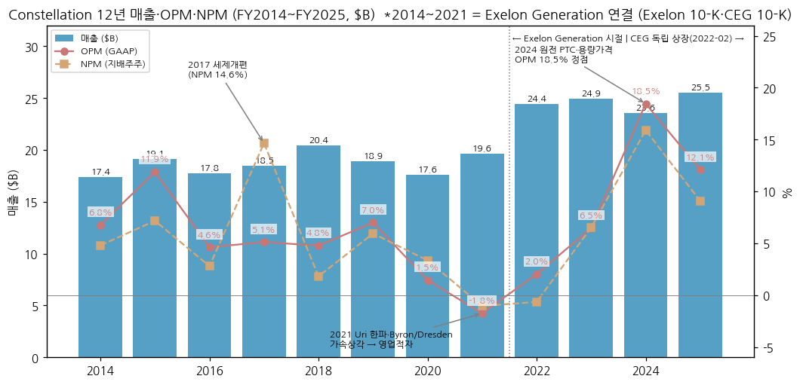

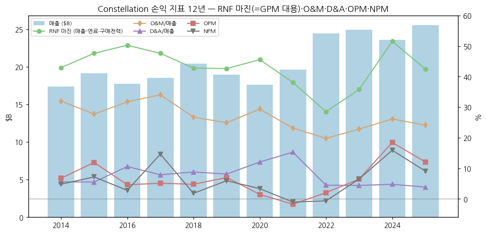

---

## ② 회사 개요

(1) 기본 정보

| 항목 | 내용 |
|---|---|
| 정식 명칭 | Constellation Energy Corporation (Pennsylvania 법인) — 사업 자회사 Constellation Energy Generation, LLC (구 Exelon Generation Company, LLC) |
| 본사 | Baltimore, Maryland |
| 뿌리 | 2000 Unicom·PECO 합병으로 Exelon 출범 → 2012-03 Constellation Energy Group 합병 → 2014-04 CENG 원전 운영권 인수 → **2022-02-01 Exelon에서 Constellation Energy Corporation으로 스핀오프** → **2026-01-07 Calpine 인수** |
| 상장 | Nasdaq: CEG |
| CEO | Joseph Dominguez (사장 겸 CEO, 2022\~, 전 ComEd CEO) [DEF 14A] |
| CFO | Shane Smith (EVP·CFO) [3Q26 보도자료, 2026-11-09] |
| 이사회 | 독립 의장 체제 (CEO와 의장 분리, DEF 14A). 이사 다수 독립 — Robert J. Lawless(전 McCormick CEO)·John M. Richardson(전 해군참모총장) 등. 원자력감독위원회(Nuclear Oversight Committee) 별도 운영 |
| 임직원 | **15,339명** (2025말, Calpine 제외) + Calpine 약 2,500명 [10-K FY25] |
| 설비 | **총 55GW** (Calpine 포함) — 원전 약 22GW (14개 발전소 25기), 2025말 Calpine 전 기준 자사 설비 31,676MW [10-K] |
| 사업 한 줄 정의 | 미국 최대 원전 함대의 전력을 도매시장·용량시장·장기 PPA로 팔고, Calpine 가스·지열 발전과 전국 소매 전력(약 250만 고객 계정, Fortune 100의 80%)을 결합한 종합 발전·판매사 |
| 고객 구성 | 공시상 10% 이상 단일 고객 없음 [판단: 10-K 주요 고객 공시 부재]. 데이터센터 대형 수요처와 장기 PPA 확대 중 |

(2) 핵심 KPI 요약 (FY25 + 3Q26 + 9M26 + FY26 가이던스, $M)

| 지표 | FY25 | 3Q26 (YoY) | 9M26 (YoY) | FY26 가이던스 |
|---|---|---|---|---|
| 매출 | 25,533 | 9,550 (+45.4%) | 28,176 (+44.8%) | — |
| RNF (매출 − 연료·구매전력) | 10,852 | 5,150 (+71.5%) | 13,401 (+60.0%) | — |
| GAAP 영업이익 (OPM) | 3,086 (12.1%) | 2,492 (26.1%) | 5,404 (19.2%) | — |
| 순이익 (지배) / 희석 EPS | 2,319 / $7.40 | 1,835 / $5.19 | 3,938 / $11.06 | — |
| 조정 영업 EPS | $9.39 | $5.06 (+66%) | — | **$12.50\~12.80** |
| 원전 발전량 (TWh) / 이용률 | 182.7 / 94.7% | 46.7 / 97.2% | 135.5 / 94.2% | — |
| 영업CF − CapEx | 1,288 | — | 1,518 | CapEx 5,700 |
| 자사주 매입 | 400 | 약 1,000 | 3,001 | 잔여 한도 약 $2.0B |

→ (출처: 10-K FY25, 3Q26 10-Q, 3Q26·4Q25 보도자료. 조정 영업 EPS는 회사 정의 non-GAAP. 3Q26 조정 영업이익 $1,792M (전년 $952M))

(3) 주요 연혁 (시대별)

| 시기 | 사건 |
|---|---|
| 1999 | Constellation Energy Group 설립 (BGE 지주사) [web 공개 사실] |
| 2000-10 | Unicom(ComEd)·PECO 합병으로 Exelon 출범 — 발전 자회사 Exelon Generation [web] |
| 2012-03-12 | **Exelon–Constellation Energy Group 합병** — Constellation 소매·트레이딩 브랜드 편입 (Exelon 10-K) |
| 2014-04-01 | **CENG(Constellation Energy Nuclear Group) 원전 운영권 인수·연결** — Calvert Cliffs·Nine Mile Point·Ginna (Exelon 10-K) |
| 2016-12 | 일리노이 Future Energy Jobs Act — Clinton·Quad Cities ZEC(무탄소 보조) 도입, 조기폐쇄 철회 [10-K ZEC 표] |
| 2018-09 / 2019-09 | Oyster Creek 폐쇄 / **TMI-1(Three Mile Island 1호기) 경제성 폐쇄** [10-K: "retired in 2019 for economic reasons"] |
| 2021-02 | 텍사스 한파(Winter Storm Uri) — 1Q21 ERCOT RNF -$1.18B [10-Q 비교치] |
| 2021-09 | 일리노이 CEJA(CMC 보조) 통과 → Byron·Dresden 폐쇄 철회 [10-K] |
| **2022-02-01** | **Exelon에서 스핀오프, Nasdaq: CEG 상장** |
| 2022-08 | IRA 원전 PTC(45U, 2024\~2032) 법제화 [10-K Note] |
| 2023-11 | NRG의 South Texas Project 44% 지분 인수 (투자CF 인수 $1.69B) [XBRL] |
| **2024-09** | **Microsoft 20년 PPA — TMI-1 재가동 (Crane Clean Energy Center, 835MW)** [10-K] |
| 2025-01 | Calpine 인수 합의 발표 [web] |
| **2025-06** | **Meta 20년 PPA — Clinton (2027-06 개시, 30MW 업레이트)** [10-K] |
| 2025-11 | DOE, Crane 재가동 대출 보증 $1.0B (30년) [10-K] |
| **2026-01-07** | **Calpine 인수 완료 — 총 대가 약 $21.8B (신주 5,000만주 + 현금 약 $4.5B), 영업권 $11.1B** [10-Q Note 2] |
| 2026-03 | PJM 5개 가스발전소 4.4GW를 LS Power에 $5.0B 매각 합의 (인수 승인 조건) [10-Q] |
| 2026-2Q | 투자등급 고객 장기 원전 PPA 920MW (Walmart 176MW — Dresden 30MW 증설 포함) [10-Q] |
| 2026-06 | FERC, Eddystone 연계권(CIR) → Crane 이전 승인 / NRC "환경 영향 없음" 판단 [10-Q, E&E News 2026-06-09] |
| **2026-09** | **Amazon 20년 PPA 690MW — Calvert Cliffs $3B+ 투자, 190MW 증설 (2030\~2032)** / Rhode Island State Energy Center(609MW 가스) $715M 인수 합의 [10-Q] |
| **2026-10** | **Google 20년 PPA — 11기 업레이트 약 890MW, $4.3B+ 투자, 첫 업레이트 2028** + 2,700MW 15년 금융계약 / DOE 업레이트 대출 보증 최대 $5.0B 조건부 약정 / Brazos Valley(606MW) $860M 매각 완료 [10-Q] |

(4) 회사 주가 역사 (narrative 영역)

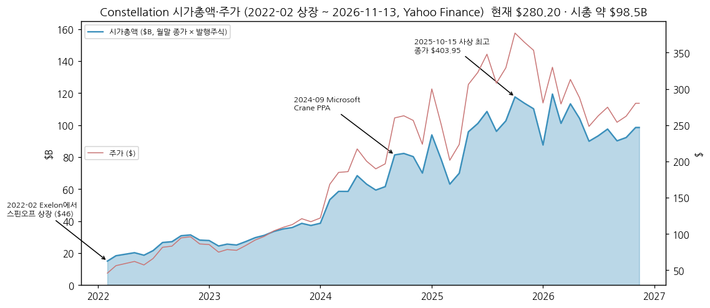

→ **2022-02 상장 \~ 2023 ($46 → $117)** — 상장 첫날 종가대 $46 [Yahoo 월간]. 2022 IRA 원전 PTC로 "원전 가격 하한" 재평가. 연말 시총 2022 $28.2B → 2023 $37.3B [stockanalysis.com]

→ **2024 AI 전력 랠리 ($117 → $224)** — 데이터센터 전력 수요 + 2024-09 Microsoft Crane PPA. 2024말 시총 $70.0B [stockanalysis.com]

→ **2025 ATH ($224 → $404)** — Meta Clinton PPA·Calpine 인수 발표. **2025-10-15 사상 최고 종가 $403.95 (시총 약 $126.0B)** [Yahoo, 계산]. 2025말 $353.27 (시총 $110.3B)

→ **2026 조정 (-31%)** — Calpine 편입(주식 희석 5,000만주)·PJM 용량시장 개편(가격 상한 연장·예비 경매) 불확실성으로 2026-07-01 종가 $236.50 (52주 최저). 3Q26 실적·가이던스 상향·Google/Amazon PPA 이후 반등, **2026-11-13 $280.20 (시총 $98.5B)** [Yahoo, 계산]

---

## ③ 비즈니스 모델

(1) 실적 추이 통합 표 (5년 + 9M26, 세그먼트별, $M, 세그먼트 매출은 세그먼트 간 거래 포함)

| 세그먼트 | 항목 | 2021 | 2022 | 2023 | 2024 | 2025 | 9M26 |
|---|---|---|---|---|---|---|---|
| **Mid-Atlantic** | 매출 | 4,584 | 5,164 | 5,138 | 5,522 | 6,487 | 5,279 |
| | RNF | 2,264 | 2,138 | 2,924 | 3,080 | 3,411 | 2,827 |
| | RNF 마진 % | 49.4 | 41.4 | 56.9 | 55.8 | 52.6 | 53.6 |
| **Midwest** | 매출 | 4,060 | 4,650 | 4,658 | 4,805 | 5,804 | 4,862 |
| | RNF | 2,717 | 2,764 | 3,255 | 3,202 | 3,702 | 2,765 |
| | RNF 마진 % | 66.9 | 59.4 | 69.9 | 66.6 | 63.8 | 56.9 |
| **New York** | 매출 | 1,575 | 1,595 | 2,021 | 2,050 | 2,190 | 1,702 |
| | RNF | 1,161 | 1,067 | 1,251 | 1,453 | 1,600 | 1,211 |
| | RNF 마진 % | 73.7 | 66.9 | 61.9 | 70.9 | 73.1 | 71.2 |
| **ERCOT** | 매출 | 1,181 | 1,543 | 1,346 | 1,550 | 1,904 | 1,408 |
| | RNF | -825 | 407 | 582 | 1,047 | 1,137 | 838 |
| | RNF 마진 % | -69.9 | 26.4 | 43.2 | 67.5 | 59.7 | 59.5 |
| **Other Power Regions** | 매출 | 4,890 | 6,732 | 5,851 | 5,506 | 5,583 | 3,550 |
| | RNF | 891 | 921 | 1,240 | 1,268 | 819 | 814 |
| | RNF 마진 % | 18.2 | 13.7 | 21.2 | 23.0 | 14.7 | 22.9 |
| **Calpine** | 매출 | — | — | — | — | — | 7,926 |
| | RNF | — | — | — | — | — | 4,081 |
| | RNF 마진 % | — | — | — | — | — | 51.5 |
| **세그먼트 RNF 합계** | | 6,208 | 7,297 | 9,252 | 10,050 | 10,669 | 12,536 |
| **전사** | 매출 | 19,649 | 24,440 | 24,918 | 23,568 | 25,533 | 28,176 |
| | RNF (Other·미실현 포함) | 7,486 | 6,978 | 8,917 | 12,149 | 10,852 | 13,401 |

→ (출처: 각 연도 10-K·10-Q MD&A 세그먼트 매출·구매전력·연료 표. 2021은 2022 10-K 비교치. 9M26은 1Q\~3Q26 10-Q 합산. 2021 ERCOT RNF 음수 = Uri 한파. 전사 RNF에는 세그먼트 외 "Other"(가스 판매·미실현 헤지손익)가 포함)

**연간 지역 RNF (2018\~2020, Exelon Generation, $M)**: 2018 MA 3,073 · MW 3,135 · NY 1,122 · ERCOT 258 · Other 729 (합 8,317) / 2019 MA 2,655 · MW 2,962 · NY 1,094 · ERCOT 308 · Other 620 (합 7,639) [Exelon 10-K FY19] / 2020 MA 2,203 · MW 2,903 · NY 997 · ERCOT 426 · Other 666 [CEG 10-K FY21 비교치, 계산]

**원전 운영 지표 (연간)**

| 연도 | 2013 | 2014 | 2015 | 2016 | 2017 | 2018 | 2019 | 2020 | 2021 | 2022 | 2023 | 2024 | 2025 | 9M26 |
|---|---|---|---|---|---|---|---|---|---|---|---|---|---|---|
| 원전 발전량 (TWh) | 142.1 | 166.5 | 175.5 | 176.8 | 182.8 | 185.0 | 181.3 | 175.1 | 173.0 | 173.4 | 174.0 | 181.7 | 182.7 | 135.5 |
| 원전 이용률 (%) | 94.1 | 94.3 | 93.7 | 94.6 | 94.1 | 94.6 | 95.7 | 95.4 | 94.5 | 94.8 | 94.4 | 94.6 | 94.7 | 94.2 |

→ (출처: Exelon 10-K FY13\~FY20 / CEG 10-K FY21\~FY25 / 3Q26 10-Q. 발전량은 공동소유 지분 기준, 이용률은 Salem·STP(타사 운영) 제외. 최신 공시 재작성값 우선 — 예: 2021은 174,987 → 172,990GWh로 재작성)

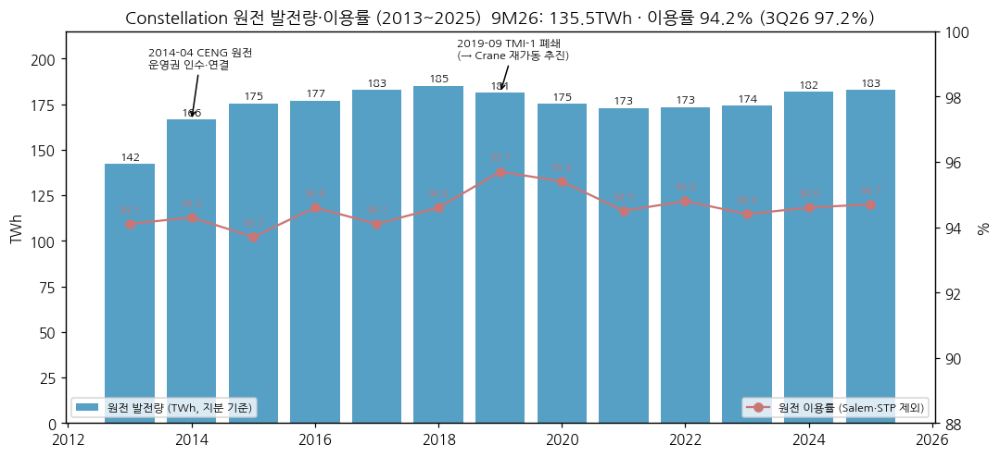

(2) 사업부별 개요 (9M26 세그먼트 RNF 비중 큰 순서)

**Calpine — 32.6%**

"미국 최대 가스·지열 발전사 + 전국 소매 전력." 2026-01 인수. 가스·석유·지열·배터리·태양광 약 23GW (매각 조건 반영 후), 소매 약 62TWh. 9M26 매출 $7,926M (인수 후 연결 매출 $8,531M — 세그먼트 정의 차이), RNF $4,081M, RNF 마진 51.5%. 텍사스 Freestone·Thad Hill 가스발전소 옆 CyrusOne 데이터센터 co-location (380MW+380MW 옵션, 400MW) [10-Q]

**Mid-Atlantic — 22.6%**

"PJM 동부 원전 단지." Calvert Cliffs(MD)·Peach Bottom(PA, 50%)·Limerick(PA)·Salem(NJ, 42.59%)·**Crane(구 TMI-1, 재가동 추진, 835MW)**. PJM 용량가격 상승 최대 수혜 — RNF 마진 2022 41.4% → 9M26 53.6%

**Midwest — 22.1%**

"일리노이 원전 6개 단지 (미국 최대 원전 밀집)." Byron·Braidwood·LaSalle·Dresden·Quad Cities(75%)·Clinton. 일리노이 CMC(2022-06\~2027-05)·ZEC(2017-06\~2027-05) 보조 → 2027 이후 Meta(Clinton) PPA 등으로 대체 [10-K]. RNF 마진 57\~70%

**New York — 9.7%**

"뉴욕 북부 원전." Nine Mile Point(Unit 2 82%)·FitzPatrick·Ginna. 뉴욕주 ZEC $14.76/MWh (2026) [10-Q]. RNF 마진 70%대로 가장 높음

**ERCOT — 6.7%**

"텍사스 원전(STP 44%) + 가스." 2021 Uri 한파 손실(-$825M RNF) 이후 2024\~ RNF 마진 60%대. Pin Oak Creek 460MW 가스 피커 2026-04 상업운전 [10-Q]

**Other Power Regions — 6.5%**

"뉴잉글랜드·남부·서부·캐나다 — 주로 소매 공급을 위한 구매전력." RNF 마진 14\~23%로 가장 낮음 (발전 자산 적음)

(3) 사업부별 디테일 (top-seller · growth · 이익 outlier)

→ **Top-seller**: Midwest + Mid-Atlantic 원전 — 2025 세그먼트 RNF $7.1B, 세그먼트 합계의 67% [계산]

→ **Growth**: Mid-Atlantic RNF 2021 $2,264M → 2025 $3,411M (+51%) — PJM 용량가격 $28.92 → $269.92. 3Q26 MA RNF $1,027M (+15% YoY) — PJM West 전력가격 $69.97/MWh (+50%) [10-Q]

→ **Growth (Calpine)**: 3Q26 Calpine RNF $1,927M — 전사 RNF $5,150M의 37% [계산]. 가스 발전량 3Q26 38.4TWh

→ **이익 outlier (긍정)**: 2024 OPM 18.5% — 원전 PTC 수익(2024 회계연도)·용량가격 상승. 3Q26 OPM 26.1% — 미실현 헤지 이익 포함 (구매전력·연료에 미실현 이익 $482M) [10-Q Note 5]

→ **이익 outlier (부정)**: 1Q21 영업손실 -$1,042M (Uri 한파, ERCOT RNF -$1,184M), 2021 D&A $3.0B (Byron·Dresden 폐쇄 대비 가속상각, 이후 철회). 2Q26 OPM 7.7% — 미실현 헤지 손실 + 인수 통합비용

→ **정책 보조 반환**: 주(州) 보조(ZEC·CMC)는 원전 PTC만큼 환급 조건 → 9M26 순매출 -$555M 차감 (2025 9M -$30M) [10-Q Note 6]

(4) 주요 경쟁사 (사업부별) — **한국 원전 운영(한국전력) 겹침 포함**

| CEG 사업·시장 | 글로벌 경쟁사 | **한국 겹침** |
|---|---|---|
| PJM 원전 발전 (MA·MW) | Vistra(Beaver Valley 등), Talen(Susquehanna), PSEG(Salem 공동), Dominion(규제) [판단] | — (시장 구조 상이) |
| 데이터센터 장기 PPA·co-location | Vistra(Comanche Peak), Talen–Amazon, NRG, NextEra(Duane Arnold 재가동) [판단] | 한국전력 — 국내 데이터센터 전력 공급 (규제 요금) |
| ERCOT 원전·가스 | Vistra(최대), NRG, Calpine(현 CEG) | — |
| 가스 발전 (Calpine) | Vistra, NRG, Talen [판단] | 한국전력 발전 자회사(가스) — 규제 정산 |
| 소매 전력 | Vistra(TXU), NRG(Reliant) [판단] | 한국전력 (독점 판매) |
| 원전 재가동·업레이트 | Holtec(Palisades 재가동), NextEra(Duane Arnold) [web] | 한수원 — 계속운전(수명연장) |

→ (출처: 10-K 경쟁 환경 서술 + 공개 사례 [판단·web]. 한국 매핑은 워치리스트 "원전 운영" 서브섹터 기준)

(5) 주요 매출처 · 장기 계약

| 상대방 | 내용 | 시점 |
|---|---|---|
| Microsoft | Crane(구 TMI-1) 재가동 출력 20년 구매, 약 835MW — 에너지·용량·무탄소 속성 일괄 | 2024-09 체결, 재가동 목표 2027년 말 이전 [E&E News] |
| Meta | Clinton 출력 20년 구매 (30MW 업레이트 2029 완료) | 2025-06 체결, 2027-06 개시 |
| Walmart 외 투자등급 고객 | 원전 PPA 합계 920MW, 15\~20년 | 2026-2Q 체결, 2029\~2032 개시 |
| Amazon | Calvert Cliffs 690MW 20년 PPA + 소매 공급, 190MW 증설 | 2026-09 |
| Google | 11기 업레이트 약 890MW 20년 PPA + 2,700MW 15년 금융 부하추종 계약 | 2026-10, 첫 업레이트 2028 |
| CyrusOne | Freestone 380MW (+380MW 2단계 독점) / Thad Hill 400MW (Calpine 시절) | 2025\~2026-1Q |
| Peak+ (첫 거래) | 270MW 20년, 2028 개시 | 2026-3Q [보도자료] |

→ 잔여 이행의무(고정가 부분만): **$12.1B** (2026 $0.4B · 2027 $1.9B · 2028 $1.7B · 2029 $1.5B · 2030 $1.0B · 2031\~ $5.6B) [10-Q Note 4] — 변동가격·파생상품 계약은 제외라 PPA 전체 가치보다 작음

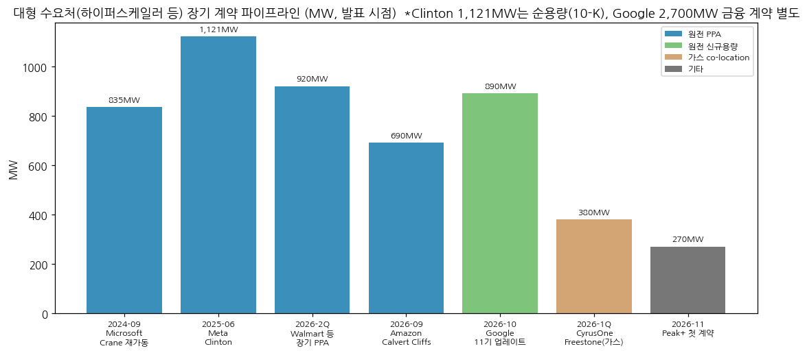

(6) 생산 CAPA + 임직원 추이

→ 자사 설비 (2025말, Calpine 전): **31,676MW** — Mid-Atlantic 10,386 · Midwest 11,606 · New York 3,093 · ERCOT 4,742 · Other 1,849 / 계약 설비 4,798MW [10-K FY25]. 2021말: 원전 20,899 · 가스·석유 8,819 · 재생 2,682 = 32,400MW [10-K FY21]

→ Calpine 편입 후 **총 55GW** — 원전 약 22GW · 가스·석유·지열·배터리·태양광 약 33GW [10-Q 개요]. 매각: PJM 가스 4.4GW ($5.0B, 2026년 말 종결 예정)·Brazos Valley 606MW (완료) / 인수: RISEC 609MW ($715M, 승인 대기)

→ 증설 파이프라인: Crane 835MW (재가동) + Google 업레이트 약 890MW + Calvert Cliffs 190MW + Clinton 30MW + Dresden 30MW ≈ **약 2.0GW 원전 신규 용량** [계산, 발표치 합]

→ 신규 대형원전(AP1000)·SMR: **확정 투자 없음** — 10-K는 "advanced nuclear 참여 기회 모니터링" 수준, 실제 자본은 재가동·업레이트·수명연장에 집중 [10-K 전략]

→ 라이선스: 전 원전 20년 1차 연장 완료, Peach Bottom·Dresden은 2차 연장(총 80년) 승인. Crane은 2029 2차 연장 신청 예정 [10-K]

→ 임직원: 13,370 (2022) → 13,871 (2023) → 14,264 (2024) → **15,339 (2025)** + Calpine 약 2,500 [10-K]

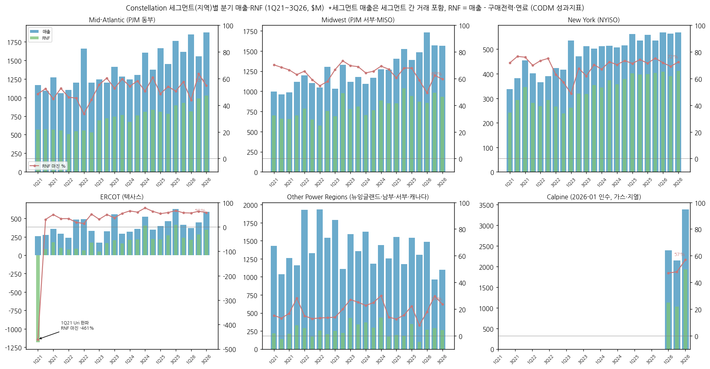

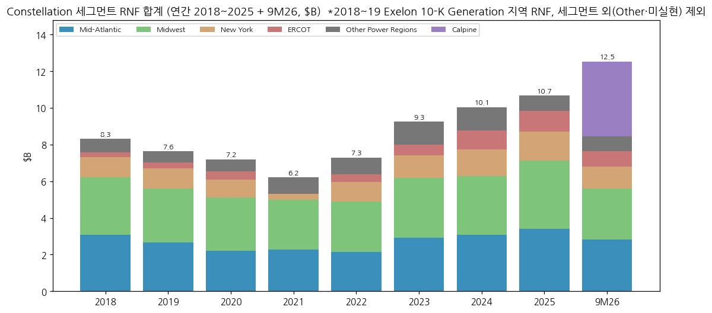

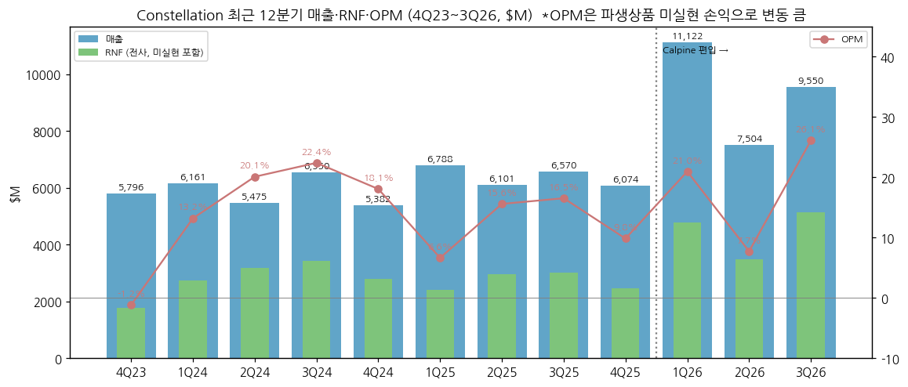

**분기 시계열 (1Q21\~3Q26, 23분기, $M)** — 전사 매출·영업이익·순이익은 XBRL(2021은 비교치), 3Q26은 10-Q 본문. 구매전력·연료·세그먼트 RNF는 MD&A 표 (4Q = 연간 − 1\~3Q [계산]). EPS는 2022 상장 후부터

| 분기 | 매출 | YoY | 구매전력·연료 | RNF | RNF 마진 | 영업이익 | OPM | 순이익 | 희석 EPS | MA RNF | MW RNF | NY RNF | ERCOT RNF | Other RNF | Calpine RNF |
|---|---|---|---|---|---|---|---|---|---|---|---|---|---|---|---|
| 1Q21 | 5,559 | — | 4,610 | 949 | 17.1 | -1,042 | -18.7 | -793 | — | 566 | 702 | 242 | -1,184 | 217 | — |
| 2Q21 | 4,153 | — | 1,947 | 2,206 | 53.1 | -308 | -7.4 | -61 | — | 572 | 658 | 292 | 83 | 136 | — |
| 3Q21 | 4,406 | — | 1,546 | 2,860 | 64.9 | 1,006 | 22.8 | 607 | — | 570 | 655 | 346 | 179 | 211 | — |
| 4Q21 | 5,532 | — | 4,060 | 1,472 | 26.6 | -2 | -0.0 | 42 | — | 556 | 702 | 281 | 97 | 327 | — |
| 1Q22 | 5,591 | +0.6 | 3,550 | 2,041 | 36.5 | 435 | 7.8 | 106 | 0.32 | 508 | 785 | 268 | 79 | 287 | — |
| 2Q22 | 5,465 | +31.6 | 3,508 | 1,957 | 35.8 | 272 | 5.0 | -111 | -0.34 | 545 | 652 | 293 | 89 | 169 | — |
| 3Q22 | 6,051 | +37.3 | 4,695 | 1,356 | 22.4 | -41 | -0.7 | -188 | -0.57 | 555 | 572 | 267 | 66 | 257 | — |
| 4Q22 | 7,333 | +32.6 | 5,709 | 1,624 | 22.1 | -172 | -2.3 | 34 | 0.10 | 530 | 755 | 239 | 173 | 208 | — |
| 1Q23 | 7,565 | +35.3 | 5,729 | 1,836 | 24.3 | 31 | 0.4 | 96 | 0.29 | 691 | 689 | 261 | 52 | 248 | — |
| 2Q23 | 5,446 | -0.3 | 2,887 | 2,559 | 47.0 | 669 | 12.3 | 833 | 2.56 | 723 | 975 | 319 | 164 | 221 | — |
| 3Q23 | 6,111 | +1.0 | 3,367 | 2,744 | 44.9 | 977 | 16.0 | 731 | 2.26 | 744 | 778 | 317 | 207 | 431 | — |
| 4Q23 | 5,796 | -21.0 | 4,018 | 1,778 | 30.7 | -67 | -1.2 | -37 | -0.10 | 766 | 813 | 354 | 159 | 340 | — |
| 1Q24 | 6,161 | -18.6 | 3,417 | 2,744 | 44.5 | 813 | 13.2 | 883 | 2.78 | 674 | 703 | 344 | 209 | 368 | — |
| 2Q24 | 5,475 | +0.5 | 2,292 | 3,183 | 58.1 | 1,100 | 20.1 | 814 | 2.58 | 760 | 765 | 373 | 214 | 293 | — |
| 3Q24 | 6,550 | +7.2 | 3,119 | 3,431 | 52.4 | 1,467 | 22.4 | 1,200 | 3.82 | 809 | 884 | 357 | 403 | 433 | — |
| 4Q24 | 5,382 | -7.1 | 2,591 | 2,791 | 51.9 | 972 | 18.1 | 852 | 2.72 | 837 | 850 | 379 | 221 | 174 | — |
| 1Q25 | 6,788 | +10.2 | 4,384 | 2,404 | 35.4 | 451 | 6.6 | 118 | 0.38 | 809 | 850 | 401 | 214 | 194 | — |
| 2Q25 | 6,101 | +11.4 | 3,132 | 2,969 | 48.7 | 951 | 15.6 | 839 | 2.67 | 782 | 1,036 | 397 | 271 | 181 | — |
| 3Q25 | 6,570 | +0.3 | 3,567 | 3,003 | 45.7 | 1,086 | 16.5 | 930 | 2.97 | 892 | 943 | 399 | 415 | 343 | — |
| 4Q25 | 6,074 | +12.9 | 3,598 | 2,476 | 40.8 | 598 | 9.8 | 432 | 1.38 | 928 | 873 | 403 | 237 | 101 | — |
| 1Q26 | 11,122 | +63.8 | 6,352 | 4,770 | 42.9 | 2,332 | 21.0 | 1,590 | 4.49 | 812 | 854 | 409 | 209 | 267 | 1,126 |
| 2Q26 | 7,504 | +23.0 | 4,023 | 3,481 | 46.4 | 580 | 7.7 | 513 | 1.42 | 988 | 979 | 390 | 284 | 287 | 1,028 |
| 3Q26 | 9,550 | +45.4 | 4,400 | 5,150 | 53.9 | 2,492 | 26.1 | 1,835 | 5.19 | 1,027 | 932 | 412 | 345 | 260 | 1,927 |

---

## ④ 재무 구조

(1) 손익계산서 (12년, $M) + chart1b

| 연도 | 매출 | 매출 YoY | 구매전력·연료 | RNF | RNF 마진 | O&M | O&M/매출 | D&A | 영업이익 | OPM | 이자비용 | 순이익(지배) | NPM | 희석 EPS ($) |
|---|---|---|---|---|---|---|---|---|---|---|---|---|---|---|
| 2014 | 17,393 | — | 9,925 | 7,468 | 42.9 | 5,566 | 32.0 | 967 | 1,176 | 6.8 | 356 | 835 | 4.8 | — |
| 2015 | 19,135 | 10.0 | 10,021 | 9,114 | 47.6 | 5,308 | 27.7 | 1,054 | 2,275 | 11.9 | 365 | 1,372 | 7.2 | — |
| 2016 | 17,757 | -7.2 | 8,830 | 8,927 | 50.3 | 5,641 | 31.8 | 1,879 | 820 | 4.6 | 364 | 496 | 2.8 | — |
| 2017 | 18,500 | 4.2 | 9,690 | 8,810 | 47.6 | 6,299 | 34.0 | 1,457 | 947 | 5.1 | 440 | 2,710 | 14.6 | — |
| 2018 | 20,437 | 10.5 | 11,693 | 8,744 | 42.8 | 5,464 | 26.7 | 1,797 | 975 | 4.8 | 432 | 370 | 1.8 | — |
| 2019 | 18,924 | -7.4 | 10,856 | 8,068 | 42.6 | 4,718 | 24.9 | 1,535 | 1,323 | 7.0 | 429 | 1,125 | 5.9 | — |
| 2020 | 17,603 | -7.0 | 9,585 | 8,018 | 45.5 | 5,168 | 29.4 | 2,123 | 256 | 1.5 | 357 | 589 | 3.3 | — |
| 2021 | 19,649 | 11.6 | 12,163 | 7,486 | 38.1 | 4,555 | 23.2 | 3,003 | -346 | -1.8 | 297 | -205 | -1.0 | — |
| 2022 | 24,440 | 24.4 | 17,462 | 6,978 | 28.6 | 4,841 | 19.8 | 1,091 | 495 | 2.0 | 251 | -160 | -0.7 | -0.49 |
| 2023 | 24,918 | 2.0 | 16,001 | 8,917 | 35.8 | 5,685 | 22.8 | 1,096 | 1,610 | 6.5 | 431 | 1,623 | 6.5 | 5.01 |
| 2024 | 23,568 | -5.4 | 11,419 | 12,149 | 51.5 | 6,159 | 26.1 | 1,123 | 4,352 | 18.5 | 506 | 3,749 | 15.9 | 11.89 |
| 2025 | 25,533 | 8.3 | 14,681 | 10,852 | 42.5 | 6,159 | 24.1 | 985 | 3,086 | 12.1 | 511 | 2,319 | 9.1 | 7.40 |
| **9M26** | **28,176** | +44.8 | 14,775 | 13,401 | 47.6 | 6,024 | 21.4 | 1,340 | 5,404 | 19.2 | 753 | 3,938 | 14.0 | 11.06 |

→ (출처: FY2014\~2020 Exelon 10-K Generation 손익계산서 (계열사 거래 포함 합산), FY2021\~ CEG 10-K, 9M26 10-Q. 순이익 = 지배주주 귀속. 이자비용 = 순이자비용 + 계열사 이자)

→ 매출과 이익이 따로 움직인다: 2022 매출 +24%에도 OPM 2.0% (구매전력·연료비 +44%, NDT 평가손 -$786M), 2024 매출 -5%에도 OPM 18.5% (가스가격 하락으로 연료비 -29%). **매출보다 RNF·OPM이 실체** [판단]

(2) 재무상태표 (12년, 연말, $M) + chart4

| 연말 | 자산 | 부채(=자산-지배자본) | 지배주주 자본 | 현금 | 단기차입 | 장기차입(비유동) | 유동성장기차입 | 유동자산 | 유동부채 | 유동비율 | 부채/자본 |
|---|---|---|---|---|---|---|---|---|---|---|---|
| 2014 | 44,951 | 32,233 | 12,718 | — | — | 7,582 | — | 7,311 | 4,459 | 1.64 | 2.5x |
| 2015 | 46,529 | 34,894 | 11,635 | — | — | 8,869 | — | 6,342 | 4,933 | 1.29 | 3.0x |
| 2016 | 47,022 | 35,517 | 11,505 | — | — | 8,124 | — | 6,567 | 5,689 | 1.15 | 3.1x |
| 2017 | 48,457 | 34,788 | 13,669 | — | — | 8,644 | — | 6,882 | 4,191 | 1.64 | 2.5x |
| 2018 | 47,556 | 34,352 | 13,204 | — | — | 7,887 | — | 8,433 | 5,769 | 1.46 | 2.6x |
| 2019 | 48,995 | 35,511 | 13,484 | 303 | — | 4,792 | — | 7,076 | 7,289 | 0.97 | 2.6x |
| 2020 | 48,094 | 35,695 | 12,399 | 226 | — | 5,890 | — | 6,947 | 5,219 | 1.33 | 2.9x |
| 2021 | 48,086 | 36,867 | 11,219 | 504 | 2,082 | 4,575 | 1,220 | 7,981 | 7,996 | 1.00 | 3.3x |
| 2022 | 46,909 | 35,891 | 11,018 | 422 | 1,159 | 4,466 | 143 | 9,360 | 7,839 | 1.19 | 3.3x |
| 2023 | 50,758 | 39,833 | 10,925 | 368 | 1,644 | 7,496 | 121 | 8,299 | 6,319 | 1.31 | 3.6x |
| 2024 | 52,926 | 39,760 | 13,166 | 3,022 | 0 | 7,384 | 1,028 | 10,776 | 6,846 | 1.57 | 3.0x |
| 2025 | 57,249 | 42,732 | 14,517 | 3,641 | 1,650 | 7,250 | 92 | 12,119 | 7,944 | 1.53 | 2.9x |
| **3Q26** | **99,185** | 66,473 | **32,712** | 603 | 3,989 | 19,039 | 359 | 18,919 | 12,732 | 1.49 | 2.0x |

→ (출처: FY2014\~2020 Exelon 10-K Generation (Selected Financial Data·대차대조표), FY2021\~ XBRL, 3Q26 10-Q. 부채 = 자산 − 지배주주 자본(비지배지분 포함) [계산]. FY2014\~2020 장기차입은 계열사 차입 포함. **3Q26: Calpine 인수로 자산 +$41.9B, 영업권 $0.42B → $11.5B, 장기차입 $7.3B → $19.0B**)

→ NDT(원전 해체 신탁기금) **$20.4B** vs 원전 해체 ARO $12.2B (3Q26) [10-Q Note 9] — 대차대조표의 가장 큰 고유 항목

→ 신용등급: **S&P BBB+ / Moody's Baa1** (3Q26 10-Q)

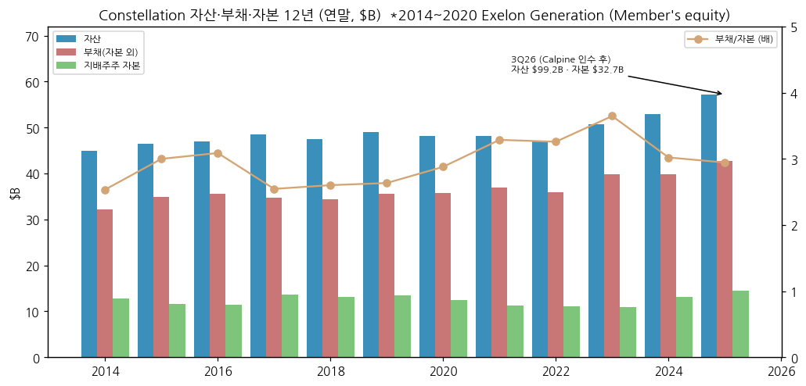

(3) 현금흐름표 (12년, $M) + chart6

| 연도 | 영업CF (GAAP) | DPP 회수(투자CF) | 조정 영업CF | 투자CF | 재무CF | CapEx | 조정 FCF | CapEx/매출 | Exelon 분배 | 배당 | 자사주 |
|---|---|---|---|---|---|---|---|---|---|---|---|
| 2014 | 1,826 | — | 1,826 | — | — | 3,012 | -1,186 | 17.3% | — | — | — |
| 2015 | 4,199 | — | 4,199 | — | — | 3,841 | 358 | 20.1% | — | — | — |
| 2016 | 4,444 | — | 4,444 | — | — | 3,078 | 1,366 | 17.3% | — | — | — |
| 2017 | 3,299 | — | 3,299 | — | — | 2,259 | 1,040 | 12.2% | — | — | — |
| 2018 | 3,861 | — | 3,861 | — | — | 2,242 | 1,619 | 11.0% | — | — | — |
| 2019 | 2,873 | — | 2,873 | — | — | 1,845 | 1,028 | 9.7% | — | — | — |
| 2020 | 584 | 3,771 | 4,355 | 1,958 | -2,664 | 1,747 | 2,608 | 9.9% | 1,734 | — | — |
| 2021 | -1,338 | 3,902 | 2,564 | 3,282 | -1,695 | 1,329 | 1,235 | 6.8% | 1,832 | — | — |
| 2022 | -2,353 | 4,964 | 2,611 | 3,104 | -799 | 1,689 | 922 | 6.9% | — | 185 | — |
| 2023 | -5,301 | 7,340 | 2,039 | 3,031 | 2,196 | 2,422 | -383 | 9.7% | — | 366 | 992 |
| 2024 | -2,464 | 10,217 | 7,753 | 7,428 | -2,289 | 2,565 | 5,188 | 10.9% | — | 444 | 999 |
| 2025 | 4,237 | 0 | 4,237 | -3,198 | -420 | 2,949 | 1,288 | 11.5% | — | 486 | 400 |
| **9M26** | 4,979 | 0 | 4,979 | -6,064 | -1,654 | 3,461 | 1,518 | 12.3% | — | 459 | 3,001 |

→ (출처: FY2014\~2019 Exelon 10-K Generation 현금흐름표, FY2020\~ XBRL, 9M26 10-Q. **DPP = 매출채권 유동화(2020-04\~) 회수액 — 투자CF로 분류되어 GAAP 영업CF를 음수로 만듦**. 조정 영업CF = 영업CF + DPP [계산]. 2025 DPP 0은 유동화 구조 변경. Exelon 분배 = 스핀오프 전 모회사 앞 분배금)

→ 9M26 투자CF -$6.06B = CapEx -$3.46B + Calpine 현금 대가(순) -$2.54B. 재무CF: 장기채 발행 $5.0B, 상환 -$5.46B, 자사주 -$3.0B

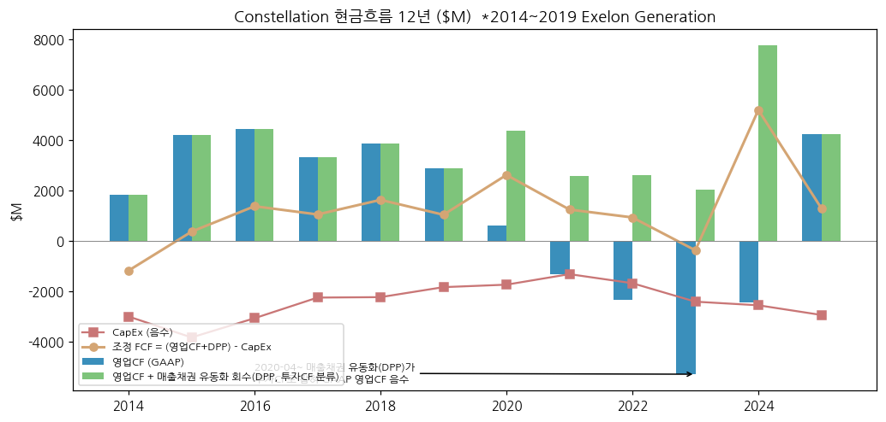

(4) CapEx + chart8

→ CapEx/매출: **17\~20% (2014\~2016, Exelon 시절 원전 연료·성장투자)** → 6.8\~9.9% (2019\~2022) → 9.7\~11.5% (2023\~2025) → 9M26 12.3%. 원전 연료 구매가 CapEx의 약 29% [10-K]

→ 다음 사이클: **2026 $5.7B / 2027 $4.7B** — Crane 재가동, 원전 업레이트(Google $4.3B+·Calvert Cliffs $3B+), Calpine 설비, co-location 인프라. DOE 대출보증 Crane $1.0B + 업레이트 최대 $5.0B (30년, 국채 +0.375%) [10-Q]

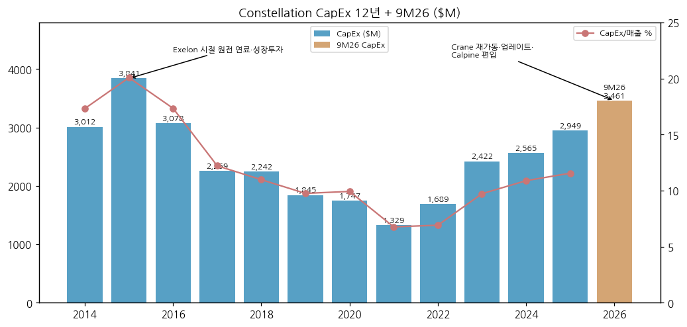

(5) 부채 구조 + 채권 history

→ 장기차입(비유동) $4.5B (2022) → $7.5B (2023, STP 인수·성장투자) → $7.3B (2025) → **$19.0B (3Q26)** — Calpine 채권 $2.29B를 CEG 채권으로 교환 + 신규 발행 $5.0B [10-Q]

→ 단기차입 $3.99B (3Q26) — 2025-2Q 이후 Calpine 대가 준비 차입 $1.65B 포함 [XBRL]

→ 순차입 **$22.8B** (3Q26) [계산] vs 2026 RNF 연환산 약 $17.9B

(6) 배당·자사주 + chart9

| 연도 | DPS 연간 ($) | 배당 지급 | 자사주 매입 | Exelon 분배 | 희석주식수 (M) |
|---|---|---|---|---|---|
| 2020 | — | — | — | 1,734 | — |
| 2021 | — | — | — | 1,832 | — |
| 2022 | 0.564 | 185 | 0 | — | 329 |
| 2023 | 1.128 | 366 | 992 | — | 324 |
| 2024 | 1.410 | 444 | 999 | — | 315 |
| 2025 | 1.551 | 486 | 400 | — | 314 |
| 9M26 | 1.706 (분기 $0.4265) | 459 | 3,001 | — | 356 |

→ (출처: XBRL·10-Q. DPS = 분기 배당 × 4. 2026 분기 배당 $0.4265 (+10%), 회사는 연 10% 배당 성장 목표 [4Q25 보도자료])

→ 자사주: 2026 이사회 한도 $4.4B 증액, **9M26 1,090만주 $3.0B 매입** (Calpine 대주주 지분 2차 매각 시 200만주 매입 포함), 잔여 약 $2.0B [10-Q Note 16]. 2023 ASR 등 누적 2023\~9M26 $5.4B [계산]

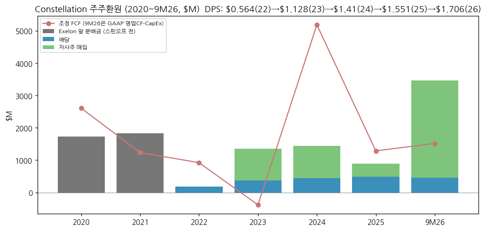

(7) 재무비율 (12년, [계산])

| 연도 | ROE (평균자본) | ROA (평균자산) | 부채비율 | 유동비율 | 이자보상배율 (영업이익/이자) |
|---|---|---|---|---|---|
| 2014 | — | — | 253% | 1.64 | 3.3x |
| 2015 | 11.3% | 3.0% | 300% | 1.29 | 6.2x |
| 2016 | 4.3% | 1.1% | 309% | 1.15 | 2.3x |
| 2017 | 21.5% | 5.7% | 255% | 1.64 | 2.2x |
| 2018 | 2.8% | 0.8% | 260% | 1.46 | 2.3x |
| 2019 | 8.4% | 2.3% | 263% | 0.97 | 3.1x |
| 2020 | 4.6% | 1.2% | 288% | 1.33 | 0.7x |
| 2021 | -1.7% | -0.4% | 329% | 1.00 | -1.2x |
| 2022 | -1.4% | -0.3% | 326% | 1.19 | 2.0x |
| 2023 | 14.8% | 3.3% | 365% | 1.31 | 3.7x |
| 2024 | 31.1% | 7.2% | 302% | 1.57 | 8.6x |
| 2025 | 16.8% | 4.2% | 294% | 1.53 | 6.0x |

→ 2014\~2020은 Exelon Generation 기준 (자본 = Member's equity). 2021\~2022 순손실로 ROE 음수. 이자보상배율은 영업이익 기준이라 미실현 헤지손익 변동이 큼 — **RNF/이자** 보조 지표 권장 [판단] (2025 RNF/이자 21.2배 [계산])

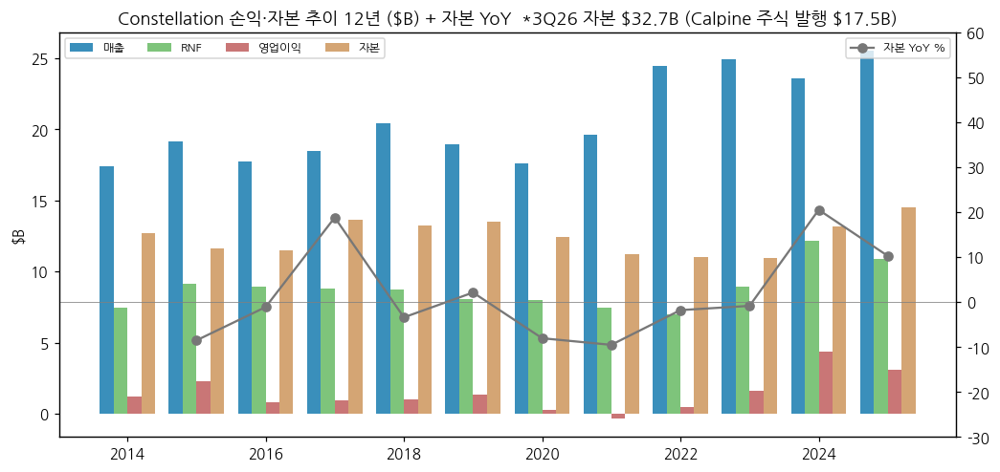

---

## ⑤ 지배 구조

(1) 그룹·계열 관계

→ 지배주주 없는 분산 소유 상장사. 지주사 CEG Parent → 사업 자회사 **Constellation Energy Generation, LLC** (구 Exelon Generation, 10-K·10-Q 공동 등록) → Calpine LLC (2026-01 편입)

→ 2022-02 분리된 **Exelon(EXC)** 은 규제 송배전 유틸리티(ComEd·PECO·BGE·PHI)로 남음. 일리노이 원전 해체 관련 "Regulatory Agreement Units" 부채(ComEd·PECO 앞 $5.8B)가 남은 연결고리 [10-Q Note 9]

(2) 주주 구분 + chart5

| 주주 | 보유 주식 | 지분율 | 비고 |
|---|---|---|---|
| The Vanguard Group | 36,651,641 | 11.7% | 13G/A 2024-02-13 기준 |
| BlackRock, Inc. | 22,564,120 | 7.2% | 13G/A 2024-01-26 기준 |
| ECP ControlCo, LLC | 22,043,724 | 7.0% | 13G 2026-01-14 — 구 Calpine 대주주(Energy Capital Partners), 인수 대가 주식. 락업 50% 2026-06-30 해제, 50% 2027-06-30 해제 [10-Q] |
| State Street Corporation | 17,801,601 | 5.7% | 13G 기준 |
| Capital International Investors | 17,170,795 | 5.5% | 13G 기준 |

→ (출처: 2026 Proxy Statement (DEF 14A, 2026-03-19). 지분율은 Proxy 표기 그대로 — 13G 시점이 오래돼 최신 지분율과 다를 수 있음. 2026-06 ECP 측 1,100만주 2차 매각(회사 200만주 매입) [10-Q])

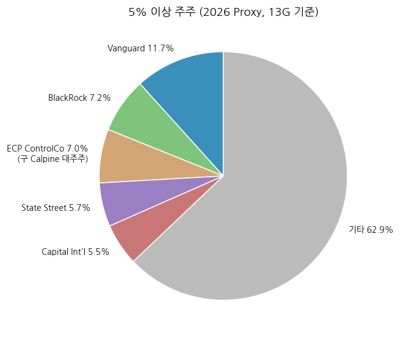

(3) 경영진·이사회

→ **Joseph Dominguez** — 사장·CEO (2022 상장부터). 전 ComEd CEO, Exelon 규제·정책 부문 출신 [DEF 14A]

→ **Shane Smith** — EVP·CFO [3Q26 보도자료, 2026-11-09]

→ 이사회: CEO와 의장 분리(독립 의장), 위원회 전원 독립 이사. 원자력감독위원회 — 전 해군참모총장 John M. Richardson, 전 Duke Energy COO Dhiaa Jamil 등 [DEF 14A]

---

## ⑥ 기타 팩트

(1) 시가총액·밸류에이션 스냅샷 (2026-11-13 종가 기준)

| 지표 | 값 |
|---|---|
| 주가 | $280.20 |
| 시가총액 | $98.5B [계산: 351.61M주] |
| EV | $121.3B [계산, 3Q26말 총차입 $23.39B − 현금 $0.60B] |
| P/E (2026 조정 영업 EPS 가이던스 중간값 $12.65) | 22.2배 |
| P/E (2025 조정 영업 EPS $9.39) | 29.8배 |
| P/E (GAAP TTM EPS $12.44 = 4Q25 $1.38 + 9M26 $11.06) | 22.5배 |
| PBR (3Q26 지배자본 $32.71B) | 3.0배 |
| 배당 수익률 | 0.6% ($1.706 ÷ $280.20) |
| 사상 최고 종가 | $403.95 (2025-10-15) — 현재 -30.6% |

→ 모든 배수는 [계산]. 컨센서스 목표가는 본 문서에서 미수집

(2) R&D 인프라 + chart7

→ R&D 비용 별도 공시 없음 (10-K 손익계산서에 R&D 항목 부재). 기술·성장 투자는 CapEx(업레이트·재가동)와 장기 PPA로 나타남 → chart7은 **PPA 파이프라인**으로 대체 (③-(5) 참조)

→ 원전 운영 역량 지표: 평균 계획정비 22일 (2025, 업계 33\~38일), 이용률 업계 평균 대비 약 +4%p (2013년 이후 매년) [10-K FY25]

(3) 진행 중 corporate action

→ **Calpine 통합** — 영업권 $11.1B 잠정 배분, 통합비용 3Q26 세후 $73M [보도자료]. PJM 가스 4.4GW $5.0B 매각 (2026년 말 종결 예정)

→ **Crane 재가동** — NRC 최종 승인 대기, CIR 이전 승인(2026-06), 목표 2027년 말 이전 [10-Q, E&E News 2026-06-09]. PJM 연계 보강 일부는 2030-12까지 걸릴 수 있음 [10-Q]

→ **RISEC 인수** ($715M, 609MW, ISO-NE) — 규제 승인 대기

→ **PJM 시장 개편** — 용량가격 상한(약 $325)·하한(약 $175) 2028/29·2029/30까지 연장 (FERC 2026-04 승인). 일회성 신뢰도 예비 경매 2027-03 개최, 결과 2027-05-10 예정. 대형부하 co-location 서비스 FERC 명령 (2025-12) [10-Q]

(4) 원전 정책·사업 마일스톤 (10년치)

| 시기 | 마일스톤 |
|---|---|
| 2016-12 / 2021-09 | 일리노이 ZEC(Clinton·Quad Cities) / CEJA·CMC(Byron·Dresden·Braidwood) — 원전 조기폐쇄 철회 |
| 2022-08 | IRA 원전 PTC 45U (2024\~2032, 최대 $15/MWh, 전력가격 오르면 감소) |
| 2024-08 | 미국 러시아산 농축우라늄 수입 금지법 발효 (DOE 면제 조건) [10-Q] |
| 2024-09 | Crane 재가동 + Microsoft 20년 PPA |
| 2025-07 | OBBBA — 45U 등 원전 세액공제 유지, 업레이트는 45Y(10년) 적용 가능 [10-K] |
| 2025-12 / 2026-06 | FERC, PJM co-location 대형부하 전송 서비스 명령 / 후속 결정 [10-Q] |
| 2026-04 | FERC, PJM 용량가격 상한·하한 2029/30까지 연장 승인 |
| 2026-10 | DOE 원전 업레이트 대출보증 최대 $5.0B 조건부 약정 / Google 11기 업레이트 PPA |

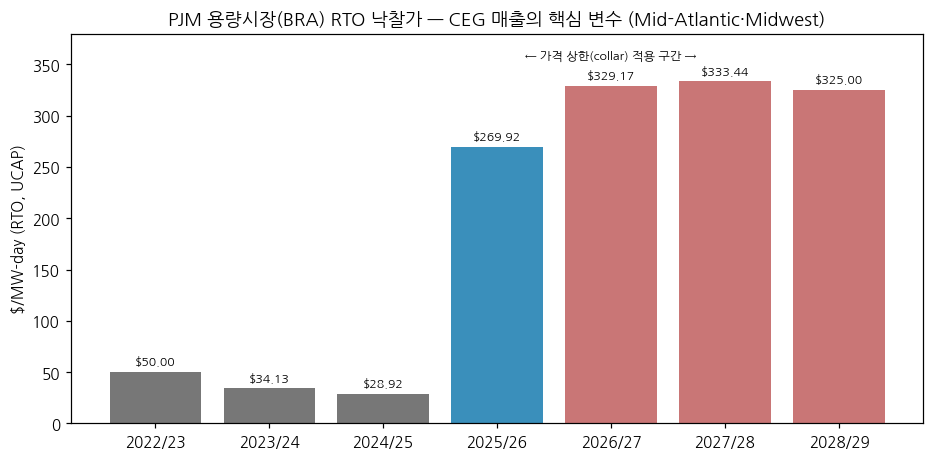

→ (PJM BRA RTO 낙찰가: 2022/23 $50.00 · 2023/24 $34.13 · 2024/25 $28.92 [PJM 공개 결과, web] · 2025/26 $269.92 · 2026/27 $329.17 [10-Q 실현가] · 2027/28 $333.44 · 2028/29 $325.00 (2026-07-14 발표, 상한) [POWER Magazine])

(5) 주요 리스크

→ **전력·가스가격** — 원전 PTC가 하방을 막지만, 전력가격이 높을 때는 PTC가 0이 되고 주(州) 보조 환급(9M26 -$555M)이 발생 — 상방도 일부 제한 [10-Q Note 6]

→ **PJM 규제·정치** — 용량가격 상한 연장, 대형부하 접속 규칙, 주지사·연방 에너지위원회의 요금 부담 개입 [10-Q]

→ **Crane 재가동 일정** — NRC 승인·연계 보강·부품 복원 지연 시 Microsoft 계약 페널티 가능 ("Failure to meet contractual timelines could result in significant penalties") [10-K 위험요인]

→ **러시아산 원전 연료** — Graham Act(2026-09)·행정명령 면제(2026-10). 연료 재고 확대 중 [10-Q]

→ **Calpine 통합·가스 믹스** — 자사 발전량 중 원전 비중 89% → 56%. 가스발전 탄소 규제 (EPA 2026 규제 철회 추진 중이나 소송 진행) [10-Q]

→ **NDT·미실현 손익 변동** — 순이익 분기 편차 (예: 2022 NDT 평가손 -$786M)

(6) ESG

→ 원문 미수집 (Source Audit ❌). 10-K: "미국에서 가장 깨끗한 대형 발전 포트폴리오 (ERM 2025 보고서)" — Calpine 가스 편입 후 무탄소 비중 하락 [10-K]

(7) 인증·라이선스

→ NRC 운전허가 25기 (전 원전 1차 갱신 완료, Peach Bottom·Dresden 2차 갱신 80년), FERC 시장기반요금 허가, 각 주 소매 공급 허가 [10-K]

---

## Activity 보고 (v1.0 finalize)

### ✅ 확보 자료
→ CEG 10-K 5 · 10-Q 15 · 8-K 69(본문) · DEF 14A 4 · Exelon 10-K 13 · XBRL companyfacts · Yahoo 월간(2022-02\~)·일간 2년 · 3Q26·4Q25 보도자료 · PJM BRA 결과(언론) · Crane 일정(E&E News)

### ❌ 누락 자료 (4)
→ 스핀오프 전 분기 세그먼트(2014\~2020) / 조정 영업 EPS 2022·2023 / ESG 보고서 / 실적 IR 덱(세그먼트별 조정 EBITDA·헤지 비율 표)

### ⚠️ 추정·계산 데이터 표시
→ FY2014\~2021은 Exelon Generation 연결 (Exelon 10-K) — CEG 상장 후 수치와 회계 범위 동일(사업 자회사)하나 모회사 비용·자본 구조 상이. 4Q 세그먼트는 연간 − 1\~3Q [계산]. 시총·EV·배수·비중은 [계산]. PJM 2024/25 이전 낙찰가는 공개 결과 [web]

### Data Quality Confidence: **85%**

---

## Version Log

**v1.0a (2026-11-16)** — CFO 정정: Daniel Eggers → Shane Smith (3Q26 보도자료 기준)

| 버전 | 일자 | 내역 |
|---|---|---|
| v1.0 | 2026-11-15 | 최초 작성 — 12년 연간(2014\~2021 Exelon Generation)·23분기 세그먼트·14종 차트, 3Q26(10-Q 2026-11-09) 반영, Calpine 인수 완료·하이퍼스케일러 PPA·PJM 용량가격 정리 |

→ 잔여 보완 후보: FY26 연간 확정(2027-02 10-K) 반영, Calpine 매각(PJM 4.4GW) 종결 후 설비 재집계, Crane 재가동 시점 확정 시 ① 분류 재평가, IR 덱 세그먼트 조정 EBITDA·헤지 비율, 2014\~2020 분기 시계열(Exelon 10-Q), 한국전력 기업개요 작성 후 교차 비교, ESG 등급, 최신 13F 지분
