# DL이앤씨 — 기업 개요 (v1.0)

> 마지막 update: 2026-11-25 (3Q26 분기보고서 2026-11-13 제출분 반영 — 3Q26 확정치)
> 입력 source: OpenDART fnlttSinglAcntAll (DL이앤씨 연결 2021\~3Q26 23개 JSON + 분할 전 대림산업(현 DL, 000210) 연결 2015\~3Q26 44개 + DL건설(001880) 별도 2016\~2024 37개) + DART 정기공시 원문 XML (DL이앤씨 27건 2021.03\~2026.09, 대림산업 52건 2013.12\~2026.09 중 사업·분기보고서 32건 파싱) + DL이앤씨 IR 실적자료 19종 (1Q22\~3Q26) + DART 기업개황·주주·임원·직원·배당·자기주식 JSON + Yahoo Finance (375500.KS 일간 2021-01-25\~2026-11-25, 000210.KS 월간) + 증권사 리포트 2건 (키움 2026-04-08, 유진 2026-07-31) + 뉴스 (비즈워치·이투데이·한경·토요경제)
> 갱신 주기: 매분기 (실적 리뷰 모드 호출 시)
> 워치리스트: 건설·건설기계 섹터 (2026-11-23 추가, 4Q26부터 리뷰, 표준 깊이) / 서브섹터: 건설
> **Fact verify cutoff**: 2026-11-25 (주가·시총 = 2026-11-24 종가 기준, 외국인 지분율 = 2026-11-25 조회, 국민연금 지분 = 유진투자증권 2026-07-31 표기, 증권사 목표가 = 2026-10-21 기사 기준)
> **분할 전 데이터 처리**: DL이앤씨는 2021-01-04 대림산업 건설사업부문의 인적분할로 신설. **2014\~2020 손익은 대림산업 연결 영업부문 주석의 "토목+주택(건축)+플랜트" 3개 보고부문 합산 (DL건설 전신 삼호·고려개발 포함, 석유화학·에너지·기타·공통비 제외)** 으로 대체. 재무상태·현금흐름·배당·자본은 분할 전 미존재 → 2021년부터만 표기

---

## 1. 기업 분류

- **Primary 분류: 사이클** (Cyclical — 국내 주택 분양·원가율 사이클이 이익을 지배)
- **Secondary 노트: 꿈(SMR·CCUS 옵션) 소폭 + 자산가치(순현금 1.1조, PBR 0.3배대)** — 2026-04 X-energy 나스닥 상장으로 주가가 실적과 무관하게 2.6배 급등했다가 되돌림

### ① 정량 근거

**📊 Summary Box (12년, 2014\~2025 — 2014\~20 대림산업 건설 3부문 합산 / 2021\~ DL이앤씨 연결):**

| 지표 | 값 |
|------|-----|
| 매출 CAGR (2014→2025, 11년) | **-0.0%** (7.45조 → 7.40조 — 외형 정체, 2017 10.7조 정점) |
| OPM 평균 | **6.1%** (2014 제외 시 7.0%) |
| OPM 정점 평균 | **14.2%** (2019 14.2% · 2020 14.1%, 3부문 부문이익률 기준 — 공통비 차감 시 약 12.5%) |
| OPM 저점 평균 | **-0.5%** (2014 -4.3% · 2024 3.3%) |
| 사이클 주기 | 약 10년 (trough-to-trough 2014→2024) |
| 사이클 회수 (12년) | 정점 1회 (2019\~2021 고원) / 저점 2회 |

```
[전사 OPM 시계열 (12년)]
연도   매출(조)  영업이익  순이익   OPM    NPM   기준
2014     7.45    -0.32        n/a   -4.3      n/a   3부문  ← 해외 플랜트 손실 (사우디 등, 플랜트 부문 -4,324억)
2015     7.91     0.16        n/a    2.1      n/a   3부문  ← 주택 분양 회복 시작
2016     8.29     0.21        n/a    2.6      n/a   3부문  
2017    10.73     0.42        n/a    3.9      n/a   3부문  ← 매출 정점 10.7조 (주택 6.9조)
2018     9.25     0.82        n/a    8.9      n/a   3부문  ← 주택 GPM 14%대 진입
2019     7.99     1.13        n/a   14.2      n/a   3부문  ← 정점: 주택 GPM 18%, 플랜트 흑자전환
2020     8.74     1.23        n/a   14.1      n/a   3부문  ← 정점 고원 (주택 GPM 19.9%)
2021     7.63     0.96     0.64   12.5    8.3   연결  ← 분할 첫해, 연결 OPM 12.5%
2022     7.50     0.50     0.43    6.6    5.8   연결  ← 원자재·인건비 급등, 주택 GPM 11.5%
2023     7.99     0.33     0.20    4.1    2.5   연결  ← 주택 GPM 7.0% (2018 이후 최저)
2024     8.32     0.27     0.23    3.3    2.8   연결  ← 저점: 판관비율 6.9%, DL건설 적자
2025     7.40     0.39     0.37    5.2    5.0   연결  ← 주택 GPM 14.5% 회복, 순이익은 이연법인세 효과

OPM range: -4.3% ~ 14.2% = 18.5%pt (주택 GPM 4.9%(2014) → 19.9%(2020) → 7.0%(2023) → 14.5%(2025)가 사이클 그 자체)
9M26 OPM 8.4% (영업이익 4,241억, 2025 연간 3,870억 이미 초과) → 회복 국면
```

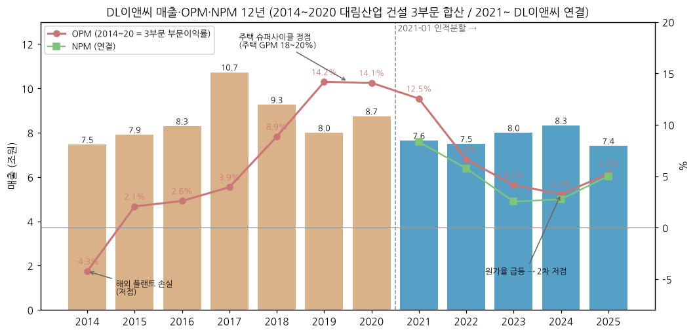

(2014\~2020 = 대림산업 사업보고서 '사업부문 요약 재무현황' 토목·주택(2014\~16 '건축')·플랜트 매출·부문영업이익 합. 이 3부문은 분할계획상 DL이앤씨로 이전된 건설사업부 + 연결 건설 자회사(삼호·고려개발·해외 건설법인) 범위와 거의 일치. 단 **공통(미배분) 비용은 석유화학과 공유돼 제외** → 2021 비교: 3부문 합 1조 1,071억 vs 연결 영업이익 9,573억 (공통비 -1,465억). 분할 전 OPM은 연결 기준 대비 약 1.5\~2%p 과대)

### ② 산업 분류

- 산업: **건설 (종합건설)** — 사이클 산업 (국내 주택 분양 사이클 + 국내외 플랜트 수주 사이클)
- DART 업종: 412 (건물 건설업) / KRX 건설 / WICS 건설
- 워치리스트 섹터: **건설·건설기계** (2026-11-23 추가, 비 T1 — 표준 깊이) / 서브섹터: **건설**

### ③ 분류 결정 논리

(1) **가장 매출 큰 사업부 기준**: 주택 (2025 연결 부문매출의 52.8%, 2023 63.6%) → 국내 주택 분양·착공 사이클 직결 → **사이클**
(2) **사이클 사업부 이익 비중 sub-rule**: 3부문 부문이익 중 주택 비중 2019 73% → 2023 39% → 2025 65% → 9M26 103% (플랜트 9M26 -58억). 12년 이익 변동(2014 -3,168억 ↔ 2020 1조 2,304억)의 대부분을 주택 GPM(4.9%→19.9%)과 2014\~2016 플랜트 손실이 설명 → 두 축 모두 사이클형 → **사이클 유지**
(3) **Boundary case 처리**: SMR(X-energy 표준화 설계 용역 약 150억, 2025-10 계약)·CCUS(카본코)·X-energy 지분(투자원금 약 300억 → 2026-04-28 평가 약 1,720억, 이투데이)은 매출 기여 미미. 그러나 2026-04 주가 고점(102,500원, 시총 3.97조)은 SMR 모멘텀으로 형성 → **Secondary 꿈(소폭)** 병기. 순현금 1.1조·PBR 0.33배는 **자산가치 하방** 노트로만 기재
(4) **피어 대비** (같은 섹터 다른 종목 개요와 교차 검수 필요): 현대건설 = 주택 사이클 + 원전 EPC 옵션 (Primary 사이클 + Secondary 꿈, 2026-11-16 개요) / 대우건설 = 주택 + 해외 토목·플랜트 사이클 / GS건설 = 주택 비중 최상위권 사이클 / HDC현대산업개발 = 자체 개발사업 비중이 큰 주택 사이클 / 삼성물산 = 건설은 일부, 상사·패션·리조트·바이오 지분 → 지주형(SOTP). **DL이앤씨 = 주택 사이클 + 플랜트(석유화학) 보조 + 업계 최상위 재무안정성(순현금·부채비율 79%)** — 현대건설보다 옵션 가치는 작고, 대차대조표 방어력은 큼

### ④ 적정 밸류에이션 방법

- **PBR (사이클 기준) 우선** — 이익 레벨이 주택 원가율에 따라 3배 이상 출렁여 PER 불안정. ROE 4.1%(2023) \~ 13.8%(2021)
  - 밴드: 키움 12M Fwd PBR 밴드 0.2\~0.8배 구간 (2022-01\~2026-04, 키움 2026-04-08) — 2023-10 저점은 0.2배대, 2026-04 고점은 0.8배권 / 2026-11-24 실적 PBR 약 0.33배 (시총 1.77조 / 3Q26 자본 5.42조)
  - 증권사 Target PBR: 키움 0.80배 (BPS 129,285원, TP 103,000원, 2026-04-08) / 유진 0.88배 (12M Fwd BPS 137,302원, TP 121,000원, 2026-07-31)
- **PER 보조** — 주택 마진 정상화 국면(2026E 영업이익 컨센 4,500억, 키움 2026-04 인용 FnGuide)에서만 유효. 2025 순이익은 이연법인세수익 2,530억 포함이라 PER 왜곡
- **SOTP (옵션)** — X-energy 지분 평가액(약 1,720억, 2026-04) + 순현금 1.12조(3Q26) 가산은 하방 지지 논리로만 사용. SMR 시공 본계약 전에는 사업가치 미부여
- 현대건설은 PBR+원전 SOTP, **DL이앤씨는 PBR + 순현금 하방** — 옵션 크기 차이

### ⑤ 분기 재평가 트리거 (분류 변경 조건)

- 주택 GPM이 **2개 연도 연속 15%+ 유지 + 연결 OPM range 2%p 이내** → 사이클 → 지속성장 transition 후보 (현재 9M26 주택 부문 GPM 21.0%, 연결 OPM 7.1\~9.1%)
- **SMR/에너지 EPC 본계약(시공) 수주잔고 1조+** 또는 해당 매출이 연결의 5%+ → Secondary 꿈 격상 검토 (현재 설계 용역만)
- 플랜트 부문 신규수주 부진으로 **플랜트 매출 연 1.5조 미만 + 부문 적자 2개 분기 연속** (3Q26 -425억) → 주택 단일 사이클로 재정의
- 주택 착공·분양 급감으로 **주택 매출 YoY -20% 2개 분기 연속** (3Q26 -11.8%) → 사이클 하강 국면 진입 판정

---

## 2. 회사 개요

### ① 기본 사항

- **회사명**: 디엘이앤씨 주식회사 (DL E&C Co., Ltd.) / KRX 375500 (보통주), 375505 (우선주), 37550L (2우선주)
- **본사**: 서울특별시 강서구 공항대로 165 에이동 (마곡동, 원그로브) — 2025-09-10 이전 (이전: 종로구 통일로 134 디타워 돈의문)
- **설립**: 2021-01-04 (DL㈜(구 대림산업) 건설사업부문 인적분할) / 2021-01-25 유가증권시장 재상장. 모태 대림산업은 1939 부림상회 → 1947 대림산업, 1976-02 상장
- **그룹**: DL그룹 (최대주주 DL㈜ 23.15%, 특수관계인 합산 보통주 24.82%, 2025말 DART) — 이해욱 회장 (미등기 회장)
- **대표이사**: 박상신 부회장 (2024-08-14 선임, 이사회 의장)
- **브랜드**: e편한세상 (주거), ACRO (하이엔드)
- **사업 한 줄 정의**: 국내 주택(e편한세상·아크로) 시공·도시정비가 이익의 대부분을 내고, 석유화학·발전 플랜트 EPC(국내 S-OIL 샤힌, 해외 미국·러시아 석화)와 토목이 보조하는 종합건설사. 연결 종속 15개사 (주요 7개, DART 2025 사업보고서) — DL건설(100%, 2024-02 포괄적 주식교환), 카본코(CCUS), 해외 건설법인 8개

### ② 최근 12년 손익·자본 추이 (조원)

| 연도 | 기준 | 매출 | YoY | 영업이익 | 순이익 | 자본총계 | 자본 YoY |
|---|---|---|---|---|---|---|---|
| 2014 | 대림 3부문 | 7.45 | - | -0.32 | n/a | 분할 전 미존재 | - |
| 2015 | 대림 3부문 | 7.91 | +6.1% | 0.16 | n/a | 분할 전 미존재 | - |
| 2016 | 대림 3부문 | 8.29 | +4.8% | 0.21 | n/a | 분할 전 미존재 | - |
| 2017 | 대림 3부문 | 10.73 | +29.4% | 0.42 | n/a | 분할 전 미존재 | - |
| 2018 | 대림 3부문 | 9.25 | -13.7% | 0.82 | n/a | 분할 전 미존재 | - |
| 2019 | 대림 3부문 | 7.99 | -13.6% | 1.13 | n/a | 분할 전 미존재 | - |
| 2020 | 대림 3부문 | 8.74 | +9.3% | 1.23 | n/a | 분할 전 미존재 | - |
| 2021 | DL이앤씨 연결 | 7.63 | -12.7% | 0.96 | 0.64 | 4.50 | - |
| 2022 | DL이앤씨 연결 | 7.50 | -1.8% | 0.50 | 0.43 | 4.69 | +4.3% |
| 2023 | DL이앤씨 연결 | 7.99 | +6.6% | 0.33 | 0.20 | 4.77 | +1.6% |
| 2024 | DL이앤씨 연결 | 8.32 | +4.1% | 0.27 | 0.23 | 4.85 | +1.6% |
| 2025 | DL이앤씨 연결 | 7.40 | -11.0% | 0.39 | 0.37 | 5.24 | +8.2% |

(2021 YoY는 대림 3부문 2020 대비 — 공통비·연결조정 차이로 비교 주의. 2014\~2020 순이익·자본은 3부문 단위로 산출 불가)

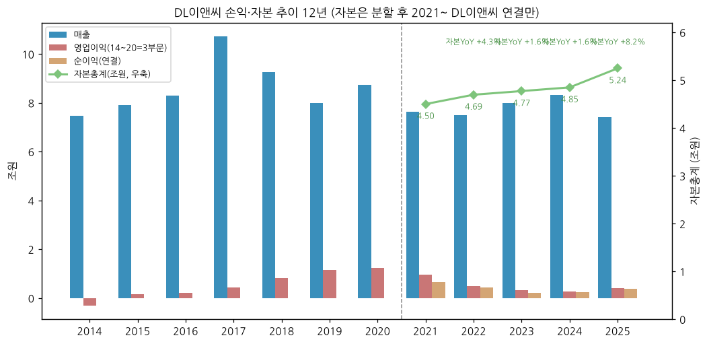

### ③ 회사 주가 역사 ★ narrative 영역

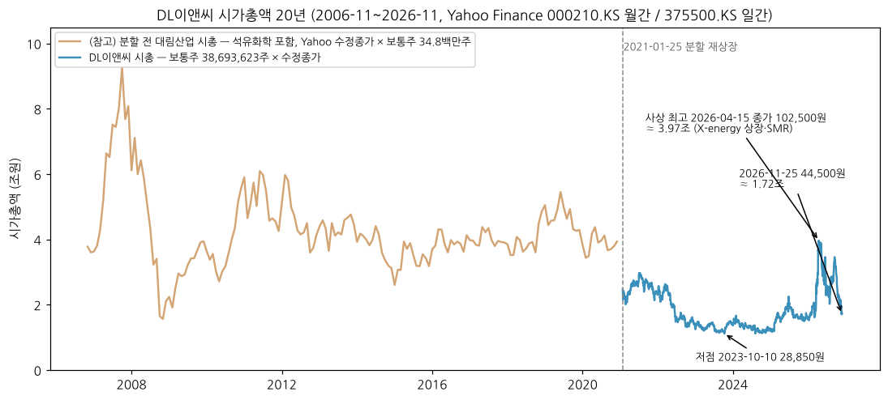

**시가총액 데이터:** DL이앤씨 2021-01-25 \~ 2026-11-25 (Yahoo 375500.KS 일간 수정종가 × 보통주 38,693,623주 고정 — 2022 무상증자 1:1 수정 반영) / 분할 전 2006-11 \~ 2020-12는 대림산업(000210.KS) 월간 수정종가 × 보통주 3,480만주 (석유화학 포함 전사 시총 — **참고용**, Yahoo 수정주가가 당시 공시 주가와 일치하는지 미검증)
- 2026-11-24 종가 **45,850원 → 보통주 시총 약 1.77조원** (알파스퀘어 표시 시총 1조 7,063억은 2026-11-23 종가 44,100원 기준) / 2026-11-25 장중 44,500원
- **사상 최고 (종가): 2026-04-15 102,500원 → 시총 약 3.97조** / 장중 최고 106,600원 (2026-04-15, Yahoo·유진 52주 최고 일치)
- 사상 최저 (종가): 2023-10-10 28,850원 (시총 약 1.12조, 주택 원가율 피크)
- 2026-04 고점 대비 -55% / 2026-09-22 85,200원 → 10-21 57,900원 (-32%, 토요경제) → 11-24 45,850원
- 외국인 지분율 23.70% (2026-11-25, 알파스퀘어) / PBR 0.33배 / PER 5.5배 (알파스퀘어)

**사이클 history:**

```
[2007] 대림산업 해외 플랜트·국내 주택 붐 — 분할 전 최고 (월말 수정종가 기준 시총 약 9조, 참고)
[2008-10] 금융위기 → 시총 1.6조대
[2014] 해외 플랜트(사우디 등) 손실 — 건설 3부문 영업손실 -3,168억
[2015-2020] 주택 슈퍼사이클 — 주택 매출 2.1조(2014) → 6.9조(2017), 주택 GPM 19.9%(2020)
[2021-01-25] DL이앤씨 분할 재상장 (첫날 수정종가 63,750원 ≈ 2.47조)
  · 2021-07 수정종가 76,750원 (2021 고점)
[2022-2023] 원자재·금리 급등, 주택 원가율 90%+ → 주가 반토막
  · 2023-10-10 28,850원 (사상 최저, PBR 0.2배대)
[2024] 주택 원가율 고점, DL건설 적자 → 3만원대 횡보 / 2024-02 DL건설 완전자회사화·자사주 소각
[2025] 주택 GPM 회복(14.5%), 2025-10 X-energy SMR 표준화 설계 계약
  · 2025-06-26 58,200원 (SMR·CCUS 기대)
[2026-03~04] X-energy 나스닥 상장(2026-04-24 공모가 $23) 기대 → SMR 리레이팅
  · 2026-04-15 102,500원 (사상 최고, 시총 3.97조, 1년 +94% (키움 4/7 기준))
[2026-05~11] 플랜트(샤힌) 원가 부담·3Q26 순손실(-267억)·건설 업종 디레이팅
  · 2026-10-21 57,900원, 증권사 TP 80,000~121,000원 (2026-10 기사, 3Q 발표 전)
  · 2026-11-24 45,850원 (고점 대비 -55%)
```

### ④ 회사의 주요 연혁

```
1939-10   부림상회 설립 (대림산업 모태, 인천)
1947      대림산업 상호 변경
1976-02   대림산업 유가증권시장 상장
2000      e편한세상 브랜드 런칭
2017      튀르키예 차나칼레 대교 EPC (DLSY JV 지분 25%, 2018-03 금융약정·EPC 계약)
2020-07   ㈜삼호 + 고려개발㈜ 합병 → 대림건설 (2021-03 DL건설로 사명 변경)
2020-12   대림산업 임시주총 분할계획 승인
2021-01-04 인적분할로 DL이앤씨 신설 (DL㈜ = 지주·석유화학, DL케미칼 물적분할)
2021-01-25 유가증권시장 재상장
2021-05   최대주주 ㈜대림 → DL㈜ (현물출자)
2022      1:1 무상증자 (보통주 19,358,738주 → 38,693,623주)
2022-03   정관에 CCUS·온실가스배출권 사업 추가 (카본코 출범)
2023-01   X-energy 시리즈C 투자 (약 $20M)
2024-02   DL건설 포괄적 주식교환 완료 → 완전자회사 (2024-03-04 DL건설 상장폐지) / 자사주 2,939,077주 소각
2024-08   박상신 대표이사 선임 (마창민 → 서영재 → 박상신)
2025-09   본사 마곡 원그로브 이전
2025-10   X-energy Xe-100 SMR BOP 표준화 설계 용역 계약 (약 $10M, 17개월)
2026-04   X-energy 나스닥 상장 — 지분가치 약 1,720억 (투자원금의 약 6배)
2026-07   자기주식 취득 결정 (555억, 보통주 2.74%)
```

---

## 3. 비즈니스 모델

### ① 실적 추이 (연결 → 부문(주택/토목/플랜트) → 법인(DL이앤씨 본체/DL건설) 3단계 위계)

**연간 5년 통합 표 (억원):**

| 항목 | 2021 | 2022 | 2023 | 2024 | 2025 | 9M26 |
|------|------|------|------|------|------|------|
| **연결 매출액** | 76,317 | 74,968 | 79,911 | 83,184 | 74,024 | 50,347 |
| └ 부문별 (DART 영업부문, 내부거래 제거 전) | | | | | | |
| &nbsp;&nbsp;&nbsp;&nbsp;└ 주택 | 50,773 | 52,948 | 52,569 | 49,481 | 39,045 | 28,166 |
| &nbsp;&nbsp;&nbsp;&nbsp;└ 토목 | 15,043 | 13,372 | 13,650 | 13,710 | 10,282 | 7,064 |
| &nbsp;&nbsp;&nbsp;&nbsp;└ 플랜트 | 10,582 | 8,831 | 16,194 | 20,868 | 24,663 | 14,492 |
| └ 법인별 (IR) | | | | | | |
| &nbsp;&nbsp;&nbsp;&nbsp;└ DL이앤씨 본체(해외법인 포함) | - | - | - | 58,621 | 57,590 | 40,036 |
| &nbsp;&nbsp;&nbsp;&nbsp;└ DL건설 | 20,104 | 19,625 | 24,300 | 24,692 | 16,526 | 10,303 |
| **연결 영업이익** | 9,573 | 4,970 | 3,307 | 2,709 | 3,870 | 4,241 |
| &nbsp;&nbsp;&nbsp;&nbsp;└ 주택 | 8,041 | 4,373 | 2,007 | 1,955 | 3,247 | 4,024 |
| &nbsp;&nbsp;&nbsp;&nbsp;└ 토목 | 1,528 | 687 | 878 | 429 | 164 | 420 |
| &nbsp;&nbsp;&nbsp;&nbsp;└ 플랜트 | 1,502 | 1,346 | 2,199 | 2,699 | 1,601 | -59 |
| &nbsp;&nbsp;&nbsp;&nbsp;└ 공통(미배분)+조정 | -1,499 | -1,436 | -1,777 | -2,373 | -1,143 | -144 |
| &nbsp;&nbsp;&nbsp;&nbsp;└ DL건설 영업이익 (법인) | 2,296 | 811 | 615 | 139 | 699 | 941 |
| **매출 YoY (%)** | -12.7(3부문 대비) | -1.8 | +6.6 | +4.1 | -11.0 | -11.8 |
| **영업이익 YoY (%)** | n/m | -48.1 | -33.5 | -18.1 | +42.8 | +30.9 |
| **OPM 전사 (%)** | 12.5 | 6.6 | 4.1 | 3.3 | 5.2 | 8.4 |
| **부문 GPM (%)** | | | | | | |
| &nbsp;&nbsp;&nbsp;&nbsp;└ 주택 GPM | 19.6 | 11.5 | 7.0 | 8.7 | 14.5 | 21.0 |
| &nbsp;&nbsp;&nbsp;&nbsp;└ 토목 GPM | 13.5 | 9.1 | 10.5 | 6.6 | 4.7 | 9.2 |
| &nbsp;&nbsp;&nbsp;&nbsp;└ 플랜트 GPM | 17.3 | 21.2 | 17.0 | 18.9 | 10.5 | 5.7 |
| **지역별 (DART 매출실적)** | | | | | | |
| &nbsp;&nbsp;&nbsp;&nbsp;└ 국내 | - | - | 69,175 | 72,200 | 60,201 | - |
| &nbsp;&nbsp;&nbsp;&nbsp;└ 해외 (토목+플랜트) | - | - | 13,238 | 11,859 | 13,789 | - |

(출처: 연결·부문 = OpenDART 재무JSON·영업부문 주석. DL건설 2021\~2024 = DL건설 별도 OpenDART(OFS, 4개 분기 합), 2025\~ = DL이앤씨 IR. DL이앤씨 본체 = IR (2024 이전 IR PDF는 이미지라 미추출). 지역별 = DART 사업보고서(2025.12) II-4 매출실적(연결조정 전). 부문 합계와 연결 매출 차이 = 공통(미배분)·연결조정)

**부문별 매출·GPM·부문이익 13년 (억원, 2013\~2020 대림산업 사업보고서 / 2021\~ DL이앤씨 사업보고서 — 영업부문 주석):**

| 연도 | 주택(건축) | 토목 | 플랜트 | 3부문 합 | 주택 GPM | 토목 GPM | 플랜트 GPM | 주택 OP | 토목 OP | 플랜트 OP | 3부문 OP | 플랜트 비중 |
|---|---|---|---|---|---|---|---|---|---|---|---|---|
| 2013 | 16,362 | 12,139 | 52,949 | 81,449 | 8.9% | 13.2% | -1.1% | 244 | 1,196 | -1,680 | -240 | 65% |
| 2014 | 20,980 | 12,390 | 41,169 | 74,539 | 4.9% | 10.4% | -7.6% | 258 | 897 | -4,324 | -3,168 | 55% |
| 2015 | 27,079 | 15,000 | 37,013 | 79,092 | 9.2% | 7.9% | 1.7% | 1,533 | 814 | -719 | 1,629 | 47% |
| 2016 | 44,341 | 14,610 | 23,938 | 82,890 | 10.9% | 5.1% | -1.3% | 3,646 | 267 | -1,766 | 2,147 | 29% |
| 2017 | 68,545 | 13,848 | 24,895 | 107,288 | 11.8% | -13.1% | 7.7% | 6,685 | -2,344 | -123 | 4,218 | 23% |
| 2018 | 63,949 | 15,840 | 12,756 | 92,545 | 14.2% | 8.5% | 6.6% | 7,790 | 752 | -350 | 8,193 | 14% |
| 2019 | 53,813 | 16,452 | 9,650 | 79,915 | 18.2% | 13.1% | 19.2% | 8,275 | 1,709 | 1,336 | 11,321 | 12% |
| 2020 | 56,750 | 16,026 | 14,595 | 87,371 | 19.9% | 13.4% | 14.9% | 9,404 | 1,449 | 1,450 | 12,304 | 17% |
| 2021 | 50,773 | 15,043 | 10,582 | 76,399 | 19.6% | 13.5% | 17.3% | 8,041 | 1,528 | 1,502 | 11,071 | 14% |
| 2022 | 52,948 | 13,372 | 8,831 | 75,152 | 11.5% | 9.1% | 21.2% | 4,373 | 687 | 1,346 | 6,406 | 12% |
| 2023 | 52,569 | 13,650 | 16,194 | 82,413 | 7.0% | 10.5% | 17.0% | 2,007 | 878 | 2,199 | 5,084 | 20% |
| 2024 | 49,481 | 13,710 | 20,868 | 84,059 | 8.7% | 6.6% | 18.9% | 1,955 | 429 | 2,699 | 5,083 | 25% |
| 2025 | 39,045 | 10,282 | 24,663 | 73,991 | 14.5% | 4.7% | 10.5% | 3,247 | 164 | 1,601 | 5,012 | 33% |
| 9M26 | 28,166 | 7,064 | 14,492 | 49,722 | 21.0% | 9.2% | 5.7% | 4,024 | 420 | -59 | 4,385 | 29% |

(2013\~2016 '건축' 부문 = 2017 이후 '주택'으로 명칭 변경(주택+일반건축). 2013 수치는 2013 사업보고서 당기값)

→ 플랜트 비중 2013 65% → 2019 12% (해외 플랜트 손실 후 축소) → 2025 33% (S-OIL 샤힌·미국 GTPP·러시아 발틱 석화) → 9M26 30% / 주택 GPM 2014 4.9% → 2020 19.9% (정점) → 2023 7.0% → 9M26 21.0% (재정점권)

**부문·법인별 분기 시계열 (부문 51분기 = 1Q14\~3Q26 DART 영업부문 누적값 차분 / DL건설 43분기 = 1Q16\~4Q24 DART 별도 + 1Q25\~3Q26 IR):**

각 차트 = 매출 (bar, 좌축) + GPM/부문 OPM (line, 우축). 베이지 bar = 분할 전 대림산업 부문.

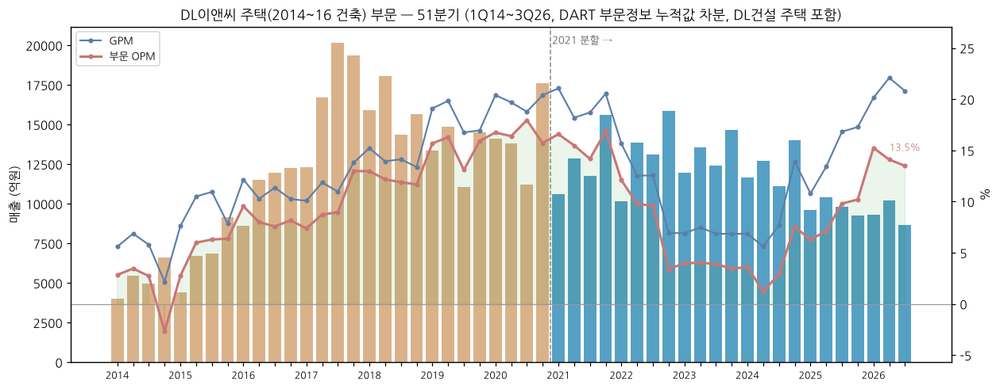
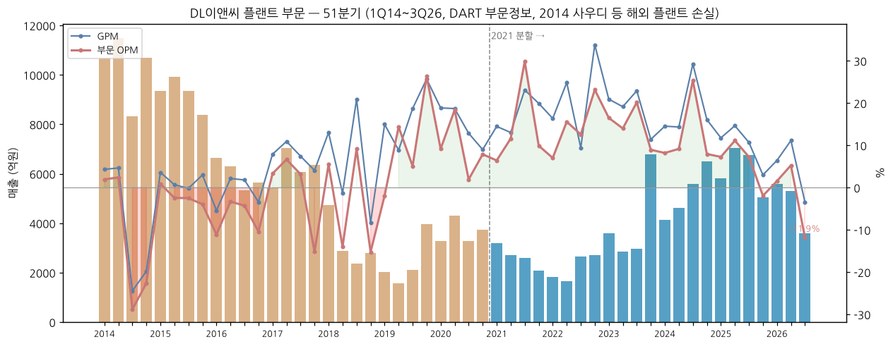
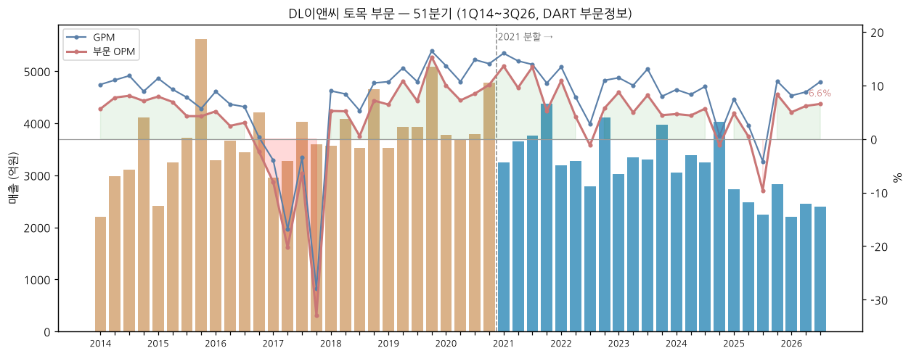
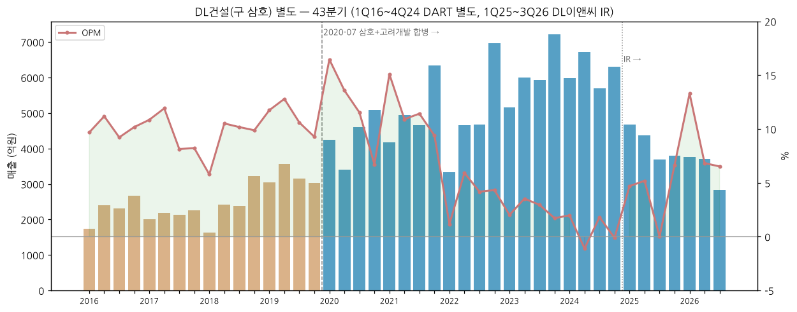

**부문별 최근 12분기 (억원, DART 영업부문 — 부문 OPM = 부문영업이익/부문매출):**

| 분기 | 주택 | 토목 | 플랜트 | 연결 | 주택 GPM | 토목 GPM | 플랜트 GPM | 주택 OP | 토목 OP | 플랜트 OP | 공통 OP |
|---|---|---|---|---|---|---|---|---|---|---|---|
| 2023-4Q | 14,638 | 3,975 | 6,774 | 23,330 | 6.8% | 8.0% | 11.4% | 502 | 177 | 607 | -418 |
| 2024-1Q | 11,645 | 3,055 | 4,147 | 18,905 | 6.9% | 9.2% | 14.5% | 421 | 142 | 340 | -415 |
| 2024-2Q | 12,719 | 3,382 | 4,630 | 20,702 | 5.6% | 8.3% | 14.3% | 153 | 149 | 425 | -410 |
| 2024-3Q | 11,096 | 3,246 | 5,578 | 19,189 | 7.7% | 9.8% | 29.3% | 324 | 184 | 1,415 | -370 |
| 2024-4Q | 14,022 | 4,027 | 6,513 | 24,388 | 13.9% | 0.6% | 16.1% | 1,057 | -47 | 518 | -433 |
| 2025-1Q | 9,593 | 2,736 | 5,808 | 18,082 | 10.8% | 7.4% | 11.8% | 602 | 131 | 423 | -336 |
| 2025-2Q | 10,386 | 2,479 | 7,038 | 19,914 | 13.4% | 2.6% | 14.7% | 740 | 12 | 784 | -382 |
| 2025-3Q | 9,823 | 2,238 | 6,762 | 19,070 | 16.8% | -4.2% | 10.7% | 963 | -215 | 493 | -390 |
| 2025-4Q | 9,243 | 2,830 | 5,055 | 16,958 | 17.3% | 10.8% | 3.0% | 942 | 236 | -98 | -361 |
| 2026-1Q | 9,280 | 2,208 | 5,595 | 17,252 | 20.1% | 8.1% | 6.4% | 1,414 | 111 | 86 | -275 |
| 2026-2Q | 10,222 | 2,453 | 5,307 | 18,029 | 22.1% | 8.8% | 11.1% | 1,441 | 152 | 281 | -342 |
| 2026-3Q | 8,664 | 2,404 | 3,590 | 15,065 | 20.8% | 10.7% | -3.4% | 1,169 | 158 | -425 | -278 |

**연결 분기 매출·영업이익 매트릭스 (억원, OpenDART — 2021\~):**

| 연도 | 1Q 매출 | 2Q | 3Q | 4Q | 1Q OP | 2Q OP | 3Q OP | 4Q OP | 연간 매출 | 연간 OPM |
|---|---|---|---|---|---|---|---|---|---|---|
| 2021 | 16,996 | 19,223 | 18,068 | 22,029 | 1,998 | 2,290 | 2,590 | 2,695 | 76,316 | 12.5% |
| 2022 | 15,147 | 18,770 | 18,489 | 22,563 | 1,257 | 1,346 | 1,164 | 1,202 | 74,969 | 6.6% |
| 2023 | 18,501 | 19,706 | 18,374 | 23,330 | 902 | 719 | 804 | 882 | 79,911 | 4.1% |
| 2024 | 18,905 | 20,702 | 19,189 | 24,388 | 609 | 326 | 833 | 941 | 83,184 | 3.3% |
| 2025 | 18,082 | 19,914 | 19,070 | 16,958 | 810 | 1,262 | 1,168 | 630 | 74,024 | 5.2% |
| 2026 | 17,252 | 18,029 | 15,065 | - | 1,574 | 1,594 | 1,073 | - | 50,346 (9M) | 8.4% |

(4Q = 연간 − 3Q 누적. 분기합 = DART 연간 일치)

**분할 전 3부문 합산 분기 (억원, 대림산업 영업부문 누적값 차분 — 공통비 제외):**

| 연도 | 1Q 매출 | 2Q | 3Q | 4Q | 1Q OP | 2Q OP | 3Q OP | 4Q OP |
|---|---|---|---|---|---|---|---|---|
| 2014 | 16,886 | 19,920 | 16,350 | 21,383 | 446 | 696 | -2,011 | -2,300 |
| 2015 | 16,171 | 19,879 | 19,914 | 23,129 | 397 | 385 | 357 | 490 |
| 2016 | 18,543 | 21,493 | 20,745 | 22,109 | 254 | 800 | 783 | 310 |
| 2017 | 20,671 | 27,038 | 30,258 | 29,321 | 850 | 1,266 | 1,739 | 363 |
| 2018 | 24,191 | 25,028 | 20,227 | 23,099 | 2,507 | 2,006 | 1,941 | 1,739 |
| 2019 | 18,906 | 20,353 | 17,092 | 23,563 | 2,282 | 3,071 | 1,834 | 4,133 |
| 2020 | 21,159 | 21,797 | 18,282 | 26,134 | 3,039 | 3,321 | 2,396 | 3,547 |

**3Q26 핵심 (분기보고서 확정치, 연간 합산은 FY26 결산 후 v2.0에서 갱신):**
- 연결 매출 **1조 5,065억** (-21.0% YoY) / 영업이익 **1,073억** (-8.1% YoY, OPM 7.1%, +1.0%p) / 순이익 **-267억** (적자전환 — 세전 -205억, 영업외 손실. 세부 원인은 기사·IR 미명시 → 리뷰에서 주석 확인)
- 주택: 매출 8,664억(DART 부문, -11.8%), GPM 20.8% — IR 본체 주택 원가율 79.3% (-3.3%p YoY)
- 플랜트: 매출 3,590억 (-46.9%), **부문영업손실 -425억** — S-OIL 샤힌 공기연장·돌관공사 추가 비용 반영 (IR 원가율 91.9%, +6.0%p) (비즈워치 2026-10-30)
- 토목: 원가율 109.5% → 86.8% 정상화, 부문 OP 158억
- DL건설: 매출 2,838억 (-23.0%) / 영업이익 185억 (흑자전환, 원가율 82.6%)
- 9M26 누적: 매출 5.03조 (2026 계획 7.2조의 70%) / 영업이익 4,241억 (+30.9%, 2025 연간 3,870억 초과) / 신규수주 7.22조 (계획 12.5조의 58%)

**12분기 시계열 (4Q23 \~ 3Q26, 억원):**

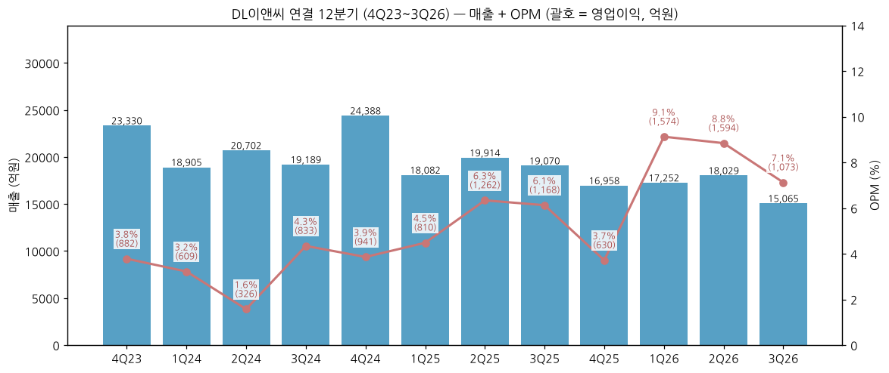

| 분기 | 매출 | 영업이익 | OPM | 순이익 | DL건설 매출 | DL건설 OP | 메모 |
|---|---|---|---|---|---|---|---|
| 4Q23 | 23,330 | 882 | 3.8% | 58 | 7,221 | 124 | 주택 GPM 6.8% 바닥권 |
| 1Q24 | 18,905 | 609 | 3.2% | 260 | 5,974 | 118 |  |
| 2Q24 | 20,702 | 326 | 1.6% | 406 | 6,719 | -74 | OPM 1.6% 저점 (주택 GPM 5.6%, DL건설 적자) |
| 3Q24 | 19,189 | 833 | 4.3% | 453 | 5,695 | 103 | 플랜트 GPM 29% (정산이익) |
| 4Q24 | 24,388 | 941 | 3.9% | 1,173 | 6,304 | -7 | 분기 매출 정점 |
| 1Q25 | 18,082 | 810 | 4.5% | 302 | 4,667 | 219 |  |
| 2Q25 | 19,914 | 1,262 | 6.3% | 83 | 4,376 | 227 | 주택 GPM 13%대 회복 |
| 3Q25 | 19,070 | 1,168 | 6.1% | 1,263 | 3,685 | 0 |  |
| 4Q25 | 16,958 | 630 | 3.7% | 2,053 | 3,798 | 253 | 플랜트 적자(-98억), 이연법인세로 순이익 2,053억 |
| 1Q26 | 17,252 | 1,574 | 9.1% | 1,601 | 3,760 | 500 | 주택 GPM 20%대 진입 |
| 2Q26 | 18,029 | 1,594 | 8.8% | 1,297 | 3,704 | 253 | 준공 정산이익 약 300억 (유진) |
| **3Q26** | 15,065 | 1,073 | 7.1% | -267 | 2,838 | 185 | **샤힌 비용 → 플랜트 -425억, 순손실** |

**수주·수주잔고 (연결, IR):**

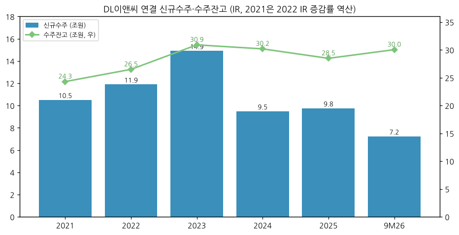

| 시점 | 신규수주 (조원) | 수주잔고 (조원) | 출처 |
|---|---|---|---|
| 2021 | 약 10.5 | 약 24.3 | 2022 IR 증감률(+13%·+9.2%) 역산 |
| 2022 | 11.89 | 26.5 | IR FY22 |
| 2023 | 14.9 | 30.9 | IR FY23 |
| 2024 | 9.48 | 30.18 | IR FY25 비교값 |
| 2025 | 9.75 | 28.48 (3Q26 IR 재표시 28.19) | IR FY25 |
| 9M26 | 7.22 (+31.0% YoY) | 30.04 | IR 3Q26 |
| 2026 계획 | 12.5 (본체 10.5 / DL건설 2.0) | - | IR FY25 경영계획 |

- DART 수주상황(2025말): DL이앤씨 본체 수주잔고 약 **22.44조**, DL건설 약 **4.67조**
- 본체 상위 현장 (계약잔액): 백현마이스 2.39조 (성남도시개발공사, \~2031) / 부산 촉진3구역 재개발 1.80조 / e편한세상 상대원 0.98조 / 제물포역 도심 공공주택 0.59조 / 아크로 드 서초 0.52조 / 영동양수발전소 0.40조 (한수원) 등 — 상위 10개 8.42조
- 해외법인: Daelim RUS·DLE&C FZCO 발틱 PE/LAO (발주처 China National Chemical Engineering No.7, 잔액 0.97조, \~2027-02) / DL USA GTPP (미국 텍사스, 잔액 0.04조, \~2026-09)

### ② 사업부별 개요 (매출 비중 큰 순서)

**주택 (2025 부문매출의 52.8%, 9M26 57%)**

"e편한세상·아크로 브랜드의 재건축·재개발·자체/도급 주택 시공 — DL이앤씨 이익의 본체."

- 본체 주택 + DL건설 건축(주택·일반건축) 포함. 신규수주는 도시정비(재건축·재개발)와 일반도급 병행 (9M26 본체 주택 신규수주 3.71조, IR)
- 2024\~2025 착공 물량 공정 본격화 → 2Q26 본체 주택 매출 7,145억 (+8.4%, 유진)
- 9M26 본체 주택 원가율 78.5% (2025 85.7%, 2024 90.7%) — 사이클 정점권 마진

**플랜트 (33.3%, 9M26 30%)**

"석유화학·정유·발전 EPC — 국내 S-OIL 샤힌, 해외 미국·러시아 석화 프로젝트."

- 주요 현장: S-OIL 샤힌(울산 석화단지), 러시아 발틱 PE/LAO, 미국 GTPP(Golden Triangle Polymers), 영동양수발전소(토목·플랜트)
- 신사업: SMR(X-energy Xe-100 BOP 표준화 설계), CCUS(카본코), 미국 가스복합·AI 전력 발전사업 (DL에너지와 협의, 유진 2026-07)
- 2026 경영계획: 플랜트 수주 3.0조 / 매출 2.3조 (IR FY25)

**토목 (13.8%, 9M26 14%)**

"도로·철도·항만·교량·양수발전 — 공공 SOC 중심."

- 해외: 튀르키예 차나칼레 대교 (2022 개통) 이후 해외 토목 축소 (2025 해외 토목 매출 700억)
- 2026 계획: 수주 1.8조 / 매출 0.8조 (본체)

**DL건설 (법인, 2025 연결 매출의 22%)**

"구 삼호(주택)+고려개발(토목) 합병 법인 — 주택·건축 중심 중견 시공사, 2024-02 100% 자회사."

- 2025 매출 1.65조 (-33.1%) / 영업이익 699억 (+403%) — 선별 수주로 외형 축소, 원가율 93.3% → 87.5%
- 9M26 매출 1.03조 / 영업이익 941억 (+111%)

### ③ 사업부별 디테일

**현재 가장 잘나가는 사업 (top-seller):**
- **주택** — 9M26 부문 GPM 21.0%, 부문이익 4,024억 (3부문 합의 103%). 1Q26\~3Q26 GPM 20.1%·22.1%·20.8%로 2020 정점(19.9%) 상회

**성장 사업 (growth):**
- 플랜트 신사업 (SMR 설계, 미국 발전, 중동 암모니아 파이프라인 추진) — 아직 매출 기여 없음. 플랜트 본업 매출은 2026 -31% 전망 (iM 2025-11)

**이익 outlier:**
- 2014 플랜트 -4,324억 / 2017 토목 -2,344억 (분할 전) / 3Q24 플랜트 OPM 25.4% (정산) / 3Q26 플랜트 -425억 (샤힌) / 2025 순이익 3,702억 중 법인세수익 2,530억 (이연법인세자산 3,603억 → 7,131억)

### ④ 주요 경쟁사 (사업부별)

| 사업 | 경쟁사 |
|---|---|
| 주택(도시정비) | 현대건설, 삼성물산, GS건설, 대우건설, 포스코이앤씨, 롯데건설, HDC현대산업개발 |
| 플랜트(석화·정유) | 삼성E&A, GS건설, 현대엔지니어링, SK에코플랜트 |
| 토목 | 현대건설, 대우건설, 삼성물산, GS건설 |
| SMR 시공·설계 | 현대건설(Holtec), 삼성물산(NuScale), 두산에너빌리티(주기기) |

### ⑤ 주요 매출처

- DART는 주요 매출처를 고객명으로 공시하지 않음 → 수주상황 상위 현장 발주처로 대체: 성남도시개발공사, 부산 촉진3구역 조합, 상대원2구역 조합, 인천도시공사, 서초신동아 조합, ㈜숲이랑코퍼레이션, 도곡개포한신 조합, 도화1구역 조합, 한국수력원자력, 대전 삼성4구역 조합 (2025말)
- 플랜트: S-OIL(샤힌), Golden Triangle Polymers (Chevron Phillips·QatarEnergy JV), China National Chemical Engineering No.7 (러시아 발틱)
- DL건설: LH(한국토지주택공사) 공공주택, 도시정비 조합

### ⑥ 생산 CAPA + 임직원

| 연도 | 2013 | 2014 | 2015 | 2016 | 2017 | 2021 | 2022 | 2023 | 2024 | 2025 |
|---|---|---|---|---|---|---|---|---|---|---|
| 직원 수 (별도) | 5,456 | 5,234 | 5,232 | 5,434 | 7,619 | 5,461 | 5,585 | 5,706 | 5,589 | 4,742 |
| 기준 | 대림산업 | 대림산업 | 대림산업 | 대림산업 | 대림산업 | DL이앤씨 | DL이앤씨 | DL이앤씨 | DL이앤씨 | DL이앤씨 |

(대림산업 = 석유화학사업부 포함 전사 별도. 2018\~2020은 사업보고서 표 형식 차이로 미추출. 2025 부문별: 토목 990 / 주택 1,862 / 플랜트 1,468 / 지원 422 — 평균 근속 13.7년, 1인 평균 급여 9,800만원)

- 수주산업이라 생산설비 CAPA 개념 없음 — 유형자산 424억 (2025말, 자산의 0.4%)

---

## 4. 재무 구조 (분할 후 2021\~3Q26 — 분할 전 연도는 DL이앤씨 법인 미존재)

### ① 손익계산서 (억원, 연결)

| 항목 | 2021 | 2022 | 2023 | 2024 | 2025 | 3Q26(9M) |
|---|---|---|---|---|---|---|
| 매출액 | 76,317 | 74,968 | 79,911 | 83,184 | 74,024 | 50,347 |
| 매출총이익 | 13,864 | 9,313 | 7,821 | 8,458 | 9,002 | 8,119 |
| 판매비와관리비 | 4,291 | 4,344 | 4,515 | 5,748 | 5,132 | 3,879 |
| 영업이익 | 9,573 | 4,970 | 3,307 | 2,709 | 3,870 | 4,241 |
| 금융원가 | 693 | 572 | 634 | 664 | 1,335 | 719 |
| 법인세차감전이익 | 9,093 | 5,955 | 2,798 | 3,539 | 1,172 | 3,642 |
| 법인세비용 | 2,734 | 1,639 | 776 | 1,247 | -2,530 | 1,010 |
| 당기순이익 | 6,358 | 4,316 | 2,022 | 2,292 | 3,702 | 2,631 |
| 지배주주순이익 | 5,770 | 4,132 | 1,879 | 2,292 | 3,702 | 2,631 |
| GPM | 18.2% | 12.4% | 9.8% | 10.2% | 12.2% | 16.1% |
| 판관비율 | 5.6% | 5.8% | 5.6% | 6.9% | 6.9% | 7.7% |
| OPM | 12.5% | 6.6% | 4.1% | 3.3% | 5.2% | 8.4% |
| NPM | 8.3% | 5.8% | 2.5% | 2.8% | 5.0% | 5.2% |

(2025 법인세비용 -2,530억 = 이연법인세 효과 → 세전 1,172억 대비 순이익 3,702억. 2014\~2020 대림 3부문 손익은 1-①·3-① 표 참조)

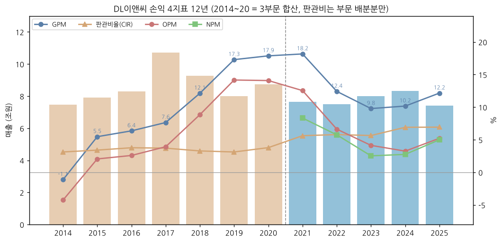

### ② 재무상태표 (억원, 연결, 기말)

| 항목 | 2021 | 2022 | 2023 | 2024 | 2025 | 3Q26(9M) |
|---|---|---|---|---|---|---|
| 자산총계 | 87,017 | 89,747 | 93,441 | 97,124 | 96,693 | 97,018 |
| 유동자산 | 53,543 | 54,038 | 57,827 | 60,055 | 56,347 | 59,752 |
| 현금및현금성자산 | 20,448 | 17,524 | 20,041 | 18,644 | 18,443 | 19,024 |
| 매출채권 및 기타채권(유동) | 9,794 | 12,092 | 14,050 | 17,399 | 16,214 | 17,679 |
| 계약자산 | 9,684 | 8,235 | 8,893 | 8,862 | 6,286 | 7,314 |
| 재고자산 | 9,396 | 8,528 | 9,381 | 9,213 | 8,862 | 8,685 |
| 부채총계 | 42,045 | 42,822 | 45,753 | 48,667 | 44,252 | 42,820 |
| 유동부채 | 31,367 | 32,107 | 37,486 | 38,545 | 37,265 | 38,114 |
| 계약부채 | 9,844 | 10,799 | 11,809 | 13,853 | 12,399 | 8,145 |
| 자본총계 | 44,971 | 46,925 | 47,688 | 48,457 | 52,441 | 54,198 |
| 지배주주지분 | 41,679 | 43,497 | 47,688 | 48,457 | 52,441 | 54,198 |
| 비지배지분 | 3,292 | 3,428 | 0 | 0 | 0 | 0 |

(2021\~2022 비지배지분 = DL건설 소수주주 지분 (DL건설 상장 상태). 2023말 0 → 2024-02 주식교환 완료)

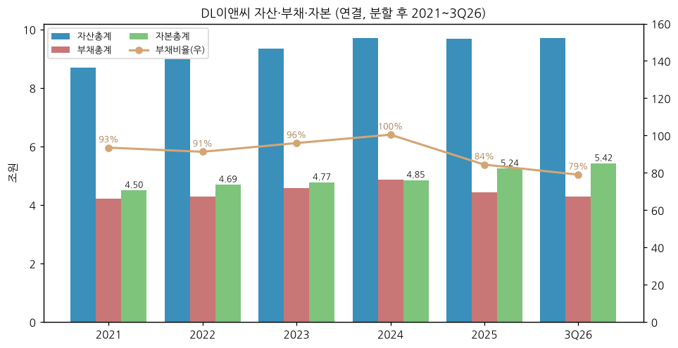

### ③ 현금흐름표 (억원, 연결)

| 연도 | 영업CF | 투자CF | 재무CF | 유·무형 CapEx | FCF | 배당지급 | 자사주 취득 | 이자지급 |
|---|---|---|---|---|---|---|---|---|
| 2021 | 5,804 | -3,380 | 1,136 | 191 | 5,613 | 44 | 32 | 296 |
| 2022 | 1,520 | -3,857 | -648 | 238 | 1,282 | 640 | 290 | 350 |
| 2023 | 2,313 | 2,013 | -1,890 | 166 | 2,148 | 443 | 729 | 568 |
| 2024 | 1,879 | -1,671 | -1,915 | 119 | 1,760 | 217 | 198 | 580 |
| 2025 | 2,321 | -518 | -2,222 | 231 | 2,091 | 230 | 344 | 630 |
| 3Q26(9M) | -81 | 763 | -723 | 83 | -163 | 371 | 242 | 258 |

→ 영업CF 2021 5,804억 이후 1,500\~2,300억대로 둔화 (매출채권 0.98조 → 1.62조, 2021→2025) / 9M26 영업CF -81억 (운전자본 증가) — 그래도 순현금 1.12조 유지

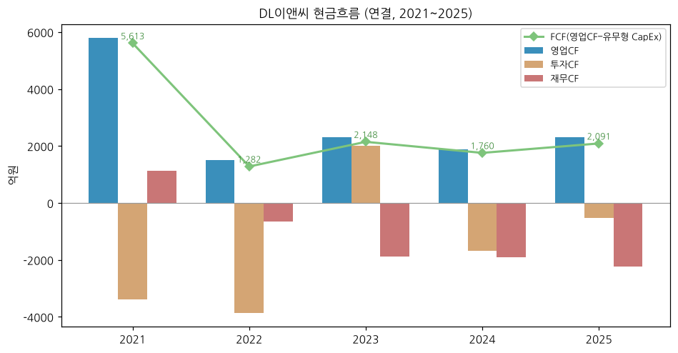

### ④ CapEx 추이 (억원)

| 연도 | 유형 | 무형 | 총 CapEx | CapEx/매출 |
|---|---|---|---|---|
| 2021 | 143 | 48 | 191 | 0.25% |
| 2022 | 175 | 62 | 238 | 0.32% |
| 2023 | 121 | 44 | 166 | 0.21% |
| 2024 | 95 | 24 | 119 | 0.14% |
| 2025 | 170 | 60 | 231 | 0.31% |
| 3Q26(9M) | 58 | 25 | 83 | 0.16% |

- 수주산업이라 CapEx는 매출의 0.1\~0.3% — 사이클 지표로는 **수주잔고·착공·운전자본(매출채권·계약자산)** 이 핵심. 관계기업·SOC·PFV 지분 투자(2025 관계기업 취득 312억)가 실질 투자

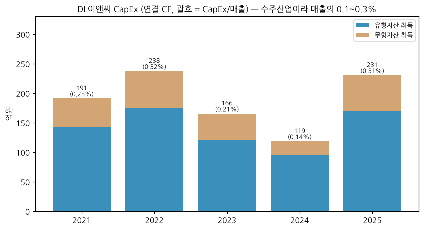

### ⑤ 부채구조 + 운전자본 (억원)

| 기말 | 총차입금 | 현금+단기금융상품 | 순현금(+) | 부채비율 | 매출채권(유동) | 계약자산 | 계약부채 |
|---|---|---|---|---|---|---|---|
| 2021 | 10,069 | 20,448 | +10,379 | 93.5% | 9,794 | 9,684 | 9,844 |
| 2022 | 10,980 | 17,524 | +6,544 | 91.3% | 12,092 | 8,235 | 10,799 |
| 2023 | 11,477 | 22,087 | +10,610 | 95.9% | 14,050 | 8,893 | 11,809 |
| 2024 | 10,771 | 20,711 | +9,940 | 100.4% | 17,399 | 8,862 | 13,853 |
| 2025 | 9,636 | 20,532 | +10,896 | 84.4% | 16,214 | 6,286 | 12,399 |
| 3Q26(9M) | 9,614 | 20,852 | +11,238 | 79.0% | 17,679 | 7,314 | 8,145 |

(총차입금 = 단기차입금·유동성장기부채 + 비유동 차입금·사채 (리스부채 제외). IR 순현금: 2025말 1조 896억 / 3Q26 1조 1,238억 — 일치)

**신용등급:** 회사채 AA- (유진 2026-07 "업계 최고 수준의 재무안정성") — 국내 대형 건설사 중 최상위권

**부동산 PF 신용보강 (연결, DART 분기보고서(2026.09) 우발부채 주석):**
- 총 **2.14조** (2025말 2.20조) — 단독사업 2.13조 / 컨소시엄 0.01조 (중도금대출·SOC 제외)
- 3Q26 자본 5.42조 대비 39% (현대건설 PF 보증 14.18조 = 자본의 126%와 대비) → PF 리스크 노출 업계 최저권
- 인천인하·전주완산·대전문화·울산의정부 PFV 재무적투자자 풋옵션 제공, 일부 PFV 지분 ㈜대림 풋/콜옵션 (2029-01 이후)

### ⑥ 배당·자사주 추이

| 연도 | DPS 보통주(원) | 배당총액(억) | 연결 순이익(억) | 연결 배당성향 | 자사주 취득(CF, 억) | 비고 |
|---|---|---|---|---|---|---|
| 2021 | 2,700 (무상증자 전, 수정 1,350) | 580 | 6,358 | 10.05% | 32 |  |
| 2022 | 1,000 | 423 | 4,316 | 10.23% | 290 | 1:1 무상증자 |
| 2023 | 500 | 202 | 2,022(지배 1,879) | 10.74% | 729 |  |
| 2024 | 540 | 230 | 2,292 | 10.05% | 198 | 2024-02 자사주 2,939,077주 소각 |
| 2025 | 890 | 371 | 3,702 | 10.05% | 344 |  |

(DART 배당에 관한 사항. 우선주 DPS = 보통주 +50원, 2우선주 = 보통주와 동일)

- **주주환원 정책 (2024-02-01 공시, 2024\~2026):** 연결 순이익의 **25%** 환원 — 현금배당 10% + 자기주식 취득 15%
- 2026-07-30 자기주식 취득 결정 555억 (보통주 2.74%) — 정책 이행분 (유진 2026-07-31)
- 자기주식 보유 보통주 1,137,953주 (2.94%) / 우선주 178,331주 (2025말, DART)

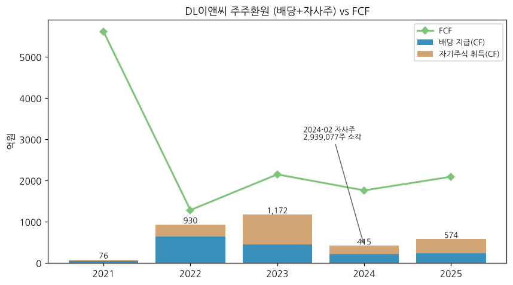

### ⑦ 재무 비율

| 연도 | ROE(지배) | ROA | 부채비율 | 유동비율 | 영업이익/이자지급 |
|---|---|---|---|---|---|
| 2021 | 13.8%* | 7.3%* | 93.5% | 170.7% | 32.3x |
| 2022 | 9.7% | 4.9% | 91.3% | 168.3% | 14.2x |
| 2023 | 4.1% | 2.2% | 95.9% | 154.3% | 5.8x |
| 2024 | 4.8% | 2.4% | 100.4% | 155.8% | 4.7x |
| 2025 | 7.3% | 3.8% | 84.4% | 151.2% | 6.1x |

(* 2021 = 기말 자본·자산 기준 (분할 기초 잔액 미사용). 이후 평균 잔액 기준. 이자보상 = 영업이익 / CF상 이자지급액)

**주요 비율 의미:**
- **ROE**: 2021 13.8% → 2023 4.1% 저점 → 2025 7.3% (법인세수익 포함) — 2026E 9.5% (유진)
- **부채비율**: 79\~100% — 건설 대형사 중 최저권. 순현금 구조 5년 연속 유지
- **이자보상**: 2023\~2025 5\~6배로 하락 (영업이익 감소 + 이자지급 증가), 9M26 16.5배 회복

---

## 5. 지배 구조

### ① 그룹·계열 관계

- **DL그룹**: 이해욱 회장 → ㈜대림(비상장 가족회사) → **DL㈜ (지주, 000210)** → DL이앤씨 (23.15%) / DL케미칼 / DL에너지 등
- DL이앤씨 연결 종속 15개사 (주요 7, 2025말): **DL건설㈜ (100%)**, 오산랜드마크프로젝트㈜ (PFV), ㈜인천도화1임대주택리츠, ㈜엔에스파트너스, ㈜사우북변도시개발, ㈜삼호시트론시티, DL Saudi Arabia, PT. DLENC UTAMA, 달림(남경)건설관리, DL USA, DL INSAAT GELISTIRME (튀르키예), Daelim RUS, DL E&C Malaysia, DLE&C FZCO, **CARBONCO PTE. Ltd. (CCUS)**
- 분할 구조 (2021-01): 대림산업 → (인적분할) DL이앤씨 신설 + (존속) DL㈜ → (물적분할) DL케미칼. 2021-05 ㈜대림이 DL이앤씨 지분 21.67%를 DL㈜에 현물출자 → 최대주주 DL㈜

### ② 주주 구분

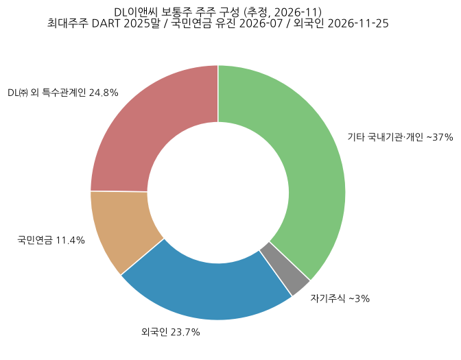

**5% 이상 주주 / 최대주주 등 (보통주):**

| 주주명 | 지분율 | 기준일 / 출처 |
|--------|--------|------|
| DL㈜ (최대주주) | 23.15% (8,957,128주) | 2025말, DART |
| (학)대림학원 | 1.39% | 2025말, DART |
| 이해욱 회장 | 0.12% (46,941주) | 2025말, DART |
| **최대주주 등 합계** | **24.82%** (9,605,194주) | 2025말, DART (유진 2026-07 "DL 외 8인 24.8%") |
| 국민연금공단 (외 1인) | 11.4% | 유진투자증권 2026-07-31 표기 |

**전체 주주 구분 (추정, 2026-11):**

| 구분 | 지분율 | 비고 |
|---|---|---|
| DL그룹 (최대주주등) | 24.8% | 공시 |
| 외국인 | 23.7% | 알파스퀘어 2026-11-25 |
| 국민연금 | \~11.4% | 2026-07 |
| 자기주식 | \~3% (+2026-07 취득분) | 2025말 2.94% |
| 기타 국내기관·개인 | \~37% | 잔여 |

- 발행주식: 보통주 38,693,623주 / 우선주(2종 합) 4,225,836주 (액면 5,000원, 2025말)

### ③ 임원·이사회

**대표이사:**
- **박상신 대표이사 부회장** (1962년생, 고려대 경영학)
    - 2024-08-14 임시주총 사내이사·대표이사 선임, 이사회 의장 겸 주택·토목사업본부장 (DART 임원현황)
    - 직전 대표 교체: 마창민 (2021-01\~2024-05) → 서영재 (2024-05\~08) → 박상신

**등기임원 (DART 사업보고서(2025.12), 사내 3 + 사외 4):**

| 구분 | 성명 | 직위·담당 | 주요 경력 | 임기만료 |
|---|---|---|---|---|
| 사내이사 | 박상신 (1962.04) | 대표이사 부회장, 이사회 의장 | 고려대 경영학 | 2027-08 |
| 사내이사 | 김생규 (1968.05) | 재무관리실장 | 한양대 경영학, 전 LF푸드 | 2028-03 |
| 사내이사 | 이정은 (1978.08) | D-IC실장 | 세종대 미술교육학(석사) | 2028-03 |
| 사외이사 | 신재용 (1972.02) | 감사위원장 | 서울대 경영대학 교수 | 2026-03 |
| 사외이사 | 노환용 (1956.04) | 인사위원장, 선임 사외이사 | LG상록재단 비상임이사 | 2027-03 |
| 사외이사 | 인소영 (1981.06) | ESG위원장 | KAIST 공과대학 교수 | 2027-03 |
| 사외이사 | 남궁주현 (1983.11) | 감사위원 | 성균관대 법학전문대학원 교수 | 2027-03 |

- 이사회 내 위원회 4개: 인사·재무·감사·ESG / 2021 분할 신설과 함께 선임 사외이사 제도 도입
- 이해욱 회장은 DL이앤씨 미등기 회장 (DART 임원현황)

---

## 6. 기타 팩트

### ① R&D 인프라

| 연도 | 2021 | 2022 | 2023 | 2024 | 2025 |
|---|---|---|---|---|---|
| 연구개발비용 (억원) | 555 | 546 | 730 | 706 | 358 |
| **R&D / 매출** | **0.73%** | **0.73%** | **0.91%** | **0.85%** | **0.48%** |

(DART 사업보고서 II-6 '연구개발비용 계' — 위탁용역비가 대부분 (2024 555억/706억). 비율 = 연결 매출 대비로 재계산 (회사 공시 2021·2022 0.73%). 분할 전 대림산업 R&D는 석유화학 포함 전사 기준이라 미기재)

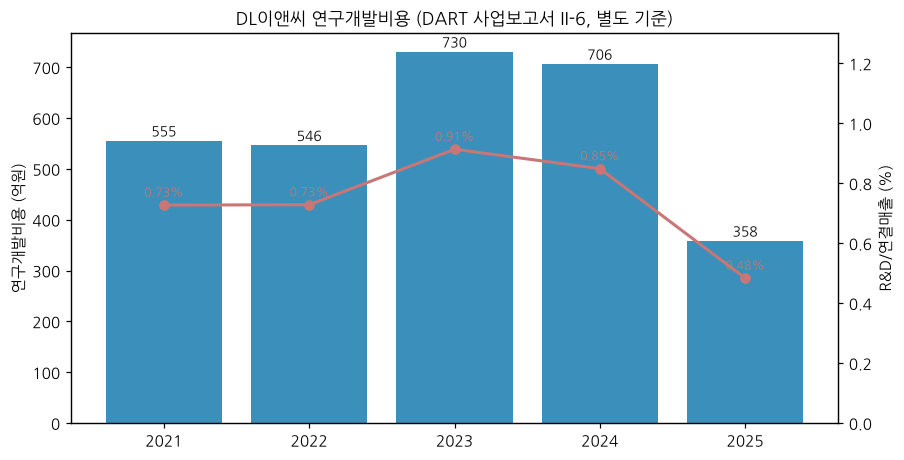

- R&D 조직: DL이앤씨 기술연구소 + D-IC실 (디지털·혁신) / 2025 위탁용역비 238억으로 급감

### ② 진행 중 corporate action — 주요 이벤트

```
2026  · 자기주식 555억 취득 결정 (07-30)
      · X-energy 나스닥 상장 (04-24) — 지분가치 약 1,720억
      · 2026 경영계획: 수주 12.5조 / 매출 7.2조
2025  · X-energy SMR BOP 표준화 설계 용역 (10월, 약 150억)
      · 본사 마곡 이전 (09-10)
2024  · DL건설 포괄적 주식교환 완료 (02-14) → 100% 자회사, 상장폐지 (03-04)
      · 자사주 2,939,077주 소각 (02-08) / 주주환원정책 25% 공시 (02-01)
      · 대표이사 2회 교체 (05월, 08월)
2023  · X-energy 시리즈C 투자 (01월) / DL건설 주식교환 계약 (10-20)
2022  · 1:1 무상증자 / 카본코(CCUS) 사업목적 추가 (03-24)
2021  · 인적분할 신설·재상장 (01-04 / 01-25) / 최대주주 DL㈜ 변경 (05월)
2020  · (대림산업) 삼호·고려개발 합병 → 대림건설 (07월)
```

### ③ 기술·신사업 마일스톤

```
2026  · X-energy 상장, 잠재 발주처의 SMR 설계 참여 문의 증가 (유진 2026-07)
      · 미국 가스복합·AI 전력 발전사업 검토 (DL에너지 협업)
2025  · Xe-100 BOP 표준화 설계 (17개월, 2027 상반기 완료 예정 — 키움) → Energy Northwest 2단계 시공 참여 가능성
2023  · X-energy 투자 + Key Supply Chain 파트너 선정
2022  · 카본코 출범 (CCUS 설계·시공·운영)
2022  · 튀르키예 차나칼레 대교 개통 (세계 최장 현수교, 2018 EPC)
```

### ④ 주요 리스크

- **플랜트 원가**: S-OIL 샤힌 공기연장·돌관공사 비용 → 3Q26 플랜트 부문 -425억. 도급 증액 반영 시점 불확실 (유진은 4Q26 반영 예상)
- **플랜트 수주 공백**: 대형 현장 준공 후 플랜트 매출 감소 (9M26 -24%) — 신규 대형 플랜트 수주 필요
- **주택 착공·분양 사이클**: 현 주택 마진(GPM 20%대)은 2024\~2025 착공분·준공 정산 효과 포함 — 원가율 반등 시 이익 급감 구조 (2020→2023 주택 GPM 19.9%→7.0% 전례)
- **PF 우발부채**: 신용보강 2.14조 (자본의 39%) — 업계 낮은 편이나 브릿지론·PFV 풋옵션 존재
- **운전자본**: 매출채권 2021 0.98조 → 3Q26 1.77조, 9M26 영업CF 적자
- **안전·중대재해**: 업계 공통 중대재해 리스크 (iM 2025-11 언급)
- **환율·해외**: 해외 매출 1.38조 = 연결 7.40조의 19% (2025) — 러시아 발틱 프로젝트 (제재 리스크), 미국 GTPP 준공 정산
- **SMR 옵션 변동성**: 주가가 X-energy 주가·SMR 뉴스에 연동 (2026-04 고점 → 11월 -55%)

### ⑤ ESG 등급

| 평가기관 | 등급 | 비고 |
|---------|------|------|
| KCGS (한국ESG기준원) | 미확인 | 이번 수집 범위에서 원문 미확보 — 다음 버전 보강 |
| 지속가능경영보고서 | 미확보 | 회사 홈페이지 PDF 수집 실패 (device 셸 장애) |

- 이사회 ESG위원회 운영 (위원장 인소영 사외이사), CCUS·SMR을 탈탄소 사업으로 제시

### ⑥ 인증·라이선스

- 종합건설업 (토목건축공사업), 플랜트 EPC, 회사채 AA-
- 원전: 영동양수발전소(한수원) 등 발전 토목 / SMR 설계 용역 (X-energy) — 대형원전 주설비 시공 실적은 현대건설·대우건설 대비 제한적

---

## Version Log

**v1.0 (2026-11-25) — 신규 작성 (한 번에 완성본)**
- ① OpenDART fnlttSinglAcntAll: DL이앤씨 연결 23개 (1Q21\~3Q26), 대림산업(DL) 연결 44개, DL건설 별도 37개 + dart_quarterly_summary 3종
- ② DART 공시원문 XML: DL이앤씨 27건 + 대림산업 52건 다운로드, 그중 사업·분기·반기 54건 텍스트 변환·파싱 → **영업부문 주석 51분기 (1Q14\~3Q26) 주택/토목/플랜트 매출·GP·부문이익** 누적값 차분, 수주상황, 연구개발비, 직원, 임원, 배당, PF 우발부채, 자본금 변동
- ③ IR 실적자료 19종 (1Q22\~3Q26; 중복 게시물 15건 제외). 2025-07 이후 7종은 텍스트 추출, 이전 12종은 이미지 PDF → 연간 하이라이트 2장만 시각 확인 (FY22·FY23 수주·잔고)
- ④ Yahoo Finance 375500.KS 일간 + 000210.KS 월간 (device web_fetch) / WebSearch·WebFetch로 시총·외국인·52주·목표가·X-energy·3Q26 원인 검증
- ⑤ 차트 16종: chart1·1b·2(×4: 주택·토목·플랜트·DL건설)·4·5·6·7·8·9·10·11·12 + chart13 (수주·수주잔고)
- ⑥ 분할 전(2014\~2020) 처리: 대림산업 3개 건설 보고부문 합산 (공통비 제외) — 손익만. 재무상태·CF·배당은 2021\~

**잔여 보완 후보 (다음 버전):**
- 이미지형 IR PDF (1Q22\~1Q25) OCR → DL이앤씨 본체/DL건설 분기 분리, 착공 세대수 시계열
- ESG 등급 (KCGS), 지속가능경영보고서, 2018\~2020 대림산업 직원 수
- 분할 전 대림산업 수주잔고 (DART 수주상황) 2013\~2020 건설 부문
- FnGuide 컨센서스 최신값 (3Q26 발표 후 TP 변경 내역)
