> Ticker: **Frankfurt (XETRA): ENR — Siemens Energy AG** / OTC ADR: **SMNEY** (Level 1, 1 ADR = 1 주)
> Entity: **Siemens Energy AG** (본사 Munich, Germany) — 2020-09-28 Siemens AG에서 분사·상장한 글로벌 에너지 기술 기업 (가스터빈·송변전·산업용 회전기기·풍력). **2026-07 신규 브랜드 'Omterra' 전환 발표** (Siemens 상표 라이선스 종료 대응, 단계적 적용)
> Sector: 전력 인프라 (T2) — 서브섹터 **발전 (핵심, GE Vernova와 페어)** / 글로벌 피어 (GEV·HE·ABB·SU·ETN·효성·HD·LS와 비교)
> 작성 시각: **2026-11-03 KST** (**v1.0** — Phase 1 Source 전수 수집 + audit + 12종 차트 + v1.5 표준 ① 기업 분류 5요소)
> 적용 구조: v4.8 (6개 섹션) + v1.5 ① 기업 분류 표준 (Summary Box 6지표 · 손익 narrative · 분류 sub-logic 4단계 · 밸류에이션 다이얼 · 분류 변경 조건 3종)
> 데이터 범위: **연간 9년 (FY17~FY25, 10월~9월 회계연도)** — FY17~FY19 = 분사 Prospectus Combined Financial Statements / FY20~FY25 = Annual Report·Q4 Earnings Release + **FY26 9M (Q1~Q3 FY26, 2026-08-05 발표분까지)** + **분기 19Q (Q1 FY22 ~ Q3 FY26, 4개 사업부 기준)** + **ENR.DE 주가 (2020-09 상장 ~ 2026-11-02)**
> 출처: **Siemens Energy IR (assets.siemens-energy.com) — Earnings Release 24건 (Q4 FY20~Q3 FY26), Annual Report FY2020·2021·2022·2025 + FY2024 분책(B·C), 2020 Listing Prospectus, CMD 2025 6건, Q3 FY26 Analyst Presentation·Shareholder Letter, Q4 FY26 Pre-close Call transcript (2026-09-30), 자사주 매입 공시 (2026-09-23), Sustainability Report 2023 + FY2025 Sustainability Statement**, **Yahoo Finance ENR.DE**, 보도 (Reuters/Börsen-Zeitung·Bloomberg 인용 기사)
> ⚠️ **FY2026 Q4·연간 실적은 2026-11-11 (수) 07:00 CET 발표 예정 — 본 v1.0 미반영. 발표 후 v1.1 갱신 예정** (FY26 연간 확정치 + FY27 가이던스 + FY30 목표 + FY30까지 자본배분 프레임 업데이트 예고, 2026-09-30 Pre-close Call 기준)

# Siemens Energy 기업 개요 (v1.0 — 전력 인프라 T2 / 발전 핵심 / 분사 6년차 턴어라운드 후반)
> **Fact verify cutoff**: 2026-11-03 (주가 2026-11-02 종가 €130.0 [Yahoo Finance], 시가총액 $122.3B [companiesmarketcap.com, 2026-11], ATH 2026-04 주간 장중 €191.66 [Yahoo Finance])


## Phase 1 Source Audit (메모리 룰)

```
=== 자료 수집 audit (Siemens Energy AG) ===

✅ 확보 (총 48개 파일, 저장: company-overview-source/ENR/)
- Earnings Release 24건: Q4 FY20, Q1 FY21 ~ Q3 FY26 (Q4 FY22는 축약본) — 분기 손익·사업부·재무제표·현금흐름 정확값
- Annual Report: FY2020 · FY2021 · FY2022 · FY2025 (통합본) + FY2024 분책 (B 경영보고서 · C 연결재무제표)
- 2020 Listing Prospectus (36,000줄) — FY17~FY19 Combined Financial Statements (분사 전 3년) 확보
- Capital Market Day 2025 (2025-11-20) 6건: CEO · CFO · Gas Services · Grid Technologies · Transformation of Industry · Siemens Gamesa
- Q3 FY26 Analyst Presentation (2026-08-05) + Shareholder Letter Q3 FY26 (2026-08-12)
- Q4 FY26 Pre-close Call transcript (2026-09-30) — 11/11 발표 일정·FY27 가이던스/FY30 목표 예고
- 자사주 매입 개시 공시 (2026-09-23, 최대 €2bn / 5,000만 주, ~2027-03-31)
- Sustainability Report 2023 + FY2025 Group Sustainability Statement
- Yahoo Finance v8 ENR.DE (2020-09-28 상장 ~ 2026-11-02, 주간 → 월말 변환)
- IR 공시 목록 HTML (215개 PDF 링크 인덱스)

❌ 누락 (5)
- FY2023 Annual Report 통합본 PDF: IR 공시 목록에 미게재 (AG 단독 재무제표만 존재) → Q4 FY23 Earnings Release + FY24 보고서 전년 비교 컬럼으로 대체
- FY2016 이전: 분사 전 Combined 재무제표 미존재 (Prospectus가 FY17~FY19만 수록) → 12년 시계열 불가, 9년(FY17~FY25)으로 작성
- SMNEY (OTC ADR) Yahoo 시세: 404 (2개 endpoint 시도) → ENR.DE만 사용
- 주주 명부 상세 (기관별 지분): AR은 10% 초과 보유자만 공시 → Siemens AG 외 기관 지분 미확보
- 분기별 R&D·CapEx 사업부 분해: 비공개

⚠️ 결과 영향
- 연간 9년 시계열 = FY17~FY19 Combined (Adj. EBITA before SI 기준) + FY20~FY21 (Adj. EBITA before SI) + FY22~FY25 (Profit before SI, 4개 사업부 재편 후 restated) → 이익 지표 정의 단절 1회 (FY22에 두 기준 병기)
- 분기 사업부 시계열: Q1 FY22~Q3 FY26 19분기 (FY23 신 사업부 재편 시 FY22 restated 값 사용). FY21 이전은 GP/SGRE 2개 부문 구조라 별도 표기
- chart5 주주구조: Siemens AG 지분은 보도(Reuters/Börsen-Zeitung, 2026-04-02) 기준 5.5% — 회사 공시 아님
- 추정값: 시총·EV·P/E 등 밸류에이션 수치는 [계산] 표시. 사업부별 매출처 순서는 [추정]

Source 6종 audit:
[V] (1) 정기 보고서 (Annual Report 4개년 + FY24 분책, Prospectus) ✓
[V] (2) IR Earnings Release·Analyst Presentation (24건, Q3 FY26까지) ✓
[V] (3) Sustainability Report (2023 + FY25 Statement) ✓
[V] (4) 주가 (Yahoo ENR.DE) ✓ / SMNEY ✗
[V] (5) CMD 2025 (6개 세션 전체) ✓
[△] (6) 12년 정확값 시계열 — 분사 기업 특성상 9년 (FY17~FY25) 한계
→ 5.5/6 source 확보. 최신 분기(Q3 FY26) 확보 — SanDisk형 사고(최근 분기 누락) 없음.
```

---

## ① 기업 분류

(1) Primary / Secondary 분류

**Primary 분류: 턴어라운드 (후반부)**

→ FY23 그룹 PbSI 마진 **-8.9%** (Siemens Gamesa 온쇼어 품질 위기 손실 €4.3bn) → FY24 1.0% → FY25 6.0% → **FY26 9M 12.6%** (시계열 최고)

→ 순이익 FY23 **-€4,588m** → FY24 +€1,335m → FY25 +€1,685m → FY26 9M +€2,769m (가이던스 연간 ~€4bn)

→ 턴어라운드의 마지막 조각인 **Siemens Gamesa가 Q3 FY26 PbSI +€75m (2.7%)로 FY22 이후 첫 분기 흑자** — "후반부"로 판단하는 근거

**Secondary 노트: 사이클 (가스터빈·대형 프로젝트 장기 수주 사이클)**

→ 분사 전 Siemens Power & Gas 시절 **FY17 정점 → FY18~FY20 가스터빈 시장 붕괴 저점**을 이미 한 번 겪은 장기 사이클 업종

→ 현재 이익의 43%(GS)가 가스터빈 신규 발주 사이클에 연동 — 데이터센터·석탄→가스 전환으로 **FY25~FY26 사상 최대 수주 국면** (GS 9M FY26 수주 €27.6bn, Book-to-bill 2.65 in Q3)

→ 단, **Grid Technologies(이익 45%)는 지속성장 성격** (송전망 교체·HVDC·데이터센터 변압기, 백로그 €51bn) → Boundary case 처리 (아래 (5) 참조)

**4개 사업부 구조 (FY26 9M 기준, PbSI = Profit before Special items)**

→ **(1) Gas Services (GS)** — 매출 €10.3bn (33%), PbSI €1.72bn, 마진 16.6% — 가스·스팀터빈·서비스, **이익 1위급**

→ **(2) Grid Technologies (GT)** — 매출 €9.7bn (31%), PbSI €1.78bn, 마진 18.3% — HVDC·변압기·GIS, **이익 최대 + 성장 최고 (명목 +19%)**

→ **(3) Siemens Gamesa (SG)** — 매출 €7.6bn (24%), PbSI -€0.02bn, 마진 -0.2% — 풍력 (온쇼어·오프쇼어), **턴어라운드 진행**

→ **(4) Transformation of Industry (TI)** — 매출 €4.3bn (14%), PbSI €0.54bn, 마진 12.8% — 압축기·산업용 스팀터빈·전해조, **지배지분 매각 검토 보도 (2026-08)**

(2) Summary Box (9년 시계열 + 사이클 통계 — 메모리 표준)

| 지표 | 값 |
|------|-----|
| 매출 CAGR (FY17→FY25, 8년) | **+3.3%/yr** [계산] (분사 후 FY20→FY25 5년 CAGR **+7.3%**, FY26 가이던스 comparable **+14~16%**로 가속) |
| OPM 평균 (9년, Adj.EBITA bSI→PbSI) | **2.1%** [계산] |
| OPM 정점 평균 | **4.8%** — FY17 7.2% (Siemens PG 정점) · FY21 2.3% (국지 정점) / **현재 FY26 9M 12.6%로 시계열 최고 갱신 중** |
| OPM 저점 평균 | **-4.5%** — FY20 -0.1% (분사·COVID) · FY23 -8.9% (Gamesa 품질 위기) |
| 사이클 주기 | 약 **3~4년** (peak-to-peak FY17→FY21 4년, trough-to-trough FY20→FY23 3년) — 단 FY23 저점은 업황이 아닌 **기업 고유 이벤트(Gamesa)** |
| 사이클 회수 (9년) | **정점 2회 / 저점 2회** + FY24~ 상승 국면 진행 중 |

```
[Siemens Energy 9년 손익 시계열 (€m, 9월 결산)]  * 이익 = FY17~21 Adj.EBITA before SI / FY22~ Profit before SI (PbSI)
연도      매출      이익      마진     순이익    
FY17    30,086    2,174    7.2%      960    ← Siemens Power & Gas 정점 (대형 가스터빈 발주 막바지, 2017-04 Siemens Wind+Gamesa 합병 SGRE 출범)
FY18    28,023    1,456    5.2%      645    ← 가스터빈 시장 붕괴 (글로벌 대형 GT 수요 급감) → Siemens PG 대규모 구조조정
FY19    28,797    1,517    5.3%      282    ← 저성장 정체, 2019-05 Siemens AG가 Gas and Power 분사 결정
FY20    27,457      -17   -0.1%   -1,859    ← 1차 저점: COVID + 2020-09-28 분사 상장 + SGRE 손실 + 구조조정 Special items -€1.5bn
FY21    28,482      661    2.3%     -560    ← 국지 정점: Gas and Power 흑자 회복, SGRE 적자 확대 시작 (DAX 편입 2021-03)
FY22    29,005      225    0.8%     -712    ← SGRE 적자 심화 + 러시아 철수, SGRE 100% 공개매수 (€18.05/주) — 신 4개 사업부 기준 restated
FY23    31,119   -2,776   -8.9%   -4,588    ← 2차 저점 (시계열 최저): Gamesa 온쇼어 4.X/5.X 품질 위기 SG PbSI -€4.3bn, 2023-11 €15bn 보증 프레임 (연방정부 역보증)
FY24    34,465      345    1.0%    1,335    ← 턴어라운드 1년차: GS·GT 마진 정상화, Siemens Ltd India 지분 매각 차익(Special items +€2.0bn)으로 순이익 흑전
FY25    39,077    2,355    6.0%    1,685    ← AI 데이터센터·가스 발전 수요 폭증, 수주 €58.9bn·백로그 €138bn 레코드, 정부 역보증 조기 종료 → 배당 재개 (DPS €0.70)
FY26 9M 31,416   3,946   12.6%    2,769    ← 시계열 최고 마진 진행 중, Q3 FY26 Gamesa 첫 분기 흑자 + GT 마진 가이던스 18~20%로 상향

매출 CAGR 8년 (FY17→FY25): +3.3%/yr [계산] → FY20→FY25 5년 +7.3% [계산] → FY26 comparable 가이던스 +14~16%
이익률 range: -8.9% (FY23) ~ +7.2% (FY17) = 16.1%pt (FY26 9M 12.6% 포함 시 21.5%pt) [계산]
사이클 cutoff (±10%pt): 충족 → 단, 최대 진폭(FY23)은 업황 아닌 Gamesa 품질 사고 → "사이클"이 아닌 "턴어라운드"를 Primary로
Gamesa 제외 코어 3사업부(GS+GT+TI) PbSI 마진: FY22 4.5% → FY23 8.0% → FY24 9.4% → FY25 13.7% → FY26 9M 16.6% [계산] — 4년 단조 우상향
```

**한국 3사 + 글로벌 피어 이익률 비교 (FY25 · 각사 주 지표 기준)**

- **Eaton (ETN)**: 24.5% (Segment OPM) — Revenue $27.4B
- **HD현대일렉트릭**: 24.4% (OPM) — Revenue $3.3B
- **ABB**: 19.0% (Op EBITA) — Revenue $32.8B
- **Schneider (SU)**: 18.7% (Adj EBITA) — Revenue €38.1B
- **효성중공업**: 12.5% (OPM) — Revenue $5.5B
- **Hitachi Energy (HE)**: 12.0% (Adj EBITA) — Revenue $19.8B
- **LS일렉트릭**: 8.6% (OPM) — Revenue $3.5B
- **GE Vernova (GEV)**: 8.3% (Adj EBITDA) — Revenue $36.7B
- **Siemens Energy (ENR)**: **6.0% (PbSI)** — Revenue **€39.1B** (피어 중 최대 매출) / **FY26 9M 12.6%**

**피어 비교 시사점**

→ FY25 기준 ENR 마진은 피어 최하위 — **Gamesa 적자(-13.1%)가 그룹 마진을 약 7~8%pt 희석** (코어 3사업부 13.7%는 HE·효성과 동급)

→ GEV와 구조가 가장 유사 (가스터빈 + 그리드 + 풍력 적자) — 두 회사 모두 **풍력 적자 축소가 그룹 마진 재평가의 핵심 변수**

→ FY26 9M 12.6%로 HE·효성 수준 진입, CMD 2025 FY28 목표 **14~16%** 달성 시 ABB·SU 하단에 근접

(3) 정량적 분류 근거

→ **수주 레코드 행진** — FY25 수주 €58.9bn (+19% comp.), FY26 Q1~Q3 각각 €17.6bn → €17.7bn → **€17.9bn (분기 레코드)**, Q3 FY26 Book-to-bill 1.57

→ **백로그 €162bn (Q3 FY26말, 사상 최대)** — GS €73bn / GT €51bn / SG €31bn / TI €8bn. FY22말 €97bn 대비 +67% [계산]

→ **가스터빈 공급 부족** — GS 신규 백로그 69 GW + 슬롯 예약(SRA) 26 GW (Q3 FY26), CMD 2025 기준 "FY28까지 생산능력 매진", FY25 가스터빈 194기 판매 (전년 대비 ~2배), 시장점유율 #1 (FY25, McCoy·10MW 초과·O&G 제외)

→ **Grid Technologies 마진 FY22 3.5% → FY26 9M 18.3%** — 백로그 마진 FY22 대비 +9pp (CMD 2025), FY26 마진 가이던스 16~18% → **18~20% 상향 (2026-05)**

→ **Siemens Gamesa 손실 축소** — PbSI FY23 -€4,347m → FY24 -€1,781m → FY25 -€1,364m → FY26 9M -€15m (Q3 +€75m)

→ **현금 창출 전환** — FCF pre tax FY23 €0.8bn → FY25 €4.7bn → FY26 9M **€7.2bn** (가이던스 ~€8bn), 조정 순현금 €7.7bn (2026-06말)

**FY26 가이던스 (2026-05-12 상향 → 2026-08-05 확인, 마진은 상단 지향)**

→ Comparable 매출 성장 **+14~16%** (최초 +11~13%)

→ PbSI 마진 **10~12%** (최초 9~11%) — Q3에 "상단 지향" 언급

→ 순이익 **~€4bn** (최초 €3~4bn) / FCF pre tax **~€8bn** (최초 €4~5bn)

→ 사업부: GS +16~18% / 14~16% · GT +25~27% / **18~20%** · TI +5~7% / 11~13% · SG +3~5% / break-even

**CMD 2025 (2025-11-20) FY28 중기 목표**

→ 그룹: 매출 low-teens CAGR (FY25 기준), **PbSI 마진 14~16%**, FY26~28 누적 FCF pre tax ~€20bn

→ 사업부 마진: GS **18~20%** (기존 12~14%) / GT **18~20%** (기존 13~15%) / TI **12~14%** / SG **3~5%**

→ 자본배분: FY26~28 **최대 €10bn 주주환원** (배당 ~€4bn + 자사주 최대 €6bn), 배당성향 40~60%, CapEx 누적 ~€6bn

(4) 산업 분류

→ **GICS** — Industrials / Electrical Equipment (Heavy Electrical Equipment)

→ **지수** — DAX 40 (2021-03 편입)

→ **워치리스트** — 섹터 T2 전력 인프라 / 서브섹터 **발전 (핵심: GE Vernova, Siemens Energy)**

(5) 분류 결정 논리

(1) **가장 매출 큰 사업부 기준** 적용 시: GS 33% ≈ GT 31% > SG 24% > TI 14% (FY26 9M) → 가스터빈(사이클 업종)과 그리드(지속성장 업종)가 양분 — 매출만으로는 결정 불가

(2) **secular 변수 sub-rule 적용** (이익 비중 우선):
   - 이익 기준으로는 GT 44% · GS 43% · TI 13% · SG ≈0% (FY26 9M 세그먼트 합계 대비) [계산]
   - 그룹 마진의 9년 진폭(16.1pp)을 만든 것은 업황이 아니라 SG 품질 사고(FY23) → **사이클 분류의 정량 cutoff는 충족하나, 진폭의 원인이 기업 고유 → Primary 턴어라운드**
   - 코어 3사업부는 FY22~FY26 4년 단조 우상향 → 턴어라운드 졸업 후 Primary 후보는 "사이클"과 "지속성장" 사이

(3) **Boundary case 처리 (Primary + Secondary)**:
   - Primary **턴어라운드 (후반부)** — SG break-even 도달 (FY26) 전까지 유지
   - Secondary **사이클** — 가스터빈 신규 발주(GS 수주의 ~40%가 신규 장비, CMD) 의존, 분사 전 FY17→FY20 하강 이력
   - 지속성장 요소(GT)는 Secondary 내 "부분 지속성장"으로 표기 — GT 이익 비중이 50%를 넘고 유지되면 분류 재검토 (② 분류 변경 조건 참조)

(4) **글로벌 피어 cross-ref**:
   - **GE Vernova** — 턴어라운드 (Primary) + 지속성장 (Secondary). 가스터빈·그리드·풍력 동일 3축 → **ENR과 가장 동일한 분류 경로**, 차이는 ENR이 풍력 손실 정상화에서 1~2분기 앞서 있고(Q3 FY26 SG 흑자) GEV는 가스 백로그 규모(122 GW, 2026 Q3)가 더 큼
   - **Hitachi Energy** — 지속성장 (Primary). ENR GT와 직접 경쟁 (HVDC·변압기) — GT만 떼면 HE형 지속성장
   - **ABB · Schneider · Eaton** — 지속성장 (Primary). 저압·배전·자동화 중심으로 대형 프로젝트 사이클 노출이 작음
   - **효성중공업 · HD현대일렉트릭 · LS일렉트릭** — 사이클 (Primary) + 지속성장 진입 (Secondary). 변압기 업사이클 노출은 ENR GT와 공통

(6) 적정 밸류에이션 방법 (단위 밸류는 분기 실적 분석, Terminal 밸류는 테마 통합 모드)

→ **사업부 mix → method 연결**: 이익의 ~87%가 GS+GT (FY26 9M), SG는 손익분기, TI는 매각 검토 → **턴어라운드 기업은 trailing 지표가 왜곡**되므로 **정상화 이익(FY27~FY28) 기반 Forward PER가 1차**

→ **1차 — Forward PER (정상화 이익)**: FY26 순이익 가이던스 ~€4bn (비지배 포함) ÷ 시총 ~€110bn → **~27.5x** [계산: 주가 €130 × 가중평균 주식수 848.6m(Q3 FY26)]. CMD FY28 마진 14~16% 달성 시 이익 레벨 상향 여지

→ **2차 — SOTP (사업부 분리 가치)**: GS(가스 사이클 multiple) + GT(HE·그리드 피어 premium multiple) + TI(매각 시 시장 가치 >€10bn 보도) + SG(턴어라운드 옵션). TI 지배지분 매각이 현실화되면 SOTP 비중 확대

→ **3차 — EV/EBITA (FY28 목표 기준)**: EV ~€102bn [계산: 시총 €110bn − 조정 순현금 €7.7bn] ÷ FY28 PbSI €7.5~9.0bn [계산: FY25 매출 €39.1bn × 연 11~13% 성장 3년 × 마진 14~16%] → **~11~14x** [계산]

→ **PBR 미사용 근거** — FY23 대규모 손실로 자본이 €17.1bn → €8.8bn 반감, 이후 자사주·배당으로 자본 레벨이 이익 체력을 반영 못함 (FY25 ROE 15.8%, P/B ~10x [계산] — 지표로서 의미 낮음)

→ **삼성전자 대비**: 삼성전자는 메모리 사이클이 이익 진폭을 만드는 "사이클" → PBR 밴드 + PER 혼합, ENR은 진폭의 원인이 Gamesa 품질 사고인 "턴어라운드" → PBR 대신 **정상화 이익 기반 Forward PER + SOTP**. 분류 차이 = 밸류 방법론 차이

(7) 분기 재평가 트리거 (**분류 변경 조건** — 실적 추적 변수는 ⑥ 섹션)

→ ① **Siemens Gamesa 4분기 연속 PbSI ≥ 0 + 그룹 PbSI 마진 2개 회계연도 연속 10%+** (FY26·FY27) → **턴어라운드 졸업 → Primary를 "사이클"로 전환** (Secondary 지속성장). FY26 4Q·FY27 1Q가 판정 구간

→ ② **Gas Services 신규 수주 3분기 연속 Book-to-bill < 1.0 + GS 백로그(GW 기준) 감소 전환** → 가스터빈 사이클 정점 통과 신호 → **Secondary 사이클을 Primary로 격상** (밸류에이션을 사이클 정점 multiple 할인 체계로 이동)

→ ③ **Transformation of Industry 지배지분 매각 완료 + GT 이익 비중 50%+ 4분기 유지** → 그리드 중심 포트폴리오로 재편 → **Secondary에 "지속성장" 격상, HE·ABB 피어군으로 비교 기준 이동**

---

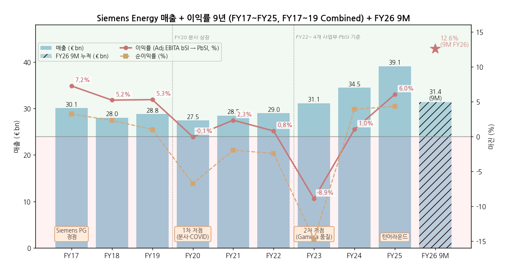

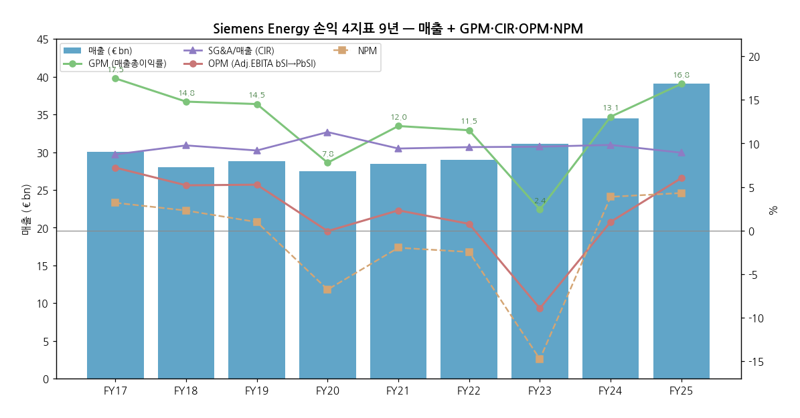

---

## ② 회사 개요

(1) 기본 정보

- **법인명** — Siemens Energy AG (독일 주식회사, Aktiengesellschaft)
- **본사** — Otto-Hahn-Ring 6, 81739 Munich, Germany
- **상장** — Frankfurt Stock Exchange (XETRA: ENR), 2020-09-28 / DAX 40 (2021-03~) / OTC ADR SMNEY
- **회계연도** — 10월 1일 ~ 9월 30일 (FY26 = 2025-10 ~ 2026-09)
- **사업 한 줄 정의** — 발전(가스·스팀터빈), 송전(HVDC·변압기·GIS), 산업 공정(압축기·전해조), 풍력(Siemens Gamesa)을 한 지붕 아래 운영하는 **"전력 가치사슬 중 전기를 만들고(발전) 보내는(송전) 장비"** 전문 기업
- **CEO** — Dr. Christian Bruch (President & CEO, 2020 분사 이후)
- **CFO** — Maria Ferraro (2020~)
- **감독이사회 의장** — Joe Kaeser (전 Siemens AG CEO)
- **직원 수** — **~106,000명** (2026-06말, 독일 29천·해외 77천) / FY25말 103,000명
- **브랜드** — 2026-07-14 신규 브랜드 **Omterra** 발표 (Siemens 상표 라이선스 기한 만료 대응, Siemens Gamesa 포함 단일 브랜드로 단계 전환). Siemens 상표 수수료(GS·GT·TI 매출의 1.2%)는 FY30까지 존속 (CMD 2025)

(2) 핵심 KPI 요약 (FY25 실적 + Q3 FY26 + FY26 가이던스)

| 항목 | FY25 실적 | Q3 FY26 실적 | FY26 9M 누적 | FY26 가이던스 (상향) |
|---|---|---|---|---|
| 수주 (€bn) | 58.9 | 17.9 (레코드) | 53.3 | — |
| 매출 (€bn) | 39.1 (+15.2% comp.) | 11.4 (+18.5% comp.) | 31.4 | comp. +14~16% |
| PbSI (€m) | 2,355 | 1,623 | 3,946 | — |
| PbSI 마진 | 6.0% | 14.2% | 12.6% | 10~12% (상단 지향) |
| 순이익 (€m) | 1,685 | 1,188 | 2,769 | ~€4bn |
| 기본 EPS (€) | 1.63 | 1.28 | 2.96 | — |
| FCF pre tax (€m) | 4,663 | 2,319 | 7,163 | ~€8bn |
| 백로그 (€bn) | 138 | 162 (레코드) | — | — |
| 조정 순현금 (€m) | 4,790 | 7,719 (6월말) | — | — |

(3) 주요 연혁 (시대별)

**1기 (~2020-03) — Siemens 사업부 시절 (Power & Gas / Energy Management / Wind)**

→ **1969년** — Siemens·AEG 합작 Kraftwerk Union (KWU) 설립 → 1977년 Siemens 단독 — 독일 발전설비 본류

→ **1998년** — Westinghouse Power Generation 인수 — 미국 가스터빈(F-class) 기반 확보

→ **2014~2015년** — Dresser-Rand 인수 (압축기, ~$7.6bn) + Rolls-Royce 항공전용 가스터빈 사업 인수 — 현 TI·GS 소형 라인업의 뿌리

→ **2017-04** — Siemens Wind Power + Gamesa 합병 → **Siemens Gamesa Renewable Energy (SGRE)** 상장 (Siemens 59%)

→ **2017-11** — 가스터빈 시장 붕괴로 Power & Gas 대규모 구조조정 발표

→ **2019-05** — Siemens AG, Gas and Power 사업 분사 결정 발표

**2기 (2020-04 ~ 2022) — 분사·상장과 SGRE 통합**

→ **2020-02** — Iberdrola 보유 SGRE 지분 8% 인수 (~€1.1bn) → SGRE 지분 67%

→ **2020-04-01** — Siemens Energy 법인 분리 출범 / **2020-09-28 Frankfurt 상장** (Siemens AG 35.1% + Siemens Pension-Trust 9.9% 보유, Siemens 주주에 2주당 1주 분배) — 시초 €22 내외

→ **2021-03** — DAX 편입 / FY21 첫 배당 DPS €0.10

→ **2022-03** — 러시아 사업 철수

→ **2022-05** — SGRE 100% 공개매수 발표 (€18.05/주, ~€4bn) → 2022-09 강제전환사채 €960m + 10% 유상증자 (현금 유입 FY23 €1,243m) → **2023-02 SGRE 상장폐지**

→ **FY23 (2022-10~)** — 4개 사업부(GS·GT·TI·SG) 체제로 재편, 주 이익 지표를 Adjusted EBITA → **Profit before Special items**로 변경

**3기 (2023) — Gamesa 품질 위기와 정부 보증**

→ **2023-01-19** — SGRE 고장률 악화로 Q1 FY23 €472m 충당 (ad-hoc 공시)

→ **2023-06-22** — 온쇼어 4.X/5.X 플랫폼 부품 품질 결함 공시, 이익 가이던스 철회 → 주가 하루 약 -37%

→ **2023-08** — Q3 FY23 SG PbSI **-€2,550m** (품질·램프업 비용), FY23 순손실 €4.6bn

→ **2023-10-26** — 보증 한도 확보 위해 독일 정부와 협의 공시 → 주가 장중 €6.4 (상장 이후 최저)

→ **2023-11** — **총 €15bn 보증 프레임** 합의 (은행 컨소시엄 보증 €12bn — 2023-12-22 체결 — 에 대해 연방정부 역보증; 조건: 보증 사용 기간 무배당·경영진 변동보수 금지) / Siemens Ltd India 지분 18% Siemens AG에 매각 (~€2.1bn) / CMD 2023 / Siemens AG가 지분 8%를 연금신탁으로 이전 (25.1% → 17.1%, 2023-12)

**4기 (2024 ~ 현재) — 턴어라운드와 재평가**

→ **2024-11** — FY24 흑전 (순이익 €1.3bn, India 매각 차익 포함) + 중기 목표 상향

→ **2025-05** — 자사주 매입 €170m (분사 후 첫 대규모 환원 재개 신호)

→ **2025-06-05** — 정부 보증 없는 **€9bn 은행 보증 한도 신설 → 연방정부 역보증 조기 종료** / 2025-07-30 연방하원 예산위 배당 제한 조기 해제

→ **2025-06** — Siemens Ltd(India)에서 에너지 사업 분할 → **Siemens Energy India** 별도 상장 (Q3 FY25 Special items +€458m)

→ **2025-11-20** — **CMD 2025**: FY28 PbSI 마진 14~16%, FY26~28 최대 €10bn 주주환원 (자사주 최대 €6bn)

→ **2026-02-26** — 주총: FY25 배당 **€0.70/주** (~€0.6bn) 승인

→ **2026-04-02** — Siemens AG 보유 지분 10.1% → **5.5%** (선도계약 만기, €3.8bn) — "적절한 기간 내 전량 매각" 목표 유지 [Reuters/Börsen-Zeitung]

→ **2026-04 (주간)** — 주가 ATH €191.66 (장중)

→ **2026-05-12** — FY26 가이던스 상향 (매출 +14~16%, 마진 10~12%, FCF ~€8bn)

→ **2026-07-14** — 신규 브랜드 **Omterra** 전환 발표

→ **2026-08-05** — Q3 FY26: 수주·매출·이익 모두 레코드, **Siemens Gamesa FY22 이후 첫 분기 흑자**

→ **2026-08 (보도)** — TI(산업용 스팀터빈·압축기) 지배지분 매각 위해 Goldman Sachs 선임 보도 (Bloomberg, 가치 >€10bn 거론) — **회사 공식 확인 없음**

→ **2026-09-24** — 자사주 매입 개시 (최대 €2bn·5,000만 주, ~2027-03-31) — FY28까지 최대 €6bn 프로그램의 일부

→ **2026-11-11 (예정)** — Q4·FY26 실적 + **FY27 가이던스 + FY30 목표 + FY30까지 자본배분 프레임** 발표

(4) 회사 주가 역사 (narrative 영역)

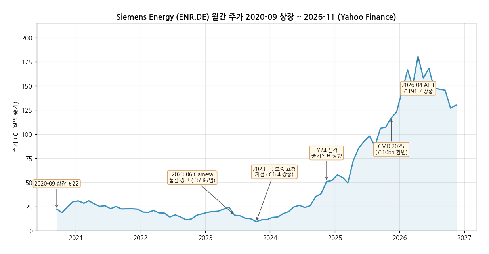

**시가총액·주가 데이터** (Yahoo Finance ENR.DE, 주간 → 월말 종가)

- 상장: 2020-09-28 ~€22 (첫 월말 €22.4)
- 1차 고점: 2021-01~03 ~€31 (DAX 편입·수소 테마)
- 최저: **2023-10 장중 €6.40** (보증 협의 공시 주간) — 시총 ~€5bn 수준 [계산: 약 8억 주 기준]
- **ATH: 2026-04 주간 장중 €191.66** (주간 종가 고점 €187.6) — 저점 대비 ~30배 [계산]
- 현재: **€130.0 (2026-11-02 종가)** — ATH 대비 -32% [계산] / 시총 **$122.3B** [companiesmarketcap.com, 2026-11] ≈ €110bn [계산]
- 연말 시총 (companiesmarketcap, USD): 2020 $14.9B → 2021 $18.3B → 2022 $13.5B → 2023 $10.5B → 2024 $41.2B → 2025 $121.2B

```
[주가 국면 history]

[2020-09 ~ 2021-03] 상장 직후 수소·에너지 전환 테마 랠리 (€22 → €31)
  · DAX 편입, ESG 자금 유입

[2021-04 ~ 2023-10] SGRE 적자 장기화 → 품질 위기 → 신용 우려 (€31 → €6.4)
  · 2023-06-22 Gamesa 품질 경고 -37%/일
  · 2023-10-26 정부 보증 협의 공시 — 상장 이후 최저

[2023-11 ~ 2025-11] 턴어라운드 + 가스터빈·그리드 슈퍼 사이클 (€6.4 → €120)
  · €15bn 보증 프레임 → 유동성 리스크 해소
  · AI 데이터센터 가스 발전 수요 + 그리드 증설 → 수주·백로그 레코드
  · 2025-06 보증 졸업, 배당 재개, CMD 2025 €10bn 환원

[2026-01 ~ 2026-04] 정점 (€123 → ATH €191.7)
  · FY26 가이던스 상향, Siemens AG 오버행 해소 진행 (10.1% → 5.5%)

[2026-05 ~ 현재] 조정 (€191.7 → €130, -32%)
  · TI 분할·매각 논의, GEV 등 피어 밸류에이션 조정, 11/11 FY27·FY30 목표 대기
```

---

## ③ 비즈니스 모델

(1) 실적 추이 통합 표 (5년, 사업부별·지역별·유형별)

**연간 5년 통합 표 (€m, FY22~FY25 restated + FY26 9M)**

| 항목 | FY22 | FY23 | FY24 | FY25 | FY26 9M |
|------|------|------|------|------|------|
| **수주** | **38,312** | **50,446** | **50,226** | **58,928** | **53,284** |
| **매출** | **29,005** | **31,119** | **34,465** | **39,077** | **31,416** |
| └ 사업부별 매출 | | | | | |
| &nbsp;&nbsp;&nbsp;&nbsp;└ Gas Services | 9,499 | 10,914 | 10,796 | 12,198 | 10,331 |
| &nbsp;&nbsp;&nbsp;&nbsp;└ Grid Technologies | 6,285 | 7,180 | 9,280 | 11,305 | 9,745 |
| &nbsp;&nbsp;&nbsp;&nbsp;└ Transformation of Industry | 4,080 | 4,438 | 5,109 | 5,723 | 4,252 |
| &nbsp;&nbsp;&nbsp;&nbsp;└ Siemens Gamesa | 9,814 | 9,092 | 10,008 | 10,375 | 7,624 |
| └ 사업부별 PbSI | | | | | |
| &nbsp;&nbsp;&nbsp;&nbsp;└ Gas Services | 619 (6.5%) | 1,035 (9.5%) | 1,021 (9.5%) | 1,580 (13.0%) | 1,715 (16.6%) |
| &nbsp;&nbsp;&nbsp;&nbsp;└ Grid Technologies | 221 (3.5%) | 545 (7.6%) | 976 (10.5%) | 1,791 (15.8%) | 1,784 (18.3%) |
| &nbsp;&nbsp;&nbsp;&nbsp;└ Transformation of Industry | 45 (1.1%) | 229 (5.2%) | 380 (7.4%) | 646 (11.3%) | 543 (12.8%) |
| &nbsp;&nbsp;&nbsp;&nbsp;└ Siemens Gamesa | -617 (-6.3%) | -4,347 (-47.8%) | -1,781 (-17.8%) | -1,364 (-13.1%) | -15 (-0.2%) |
| **그룹 PbSI (마진)** | **225 (0.8%)** | **-2,776 (-8.9%)** | **345 (1.0%)** | **2,355 (6.0%)** | **3,946 (12.6%)** |
| └ 사업부별 수주 | | | | | |
| &nbsp;&nbsp;&nbsp;&nbsp;└ Gas Services | 11,813 | 12,897 | 16,365 | 22,996 | 27,587 |
| &nbsp;&nbsp;&nbsp;&nbsp;└ Grid Technologies | 10,416 | 15,798 | 20,901 | 21,423 | 18,327 |
| &nbsp;&nbsp;&nbsp;&nbsp;└ Transformation of Industry | 5,650 | 5,569 | 6,413 | 6,003 | 4,642 |
| &nbsp;&nbsp;&nbsp;&nbsp;└ Siemens Gamesa | 11,598 | 16,836 | 7,255 | 9,324 | 3,452 |
| └ 지역별 매출 (고객 소재지, FY25) | | | | | |
| &nbsp;&nbsp;&nbsp;&nbsp;└ Europe·C.I.S.·중동·아프리카 | | | 18,087 | 20,690 (53%) | |
| &nbsp;&nbsp;&nbsp;&nbsp;└ Americas (그중 미국) | | | 10,258 (6,919) | 11,935 (8,666) | |
| &nbsp;&nbsp;&nbsp;&nbsp;└ Asia·Australia (그중 중국) | | | 6,120 (1,516) | 6,453 (1,465) | |
| └ 유형별 매출 (FY25) | | | | | |
| &nbsp;&nbsp;&nbsp;&nbsp;└ New Units (신규 장비) | | | 22,235 | 25,607 | |
| &nbsp;&nbsp;&nbsp;&nbsp;└ 서비스 등 (잔여) | | | ~12,230 [계산] | ~13,470 [계산] | |

> **사업부 구성 변경 매핑**:
> - **FY17~FY19 (Siemens 내부, Prospectus)**: Gas and Power (GP) = Generation + Transmission + Industrial Applications (+ New Energy Business) / SGRE
> - **FY20~FY22 (분사 후 보고)**: GP + SGRE 2개 부문, 이익 지표 Adjusted EBITA
> - **FY23~ (2022-10 재편)**: **Generation → Gas Services**, **Transmission → Grid Technologies**, **Industrial Applications + New Energy(전해조) → Transformation of Industry**, **SGRE → Siemens Gamesa** / 이익 지표 **Profit before Special items** (FY22 restated)
> - 이익 지표 차이: FY22 기준 Adjusted EBITA before SI €378m vs PbSI €225m — 시계열 단절은 FY22에서 1회
> - 2026-07 Omterra 브랜드 발표 / TI 지배지분 매각 검토 보도 (미확정) — 확정 시 TI는 중단사업 분류 가능

(2) 사업부별 개요 (매출 비중 큰 순서, 직관적 설명)

**Gas Services (GS) — 매출 비중 33% (FY26 9M)**

"발전소의 심장인 가스터빈·스팀터빈을 만들어 팔고, 이후 20년간 정비(서비스)로 돈을 버는 사업부."

- **대형 가스터빈 (100~600 MW)**: **HL-class** (SGT5/6-9000HL, 440/593 MW급 — 65기 확보·15기 가동, FY25), **F-class** (260/385 MW급, FY25 점유율 ~37%)
- **중형 가스터빈 (20~100 MW)**: **SGT-800** (62 MW급 — 해당 출력대 FY25 점유율 ~90%, 회사 자료) — 데이터센터 자가발전·산업용
- **항공전용(Aero) 가스터빈 (~65 MW)**: SGT-A35·A65 (Rolls-Royce 사업 인수 계보) — 피크용·FPSO·Powership
- **소형 가스터빈 (~20 MW)**: SGT-400 등
- **스팀터빈·발전기**: 복합화력용 + 원자력 재래식 섬(conventional island, 1,000 MW+) + SMR 대응 (~500 MW)
- **서비스**: 장기 서비스 계약(LTSA), 업그레이드, 부품 — 원전 스팀터빈 함대 >80 GW 서비스, GT 1GW당 서비스 수익 잠재력 ~€400m (CMD)
- **수소 혼소/전소** 대응 가스터빈 개발

**Grid Technologies (GT) — 매출 비중 31%**

"발전소에서 만든 전기를 멀리, 안정적으로 보내는 송전망 장비(직류송전·변압기·개폐기)를 만드는 사업부."

- **HVDC 솔루션**: **HVDC PLUS** (전압형 VSC), LCC — **글로벌 설치 HVDC의 ~30%** (회사 자료), 해상풍력 계통연계 (독일 TenneT 2 GW 표준 플랫폼 등)
- **변전소 (Substations)**: AIS·GIS 턴키 / **Blue GIS** (SF₆-free 친환경 개폐기)
- **변압기 (Products)**: 대형 전력용 변압기·HVDC 변압기·배전 변압기 — **글로벌 설치 전력변압기의 ~20%**
- **개폐기·차단기**: 고압 GIS·AIS·Dead-tank 차단기
- **계통 안정화**: FACTS·STATCOM·**eSTATCOM**·동기조상기
- **디지털·서비스**: Sensformer (디지털 변압기), 자산관리 SW — 2030 서비스 수주 2배, 디지털 반복매출 >€1bn 목표
- 시장 포지션 (FY24, 회사 자료): Solutions **#1** · Products **#1** · Service **#2** / 백로그 €42bn (FY25말: Solutions €24bn · Products €16bn · Digital&Service €2bn) → €51bn (Q3 FY26)

**Siemens Gamesa (SG) — 매출 비중 24%**

"바다(오프쇼어)와 육지(온쇼어)에 세우는 풍력 터빈을 만들고 정비하는 사업부. 2023년 품질 사고 이후 정상화 중."

- **오프쇼어 터빈**: **SG 14-222 DD / SG 14-236 DD** (Direct Drive, 14~15 MW급) — 설치 31 GW (>5,100기), 하루 ~1기 설치 속도, 글로벌 오프쇼어 리더
- **온쇼어 터빈**: **4.X / 5.X 플랫폼** (2023 품질 결함 → 기술 해결책 대부분 적용) → 재설계 **SG 5.0-145 (2.0)** · **SG 7.0-170** 판매 재개 / 설치 119 GW (>61,000기)
- **서비스**: 온·오프쇼어 운영·정비 — 수익성 목표 회복 진행
- **전략**: 온쇼어는 12개 핵심국 집중·서비스 중심으로 축소, 인도 풍력 사업 매각 추진 (FY25 보유자산 분류)
- 핵심 기술: IntegralBlade®, RecyclableBlade, GreenerTower

**Transformation of Industry (TI) — 매출 비중 14%**

"정유·화학·LNG·제철 같은 에너지 다소비 공장에 압축기·산업용 스팀터빈·전해조를 공급하는 사업부."

- **압축기**: 원심·왕복동 압축기 (Dresser-Rand 계보) — 가스 압축·수송·저장, LNG — 시장 #2
- **산업용 스팀터빈·발전기**: 공정 스팀·폐열 발전 — 시장 **#1** (세계 최대 산업용 스팀터빈 제조사)
- **전기화·자동화·디지털**: 산업·해양(선박 전기추진) 전기화 시스템 — #2
- **전해조 (Electrolyzer)**: **Silyzer** PEM 전해조 (베를린 기가팩토리, Air Liquide 협력) — #1
- **서비스·디지털**: 수리·현장서비스·현대화, 공정안전·사이버보안·배출관리
- 2026-08 Goldman Sachs 선임·지배지분 매각 검토 보도 (CVC·EQT·Bain·Brookfield·KKR 관심 거론, 가치 >€10bn) — **회사 미확인**

(3) 사업부별 디테일

**현재 가장 잘나가는 제품·사업부 (Q3 FY26 기준)**:

- **GS 대형 가스터빈 (미국 데이터센터·중동·아시아 신규 발전소)** — Q3 수주 €10.0bn (+62% comp.), Book-to-bill 2.65, 15 GW 수주 (12 GW는 슬롯예약 전환), 백로그 69 GW + SRA 26 GW
- **GT 변압기 (데이터센터 프로젝트 포함)** — Q3 매출 +28.6% comp., PbSI 마진 19.9% (분기 최고), 생산능력 확대가 매출로 전환
- **TI 압축기 신규 장비 (미주 대형 수주)** — Q3 수주 +31.5% comp.

**향후 큰 매출 기대 (growth)**:

- **가스터빈 증설** — 생산능력 FY24 17 GW → FY25~27 평균 22 GW → FY28~30 평균 >30 GW (CMD 2025, 가스터빈 210~230기/년), "FY28까지 매진"
- **GT 공장 증설** — FY23~25 ~€600m 투자(+20% 능력) → FY28까지 추가 ~€2bn, 변압기 능력 ~2배 계획
- **HVDC·해상 계통연계** — 시장 FY22~24 ~€45bn → FY28~30 ~€95bn (2배, 회사 추정), GT Solutions 백로그 66%가 HVDC·오프쇼어 (평균 소화 5~7년)
- **원전 재래식 섬·SMR 스팀터빈** — 원전 재부상 수혜 옵션

**이익 outlier (가이던스·CMD 기준)**:

- **GS 서비스** — 백로그 마진 FY22 대비 신규장비 +~12pp, 서비스 +~3pp (CMD 2025) → FY28 마진 18~20%
- **GT 백로그 마진** FY22 대비 +9pp → FY26 마진 가이던스 18~20% (FY28 목표를 2년 앞당김)
- **SG** — FY26 break-even → FY28 3~5% 목표, 온쇼어 신규 백로그 ~€2bn으로 축소 (리스크 감소)

(4) 주요 경쟁사 (사업부별)

- **Gas Services** — GE Vernova (HA-class, 최대 경쟁자), Mitsubishi Power (M501JAC), Ansaldo Energia, Baker Hughes·Solar Turbines (중소형·항공전용), 두산에너빌리티, Harbin·Dongfang·Shanghai Electric (중국)
- **Grid Technologies** — Hitachi Energy (HVDC·변압기 최대 경쟁자), GE Vernova (Grid Solutions·Prolec GE), HD현대일렉트릭, 효성중공업, LS일렉트릭 (변압기·GIS), TBEA·China XD (중국), Mitsubishi Electric·Toshiba
- **Transformation of Industry** — Baker Hughes, Everllence (구 MAN Energy Solutions), Elliott (Ebara), Atlas Copco (압축기) / MHI·Doosan·Shin Nippon (산업용 스팀터빈) / thyssenkrupp nucera·Nel·ITM (전해조)
- **Siemens Gamesa** — Vestas (최대 경쟁자), GE Vernova Wind, Nordex, Goldwind·Envision·Mingyang (중국)

(5) 주요 매출처 (공개 수주 기반 — 매출 순위 아님)

> ⚠️ Siemens Energy는 단일 고객 매출 10% 이상 공시 대상 없음. 아래는 회사 자료·CMD에 등장한 대표 고객 + 산업 구조 기반 [추정] 순서.

- **1. 유럽 송전망 운영사 (TSO)** — TenneT (독일·네덜란드 2 GW 해상 계통연계 프레임), Amprion·50Hertz (독일), National Grid (영국) — GT 최대 고객군 [추정]
- **2. 미국 전력회사·IPP·데이터센터 개발사** — Williams (데이터센터 전용 5 GW, CMD 2025 사례) 등 — FY25 미국 수주 €17.0bn (+71% comp.)
- **3. 중동 국영 전력·수전력 기관** — 사우디·UAE 가스 발전 프로그램 (~50 GW 계획, CMD) [추정]
- **4. 아시아 발전·제조사** — 대만 Mai Liao·Kuo Kuang (반도체 제조·석탄→가스 전환, CMD 사례)
- **5. 해상풍력 개발사** — Ørsted·RWE·Iberdrola·Vattenfall 등 [추정]
- **6. 석유·가스·화학 (TI)** — LNG·정유·석유화학 EPC [추정]
- **지역 mix (FY25 매출)** — EMEA 53% / Americas 31% (미국 22%) / Asia·Australia 17% (중국 3.7%) [계산]

(6) 생산 CAPA + 임직원 추이

- **가스터빈 능력** — FY24 17 GW (~110기) → FY25~27 평균 22 GW (~160기) → FY28~30 평균 >30 GW (210~230기) / 주요 거점: 베를린 (대형 GT), Charlotte (미국, 제조 시간당 효율 +45%), Finspång (스웨덴, SGT-800), Görlitz·Mülheim (스팀터빈)
- **변압기·GIS 능력** — FY23~25 +20% → 2배 확대 계획 / 거점: Nuremberg·Weiz (오스트리아)·Charlotte (미국)·Berlin (GIS)
- **풍력** — Brande (덴마크), Cuxhaven (독일)·Hull (영국) 오프쇼어 나셀·블레이드
- **임직원 (천 명)** — GS 엔지니어 7,400명, FY25 GS 4,700명 채용
    - FY19 89 / FY20 93 / FY21 91 / FY22 92
    - FY23 96 / FY24 99 / FY25 103 / **2026-06 106**

---

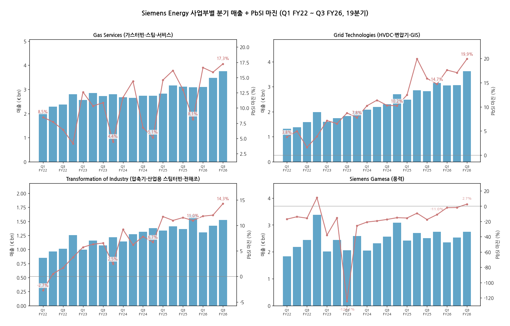

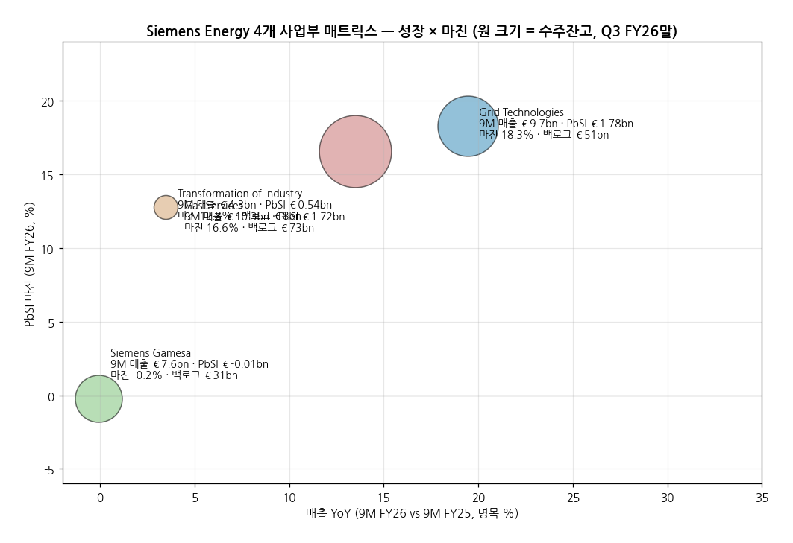

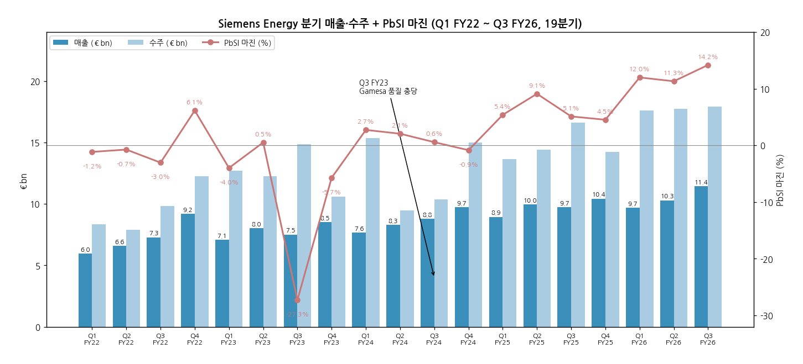

**분기 시계열 (€m, 그룹 + 사업부 PbSI 마진)**

| 분기 | 매출 | 수주 | PbSI | 마진 | GS 마진 | GT 마진 | TI 마진 | SG 마진 | 메모 |
|---|---|---|---|---|---|---|---|---|---|
| Q1 FY22 | 5,956 | 8,330 | -69 | -1.2% | 8.5% | 3.8% | -2.7% | -16.9% | |
| Q2 FY22 | 6,583 | 7,908 | -49 | -0.7% | 7.7% | 5.0% | 0.5% | -13.8% | 러시아 철수 |
| Q3 FY22 | 7,280 | 9,840 | -222 | -3.0% | 6.4% | 1.6% | 1.7% | -15.7% | SGRE 공개매수 |
| Q4 FY22 | 9,186 | 12,234 | 564 | 6.1% | 4.2% | 3.9% | 3.7% | 11.1% | SG 풍력단지 개발 포트폴리오 매각 이익 |
| Q1 FY23 | 7,064 | 12,727 | -282 | -4.0% | 12.6% | 7.2% | 5.7% | -37.8% | SG 고장률 충당 |
| Q2 FY23 | 8,028 | 12,256 | 41 | 0.5% | 10.3% | 6.5% | 6.3% | -15.3% | |
| Q3 FY23 | 7,506 | 14,886 | -2,048 | -27.3% | 10.8% | 8.7% | 6.5% | -124.1% | ← Gamesa 품질 위기 저점 |
| Q4 FY23 | 8,521 | 10,577 | -487 | -5.7% | 4.4% | 7.8% | 2.5% | -25.6% | 정부 보증 프레임 |
| Q1 FY24 | 7,649 | 15,381 | 208 | 2.7% | 11.7% | 10.2% | 9.2% | -20.8% | |
| Q2 FY24 | 8,278 | 9,470 | 170 | 2.1% | 14.4% | 11.4% | 6.2% | -19.3% | |
| Q3 FY24 | 8,797 | 10,362 | 49 | 0.6% | 6.8% | 10.3% | 7.8% | -17.4% | |
| Q4 FY24 | 9,741 | 15,013 | -83 | -0.9% | 5.1% | 10.2% | 6.7% | -15.1% | |
| Q1 FY25 | 8,942 | 13,668 | 481 | 5.4% | 14.6% | 12.5% | 11.7% | -15.5% | |
| Q2 FY25 | 9,962 | 14,433 | 906 | 9.1% | 16.2% | 20.0% | 11.0% | -9.2% | |
| Q3 FY25 | 9,745 | 16,613 | 497 | 5.1% | 13.0% | 15.9% | 11.5% | -17.5% | |
| Q4 FY25 | 10,428 | 14,214 | 471 | 4.5% | 8.1% | 14.7% | 11.0% | -11.0% | |
| Q1 FY26 | 9,675 | 17,609 | 1,159 | 12.0% | 16.6% | 17.6% | 11.8% | -2.0% | |
| Q2 FY26 | 10,294 | 17,749 | 1,164 | 11.3% | 15.9% | 17.1% | 12.0% | -1.7% | 가이던스 상향 |
| Q3 FY26 | 11,447 | 17,926 | 1,623 | **14.2%** | **17.3%** | **19.9%** | **14.3%** | **2.7%** | ← 레코드 + SG 흑전 |

> FY22 분기는 FY23 Earnings Release의 restated 전년 컬럼, FY23~FY25 분기는 다음 해 Earnings Release 전년 컬럼(최신 restated) 사용. 마진은 [계산].

---

## ④ 재무 구조

(1) 손익계산서 (9년, €m) + chart1b

| FY | 매출 | 매출총이익 | GPM | R&D | SG&A | 이익* | 이익률 | 순이익 | NPM | 기본 EPS (€) | DPS (€) |
|----|---|---|---|---|---|---|---|---|---|---|---|
| FY17 | 30,086 | 5,254 | 17.5% | 1,111 | 2,631 | 2,174 | 7.2% | 960 | 3.2% | — | — |
| FY18 | 28,023 | 4,147 | 14.8% | 1,069 | 2,739 | 1,456 | 5.2% | 645 | 2.3% | — | — |
| FY19 | 28,797 | 4,181 | 14.5% | 1,001 | 2,647 | 1,517 | 5.3% | 282 | 1.0% | — | — |
| FY20 | 27,457 | 2,139 | 7.8% | 985 | 3,103 | -17 | -0.1% | -1,859 | -6.8% | -2.21 | 0.00 |
| FY21 | 28,482 | 3,417 | 12.0% | 1,155 | 2,682 | 661 | 2.3% | -560 | -2.0% | -0.63 | 0.10 |
| FY22 | 29,005 | 3,340 | 11.5% | 1,078 | 2,778 | 225 | 0.8% | -712 | -2.5% | -0.65 | 0.00 |
| FY23 | 31,119 | 753 | 2.4% | 1,123 | 2,996 | -2,776 | -8.9% | -4,588 | -14.7% | -5.47 | 0.00 |
| FY24 | 34,465 | 4,503 | 13.1% | 1,209 | 3,388 | 345 | 1.0% | 1,335 | 3.9% | 1.37 | 0.00 |
| **FY25** | **39,077** | **6,579** | **16.8%** | **1,210** | **3,492** | **2,355** | **6.0%** | **1,685** | **4.3%** | **1.63** | **0.70** |
| FY26 9M | 31,416 | — | — | — | — | 3,946 | 12.6% | 2,769 | 8.8% | 2.96 | — |

> \* 이익 = FY17~FY21 Adjusted EBITA before Special items (FY17~19 Combined, Prospectus) / FY22~ Profit before Special items (회사 정의, FY22 restated). IFRS 순이익(비지배지분 포함) 병기. FY22 순이익·매출총이익은 FY23 보고서 restated 값.
> FY20~FY21 Adjusted EBITA (SI 반영 후): -1,543 / -12 · FY22 Adjusted EBITA (구 기준) -75. Special items 누계 FY20 -€1,526m, FY21 -€673m.
> FY24 순이익 €1,335m은 Siemens Ltd India 지분 매각 차익(Special items +€2,038m) 포함 — 영업 체력 기준 PbSI는 €345m.

→ FY17→FY25 매출 +29.9%, CAGR +3.3%/yr [계산] — 분사 후 FY20→FY25 +42.3%, CAGR +7.3% [계산]
→ GPM: FY23 2.4% 바닥 → FY25 16.8% (FY17 Siemens PG 시절 17.5% 근접) — 품질 비용 소멸 + 가격 결정력
→ SG&A/매출(CIR): 8.7%~11.3% 범위, FY25 8.9% — CMD 목표는 추가 하향 (Siemens 상표 수수료 0.8~0.9%p 포함)

(2) 재무상태표 (9년, €m) + chart4

| FY | 자산총계 | 부채총계 | 자본총계 | 부채비율 | 현금성자산 | 조정 순현금(+)/순부채(-) |
|----|---|---|---|---|---|---|
| FY17 | 47,290 | 35,972 | 11,318 | 318% | 1,850 | -3,388 |
| FY18 | 45,763 | 35,062 | 10,701 | 328% | 2,544 | -4,342 |
| FY19 | 45,041 | 31,952 | 13,089 | 244% | 1,871 | -2,169 |
| FY20 | 43,032 | 27,642 | 15,390 | 180% | 4,630 | — |
| FY21 | 44,141 | 28,921 | 15,220 | 190% | 5,333 | — |
| FY22 | 51,084 | 33,966 | 17,118 | 198% | 5,959 | — |
| FY23 | 47,907 | 39,120 | 8,787 | 445% | 4,588 | -759 |
| FY24 | 50,874 | 41,510 | 9,364 | 443% | 6,363 | +1,951 |
| **FY25** | **56,637** | **45,962** | **10,675** | **431%** | **9,162** | **+4,790** |
| 2026-06 | 63,836 | 52,665 [계산] | 11,171 | 471% [계산] | 11,088 | **+7,719** |

> 부채비율 = 부채총계/자본총계 [계산]. 부채의 최대 항목은 **계약부채(고객 선수금) €22.3bn (FY25)** — 이자부 차입금(€4.0bn)이 아닌 선수금이 부채를 키우는 구조 → 부채비율보다 순현금·계약부채 추이가 의미 있음. FY20~FY22 조정 순현금은 본 수집 범위에서 미추출 (누락).

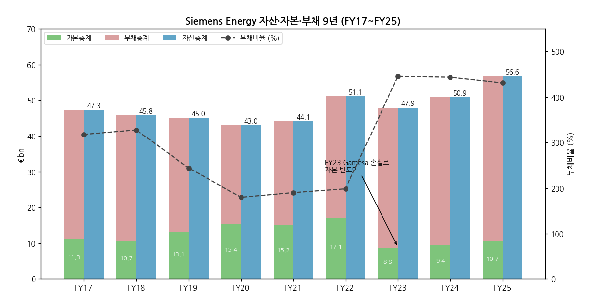

(3) 현금흐름표 (9년, €m) + chart6

| FY | OCF | ICF | CFF | CapEx | FCF (OCF−CapEx) | FCF pre tax (회사 정의) |
|----|---|---|---|---|---|---|
| FY17 | 686 | -835 | 1,890 | 807 | -121 | — |
| FY18 | 844 | -429 | 330 | 764 | 80 | — |
| FY19 | 1,694 | -797 | -1,597 | 818 | 876 | 1,164 |
| FY20 | 1,601 | -1,036 | 2,353 | 927 | 674 | 977 |
| FY21 | 1,946 | -958 | -340 | 987 | 959 | 1,358 |
| FY22 | 2,218 | -1,118 | -568 | 1,157 | 1,061 | 1,503 |
| FY23 | 1,622 | -1,633 | -1,132 | 1,228 | 394 | 784 |
| FY24 | 2,889 | +1,250 | -2,258 | 1,514 | 1,375 | 1,859 |
| **FY25** | **5,821** | **-1,618** | **-1,135** | **1,724** | **4,097** | **4,663** |
| FY26 9M | — | — | — | 1,125 | 6,634 | 7,163 |

→ FY24 ICF 플러스: Siemens Ltd India 지분 매각 대금 (투자자산 처분 €2,623m)
→ FY25 OCF €5.8bn: 계약부채(선수금) 증가 €4.0bn이 핵심 — 수주 호황기 선수금 유입 구조 (사이클 하강 시 역방향 위험)
→ FY26 9M FCF pre tax €7.2bn — 슬롯예약 수수료(reservation fee) 포함 선수금 유입

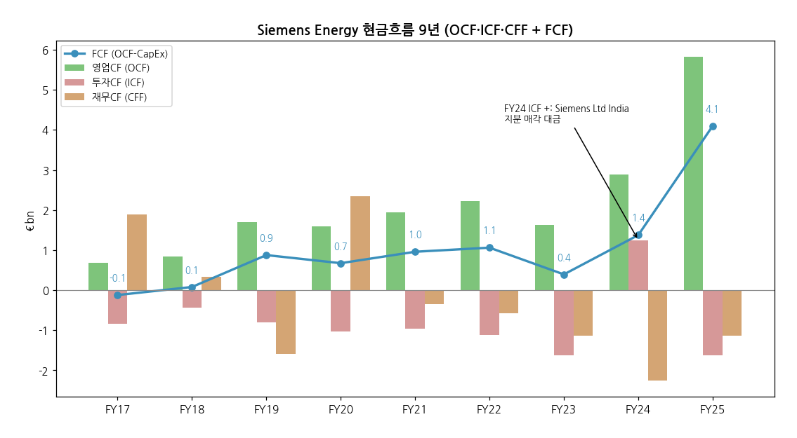

(4) CapEx + chart8

→ FY17~FY22 €0.8~1.2bn (매출 대비 2.7~4.0%) → FY24 €1.5bn → FY25 €1.7bn (4.4%) → FY26 9M €1.1bn
→ **CMD 2025: FY26~FY28 누적 ~€6bn** (GS 가스터빈·GT 변압기/GIS 증설), FY28 이후 매출 대비 ~3%·감가상각 이하로 정상화 목표
→ 증설 원칙 (GS "4가지 황금률"): 기존 부지 내 확장 · 서비스 연계성 · 프리미엄 가격 · 짧은 회수기간

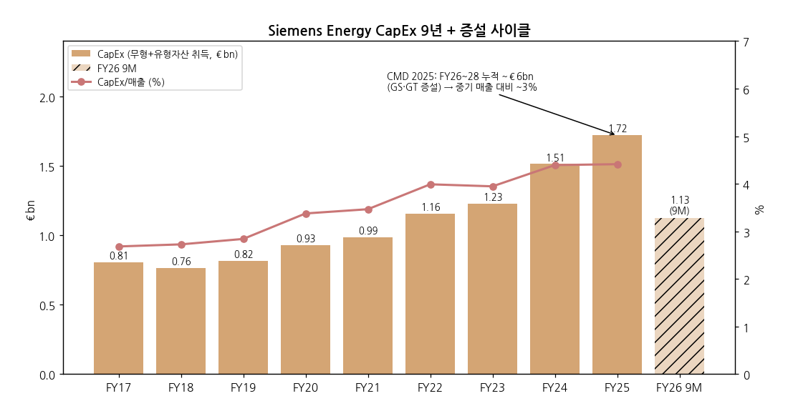

(5) 부채 구조 + 채권·보증 history

- **이자부 차입금** — FY25말 €3,966m (단기 1,528 + 장기 2,438) / 조정 순현금 €4,790m → 2026-06 €7,719m
- **2022-09** — 강제전환사채 €960m 발행 (SGRE 인수 재원)
- **2023-04** — 회사채 €1.5bn 발행 (SGRE 잔여 지분 매입·SGRE 부채 차환)
- **2023-12-22** — 은행 보증 한도 €12bn (2건) — 연방정부 역보증 연계 / 2024-02 신용한도 €4bn / 2024-07 보증 한도 €1.2bn 추가
- **2025-06-05** — 정부 보증 없는 **€9bn 은행 보증 한도** 체결 → 연방 역보증 종료
- **신용등급** (CMD 2025, 2025-11 기준) — S&P **BBB- (Outlook Positive)** / Moody's **Baa2 (Outlook Positive)** — 이후 변동은 v1.1에서 verify

(6) 배당·자사주 + chart9

| 항목 | FY20 | FY21 | FY22 | FY23 | FY24 | FY25 | FY26 |
|---|---|---|---|---|---|---|---|
| DPS (해당 회계연도분, €) | 0.00 | 0.10 | 0.00 | 0.00 | 0.00 | **0.70** | 11/11 제안 예정 |
| 배당 현금 지급 (€m, 지급 연도) | 0 | 0 | 72 | 0 | 0 | 0 | 601 (9M) |
| 자사주 매입 (€m) | 162 | 231 | 0 | 130 | 130 | 170 | 2026-09-24 €2bn 프로그램 개시 |
| FCF pre tax (€m) | 977 | 1,358 | 1,503 | 784 | 1,859 | 4,663 | 7,163 (9M) |

→ **FY22~FY24 무배당** — Gamesa 손실 + FY23 이후 정부 역보증 조건 (보증 사용 회계연도 배당 금지)
→ **배당 정책**: 순이익(지배주주) 40~60% (비현금 특이요인 조정 가능)
→ **FY26~FY28 최대 €10bn 환원** (배당 ~€4bn + 자사주 최대 €6bn, CMD 2025) — 1차 트랜치 €2bn (2026-09-24 ~ 2027-03-31)

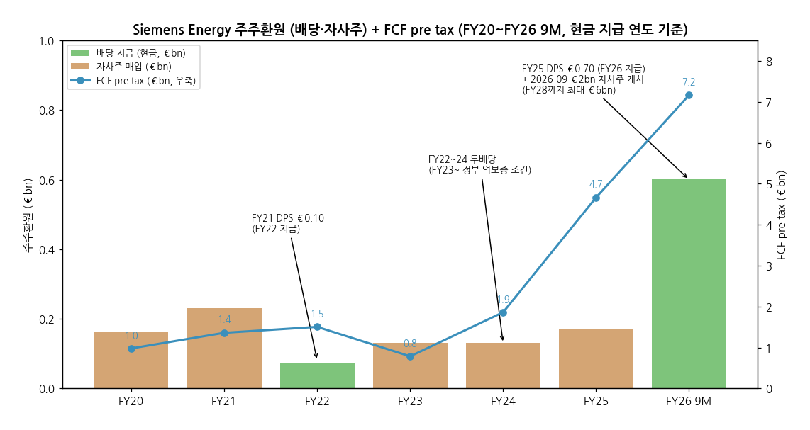

(7) 재무비율 (9년, [계산])

| FY | ROE | ROA | 부채비율 | CapEx/매출 | R&D/매출 |
|---|---|---|---|---|---|
| FY17 | 8.5% | 2.0% | 318% | 2.7% | 3.7% |
| FY18 | 6.0% | 1.4% | 328% | 2.7% | 3.8% |
| FY19 | 2.2% | 0.6% | 244% | 2.8% | 3.5% |
| FY20 | -12.1% | -4.3% | 180% | 3.4% | 3.6% |
| FY21 | -3.7% | -1.3% | 190% | 3.5% | 4.1% |
| FY22 | -4.2% | -1.4% | 198% | 4.0% | 3.7% |
| FY23 | -52.2% | -9.6% | 445% | 3.9% | 3.6% |
| FY24 | 14.3% | 2.6% | 443% | 4.4% | 3.5% |
| FY25 | 15.8% | 3.0% | 431% | 4.4% | 3.1% |

> ROE = 순이익(비지배 포함)/기말 자본총계, ROA = 순이익/기말 자산총계 [계산]. 유동비율 FY25 89.5% (34,453/38,491), FY24 89.9% [계산] — 계약부채 구조로 1 미만. 이자보상배율(PbSI/이자비용) FY25 8.0x, FY24 1.0x [계산].

(8) 한국 3사 + 글로벌 피어 cross-ref (FY25)

- **Siemens Energy (ENR)** — Revenue **€39.1B** / PbSI **6.0%** (FY26 9M 12.6%) / Backlog **€138B** (Q3 FY26 €162B) / 4 사업부 103K명
- **GE Vernova (GEV)** — Revenue $36.7B / Adj EBITDA 8.3% / Backlog $122B / Power·Wind·Electrification
- **Hitachi Energy (HE)** — Revenue $19.8B / Adj EBITA 12.0% / Backlog $57.9B / 송변전 순수
- **ABB** — Revenue $32.8B / Op EBITA 19.0% / Backlog ~$24B / 전기화·모션·자동화
- **Schneider Electric (SU)** — Revenue €38.1B / Adj EBITA 18.7% / Backlog €21.4B / 에너지관리·산업자동화
- **Eaton (ETN)** — Revenue $27.4B / Segment OPM 24.5% / EA Backlog +44% YoY / 전기·항공
- **효성중공업** — Revenue $5.5B / OPM 12.5% / Backlog ~$10B / 중공업+건설
- **HD현대일렉트릭** — Revenue $3.3B / OPM 24.4% / Backlog $14B+ / 변압기 중심
- **LS일렉트릭** — Revenue $3.5B / OPM 8.6% / Backlog ~$3B / 전력기기+자동화

> 피어 수치는 같은 폴더 각 기업개요(2026-05~06 작성)의 FY25 값. 지표 정의가 회사마다 다름 (PbSI ≈ EBITA 성격).

**직접 비교 1 — GE Vernova (가스터빈·그리드)**

- **ENR 가스터빈**: 백로그 69 GW + 슬롯예약 26 GW = 95 GW (Q3 FY26), FY25 194기 판매, 능력 FY28~30 >30 GW/년
- **GEV 가스터빈**: 백로그 + 슬롯예약 **122 GW** (2026 Q3, 연말 ≥130 GW 목표) — 규모는 GEV 우위 [Turbomachinery International, 2026-10-29]
- **ENR 그리드**: GT 매출 €11.3bn (FY25), 마진 15.8% → 9M FY26 18.3%
- **GEV 그리드**: Electrification 마진 17~19% 수준, 2026-02 Prolec GE 100% 인수 + 2026-10 Trench Group 인수 합의 ($9B) — 그리드 M&A로 확장 중
- **풍력**: ENR SG Q3 FY26 흑전 vs GEV Wind 적자 지속 (FY25 -26.7%) — 풍력 정상화는 ENR이 선행

**직접 비교 2 — Hitachi Energy (HVDC)**

- **ENR GT**: 글로벌 설치 HVDC의 ~30%, 전력변압기 ~20% (회사 자료), GT Solutions 백로그 €24bn 중 66%가 HVDC·오프쇼어
- **HE**: HVDC 원조 (1954 Gotland) 글로벌 #1, 전력변압기 ~20%, 백로그 $57.9B, 2024~2030 $9B 증설
- **차이**: HE는 송변전 순수 플레이 (지속성장), ENR GT는 그룹 내 이익 45% 비중 — GT만 떼면 HE와 동급 마진(18%대)

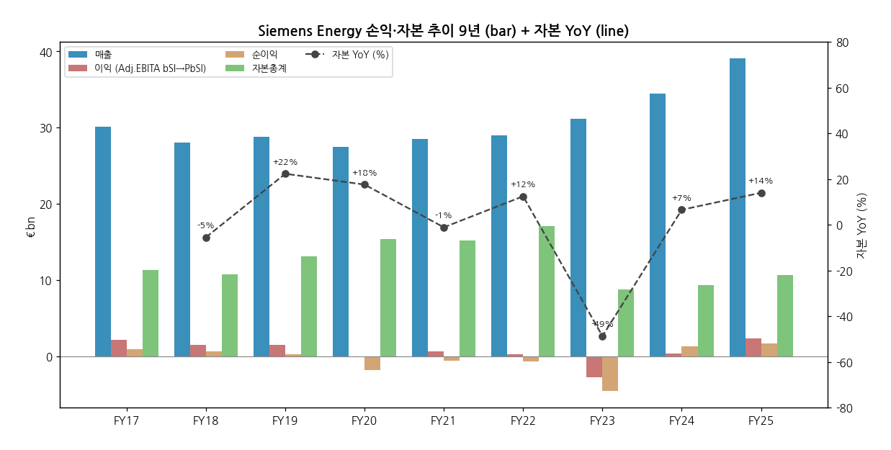

---

## ⑤ 지배 구조

(1) 그룹·계열 관계

- **Siemens AG (구 모회사)** — 지분 단계적 축소, **전량 매각 목표 유지** (잔여 오버행)
    - 2020-09 분사 시: 35.1% (+ Siemens Pension-Trust 9.9%)
    - 2023 (시점 근사): 25.1%
    - 2023-12: 17.1% (8%를 연금신탁으로 이전)
    - 2025-11: 10.1% (Siemens 언급)
    - **2026-04-02: 5.5%** (선도계약 만기 매각 €3.8bn) [Reuters/Börsen-Zeitung]
- **Siemens 상표 라이선스** — GS·GT·TI 매출의 1.2% 수수료, FY30 종료 → **Omterra** 브랜드 전환 (2026-07 발표)
- **주요 자회사** — Siemens Gamesa Renewable Energy (100%, 2023-02 상장폐지), Siemens Energy India Ltd (2025-06 분할 상장, 인도 NSE), Siemens Energy Global GmbH & Co. KG (운영 지주)
- **관계 정리** — Siemens Ltd India 지분 18% Siemens AG에 매각 (FY24, ~€2.1bn) → 인도 에너지 사업은 Siemens Energy India로 분리

(2) 주주 구분 + chart5

- **Siemens AG** — 5.5% (2026-04, 보도 기준) — 10% 초과 보유자는 FY25말 공시상 Siemens AG가 유일
- **von Siemens-Vermögensverwaltung (Siemens 가문)** — 4,448,480주 의결권 위임 (2025-09말, ~0.5% [계산])
- **기타 (글로벌 기관·개인·자사주)** — ~94.5% [계산] — 기관별 지분 미확보 (누락)
- **발행주식수** — 861,104,914주 (2025-09말) / Q3 FY26 가중평균 848.6m주 (자사주 매입 반영)

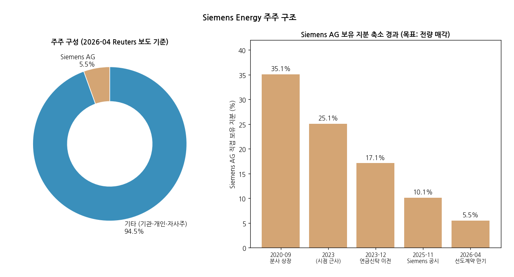

(3) 경영진 (Executive Board) + 감독이사회

**Executive Board (FY25 Annual Report 기준)**

- **President & CEO — Dr. Christian Bruch** — 분사 이후 CEO, Chief Sustainability Officer 겸임 / 전 Linde Engineering CEO
- **CFO — Maria Ferraro** — Chief Inclusion & Diversity Officer 겸임 / 전 Siemens AG 재무 조직
- **Karim Amin** — Gas Services 담당 (CMD 2025 GS 발표)
- **Tim Holt** — Grid Technologies 담당 + 노무이사(Labor Director)·HR
- **Anne-Laure Parrical de Chammard** — Transformation of Industry 담당
- **Vinod Philip** — Siemens Gamesa 담당

**Supervisory Board**

- **의장 — Joe Kaeser** (전 Siemens AG CEO, 2020 분사 설계자) — 2025 주총 후 재선임
- 독일 공동결정법 구조 (주주 대표 + 노동자 대표 동수)

**보상 제약 이력** — FY24·FY25 경영진 변동보수(단기·장기 주식보상) 미지급 (연방 보증 조건), 2025-06 보증 종료로 FY26부터 정상화

---

## ⑥ 기타 팩트

(1) 시가총액·밸류에이션 스냅샷 (2026-11-02 기준)

- **주가** — **€130.0** (ENR.DE 2026-11-02 종가) / ATH 2026-04 주간 장중 €191.66 [Yahoo Finance]
- **시가총액** — **$122.3B** [companiesmarketcap.com, 2026-11] ≈ **€110bn** [계산: €130 × 848.6m주]
- **조정 순현금** — €7.7bn (2026-06말) → **EV ≈ €102bn** [계산]
- **P/E (FY26 가이던스 순이익 ~€4bn)** — **~27.5x** [계산]
- **EV/Sales (FY26E)** — FY25 매출 €39.1bn × 1.15 ≈ €45bn [계산] → **~2.3x** [계산]

(2) R&D 인프라 + chart7

→ **FY25 R&D 비용 €1,210m** (매출 3.1%) / 9년 범위 €985m~€1,210m, 매출 대비 3.1~4.1%

→ **특허** — 약 18,800건 등록 (2025-09말, 2024: ~19,200)

→ **GS R&D ~€500m/년** (CMD 2025) — HL-class 효율, 수소 연소, SMR 스팀터빈

→ **거점** — Berlin (가스터빈 시험), Finspång, Orlando·Charlotte (미국), Erlangen (그리드), Brande (풍력)

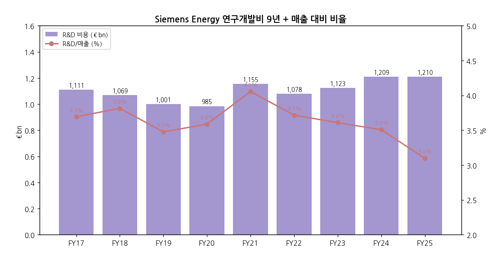

(3) 진행 중 corporate action

- **자사주 매입** — 최대 €2bn·5,000만 주 (2026-09-24 ~ 2027-03-31), FY28까지 최대 €6bn 프로그램
- **TI 지배지분 매각 검토 (보도)** — Goldman Sachs 선임 (Bloomberg, 2026-08-24), PE 5곳 관심 거론, 가치 >€10bn — 회사 미확인. 확정 시 SOTP·분류 재검토 트리거 ③
- **Omterra 브랜드 전환** — 2026-07-14 발표, 단계 적용
- **인도 풍력 사업 매각** — FY25 보유자산 분류 (AR 2025)
- **Siemens AG 잔여 지분 5.5% 매각** — 오버행
- **11/11 FY30 목표·자본배분 업데이트** — Pre-close call에서 예고

(4) 주요 리스크

- **가스터빈 사이클 반전** — 데이터센터·LNG 발전 투자 둔화 시 신규 수주 급감 → 선수금(계약부채 €22bn) 역류 위험
- **대형 프로젝트 집행 리스크** — HVDC·해상 계통연계 고정가 계약 비용 초과 (GT Solutions 백로그 평균 5~7년)
- **Siemens Gamesa 재발 리스크** — 온쇼어 4.X/5.X 품질 이슈 잔여, 오프쇼어 SG 14 램프업
- **관세·공급망** — 미국 관세, 변압기 소재(전기강판·구리) 공급 병목
- **지배구조·오버행** — Siemens AG 잔여 지분 매각, TI 매각 불확실성
- **법률·규제** — 가이던스는 "향후 법률·규제 비용 미포함" 전제

(5) ESG

- **Scope 1+2** — FY19 440,363 tCO₂e → FY25 194,460 tCO₂e (**-56%** [계산]) / FY30 자체 운영 탄소중립 목표 (최소 -60% + 잔여 상쇄)
- **재생에너지 전력 100%** — FY23부터 자체 운영 전력 100% 재생
- **SF₆-free** — Blue GIS 확대 (GT)
- **안전** — TRIR FY23→FY25 ~30% 감소 (CMD 2025)
- **보고** — FY25부터 CSRD 기반 Group Sustainability Statement (제한적 검증)

(6) 인증·라이선스

- **Siemens 상표 라이선스** — FY30 만료 (수수료 1.2%) → Omterra
- **HL-class 기네스 기록** — 복합화력 효율 기록 (CMD 2025 언급) / 수소 혼소 대응 가스터빈 개발
- **EU Taxonomy** — 풍력·그리드·전해조 매출 적격 (AR 2025)

---

## Activity 보고 (v1.0 finalize)

### ✅ 확보 자료 (48개 파일)

- **Earnings Release 24건** (Q4 FY20 ~ Q3 FY26) — 분기 19Q 사업부 시계열 + FY19~FY25 연간 재무제표
- **Annual Report** FY2020·2021·2022·2025 + FY2024 분책 — 지배구조·배당정책·R&D·보증 history
- **2020 Prospectus** — FY17~FY19 Combined (분사 전 3년)
- **CMD 2025 6건** — FY28 목표·사업부 포지션·자본배분
- **Q3 FY26 Analyst Presentation · Shareholder Letter · Q4 Pre-close transcript · 자사주 공시**
- **Sustainability 2건 · Yahoo ENR.DE**

### ❌ 누락 자료 (5)

- FY2023 Annual Report 통합본 (Q4 FY23 ER + FY24 전년 컬럼으로 대체)
- FY16 이전 재무 (분사 기업 — 9년 시계열 한계)
- SMNEY ADR 시세 (Yahoo 404)
- 기관별 주주 명부 (10% 초과만 공시)
- FY20~FY22 조정 순현금 (미추출)

### ⚠️ 추정·계산 데이터 표시

- [계산]: CAGR, 마진, 재무비율, 시총(€), EV, P/E, EV/EBITA, FY28 이익 범위, 서비스 매출(=매출−New Units), 지역 비중
- [추정]: 매출처 순서·고객군, Siemens 가문 지분율
- 보도 기반 (회사 공시 아님): Siemens AG 5.5% 지분, TI 매각 검토, Omterra 세부 일정
- 이익 지표 단절: FY17~FY21 Adj.EBITA before SI ↔ FY22~ PbSI

### 🔗 핵심 source URL

- **Q3 FY26 Earnings Release**: https://assets.siemens-energy.com/dam/30018eed-275d-4e73-811e-b49d004cdc3d/2026-08-05-Earnings_Release_Q3_FY26_EN-pdf_Original%20file.pdf
- **Annual Report 2025**: https://assets.siemens-energy.com/dam/32b27e9a-af91-4915-8b51-b3af012d0d98/A-Siemens_Energy_Annual_Report_2025-pdf_Original%20file.pdf
- **CMD 2025 CFO**: https://assets.siemens-energy.com/dam/8642cd30-7fdd-4b28-8865-b39b00b10373/251120_CMD-2025_CFO_FINAL-pdf_Original%20file.pdf
- **IR 공시 목록**: https://www.siemens-energy.com/global/en/home/investor-relations/publications-ad-hoc.html
- **Siemens AG 지분 5.5% (Börsen-Zeitung/Reuters, 2026-04-02)**: https://www.boersen-zeitung.de/konjunktur-politik/siemens-halbiert-beteiligung-an-siemens-energy

### Data Quality Confidence: **93%**

- 연간·분기 손익·재무제표 (회사 Earnings Release·AR 직접 parse): 100%
- FY17~FY19 Combined (Prospectus): 100% (단 이익 정의 차이)
- 사업부 제품·포지션 (CMD 2025 회사 자료): 95%
- 주주 구조·TI 매각·Omterra (보도): 75%
- 매출처: 60% [추정]

---

## Version Log

- **v1.0** (2026-11-03) — 초안. Phase 1 source 48개 일괄 수집 (Earnings Release 24건·AR·Prospectus·CMD 2025·Q3 FY26·Pre-close) + audit. 9년 연간 (FY17~FY25, FY17~19 Combined) + FY26 9M + 분기 19Q 사업부 시계열. v1.5 표준 ① 기업 분류 (Primary 턴어라운드 후반부 + Secondary 사이클, Summary Box 6지표·손익 narrative·sub-logic 4단계·밸류 다이얼·분류 변경 조건 3종). 12종 차트 + 다크 .html 동시 생성.
- **잔여 보완 (v1.1, 2026-11-11 Q4 FY26 발표 후)**:
  - FY26 연간 확정치 (매출·PbSI·순이익·FCF·DPS 제안) → 연간 표를 FY17~FY26 10년으로 확장, chart1·1b·4·6·7·8·9·12 갱신
  - Q4 FY26 분기 추가 (20Q) → chart2·10 갱신, Gamesa 2분기 연속 흑자 여부 = 분류 변경 조건 ① 판정
  - FY27 가이던스 + **FY30 목표** + FY30까지 자본배분 프레임 반영 (① 밸류에이션 다이얼·③ 사업부 목표)
  - TI 매각/분할 결정 여부, 신용등급 변동, Siemens AG 잔여 지분, 시총·주가 verify
  - FY2023 AR 통합본·FY20~22 순현금 보강
