> Ticker: **Nasdaq: ESLT / TASE: ESLT — Elbit Systems Ltd.** (같은 보통주 이중 상장, 보고 통화 USD, US GAAP, 20-F·6-K 제출 외국 발행인)
> Entity: **Elbit Systems Ltd.** (본사 Haifa, Israel) — 1966년 Elbit Computers에서 출발해 1996년 Elbit Ltd. 분할로 방산 부문이 독립한 이스라엘 최대 민간 방산 기업. 5개 사업부(Aerospace·C4I and Cyber·ISTAR and EW·Land·Elbit Systems of America)
> Sector: 방산 — 서브섹터 **방산 글로벌** (글로벌 피어 10사 중 1, 한국 5사와 다연장·방산전자·전술 무인기·탄약에서 직접 경쟁)
> 작성 시각: **2026-11-14 KST** (**v1.0** — Phase 1 Source 수집 + audit + 13종 차트)
> 적용 구조: v4.8 (6개 섹션) + ① 기업 분류 표준 (Summary Box · 손익 narrative · 분류 논리 · 밸류에이션 · 분류 변경 조건)
> 데이터 범위: **연간 12년 (2014~2025, 12월 결산)** — SEC XBRL companyfacts(20-F) / **분기 18Q (1Q22~2Q26)** — 회사 분기 실적 보도자료 / **사업부 연간 6년 (2020~2025, 영업이익 포함)** — 20-F Note 23 / **ESLT 주가 (2006-12 ~ 2026-11-13)** — Yahoo Finance
> 출처: **SEC EDGAR 20-F 10개년(FY2016~FY2025) + XBRL companyfacts**, **Elbit IR 분기 보도자료 13건 (1Q23~2Q26, 4Q23 제외)**, **2Q26 컨퍼런스콜 트랜스크립트 (회사 공개 PDF, 2026-08-11)**, **Yahoo Finance ESLT**, 보도 (Breaking Defense·Globes·ynet 등)
> ⚠️ **3Q26 실적은 2026-11-17 (화) 발표 예정 — 본 v1.0 미반영** (회사 공지 2026-10-28). 발표 후 분기 시계열 갱신 예정

# Elbit Systems 기업 개요 (v1.0 — 방산 글로벌 / 이스라엘 전쟁 수요 + 유럽 재무장 수혜 / 지속성장형 방산 통합업체)
> **Fact verify cutoff**: 2026-11-14 (주가 2026-11-13 Nasdaq 종가 **$706.62** [Yahoo Finance], 시가총액 **약 $32.9B** [계산: 46,508,933주(20-F, 2026-03-05) × $706.62], 52주 고가 **$1,016.06** (2026-03-17 장중, 상장 이후 최고가) / 52주 저가 **$453.00** (2025-12-01 장중) [Yahoo Finance])

## Phase 1 Source Audit

```
=== 자료 수집 audit (Elbit Systems Ltd.) ===

✅ 확보 (저장: company-overview-source/ESLT/ + company-overview-source/ESLT_ELBIT SYSTEMS LTD/)
- 20-F 10개년 (FY2016~FY2025, SEC EDGAR) — 손익·재무상태·현금흐름·사업부 Note·주주·임원·직원·수주잔고
- SEC XBRL companyfacts (2010~2025 연간 재무 태그) — 12년 시계열 1차 소스
- 분기 실적 보도자료 13건: 1Q23·2Q23·3Q23·1Q24~4Q24·1Q25~4Q25·1Q26 (Elbit IR), 2Q26 (PRNewswire)
- 2Q26 컨퍼런스콜 트랜스크립트 PDF (Elbit IR, 2026-08-11)
- 6-K 표지 377건 (EDGAR, 2017~2026 — 표지만, 본문 exhibit 미포함)
- Yahoo Finance v8 ESLT 월간 20년 + 일간 1년

❌ 누락 (4)
- 4Q23 분기 보도자료: 회사 사이트 403 → 4Q24 보도자료 전년 열 + 20-F 연간 − 9M 역산으로 대체
- 1Q25 보도자료 표 부분: 페이지 일부만 저장 → 2Q25·1Q26 보도자료의 비교 열로 대체
- 사업부 분기 영업이익: 회사 미공시 (분기는 사업부 매출만, 영업이익은 연간 20-F에만)
- 2014년 말 수주잔고, 2013년 이전 사업부 데이터: 2015 이전 20-F 미수집

⚠️ 결과 영향
- 사업부 체계: 현 5개 사업부는 20-F 기준 2020년부터 비교 가능 (2020~2025 6년). 그 이전 연도는 전사만
- 2017년 이후 수치는 ASC 606 소급 반영값 (XBRL 최신 보고값 우선)
- Non-GAAP 영업이익: 1Q23 이후만 (회사가 2024년부터 조정항목 정의 변경, 이전 분기는 재작성값 사용)
- 2020~2022 GAAP 영업이익에 기타영업이익(자산 매각 등) 포함: 2022 $68.9M, 2021 $14.7M, 2020 $35.0M → YoY 왜곡
- 주주: 20-F는 5% 초과 주주만 공시 → Federmann 외 기관 지분 미확보

Source 6종 audit:
[V] (1) 정기 보고서 (20-F 10개년) ✓
[V] (2) IR 분기 보도자료 (13건 + 역산 1건, 2Q26까지) ✓
[△] (3) 지속가능경영 보고서 — 미수집 (20-F ESG 항목으로 대체)
[V] (4) 주가 (Yahoo ESLT 20년) ✓
[V] (5) 컨퍼런스콜 (2Q26 트랜스크립트) ✓
[△] (6) 12년 정확값 — 연간 12년 ✓ / 사업부 6년 / 분기 18Q
→ 5/6 source 확보. 최신 발표 분기(2Q26) 확보 — 3Q26은 11/17 발표 예정
```

---

## ① 기업 분류

(1) Primary / Secondary 분류

**Primary 분류: 지속성장 (전쟁·재무장 수요로 성장 가속 국면)**

→ 매출 12년 연속 증가 (2014 $2.96B → 2025 $7.94B, 감소 연도 없음) — 방산 수주잔고 기반의 비사이클형 성장

→ 2023년 10/7 전쟁 이후 성장률이 한 단계 올라감: 매출 YoY 2023 +8.4% → 2024 +14.3% → 2025 +16.3% → 1H26 +15.7%, 수주잔고 2022 $15.1B → 2Q26 **$32.0B** (2.1배)

**Secondary 노트: 저마진 통합업체 → 마진 레벨업 진행**

→ OPM이 12년간 6~10% 박스에 있었다 (평균 7.9%). 2025 8.5% → 2Q26 GAAP 9.6% / Non-GAAP 10.4%로 박스 상단 돌파 시도 중

→ 이익 사이클은 매출보다 변동이 크다 — 2018~2023 IMI 인수·코로나·전쟁 초기 비용으로 OPM 9.6% → 6.2%까지 하락 후 회복

**5개 사업부 구조 (2025 연간, 사업부 매출은 내부거래 포함)**

→ **(1) Land** — 매출 $2.32B (27%), 영업이익 $264M, OPM 11.4% — 다연장(PULS)·자주포·탄약·정밀유도무기·능동방호(Iron Fist), **이익 1위 + 성장 최고 (+38%)**

→ **(2) Aerospace** — 매출 $2.07B (24%), 영업이익 $152M, OPM 7.3% — 무인기(Hermes)·항공전자·HMD·훈련/시뮬레이터·기체구조물

→ **(3) ESA (Elbit Systems of America)** — 매출 $1.69B (20%), 영업이익 $123M, OPM 7.2% — 미군·FMS·국경감시·야간투시경(ENVG-B)·소노부이(Sparton)·의료기기(HiArc)

→ **(4) ISTAR and EW** — 매출 $1.53B (18%), 영업이익 $129M, OPM 8.5% — 전자광학·레이저(Iron Beam 고출력 레이저)·DIRCM·전자전·SIGINT·레이더·해양

→ **(5) C4I and Cyber** — 매출 $0.93B (11%), 영업이익 $56M, OPM 6.0% — 전술 무전기(SDR)·지휘통제·사이버·자율 로봇

→ 방산 비중: 민수(상업 항공전자·기체구조물, 의료기기)는 별도 공시 없음, 소규모 `[판단]` → **방산 합계 = 전사**로 처리

(2) Summary Box (12년 시계열 + 사이클 통계)

| 지표 | 값 |
|------|-----|
| 매출 CAGR (2014→2025, 11년) | **+9.4%/yr** [계산] (2022→2025 3년 CAGR **+12.9%**, 1H26 YoY +15.7%) |
| 영업이익 CAGR (2014→2025) | **+9.5%/yr** [계산] |
| OPM 평균 (12년, GAAP) | **7.9%** [계산] |
| OPM 정점 평균 | **9.5%** — 2017 9.6% · 2016 9.3% (현재 2Q26 9.6% / 1H26 9.5%로 정점권 재진입) |
| OPM 저점 평균 | **6.6%** — 2023 6.2% (전쟁 초기 비용) · 2022 6.7% · 2020 7.0% |
| 사이클 주기 | 이익률 기준 약 **6년** (정점 2017 → 저점 2023 → 회복). 매출은 무사이클 |
| 사이클 회수 (12년) | 이익률 정점 1회 / 저점 1회 + 2024~ 상승 국면 |

```
[Elbit Systems 12년 손익 시계열 ($M, 12월 결산, US GAAP)]
연도     매출      영업이익   OPM     순이익(지배)  수주잔고($B)
2014    2,958      246.9    8.3%     171.0      —
2015    3,108      268.6    8.6%     202.5      6.6
2016    3,260      304.7    9.3%     236.9      6.9
2017    3,378      324.4    9.6%     239.1      7.6   ← 이익률 정점
2018    3,684      292.8    7.9%     206.7      9.4   ← 2018-11 IMI Systems 인수 (탄약·로켓), Universal Avionics 인수
2019    4,508      321.6    7.1%     227.9     10.0   ← IMI 연결 첫해 매출 +22%, 마진 희석. L3Harris 야간투시경 사업 인수
2020    4,663      325.7    7.0%     237.7     11.0   ← 코로나 (Aerospace OPM 1.5%)
2021    5,279      418.5    7.9%     274.4     13.7   ← Sparton 인수, 매출 +13%
2022    5,512      367.5    6.7%     275.4     15.1   ← 러-우 전쟁 → 유럽 수주 증가, 공급망 비용
2023    5,975      369.1    6.2%     215.1     17.8   ← 이익률 저점: 10/7 전쟁 초기 비용, 4Q23 OPM 4.2%
2024    6,828      489.1    7.2%     321.1     22.6   ← 이스라엘 국방부(IMOD) 비중 25%로 상승, Land 매출 +29%
2025    7,939      671.4    8.5%     534.3     28.1   ← 매출 +16%, 영업이익 +37%, 유상증자 $573M
1H26    4,476      423.9    9.5%     334.4     32.0   ← Non-GAAP OPM 10.3%, 수주잔고 $32B 신기록

매출 CAGR 11년: +9.4%/yr [계산] / 이익률 range 6.2% (2023) ~ 9.6% (2017) = 3.4%p
사이클 cutoff (±10%p): 미충족 → 사이클 아님. 매출 무감소 12년 → 지속성장
```

**한국 방산 5사 + 글로벌 피어 이익률 비교 (각사 리뷰·개요 기준, 참고)**

→ Elbit 2025 GAAP OPM **8.5%** / 2Q26 9.6% — 한국 5사 대비 낮다. 현대로템 3Q26 15.2%, 방산 부문 28.1% (2026-Q3 현대로템 리뷰). 이스라엘 국방부 내수·대형 통합 프로젝트 비중이 높은 구조 `[판단]`

→ 매출 규모는 한국 최대 방산사 수준 (2025 $7.9B). 수주잔고 $32B는 매출의 약 3.7배 [계산: 2Q26 TTM 매출 $8.55B 기준]

(3) 정량적 분류 근거

→ **수주잔고 증가 > 매출 증가 4년 연속**: 잔고 YoY 2023 +17% / 2024 +27% / 2025 +24% / 2Q26 +34%, 매출 YoY 8~16% (회사 컨콜도 같은 설명)

→ **이스라엘 비중 상승**: 매출 중 이스라엘 2023 19.5% → 2025 32.2% → 2Q26 37.4%. IMOD 단일 고객 비중 16% → 25% → 28% (20-F)

→ **수출 잔고 비중 높음**: 2Q26 잔고의 73%가 이스라엘 외. 유럽이 2025 매출 27%로 이스라엘 다음

(4) 산업 분류

→ GICS: Industrials / Aerospace & Defense. 워치리스트 섹터 = 방산, 서브섹터 = 방산 글로벌

→ 제품 축: **지상 화력(다연장·자주포·탄약) + 방산전자(EO/IR·전자전·C4I) + 무인기** 복합. 한국 기업으로 보면 한화에어로스페이스(지상)·한화시스템(방산전자)·LIG D&A(유도무기·전자전)·KAI(무인기·훈련)의 사업을 한 회사에 모은 형태 `[판단]`

(5) 분류 결정 논리

(1) **매출 성장 연속성**: 12년 무감소 → 사이클형이 아닌 지속성장형

(2) **이익 변동의 원인**: 2018~2023 마진 하락은 업황이 아니라 인수 통합(IMI)·전쟁 초기 비용 등 기업 고유 요인 → 지속성장 분류 유지

(3) **Boundary**: 이스라엘 전쟁 재고 보충 수요(2024~2026)는 일시 수요 성격이 섞여 있다. 이스라엘 비중이 정상화될 때 성장률이 유지되는지가 분류 검증 포인트 `[판단]`

(6) 적정 밸류에이션 방법

→ 1순위 **P/E (Non-GAAP EPS)** — 회사·셀사이드 모두 Non-GAAP EPS를 주 지표로 사용. 2026-11-13 기준 2026E Non-GAAP EPS $16.31~16.38 컨센 대비 약 **43배** [계산, 컨센: stockanalysis·tradestie 2026-11]

→ 2순위 **수주잔고/시가총액**: 잔고 $32.0B vs 시총 $32.9B (약 1.0배) [계산]

→ 참고: P/B 약 7.5배 [계산: 2Q26 지배주주 자본 $4.41B], 트레일링 GAAP P/E 약 53배 [계산: 3Q25~2Q26 GAAP EPS 합 $13.27]

(7) 분기 재평가 트리거 (분류 변경 조건)

→ 매출 YoY가 2개 분기 연속 한 자릿수로 내려가고 잔고 증가도 멈추면 → "성장 가속" 해제, 일반 지속성장으로 하향

→ Non-GAAP OPM이 11%를 넘어 2개 분기 유지하면 → "마진 레벨업 완료"로 Secondary 갱신

→ 이스라엘 비중이 25% 이하로 내려가는데 매출 성장률이 10%대 유지 → 전쟁 수요 의존 우려 해소

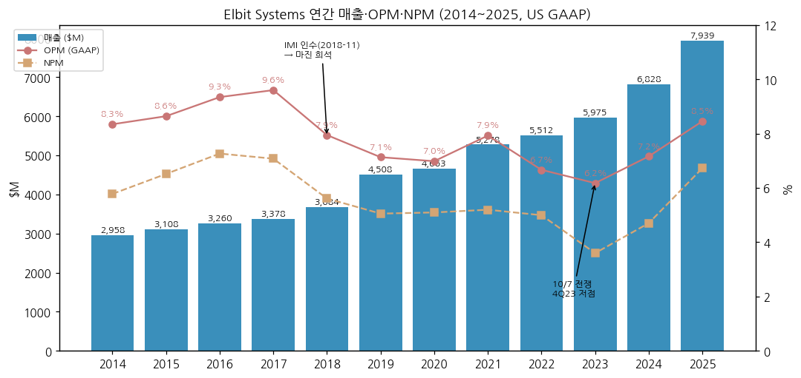

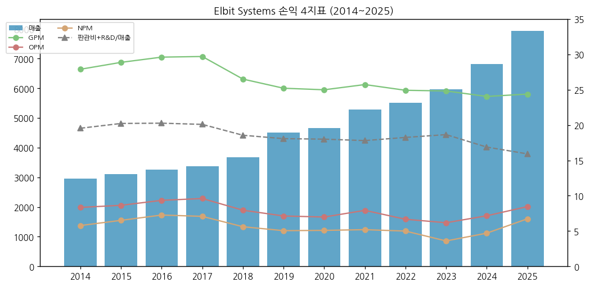

---

## ② 회사 개요

(1) 기본 정보

| 항목 | 내용 |
|---|---|
| 회사명 | Elbit Systems Ltd. (이스라엘 법인) |
| 본사 | Advanced Technology Center, Haifa / 미국 본부 ESA Fort Worth, Texas |
| 상장 | Nasdaq Global Select · TASE (티커 ESLT) |
| 회계 | US GAAP, USD, 12월 결산 |
| 임직원 | 20,537명 (2025말, 미국 3,267·이스라엘 14,805) |
| 최대주주 | Federmann Enterprises Ltd. 41.5% (2026-03-05) |
| 대표 | CEO Bezhalel (Butzi) Machlis (2013~), 이사회 의장 David Federmann (2023-08~), CFO Yaacov (Kobi) Kagan (2022~) |
| 사업 한 줄 | 항공·지상·해상 방산 시스템과 탄약을 개발·통합하는 이스라엘 최대 민간 방산 기업 |

(2) 핵심 KPI 요약

| 지표 | 2025 | 2Q26 | 1H26 YoY |
|---|---|---|---|
| 매출 ($M) | 7,938.6 (+16.3%) | 2,287.1 (+15.9%) | +15.7% |
| GAAP 영업이익 ($M) | 671.4 (8.5%) | 218.8 (9.6%) | +37.9% |
| Non-GAAP 영업이익 ($M) | 737.8 (9.3%) | 237.5 (10.4%) | +35.0% |
| Non-GAAP EPS ($) | 12.75 | 4.14 | +37.9% |
| 수주잔고 ($B) | 28.1 | 32.0 | +34% |
| 영업현금흐름 ($M) | 778.4 | 1H 517.8 | +70% |

→ (출처: 2025 20-F, 2Q26 보도자료 2026-08-11. YoY는 [계산])

(3) 주요 연혁

→ **1966** Elbit Computers 설립 (Elron 계열)
→ **1996** Elbit Ltd. 분할 — 방산 부문이 Elbit Systems로 독립, Nasdaq·TASE 상장
→ **2000** Federmann 그룹의 El-Op(전자광학)과 합병 → Federmann이 최대주주
→ **2000년대** Elisra(전자전)·Tadiran Communications(무전기, 2008) 인수로 전자전·C4I 축 구축
→ **2018-11** IMI Systems(이스라엘 국영 탄약·로켓) 인수 → Land 사업부의 탄약·PULS 축. Universal Avionics 인수
→ **2019** L3Harris 야간투시경 사업 인수 (ESA)
→ **2021** Sparton(소노부이, 미국) 인수
→ **2022** 러-우 전쟁 → 유럽 수주 확대
→ **2023-10-07** 하마스 공격으로 전쟁 시작 → IMOD 수요 급증
→ **2024** Iron Beam 고출력 레이저 공급 계약 (2025 1호기 인도), "Blue and White" 국산화 전략 수혜
→ **2025** 유상증자 $573M (5월), $2.3B 국제 전략 계약·$1.6B 유럽 계약 등 대형 수주, 수주잔고 $28.1B
→ **2026** KNDS와 EuroPULS 합작(독일), 그리스 PULS 약 $750M 공식 계약, 유럽 $1.4B 현대화 계약, 2Q26 잔고 $32.0B

(4) 회사 주가 역사

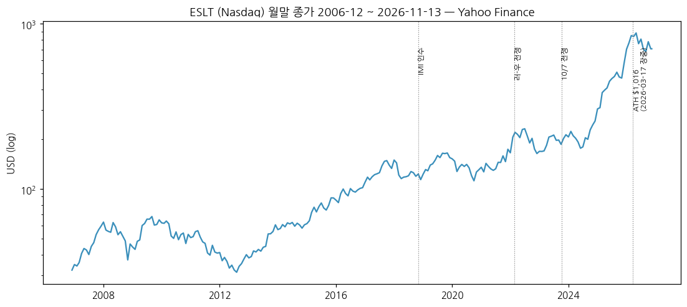

→ 2006~2014: $30~65 박스. 저마진 이스라엘 방산주로 낮은 멀티플
→ 2015~2019: $60 → $155. 유럽·아시아 수출과 IMI 인수
→ 2020~2022: $115~180 정체. 코로나·마진 하락
→ 2023-10 이후: 전쟁 수요 + 유럽 재무장으로 재평가. 2024말 $258 → 2025말 $578 (+124%) → **2026-03-17 장중 $1,016 (최고가)** — 2월 말 미·이스라엘의 이란 공습 직후
→ 2026-03 이후 조정: 2Q26 실적일(8/11) Nasdaq -8.3% (전일 $846.04 → $776.08), 11/13 종가 $706.62 (고점 대비 -30%) [Yahoo Finance]

---

## ③ 비즈니스 모델

(1) 실적 추이 통합 표 (사업부·지역, $M)

| 구분 | 2021 | 2022 | 2023 | 2024 | 2025 | 1H26 |
|---|---|---|---|---|---|---|
| **전사 매출** | 5,278.5 | 5,511.5 | 5,974.7 | 6,827.9 | 7,938.6 | 4,475.9 |
| Aerospace | 1,583.3 | 1,733.2 | 1,873.3 | 2,036.3 | 2,067.0 | 1,011.6 |
| C4I and Cyber | 624.7 | 678.4 | 721.1 | 799.8 | 930.9 | 509.6 |
| ISTAR and EW | 1,026.3 | 1,045.6 | 1,179.4 | 1,318.0 | 1,525.8 | 870.8 |
| Land | 1,116.9 | 1,168.6 | 1,306.2 | 1,679.4 | 2,318.7 | 1,484.9 |
| ESA | 1,492.8 | 1,456.7 | 1,464.9 | 1,585.7 | 1,694.1 | 900.7 |
| 내부거래 제거 | -565.5 | -570.9 | -570.2 | -591.3 | -597.8 | -301.7 |
| **사업부 영업이익 합** | 399.5 | 308.5 | 387.0 | 514.1 | 723.4 | 미공시 |
| Aerospace OPM | 8.2% | 6.2% | 6.7% | 7.3% | 7.3% | — |
| C4I and Cyber OPM | 7.1% | 7.2% | 7.0% | 7.8% | 6.0% | — |
| ISTAR and EW OPM | 6.4% | 4.7% | 11.4% | 7.3% | 8.5% | — |
| Land OPM | 3.2% | 2.4% | 6.2% | 9.0% | 11.4% | — |
| ESA OPM | 8.3% | 5.1% | -0.3% | 3.5% | 7.2% | — |
| **지역 — 이스라엘** | — | — | 1,167.2 | 1,988.0 | 2,556.4 | 1,672.9 |
| 유럽 | — | — | 1,776.4 | 1,820.9 | 2,139.5 | 1,075.6 |
| 북미 | — | — | 1,417.7 | 1,520.3 | 1,659.3 | 898.4 |
| 아시아태평양 | — | — | 1,263.8 | 1,132.7 | 1,243.7 | 661.7 |
| 중남미·기타 | — | — | 349.6 | 365.9 | 339.7 | 167.3 |

→ (출처: 20-F 2022~2025 Note 23, 2Q26 보도자료. 사업부 매출은 내부거래 포함, 사업부 영업이익은 연간만 공시. 2020: Aerospace 1,272.3 / OPM 1.5%, Land OPM 1.2%)
→ 2021~2025 증분 매출 $2.66B 중 Land가 $1.20B (45%) — Land가 성장과 마진 레벨업을 같이 끌었다 [계산]

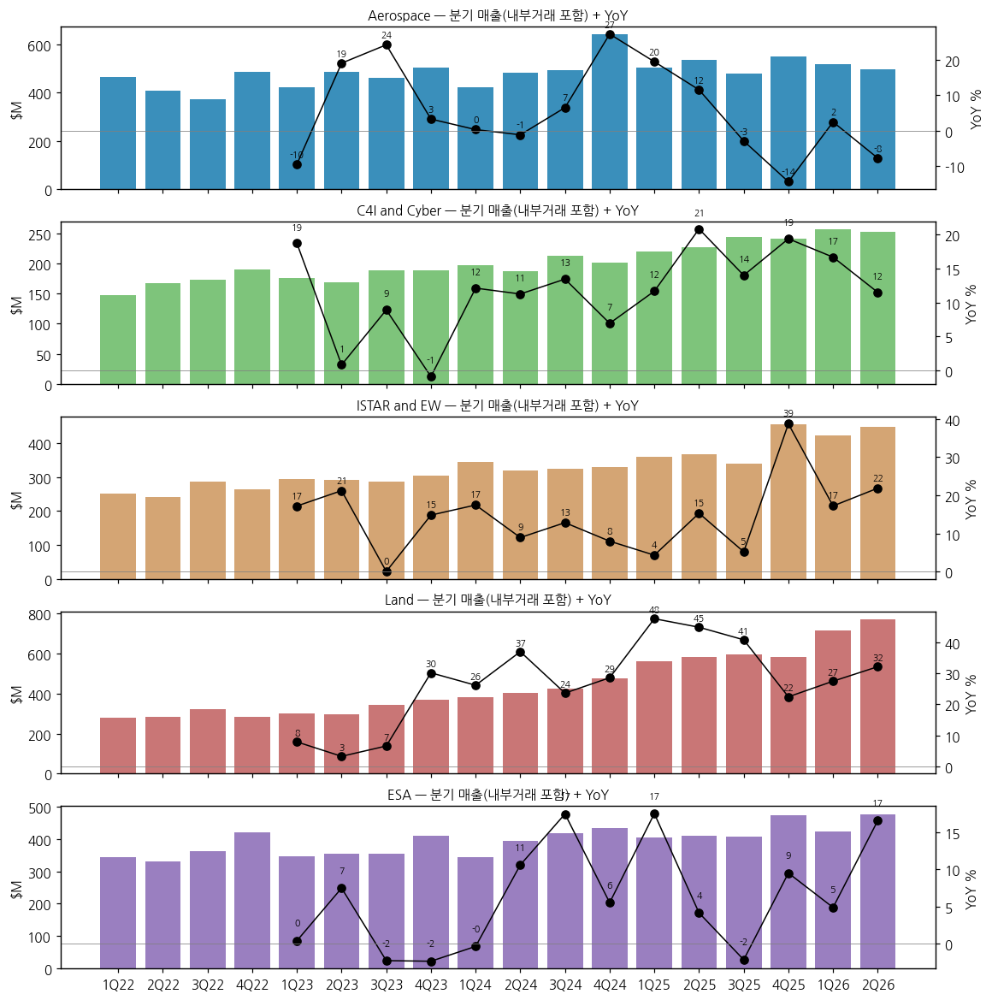

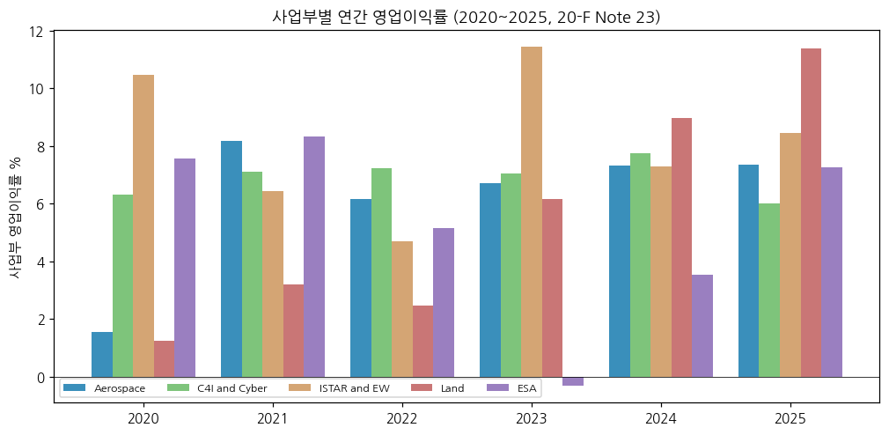

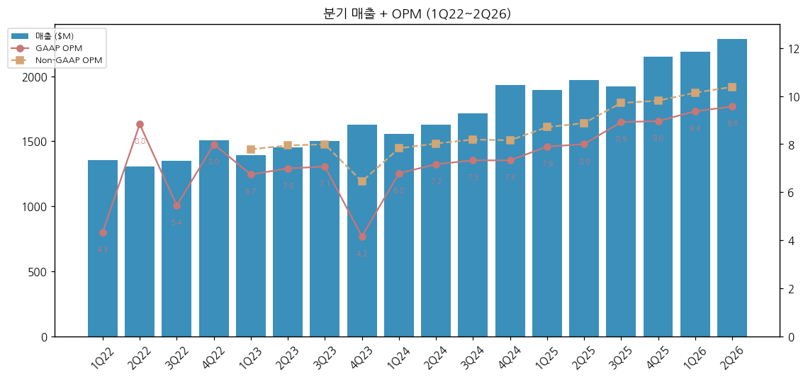

(2) 사업부별 개요 (매출 큰 순)

→ **Land (1H26 31%)**: 다연장 로켓 PULS, 자주포(ATMOS·Sigma), 박격포, 120mm 전차탄·포병탄·소구경탄, 정밀유도 로켓·미사일, 전차·장갑차 포탑·현대화, 능동방호 Iron Fist. IMI 인수로 탄약 축 확보. 2025~2026 이스라엘·유럽 탄약 수요가 성장 동력

→ **Aerospace (21%)**: Hermes 계열 무인기, 전투기·헬기 항공전자·HMD, 훈련·시뮬레이터·비행학교, 상업 항공전자·기체구조물. 2Q26 매출 -8%(유럽 훈련·시뮬레이션 감소, 일회성 믹스)

→ **ESA (19%)**: 미국 법인. 미 육군 ENVG-B 야간투시경(2Q26 $212M 단독 공급), 미 국경보호청 감시 시스템($370M), Bradley Iron Fist, 소노부이(Sparton — 미 해군 2개 공급사 중 하나), 의료기기(HiArc)

→ **ISTAR and EW (18%)**: Elop(전자광학·레이저)·Elisra(전자전·SIGINT). Iron Beam 고출력 레이저, 항공기 DIRCM, 함정 전자전(영국 해군 차기 함정 EW), 무인수상정, AI 레이더

→ **C4I and Cyber (11%)**: 전술 SDR 무전기, 지휘통제·전장 네트워크(스웨덴 디지털 지상군 시연), 사이버 정보, 자율 로봇

(3) 사업부별 디테일

→ **Top-seller**: Land 탄약 — 2025 Land 영업이익 +$113M의 주 원인이 이스라엘·유럽 탄약 매출 (2025 보도자료)
→ **Growth**: Land 매출 2023 → 2025 +78%, 1H26 +30%
→ **이익 outlier**: ESA 2023 영업손실 -$4.7M → 2025 +$122.8M (야간투시경·해양 신규 계약). ISTAR and EW 2023 11.4% → 2024 7.3% (유럽 전자광학 매출 감소)
→ **신성장**: 고출력 레이저(Iron Beam 지상형 공급 중, 헬기·전투기 탑재형 개발 계약), 자율 무인체계(2026 Bluewhite Robotics 등 볼트온 3건)

(4) 주요 경쟁사 (사업부별, ★ = 한국 방산 5사)

| 사업부 | 주요 경쟁사 | 한국 5사와 겹치는 지점 |
|---|---|---|
| Land — 다연장 | Lockheed Martin(HIMARS), ★**한화에어로스페이스(천무 K239)**, KNDS·Rheinmetall(유럽), Roketsan | **유럽 다연장 입찰 직접 경쟁**: 노르웨이는 2026-01 천무 선택(약 $2B, 16기, KNDS·Rheinmetall·Saab/Boeing·HIMARS 경쟁 — Breaking Defense), 에스토니아·폴란드도 천무. PULS는 네덜란드·덴마크·그리스(약 $750M)·독일(EuroPULS 합작) |
| Land — 자주포·전차 현대화 | ★한화에어로스페이스(K9), ★**현대로템(K2)**, BAE, KNDS, Rheinmetall | 자주포 수출, 전차 현대화·포탑($350M 해외 MBT 현대화 2Q26) |
| Land — 탄약 | Rheinmetall, Nammo, 풍산(20-F 명시), General Dynamics OTS | 155mm·전차탄 |
| ISTAR and EW | L3Harris, Thales, Leonardo, Hensoldt, Saab, Aselsan, ★**한화시스템**, ★**LIG D&A(LIG Next1, 20-F 명시)** | 전자광학·전자전·레이더·DIRCM. 레이저 대공(Iron Beam) vs 한국 레이저 대공무기 `[판단]` |
| C4I and Cyber | Thales, Rohde & Schwarz, L3Harris, Aselsan, ★**한화시스템(전술통신·C4I)** | 전술 무전기·전장관리 |
| Aerospace | IAI, AeroVironment, Baykar, CAE, ★**한국항공우주(무인기·훈련체계)** | 전술 무인기, 훈련·시뮬레이션 |
| ESA | 미국 방산 대기업(Northrop·RTX·L3Harris 등) | 미국 시장 — 한국 5사는 직접 경쟁 적음 |

→ (출처: 20-F 2025 "Competition" — Hanwha, LIG Next1, Poongsan을 경쟁사로 직접 명시. 이스라엘 내 경쟁사는 IAI·Rafael)

(5) 주요 매출처

→ **IMOD (이스라엘 국방부)**: 2023 16% → 2024 25% → 2025 28% (20-F, 10% 이상 고객)
→ **미국 정부**: 2023 17% → 2024 15% → 2025 15%
→ 그 외는 국가별 국방부 — 2025 공시 수주: 유럽 국가 약 $1.6B, 국제 전략 계약 약 $2.3B, 독일 A400M DIRCM 약 $260M, 아태 국가 전자전 약 $275M, 미 육군 Bradley Iron Fist $228M (20-F)

(6) 생산 CAPA + 임직원 추이

→ CapEx 연 $220M → **$300M으로 증액** (2Q26 컨콜, 1H26 $158M). 남부 Ramat Beka 탄약 공장 일부 가동, 스웨덴·독일 신규 시설, 미국 기체구조물 공장, 2024 이스라엘 무인기 조립장
→ 고객이 생산능력 투자를 분담하거나(매칭) 현지 이전 시설을 전액 부담하는 사례 증가 (CFO, 2Q26 컨콜)

| 연도 | 2014 | 2016 | 2018 | 2020 | 2022 | 2023 | 2024 | 2025 |
|---|---|---|---|---|---|---|---|---|
| 임직원 | 11,851 | 12,470 | 16,149 | 16,676 | 18,407 | 18,984 | 19,712 | 20,537 |

→ (출처: 각 연도 20-F. 2018년 +3,368명은 IMI 인수)

---

## ④ 재무 구조

(1) 손익계산서 (12년, $M)

| 연도 | 매출 | 매출원가 | 매출총이익 | GPM | R&D(순) | 판매 | 관리 | 영업이익 | OPM | 지배순이익 | NPM | 희석 EPS($) |
|---|---|---|---|---|---|---|---|---|---|---|---|---|
| 2014 | 2,958.2 | 2,133.2 | 825.1 | 27.9% | 228.0 | 216.5 | 139.6 | 246.9 | 8.3% | 171.0 | 5.8% | 4.01 |
| 2015 | 3,107.6 | 2,210.5 | 897.1 | 28.9% | 243.4 | 239.4 | 145.7 | 268.6 | 8.6% | 202.5 | 6.5% | 4.74 |
| 2016 | 3,260.2 | 2,294.9 | 965.3 | 29.6% | 255.8 | 271.0 | 151.4 | 304.7 | 9.3% | 236.9 | 7.3% | 5.54 |
| 2017 | 3,377.8 | 2,374.8 | 1,003.1 | 29.7% | 265.1 | 280.2 | 133.3 | 324.4 | 9.6% | 239.1 | 7.1% | 5.59 |
| 2018 | 3,683.7 | 2,707.5 | 976.2 | 26.5% | 287.4 | 281.0 | 160.3 | 292.8 | 7.9% | 206.7 | 5.6% | 4.83 |
| 2019 | 4,508.4 | 3,371.9 | 1,136.5 | 25.2% | 331.8 | 301.4 | 214.7 | 321.6 | 7.1% | 227.9 | 5.1% | 5.20 |
| 2020 | 4,662.6 | 3,497.5 | 1,165.1 | 25.0% | 359.7 | 290.7 | 223.9 | 325.7 | 7.0% | 237.7 | 5.1% | 5.38 |
| 2021 | 5,278.5 | 3,920.5 | 1,358.0 | 25.7% | 395.1 | 291.8 | 267.4 | 418.5 | 7.9% | 274.4 | 5.2% | 6.20 |
| 2022 | 5,511.5 | 4,138.3 | 1,373.3 | 24.9% | 435.7 | 326.0 | 313.0 | 367.5 | 6.7% | 275.4 | 5.0% | 6.18 |
| 2023 | 5,974.7 | 4,491.8 | 1,483.0 | 24.8% | 424.4 | 359.1 | 330.3 | 369.1 | 6.2% | 215.1 | 3.6% | 4.82 |
| 2024 | 6,827.9 | 5,186.1 | 1,641.8 | 24.0% | 466.4 | 375.4 | 311.0 | 489.1 | 7.2% | 321.1 | 4.7% | 7.18 |
| 2025 | 7,938.6 | 6,003.4 | 1,935.3 | 24.4% | 517.1 | 399.4 | 347.3 | 671.4 | 8.5% | 534.3 | 6.7% | 11.39 |

→ (출처: SEC XBRL companyfacts — 20-F 보고값. 2017 이후 ASC 606 반영. 2020~2022 영업이익에 기타영업이익 포함)
→ GPM은 2017 29.7% → 2024 24.0%로 내려왔다(IMI 탄약·대형 통합 프로젝트 믹스). 영업레버리지(판관비·R&D 비율 하락)로 OPM을 올리는 구조 `[판단]`

(2) 재무상태표 (연말, $M)

| 연도 | 총자산 | 유동자산 | 현금 | 재고 | 영업권 | 유동부채 | 총부채 | 자본총계 | 부채비율 | 유동비율 |
|---|---|---|---|---|---|---|---|---|---|---|
| 2014 | 4,021.3 | 2,249.0 | 200.4 | 868.8 | 504.6 | 1,624.2 | 2,785.3 | 1,235.9 | 225% | 138% |
| 2016 | 4,351.9 | 2,420.9 | 222.8 | 840.3 | 617.0 | 1,924.2 | 2,784.6 | 1,567.2 | 178% | 126% |
| 2018 | 6,450.8 | 3,279.0 | 208.5 | 1,142.0 | 1,022.6 | 2,910.5 | 4,596.4 | 1,854.4 | 248% | 113% |
| 2020 | 8,057.9 | 4,272.9 | 278.8 | 1,316.7 | 1,316.8 | 3,622.2 | 5,826.5 | 2,231.4 | 261% | 118% |
| 2022 | 9,215.7 | 5,031.8 | 211.1 | 1,946.3 | 1,502.5 | 4,277.3 | 6,458.0 | 2,757.7 | 234% | 118% |
| 2023 | 9,739.6 | 5,508.1 | 197.4 | 2,298.0 | 1,499.1 | 4,823.8 | 6,789.3 | 2,950.3 | 230% | 114% |
| 2024 | 10,971.6 | 6,355.2 | 265.4 | 2,773.7 | 1,490.6 | 5,311.2 | 7,690.6 | 3,281.0 | 234% | 120% |
| 2025 | 12,661.5 | 7,735.1 | 635.1 | 3,129.8 | 1,497.2 | 5,976.4 | 8,531.5 | 4,130.0 | 207% | 129% |
| 2Q26 | 13,858.6 | 8,865.5 | 255.3 | 3,237.0 | — | 6,355.9 | 9,448.6 | 4,410.0 | 214% | 139% |

→ (출처: XBRL / 2Q26 보도자료. 총부채 = 총자산 − 자본총계 [계산]. 2Q26 단기예금 $707.6M 별도. 홀수 연도 2015·2017·2019·2021은 차트에 포함)
→ 부채 대부분은 계약부채(선수금)·매입채무 — 2025말 계약부채 $3.62B(유동 2.68 + 비유동 0.93). 차입금성 부채는 2025말 약 $0.39B로 축소 (단기 50.5 + 회사채 B·C·D 321 + 장기차입 18)

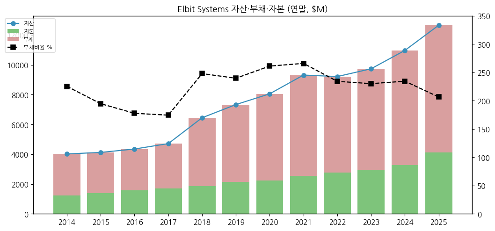

(3) 현금흐름표 ($M)

| 연도 | 2014 | 2015 | 2016 | 2017 | 2018 | 2019 | 2020 | 2021 | 2022 | 2023 | 2024 | 2025 |
|---|---|---|---|---|---|---|---|---|---|---|---|---|
| 영업CF | 177.8 | 434.8 | 208.0 | 100.9 | 191.7 | -53.3 | 278.8 | 416.9 | 240.1 | 113.7 | 534.6 | 778.4 |
| 투자CF | -80.1 | -181.6 | -117.8 | -115.6 | -592.9 | -106.8 | -22.9 | -587.7 | -152.0 | -210.6 | -178.8 | -390.7 |
| 재무CF | -89.0 | -154.4 | -166.7 | -52.1 | 453.6 | 172.7 | -198.2 | 151.0 | -136.0 | 83.2 | -287.9 | -17.9 |
| FCF (영업CF−CapEx) | 106.6 | 335.6 | 83.8 | -7.0 | 89.4 | -190.9 | 146.6 | 228.3 | 35.0 | -73.3 | 319.5 | 552.8 |

→ (출처: XBRL. FCF [계산]. 2018·2021 투자CF는 IMI·Sparton 인수. 1H26 영업CF $517.8M, CapEx $157.6M)
→ 2024~2025 영업CF 급증은 선수금(계약부채 증가 2024 +$956M, 2025 +$651M) 덕분 — 수주가 현금을 먼저 끌어온다 `[판단]`

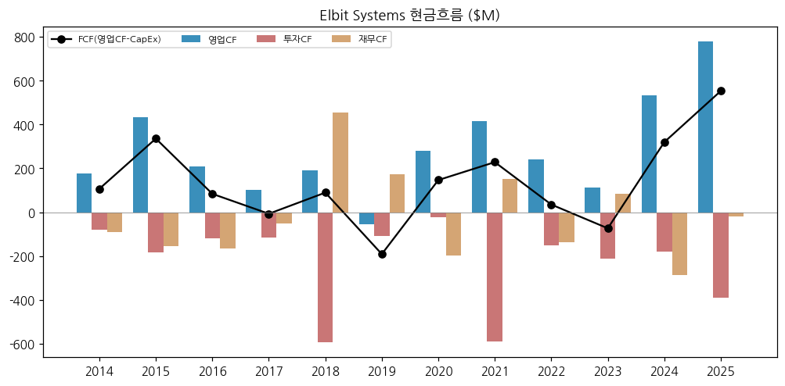

(4) CapEx

→ 2014 $71M → 2025 $226M (매출 대비 2.4~3.8%). 2026 약 $300M 계획 (회사 컨콜)

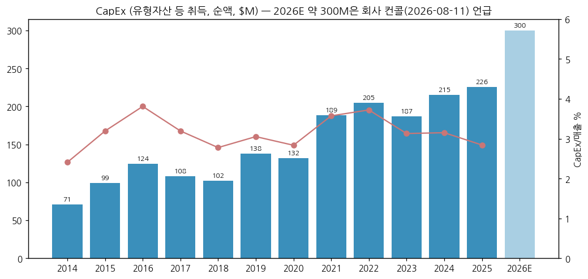

(5) 부채 구조 + 채권 history

→ 이스라엘 회사채 Series A(2010년대 상환 완료), Series B·C·D 잔액 2025말 약 $321M (유동 포함, 20-F). 2Q26 잔액 $263M
→ 단기 기업어음·은행차입 2024말 $451M → 2025말 $51M → 2Q26 0 (2025-05 유상증자 $573M으로 상환)
→ 신용등급: S&P Global Ratings Maalot 등급 보고서 (2026-05-20 6-K) — 등급 수치는 미확인

(6) 배당·자사주

→ 분기 배당 정책. 주당 배당 (실적 발표 시 결의): 2023 분기 $0.50 → 2024-Q4 $0.60 → 2025-Q2 $0.75 → 2025-Q4 이후 **$1.00** (2Q26 결의, 2026-10-26 지급)
→ 현금배당 지급 2014 $68M → 2025 $112M. 자사주 매입 없음, 2025-05 유상증자(약 $573M)로 오히려 주식 수 증가

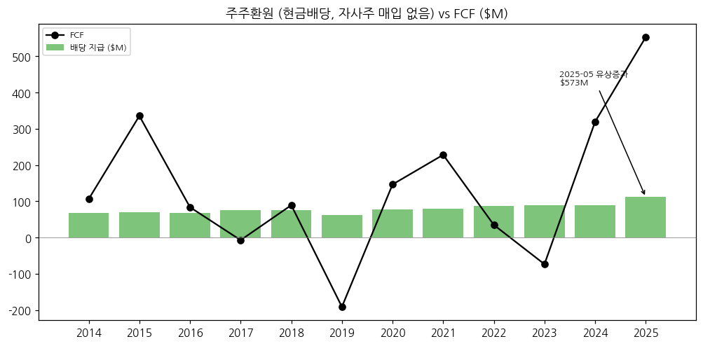

(7) 재무비율 ([계산])

| 연도 | 2014 | 2016 | 2018 | 2020 | 2022 | 2023 | 2024 | 2025 |
|---|---|---|---|---|---|---|---|---|
| ROE (지배순이익/기말 자본) | 13.8% | 15.1% | 11.1% | 10.7% | 10.0% | 7.3% | 9.8% | 12.9% |
| ROA | 4.3% | 5.4% | 3.2% | 2.9% | 3.0% | 2.2% | 2.9% | 4.2% |
| 부채비율 | 225% | 178% | 248% | 261% | 234% | 230% | 234% | 207% |
| 유동비율 | 138% | 126% | 113% | 118% | 118% | 114% | 120% | 129% |
| 이자보상배율 (영업이익/순금융비용) | — | — | — | — | — | 2.7x | 3.2x | 4.8x |

→ (순금융비용 2023 $137.8M, 2024 $151.1M, 2025 $138.6M — 20-F)

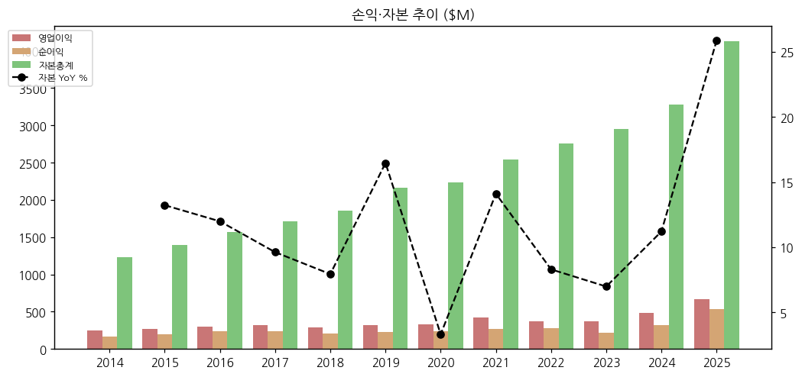

---

## ⑤ 지배 구조

(1) 그룹·계열 관계

→ 최대주주 **Federmann Enterprises Ltd. (FEL)** — Federmann 가문 지주회사 (Dan Hotels 등 보유). Heris AG(3.84M주)를 통한 간접 보유 포함
→ 주요 자회사 (모두 100%): ESA(미국), Elbit Systems C4I and Cyber, Elisra(전자전), Elop(전자광학), Elbit Systems Land, IMI Systems
→ ESA는 미 국방부와 특별보안협정(SSA)으로 기밀 사업 참여. ESA는 Collins Aerospace와 HMD 50:50 합작

(2) 주주 구분

| 주주 | 주식 수 | 지분 |
|---|---|---|
| Federmann Enterprises (Heris 포함) | 19,318,508 | 41.5% |
| 임원·이사 전체 (23명) | 92,693 | 1% 미만 |
| 기타 유통 | 약 27.1M | 약 58.5% |

→ (출처: 20-F 2026-03-05 기준, 발행주식 46,508,933주. 미국 등록 주주 보유 약 14%. 2022년 Clal·1832 Asset Management의 5% 초과 보유는 이후 해소)

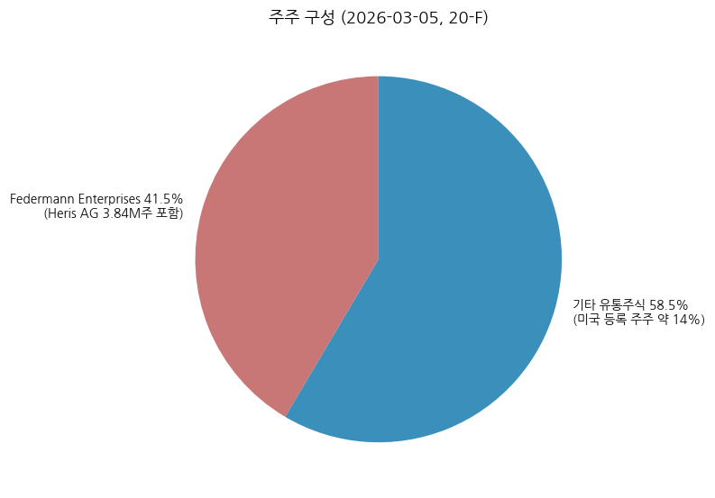

(3) 경영진·이사회

→ **Bezhalel (Butzi) Machlis** — 사장 겸 CEO (2013~). 2004~2012 Land·C4I 부문 총괄
→ **Yaacov (Kobi) Kagan** — EVP·CFO (2022~). 이전 Elbit Systems Land 재무 총괄
→ **David Federmann** — 이사회 의장 (2023-08~, 2015~2023 부의장). Michael Federmann(2000~2023 의장)은 이사로 남음
→ 이사 9명 (사외이사 2명: Noaz Bar Nir, Bilha Shapira). Tzipi Livni(前 외무장관) 2023 선임

---

## ⑥ 기타 팩트

(1) 시가총액·밸류에이션 스냅샷 (2026-11-13 종가 기준)

| 항목 | 값 |
|---|---|
| 주가 | $706.62 (Nasdaq) |
| 시가총액 | 약 $32.9B [계산] |
| 52주 고/저 | $1,016.06 (2026-03-17) / $453.00 (2025-12-01) |
| 2026E Non-GAAP P/E | 약 43배 [계산, EPS 컨센 $16.31~16.38] |
| 2027E Non-GAAP P/E | 약 40배 [계산, EPS 컨센 $17.81 — stockanalysis] |
| 셀사이드 | Hold 우위 (6곳 중 Strong Buy 1·Hold 5), 평균 TP $802 (범위 $518~960) — stockanalysis 2026-11 |

(2) R&D 인프라

→ R&D 총액 2014 $268M → 2025 $600M (매출 대비 7.6~9.4%), 보조금 차감 순액 2025 $517M
→ 2026-03-31 이스라엘 R&D 장려법 제정 → 1H26 R&D 약 $70M 증액 중 절반을 법 인센티브가 충당, 누적 효과 약 $40M 인식 (2Q26 보도자료·컨콜)

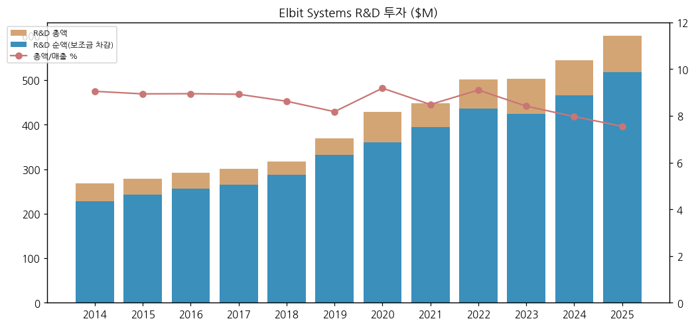

(3) 진행 중 corporate action

→ 2026 볼트온 인수 3건 (Bluewhite Robotics — 자율 지상체계 등), U-TacS 잔여 지분 인수 (2026 종결)
→ EuroPULS (KNDS와 독일 합작, 유럽 PULS 마케팅), Diehl Defence와 SkyStriker 배회형 탄약 독일 공동 제안
→ 2025 C4I and Cyber의 Robo-Team 지분 매각

(4) 주요 리스크

→ **이스라엘 의존·지정학**: IMOD 매출 28%, 이란·헤즈볼라·하마스 분쟁 지속(2026-07 미-이란 교전 재개). 예비군 동원·공급망 차질
→ **일부 국가의 이스라엘 거래 제한**: 20-F에 "일부 국가의 이스라엘 관여 제한"과 해외 시설 공격 리스크 명시
→ **세율 상승**: OECD Pillar II 적용으로 2Q26 실효세율 16.4% (전년 5.6%)
→ **고정가 장기계약**: 원가 상승 시 마진 훼손
→ **환율**: 원가 상당 부분이 셰켈, 매출은 USD·EUR

(5) ESG

→ 2024 ESG 보고서 발간, CDP 참여. 집속탄 금지협약(CCM) 준수 명시. 일부 유럽 연기금의 투자 배제 사례가 있다 `[판단 — 개별 사례 미검증]`

(6) 인증·라이선스

→ ISO-14001·ISO-45001 (EHS). 미국 SSA·Proxy Agreement로 기밀 사업 자격. 이스라엘 국방수출통제법 적용

---

## Activity 보고 (v1.0)

### ✅ 확보 자료
→ 20-F 10개년, XBRL companyfacts, 분기 보도자료 13건, 2Q26 트랜스크립트, Yahoo 주가 2종

### ❌ 누락 자료 (4)
→ 4Q23 보도자료(역산 대체), 1Q25 보도자료 표(비교 열 대체), 사업부 분기 영업이익(미공시), 2014 잔고·2013 이전 사업부

### ⚠️ 추정·계산 데이터 표시
→ 시가총액·P/E·비율은 [계산]. 4Q22·4Q23 분기값은 연간 − 9M 역산. 경쟁 구도의 한국 레이저 무기 비교는 `[판단]`

### 🔗 핵심 source URL
→ SEC EDGAR CIK 0001027664 (20-F·6-K), data.sec.gov companyfacts
→ elbitsystems.com/news (분기 보도자료), 2Q26 transcript PDF (elbitsystems.com/sites/default/files/2026-08/)
→ query1.finance.yahoo.com ESLT

### Data Quality Confidence: **90%**
→ 손익·재무·사업부 매출은 공시 원문 대조 완료 (분기 합 = 연간 합 검산). 차감 요인: 사업부 분기 이익 미공시, 지분 구조 상세 미확보

---

## Version Log

→ **v1.0 (2026-11-14)**: 최초 작성. 12년 연간(XBRL) + 18Q 분기 + 사업부 6년 + 13종 차트(chart3 사업부 OPM 추가)
→ 잔여 보완 후보: 3Q26(11/17) 반영, 2015 이전 20-F로 2013 이전 사업부 보강, 신용등급 수치, ESG 보고서
