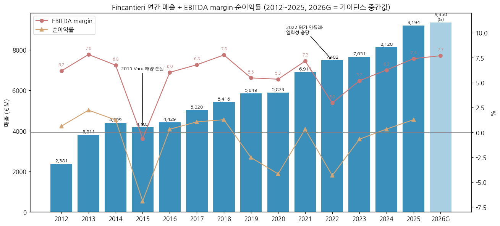
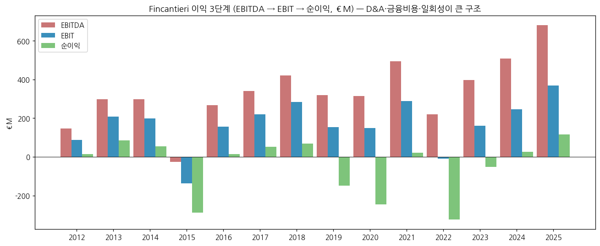
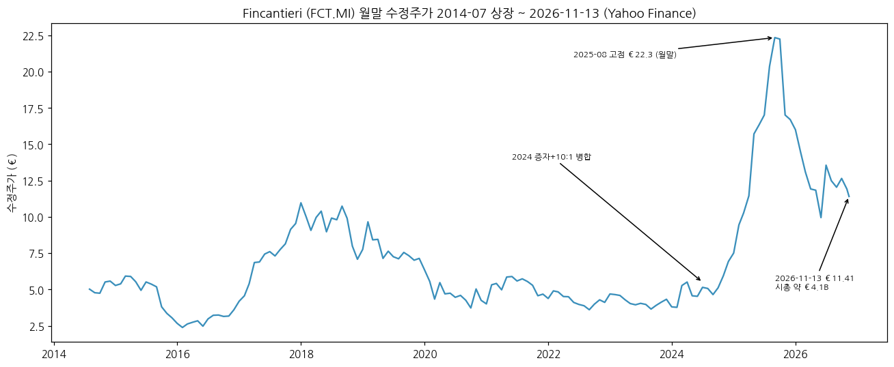
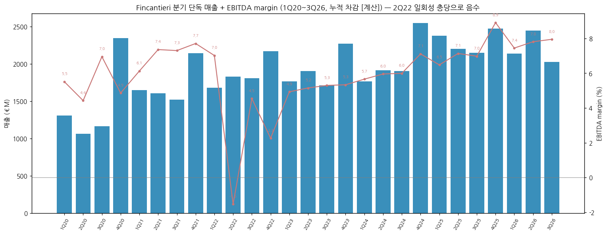
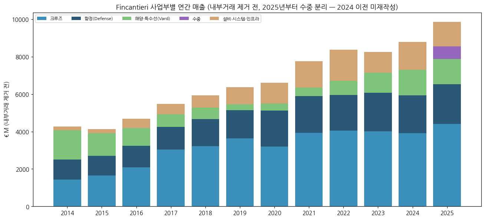
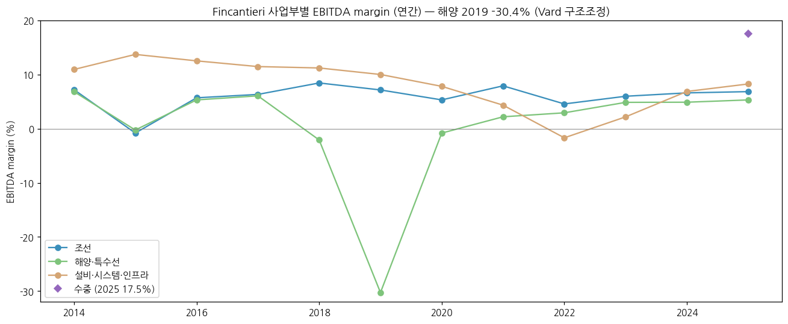
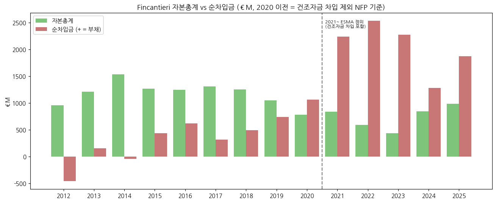
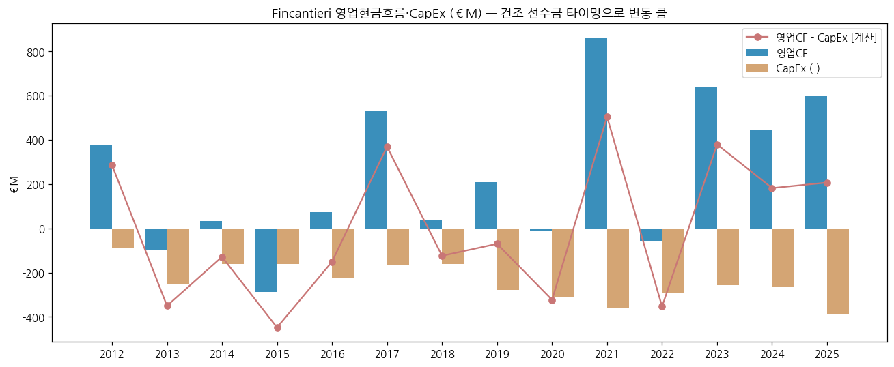
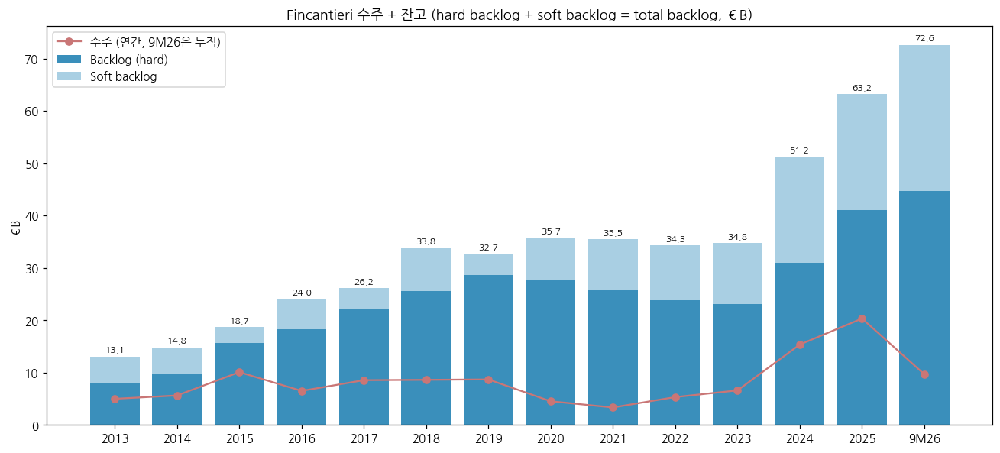

> Ticker: **Borsa Italiana (Euronext Milan): FCT — Fincantieri S.p.A.** / Yahoo `FCT.MI` / OTC `FNCNF`
> Entity: **Fincantieri S.p.A.** (본사 Trieste, Italy) — 이탈리아 국영(CDP Equity 64.19%) 복합 조선 그룹. 크루즈선 세계 선두권, 이탈리아 해군 주력 조선소, Vard(해양·특수선), 미국 FMG(위스콘신 3개 조선소)를 보유
> Sector: **조선 (섹터 T2 주도 후보)** — 서브섹터 **조선 글로벌** (한국 조선 3사 대비 글로벌 피어: 중국선박공업·양쯔장조선·Seatrium·HII·Fincantieri·TKMS)
> 작성 시각: **2026-11-14 KST** (**v1.0** — Phase 1 회사 IR 원문 수집 + 12년 손익 + 분기 27개(1Q20~3Q26) + 사업부 4개 + 수주·잔고 + 주가)
> 적용 구조: v4.8 (6개 섹션) + v1.5 ① 기업 분류 표준 (Summary Box · 손익 narrative · 분류 논리 · 밸류에이션 · 분류 변경 조건)
> 데이터 범위: **연간 14년 (FY2012~FY2025, 12월 결산)** + 2026 9M + **분기 단독 27개 (1Q20~3Q26, 누적 공시치 차감 [계산])** + 사업부 연간 2012~2025 + 주가 2014-07 상장 ~ 2026-11-13
> 출처: **Fincantieri IR — Data sheet 9M 2026(xlsx, 2012~2026 P&L·BS·CF·수주/잔고 누적 시계열), 9M·1H·1Q 2026 보도자료, 9M 2026 Results Presentation, 2026 반기보고서(주주·주식수), CMD 2026 「F4」 Business Plan 2026-2030, Underwater M&A 보도자료(2026-07-06), IR Financial Highlights 페이지**, **Yahoo Finance FCT.MI**, 보도(증자·연혁 일부 — 「보도 인용」 표기)

# Fincantieri 기업 개요 (v1.0 — 조선 T2 주도 후보 / 조선 글로벌 / 크루즈·함정·수중 복합 조선)
> **Fact verify cutoff**: 2026-11-14 (주가 2026-11-13 종가 €11.405 [Yahoo Finance], 시가총액 약 €4.09B = 358.8M주 × €11.405 [계산], 52주 고가 €20.44 / 저가 €9.62)

## Phase 1 Source Audit

```
=== 자료 수집 audit (Fincantieri S.p.A.) ===
✅ 확보 (저장: company-overview-source/FCT.MI_Fincantieri/)
- Data sheet 9M 2026 / 1H 2026 / 1Q 2026 (xlsx) — 2012~2025 FY + 2014~2026 1Q·1H·9M 누적 (2019 분기 누적 컬럼 없음)
- 9M 2026 보도자료(2026-11-12, 23쪽) + Results Presentation(28쪽)
- 1H 2026 보도자료(2026-07-29) + 반기보고서(주주 구성·주식수·주가 통계)
- 1Q 2026 보도자료(2026-05-11)
- CMD 2026 「F4 FAST. FORWARD. FURTHER. FUTURE.」 Business Plan 2026-2030 (2026-02)
- Underwater M&A 보도자료 (2026-07-06, NextGeo·WSense·Graal Tech·Defcomm)
- IR Financial Highlights 페이지 (FY2017~2025 사업부 표, 2026-03-25 갱신)
- Yahoo Finance FCT.MI 월간(2014-07~) + 일간(최근 1개월)
❌ 누락
- 9M 2026 컨콜 트랜스크립트 (GuruFocus 미게재, 1H26은 요약만)
- FY2025 Annual Report 본문 (Data sheet·하이라이트로 대체 — 임원 약력·R&D 비용 상세 미확보)
- 2019년 1Q·1H·9M 누적 (Data sheet 미수록) → 분기 시계열은 1Q20부터
- 셀사이드 리서치·컨센서스
```

## ① 기업 분류

(1) Primary / Secondary 분류

**Primary 분류: 사이클 (장기 수주형 저마진 조선 사이클) — 현재 "회복·마진 확장" 국면**

→ 2014~2025 12년 EBITDA margin 범위는 -0.6%(2015) ~ 7.8%(2013·2018)다. 진폭 8.4%p로 ±10%p cutoff에는 못 미치지만, **12년간 저점이 3회**(2015 Vard 해양 손실, 2019~2020 코로나·Vard 구조조정, 2022 원가 인플레·일회성)였다. 순이익은 12년 중 6개 연도가 적자다

→ 이익을 결정하는 것은 **수주 시점 가격 vs 건조 시점 원가**의 차이다. 크루즈·함정 모두 3~6년 장기 건조라, 원가 인플레(2022) 때는 마진이 무너지고 단가 상승기 수주분이 들어올 때(2024~2026) 마진이 오른다

**Secondary 노트: 지속성장 후보 (수중·함정) + 국영 방산 플랫폼**

→ **수중(Underwater)** 사업부(2025 신설)는 EBITDA margin 17~19%로 그룹 평균의 2배를 넘고, 9M26 매출이 +37.6% 늘었다. 2026-07 인수 4건이 종결되면 pro-forma 매출 €1.1B·EBITDA €220M으로 그룹 EBITDA의 약 30%가 된다

→ CMD 2026 목표: 2030년 **함정+수중 매출 비중 1/3**(2026년 24% → 2030년 32%), 그룹 EBITDA margin **~10%**

**4개 사업부 구조 (9M26, 내부거래 제거 전)**

→ **(1) 조선 Shipbuilding** — 매출 €4,556M (63%), EBITDA €335M, margin 7.3%. 크루즈 €3,477M + 함정(Defense) €1,039M + Ship Interiors €40M

→ **(2) 해양·특수선 Offshore & Specialized Vessels (Vard)** — 매출 €1,124M (16%), EBITDA €61M, margin 5.4%. 해상풍력 CSOV·어선·케이블선·연구선, 크루즈 블록 제작

→ **(3) 수중 Underwater** — 매출 €531M (7%), EBITDA €93M, margin 17.6%. U212 NFS 잠수함, WASS(어뢰·소나·대응체계, 2025-01 Leonardo에서 인수), Remazel

→ **(4) 설비·시스템·인프라 Equipment, Systems & Infrastructure (ESI)** — 매출 €1,037M (14%), EBITDA €70M, margin 6.7%. 전자·디지털, 기계 시스템(추진·안정기), 인프라(교량·철골)

(2) Summary Box (12년 시계열 + 사이클 통계)

| 지표 | 값 |
|------|-----|
| 매출 CAGR (2014→2025, 11년) | **+6.9%/yr** [계산] (2020→2025 5년 **+9.4%**, 2026G +1~2%로 둔화) |
| EBITDA margin 평균 (2014~2025) | **5.5%** [계산] |
| EBITDA margin 정점 평균 | **7.6%** — 2013·2018 7.8%, 2021 7.2%, 2025 7.4% [계산] |
| EBITDA margin 저점 평균 | **2.6%** — 2015 -0.6%, 2020 5.3%, 2022 3.0% [계산] |
| 사이클 주기 | 약 **3~4년** (정점 2018 → 2021 → 2025, 저점 2015 → 2020 → 2022) |
| 사이클 회수 (2014~2025) | **정점 3회 / 저점 3회**, 2023~ 상승 국면 진행 (9M26 7.7% = 시계열 최고 경신 중) |

```
[Fincantieri 14년 손익 시계열 (€M, 12월 결산)]  * EBITDA = 회사 APM, 비경상 손익 제외
연도   매출     EBITDA  margin   EBIT    순이익
2012   2,381    147     6.2%      87      15    ← Vard 인수 전, 이탈리아 조선소만
2013   3,811    298     7.8%     209      85    ← 2013-01 Vard(구 STX OSV) 인수 연결 → 매출 +60%
2014   4,399    297     6.8%     198      55    ← 2014-07 Borsa Italiana 상장 (IPO)
2015   4,183    -26    -0.6%    -137    -289    ← 1차 저점: 유가 폭락 → Vard 해양(브라질 등) 손실, 크루즈 프로토타입 원가 초과
2016   4,429    267     6.0%     157      14    ← 회복, 크루즈 수주 사이클 진입
2017   5,020    341     6.8%     221      53    ← 크루즈 슈퍼사이클 본격화
2018   5,416    421     7.8%     285      69    ← 정점: 조선 margin 8.5%
2019   5,849    320     5.5%     153    -148    ← Vard 구조조정(해양 margin -30.4%), 비경상 손실
2020   5,879    314     5.3%     148    -245    ← 2차 저점: 코로나 조업중단, 크루즈 인도 연기. 4월 미 해군 Constellation FFG 수주
2021   6,911    495     7.2%     289      22    ← 국지 정점: 인도 재개, 크루즈 미인도분 몰림
2022   7,482    221     3.0%     -10    -324    ← 3차 저점: 에너지·원자재 인플레(고정가 계약), 공급망, ESI 손실 / 5월 Folgiero CEO 취임
2023   7,651    397     5.2%     162     -53    ← 2023-2027 계획 첫해, 원가 정상화
2024   8,128    509     6.3%     246      27    ← 증자 €400M(7월)·10:1 병합, 수주 €15.4B (크루즈 대량 발주)
2025   9,194    681     7.4%     368     117    ← 사상 최대 순이익, 수주 €20.3B·B/B 2.2x, WASS 인수(수중 사업부 신설)
9M26   6,605    511     7.7%      —       —     ← 매출 -1.8%(함정 공백), EBITDA +10.9%, margin 시계열 최고

매출 CAGR 11년 (2014→2025): +6.9%/yr [계산]
EBITDA margin range (2014~2025): -0.6% ~ +7.8% = 8.4%p → cutoff(±10%p) 미달이나 저점 3회 반복
순이익 적자 연도: 2015·2019·2020·2022·2023 (12년 중 5개, 2012·2013 포함 14년 중 5개)
```

→ (출처: Data sheet 9M 2026 FY 컬럼. 2022 매출은 Data sheet 7,482 / IR 하이라이트 7,440(재작성 차이). 2013 Vard 연결·2014 IPO·2022 CEO 교체·2024 증자/병합 연혁은 회사 자료 + 보도 인용)





**한국 조선 3사 + 글로벌 피어 이익률 비교 (3Q26, 각사 주 지표)**

→ **HD현대중공업** — OPM 15.6% [잠정] (매출 5조 7,536억원, 상선·엔진·함정)

→ **한화오션** — OPM 14.2% (매출 3조 4,139억원, 상선·해양·특수선)

→ **삼성중공업** — OPM 10.7% [잠정] (매출 3조 1,504억원, 상선·FLNG)

→ **Fincantieri** — **EBITDA margin 8.0%** (분기 단독 [계산], 매출 €2,025M) / EBIT margin 1H26 4.5%

→ (출처: 각사 2026-Q3 리뷰 — earnings-review 폴더. 지표 정의가 다르다: 한국 = K-IFRS 영업이익, Fincantieri = EBITDA(감가상각 전). EBIT 기준이면 격차는 약 2배다)

**한국 조선 3사와의 경쟁 지점**

→ **(1) 해외 호위함·함정 수출** — Fincantieri는 인도네시아 PPA/MPCS 2척(2025 매출 인식), 포르투갈 FREMM EVO 3척(정부 간 합의, 2026-07), 그리스 FREMM 이전 지원, 중동 수명주기 관리 프로그램을 진행한다. 한화오션(태국 호위함)·HD현대중공업(동남아·남미 함정 수출)과 같은 아시아·중동·남미 수출 시장에서 만난다 [판단]

→ **(2) 미 해군** — 자회사 FMG(Marinette)가 Constellation 호위함(2020 수주, 2025년 재편 — 보도상 2척으로 축소)과 LSM 상륙함(2026-04 첫 계약)을 맡는다. 한화(필리조선)·HD현대의 미 해군 MRO·신조 진출과 같은 시장이다. 미국 내 건조 요건(Jones Act·Buy American) 아래에서 FMG는 이미 현지 조선소를 가진 선발 주자다

→ **(3) 잠수함** — 이탈리아 U212 NFS 4척을 건조한다. 해외 잠수함 입찰(폴란드 Orka·캐나다 CPSP 등)에서는 한화오션·HD현대중공업(KSS-III 계열)과 TKMS(212CD)가 주요 경쟁자다. Fincantieri는 주로 TKMS 설계 기반 국내 건조와 WASS 어뢰·소나 공급자로 참여한다 [판단]

→ **(4) 해양·특수선 (Vard)** — Vard는 해상풍력 CSOV·케이블선 같은 중소형 특수선에 특화돼 있다. 한국 3사가 주력하는 FPSO·FLNG(대형 해양 플랜트)와는 겹치지 않는다. 겹치는 것은 일부 연구선·케이블선이며, 주된 경쟁자는 노르웨이·중국 조선소다 [판단]

→ **(5) 크루즈** — 한국 3사는 크루즈 건조 실적이 사실상 없다. Fincantieri는 Meyer Werft(독일·핀란드)·Chantiers de l'Atlantique(프랑스)와 함께 대형 크루즈 시장을 나눈다. 크루즈는 한국과 경쟁하지 않는 Fincantieri 고유 사업이다

(3) 정량적 분류 근거

→ **수주 레코드** — 2024년 €15.4B, 2025년 €20.3B(B/B 2.2x). 9M26은 €9.7B로 연간 목표 €11B의 88%이고, 서명 후 미발효 €12.3B는 별도다

→ **잔고** — Hard backlog €44.7B(9M26, 2025 매출의 4.9배), total backlog €72.6B(7.9배), 크루즈 인도 일정은 2036년(Princess 포함 2039년)까지다

→ **마진 확장** — 그룹 EBITDA margin은 2022년 3.0% → 2025년 7.4% → 9M26 7.7%다. 조선 margin은 9M26 7.3%(9M25 6.5%), 크루즈 자매선 비중은 30/36척이다

→ **재무 개선** — 조정 순차입금/EBITDA가 2024년 2.4x → 2025년 1.9x → 9M26 1.0x(증자 제외 1.7x)로 낮아졌다

(4) 산업 분류

→ **GICS** — Industrials — Aerospace & Defense (GuruFocus 분류) / 회사 자체 정의는 "high complexity shipbuilding"

→ **워치리스트 섹터** — 조선 (섹터 T2 주도 후보) / 서브섹터: 조선 글로벌

(5) 분류 결정 논리

(1) **가장 큰 사업부 기준** — 조선(크루즈+함정)이 매출의 63%, EBITDA의 65%(9M26 335/511)를 차지한다. 이익은 수주 가격과 원가의 차이로 정해진다 → 사이클

(2) **사이클 vs 지속성장** — margin 진폭(8.4%p)은 cutoff 미달이지만 12년 중 저점 3회, 순이익 적자 5개 연도로 단조 우상향이 아니다 → 사이클을 Primary로 둔다

(3) **Boundary case** — 수중(18% margin, +38%)과 함정(정부 장기 프로그램)은 지속성장 성격이다. 2030년 함정+수중 비중 1/3 목표가 달성되면 재분류 후보 → Secondary로 표기

(4) **글로벌 피어 대비** — 한국 3사(상선 중심, OPM 10~16%)보다 마진은 낮다. 대신 크루즈 독과점(3강)과 국영 방산 지위로 수주 가시성(잔고 7.9년)이 더 길다

(6) 적정 밸류에이션 방법

→ **1차 — EV/EBITDA**: 순이익이 작고 변동이 커서(D&A €313M·금융비용 €173M, 2025) EBITDA 기준이 적합하다. 현재 EV 약 €4.8B(시총 €4.09B + 조정 순차입금 €0.73B) / 2026G EBITDA 중간값 €720M = **약 6.7x** [계산]

→ **2차 — P/E (2027~2028)**: 2026G 순이익 중간값 €160M 기준 약 25.6x [계산]다. CMD 목표(2028 순이익 €220M, 2030 €500M)가 실현되면 P/E는 빠르게 낮아진다. 순이익 레버리지가 커서 Forward P/E 민감도가 높다

→ **3차 — SOTP**: 수중 사업부는 회사가 피어 EV/EBITDA를 적용해 "수중만으로 증분 EV €1.6~2.0B"를 제시했다(M&A 보도자료). 크루즈·함정은 유럽 방산·조선 피어 멀티플로 따로 본다

→ **PBR 보조** — 자본 €1,764M(9M26, 증자 반영) 기준 PBR 약 2.3x [계산]. 적자 이력이 있어 저점 판단용으로만 쓴다

(7) 분기 재평가 트리거 (**분류 변경 조건**)

→ ① **그룹 EBITDA margin 4개 분기 연속 9% 이상 + 순이익 흑자 유지** → 사이클 → **지속성장(마진 구조 변화)** 재검토 (CMD 2028 목표 8.5%, 2030 10%)

→ ② **함정+수중 매출 비중 30% 이상 도달** (9M26 약 21%: 함정 €1,039M + 수중 €531M / 제거 전 €7,248M [계산]) → 방산 플랫폼으로 Primary 재검토

→ ③ **크루즈 신규 발주 2개 분기 연속 0 + soft backlog 감소** → 크루즈 사이클 정점 통과 판단, 사이클 하강 국면으로 분류 갱신

## ② 회사 개요

(1) 기본 사항

| 항목 | 내용 |
|---|---|
| 회사명 | Fincantieri S.p.A. |
| 본사 | Via Genova 1, 34121 Trieste, Italy |
| 상장 | Euronext Milan (Borsa Italiana), 2014-07 IPO |
| 최대주주 | CDP Equity S.p.A. 64.19% (CDP 100% 자회사, CDP는 이탈리아 경제재정부 82.77%) |
| 발행주식 | 358,785,760주 (2026-06-30) / 자기주식 1,500,177주 |
| 시가총액 | 약 €4.09B (2026-11-13 €11.405 × 358.8M주 [계산]) |
| 임직원 | 24,370명 (2025말) / 반기보고서 "24,000명 이상" (2026-06) |
| 조선소 | 전 세계 18개, 3개 대륙 (이탈리아·노르웨이·루마니아·베트남·미국 등) |
| 이력 | "230년 이상의 역사, 7,000척 이상 설계·건조" (회사) |
| 사업 한 줄 | 크루즈선·군함·잠수함·해양 특수선을 설계·건조하고, 선박 시스템·수중 기술·인프라를 공급하는 서방 최대급 복합 조선 그룹 |

→ (출처: 2026 반기보고서, 9M 2026 보도자료, IR 하이라이트, CMD 2026)

(2) 14년 손익·자본 추이

| 연도 | 매출 | EBITDA | EBITDA margin | EBIT | EBIT margin | 순이익 | 조정 순이익 | 매출 YoY | EBITDA YoY |
|---|---|---|---|---|---|---|---|---|---|
| 2012 | 2,381 | 147 | 6.2 | 87 | 3.7 | 15 | 44 | — | — |
| 2013 | 3,811 | 298 | 7.8 | 209 | 5.5 | 85 | 137 | +60.1 | +102.7 |
| 2014 | 4,399 | 297 | 6.8 | 198 | 4.5 | 55 | 87 | +15.4 | -0.3 |
| 2015 | 4,183 | -26 | -0.6 | -137 | -3.3 | -289 | -252 | -4.9 | 적자 전환 |
| 2016 | 4,429 | 267 | 6.0 | 157 | 3.5 | 14 | 60 | +5.9 | 흑자 전환 |
| 2017 | 5,020 | 341 | 6.8 | 221 | 4.4 | 53 | 91 | +13.3 | +27.7 |
| 2018 | 5,416 | 421 | 7.8 | 285 | 5.3 | 69 | 114 | +7.9 | +23.5 |
| 2019 | 5,849 | 320 | 5.5 | 153 | 2.6 | -148 | -71 | +8.0 | -24.0 |
| 2020 | 5,879 | 314 | 5.3 | 148 | 2.5 | -245 | -42 | +0.5 | -1.9 |
| 2021 | 6,911 | 495 | 7.2 | 289 | 4.2 | 22 | 92 | +17.6 | +57.6 |
| 2022 | 7,482 | 221 | 3.0 | -10 | -0.1 | -324 | -108 | +8.3 | -55.4 |
| 2023 | 7,651 | 397 | 5.2 | 162 | 2.1 | -53 | -7 | +2.3 | +79.6 |
| 2024 | 8,128 | 509 | 6.3 | 246 | 3.0 | 27 | 57 | +6.2 | +28.2 |
| 2025 | 9,194 | 681 | 7.4 | 368 | 4.0 | 117 | 143 | +13.1 | +33.8 |
| 2026G | 9,300~9,400 | 715~725 | ~7.7 | — | — | 140~180 | — | +1.2~+2.2 | +5.0~+6.5 |

→ (단위: €M, %. 출처: Data sheet 9M 2026. 조정 순이익 = 비경상 손익 반영 전 순이익. 2026G = 9M26 보도자료 가이던스)

(3) 주가 역사

→ 2014-07 상장 후 2020년까지 수정주가는 €3~8 박스권이었다(2024년 10:1 병합 반영 수정치). 2024년 증자·병합 후 2025년 크루즈·방산 수주 레코드와 유럽 재무장 기대로 급등해 2025-08 월말 €22.34(상장 후 최고)를 찍었다

→ 2025-10 이후 하락해 2026-11-13 €11.405다. 연초(€16.00) 대비 -28.7%, 52주 고가(€20.44) 대비 -44%다. 2026-02 증자(€15.32, 종가 대비 7% 할인)와 함정 매출 공백이 겹쳤다. 9M 발표(11/12) 후 2거래일 -5.7%다

→ 반기보고서 기준 시가총액은 2025말 €5,424M → 2026-06말 €3,570M이었다



(4) 주요 연혁

| 시점 | 사건 |
|---|---|
| 1959 | IRI 산하 조선 지주회사로 Fincantieri 설립 (보도·공개 자료) |
| 2008~2009 | 미국 Manitowoc Marine Group 인수 → Fincantieri Marine Group(FMG, 위스콘신 Marinette·Sturgeon Bay·Green Bay) (보도 인용) |
| 2013-01 | STX OSV 인수 → Vard (해양·특수선, 노르웨이·루마니아·베트남·브라질) |
| 2014-07 | Borsa Italiana 상장 |
| 2015 | 유가 폭락으로 Vard 해양 손실 → 그룹 EBITDA 적자 |
| 2018 | Vard 잔여 지분 공개매수, 싱가포르 거래소(SGX) 상장폐지 (보도 인용) |
| 2020-04 | 미 해군 Constellation(FFG-62) 호위함 프로그램 수주 (FMG) |
| 2022-05 | Pierroberto Folgiero CEO 취임 |
| 2024-07 | 유상증자 약 €400M 완료 (10:1 주식병합 병행, 보도 인용) |
| 2025-01 | Leonardo로부터 WASS(수중 무기·소나) 인수 → 2025년 수중 사업부 신설 |
| 2025 | 수주 €20.3B, 순이익 €117M (사상 최대) / 미 해군 Constellation 재편 (보도상 2척 축소) |
| 2026-02 | CMD 2026 「F4」 사업계획 발표, ABB 증자 €499M (신주 32.6M주 × €15.32, 보도 인용) |
| 2026-04 | 미 해군 LSM 첫 계약 ($30M), Princess Cruises 3척 서명 |
| 2026-07 | 수중 기업 4곳 인수 발표 (NextGeo·WSense·Graal Tech·Defcomm, 약 €600M) / 포르투갈 FREMM EVO 3척 정부 간 합의 |
| 2026-09 | 이탈리아 해군 DDX 구축함 2척 계약 (Fincantieri 몫 약 €1.8B) |
| 2026-11 | 9M26 발표, EBITDA 가이던스 €715~725M 상향 / Poste Italiane·TIM과 Physical AI 파트너십 |

## ③ 비즈니스 모델

① 실적 추이 통합 표 (5년 연간, 사업부별, €M, 내부거래 제거 전)

| 사업부 | 항목 | 2021 | 2022 | 2023 | 2024 | 2025 | 9M26 |
|---|---|---|---|---|---|---|---|
| 조선 | 매출 | 5,903 | 5,953 | 6,129 | 5,990 | 6,592 | 4,556 |
| ㄴ 크루즈 | 매출 | 3,926 | 4,056 | 4,014 | 3,913 | 4,404 | 3,477 |
| ㄴ 함정 | 매출 | 1,977 | 1,897 | 2,060 | 2,015 | 2,117 | 1,039 |
| 조선 | EBITDA | 467 | 272 | 367 | 396 | 451 | 335 |
| 조선 | margin | 7.9 | 4.6 | 6.0 | 6.6 | 6.8 | 7.3 |
| 해양·특수선 | 매출 | 456 | 751 | 1,070 | 1,371 | 1,356 | 1,124 |
| 해양·특수선 | EBITDA | 10 | 22 | 52 | 67 | 72 | 61 |
| 해양·특수선 | margin | 2.1 | 2.9 | 4.9 | 4.9 | 5.3 | 5.4 |
| 수중 | 매출 | — | — | — | — | 667 | 531 |
| 수중 | EBITDA | — | — | — | — | 117 | 93 |
| 수중 | margin | — | — | — | — | 17.5 | 17.6 |
| 설비·시스템·인프라 | 매출 | 1,404 | 1,659 | 1,100 | 1,498 | 1,320 | 1,037 |
| 설비·시스템·인프라 | EBITDA | 61 | -28 | 24 | 103 | 109 | 70 |
| 설비·시스템·인프라 | margin | 4.3 | -1.7 | 2.2 | 6.9 | 8.3 | 6.7 |
| 기타(본사) | EBITDA | -43 | -45 | -46 | -57 | -68 | -47 |
| 내부거래 제거 | 매출 | -852 | -881 | -648 | -731 | -741 | -643 |

→ (출처: Data sheet 9M 2026 사업부 표. 2022 조선·ESI는 Data sheet 기준이고, IR 하이라이트 재작성치(조선 6,373/340, ESI 916/-96)와 다르다. 수중은 2025년 신설이며 2024년 이전은 재작성되지 않았다(WASS 2025-01 연결, Remazel 등은 ESI에서 이관). Data sheet는 2025 수중 margin을 17.6%로 표기하나 117/667 = 17.5% [계산])

② 분기 시계열 (단독, 매출 / EBITDA / margin, €M — 누적 차감 [계산])

| 연도 | 1Q | 2Q | 3Q | 4Q |
|---|---|---|---|---|
| 2020 | 1,307 / 72 / 5.5% | 1,062 / 47 / 4.4% | 1,165 / 81 / 7.0% | 2,345 / 114 / 4.9% |
| 2021 | 1,648 / 101 / 6.1% | 1,603 / 118 / 7.4% | 1,520 / 111 / 7.3% | 2,140 / 165 / 7.7% |
| 2022 | 1,681 / 118 / 7.0% | 1,829 / -28 / -1.5% | 1,805 / 82 / 4.5% | 2,167 / 49 / 2.3% |
| 2023 | 1,764 / 87 / 4.9% | 1,905 / 98 / 5.2% | 1,714 / 91 / 5.3% | 2,268 / 121 / 5.3% |
| 2024 | 1,767 / 100 / 5.7% | 1,914 / 114 / 6.0% | 1,902 / 114 / 6.0% | 2,545 / 181 / 7.1% |
| 2025 | 2,376 / 154 / 6.5% | 2,200 / 157 / 7.1% | 2,149 / 150 / 7.0% | 2,469 / 220 / 8.9% |
| 2026 | 2,135 / 159 / 7.4% | 2,445 / 191 / 7.8% | **2,025 / 161 / 8.0%** | 가이던스 내재 2,695~2,795 / 204~214 |

→ (출처: Data sheet 9M 2026. 회사는 1Q·1H·9M·FY 누적만 공시하므로 2Q = 1H − 1Q, 3Q = 9M − 1H, 4Q = FY − 9M. EBIT·순이익은 1H·FY만 공시. 4Q는 크루즈 인도·연말 정산이 몰려 매출·margin이 가장 높은 계절성이 있다)







③ 사업부별 개요·디테일 (매출 비중 큰 순서)

(1) **조선 — 크루즈 (9M26 매출 €3,477M, +9.1%)**

→ 대형 크루즈선·럭셔리 크루즈·익스페디션선을 건조한다. 주요 조선소는 Monfalcone·Marghera·Ancona·Sestri Ponente다. 고객은 Carnival 그룹(Princess·AIDA 등), NCLH(Norwegian·Oceania·Regent), Viking(누적 28척 파트너십), MSC Explora Journeys, TUI Cruises, Four Seasons, Crystal 등이다

→ 크루즈 수주잔고 36척 중 30척이 자매선이다. 2026~2030 CMD 계획상 크루즈 매출 CAGR 약 3%이고, 그룹 매출 비중은 2026년 46% → 2030년 37%로 낮아진다. 마진 동력은 물량이 아니라 단가(Revenue/GRT)와 반복 건조 효율이다

→ 인도 일정 (2026-09말 수주잔고 기준): 4Q26 2척, 2027년 5척, 2028년 6척, 2029년 4척, 2030년 5척, 이후 14척 (회사)

(2) **조선 — 함정 Defense (9M26 매출 €1,039M, -36.8%)**

→ 이탈리아 해군(FREMM·PPA·DDX 구축함·LHD·군수지원함), 해외(인도네시아 PPA, 카타르 등), 미 해군(FMG — Constellation·LSM)이 고객이다. Riva Trigoso·Muggiano가 주력 조선소이고, Leonardo와 JV(Orizzonte Sistemi Navali)로 이탈리아 해군 대형 프로그램을 수행한다

→ CMD 2026: 이탈리아 조선소의 수상함 생산능력을 2배로 늘리고, 함정 매출 CAGR 약 18%(2026~2030)를 목표로 한다. 2030년 그룹 매출의 24%가 목표다. 함정 신규 수주 목표는 약 €5B다

→ 9M26 감소는 2025년 1Q 인도네시아 PPA 2척 일괄 인식 기저와 Constellation 재편 때문이다. DDX 매출은 2027년부터 들어온다

(3) **해양·특수선 Offshore & Specialized Vessels — Vard (9M26 매출 €1,124M, +8.0%)**

→ 노르웨이 설계·루마니아(Tulcea·Braila) 선체·베트남 건조 체계를 갖췄다. 해상풍력 CSOV(9M26 9척 인도), 케이블선, 어선, 심해 연구선(Inkfish — Vard 사상 최대 수주), 크루즈 블록 제작을 맡는다. CMD 계획상 베트남 신규 조선소에 약 €250M을 투자한다

→ EBITDA margin은 2019년 -30.4%(구조조정)에서 2025년 5.3%, 9M26 5.4%로 회복했다. 회사는 "경쟁적 환경"이라고 표현했다. 2030년 목표 margin은 8%다

(4) **수중 Underwater (9M26 매출 €531M, +37.6%)**

→ U212 NFS 잠수함 4척(Muggiano, 2029년부터 매년 1척 인도), WASS(Black Shark·MU90 어뢰, 소나, 대응체계), Remazel(수중 장비 엔지니어링)로 구성된다. 사우디 MU90 어뢰 계약은 WASS 사상 최대다(미발효)

→ 2026-07 인수 4건: Next Geosolutions(해저 측량·시공 서비스), WSense(수중 IoT·통신), Graal Tech(무인 수중체), Defcomm(무인 수상정·통신). 인수 후 수중 pro-forma 2026년 매출 약 €1.1B·EBITDA 약 €220M, 2030년 매출 €1.4B·순이익 약 €130M이 목표다(M&A 보도자료)

(5) **설비·시스템·인프라 ESI (9M26 매출 €1,037M, +11.9%)**

→ 전자·디지털 제품(+8.6%, EBITDA +34.1%), 기계 시스템·부품(+19.7%, margin 11.1%), 인프라(교량·철골 구조물, +10.0%)의 3개 클러스터다. 매출의 약 40%가 그룹 내부 공급이다(9M26 내부 €412M / €1,037M [계산])

④ 주요 경쟁사 (사업부별)

| 사업부 | 경쟁사 |
|---|---|
| 크루즈 | Meyer Werft(독일·핀란드 Meyer Turku), Chantiers de l'Atlantique(프랑스) — 대형 크루즈 3강 구도. 중국 CSSC(상하이 와이가오차오, Adora Cruises 선대)가 신규 진입 |
| 함정 (유럽) | Naval Group(프랑스), TKMS·NVL(독일), Navantia(스페인), BAE Systems(영국), Damen(네덜란드) |
| 함정 (수출·미국) | HD현대중공업·한화오션(한국), HII·General Dynamics(미국), Austal |
| 잠수함·수중 | TKMS(212CD), Naval Group, Saab Kockums, 한화오션·HD현대중공업(KSS-III), Kongsberg(수중 시스템) |
| 해양·특수선 | Ulstein·Kleven(노르웨이), Damen, 중국 조선소 |

→ (출처: 회사 자료 + 업계 일반 [판단]. 수출 입찰별 실제 경합 여부는 입찰마다 다르다)

⑤ 주요 매출처

→ 크루즈: Carnival 그룹(Princess·AIDA·Holland America 계열), NCLH, Viking, MSC Explora, TUI Cruises(TUI·RCL JV), Four Seasons(Marc-Henry), Crystal (9M26 보도자료의 수주·인도 고객 기준). 고객별 매출 비중은 공시되지 않는다

→ 함정: 이탈리아 해군(OCCAR 경유 포함), 미 해군, 인도네시아 해군 등

⑥ 생산 CAPA + 임직원

→ 조선소 18개(3개 대륙). 9M26 19척 인도(10개 조선소), 수주잔고 90척이다

→ 임직원은 2017년 19,545명 → 2021년 20,774명 → 2025년 24,370명이다(IR 하이라이트)

→ CMD 2026 CAPA 계획: 이탈리아 수상함 생산 약 2배, 루마니아 생산체계 개선, 베트남 신규 조선소, Monfalcone 대형 크레인(점보 크루즈용). 2026~2030 투자 총 약 €1.9B다

## ④ 재무 구조

① 손익 — 위 ② (2) 14년 표 참조. 구조적 특징: EBITDA → 순이익 사이에 D&A(2025 €313M), 금융비용(€173M), 비경상 손실(€37M)이 끼어 있어 EBITDA margin 7.4%가 순이익률 1.3%가 된다

② 재무상태 (€M, 12월 말)

| 연도 | 2017 | 2018 | 2019 | 2020 | 2021 | 2022 | 2023 | 2024 | 2025 | 9M26 |
|---|---|---|---|---|---|---|---|---|---|---|
| 자본총계 | 1,309 | 1,253 | 1,050 | 777 | 834 | 587 | 434 | 845 | 987 | 1,764 |
| 순차입금 (+ = 부채) | 314 | 494 | 736 | 1,062 | 2,238 | 2,531 | 2,271 | 1,281 | 1,872 | — |
| 조정 순차입금 | — | — | — | — | — | — | — | 1,668 (보도 기준) | 1,311 | 730 |
| 순운전자본 | -120 | 44 | -125 | -202 | 440 | 618 | -316 | -425 | -634 | -711 |
| 순투하자본 | 1,623 | 1,747 | 1,786 | 1,839 | 3,072 | 3,118 | 2,705 | 2,126 | 2,859 | 2,494 |

→ (출처: Data sheet 9M 2026 Balance Sheet·Balance Sheet_Old·Cash-Flow & Net debt. **기준 단절**: 2020년 이전 순차입금은 건조자금 차입(construction loans)을 제외한 옛 NFP 정의, 2021년부터 ESMA 정의(포함). 조정 순차입금 = 순차입금 − 비유동 금융채권(9M26 €555M). 2024 조정치 €1,668M은 IR 하이라이트 서술 기준)



③ 현금흐름·CapEx (€M)

| 연도 | 2017 | 2018 | 2019 | 2020 | 2021 | 2022 | 2023 | 2024 | 2025 |
|---|---|---|---|---|---|---|---|---|---|
| 영업CF | 532 | 37 | 209 | -14 | 862 | -58 | 637 | 445 | 596 |
| 투자CF | -168 | -163 | -322 | -376 | -535 | -225 | -106 | -241 | -667 |
| CapEx | 163 | 161 | 279 | 309 | 358 | 295 | 258 | 263 | 389 |
| 영업CF − CapEx [계산] | 369 | -124 | -70 | -323 | 504 | -353 | 379 | 182 | 207 |

→ (출처: Data sheet. 2025 투자CF에는 WASS 인수 포함. 9M26 CapEx €290M)
→ 건조 선수금(construction contracts and client advances) 타이밍에 따라 영업CF가 크게 흔들린다. CMD 계획상 2026~2030 누적 영업CF 약 €2.4B, CapEx 약 €1.9B(매출 대비 3~4%)다



④ 수주·잔고 (€M)

| 연도 | 2017 | 2018 | 2019 | 2020 | 2021 | 2022 | 2023 | 2024 | 2025 | 9M26 |
|---|---|---|---|---|---|---|---|---|---|---|
| 수주 | 8,554 | 8,617 | 8,692 | 4,526 | 3,343 | 5,328 | 6,600 | 15,355 | 20,331 | 9,693 |
| Backlog (hard) | 22,053 | 25,524 | 28,590 | 27,781 | 25,819 | 23,826 | 23,072 | 30,978 | 41,095 | 44,708 |
| Soft backlog | 4,100 | 8,300 | 4,100 | 7,900 | 9,700 | 10,500 | 11,700 | 20,200 | 22,100 | 27,900 |
| Total backlog | 26,153 | 33,824 | 32,690 | 35,681 | 35,519 | 34,326 | 34,772 | 51,178 | 63,195 | 72,608 |
| Book-to-bill | 1.7 | 1.6 | 1.5 | 0.8 | 0.5 | 0.7 | 0.9 | 1.9 | 2.2 | 1.5 |

→ (출처: Data sheet Operational review, IR 하이라이트. Book-to-bill = 수주 / 매출 [계산, 9M26은 회사 발표 1.5x]. Soft backlog = 옵션·LOI·협상 막바지 계약, 2024년부터 이탈리아 국방 다년계획(DPP) 프로그램 포함)
→ CMD 2026 계획: 2026~2030 누적 수주 €50B 이상(B/B 약 1.0x), 잔고 약 €50B 유지



⑤ 부채 구조

→ CMD 2026 기준: 2025~2028 만기 차입 €940M 차환, €800M 대출 조기상환, Schuldschein €395M 발행으로 만기를 분산했다. 재무약정(covenant)이 없고, 2026~2030 이자부 차입의 70%를 고정금리로 헤지했다. 평균 이자비용은 4.0~4.2%다

→ 2026-02 €499M 증자 자금은 수중 M&A에 전액 배정됐다

⑥ 배당·자사주

→ 현재 무배당이다. CMD 2026 계획상 **2027년 실적에 대해 2028년부터 배당 재개 예정**(이사회 승인 조건)이다

→ 2026-06-12 자사주 1,000,000주 매입 프로그램 완료(자본의 약 0.28%), 보유 자사주 1,500,177주다

⑦ 재무비율 (2025)

→ 조정 순차입금/EBITDA 1.9x (9M26 LTM 1.0x, 증자 제외 1.7x), 순차입금/EBITDA 2.7x

→ ROE 약 12% (순이익 €117M / 자본 €987M [계산]). CMD 목표 ROE 2028년 ~19%, 2030년 ~22.5%, ROI 2030년 ~25%다

## ⑤ 지배 구조

① 그룹·계열 관계

→ CDP Equity S.p.A.(Cassa Depositi e Prestiti 100% 자회사)가 64.19%를 보유한다. CDP 지분의 82.77%는 이탈리아 경제재정부(MEF)가 갖고 있다. 사실상 이탈리아 정부가 지배하는 국영 기업이며, 이탈리아 해군 프로그램·방산 정책과 직접 연결된다

→ 주요 자회사·JV: Vard Group(노르웨이, 100%), Fincantieri Marine Group(미국), WASS Submarine Systems, Remazel Engineering, Orizzonte Sistemi Navali(Leonardo JV), Naviris(Naval Group JV, 보도 인용), Prysmian JV(Xtera 인수, Fincantieri 20%)

② 주주 구분 (2026-06-30)

| 주주 | 지분 |
|---|---|
| CDP Equity S.p.A. | 64.19% |
| 일반 시장 (기관·개인) | 35.39% |
| 자기주식 | 0.42% |

→ (출처: 2026 반기보고서. 2026-02 증자 전 CDP 지분은 약 71%였고, 증자 후 64% 수준으로 희석됐다 — 보도 인용)

③ 임원·이사회

→ 회장: Biagio Mazzotta / CEO 겸 총괄: Pierroberto Folgiero (2022-05~) / 재무 발표: Giuseppe Dado (9M26 PT 「Financial results」 발표자, CFO)

→ 상세 약력은 미확보(FY2025 Annual Report 본문 미수집)

## ⑥ 기타 팩트

① R&D·기술

→ "Navis Sapiens"(선박 전 수명주기 디지털 관리), "Fincantieri Ontology"(Physical AI·4D 모델·설계 자동화), NexTech(Foundational Digital Platform, OMEGA360 4D 레이더)를 추진한다. 2026-11 Poste Italiane·TIM과 이탈리아 Physical AI 가치사슬 파트너십을 맺었다

→ R&D 비용 금액은 미확보

② 최근 10년 M&A·corporate action

| 시점 | 내용 |
|---|---|
| 2013 | Vard(구 STX OSV) 인수 |
| 2018 | Vard 잔여 지분 공개매수·SGX 상장폐지 (보도 인용) |
| 2024 | 유상증자 약 €400M + 10:1 주식병합 (보도 인용) |
| 2025-01 | WASS(Leonardo 수중 사업) 인수, Remazel 인수 |
| 2026-02 | €499M ABB 증자 (수중 M&A 자금) |
| 2026-07 | NextGeo·WSense·Graal Tech·Defcomm 과반 지분 인수 발표 (약 €600M) |
| 2026-10 | Prysmian JV(80/20)로 Xtera Topco(해저 통신) 인수 완료 |

③ 주요 리스크

→ **고정가 장기 계약의 원가 리스크** — 2015·2022 적자는 모두 수주 후 원가 상승에서 나왔다

→ **크루즈 선주 금융** — 서명 계약 €12.3B가 금융 조건 충족 전이다. 선주 신용·크루즈 수요가 꺾이면 soft → hard 전환이 지연된다

→ **미 해군 프로그램** — Constellation 재편으로 2026년 함정 매출이 빠졌다. FMG 가동률은 LSM 등 후속 수주에 달려 있다

→ **국영 지배** — CDP 64%로 정책 목적(국내 조선 생태계·고용)이 주주 이익과 충돌할 수 있다

→ **환율** — 미국(USD)·노르웨이(NOK) 사업 비중이 있다

④ ESG

→ CDP(환경) 6년 연속 Leadership 등급, S&P Global CSA·Sustainalytics 평가를 받는다(반기보고서·9M PT 부록)

⑤ CMD 2026 「F4」 목표 요약

| 항목 | 2026 (최초) | 2028 | 2030 | 2035 시나리오 |
|---|---|---|---|---|
| 매출 | €9.2~9.3B | ~€11B | ~€12.5B | ~€18B |
| EBITDA | ~€700M | ~€930M | ~€1,250M | ~€2.3B |
| EBITDA margin | ~7.5% | ~8.5% | ~10% | ~13% |
| 순이익 | 2025 초과 | ~€220M | ~€500M | — |
| 순차입금/EBITDA | ~2.0x | ~1.7x | ~1.0x | 순현금 |

→ (출처: CMD 2026 p.47·56. 2026 가이던스는 이후 매출 €9.3~9.4B, EBITDA €715~725M, 순이익 €140~180M로 상향)

## Version Log

| 버전 | 일자 | 내용 |
|---|---|---|
| v1.0 | 2026-11-14 | 최초 작성. 회사 IR Data sheet 9M 2026 기반 14년 연간(2012~2025)·분기 단독 27개(1Q20~3Q26)·사업부 4개·수주잔고·재무상태·현금흐름, CMD 2026 목표, 반기보고서 주주 구성, Yahoo 주가. 차트 9종(chart1·1b·2·2b·3·4·5·6·7) |

→ 잔여 보완 후보: FY2025 Annual Report 본문(임원 약력·R&D 비용·고객 집중도), 9M26 컨콜 트랜스크립트, 셀사이드 컨센서스, 2019년 분기 누적치(옛 보도자료), Constellation 재편 규모(회사 원문)
