> Ticker: **NYSE: GD — General Dynamics Corporation** (CIK 0000040533)
> Entity: **General Dynamics Corporation** (본사 Reston, Virginia, 미국) — 비즈니스 제트(걸프스트림)·잠수함/수상함 건조·지상 전투차량/탄약·국방 IT/C5ISR 4개 사업부의 미국 4대 방산 프라임
> Sector: 방산 — 서브섹터 **방산 글로벌** (글로벌 피어 10사 중 1, 한국 5사 비교용: 지상장비 ↔ 현대로템·한화에어로스페이스, 잠수함 ↔ 한화오션 참고)
> 작성 시각: **2026-11-14 KST** (**v1.0** — Phase 1 Source 전수 수집 + audit + 12종(+BU 매트릭스) 차트)
> 적용 구조: v4.8 (6개 섹션) + ① 기업 분류 표준 (Summary Box · 손익 narrative · 분류 논리 · 밸류에이션 · 분류 변경 조건)
> 데이터 범위: **연간 12년 (2014~2025, 12월 결산)** + **분기 사업부 51분기 (1Q14~3Q26)** + **3Q26 (2026-10-04 종료 분기, 2026-10-30 발표)** + **GD 월간 주가 2006-12~2026-11**
> 출처: **SEC EDGAR — 10-K 13건(FY2013~FY2025)·10-Q 39건(1Q14~3Q26)·8-K 17건(2025-01~2026-10)**, **SEC XBRL companyfacts (CIK 0000040533)**, **3Q26 Press Release (PR Newswire, 2026-10-30)**, 3Q26 컨콜 요약(Zacks 2026-11-02·StatementDog), **Yahoo Finance v8 (GD 월간 20년·일간 1년)**, stockanalysis.com (컨센·TP, 2026-10-15 기준)

# General Dynamics 기업 개요 (v1.0 — 방산 글로벌 / 미국 4대 프라임 / 잠수함 슈퍼사이클 + 걸프스트림)
> **Fact verify cutoff**: 2026-11-14 (주가 2026-11-13 종가 **$363.46** [Yahoo Finance], 52주 고저 **$400.00 (2026-07, 상장 이후 ATH) / $306.77** [Yahoo Finance 일간 1년], 발행주식 270.2M주 (2026-10-04, 3Q26 10-Q 표지) → 시가총액 약 **$98.2B** [계산])

## Phase 1 Source Audit (메모리 룰)

```
=== 자료 수집 audit (General Dynamics) ===

✅ 확보 (저장: company-overview-source/GD_GENERAL DYNAMICS CORP/ (10-K·10-Q, MCP 자동 폴더) + company-overview-source/GD/ (8-K·XBRL·주가))
- 10-K 13건 (FY2013~FY2025, 2014-02-07 ~ 2026-01-30) — 연간 손익·재무상태·현금흐름·사업부 3개년 표·R&D·임직원·백로그
- 10-Q 39건 (1Q14~3Q26, 최신 2026-10-30 = 3Q26) — 분기 사업부 매출·영업이익 (전년 동기 재작성 컬럼 우선 사용)
- 8-K 17건 (2025-01~2026-10): 실적발표 공시(본문), CEO 승계(2025-06 Global Ops·2025-12 사장·2026-10-08 CEO 선임), 2026-08 주식 rescission offer
- SEC XBRL companyfacts JSON (3.7MB) — 연간 재무 시계열 정확값
- 3Q26 Press Release 본문 (PR Newswire 경유 placera.se) — 수주·FCF·인도대수
- Yahoo Finance v8 GD 월간 20년 + 일간 1년

❌ 누락 (5)
- 실적발표 8-K의 Exhibit 99 (Press Release·Investor Slides 원본 PDF): MCP가 8-K 본문만 수집 → 3Q26은 PR Newswire 전문으로 대체, 과거 분기 IR 슬라이드 미확보
- 3Q26 컨콜 트랜스크립트 원문: Motley Fool 링크 0건, Fortune/StatementDog 로그인 벽 → Zacks·StatementDog 요약으로 대체
- DEF 14A (주주·이사회·보수): 미다운로드 → 5% 이상 주주 표 미작성
- Sustainability/ESG 보고서·ESG 등급: 미수집
- 2013년 이전 연간 (12년 이상), 사업부별 수주(orders) 분기 시계열: 방산 3사업부 합산 book-to-bill만 공시

⚠️ 결과 영향
- 회계 기준 단절 2회: (1) 2017년 ASC 606 조기 도입(2015~16 재작성) → 2014년은 구 기준 (2) 2018년 ASU 2017-07 연금 재분류 → 사업부 영업이익 소폭 재작성
- 사업부 재편 2회: 2014~17 IS&T → 2018~20 Information Technology + Mission Systems (CSRA 인수) → 2021~ Technologies. 본 문서는 Technologies = 위 합산으로 연결
- 분기 4Q = 연간 − 1~3Q 역산 [계산]. 4Q16 Marine 영업이익 $42M은 재작성 기준 혼재 가능성 ⚠️ (연간 합은 일치)
- 회계 분기 말일이 일요일 기준(예: 1Q26 = 1/1~4/5, 95일 vs 1Q25 89일) → 1Q는 길고 4Q는 짧은 해가 있음. 2026년 4Q는 88일(전년 94일)
- 시가총액·밸류에이션·비율은 [계산] 표기. 주주 구조는 DEF 14A 미수집으로 chart5를 '주식수 추이'로 대체

Source 6종 audit:
[V] (1) 정기 보고서 10-K/10-Q 52건 ✓
[△] (2) IR Earnings Release·Slides — 3Q26 Press Release 전문만 ✓, 슬라이드 ✗
[✗] (3) Sustainability Report ✗
[V] (4) 주가 Yahoo 20년 ✓
[△] (5) 컨콜 — 요약본만
[V] (6) 12년 정확값 시계열 (XBRL) ✓
→ 4/6 source. 최신 분기(3Q26) 확보.
```

---

## ① 기업 분류

(1) Primary / Secondary 분류

**Primary 분류: 지속성장 (방산 장기 계약 기반, 저변동)**

→ 12년 매출 CAGR **+4.96%** [계산] (2014 $30.9B → 2025 $52.6B), 매출 역성장은 4회(2014·2016·2020)뿐이고 폭도 -4% 이내

→ OPM 범위 **10.0%~13.7%** (12년 진폭 3.7%p) — 사이클 기준(±10%p)과 거리가 멀다. 매출 75~80%가 미국 정부 원가가산·고정가 장기계약

→ 2023년 이후 **잠수함 슈퍼사이클**로 성장 가속: 매출 YoY 2023 +7.3% → 2024 +12.9% → 2025 +10.1% → 9M26 +10.4%

**Secondary 노트: 비즈니스 제트 사이클 (걸프스트림, 매출 25%)**

→ Aerospace OPM 2015 19.7% → 2021 12.7% (G500/G600 신기종 초기 생산 + COVID 인도 급감) → 2025 13.3% → 3Q26 14.5%. 신기종 출시 사이클(약 5~7년)마다 마진이 깎였다가 회복

**4개 사업부 구조 (TTM 4Q25~3Q26, $M)** [계산]

→ **(1) Marine Systems** — 매출 $18,781 (33%), 영업이익 $1,394, OPM 7.4% — Electric Boat(버지니아·콜럼비아급 핵잠수함), Bath Iron Works(DDG-51 구축함), NASSCO(보급함·ESB). **성장 최고 (TTM +18%)** [계산], 마진 최저

→ **(2) Aerospace** — 매출 $14,128 (25%), 영업이익 $1,997, OPM 14.1% — 걸프스트림 G300~G800, Jet Aviation 정비·FBO. **이익 1위**

→ **(3) Technologies** — 매출 $14,117 (25%), 영업이익 $1,314, OPM 9.3% — GDIT(국방·정보·연방 IT), Mission Systems(C5ISR, 암호장비, 무인잠수정)

→ **(4) Combat Systems** — 매출 $9,494 (17%), 영업이익 $1,339, OPM 14.1% — Land Systems(M1 에이브럼스, 스트라이커), European Land Systems(ASCOD·피라냐·이글·교량), OTS(155mm 포탄·로켓모터·탄약). **한국 지상방산과 직접 경쟁 영역**

→ **방산 3사업부 합계 (Marine+Combat+Technologies)**: 매출 $42,392 (75%), 영업이익 $4,047, OPM 9.5%

(2) Summary Box (12년 시계열)

| 지표 | 값 |
|------|-----|
| 매출 CAGR (2014→2025, 11년) | **+5.0%/yr** [계산] (2022→2025 3년 **+10.1%/yr**) |
| OPM 평균 (12년) | **11.5%** [계산] |
| OPM 정점 평균 | **13.6%** — 2015 13.5% · 2017 13.7% (걸프스트림 G650 전성기) |
| OPM 저점 평균 | **10.1%** — 2023 10.0% · 2024 10.1% (Marine 증산 초기 저마진 + G700 인증 지연) |
| 사이클 주기 | 뚜렷한 사이클 없음 — 마진 하향 추세(2017→2023) 후 횡보 |
| 사이클 회수 (12년) | 매출 저점 2회(2016·2020), 마진은 구조적 하향 1회 |

```
[General Dynamics 12년 손익 시계열 ($M, 12월 결산, US GAAP)]
연도    매출     영업이익   OPM     순이익
2014   30,852    3,889   12.6%   2,533   ← 구 회계기준(ASC 605). IS&T 축소·자사주 대량 매입($3.4B)
2015   31,781    4,295   13.5%   3,036   ← 걸프스트림 G650 정점 (Aerospace OPM 19.7%)
2016   30,561    3,744   12.3%   2,572   ← 걸프스트림 인도 감소, Marine 마진 7.4%
2017   30,973    4,236   13.7%   2,912   ← 12년 OPM 최고. ASC 606 조기 도입
2018   36,193    4,394   12.1%   3,345   ← CSRA $9.7B 인수 (차입금 $4.0B → $12.4B), IT 저마진 편입
2019   39,350    4,570   11.6%   3,484   ← G500/G600 인도 개시, 버지니아 Block V $22B 수주(12월)
2020   37,925    4,133   10.9%   3,167   ← COVID: 걸프스트림 인도 147 → 127대
2021   38,469    4,163   10.8%   3,257   ← Technologies 통합, G700 개발비 부담
2022   39,407    4,211   10.7%   3,390   ← 우크라 전쟁 → 유럽 지상장비·포탄 수요
2023   42,272    4,245   10.0%   3,315   ← 12년 OPM 최저: Marine 공급망 지연(OPM 7.0%), G700 인증 지연(인도 111대)
2024   47,716    4,796   10.1%   3,782   ← G700 인도 개시(136대), Marine 매출 +15%
2025   52,550    5,356   10.2%   4,210   ← 사상 최대: 인도 158대, Marine $16.7B, 수주잔고 $118B
9M26   42,141    4,407   10.5%   3,514   ← 3Q26 잠수함 $71.6B 수주 → 잔고 $220.3B (2배)

매출 CAGR 11년: +5.0% [계산] / OPM range 10.0~13.7% (3.7%p) → "사이클" 아님
방산 3사업부 OPM: 2014 10.6% → 2017 11.5% (정점) → 2023 9.6% → 2025 9.6% → TTM 9.5% [계산] — Marine 비중 확대가 마진 희석
```

**한국 방산 5사 + 글로벌 피어 이익률 비교 (각사 3Q26 분기 기준)**

- 현대로템: 15.2% (OPM, 방산 AD&RH 28.1%) — 3Q26 매출 1.62조원
- **GD Combat Systems: 13.8%** (지상장비·탄약) / **GD 연결: 10.5%** / **GD 방산 3사업부: 9.7%** [계산]
- GD Marine Systems: 7.9% (잠수함) — 한화오션 특수선과 비교 참고

**피어 비교 시사점**

→ GD Combat(13~15%)는 현대로템 방산(25~29%)·한화에어로 지상방산(20%대) 대비 마진이 절반 수준 `[판단]` — 미국 정부 원가가산 계약(마진 상한) 구조와 한국 수출 고정가 계약(폴란드)의 차이

→ 대신 GD는 잔고 $220B(매출 3.9년치 [계산])로 **물량 가시성**에서 압도적 — 한국 5사는 마진, GD는 규모·가시성

(3) 분류 결정 논리

→ ① 매출 변동성 낮음(역성장 최대 -3.8%) ② OPM 진폭 3.7%p ③ 미 정부 매출 75%+ ④ 잔고/매출 4배 → **지속성장**

→ 단 Aerospace(25%)가 경기 민감 → Secondary로 비즈니스 제트 사이클 병기

(4) 적정 밸류에이션 방법

→ **PER 우선** (방산 프라임 표준, 안정 이익). 현재 P/E: 2026E EPS 가이던스 $17.20~17.30 기준 **21.1x** [계산], 2027E 컨센 $18.63(stockanalysis, 2026-10-15) 기준 **19.5x** [계산]

→ 보조: EV/EBITDA, FCF Yield (2026 9M FCF $4.8B)

→ 국내 비교: 현대로템 2026E P/E 약 11배(현대로템 3Q26 리뷰) — GD가 약 2배 프리미엄 `[판단]` (가시성·주주환원 29년 연속 배당 증가)

(5) 분류 변경 조건 (재평가 트리거)

→ **고성장 승격**: 방산 3사업부 매출 YoY 15%+ 4분기 지속 (잠수함 잔고 매출화 가속)

→ **사이클 강등**: 걸프스트림 수주 book-to-bill 1.0 미만 2분기 연속 + Aerospace OPM 12% 하회

→ **마진 재평가**: Marine OPM 8%+ 정착 (회사 기준선은 "mid-7%", 3Q26 컨콜)

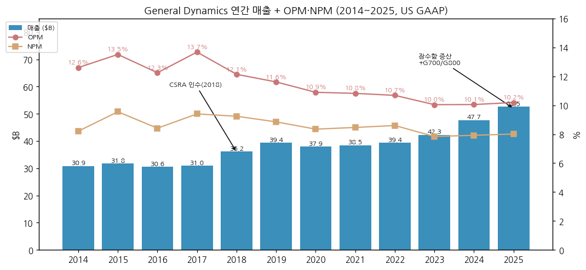

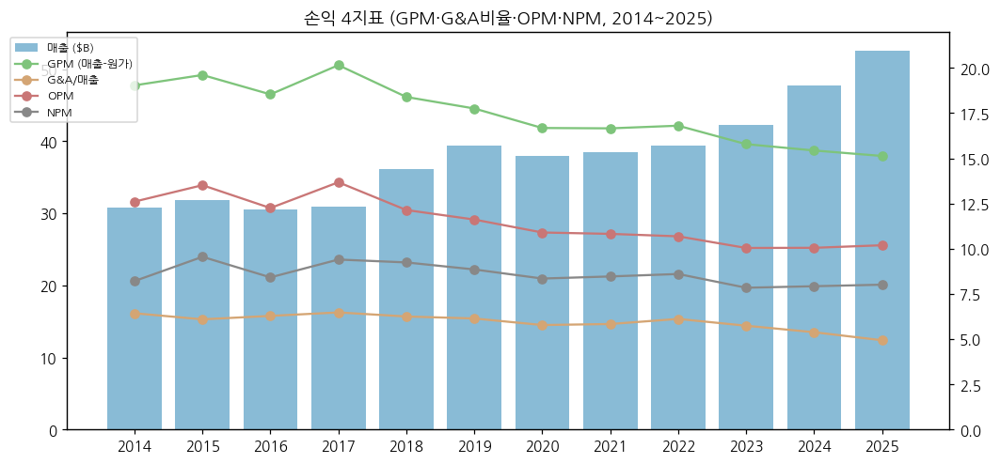

---

## ② 회사 개요

① 기본 사항

→ 회사명: General Dynamics Corporation (Delaware 법인, NYSE: GD). 1952년 설립(Electric Boat 모태, 1899년 창립)

→ 사업 한 줄: 미 해군 핵잠수함 2개 조선소 중 하나(Electric Boat, 콜럼비아급 주계약자)를 보유하고, 걸프스트림 비즈니스 제트로 민수 이익을 내는 방산·항공우주 기업

→ 임직원: 약 117,000명 (10-K 2025·2026)

→ 주 고객: 미국 정부(전쟁부(DoW, 구 국방부)·정보기관), 해외 정부, 비즈니스 제트 구매자

② 12년 손익·자본 추이

| 항목 ($M) | 2014 | 2015 | 2016 | 2017 | 2018 | 2019 | 2020 | 2021 | 2022 | 2023 | 2024 | 2025 |
|---|---|---|---|---|---|---|---|---|---|---|---|---|
| 매출 | 30,852 | 31,781 | 30,561 | 30,973 | 36,193 | 39,350 | 37,925 | 38,469 | 39,407 | 42,272 | 47,716 | 52,550 |
| 영업이익 | 3,889 | 4,295 | 3,744 | 4,236 | 4,394 | 4,570 | 4,133 | 4,163 | 4,211 | 4,245 | 4,796 | 5,356 |
| 순이익 | 2,533 | 3,036 | 2,572 | 2,912 | 3,345 | 3,484 | 3,167 | 3,257 | 3,390 | 3,315 | 3,782 | 4,210 |
| 자본 | 11,829 | 10,440 | 10,301 | 11,801 | 12,110 | 13,978 | 15,661 | 17,641 | 18,568 | 21,299 | 22,063 | 25,622 |
| EPS (희석, $) | 7.42 | 9.29 | 8.29 | 9.56 | 11.18 | 11.98 | 11.00 | 11.55 | 12.19 | 12.02 | 13.63 | 15.45 |

→ (출처: SEC XBRL companyfacts, 각 연도 최신 10-K 기준. 2014년은 ASC 605 구 기준)

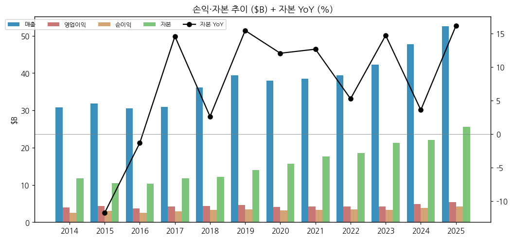

③ 주가 역사

→ 2006~2012: $40~60 박스 (금융위기 저점 2009-03 약 $30)

→ 2013~2017: 시퀘스터(국방 예산 자동 삭감) 이후 자사주 대량 매입 + 걸프스트림 G650 호황으로 $200대 진입 (5년 약 4배)

→ 2018~2020: CSRA 인수·G500/G600 초기 마진 부담 → COVID 2020-10 약 $130 저점

→ 2022~2026: 우크라 전쟁 + 잠수함 증산 + G700/G800 → **2026-07 ATH $400.00**, 이후 10월 방산 섹터 디레이팅으로 $340대 → 3Q26 후 $363.46 (2026-11-13)

→ 2026-10 실적 발표 전 RBC($410→360)·Bernstein($407→365)·TD Cowen($420→380)·Goldman($319→309, Sell) TP 하향 (stockanalysis.com, 2026-10-07~15)

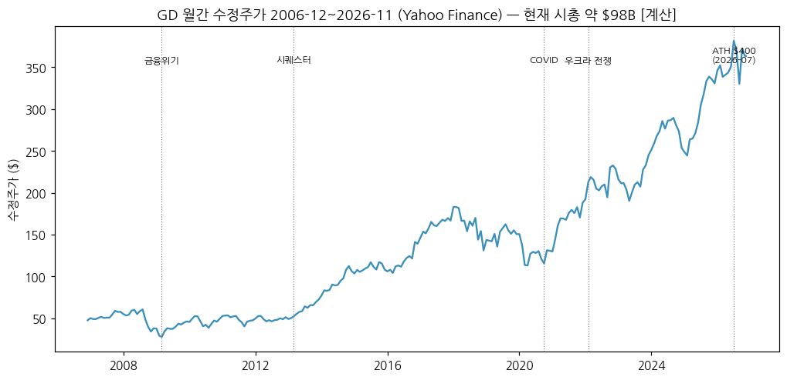

④ 주요 연혁

| 연도 | 사건 |
|---|---|
| 1899 | Electric Boat 설립 (미 해군 최초 잠수함 USS Holland) |
| 1952 | General Dynamics 출범 |
| 1982 | Chrysler Defense(에이브럼스 생산) 인수 → Land Systems |
| 1995 | Bath Iron Works 인수 |
| 1998 | NASSCO 인수 |
| 1999 | Gulfstream 인수 |
| 2003 | GM Defense(스트라이커·LAV) 인수 / 2001 Santa Bárbara(스페인) · 2003 Steyr(오스트리아, ASCOD) 등 유럽 지상장비 |
| 2008 | Jet Aviation 인수 |
| 2013 | Phebe Novakovic CEO 취임 |
| 2018 | CSRA $9.7B 인수 → GDIT 확대 |
| 2019 | 버지니아급 Block V (9척 + 옵션) 약 $22B 수주 |
| 2020 | 콜럼비아급 1번함 건조 계약 |
| 2023 | M10 Booker 경전차 양산 (2025 프로그램 종료) |
| 2024 | G700 인도 개시 / 2025 G800 인도 개시 |
| 2025-12 | Danny Deep 사장 선임 |
| 2026-Q3 | 콜럼비아급 5척 $29.5B + 버지니아급 9척 $42.1B 수주 → 잔고 $220.3B |
| 2026-10 | Danny Deep CEO 선임 (2027-01-01 취임, Novakovic 이사회 의장 잔류) |

→ (출처: GD 10-K 사업 개요, 8-K 2025-06-04·2025-12-05·2026-10-08, 3Q26 컨콜 요약(Zacks 2026-11-02))

---

## ③ 비즈니스 모델

① 실적 추이 통합 표 (사업부별, 연간 $M)

| 사업부 | 항목 | 2021 | 2022 | 2023 | 2024 | 2025 | 9M26 |
|---|---|---|---|---|---|---|---|
| Aerospace | 매출 | 8,135 | 8,567 | 8,621 | 11,249 | 13,110 | 10,340 |
| | 영업이익 | 1,031 | 1,130 | 1,182 | 1,464 | 1,746 | 1,516 |
| | OPM | 12.7% | 13.2% | 13.7% | 13.0% | 13.3% | 14.7% |
| Marine Systems | 매출 | 10,526 | 11,040 | 12,461 | 14,343 | 16,723 | 13,963 |
| | 영업이익 | 874 | 897 | 874 | 935 | 1,177 | 1,049 |
| | OPM | 8.3% | 8.1% | 7.0% | 6.5% | 7.0% | 7.5% |
| Combat Systems | 매출 | 7,351 | 7,308 | 8,268 | 8,997 | 9,246 | 6,959 |
| | 영업이익 | 1,067 | 1,075 | 1,147 | 1,276 | 1,331 | 958 |
| | OPM | 14.5% | 14.7% | 13.9% | 14.2% | 14.4% | 13.8% |
| Technologies | 매출 | 12,457 | 12,492 | 12,922 | 13,127 | 13,471 | 10,879 |
| | 영업이익 | 1,275 | 1,227 | 1,202 | 1,260 | 1,277 | 1,024 |
| | OPM | 10.2% | 9.8% | 9.3% | 9.6% | 9.5% | 9.4% |
| **방산 3사업부 합계** | 매출 | 30,334 | 30,840 | 33,651 | 36,467 | 39,440 | 31,801 |
| | 영업이익 | 3,216 | 3,199 | 3,223 | 3,471 | 3,785 | 3,031 |
| | OPM | 10.6% | 10.4% | 9.6% | 9.5% | 9.6% | 9.5% |
| | 매출 비중 | 79% | 78% | 80% | 76% | 75% | 75% |

→ (출처: 10-K 사업부 표 (각 연도 최신 공시), 3Q26 10-Q Note L. 방산 합계 [계산])

→ 12년 범위: Aerospace OPM 12.7~19.7%, Marine 6.5~9.6%, Combat 13.9~15.8%, Technologies 8.6~11.4% (seg 연간 표, [계산])

**수주잔고 (Total backlog, $B)**

| 사업부 | 3Q24 | 3Q25 | 4Q25 | 1Q26 | 2Q26 | **3Q26** |
|---|---|---|---|---|---|---|
| Aerospace | 19.8 | 20.6 | 21.8 | 22.3 | 24.0 | **25.4** |
| Marine Systems | 40.5 | 53.6 | 52.3 | 64.0 | 65.2 | **146.9** |
| Combat Systems | 18.0 | 18.7 | 27.2 | 26.9 | 29.4 | **28.7** |
| Technologies | 14.4 | 16.9 | 16.7 | 17.7 | 18.0 | **19.4** |
| 합계 | 92.6 | 109.9 | 118.0 | 130.8 | 136.5 | **220.3** |

→ (출처: 10-Q·10-K "Backlog and Estimated Potential Contract Value" 표. 총 추정 계약가치(잔고+옵션·IDIQ) 3Q26 $270.7B)

→ Combat 잔고는 4Q25에 $18.7B → $27.2B로 +45% 점프 후 유지 — 유럽·해외 지상장비/탄약 대형 수주 영향 [판단, 수주 내역 개별 미확인]

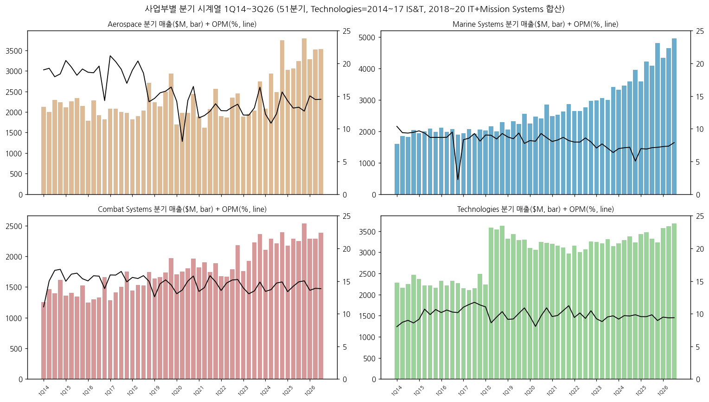

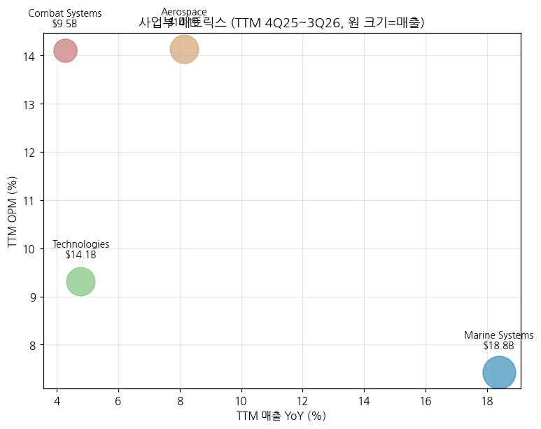

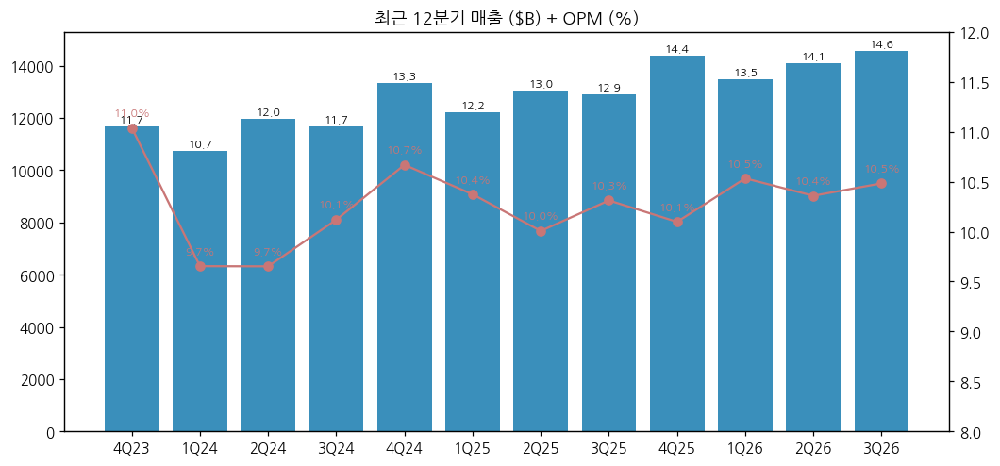

② 사업부별 개요 (TTM 매출 비중 순)

→ **Marine Systems (33%)**: 미 해군 잠수함 2대 건조사 중 하나 (다른 하나는 HII Newport News). Electric Boat가 콜럼비아급 SSBN 주계약자, 버지니아급 SSN은 HII와 분담. 3Q26 잔고 $146.9B = Marine 매출 약 8년치 [계산]

→ **Aerospace (25%)**: 걸프스트림 — 초대형(G700·G800), 대형(G500·G600·G400), 중형(G280 → G300 교체). 2025 인도 158대, 9M26 119대. 2030년 연 200대 목표 (3Q26 컨콜)

→ **Technologies (25%)**: GDIT(연방 IT 서비스·클라우드·AI) + Mission Systems(C5ISR, 암호, 무인잠수정). 마진 9%대, 단기 두 자릿수 회복은 어렵다고 회사 언급 (3Q26 컨콜 요약)

→ **Combat Systems (17%)**: 미국 Land Systems(M1 에이브럼스·스트라이커), European Land Systems(스페인 Santa Bárbara, 오스트리아 Steyr — ASCOD, 스위스 MOWAG — 피라냐·이글, 독일 — 교량), OTS(155mm 포탄·로켓모터·탄약)

③ 사업부별 디테일

(1) Combat Systems — 9M26 매출 증감 분해 ($M, 3Q26 10-Q)
→ 무기·탄약 +343 (포병탄 증산), 해외 군용차량 +108 (유럽 차륜·궤도 차량), 미국 군용차량 -203 (미 육군 재편·M10 Booker 종료)
→ 3Q26 European Land Systems 매출 +28%, 탄약(OTS) +16% (컨콜 요약, StatementDog)
→ 회사 전망: 미 육군 차세대 전환기로 "단기 전투차량 생산량은 소폭 감소", 탄약 수요는 "높은 수준 유지" (3Q26 10-Q MD&A)

(2) Marine Systems — 콜럼비아급·버지니아급 증산
→ 3Q26 매출 +21%, OPM 7.9% (버지니아 Block IV 완료 근접 일회성 호조 포함, 기준선 "mid-7%"), Electric Boat 인력 연내 약 8,000명 순증 계획 (컨콜 요약)

(3) Aerospace — 신기종 주기
→ G700(2024)·G800(2025) 인도 → 3Q26 OPM 14.5%, 2027년 G280 → G300 교체기 인도 공백 예상 (컨콜 요약, Zacks)

④ 주요 경쟁사 (사업부별)

| 사업부 | 글로벌 경쟁사 | **한국 방산 5사와 겹침** |
|---|---|---|
| Combat — 전차 | Rheinmetall·KNDS (레오파르트2) | **현대로템 K2** ↔ M1 에이브럼스: 폴란드가 두 전차를 동시 도입한 공통 고객. 동유럽·중동 신규 전차 사업에서 직접 경합 |
| Combat — 보병전투차·장갑차 | Rheinmetall(Lynx), BAE(CV90), KNDS | **한화에어로스페이스 레드백(AS21)** ↔ GD ASCOD(스페인·오스트리아·영국 Ajax)·스트라이커·피라냐 — 유럽·호주·중동 IFV 사업 경합 |
| Combat — 자주포·탄약 | BAE(M109), Rheinmetall, Nammo | **한화에어로스페이스 K9·탄약** ↔ GD OTS 155mm 포탄 (GD는 자주포 완제품보다 포탄·추진체 공급 중심) |
| Marine — 잠수함·수상함 | HII (Newport News·Ingalls) | **한화오션** (참고만): 한화 필리조선소의 미 해군 보급함·MRO 진출 시 NASSCO·BIW와 접점, 핵잠 영역은 겹치지 않음 |
| Aerospace | Bombardier, Dassault Falcon, Embraer | 없음 |
| Technologies | Leidos, Booz Allen, SAIC, CACI, L3Harris | 한화시스템(C4I·전자전)과 개념상 유사하나 시장(미 연방 IT) 거의 불겹침 |

→ (경쟁 구도는 회사 10-K 사업 서술 + 섹터 문서 기준. 국가별 개별 입찰 결과는 본 문서에서 검증하지 않음 — 섹터 리뷰에서 교차 확인)

⑤ 주요 매출처

→ 미국 정부 매출 비중 연 70%대 이상 (10-K 고객별 매출 공시: 2021년 미 정부 $26.8B / 총 $38.5B = 70% [계산]). 해외 정부, 비즈니스 제트 고객(개인·기업·정부) 순
→ 해외 사업장 매출 $5.4B (2025, 10-K)

⑥ 생산 CAPA + 임직원

| 연도 | 2017 | 2018 | 2019 | 2021 | 2022 | 2023 | 2024 | 2025 |
|---|---|---|---|---|---|---|---|---|
| 임직원 (명) | 98,600 | 105,600 | 102,900 | 103,100 | 106,500 | 111,600 | 117,000 | 117,000 |
| 걸프스트림 인도 (대) | 120 | 121 | 147 | 119 | 120 | 111 | 136 | 158 |

→ (출처: 각 연도 10-K. 2020 인도 127대, 임직원 2020 미추출)

---

## ④ 재무 구조 (12년 시계열)

① 손익계산서

| 항목 ($M) | 2014 | 2015 | 2016 | 2017 | 2018 | 2019 | 2020 | 2021 | 2022 | 2023 | 2024 | 2025 |
|---|---|---|---|---|---|---|---|---|---|---|---|---|
| 매출 | 30,852 | 31,781 | 30,561 | 30,973 | 36,193 | 39,350 | 37,925 | 38,469 | 39,407 | 42,272 | 47,716 | 52,550 |
| G&A | 1,984 | 1,937 | 1,921 | 2,006 | 2,263 | 2,417 | 2,192 | 2,245 | 2,411 | 2,427 | 2,568 | 2,595 |
| 영업이익 | 3,889 | 4,295 | 3,744 | 4,236 | 4,394 | 4,570 | 4,133 | 4,163 | 4,211 | 4,245 | 4,796 | 5,356 |
| OPM | 12.6% | 13.5% | 12.3% | 13.7% | 12.1% | 11.6% | 10.9% | 10.8% | 10.7% | 10.0% | 10.1% | 10.2% |
| 순이익 | 2,533 | 3,036 | 2,572 | 2,912 | 3,345 | 3,484 | 3,167 | 3,257 | 3,390 | 3,315 | 3,782 | 4,210 |
| NPM | 8.2% | 9.6% | 8.4% | 9.4% | 9.2% | 8.9% | 8.4% | 8.5% | 8.6% | 7.8% | 7.9% | 8.0% |
| 매출 YoY | -0.3% | 3.0% | -3.8% | 1.3% | 16.9% | 8.7% | -3.6% | 1.4% | 2.4% | 7.3% | 12.9% | 10.1% |

② 재무상태표

| 항목 ($M) | 2014 | 2015 | 2016 | 2017 | 2018 | 2019 | 2020 | 2021 | 2022 | 2023 | 2024 | 2025 |
|---|---|---|---|---|---|---|---|---|---|---|---|---|
| 자산 | 35,337 | 32,538 | 33,172 | 35,046 | 45,887 | 49,349 | 51,308 | 50,073 | 51,585 | 54,810 | 55,880 | 57,249 |
| 자본 | 11,829 | 10,440 | 10,301 | 11,801 | 12,110 | 13,978 | 15,661 | 17,641 | 18,568 | 21,299 | 22,063 | 25,622 |
| 부채 [계산] | 23,508 | 22,098 | 22,871 | 23,245 | 33,777 | 35,371 | 35,647 | 32,432 | 33,017 | 33,511 | 33,817 | 31,627 |
| Goodwill | 11,731 | 11,443 | 11,445 | 11,914 | 19,594 | 19,677 | 20,053 | 20,098 | 20,334 | 20,586 | 20,556 | 21,009 |
| 현금 | 4,388 | 2,785 | 2,334 | 2,983 | 963 | 902 | 2,824 | 1,603 | 1,242 | 1,913 | 1,697 | 2,333 |

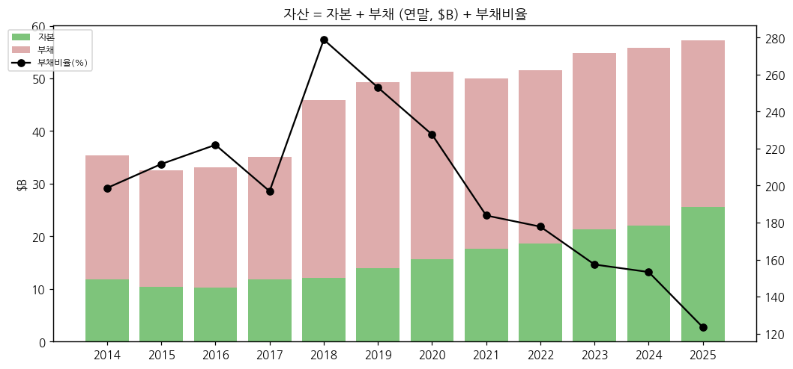

③ 현금흐름표

| 항목 ($M) | 2014 | 2015 | 2016 | 2017 | 2018 | 2019 | 2020 | 2021 | 2022 | 2023 | 2024 | 2025 |
|---|---|---|---|---|---|---|---|---|---|---|---|---|
| OCF | 3,728 | 2,499 | 2,163 | 3,876 | 3,148 | 2,981 | 3,858 | 4,271 | 4,579 | 4,710 | 4,112 | 5,120 |
| CapEx | 521 | 569 | 392 | 428 | 690 | 987 | 967 | 887 | 1,114 | 904 | 916 | 1,161 |
| FCF [계산] | 3,207 | 1,930 | 1,771 | 3,448 | 2,458 | 1,994 | 2,891 | 3,384 | 3,465 | 3,806 | 3,196 | 3,959 |
| FCF/순이익 | 127% | 64% | 69% | 118% | 73% | 57% | 91% | 104% | 102% | 115% | 85% | 94% |

→ 2016 OCF는 10-K 2020 재작성값(2,163). 2018 ICF -$10.2B = CSRA 인수. **9M26 OCF $5,745M, FCF $4,827M** (전년 9M $3,007M) — 3Q26 Press Release

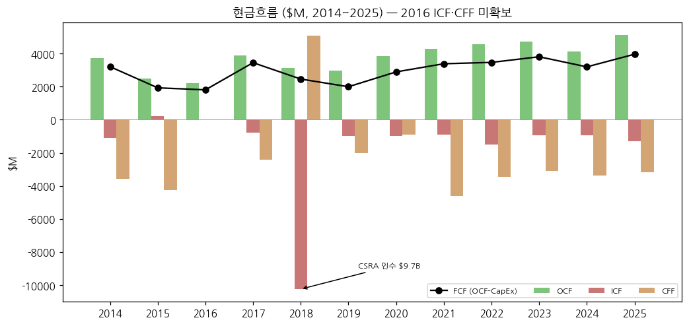

④ CapEx

→ CapEx/매출 1.3% (2016) → 2.5% (2019, 걸프스트림 Savannah·잠수함 야드) → 2.2% (2025). **2026년 9M $918M (+66% YoY), 연간 매출의 3.5~4% 가이드** (3Q26 컨콜 요약) — Electric Boat·Bath·NASSCO 증설

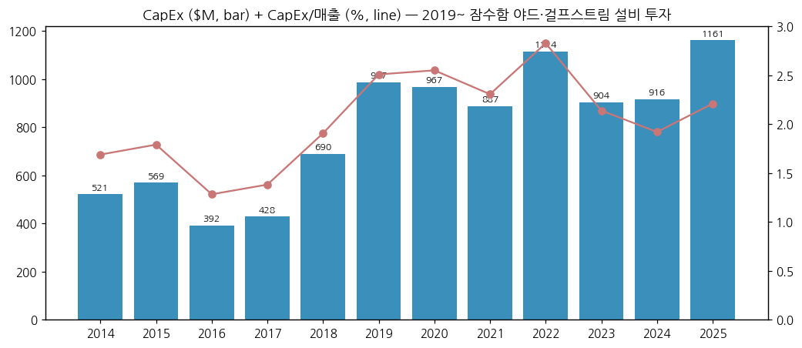

⑤ 부채 구조

| 항목 ($M) | 2014 | 2017 | 2018 | 2019 | 2020 | 2021 | 2022 | 2023 | 2024 | 2025 | 3Q26 |
|---|---|---|---|---|---|---|---|---|---|---|---|
| 총차입금 | 3,893 | 3,982 | 12,417 | 11,930 | 12,998 | 11,495 | 10,496 | 9,261 | 8,762 | 8,013 | 7,016 |
| 순차입금 [계산] | -495 | 999 | 11,454 | 11,028 | 10,174 | 9,892 | 9,254 | 7,348 | 7,065 | 5,680 | 2,628 |

→ CSRA 인수로 2018년 차입 급증 후 매년 상환 — 2026년 6월·8월 각 $500M 만기 상환, 3Q26말 CP 잔액 0, $4B 신용한도 (3Q26 10-Q)

⑥ 배당·자사주

| 항목 | 2014 | 2015 | 2016 | 2017 | 2018 | 2019 | 2020 | 2021 | 2022 | 2023 | 2024 | 2025 |
|---|---|---|---|---|---|---|---|---|---|---|---|---|
| 배당 지급 ($M) | 822 | 873 | 911 | 986 | 1,075 | 1,152 | 1,240 | 1,315 | 1,369 | 1,428 | 1,529 | 1,593 |
| 자사주 ($M) | 3,382 | 3,233 | 1,996 | 1,558 | 1,769 | 231 | 587 | 1,828 | 1,229 | 434 | 1,501 | 637 |
| 주당 배당 선언 ($) | 2.48 | 2.76 | 3.04 | 3.36 | 3.72 | 4.08 | 4.40 | 4.76* | 5.04* | 5.28* | 5.68* | 6.00* |

→ *2021~ = 분기 배당 × 4 [계산] (10-K 분기 배당 공시). 2026-03 분기 배당 $1.59로 **29년 연속 인상**. 희석 주식수 2014 341M → 2025 272M (-20%)

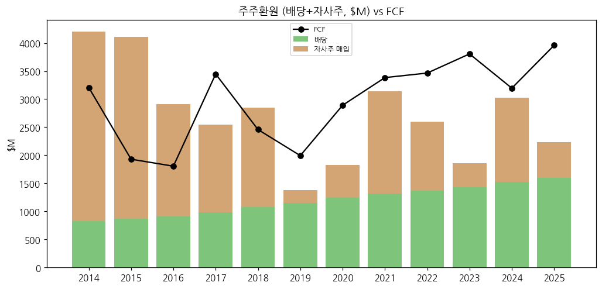

⑦ 재무비율

| 비율 | 2014 | 2015 | 2016 | 2017 | 2018 | 2019 | 2020 | 2021 | 2022 | 2023 | 2024 | 2025 |
|---|---|---|---|---|---|---|---|---|---|---|---|---|
| ROE | 19.2% | 27.3% | 24.8% | 26.4% | 28.0% | 26.7% | 21.4% | 19.6% | 18.7% | 16.6% | 17.4% | 17.7% |
| ROA | 7.2% | 8.9% | 7.8% | 8.5% | 8.3% | 7.3% | 6.3% | 6.4% | 6.7% | 6.2% | 6.8% | 7.4% |
| 부채비율 | 199% | 212% | 222% | 197% | 279% | 253% | 228% | 184% | 178% | 157% | 153% | 123% |
| 유동비율 | 127% | 117% | 123% | 140% | 123% | 121% | 135% | 143% | 137% | 144% | 137% | 144% |
| 이자보상배율 | 37.8x | 43.8x | 37.8x | 36.2x | 11.7x | 9.7x | 8.5x | 9.7x | 10.8x | 10.6x | 14.8x | 17.1x |

→ (ROE·ROA 평균자본·자산 기준 [계산]. 이자보상배율 = 영업이익 / 이자비용(2024·2025는 순이자비용 $324M·$314M))

---

## ⑤ 지배 구조

① 그룹·계열 관계

→ 독립 상장사 (지주·모회사 없음). 주요 자회사: Gulfstream Aerospace, Jet Aviation, Electric Boat, Bath Iron Works, NASSCO, GD Land Systems, GD European Land Systems, GD-OTS, GDIT, GD Mission Systems

② 주주 구성

→ DEF 14A 미수집으로 5% 이상 주주 표 미작성 ❌. 발행주식 270.2M주 (2026-10-04). 2026-08 직원 저축플랜 관련 최대 1,010,925주 rescission offer 공시 (8-K 2026-08-04)

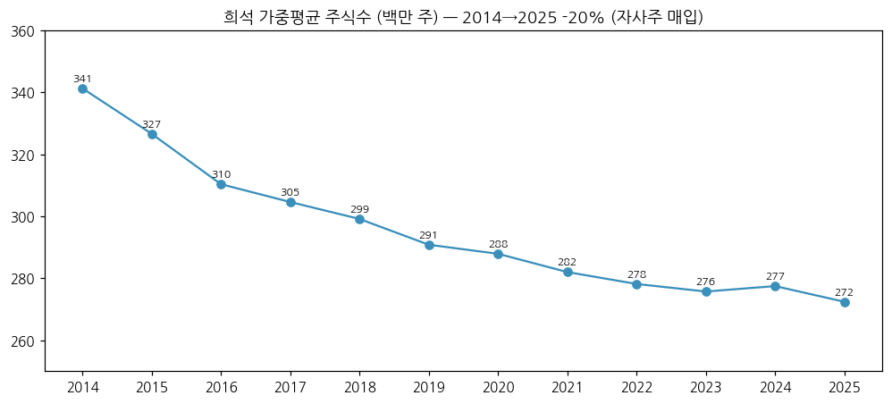

③ 임원·이사회

→ **Phebe N. Novakovic** — 회장 겸 CEO (2013~), 2027-01-01부터 이사회 의장(Executive Chairman)
→ **Danny Deep** (56세) — 사장(2025-12~), 이사(2026-08~), **CEO 선임 (2027-01-01 취임)**. 前 GD Land Systems 사장, Combat Systems EVP(2024-04~2025-06), Global Operations EVP(2025-06~12) — **지상장비 출신 CEO**
→ Kimberly Kuryea — CFO / 사업부: Mark Burns(Gulfstream), Rob Smith(Marine), Jason Aiken(Combat + Mission Systems), Amy Gilliland(GDIT)
→ (출처: 8-K 2025-06-04·2025-12-05·2026-08-07·2026-10-08, 3Q26 컨콜 참석자)

---

## ⑥ 기타 팩트

① R&D

| 연도 | 2014 | 2015 | 2016 | 2017 | 2018 | 2019 | 2020 | 2021 | 2022 | 2023 | 2024 | 2025 |
|---|---|---|---|---|---|---|---|---|---|---|---|---|
| 회사 자체 R&D ($M) | 358 | 395 | 418 | 521 | 502 | 466 | 374 | 415 | 480 | 510 | 565 | 486 |
| R&D/매출 | 1.2% | 1.2% | 1.4% | 1.7% | 1.4% | 1.2% | 1.0% | 1.1% | 1.2% | 1.2% | 1.2% | 0.9% |

→ (출처: 10-K "Company-sponsored R&D, including Aerospace product-development costs". 고객 부담 R&D(정부 계약)는 별도·미포함)

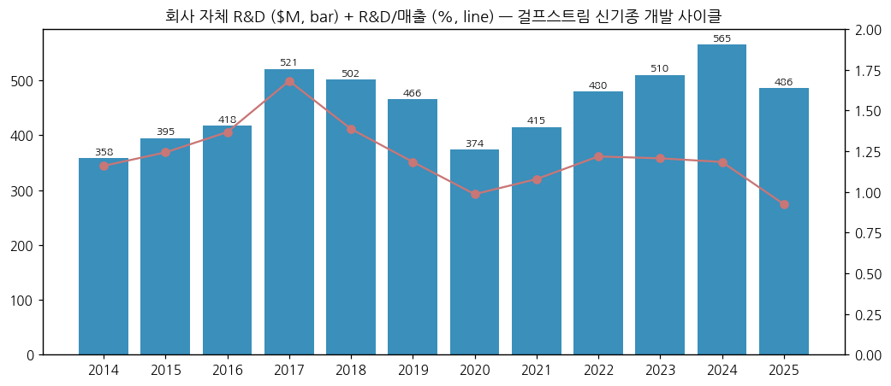

② Corporate action (10년)
→ 2018 CSRA 인수 ($9.7B) / 2020~21 IT·Mission Systems → Technologies 통합 / 2025 M10 Booker 종료 / 2026 경영진 승계

③ 제품 마일스톤
→ 2015 G500 첫 비행 → 2018 G500 인도 → 2019 G600 인도 / 2024 G700, 2025 G800 인도 개시 / G300(중형, G280 후속) 출시 준비 — 2027년 교체기 인도 공백 예상 (3Q26 컨콜) / 콜럼비아급 1번함 건조 중 / M1E3 차세대 전차·XM30 보병전투차 개발 경쟁 (미 육군)

④ 주요 리스크
→ 미 국방 예산·CR(임시예산): FY2027 예산 미통과, CR 2026-12-11까지 (3Q26 10-Q)
→ 조선 공급망·숙련 인력 부족 (잠수함 일정 지연·고정가 계약 원가 리스크)
→ 걸프스트림: 이스라엘 소재 중형기 동체 공급사의 중동 분쟁 영향, 러시아 제재, 관세(IEEPA 관세 환급 진행) (3Q26 10-Q)
→ 미 육군 지상장비 재편(전투차량 단기 물량 감소)

⑤ ESG 등급 — 미수집 ❌

⑥ 인증·라이선스 — 미 해군 핵추진 함정 건조 자격(2개사 중 1), FAA 형식증명(걸프스트림 전 기종)

---

## Version Log

| 버전 | 일자 | 내용 |
|---|---|---|
| v1.0 | 2026-11-14 | 최초 작성 — SEC 10-K 13·10-Q 39·8-K 17 + XBRL, 연간 12년·분기 51분기, 13개 차트, 한국 5사 경쟁 매핑 |

→ 잔여 보완 후보: DEF 14A(주주·보수), IR 슬라이드·컨콜 원문, 사업부별 수주(orders) 시계열, ESG 등급, 2027 가이던스(2027-01 4Q26 발표) 반영
