# GKL — 기업 개요 (v1.0)

> 마지막 update: 2026-11-25 (v1.0 — 첫 작성. 3Q26 분기보고서(2026-11-13 제출) 반영)
> 입력 source: OpenDART fnlttSinglAcntAll (연결 CFS 2018 사업보고서\~3Q26 32개 + 별도 OFS 2015 사업보고서\~3Q26 44개 JSON — GKL은 2018-10 자회사 지케이엘위드 설립 후 연결 작성, 2014\~2017은 별도(종속회사 없음), 2014는 2015 사업보고서 전기 컬럼) + DART 정기공시 원문 XML 54건 (사업보고서 2015\~2025·분기/반기 1Q16\~3Q26, 본문·첨부 포함) + OpenDART 기업개황·최대주주·임원·직원·배당·자기주식·주식총수 (2025 사업보고서) + GKL IR PDF 17건 (2018-05\~2025-09, irgo 경유 — 2020-05 이후 2024-06 전까지 공백, 3Q25 이후 미게시) + Yahoo Finance (114090.KS 일간·월간 2009-11-19\~2026-11-25) + 네이버증권 (외국인 소진율, 2026-11-24) + 언론 (머니투데이·데일리안·MTN·매일신문·IB토마토·스마트투데이·AsGam·GGRAsia·아시아경제·Focus Gaming News, 2023-01\~2026-11)
> 갱신 주기: 매분기 (실적 리뷰 모드 호출 시)
> 워치리스트: **여행·레저·유통 섹터 / 서브섹터: 면세·카지노·여행** (`earnings/watchlist.md` 102·103행, 2순위 섹터 — 4Q26부터 리뷰)
> **Fact verify cutoff**: 2026-11-25 (주가 2026-11-24 종가 **7,200원** [Yahoo Finance 114090.KS, 네이버증권 '전일 7,200' 동일], 발행주식 61,855,670주 [DART 2025 사업보고서 주식의 총수 — 자기주식 0주] → 시가총액 **4,454억원 (0.45조)** [계산]. **상장(2009-11-19) 이후 종가 최고가: 2014-08-25 49,150원** (장중 최고 49,600원, 2014-03·08) [Yahoo 일간] → 당시 시총 **3.04조원** [계산]. 고점 대비 **-85.4%**. YTD **-51.9%** (2025말 14,970원), 1년 **-51.2%** (2025-11-24 14,750원). 52주 최고 종가 15,310원 (2025-12-22), 2026-11-23 종가 7,170원은 상장 후 종가 최저 [Yahoo]. 외국인 소진율 11.07% [네이버증권 2026-11-24])

---

## 1. 기업 분류

- **Primary 분류: 사이클 — 방한 외래객·VIP 정책 사이클 (공기업 배당형)** — 매출은 외국인 VIP 입국(특히 중국·일본) 흐름에 따라 2014 정점 → 2017 사드 → 2020\~2022 코로나로 대진폭. 12년(2014\~2025) 매출 CAGR **-2.2%** — 11년간 2014 수준을 회복하지 못함. 비용은 인건비(정규직 1,800명)·임차료·기금이 고정적이라 매출 변동이 OPM에 증폭 전달 (OPM 27.6% ↔ -171.4%)
- **Secondary 노트: 정책·규제 리스크 프리미엄 + 공기업 할인** — 한국관광공사 51% 자회사(준시장형 공기업)로 경영평가·배당정책(정부 배당성향 가이드)·사장 인선이 정부 영향. 2026-07 관광진흥개발기금 상한 10→15% 상향 추진 [머니투데이 2026-07-20]이 이익 구조를 바꿀 수 있는 최대 변수

### ① 정량 근거

**📊 Summary Box (12년, 2014\~2025 — 2014\~2017 별도 / 2018\~ 연결):**

| 지표 | 값 |
|------|-----|
| 매출 CAGR (2014→2025, 11년) | **-2.2%** (5,407억 → 4,229억) — 2025 매출은 2019의 86%, 2014 정점의 78% |
| OPM 평균 | **-4.0%** (range -171.4\~27.6%) — 코로나 3년(2020\~2022) 제외 시 **19.6%**, 코로나 전(2014\~2019) 23.6% → 리오프닝 후(2023\~2025) 11.7% |
| OPM 정점 평균 | **27.5%** (2014 27.3% · 2016 27.6%) — 중국 VIP 정점·홀드율 13%대 |
| OPM 저점 평균 | **-109.8%** (2020 -48.1% · 2021 -171.4%) — 코로나 휴장. 비(非)코로나 저점은 2024 9.7% (마케팅비 증가 + 홀드율 10.8%) |
| 사이클 주기 | **약 4\~6년 (외부 충격 주도)** — 2014 고점 → 2017 사드 저점(3년) → 2019 회복 → 2021 코로나 저점 → 2025 회복. 내생적 수요 사이클이 아니라 **방한 정책·지정학 충격** 주기 |
| 사이클 회수 (12년) | **2회** (사드 2017 / 코로나 2020\~2022). 2026은 3번째 하강 후보 (기금 상향·中 자본통제·원화 강세) |

```
[전사 OPM 시계열 (12년, DART — 2014~2017 별도 / 2018~ 연결)]
연도   매출(억)  영업이익  순이익    OPM     NPM   드롭(조)  홀드율  입장객(만)
2014    5,407    1,478    1,165    27.3    21.5    4.45    12.0%    157.1   ← 매출·영업이익 사상 최대 (중국 VIP 정점, 별도)
2015    5,057    1,184      917    23.4    18.1    4.17    11.9%    160.1   ← 메르스(5~7월)·中 반부패, 드롭 -6.3%
2016    5,482    1,512    1,143    27.6    20.9    4.08    13.3%    151.9   ← 매출 5,482억 사상 최대 (홀드율 13.3%)
2017    5,013    1,082      805    21.6    16.1    3.89    12.6%    120.4   ← 사드 보복(3월 中 단체관광 금지), 드롭 -4.7%
2018    4,803    1,051      777    21.9    16.2    4.20    11.5%    147.8   ← 연결 첫 해(지케이엘위드), 입장객 회복
2019    4,908      968      724    19.7    14.8    4.55    10.8%    172.1   ← 드롭 4.55조 사상 최대, 홀드율 10.8%
2020    1,845     -888     -643   -48.1   -34.9    1.43    13.0%     44.5   ← 코로나 — 2월부터 단축·휴장, 11월말 서울 휴장
2021      851   -1,458   -1,133  -171.4  -133.1    0.75    11.9%     24.6   ← 서울 3/15·부산 2/15 재개장, 매출 851억
2022    2,621     -139     -227    -5.3    -8.7    1.99    13.3%     40.9   ← 리오프닝, 12/31 강북힐튼 → 서울드래곤시티 이전
2023    3,967      510      438    12.9    11.1    3.39    11.7%     79.0   ← 흑자전환, 배당 재개 (DPS 353원)
2024    3,964      383      331     9.7     8.3    3.65    10.8%    104.5   ← 마케팅비 +89억, 홀드율 10.8% → 감익
2025    4,229      526      471    12.4    11.1    3.70    11.5%    111.7   ← 홀드율 11.5% 회복, 순이익 +42%

OPM range: -171.4% ~ 27.6%  (코로나 제외 9.7% ~ 27.6% — 고정비 레버리지가 커서 홀드율 1%p, 드롭 10% 변화가 OPM 3~5%p를 움직임)
드롭: 2014~2021 DART 점별 드롭액 / 2022~2025 언론 집계(GGRAsia·아시아경제·AsGam). 홀드율 = 관광기금 부과기준 카지노매출 / 드롭 [계산]
```

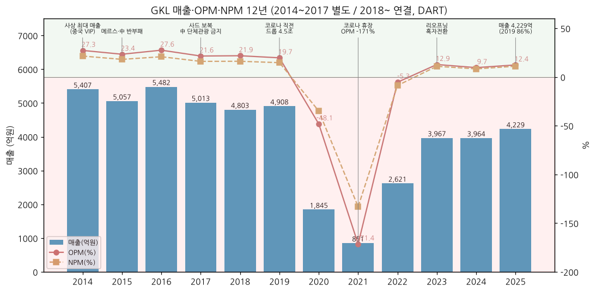

(2014\~2017은 별도 재무제표 — 당시 종속회사가 없어 사실상 회사 전체. 2018-10 자회사 지케이엘위드(카지노 영업장 운영 서비스) 설립 후 연결 작성 — 2018 연결 매출 4,803억 vs 별도 4,802억으로 차이 미미 [DART]. 2019 IFRS16 도입으로 영업장 임차료가 사용권자산 상각·이자비용으로 전환)

### ② 산업 분류

- 산업: **외국인전용 카지노 (도심형, 임차 영업장 3곳)** — 관광진흥법상 문체부 허가 사업. 국내 카지노 18개 중 외국인전용 17개 + 내국인 1개(강원랜드) [DART 분기보고서(2026.09) II-7]
- DART 업종: 91249 기타 갬블링 및 베팅업 [OpenDART 기업개황]. 공공기관운영법상 **준시장형 공기업** (2017-01-25 지정) [DART 분기보고서(2026.09)]
- 워치리스트 섹터: **여행·레저·유통** / 서브섹터: **면세·카지노·여행**
- 시장 지위: 외국인전용 카지노 매출 점유율 **18.8% (2025)** — 2012 44.7%, 2016 42.4%에서 하락 [DART 시장점유율·업체현황 표, 계산]. 2025 매출(관광기금 부과기준) 4,253억으로 파라다이스 계열(워커힐 3,422억 + 파라다이스시티 4,854억 + 부산·제주) 대비 열위, 롯데관광개발 드림타워(5,206억)보다도 작음 [DART 분기보고서(2026.09) 국내 카지노업체 현황]

### ③ 분류 결정 논리

(1) **가장 매출 큰 사업부 기준** 적용 시: 카지노 단일 사업 — 9M26 테이블 89.4% / 머신 9.3% / 환전수입 1.3% [DART 분기보고서(2026.09) II-2]. 수요는 방한 외국인(중국·일본·기타 아시아) VIP·매스 — 정책·지정학·환율에 민감 → **사이클**
(2) **이익 비중 sub-rule**: 단일 사업이라 사업부 이익 분해 없음. 영업점별(강남코엑스·서울드래곤시티·부산롯데) 매출·드롭·입장객만 공시, 영업점별 이익 미공시 → 전사 OPM 변동성(코로나 제외 9.7\~27.6%)으로 판단 → **사이클 유지**
(3) **Boundary case 처리 — "배당 유틸리티"로 볼 수 있나**: 순현금 4,183억(3Q26, 현금+정기예금, 리스 제외) = 시총의 94% [계산]. 차입금 0, 배당성향 50%+ (정부 공기업 배당 가이드 40%+) [IR 1Q24]. 그러나 이익 자체가 외부 충격에 대진폭(2020\~2022 3년 연속 적자·무배당)이어서 **배당 안정성은 사이클 종속** → Primary 사이클, 배당은 Secondary 속성
(4) **국내 카지노 피어 + 글로벌 cross-ref**:
→ **파라다이스(034230)**: 같은 외국인전용이지만 인천 파라다이스시티 복합리조트(IR) 보유 — 2025 매출 1.15조 (+7%대) [IB토마토 2026-06-11]. 비카지노(호텔·리조트) 포트폴리오가 있어 분류는 "사이클 + IR 성장"
→ **롯데관광개발(032350)**: 제주 드림타워 IR — 2025 매출 6,534억 (+38.6%) [IB토마토 2026-06-11]. 성장 국면(차입 레버리지 큼)
→ **GKL**은 3사 중 유일하게 **호텔·비게이밍 시설이 없는 임차형 도심 카지노** — 성장 레버(신규 IR 투자)가 없고 점유율이 구조적으로 하락 중. "IR은 현재 검토하지 않는다"는 회사 입장 [IB토마토 2026-06-11]
→ 비교 수치는 `파라다이스_기업개요.md`, `롯데관광개발_기업개요.md` (동시 작성, 통합 검수 대상) 참조
→ 글로벌: 마카오 6사·싱가포르(Genting Singapore, MBS)와 같은 VIP·매스 게이밍이지만 규모·IR 보유 여부가 달라 정성 비교만 (수치 미수집). 2026 6\~9월 마카오 GGR 4개월 연속 YoY 감소 — 中 역외신탁 과세 등 자본통제 영향 [MTN 2026-10-13]

### ④ 적정 밸류에이션 방법

- **PER(정상화 이익) + 배당수익률 우선, 순현금 조정 EV 보조**
→ 현재 **PER 11.3배** [계산: 시총 4,454억 / LTM 지배순이익 394억 (4Q25 -7 + 1Q26 151 + 2Q26 180 + 3Q26 70)]. 2026E 컨센서스 기준 추정 PER 9.3배 [네이버증권 2026-11-24, 컨센서스 EPS 794원]
→ **배당수익률 5.75%** [계산: 2025 DPS 414원 / 7,200원]. 공기업으로 정부 배당성향 가이드(40%+) 준수, 최근 3년 배당성향 49.8\~54.4% [DART]
→ **PBR 0.98배** [계산: 시총 / 3Q26 자본총계 4,553억, 비지배지분 0]. 코로나 전(2014\~2019) 연말 PBR 2.1\~4.6배 대비 최저권 (4번 ⑦ 표)
→ **순현금 조정**: 순현금 4,183억 제외 시 EV 271억 → LTM 영업이익(477억) 대비 EV/EBIT **0.6배** [계산] — 시장은 본업 가치를 사실상 0으로 반영 중. 단, 순현금 일부는 기금·개별소비세·임대료 등 운영자금 성격이고 리스부채 1,574억(3Q26)을 감안하면 리스 포함 순현금 2,610억
- **피어 차별화**: 파라다이스·롯데관광개발은 성장(IR 증설·점유율 상승) 프레임의 EV/EBITDA, GKL은 **"기금 상향 후 정상화 이익 × PER + 배당"** 프레임 — 기금 상향 시 연 229억 추가 부담(15% 단순 적용 상한, 2025 영업이익 526억의 44%) [머니투데이 2026-07-20]이 정상화 이익 계산의 핵심 변수

#### ④-1 면세·카지노·여행 공통 비교 박스 (통합 검수 예정)

### ⑤ 분기 재평가 트리거 (분류 변경 조건)

- **관광진흥개발기금 부과율 상향 확정** (법 개정 통과, 최고 구간 15%) 시 → 정상화 OPM 하향(기금/매출 2025 9.7% → 최대 15%) + "규제 이익 축소" 태그 추가
- **카지노 허가 5년 갱신제 도입** [데일리안 2026-08-06] 시 → 공기업이라 갱신 리스크는 낮지만, 영업장 임차 재계약·허가 연계 조건 확인 필요
- **부산롯데점 임대차(2026-12-31 만료)** [DART 분기보고서(2026.09) II-6] 재계약 조건 공시 시 → 리스부채·상각비 재추정 (코엑스는 2025-10 10년 재계약으로 3Q26 사용권자산 +1,080억)
- **드롭 2개 분기 연속 YoY -10% 이하** 또는 **홀드율 10% 미만 2개 분기** 시 → 사이클 하강 국면 판정
- **IR(복합리조트)·신규 영업장 추진 공식화** 시 → "성장 옵션" Secondary 추가

---

## 2. 회사 개요

### ① 기본 사항

- **회사명**: 그랜드코리아레저㈜ (Grand Korea Leisure Co., Ltd. / 브랜드 세븐럭 Seven Luck) / KRX 114090 (유가증권시장, 종목명 GKL)
- **본사**: 서울특별시 강남구 삼성로 610 [OpenDART 기업개황]
- **설립**: 2005-01 한국관광공사가 외국인전용 카지노 3개 허가 취득 → 2005-09-06 관광공사 자회사로 법인 설립 → 2006-01 강남코엑스점, 2006-05 강북힐튼점, 2006-06 부산롯데점 개장 [DART 사업보고서(2025.12) I-2]
- **지배구조**: 최대주주 한국관광공사 **51.00%** (31,546,392주), 국민연금공단 8.06% (2026-06-30) [DART 반기보고서(2026.06) VII]. 공공기관운영법상 준시장형 공기업 — 기획재정부 경영평가 대상
- **사업 한 줄 정의**: 서울 2곳(강남코엑스·서울드래곤시티)과 부산 1곳(부산롯데)에서 외국인전용 카지노 '세븐럭'을 24시간·연중무휴로 운영하는 공기업. 영업장은 모두 임차, 호텔·리조트 등 비게이밍 시설 없음
- **설비·고객**: 테이블 173대, ETG 14대(단말기 187), 머신 354대 (2026-09말) [DART 분기보고서(2026.09) II-3]. 2025 입장객 111.7만명 — 서울드래곤시티 57.2만 / 강남코엑스 36.2만 / 부산롯데 18.3만 [DART 사업보고서(2025.12) IV]. 주력 고객은 중국·일본·중화권·몽골 등 아시아 VIP·매스
- **대표이사**: 윤두현 사장 (1961-05생, 前 YTN플러스 대표·대통령비서실 홍보수석·제21대 국회의원, 2024-12-02 취임, 임기 2027-12-01) [OpenDART exctvSttus 2025]
- **신용등급**: **미확보 / 해당 없음 추정** — 차입금·사채 발행 이력이 없어(2017말 장기차입금 3.6억 이후 0) 공모 회사채 신용등급 미공시 [DART 재무제표]

### ② 최근 12년 손익·자본 추이 (억원, DART)

| 연도 | 기준 | 매출 | YoY | 영업이익 | 순이익 | 자본총계 | 자본 YoY |
|---|---|---|---|---|---|---|---|
| 2014 | 별도 | 5,407 | - | 1,478 | 1,165 | 4,314 | - |
| 2015 | 별도 | 5,057 | -6.5% | 1,184 | 917 | 4,562 | +5.8% |
| 2016 | 별도 | 5,482 | +8.4% | 1,512 | 1,143 | 5,187 | +13.7% |
| 2017 | 별도 | 5,013 | -8.6% | 1,082 | 805 | 5,321 | +2.6% |
| 2018 | 연결 | 4,803 | -4.2% | 1,051 | 777 | 5,621 | +5.6% |
| 2019 | 연결 | 4,908 | +2.2% | 968 | 724 | 5,852 | +4.1% |
| 2020 | 연결 | 1,845 | -62.4% | -888 | -643 | 4,864 | -16.9% |
| 2021 | 연결 | 851 | -53.9% | -1,458 | -1,133 | 3,835 | -21.1% |
| 2022 | 연결 | 2,621 | +208.1% | -139 | -227 | 3,825 | -0.3% |
| 2023 | 연결 | 3,967 | +51.3% | 510 | 438 | 4,118 | +7.7% |
| 2024 | 연결 | 3,964 | -0.1% | 383 | 331 | 4,135 | +0.4% |
| 2025 | 연결 | 4,229 | +6.7% | 526 | 471 | 4,415 | +6.7% |

(OpenDART fnlttSinglAcntAll. 9M26 (연결): 매출 3,408억 (+6.4%), 영업이익 486억 (-9.1%), 순이익 401억 (-16.1%) [DART 분기보고서(2026.09)]. LTM(4Q25\~3Q26) 매출 4,437억 / 영업이익 477억 / 순이익 394억 [계산])

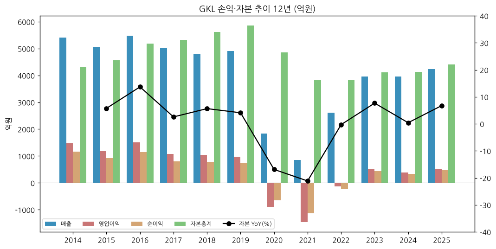

### ③ 회사 주가 역사 ★ narrative 영역

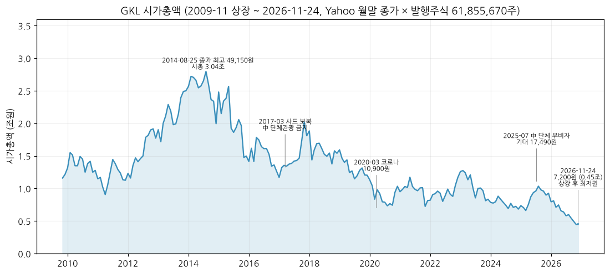

(차트: Yahoo 월말 종가(close) × 발행주식 61,855,670주 — 상장 이후 증자·감자·자사주 소각 공시 없음 [DART 사업보고서 자본금 변동사항 2015\~2025 확인분]. 2009\~2014 주식수 일정 가정)

(1) 2009\~2014: 상장 → 중국 VIP 붐 → 사상 최고가
→ 2009-11-19 상장, 첫 거래일 종가 15,850원 (시총 0.98조) [Yahoo]
→ 2012\~2014 방한 중국인 급증 — GKL 입장객 중 중국 비중 2012 27.4% → 2014 40.4% [DART 사업보고서(2015.12)]
→ 2014 매출 5,407억·영업이익 1,478억 (OPM 27.3%) — 영업이익 사상 최대
→ **2014-08-25 종가 49,150원 — 상장 후 최고가 (시총 3.04조)** [Yahoo 일간]

(2) 2015\~2017: 中 반부패·메르스·사드 → 장기 하락
→ 2014-12 종가 32,250원으로 고점 대비 -34% (中 반부패정책 영향 [DART 사업보고서(2019.12) 산업의 성장성]) [Yahoo]
→ 2015 메르스(5\~7월) — 드롭 -6.3%, 영업이익 -19.9%
→ 2016 매출 5,482억 사상 최대(홀드율 13.3%)에도 주가는 2016말 20,450원
→ 2017-03 사드 보복 — 中 단체관광 금지. 2017 입장객 -20.7% (151.9만 → 120.4만), 영업이익 -28.4% [DART]

(3) 2018\~2019: 회복 시도 — 주가 박스권
→ 2017-12-04 종가 34,000원 반등 (한중 관계 개선 기대 **[⚠️ 추정 — 반등 원인 미검증]**) → 2018\~2019 박스권 하락 (2019말 19,450원)
→ 2019 드롭 4.55조 사상 최대였지만 홀드율 10.8%로 매출 4,931억 (+2.2%), 영업이익 968억 (-7.9%) [DART]
→ 2019 IFRS16 — 영업장 임차가 사용권자산 929억·리스부채로 인식

(4) 2020\~2022: 코로나 휴장 — 3년 적자·무배당
→ 2020-03-23 종가 10,900원 (당시 상장 후 최저) [Yahoo]
→ 서울 2020-11-24\~2021-03-14, 부산 2020-12-01\~2021-02-14 휴장 [DART 사업보고서(2021.12)]
→ 2021 매출 851억 (2019의 17%), 영업손실 -1,458억, 무배당 3년 (2020\~2022)
→ 2022-12-31 강북힐튼점 영업 종료 → 서울드래곤시티점 이전 개장 (리모델링 190억, 임차 2022-08-16\~2032-08-15) [DART 분기보고서(2026.09) II-3]
→ 2022말 종가 18,900원 — 리오프닝 기대 선반영

(5) 2023\~2025: 리오프닝 — 매출 회복, 점유율 하락
→ 2023 흑자전환 (영업이익 510억), 배당 재개 DPS 353원
→ 2024 마케팅활동비 666억 (+89억)·홀드율 10.8%로 감익 (영업이익 383억, -24.9%), 2024-11-14 종가 10,280원 [Yahoo, DART]
→ 2025 영업이익 526억 (+37.4%), 순이익 471억 (+42.4%), DPS 414원 (중간배당 60원 재도입) [DART]
→ 2025-07-10 종가 17,490원 (2025 고점) — 中 단체관광객 증가 기대로 상승 [아시아경제 2025-06-04 'Hits Record High' 보도 — Yahoo 기준 상장 후 최고가가 아니라 52주 신고가로 판단]

(6) 2026: 기금 상향·中 자본통제·원화 강세 → 상장 후 최저
→ 2026-01-02 14,680원 → 2026-11-23 종가 7,170원 (-51%) [Yahoo]
→ 2026-07-20 문체부 관광진흥개발기금 상한 10→15% 상향 + 허가 갱신제·대주주 변경 사전승인 추진 — GKL 추가 부담 최대 229억 (2025 기준 단순 계산) [머니투데이 2026-07-20, 데일리안 2026-08-06]
→ 2026-07 이후 中 역외신탁 소득 과세·신고 강화 → 중국 VIP 위축, 원화 강세 [MTN 2026-10-13, 매일신문 2026-10-20]
→ 2026-10 키움증권 목표가 16,000 → 12,000원, KB증권 13,000 → 10,000원(보유) [매일신문 2026-10-20, mydailybyte 집계]
→ 3Q26 영업이익 96억 (-44.4% YoY) — 매출원가 +8%, 판관비 +15.5%, 금융비용 30억 (코엑스 재계약 리스 이자) [Focus Gaming News 2026-11-10, DART]
→ **2026-11-24 7,200원 (시총 4,454억)**

### ④ 회사의 주요 연혁

```
2005-01      한국관광공사, 외국인전용 카지노 3개 신규 허가
2005-09-06   그랜드코리아레저㈜ 설립 (관광공사 자회사)
2006-01      강남코엑스점 개장 / 2006-05 강북힐튼점 / 2006-06 부산롯데점
2007-04      기타공공기관 지정
2009-11-19   유가증권시장 상장 (관광공사 지분 51%)
2014-05      공익법인 GKL사회공헌재단 설립
2014-08-25   주가 상장 후 최고 종가 49,150원
2015-09      업계 최초 5억달러 관광진흥탑
2016-01-01   부산롯데점 임대차 갱신 (~2026-12-31)
2017-02      준시장형 공기업 지정 (2017-01-25 지정)
2017-03      사드 보복 — 中 단체관광 금지
2018-10      자회사 ㈜지케이엘위드 설립 (영업장 운영 서비스) → 2018 연결 작성 시작
2019-01      IFRS16 도입 (영업장 임차 → 사용권자산·리스부채)
2020-11~2021-03  서울·부산 영업장 휴장 (코로나)
2021-08      김영산 사장 취임
2022-12-31   강북힐튼점 → 서울드래곤시티점 이전 개장
2023         흑자전환·배당 재개
2024-12-02   윤두현 사장 취임
2025-08      중간배당 재도입 (60원) — '상장 공기업 유일 중간배당' [IR 2Q25]
2025-10-05   강남코엑스점 임대차 10년 재계약 (~2035-10-04)
2026-07-20   문체부, 카지노 관광기금 상한 15% 상향·허가 갱신제 추진
2026-11-23   종가 7,170원 — 상장 후 최저
2026-12-31E  부산롯데점 임대차 만료 (재계약 협의)
```

(출처: DART 사업보고서(2025.12) I-2 연혁, DART 분기보고서(2026.09) II-6 임대차 계약, Yahoo, 머니투데이)

---

## 3. 비즈니스 모델

### ① 실적 추이 (전사 → 영업점 → KPI 3단계 위계)

**(1) 사업 구조** — 외국인카지노 단일 사업. 매출 = 카지노매출(카지노수입 − 카지노손실 − 매출에누리) + 환전수입

| 항목 (억원, DART) | 2022 | 2023 | 2024 | 2025 | 9M26 |
|---|---|---|---|---|---|
| 카지노수입 (고객 패배분 총액) | 3,789 | 5,086 | 5,158 | 5,272 | 미공시 |
| 카지노손실 (고객 승리분) | -853 | -787 | -897 | -743 | 미공시 |
| 매출에누리 (콤프·리베이트 등) | -330 | -379 | -349 | -358 | 미공시 |
| **카지노매출 (IFRS)** | **2,606** | **3,921** | **3,911** | **4,171** | **3,364** |
| 환전수입 | 16 | 46 | 53 | 58 | 44 |
| **매출액 합계** | **2,621** | **3,967** | **3,964** | **4,229** | **3,408** |

(출처: DART 사업보고서 2022\~2025 IV. 이사의 경영진단 수익현황, DART 분기보고서(2026.09) II-4. 9M26 상품 구성: 테이블 3,053억(89.4%) / 슬롯머신 320억(9.3%) / 환전 44억(1.3%) — 테이블·머신은 관광기금 부과기준)

**(2) 영업점별 연간 매출·입장객 (관광기금 부과기준 매출, 억원 / 명)**

| 연도 | 강남코엑스 매출 | 힐튼→드래곤시티 매출 | 부산롯데 매출 | 3점 합계 | 강남 비중 | 강남 입장객 | 힐튼/드래곤 입장객 | 부산 입장객 | 입장객 합계 | 1인당 매출(만원) |
|---|---|---|---|---|---|---|---|---|---|---|
| 2012 | 2,667 | 2,128 | 805 | 5,600 | 48% | 396,832 | 912,288 | 207,562 | 1,516,682 | 37 |
| 2013 | 2,850 | 1,828 | 790 | 5,468 | 52% | 418,275 | 981,195 | 218,199 | 1,617,669 | 34 |
| 2014 | 2,584 | 2,002 | 757 | 5,343 | 48% | 451,429 | 898,546 | 220,633 | 1,570,608 | 34 |
| 2015 | 2,153 | 1,962 | 852 | 4,967 | 43% | 470,735 | 919,799 | 210,276 | 1,600,810 | 31 |
| 2016 | 2,346 | 2,201 | 862 | 5,408 | 43% | 524,670 | 763,060 | 231,025 | 1,518,755 | 36 |
| 2017 | 1,989 | 2,072 | 854 | 4,915 | 40% | 404,908 | 601,854 | 197,384 | 1,204,146 | 41 |
| 2018 | 1,951 | 2,029 | 844 | 4,824 | 40% | 476,338 | 748,840 | 253,253 | 1,478,431 | 33 |
| 2019 | 1,880 | 2,215 | 836 | 4,931 | 38% | 549,176 | 901,723 | 269,695 | 1,720,594 | 29 |
| 2020 | 865 | 778 | 217 | 1,860 | 46% | 153,550 | 230,064 | 61,256 | 444,870 | 42 |
| 2021 | 319 | 480 | 97 | 896 | 36% | 84,650 | 132,253 | 29,505 | 246,408 | 36 |
| 2022 | 1,406 | 1,018 | 227 | 2,652 | 53% | 143,229 | 220,476 | 45,330 | 409,035 | 65 |
| 2023 | 1,921 | 1,517 | 535 | 3,974 | 48% | 262,789 | 397,984 | 129,052 | 789,825 | 50 |
| 2024 | 1,802 | 1,545 | 590 | 3,937 | 46% | 345,241 | 529,767 | 170,048 | 1,045,056 | 38 |
| 2025 | 2,056 | 1,507 | 691 | 4,253 | 48% | 362,045 | 571,622 | 183,498 | 1,117,165 | 38 |

(출처: DART 사업보고서 각 연도 '시장점유율'·'국내 카지노업체 현황'·'국적별 카지노입장객'·'입장객 현황' 표. 관광기금 부과기준 매출은 IFRS 카지노매출과 차이(2025 4,253억 vs 4,171억) — 매출에누리 처리 차이. 2022 부산 매출은 2023 사업보고서 기준 227억(2022 보고서는 222억))

**(3) 영업점별 드롭액·홀드율 (억원)** — DART는 2014\~2021 연간, 2022\~2025 상반기만 공시

| 연도 | 강남 드롭 | 힐튼/드래곤 드롭 | 부산 드롭 | 합계 | 강남 홀드율 | 힐튼/드래곤 홀드율 | 부산 홀드율 | 전사 홀드율 |
|---|---|---|---|---|---|---|---|---|
| 2014 | 25,905 | 11,833 | 6,766 | 44,504 | 10.0% | 16.9% | 11.2% | 12.0% |
| 2015 | 22,421 | 12,342 | 6,923 | 41,687 | 9.6% | 15.9% | 12.3% | 11.9% |
| 2016 | 20,118 | 13,530 | 7,168 | 40,815 | 11.7% | 16.3% | 12.0% | 13.3% |
| 2017 | 18,324 | 12,965 | 7,596 | 38,886 | 10.9% | 16.0% | 11.2% | 12.6% |
| 2018 | 19,877 | 14,486 | 7,662 | 42,026 | 9.8% | 14.0% | 11.0% | 11.5% |
| 2019 | 21,865 | 15,684 | 7,914 | 45,462 | 8.6% | 14.1% | 10.6% | 10.8% |
| 2020 | 7,373 | 5,128 | 1,773 | 14,274 | 11.7% | 15.2% | 12.3% | 13.0% |
| 2021 | 3,968 | 2,825 | 746 | 7,539 | 8.0% | 17.0% | 13.0% | 11.9% |
| 2022 상반기 | 4,044 | 2,289 | 420 | 6,753 | - | - | - | - |
| 2023 상반기 | 8,681 | 4,913 | 2,304 | 15,898 | - | - | - | - |
| 2024 상반기 | 10,729 | 5,154 | 2,686 | 18,570 | - | - | - | - |
| 2025 상반기 | 9,376 | 5,261 | 2,780 | 17,417 | - | - | - | - |

(출처: DART 사업보고서 '점별 드롭액 및 카지노 매출액 현황'(2014\~2021), 반기보고서(2022.06·2024.06), IR 1Q24·2Q25. 2023\~2025 상반기 영업점별 매출: 강남 1,120억 → 837억 → 1,082억 / 드래곤시티 700억 → 801억 → 680억 / 부산 260억 → 287억 → 337억 [반기보고서(2024.06), IR 2Q25]. 홀드율 = 관광기금 부과기준 매출 / 드롭 [계산])

**(4) 카지노 KPI (전사, 연간)**

| 연도 | 드롭액(억원) | 드롭 YoY | 카지노매출(기금기준, 억원) | 홀드율 [계산] | 입장객(명) | 1인당 드롭(만원) | 외국인전용 시장 점유율 | 드롭 출처 |
|---|---|---|---|---|---|---|---|---|
| 2014 | 44,504 | - | 5,343 | 12.0% | 1,570,608 | 283 | 38.7% | DART |
| 2015 | 41,687 | -6.3% | 4,967 | 11.9% | 1,600,810 | 260 | 39.9% | DART |
| 2016 | 40,815 | -2.1% | 5,408 | 13.3% | 1,518,755 | 269 | 42.4% | DART |
| 2017 | 38,886 | -4.7% | 4,915 | 12.6% | 1,204,146 | 323 | 40.8% | DART |
| 2018 | 42,026 | +8.1% | 4,824 | 11.5% | 1,478,431 | 284 | 29.7% | DART |
| 2019 | 45,462 | +8.2% | 4,931 | 10.8% | 1,720,594 | 264 | 34.1% | DART |
| 2020 | 14,274 | -68.6% | 1,860 | 13.0% | 444,870 | 321 | 31.1% | DART |
| 2021 | 7,539 | -47.2% | 896 | 11.9% | 246,408 | 306 | 22.0% | DART |
| 2022 | 19,900 | +164.0% | 2,652 | 13.3% | 409,035 | 487 | 37.0% | GGRAsia 2023-01-03 |
| 2023 | 33,943 | +70.6% | 3,974 | 11.7% | 789,825 | 430 | 28.2% | 아시아경제 2024-01-03 |
| 2024 | 36,500 | +7.5% | 3,936 | 10.8% | 1,045,056 | 349 | 21.1% | AsGam 2025-01-05 |
| 2025 | 37,000 | +1.4% | 4,253 | 11.5% | 1,117,165 | 331 | 18.8% | AsGam 2026-01-06 |
| 9M26 | 29,700 | +9.5% | 3,372 | 11.4% | 미확보 | - | - | Focus Gaming News 2026-11-10 |

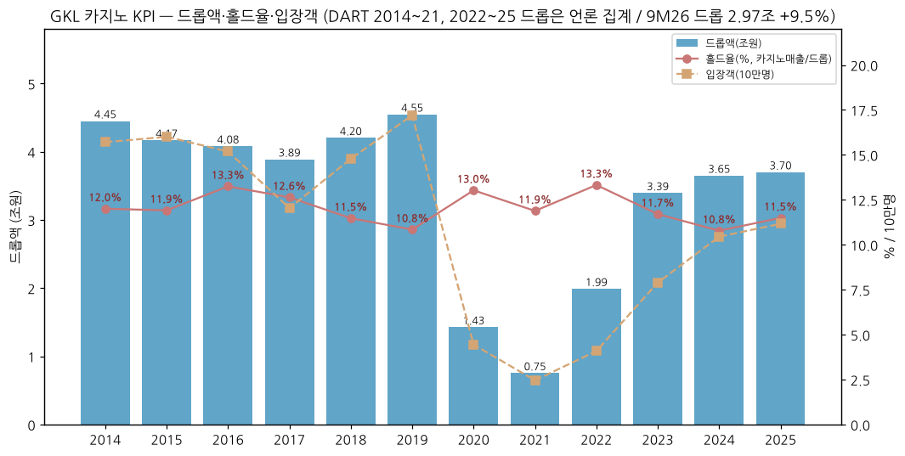

→ **2025 드롭 3.70조는 2019(4.55조)의 81%, 입장객 111.7만명은 2019(172.1만)의 65%** — 매출 회복(2019의 86%)이 드롭·입장객보다 빠른 것은 홀드율(11.5%)과 1인당 드롭 증가 효과
→ **9M26 드롭 2.97조 (+9.5%), 카지노 순매출 3,372억 (+5.8%)** [Focus Gaming News 2026-11-10] — 홀드율 11.4%로 2025(11.5%)와 유사
→ 1Q26: 입장객 27.3만 (+20.3%), 드롭 9,310억 (+12.6%), 카지노 매출 1,067억 (-1.4%), 홀드율 11.5% (-1.6%p) [IB토마토 2026-06-11]

**(5) 시장 점유율 — 외국인전용 카지노 시장 내 GKL**

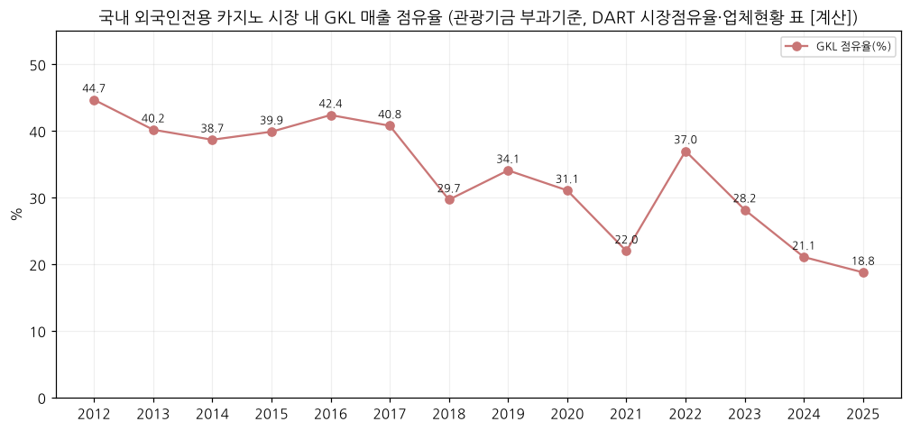

(2012\~2021 = DART 사업보고서 시장점유율 표의 GKL 3개 영업점 합산, 2022 = 3개점 매출 / 외국인전용 16개 업체 합계 7,147억 [계산], 2023 = 회사 공시 28.2%, 2024·2025 = 3개점 매출 / 외국인전용 17개 영업장 합계(1.86조·2.26조) [계산])

→ 외국인전용 카지노 시장은 2025 2.26조로 2019(1.45조) 대비 +56% 성장했지만 [DART 분기보고서(2026.09) II-7], GKL 매출은 2019 대비 -14% → **점유율 34.1% (2019) → 18.8% (2025)**. 인천 인스파이어(2024-01 허가, 2025 2,860억)·파라다이스시티(4,854억)·제주 드림타워(5,206억) 등 IR형 경쟁자가 증가분을 흡수

**(6) 전사 분기 시계열 (47개 분기, 억원)** — 단일 사업이므로 전사 = 사업부

| 분기 | 기준 | 매출 | 영업이익 | OPM | 순이익 | 매출 YoY | 영업이익 YoY |
|---|---|---|---|---|---|---|---|
| 1Q15 | 별도 | 1,487 | 486 | 32.7% | 322 | - | - |
| 2Q15 | 별도 | 1,224 | 217 | 17.7% | 185 | - | - |
| 3Q15 | 별도 | 1,113 | 265 | 23.8% | 226 | - | - |
| 4Q15 | 별도 | 1,233 | 217 | 17.6% | 185 | - | - |
| 1Q16 | 별도 | 1,366 | 421 | 30.8% | 268 | -8.1% | -13.4% |
| 2Q16 | 별도 | 1,290 | 314 | 24.3% | 256 | +5.4% | +44.7% |
| 3Q16 | 별도 | 1,340 | 345 | 25.7% | 277 | +20.4% | +30.2% |
| 4Q16 | 별도 | 1,486 | 431 | 29.0% | 341 | +20.5% | +98.6% |
| 1Q17 | 별도 | 1,253 | 315 | 25.1% | 175 | -8.3% | -25.2% |
| 2Q17 | 별도 | 1,097 | 176 | 16.0% | 154 | -15.0% | -43.9% |
| 3Q17 | 별도 | 1,387 | 407 | 29.3% | 334 | +3.5% | +18.0% |
| 4Q17 | 별도 | 1,276 | 184 | 14.4% | 142 | -14.1% | -57.3% |
| 1Q18 | 별도 | 1,219 | 314 | 25.8% | 174 | -2.7% | -0.3% |
| 2Q18 | 별도 | 1,161 | 347 | 29.9% | 272 | +5.8% | +97.2% |
| 3Q18 | 별도 | 1,304 | 309 | 23.7% | 264 | -6.0% | -24.1% |
| 4Q18 | 별도 | 1,118 | 79 | 7.1% | 67 | -12.4% | -57.1% |
| 1Q19 | 연결 | 1,092 | 170 | 15.6% | 87 | -10.4% | -45.9% |
| 2Q19 | 연결 | 1,174 | 264 | 22.5% | 201 | +1.1% | -23.9% |
| 3Q19 | 연결 | 1,334 | 306 | 22.9% | 253 | +2.3% | -1.0% |
| 4Q19 | 연결 | 1,308 | 228 | 17.4% | 183 | +17.0% | +188.6% |
| 1Q20 | 연결 | 1,115 | 269 | 24.1% | 147 | +2.1% | +58.2% |
| 2Q20 | 연결 | 233 | -321 | -137.8% | -236 | -80.2% | 적전 |
| 3Q20 | 연결 | 348 | -310 | -89.1% | -228 | -73.9% | 적전 |
| 4Q20 | 연결 | 149 | -527 | -353.7% | -327 | -88.6% | 적전 |
| 1Q21 | 연결 | 53 | -466 | -879.2% | -374 | -95.2% | 적전 |
| 2Q21 | 연결 | 330 | -259 | -78.5% | -181 | +41.6% | 적지 |
| 3Q21 | 연결 | 253 | -310 | -122.5% | -234 | -27.3% | 적지 |
| 4Q21 | 연결 | 216 | -423 | -195.8% | -344 | +45.0% | 적지 |
| 1Q22 | 연결 | 469 | -132 | -28.1% | -108 | +784.9% | 적지 |
| 2Q22 | 연결 | 481 | -107 | -22.2% | -80 | +45.8% | 적지 |
| 3Q22 | 연결 | 744 | 46 | 6.2% | 50 | +194.1% | 흑전 |
| 4Q22 | 연결 | 928 | 54 | 5.8% | -89 | +329.6% | 흑전 |
| 1Q23 | 연결 | 1,092 | 272 | 24.9% | 216 | +132.8% | 흑전 |
| 2Q23 | 연결 | 1,002 | 110 | 11.0% | 86 | +108.3% | 흑전 |
| 3Q23 | 연결 | 966 | 137 | 14.2% | 120 | +29.8% | +197.8% |
| 4Q23 | 연결 | 907 | -9 | -1.0% | 17 | -2.3% | 적전 |
| 1Q24 | 연결 | 979 | 139 | 14.2% | 102 | -10.3% | -48.9% |
| 2Q24 | 연결 | 988 | 132 | 13.4% | 113 | -1.4% | +20.0% |
| 3Q24 | 연결 | 938 | 58 | 6.2% | 60 | -2.9% | -57.7% |
| 4Q24 | 연결 | 1,059 | 55 | 5.2% | 55 | +16.8% | 흑전 |
| 1Q25 | 연결 | 1,099 | 202 | 18.4% | 161 | +12.3% | +45.3% |
| 2Q25 | 연결 | 1,009 | 160 | 15.9% | 170 | +2.1% | +21.2% |
| 3Q25 | 연결 | 1,094 | 173 | 15.8% | 147 | +16.6% | +198.3% |
| 4Q25 | 연결 | 1,028 | -8 | -0.8% | -7 | -2.9% | 적전 |
| 1Q26 | 연결 | 1,107 | 181 | 16.4% | 151 | +0.7% | -10.4% |
| 2Q26 | 연결 | 1,205 | 208 | 17.3% | 180 | +19.4% | +30.0% |
| 3Q26 | 연결 | 1,097 | 96 | 8.8% | 70 | +0.3% | -44.5% |

(1Q15\~4Q18 = OpenDART 별도(OFS), 1Q19\~ = 연결(CFS). 1Q15\~3Q15는 2016 분기보고서 전기 컬럼(누적 차감), 4Q = 연간 − 3Q 누적. 1Q14\~4Q14 이전 분기는 OpenDART 미제공·분기보고서 원문 미수집으로 **미확보** — 60분기 목표 대비 47분기)

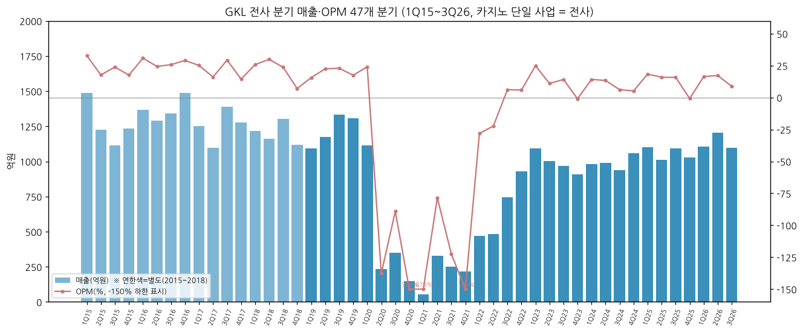
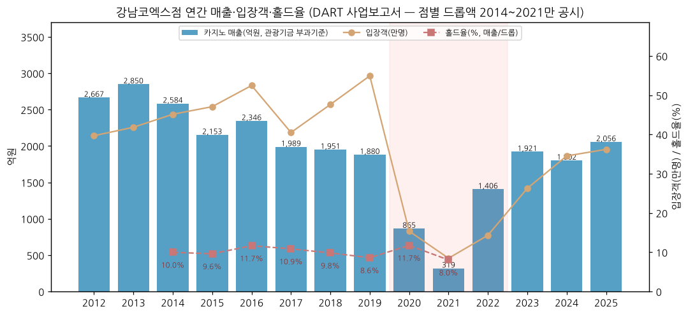
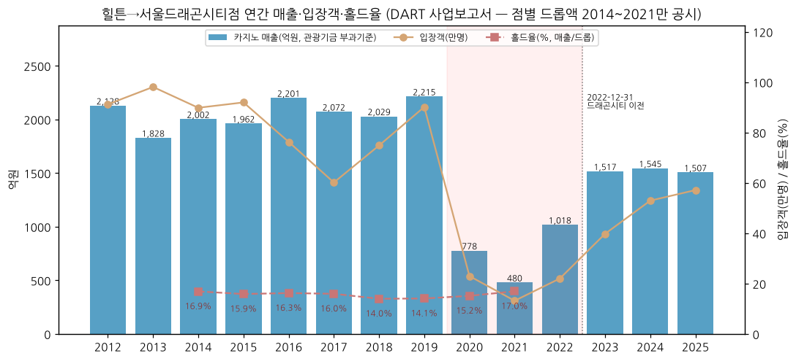
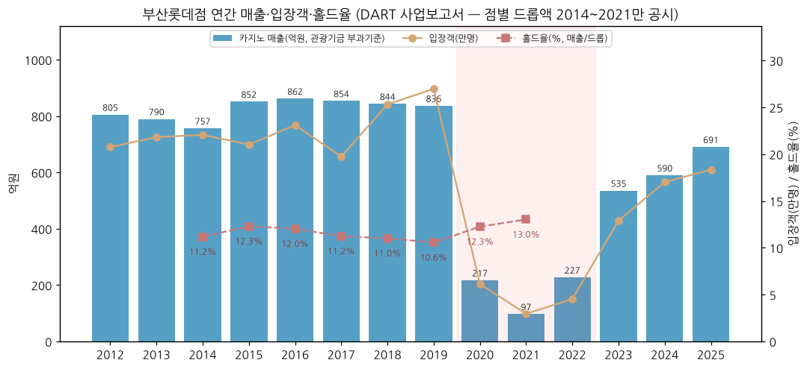

**(7) 최근 12분기 (rolling)**

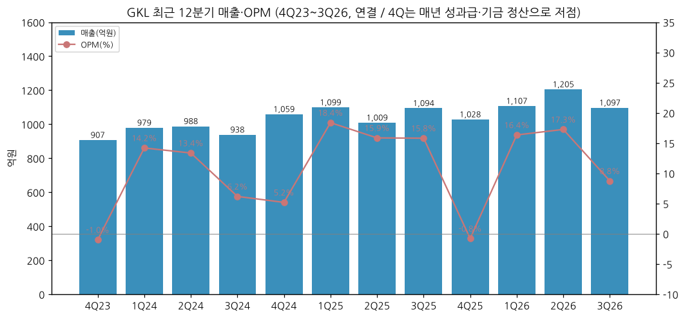

→ 4Q는 4년 연속 OPM 최저 (4Q23 -1.0%, 4Q24 5.2%, 4Q25 -0.8%) — 연말 경영평가 성과급·관광기금 정산·기부금 등 비용 집중 패턴 **[⚠️ 추정 — 회사 분기 비용 분해 미공시, 4Q 저점의 반복성으로 판단]**
→ 3Q26 OPM 8.8% (-7.0%p YoY) — 코엑스 재계약(2025-10, 10년)으로 사용권자산 471억 → 1,550억, 9M26 리스 이자비용 27억 (9M25 19억) [DART 분기보고서(2026.09) 연결 CF]

### ② 사업부별 개요 (매출 비중 큰 순서, 2025)

| 영업점 | 2025 매출(기금기준) | 비중 | 입장객 | 1인당 매출 | 영업장 면적(허가증) | 임대차 |
|---|---|---|---|---|---|---|
| 강남코엑스점 | 2,056억 | 48.3% | 36.2만 | 57만원 | 2,158㎡ (계약 12,955㎡) | 한무컨벤션, 2025-10-05\~2035-10-04 |
| 서울드래곤시티점 | 1,507억 | 35.4% | 57.2만 | 26만원 | 2,137㎡ (계약 5,836㎡) | 서부티엔디, 2022-08-16\~2032-08-15 |
| 부산롯데점 | 691억 | 16.2% | 18.3만 | 38만원 | 1,584㎡ (계약 7,798㎡) | 부산롯데호텔, 2016-01-01\~**2026-12-31** |

(출처: DART 분기보고서(2026.09) II-6·II-7, DART 사업보고서(2025.12) IV 입장객 현황. 1인당 매출 [계산])

### ③ 사업부별 디테일

(1) 강남코엑스점 — VIP 중심, 홀드율 변동이 실적을 좌우
→ 매출 비중 48%로 최대이지만 입장객은 2위 — VIP 비중이 높아 1인당 매출 57만원 (드래곤시티의 2.2배) [계산]
→ 홀드율 변동이 큼: 1Q24 매출 359억 (-41.4% YoY) vs 드롭 5,200억 (+24.8%) — 홀드율이 6.9%로 급락 [IR 1Q24, 계산]. 1H25 매출 1,082억 (+29.1%) vs 드롭 9,376억 (-12.6%) — 홀드율 11.5% [IR 2Q25, 계산]
→ 2025-10 10년 재계약 → 리스부채 1,000억+ 인식 (상각비·이자비용 증가 요인)

(2) 서울드래곤시티점 — 매스(중국·중화권) 중심, 입장객 최대
→ 2022-12-31 강북힐튼(밀레니엄서울힐튼 영업 종료) → 용산 서울드래곤시티 이전. 2025 입장객 57.2만 (힐튼 시절 2019 90.2만의 63%)
→ 이전 후 성장 둔화 — 2023\~2025 매출 1,517억 → 1,545억 → 1,507억 정체 [DART, IB토마토 2026-06-11]
→ 1H25 매출 680억 (-15.1%) / 입장객 23.0만 (+4.4%) [IR 2Q25]

(3) 부산롯데점 — 일본 고객 비중 최고, 가장 빠른 회복
→ 일본인 비중 2012 73.9% → 2021 0.9% (코로나) [DART 국적별 입장객]. 2025 매출 691억은 2019(836억)의 83% — 2019 대비 회복률은 강남 109% > 부산 83% > 드래곤시티 68% [계산]
→ 1H25 매출 337억 (+17.4%), 입장객 8.4만 (+10.5%) [IR 2Q25]
→ **임대차 2026-12-31 만료** — 재계약 조건(기간·임대료)이 2027 리스부채·비용의 변수

(4) 국적 구성 (GKL 합계 입장객 기준, DART 2012\~2021)

| 연도 | 일본 | 중국 | 기타 |
|---|---|---|---|
| 2012 | 41.3% | 27.4% | 31.3% |
| 2013 | 34.0% | 32.6% | 33.4% |
| 2014 | 29.0% | 40.4% | 30.5% |
| 2015 | 24.6% | 44.1% | 31.3% |
| 2016 | 22.1% | 49.8% | 28.1% |
| 2017 | 22.8% | 44.4% | 32.8% |
| 2018 | 22.9% | 46.1% | 31.0% |
| 2019 | 17.1% | 54.6% | 28.3% |
| 2020 | 9.7% | 56.5% | 33.8% |
| 2021 | 0.8% | 66.1% | 33.1% |

(2022 이후 국적별 표는 반기보고서에만 일부 공시. 2023 상반기 강남: 일본 17% / 중국 39% / 기타 44%, 드래곤시티: 일본 21% / 중국 60% / 기타 19% [DART 반기보고서(2024.06)])

(5) 비용 구조 — 고정비 + 매출 연동 부담금
→ 매출원가 3,385억 (2025, 매출의 80.0%): 종업원급여(2023 1,501억), 마케팅활동비 692억(콤프·고객운송·숙식·판촉), 관광진흥개발기금 409억, 개별소비세(총매출 2\~4% + 교육세 30%) [DART 사업보고서(2025.12) IV, II-7]
→ 1H25 주요 비용: 마케팅활동비 324억 (+2.5%), 카지노부담금 258억 (+10.3% — 관광기금 202억·개별소비세 56억) [IR 2Q25]
→ 관광기금은 **매출 기준 부과**(이익과 무관) — 상한 10% → 15% 상향 시 매출 4,253억(2025) 기준 최대 229억 추가 [머니투데이 2026-07-20]. 문체부는 "전 구간 15% 일괄이 아니라 최고 구간 신설"이라며 실제 증가폭은 더 작을 수 있다고 설명 [머니투데이 2026-07-20]

### ④ 주요 경쟁사

| 경쟁사 | 영업장 (2025 매출·입장객, 관광기금 기준) | 특징 |
|---|---|---|
| 파라다이스 (034230) | 워커힐 3,422억·47.7만 / 파라다이스시티 4,854억·43.5만 / 부산 581억 / 제주 239억 | 인천 복합리조트(IR), 2025 연결 매출 1.15조 [IB토마토] |
| 롯데관광개발 (032350) | 제주 드림타워 5,206억·59.0만 | 2025 매출 6,534억 (+38.6%), 1Q26 +28.1% [IB토마토] |
| 인스파이어 (비상장) | 인천 인스파이어 2,860억·37.9만 | 2024-01 허가, 미국계 IR |
| 강원랜드 (035250, 내국인) | 1.43조·247.9만 | 내국인 대상 — 고객층 비경쟁 |

(출처: DART 분기보고서(2026.09) II-7 국내 카지노업체 현황(문체부 자료). 외국인전용 17개 영업장 합계 2.26조·349.4만명)

→ 서울 도심 외국인전용 시장은 GKL 2곳 + 파라다이스 워커힐 1곳의 3강 구조. 서울·부산 추가 허가 가능성은 "매우 낮음" [DART 분기보고서(2026.09) 경쟁상의 강점]
→ 약점(회사 기재): ① 카지노 단일 사업으로 위기 취약 ② 임대 영업장이라 규모의 경제 제약 [DART 분기보고서(2026.09)]

### ⑤ 주요 매출처

- 판매경로: 사업장 직접 판매 100%, 대부분 현금 매출 [DART 분기보고서(2026.09) II-4]
- 매출처는 개인 고객(외국인 VIP·매스)으로 특정 거래처 의존 없음. 매출채권은 지급보증인이 설정된 개인 외상 일부 (3Q26 매출채권 잔액 96억, 손상 29억) [DART 분기보고서(2026.09) II-5]
- 해외 에이전트(전문모집인) 유치·일본·중화권·동남아 현지 판촉 [DART 분기보고서(2026.09) II-4]. 해외 고객 접촉 행위의 현지법·중국 형법 위반 소지 지적 보도 (2026-10) [mydailybyte 뉴스 집계 — 원문 미확인]
- 상위 고객·국적별 매출 비중: **미공시**

### ⑥ 생산 CAPA + 임직원

- CAPA = 게임기구 보유 대수: 테이블 173 / ETG 14(단말기 187) / 머신 354 (2026-09말). 2025말 테이블 174 / ETG 10(145) / 머신 354 [DART 분기보고서(2026.09) II-3]. 연중무휴 24시간 (연 8,760시간)
- 임직원 (연말, DART):

| 연도 | 임직원(명) | YoY | 1인당 매출(억원) | 매출 대비 관광기금 | 매출 대비 마케팅비 |
|---|---|---|---|---|---|
| 2015 | 1,869 | - | 2.71 | 9.5% | 21.2% |
| 2016 | 1,838 | -1.7% | 2.98 | 9.6% | 20.1% |
| 2017 | 1,852 | +0.8% | 2.71 | 미공시 | 미공시 |
| 2018 | 2,027 | +9.4% | 2.37 | 미공시 | 미공시 |
| 2019 | 1,853 | -8.6% | 2.65 | 미공시 | 미공시 |
| 2020 | 1,831 | -1.2% | 1.01 | 10.1% | 8.2% |
| 2021 | 1,754 | -4.2% | 0.49 | 8.7% | 4.3% |
| 2022 | 1,663 | -5.2% | 1.58 | 11.3% | 8.9% |
| 2023 | 1,759 | +5.8% | 2.26 | 9.6% | 14.5% |
| 2024 | 1,780 | +1.2% | 2.23 | 9.5% | 16.8% |
| 2025 | 1,794 | +0.8% | 2.36 | 9.7% | 16.4% |

(2018은 계약직 포함 2,027명(남 880 / 여 1,147). 2025 평균 근속 15.7년, 1인 평균 급여 6,400만원 [OpenDART empSttus 2025]. 2015\~2016 마케팅비 = 콤프비용 + 판매촉진비, 2020\~ = 마케팅활동비. 2017\~2019 기금·마케팅비 금액은 사업보고서에 증감액만 기재되어 미공시 처리)

---

## 4. 재무 구조 (12년 시계열)

> 기준: 2014\~2017 별도(종속회사 없음), 2018\~ 연결 (종속회사 지케이엘위드 1개, 비지배지분 0). 단위 억원, OpenDART fnlttSinglAcntAll

### ① 손익계산서 (12년, 억원)

| 연도 | 매출 | 매출원가 | 매출총이익 | GPM | 판관비 | 판관비율 | 영업이익 | OPM | 금융수익 | 세전이익 | 순이익 | NPM | EPS(원) |
|---|---|---|---|---|---|---|---|---|---|---|---|---|---|
| 2014 | 5,407 | 3,586 | 1,821 | 33.7% | 343 | 6.3% | 1,478 | 27.3% | 120 | 1,532 | 1,165 | 21.5% | 1,884 |
| 2015 | 5,057 | 3,507 | 1,550 | 30.6% | 366 | 7.2% | 1,184 | 23.4% | 96 | 1,210 | 917 | 18.1% | 1,483 |
| 2016 | 5,482 | 3,649 | 1,833 | 33.4% | 321 | 5.9% | 1,512 | 27.6% | 112 | 1,502 | 1,143 | 20.9% | 1,849 |
| 2017 | 5,013 | 3,549 | 1,464 | 29.2% | 382 | 7.6% | 1,082 | 21.6% | 101 | 1,073 | 805 | 16.1% | 1,302 |
| 2018 | 4,803 | 3,398 | 1,406 | 29.3% | 355 | 7.4% | 1,051 | 21.9% | 112 | 1,040 | 777 | 16.2% | 1,257 |
| 2019 | 4,908 | 3,566 | 1,341 | 27.3% | 373 | 7.6% | 968 | 19.7% | 126 | 957 | 724 | 14.8% | 1,170 |
| 2020 | 1,845 | 2,384 | -539 | -29.2% | 349 | 18.9% | -888 | -48.1% | 117 | -811 | -643 | -34.9% | -1,040 |
| 2021 | 851 | 2,042 | -1,191 | -140.0% | 267 | 31.4% | -1,458 | -171.4% | 49 | -1,473 | -1,133 | -133.1% | -1,831 |
| 2022 | 2,621 | 2,496 | 125 | 4.8% | 264 | 10.1% | -139 | -5.3% | 51 | -251 | -227 | -8.7% | -368 |
| 2023 | 3,967 | 3,166 | 801 | 20.2% | 291 | 7.3% | 510 | 12.9% | 100 | 548 | 438 | 11.1% | 709 |
| 2024 | 3,964 | 3,254 | 710 | 17.9% | 326 | 8.2% | 383 | 9.7% | 111 | 437 | 331 | 8.3% | 534 |
| 2025 | 4,229 | 3,385 | 845 | 20.0% | 318 | 7.5% | 526 | 12.4% | 154 | 631 | 471 | 11.1% | 761 |

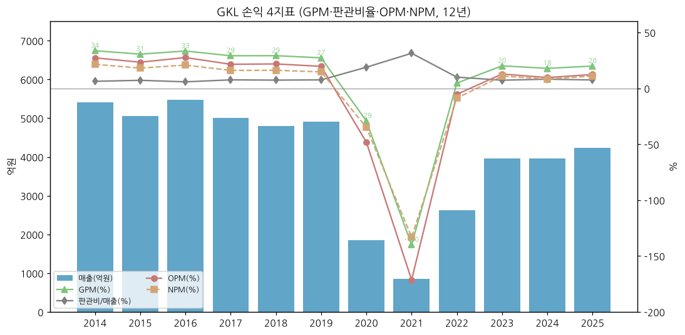

→ **GPM이 곧 이익 체력**: 카지노 원가(인건비·기금·마케팅·임차/상각)가 전부 매출원가에 잡혀 GPM 2014 33.7% → 2025 20.0%. 판관비는 연 260\~380억으로 안정 (매출의 7\~8%)
→ 금융수익 연 100\~150억 = 정기예금 등 이자수익 (2025 이자수익 97억) — 순이익을 받쳐주는 구조 [DART 연결 CF]
→ 2022 금융비용 154억은 외화환산·리스 이자 등 (2023 50억으로 정상화)

### ② 재무상태표 (12년, 억원)

| 연도말 | 자산총계 | 유동자산 | 현금성자산 | 기타금융자산(정기예금 등) | 유형자산 | 사용권자산 | 부채총계 | 유동부채 | 자본총계 | 이익잉여금 | 부채비율 | 유동비율 |
|---|---|---|---|---|---|---|---|---|---|---|---|---|
| 2014 | 6,510 | 5,292 | 1,885 | 3,152 | 382 | - | 2,196 | 2,050 | 4,314 | 3,791 | 50.9% | 258% |
| 2015 | 6,505 | 4,940 | 1,948 | 2,800 | 780 | - | 1,943 | 1,688 | 4,562 | 4,038 | 42.6% | 293% |
| 2016 | 7,302 | 5,576 | 1,913 | 3,440 | 986 | - | 2,115 | 1,859 | 5,187 | 4,663 | 40.8% | 300% |
| 2017 | 7,319 | 5,662 | 1,254 | 4,188 | 930 | - | 1,999 | 1,695 | 5,321 | 4,799 | 37.6% | 334% |
| 2018 | 7,658 | 4,556 | 1,312 | 3,020 | 857 | - | 2,037 | 1,686 | 5,621 | 5,099 | 36.2% | 270% |
| 2019 | 9,094 | 4,571 | 1,322 | 2,963 | 807 | 929 | 3,243 | 2,118 | 5,852 | 5,330 | 55.4% | 216% |
| 2020 | 7,084 | 3,472 | 1,019 | 2,220 | 673 | 789 | 2,221 | 1,288 | 4,864 | 4,342 | 45.7% | 270% |
| 2021 | 5,313 | 2,370 | 985 | 1,217 | 551 | 526 | 1,478 | 1,011 | 3,835 | 3,314 | 38.5% | 234% |
| 2022 | 6,095 | 2,627 | 1,710 | 700 | 741 | 774 | 2,271 | 1,611 | 3,825 | 3,303 | 59.4% | 163% |
| 2023 | 6,394 | 3,448 | 1,857 | 1,394 | 692 | 708 | 2,276 | 1,731 | 4,118 | 3,596 | 55.3% | 199% |
| 2024 | 6,162 | 3,659 | 1,685 | 1,800 | 664 | 540 | 2,027 | 1,654 | 4,135 | 3,614 | 49.0% | 221% |
| 2025 | 6,513 | 4,339 | 2,131 | 2,000 | 657 | 471 | 2,098 | 1,794 | 4,415 | 3,893 | 47.5% | 242% |
| **3Q26** | 7,518 | 4,372 | 1,983 | 2,200 | 736 | 1,550 | 2,966 | 1,643 | 4,552 | 4,031 | 65.1% | 266% |

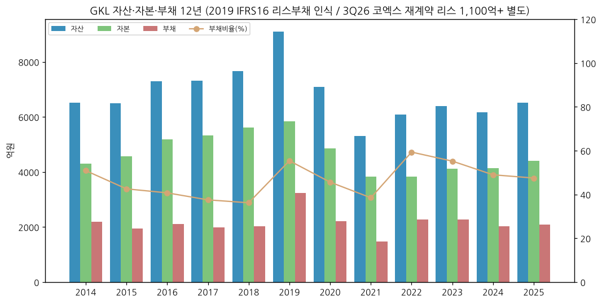

→ **무차입 + 순현금 구조**: 현금성자산 + 기타금융자산(정기예금) = 3Q26 4,183억 (자산의 56%). 차입금·사채 없음 (2017말 장기차입금 3.6억이 마지막)
→ 부채의 대부분은 미지급금(관광기금·개별소비세·임대료 등 1,224억)과 리스부채(1,574억, 3Q26) — 부채비율 3Q26 65.1%는 코엑스 재계약 리스(비유동 리스부채 304억 → 1,322억) 때문 [DART 분기보고서(2026.09)]
→ 자본총계는 2019 5,852억 정점 → 코로나 적자로 2022 3,825억 (-35%) → 3Q26 4,553억

### ③ 현금흐름표 (12년, 억원)

| 연도 | 영업CF | 투자CF | 재무CF | CapEx(유+무형) | FCF | 배당금 지급 | 리스부채 상환 | FCF − 리스상환 |
|---|---|---|---|---|---|---|---|---|
| 2014 | 1,590 | -11 | -733 | 135 | 1,455 | 729 | - | 1,455 |
| 2015 | 865 | -179 | -623 | 534 | 330 | 620 | - | 330 |
| 2016 | 1,378 | -898 | -516 | 338 | 1,039 | 434 | - | 1,039 |
| 2017 | 784 | -826 | -615 | 95 | 689 | 619 | - | 689 |
| 2018 | 928 | -419 | -453 | 84 | 844 | 452 | - | 844 |
| 2019 | 1,176 | -516 | -650 | 58 | 1,118 | 439 | 209 | 909 |
| 2020 | -1,390 | 1,641 | -551 | 68 | -1,457 | 327 | 228 | -1,685 |
| 2021 | -1,282 | 1,479 | -233 | 16 | -1,298 | 0 | 231 | -1,529 |
| 2022 | 458 | 487 | -215 | 185 | 272 | 0 | 213 | 59 |
| 2023 | 849 | -491 | -211 | 158 | 691 | 0 | 211 | 480 |
| 2024 | 717 | -405 | -491 | 56 | 661 | 255 | 236 | 426 |
| 2025 | 1,047 | -186 | -414 | 86 | 961 | 174 | 239 | 722 |
| **9M26** | 628 | -324 | -446 | 155 | 474 | 256 | 190 | 283 |

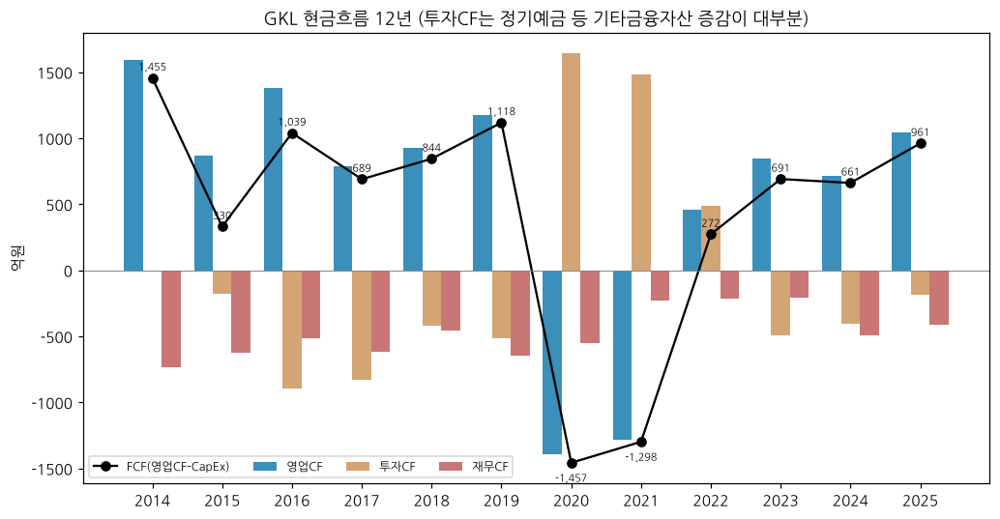

→ 투자CF의 대부분은 정기예금(기타금융자산) 가입·해지 — 2025 기타금융자산 취득 2,900억 / 감소 2,752억 [DART 연결 CF]. 코로나 기간(2020\~2021) 투자CF +1,641억·+1,479억은 예금 해지로 운영자금 충당
→ IFRS16 이후 실질 FCF는 리스부채 상환(연 210\~240억)을 차감해 봐야 함 — 2025 FCF 961억 → 리스 차감 722억 [계산]

### ④ CapEx 추이 (12년, 억원)

| 연도 | 유형자산 취득 | 무형자산 취득 | CapEx 합계 | CapEx/매출 | 감가상각비(유형) | 사용권자산 상각 | CapEx/감가상각 |
|---|---|---|---|---|---|---|---|
| 2014 | 135 | 0 | 135 | 2.5% | 109 | - | 1.24x |
| 2015 | 531 | 3 | 534 | 10.6% | 123 | - | 4.35x |
| 2016 | 338 | 0 | 338 | 6.2% | 124 | - | 2.73x |
| 2017 | 95 | 1 | 95 | 1.9% | 155 | - | 0.62x |
| 2018 | 79 | 6 | 84 | 1.8% | 159 | - | 0.53x |
| 2019 | 55 | 3 | 58 | 1.2% | 150 | 217 | 0.39x |
| 2020 | 62 | 6 | 68 | 3.7% | 152 | 231 | 0.44x |
| 2021 | 12 | 4 | 16 | 1.9% | 132 | 228 | 0.12x |
| 2022 | 185 | 0 | 185 | 7.1% | 102 | 224 | 1.82x |
| 2023 | 155 | 3 | 158 | 4.0% | 88 | 214 | 1.79x |
| 2024 | 52 | 4 | 56 | 1.4% | 88 | 228 | 0.64x |
| 2025 | 85 | 1 | 86 | 2.0% | 84 | 235 | 1.02x |

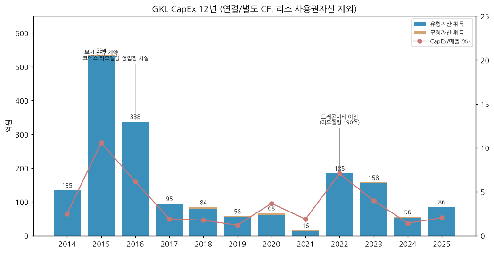

→ 임차 영업장이라 CapEx가 작음 (코로나 전 평균 매출의 4% 안팎, 2019\~2025 1.2\~7.1%). 2015 531억은 부산롯데점 갱신·영업장 시설, 2022 185억은 서울드래곤시티 리모델링(총 190억) [DART]
→ 9M26 유형자산 취득 147억 (+106% YoY) — 비품 113억 증가(게임기구 교체 등) [DART 분기보고서(2026.09) II-3]
→ 사용권자산(영업장 임차권)은 CapEx가 아닌 리스로 인식: 2019 929억 → 2025 471억 → 3Q26 1,550억 (코엑스 10년 재계약)

### ⑤ 부채구조 + 채무증권 발행 history

- **차입금·사채: 0** (2018\~3Q26 연결 재무상태표 차입 계정 없음). 2017말 유동성장기차입금 1.7억 + 장기차입금 1.9억(정부 지원 성격 추정)이 마지막 [DART 2017 별도 BS]
- **채무증권 발행 이력: 없음** (회사채·CP 발행 실적 미기재) [DART 사업보고서 증권의 발행 — 확인 범위 2015\~2025]
- **리스부채** (영업장 임차): 3Q26 1,574억 (유동 252억 / 비유동 1,322억). 계약상 현금흐름 1,956억 — 1년 미만 260억 / 1\~5년 965억 / 5년 이상 731억 [DART 분기보고서(2026.09) II-5 유동성위험]
- 이자율·변동금리 위험 없음, 외환위험은 보유 외화(USD·JPY·HKD·CNY) 한도 관리 [DART 분기보고서(2026.09) II-5]
- 이자보상배율 (영업이익 / 리스 이자비용): 2019 25.4x → 2023 13.5x → 2025 20.7x [계산] — 3Q26 코엑스 리스로 이자비용 증가

### ⑥ 배당·자사주 추이 (12년)

| 사업연도 | DPS(원) | 배당총액(억원) | 배당성향(연결) | 연말 종가(원) | 시가배당률 [계산] | 비고 |
|---|---|---|---|---|---|---|
| 2014 | 1,002 | 620 | 53.2% | 32,250 | 3.1% |  |
| 2015 | 831 | 514 | 56.0% | 24,200 | 3.4% |  |
| 2016 | 1,000 | 619 | 54.1% | 20,450 | 4.9% |  |
| 2017 | 730 | 452 | 56.1% | 29,250 | 2.5% |  |
| 2018 | 710 | 439 | 56.6% | 24,900 | 2.9% |  |
| 2019 | 659 | 408 | 56.6% | 19,450 | 3.4% | 중간배당 81억 포함 |
| 2020 | 0 | 0 | - | 16,700 | 0.0% | 코로나 적자 무배당 |
| 2021 | 0 | 0 | - | 13,150 | 0.0% | 무배당 |
| 2022 | 0 | 0 | - | 18,900 | 0.0% | 무배당 |
| 2023 | 353 | 218 | 49.8% | 13,490 | 2.6% | 배당 재개 |
| 2024 | 282 | 174 | 52.76% | 11,040 | 2.6% |  |
| 2025 | 414 | 256 | 54.4% | 14,970 | 2.8% | 중간 60원 + 기말 354원 |
| 2026 (중간) | 60 | 37 | - | - | - | 2026-08 중간배당 (반기보고서) |

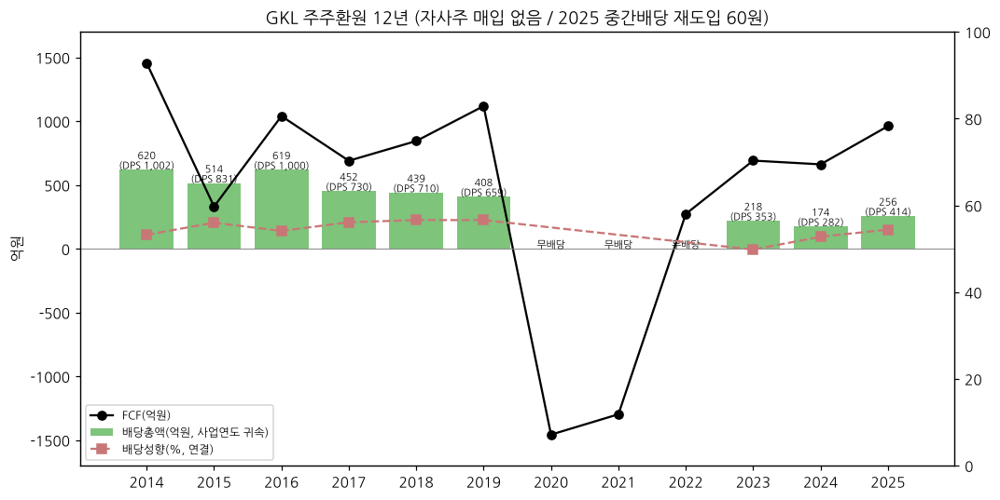

- **배당 정책**: 연간 흑자 시 배당, 정부 공기업 배당정책(배당성향 40% 이상) 준수 [IR 1Q24]. 2025부터 중간배당 재도입 + '선(先) 배당액 확정, 후(後) 배당기준일' 절차 도입 [IR 2Q25]
- **자기주식: 매입·보유 이력 없음** (2025말 자기주식 0주) [OpenDART tesstkAcqsDspsSttus·stockTotqySttus 2025]
- 12년 누적 배당 지급 4,049억 / 누적 순이익 4,769억 [계산, CF 배당금 지급 기준] — 코로나 적자를 감안하면 흑자 연도 이익의 대부분을 배당
- 2025 DPS 414원 기준 현재 시가배당률 **5.75%** [계산, 2026-11-24 종가]

### ⑦ 재무 비율 + 밸류에이션 밴드 (12년)

| 연도 | ROE | ROA | 부채비율 | 유동비율 | OPM | 순현금(현금+기타금융자산, 억원) | PBR(연말) [계산] | PER(연말) [계산] |
|---|---|---|---|---|---|---|---|---|
| 2014 | 27.0% | 17.9% | 50.9% | 258% | 27.3% | 5,037 | 4.62x | 17.1x |
| 2015 | 20.7% | 14.1% | 42.6% | 293% | 23.4% | 4,749 | 3.28x | 16.3x |
| 2016 | 23.5% | 16.6% | 40.8% | 300% | 27.6% | 5,353 | 2.44x | 11.1x |
| 2017 | 15.3% | 11.0% | 37.6% | 334% | 21.6% | 5,442 | 3.40x | 22.5x |
| 2018 | 14.2% | 10.4% | 36.2% | 270% | 21.9% | 4,332 | 2.74x | 19.8x |
| 2019 | 12.6% | 8.6% | 55.4% | 216% | 19.7% | 4,284 | 2.06x | 16.6x |
| 2020 | -12.0% | -8.0% | 45.7% | 270% | -48.1% | 3,239 | 2.12x | 적자 |
| 2021 | -26.0% | -18.3% | 38.5% | 234% | -171.4% | 2,201 | 2.12x | 적자 |
| 2022 | -5.9% | -4.0% | 59.4% | 163% | -5.3% | 2,410 | 3.06x | 적자 |
| 2023 | 11.0% | 7.0% | 55.3% | 199% | 12.9% | 3,250 | 2.03x | 19.0x |
| 2024 | 8.0% | 5.3% | 49.0% | 221% | 9.7% | 3,485 | 1.65x | 20.7x |
| 2025 | 11.0% | 7.4% | 47.5% | 242% | 12.4% | 4,131 | 2.10x | 19.7x |

(ROE·ROA = 평균 자본·자산 기준 [계산], 2014는 기말 기준. PBR·PER = 연말 종가 × 61,855,670주 / 자본총계·순이익 [계산])

→ **현재 (2026-11-24)**: PBR **0.98배** (3Q26 자본 4,553억), PER **11.3배** (LTM 순이익 394억), 배당수익률 5.75%, 시총 대비 순현금 94% [계산]
→ ROE: 코로나 전(2014\~2019) 12.6\~27.0% → 리오프닝 후 8.0\~11.0% — 이익률 하락(점유율·홀드율·비용)으로 ROE 레벨이 한 단계 낮아짐

---

## 5. 지배 구조

### ① 그룹·계열 관계

- **한국관광공사** (문화체육관광부 산하 공기업) → GKL 51.00% 보유 최대주주 (상장 이후 변동 없음) [OpenDART hyslrSttus 2025]
- **종속회사**: ㈜지케이엘위드 (2018-10 설립, 지분 100% 추정 — 비지배지분 0) — 카지노 영업장 운영 서비스 [DART 사업보고서(2025.12) I-1]
- **관계 공익법인**: GKL사회공헌재단 (2014-05 설립, 연결 대상 아님) [DART 연혁]
- 공공기관 지정: 준시장형 공기업 (2017-01-25) → 기획재정부 경영평가, 정부 배당정책, 임원 임명 절차 적용. 2024년도 경영평가 **D(미흡)**, 청렴도 4등급 [IB토마토 2026-06-11]. 2025년도 평가(2026-06-19 발표) 등급 **미확보**

### ② 주주 구분

| 주주 | 주식수 | 지분율 | 기준일 / 출처 |
|---|---|---|---|
| 한국관광공사 | 31,546,392 | 51.00% | 2026-06-30, DART 반기보고서 |
| 국민연금공단 | 4,988,080 | 8.06% | 2026-06-30, DART 반기보고서 |
| 우리사주조합 | 1,312 | 0.00% | 2026-06-30, DART 반기보고서 |
| 소액주주 (19,947명) | 20,498,282 | 33.14% | 2026-06-30, DART 반기보고서 |
| 외국인 (소진율) | 약 6.85백만 [계산] | 11.07% | 2026-11-24, 네이버증권 (소액주주와 일부 중복) |

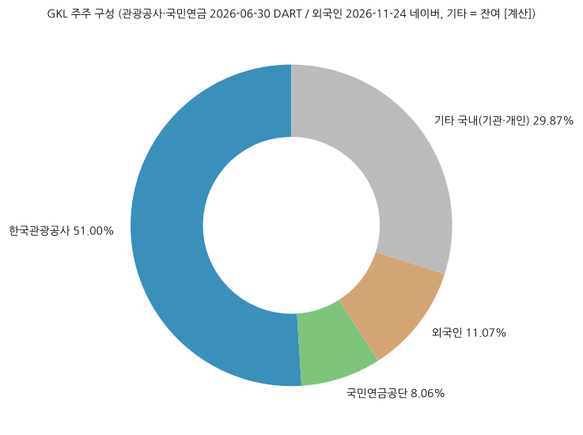

(차트의 '기타 국내' 29.87% = 100 − 관광공사 − 국민연금 − 외국인 [계산]. 외국인 지분율 연도별 추이는 미수집. IR 2Q25 주주구성: 관광공사 31,546,392주 / 그 외 3개 구분 4,812,326·8,318,785·17,178,167주 — 구분명 PDF 텍스트 추출 불가)

### ③ 임원·이사회

- **대표이사 사장 윤두현** (1961-05) — 경북대 영문학, 前 ㈜YTN플러스 대표이사·대통령비서실 홍보수석비서관·제21대 국회의원. 2024-11-25 임시주총 선임, 2024-12-02 취임, 임기 2027-12-01 [OpenDART exctvSttus 2025, DART 사업보고서(2025.12) I-2]
- 전임: 김영산 (2021-08 \~ 2024-11), 유태열 (\~2021-08) [DART 사업보고서(2025.12) I-2]
- 상임이사: 김현기 경영본부장 (前 문체부 소통실장), 안덕수 마케팅본부장 (前 관광공사 해외마케팅실장), 권익준 서울사업본부장, 김문락 부산사업본부장 — 주요 본부장이 문체부·관광공사·내부 출신 [OpenDART exctvSttus 2025]
- 비상임이사 7명 (노동이사 1명 포함), 상임감사 1명 (박용우) [OpenDART exctvSttus 2025]. 다수 임원의 기재 임기가 이미 경과(2023\~2025 만료) — 공공기관 후임 임명 지연 시 직무 수행 (공운법) **[⚠️ 추정]**
- CEO 평가: 언론인·정치인 출신으로 기업 경영 경험이 제한적이라는 지적, 2026-06 감사에서 직원 부적절 업체 접촉·근태 위반 적발 보도 [IB토마토 2026-06-11]

---

## 6. 기타 팩트

### ① R&D 인프라

- **공시 연구개발비: 없음** — 사업보고서 'II-6 주요계약 및 연구개발활동'에 연구개발 조직·비용 기재 없음 (2015\~2025 사업보고서 전수 확인, '연구개발비' 기재 0건) [DART]. 카지노 서비스업 특성상 R&D 대신 **마케팅·게임기구·디지털 채널**에 투자
- 디지털 투자 사례: 업계 최초 세븐럭 고객 전용 앱, 키오스크 기능 고도화, ETG(전자테이블게임) 확대 — ETG 단말기 145 → 187대 (2025말 → 2026-09말) [DART 분기보고서(2026.09) II-3·II-4]
- 대신 보는 지표 — 매출 대비 핵심 비용 비중 (chart7): 관광진흥개발기금 9.5% (2015) → 9.7% (2025), 마케팅비 21.2%(2015, 콤프+판촉) → 16.4% (2025, 마케팅활동비) [DART 이사의 경영진단, 계산]

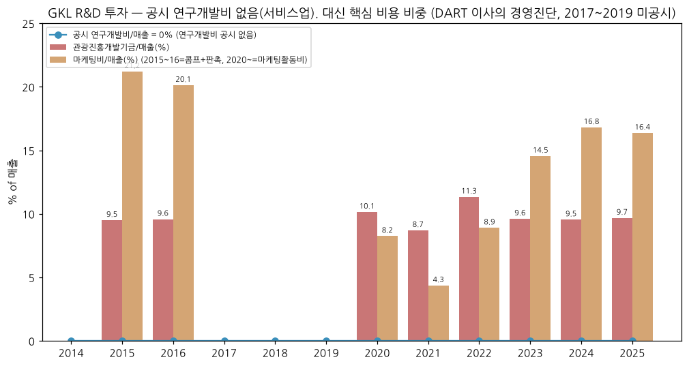

### ② 진행 중 corporate action — 10년치 주요 이벤트

| 시기 | 이벤트 | 내용 / 출처 |
|---|---|---|
| 2016-01 | 부산롯데점 임대차 갱신 | 2016-01-01\~2026-12-31 (11년) [DART] |
| 2017-01 | 준시장형 공기업 지정 | 기타공공기관 → 공기업 [DART] |
| 2018-10 | 자회사 지케이엘위드 설립 | 영업장 운영 서비스 (용역 인력 정규화 목적 추정) → 연결 작성 [DART] |
| 2019-01 | IFRS16 | 영업장 임차 사용권자산 929억 인식 [DART] |
| 2020\~2021 | 코로나 휴장 | 서울 2020-11-24\~2021-03-14, 부산 2020-12-01\~2021-02-14 [DART] |
| 2021-12 | 강북 신규 영업장 선정 | 밀레니엄서울힐튼 영업 종료(2022-12-30) → 서울드래곤시티 계약(10년) [DART] |
| 2022-12-31 | 서울드래곤시티점 개장 | 리모델링 190억 (2022-09\~12) [DART] |
| 2025-08 | 중간배당 재도입 | 1주당 60원, 총 37억 [IR 2Q25] |
| 2025-10-05 | 강남코엑스점 10년 재계약 | 2025-10-05\~2035-10-04, 한무컨벤션 — 3Q26 사용권자산 1,550억 [DART 분기보고서(2026.09)] |
| 2026-09 | GKL-코엑스 외래관광객 유치 협약 | [mydailybyte 뉴스 집계] |
| 2026-12-31E | 부산롯데점 임대차 만료 | 재계약 조건 미공시 [DART 분기보고서(2026.09)] |

- M&A·지분 투자·자사주 매입: **없음** (10년간). 회사는 IR(복합리조트)을 "현재 검토하지 않음" [IB토마토 2026-06-11]

### ③ 서비스·영업 마일스톤 — 10년치

- 2015-09 업계 최초 5억달러 관광진흥탑 [DART 연혁]
- 2019 드롭 4.55조·입장객 172.1만명 사상 최대 [DART]
- 2020-11 국가품질혁신상 인재개발부문 대통령 표창 [DART 연혁]
- 2022-12 서울드래곤시티점 개장 (호텔 2·4·5층, 계약 5,836㎡) [DART]
- 2024\~2026 ETG 확대, 고객 전용 앱·키오스크 고도화, 일본·대만·몽골·태국 VIP 마케팅 [DART, IB토마토 2026-06-11]
- 2025 지속가능경영보고서 美 LACP 비전 어워드 대상 (2025-08) [아주경제 2025-08-25], 대한민국 ESG 대상 (2025-09) [헤럴드경제 2025-09-01]

### ④ 주요 리스크

(1) 관광진흥개발기금 상향·허가 갱신제 (진행 중, 최대 현안)
→ 문체부, 기금 상한 10% → 15%(최고 구간 신설) + 카지노 허가 5년 갱신제 + 대주주 변경 사전승인 추진 [머니투데이 2026-07-20, 데일리안 2026-08-06]
→ GKL 영향: 2025 기금 409억 → 15% 단순 적용 시 638억 (+229억, 2025 영업이익의 44%) [머니투데이 2026-07-20]. KB증권은 업계 부담 연 1,500억+ 증가 추정 [매일신문 2026-10-20]
→ 상쇄 변수: 출국납부금 7,000원 → 20,000원 인상 검토 (기금 재원 확충으로 카지노 상향 폭 축소 가능) [매일신문 2026-10-20]. 국정감사 이후 입법 예상 [MTN 2026-10-13]
(2) 중국 VIP·자본통제·지정학
→ 2026-07 이후 中 역외신탁 소득 과세·신고 강화 → 中 VIP 베팅 위축, 마카오 GGR 2026-06\~09 4개월 연속 YoY 감소 [MTN 2026-10-13]
→ 과거 충격: 2015 메르스, 2017 사드(입장객 -20.7%), 2020\~2022 코로나 [DART]
(3) 홀드율 변동
→ 연간 10.8\~13.3% (2014\~2025) — 1%p 변동 = 드롭 3.7조 기준 매출 약 370억 [계산]. 분기·영업점 단위로는 더 크게 출렁임 (1Q24 강남 6.9%)
(4) 경쟁 심화·점유율 하락
→ 외국인전용 시장 점유율 34.1% (2019) → 18.8% (2025). IR형 경쟁자(인스파이어 2024 개장, 파라다이스시티, 드림타워) 대비 비게이밍 시설 부재 [DART]
(5) 임대차·비용
→ 부산롯데점 2026-12-31 만료, 코엑스 재계약으로 리스 비용 증가 (9M26 리스 이자 27억 vs 9M25 19억) [DART]
(6) 환율
→ 원화 강세 시 외국인 고객의 원화 환전액 감소 → 드롭 감소 요인 [MTN 2026-10-13]. 회사 자체 외환위험(보유 외화)은 제한적 [DART]
(7) 공기업 거버넌스
→ 경영평가 D(2024년도), 청렴도 4등급, 내부감사 적발 [IB토마토 2026-06-11]. 정부 정책에 따른 배당·인사 결정
(8) 법률·소송·우발채무: 중요한 소송 **미확인** (이번 버전 미조사)

### ⑤ ESG 등급

- **한국ESG기준원(KCGS) 2025 ESG 통합등급: A** [스마트투데이 2025 통합등급 보도]. 비교: 롯데관광개발 D, 강원랜드 A [동 보도]
- MSCI·Sustainalytics 등 해외 ESG 등급: **미확보**
- 지속가능경영보고서: 매년 발간 (2025 보고서 LACP 비전 어워드 대상 [아주경제 2025-08-25]). **원문 PDF 미수집** — 이번 작업 중 BT 컴퓨터 셸 장애로 회사 사이트(grandkorea.com) 다운로드 미시도 (source 체크리스트 4번 ❌) → 임직원·ESG 정량(온실가스·사회공헌액)은 다음 버전 보강
- 사회공헌: GKL사회공헌재단(2014\~), 지역사회공헌 인정기업 7년 연속 [아시아경제 2025-11-25]

### ⑥ 인증·라이선스

- 사업 근거: 관광진흥법 제5조 카지노업 허가 (2005-01-28 허가, 3개 영업장) — 허가증 면적 강남 2,158㎡ / 드래곤시티 2,137㎡ / 부산 1,584㎡ [DART 분기보고서(2026.09) II-7]
- 부담금: 관광진흥개발기금 (총매출의 10% 범위, 관광진흥개발기금법), 개별소비세 (총매출 2\~4%) + 교육세 (개별소비세의 30%) [DART 분기보고서(2026.09) II-7]
- 공공기관: 준시장형 공기업 (공공기관의 운영에 관한 법률, 2017-01-25) [DART]
- 신용등급: 미공시 (무차입)

---

## Version Log

- **v1.0 (2026-11-25)**: 첫 작성 — Phase 1 source 점검 (OpenDART 연결 재무 JSON 32개(FY2018\~3Q26) + 별도 44개(FY2015\~3Q26), 정기공시 XML 54건, 기업개황·주주·임원·직원·배당·자기주식·주식총수, IR PDF 17건(2018-05\~2025-09), Yahoo 일간·월간 시세, 네이버증권 외국인 소진율) + v4.8 6개 섹션 + 차트 17종 (12종 표준 + chart2 4종(전사 분기 47Q·강남코엑스·서울드래곤시티·부산롯데 연간) + chart13 드롭·홀드율·입장객 + chart14 시장점유율). 3Q26 분기보고서(2026-11-13) 반영
- **데이터 관례 (면세·카지노·여행 통합 검수용)**: ① 재무 = 2014\~2017 별도, 2018\~ 연결 (지케이엘위드 연결, 차이 미미) ② 카지노 KPI 매출 = 관광진흥개발기금 부과기준(문체부·카지노협회) — IFRS 매출과 다름 ③ 홀드율 = 기금기준 매출 / 드롭 [계산] (회사 공식 홀드율 아님) ④ 드롭 2022\~2025는 언론 집계(회사 월별 공시 기반 추정) ⑤ 주가 = Yahoo `close`, 시총 = close × 61,855,670주 ⑥ 순현금 = 현금및현금성자산 + 기타금융자산(정기예금), 리스부채 제외 ⑦ FCF = 영업CF − 유·무형 취득 (리스 상환 미차감, 표에 차감값 병기)
- 잔여 보완 후보: ① 1Q14 이전·1Q14\~4Q14 분기 손익 (분기보고서 원문 2014\~2015 수집 → 60분기) ② 2022\~2026 영업점별 연간 드롭 (월별 영업실적 공시 수집) ③ 지속가능경영보고서 PDF · MSCI 등급 ④ 외국인 지분율 연도별 추이 ⑤ 2025년도 공공기관 경영평가 등급 ⑥ 부산롯데점 재계약 조건 ⑦ 관광기금 개정안 국회 제출·구간 확정 ⑧ IR 3Q25 이후 PDF (irgo 미게시) ⑨ 소송·우발채무 점검
