# GS건설 — 기업 개요 (v1.0)

> 마지막 update: 2026-11-25 (3Q26 분기보고서 2026-11-13 제출분 반영 — 확정치)
> 입력 source: OpenDART fnlttSinglAcntAll (연결·별도, 2015 FY\~3Q26, 88개 JSON, 2014는 2015 사업보고서 전기 컬럼) + DART 정기공시 원문 XML 72건 (사업보고서 2013\~2025 본문·첨부, 분기·반기 1Q14\~3Q26, 2023\~2026 기재정정분 포함) + dart_company_info 7종 (2025 사업보고서 기준) + GS건설 IR 실적자료 16건 (1Q18·2Q18·2Q19·FY23·1Q24\~3Q26, irgo) + Yahoo Finance (006360.KS 월간 2000-02\~2026-11, 일간 2024-11\~2026-11-25) + 뉴스·증권사 (신한 2026-10-13, 대신 2026-11-02 등)
> 갱신 주기: 매분기 (실적 리뷰 모드 호출 시)
> 워치리스트: 건설·건설기계 섹터 (2026-11-23 추가, 4Q26부터 리뷰, 표준 깊이) / 서브섹터: 건설
> **Fact verify cutoff**: 2026-11-25 (주가·시총 = 2026-11-24 종가 25,900원 기준 시총 2조 2,166억 (이투데이 시세) / Yahoo 2026-11-25 장중 25,500원. 지분율 = DART 사업보고서(2025.12). 컨센서스·목표가 = 2026-10\~11 증권사 보고서·보도)

---

## 1. 기업 분류

- **Primary 분류: 사이클** (Cyclical — 국내 주택 분양·원가율 사이클이 이익을 지배하는 주택 편중 EPC)
- **Secondary 노트: 자산 매각(GS이니마)·재무구조 재편 이벤트 일부** — 2025\~2026은 영업 사이클 회복보다 GS이니마 매각(1.2bn$ SPA, 2025-08)과 검단 사고 법적 리스크 해소가 밸류에이션 변수

### ① 정량 근거

**📊 Summary Box (12년, 2014\~2025 연결):**

| 지표 | 값 |
|------|-----|
| 매출 CAGR (2014→2025, 11년) | **+2.5%** (9.49조 → 12.45조) |
| OPM 평균 | **3.6%** (단순평균, 2023 제외 시 4.2% / 12년 누적 OP÷누적 매출 3.5%) |
| OPM 정점 평균 | **7.5%** (정점 구간 2018\~2021: 8.1% · 7.4% · 7.4% · 7.2%) |
| OPM 저점 평균 | **-1.2%** (2014 0.5% · 2023 -2.9%) / 12년 밖 2013 -9.8% 포함 시 -4.1% |
| 사이클 주기 | 약 9\~10년 (trough-to-trough 2013→2023), 정점까지 상승 5년(2013→2018) |
| 사이클 회수 (12년) | 정점 1회(2018 plateau \~2021) / 저점 2회(2014, 2023) |

```
[전사 OPM 시계열 (12년, 연결, DART)]
연도   매출(조)  영업이익  순이익   OPM    NPM
2014      9.49     0.05    -0.02    0.5   -0.2   ← 2013 해외 저가수주 손실(-9,355억) 직후, 해외 플랜트 적자 지속
2015     10.57     0.12     0.03    1.2    0.3   
2016     11.04     0.14    -0.02    1.3   -0.2   ← 국내 분양 호황 → 건축 OPM 13.6%, 플랜트 -10.5%로 상쇄
2017     11.68     0.32    -0.16    2.7   -1.4   ← 플랜트 -6,066억 손실 마무리 (순손실 -1,637억)
2018     13.14     1.06     0.59    8.1    4.5   ← OPM 정점 8.1% (영업이익 1조 클럽, 주택 + 해외 정산이익 1Q18 OPM 12.5%)
2019     10.42     0.77     0.45    7.4    4.3   ← 매출 -20.7%(플랜트 축소)에도 주택 마진으로 7%대 유지
2020     10.12     0.75     0.33    7.4    3.3   
2021      9.04     0.65     0.43    7.2    4.7   ← 매출 저점 9.04조 (플랜트 축소), 주택 OPM 17%
2022     12.30     0.55     0.44    4.5    3.6   ← 원자재·인건비 급등, 주택 원가율 상승
2023     13.44    -0.39    -0.42   -2.9   -3.1   ← 검단 붕괴 재시공 5,524억 (2Q23 OP -4,138억, 4Q23 -1,932억)
2024     12.86     0.29     0.26    2.2    2.1   ← 흑자전환 (영업정지 처분 집행정지)
2025     12.45     0.44     0.09    3.5    0.8   ← 주택 GPM 13.9%로 회복, 매출은 착공 감소로 역성장

OPM range: -2.9% ~ 8.1% = 11.0%pt (2013 -9.8% 포함 시 17.9%pt) — 매출 변동(±20%) 대비 이익 변동 큰 전형적 건설 사이클
```

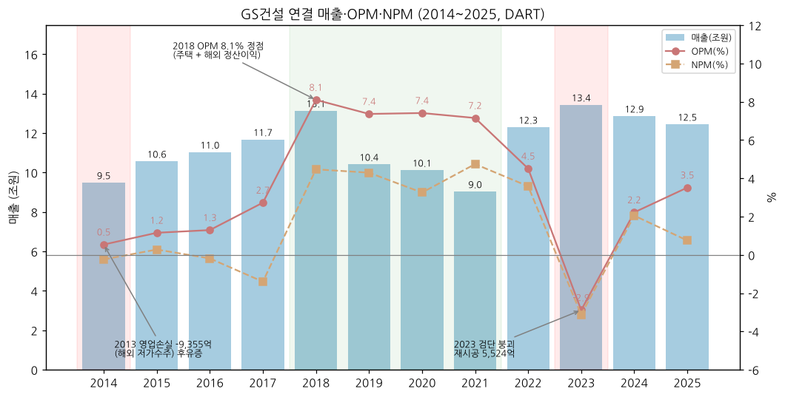

(2014 수치는 2015 사업보고서 전기 컬럼(OpenDART). 2013은 OpenDART 재무 API 미제공 → DART 사업보고서(2014.12) 요약연결재무정보: 매출 9.57조, 영업손실 -9,355억, 순손실 -8,273억)

### ② 산업 분류

- 산업: **건설 (종합건설·주택 중심 EPC)** — 사이클 산업 list 포함 (국내 주택 분양·정비사업 사이클 + 해외 플랜트 수주 사이클)
- DART 업종코드: 4111 (주거용 건물 건설업) / KRX 건설업
- 워치리스트 섹터: **건설·건설기계** / 서브섹터: **건설** (2026-11-23 추가 섹터, T1 아님 → 표준 깊이, 4Q26부터 리뷰)

### ③ 분류 결정 논리

(1) **가장 매출 큰 사업부 기준** 적용 시: 건축·주택 (2025 연결 순매출 7.79조, **62.5%** / 3Q26 9M 56.3%) → 국내 주택 분양·정비사업 사이클에 직결 → **사이클**
(2) **사이클 사업부 이익 비중 우선 sub-rule**: DART 영업부문 영업이익 기준 건축·주택은 2016\~2025 10년 중 8년 전사 영업이익의 100% 이상을 벌었고(플랜트·인프라 적자 상쇄, 예외 2018 75%·2019 90%), 2023 검단 재시공으로 건축·주택 영업이익이 **-4,461억**으로 돌아서자 전사도 적자 → 이익 변동을 지배하는 것도 주택 사이클. 주택 OPM은 2020 19.1% → 2023 -4.4% → 2025 6.0% → 3Q26 누적 5.5% → **사이클 유지**
(3) **Boundary case 처리**: ① GS이니마(수처리 운영, 2025 매출 8,672억·영업이익 265억)는 장기 운영계약형 안정 사업이나 매출 7%에 불과하고 TAQA 매각(2025-08 SPA, 1.2bn$) 진행 중 → 분류에 반영하지 않음. ② 2026 AI 데이터센터(동해 100MW, LG유플러스 AIDC 4,600억 수주) 등 신규 상품은 건축 부문 내 수주로 매출 기여 미미 → Secondary 꿈으로도 격상하지 않음. ③ 2023\~2025는 **사고 비용(검단)** 이 사이클 저점을 깊게 만든 일회성 요인 — 사이클 판단은 2023을 포함하되 OPM 평균은 제외값 병기
(4) **피어 cross-ref**: 현대건설 = 주택 사이클 + 원전 EPC 옵션(Primary 사이클 + Secondary 꿈, 현대건설_기업개요 v1.0a) / 대우건설·DL이앤씨 = 주택 사이클 단독 성격 / HDC현대산업개발 = 자체 개발·분양 비중 높은 주택 사이클 (2022 광주 붕괴 사고 → GS건설과 같은 **사고 비용형 저점** 이력) / 삼성물산 = 건설 외 상사·패션·리조트·바이오 지분 보유 지주형 — **GS건설 = 피어 중 주택 비중이 가장 높은 순수 주택 사이클 + 비핵심 자산(이니마) 매각 이벤트**. (다른 피어 분류는 같은 섹터 기업개요 통합 검수 시 확인 필요)

### ④ 적정 밸류에이션 방법

- **PBR (사이클 기준) 우선** — ROE가 -10.5%(2023)\~17.3%(2018) 범위로 크게 출렁이고 2024\~2025 2\~6%대 → 이익 기반 PER은 저점 구간에서 의미 약함
- 현재 PBR: 시총 2.22조 (2026-11-24) ÷ 지배지분 4.69조 (3Q26 DART) = **약 0.47배** / 신한 2026F·2027F PBR 0.5배 (2026-10-13)
- **SOTP 보조 (자산 매각 가치)** — 신한 SOTP: 영업가치 3.94조 (NOPLAT 4,376억 × 9.0배) + 비영업가치 2.70조 (GS이니마 예상 매각가 약 1.7조 포함) − 순차입 2.2조 → 목표 47,000원 (2026-10-13). 대신 목표 44,000원 (2026-11-02, 2027E 영업이익 6,700억)
- **PER은 참고만** — 신한 2027F PER 9.0배 (이니마 제외 시 6.2배), 2026F 지배순이익 714억으로 PER 왜곡
- 사이클 밴드 (Yahoo 수정주가 기준): 2018 실적 정점기 월말 4.1\~5.2만원(2018-09 52,300원, 시총 약 4.2조, P/B 약 1.2배) / 2023-10 검단 저점 월말 13,160원(시총 약 1.13조, P/B 약 0.26배) / 2026-04-21 43,100원(시총 약 3.7조, P/B 약 0.77배) — P/B는 직전 분기말 지배지분으로 근사(추정)
- 현대건설은 PBR + 원전 SOTP, **GS건설은 PBR + 이니마 매각가치 SOTP** — 본업 이익 회복 이전에 비핵심 자산 현금화가 밸류의 하단을 받치는 구조

### ⑤ 분기 재평가 트리거 (분류 변경 조건)

- GS이니마 매각 **종결(Closing)** 시 → 순차입 감소(약 1.6\~1.8조 유입 추정)로 재무 레버리지 축소. 신사업 부문 매출 -50%, 분류는 순수 주택 사이클로 단순화
- 매각 **무산**(알제리 등 규제 승인 실패) 시 → Secondary 노트를 "수처리 운영(지속성장 일부)"로 전환 검토
- 2개 연도 연속 **OPM 5%+ 및 OPM range 2%pt 이내** 시 → 사이클 → 지속성장 transition 후보 (2018\~2021 plateau가 유일한 전례)
- 검단 관련 **LH 손해배상(1,738억) 1심·국토부 영업정지 취소소송** 패소 시 → 추가 충당금 → 사이클 저점 연장 (일회성 손실 annotation 추가)
- 데이터센터·에너지 등 비주택 매출이 건축·주택 매출의 30%+ 도달 시 → Primary 재검토

---

## 2. 회사 개요

### ① 기본 사항

- **회사명**: 지에스건설주식회사 (GS Engineering & Construction Corp., GS E&C) / KRX 006360 (보통주, 우선주 없음)
- **본사**: 서울특별시 종로구 종로 33 그랑서울
- **설립**: 1969-12-19 락희개발(주) 설립 (DART 기업개황) → 럭키개발 → LG건설 → **2005 GS건설** (LG-GS 계열 분리) / 유가증권시장 상장
- **그룹**: GS그룹 계열 (공정위 기업집단 GS) — 단, 지주회사 ㈜GS의 자회사가 아니라 **허창수 회장 등 허씨 일가 개인 지분(23.64%)으로 지배**
- **대표이사**: 허윤홍 사장 (1979년생, 허창수 회장 장남, 2023-10 CEO 내정 → 2024-03-29 정기주총 대표이사 선임, 전임 임병용 부회장 중도퇴임) · 김태진 사장 (전 CFO·CSSO, 2026-03 각자대표 선임) — 허창수 회장은 2026-03 정기주총에서 24년 만에 대표이사 사임, 사내이사·회장직 유지 (CEO스코어데일리 2026-03-25)
- **사업 한 줄 정의**: 주택 브랜드 "자이(Xi)" 중심의 도시정비·주택 시공사 + 해외 플랜트·인프라(싱가포르·호주) EPC + 수처리 운영사 GS이니마(스페인, 매각 진행) + 모듈러(Prefab: 폴란드 Danwood·영국 Elements 등). 연결 종속기업 137개사 (DART 사업보고서(2025.12)), 상장 자회사 자이에스앤디

### ② 최근 12년 손익·자본 추이 (조원, 연결, DART)

| 연도 | 매출 | YoY | 영업이익 | 순이익 | 자본총계 | 자본 YoY |
|---|---|---|---|---|---|---|
| 2014 | 9.49 | - | 0.05 | -0.02 | 3.58 | - |
| 2015 | 10.57 | +11.4% | 0.12 | 0.03 | 3.35 | -6.5% |
| 2016 | 11.04 | +4.4% | 0.14 | -0.02 | 3.35 | +0.2% |
| 2017 | 11.68 | +5.8% | 0.32 | -0.16 | 3.24 | -3.4% |
| 2018 | 13.14 | +12.5% | 1.06 | 0.59 | 3.62 | +11.9% |
| 2019 | 10.42 | -20.7% | 0.77 | 0.45 | 4.14 | +14.3% |
| 2020 | 10.12 | -2.8% | 0.75 | 0.33 | 4.31 | +4.1% |
| 2021 | 9.04 | -10.7% | 0.65 | 0.43 | 4.87 | +13.0% |
| 2022 | 12.30 | +36.1% | 0.55 | 0.44 | 5.36 | +9.9% |
| 2023 | 13.44 | +9.2% | -0.39 | -0.42 | 4.89 | -8.8% |
| 2024 | 12.86 | -4.3% | 0.29 | 0.26 | 5.09 | +4.1% |
| 2025 | 12.45 | -3.2% | 0.44 | 0.09 | 5.52 | +8.6% |
| 3Q26 | 9M 7.92 | -16.3% | 9M 0.26 | 9M 0.10 | 5.45 | -1.4% (YTD) |

(연결 기준, OpenDART. 2014는 2015 사업보고서 전기 재작성값 — 원공시와 동일(매출 9.49조·영업이익 512억))

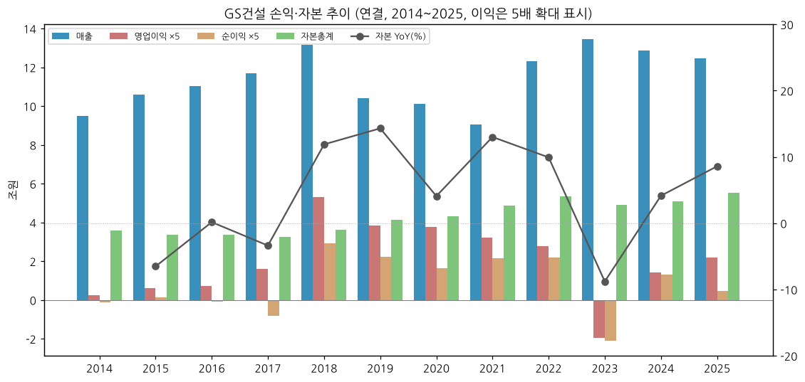

### ③ 회사 주가 역사 ★ narrative 영역

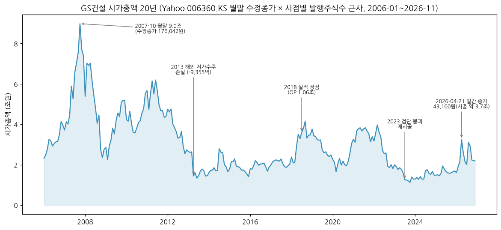

**시가총액 데이터:** 2006-01 \~ 2026-11-25 (Yahoo Finance 006360.KS 월말 수정종가 × 시점별 발행주식수 근사: 2014-06 이전 5,100만주 / 2014 유상증자 후 7,100만주 / 2018\~2021 CB 전환 등 7,940만→8,558만주). ⚠ Yahoo 종가는 2014 유상증자 등 권리락이 소급 조정된 값이라 2014 이전 구간 시총은 실제보다 낮게 표시될 수 있음
- 2026-11-24 종가 **25,900원 → 시총 약 2.22조원** (발행 85,581,490주, 이투데이 시세 22,166억) / 2026-11-25 장중 25,500원 (Yahoo)
- **사상 최고 (월말 수정종가 기준): 2007-10 176,042원 → 시총 약 9.0조원** (Yahoo 006360.KS 월간, 수정주가 — 당시 명목 주가는 이보다 높음, 명목 장중 최고가는 미확인)
- 2010년대 최고: 2011-06 월말 121,408원(수정) 시총 약 6.2조 (Yahoo 월간) / 2018 실적 정점기 2018-09 월말 52,300원 시총 약 4.2조
- 최근 저점: 2025-04-09 종가 15,340원 (Yahoo 일간, 시총 약 1.31조) — 2023-10 검단 이후 저점(월말 13,160원)과 비슷
- 2026 고점: **2026-04-21 종가 43,100원** (시총 약 3.69조, Yahoo 일간) → 2026-11-24 25,900원 (고점 대비 **-40%**) / 2026-11-20→23 하루 -12.6% (28,650→25,050원, 원인 미확인)

**사이클 history:**

```
[2005-2007] LG→GS 계열분리 후 해외 플랜트 수주 붐 (중동 오일머니)
  · 2007-10 월말 수정종가 176,042원 — 사상 최고 (시총 약 9.0조)
  · 2008 금융위기 급락 (2008-10~2009-02)

[2009-2011] 해외 플랜트 2차 붐 + 국내 주택 회복 기대 → 2011-06 시총 약 6.2조

[2012-2013] 해외 저가수주 부메랑
  · 2013 연간 영업손실 -9,355억 (2012 +1,761억 → 적자전환, 해외 플랜트 원가 급증)
  · 2014 유상증자 (자본금 2,550억 → 3,550억), 파르나스호텔 매각 (2015)

[2015-2018] 국내 분양 호황 + 해외 손실 정리
  · 2015~2017 주택 영업이익으로 플랜트 손실(-2,068억 → -6,066억) 상쇄
  · 2018 영업이익 1.06조 (OPM 8.1%), 주가 월말 4.1~5.2만원

[2019-2022] 주택 고마진 유지 → 원가 급등
  · 2020 주택 OPM 19.1%, 2022 원자재·인건비 급등으로 주택 OPM 8.2%

[2023-04~2024] 인천 검단 AA13-2BL 지하주차장 붕괴 (2023-04-29)
  · 2023-07-05 전면 재시공 결정 → 2Q23 손실 5,524억 반영, 2023 연간 영업손실 -3,879억
  · 2023-10 월말 13,160원, 시총 1.13조 (P/B 약 0.26배) — 2005년 이후 최저권
  · 2024-02 국토부 8개월 + 서울시 1개월 영업정지 처분 → 집행정지 인용

[2025-2026-04] 주택 마진 회복 + GS이니마 매각 + 건설주 랠리
  · 2025-08 GS이니마 TAQA 매각 SPA (1.2bn$)
  · 2026-04-21 종가 43,100원 (2023 저점 대비 약 3배)

[2026-05~11] 매출 역성장 + 이니마 종결 지연 → 주가 반락
  · 이니마 매각 알제리 정부 반대 보도 (2026-05), 3Q26 해외 비용 598억(호주 NEL·사우디 얀부)
  · 2026-11-24 25,900원 (고점 대비 -40%)
```

### ④ 회사의 주요 연혁

```
1969-12   락희개발 설립 (LG그룹 건설 계열)
(이후)    럭키개발 → LG건설로 상호 변경
2005      LG그룹에서 계열 분리, GS건설로 사명 변경 (허창수 회장 체제)
2012      스페인 수처리사 Inima 인수 (80%, 2,680억 → 이후 100%) → GS이니마
2013      해외 저가수주 손실, 연간 영업손실 -9,355억
2014      유상증자 (자본금 3,550억)
2015      파르나스호텔 지분 매각
2018      연결 영업이익 1조 클럽 (1.06조, OPM 8.1%)
2019      GS이니마, 브라질 BRK Ambiental 산업용수 부문 인수 (약 2,286억)
2020      모듈러 업체 인수 (폴란드 Danwood, 영국 Elements Europe) — 신사업본부 출범
2023-04   인천 검단 AA13-2BL 지하주차장 붕괴 → 2023-07 전면 재시공 결정
2023-10   허윤홍 사장 CEO 내정 (2024-03 대표이사 선임)
2024-02   최대주주 허창수 지분 8.28% → 5.95% (특수관계인 증여, DART)
2024-02   국토부·서울시 영업정지 처분 (집행정지 인용, 취소소송 진행)
2025-08   GS이니마 지분 전량 TAQA 매각 SPA (1.2bn$) — 선결조건 진행 중
2025      Elements (Europe) 청산 결정 (영국 법정관리)
2026-03   허창수 회장 대표이사 사임, 허윤홍·김태진 각자대표 체제
2026      성수1 재개발(2.15조) 등 시공권 확보, 동해 AI 데이터센터 인허가
```

---

## 3. 비즈니스 모델

### ① 실적 추이 (연결 → 사업본부 → 지역/유형 3단계 위계)

**연간 5년 통합 표 (억원, DART 영업부문 순매출·영업이익 / 2025 기준 본부 체계):**

| 항목 | 2021 | 2022 | 2023 | 2024 | 2025 |
|------|------|------|------|------|------|
| **연결 매출액** | **90,366** | **122,992** | **134,367** | **128,638** | **124,503** |
| &nbsp;&nbsp;&nbsp;&nbsp;└ 건축·주택 | 60,912 | 93,346 | 102,371 | 95,109 | 77,869 |
| &nbsp;&nbsp;&nbsp;&nbsp;└ 플랜트 (+분산형에너지·ECO·그린) | 12,997 | 7,717 | 5,722 | 7,017 | 13,201 |
| &nbsp;&nbsp;&nbsp;&nbsp;└ 인프라 | 7,803 | 10,614 | 11,041 | 11,535 | 14,614 |
| &nbsp;&nbsp;&nbsp;&nbsp;└ 신사업 (개발·Prefab·Inima) | 7,773 | 10,256 | 14,144 | 13,921 | 17,787 |
| &nbsp;&nbsp;&nbsp;&nbsp;└ 기타 | 881 | 1,059 | 1,088 | 1,057 | 1,032 |
| &nbsp;&nbsp;&nbsp;&nbsp;&nbsp;&nbsp;&nbsp;&nbsp;└ (Inima 단독) | - | - | - | 5,702* | 8,672 |
| └ 지역별 (IR) | | | | | |
| &nbsp;&nbsp;&nbsp;&nbsp;└ 국내 | - | 99,380 | 109,210 | 102,270† | 85,707† |
| &nbsp;&nbsp;&nbsp;&nbsp;└ 해외 | - | 23,610 | 25,160 | 26,368† | 38,797† |
| **연결 영업이익** | **6,465** | **5,548** | **-3,879** | **2,860** | **4,378** |
| &nbsp;&nbsp;&nbsp;&nbsp;└ 건축·주택 | 10,331 | 7,680 | -4,461 | 3,956 | 4,637 |
| &nbsp;&nbsp;&nbsp;&nbsp;└ 플랜트 (+분산형에너지·ECO·그린) | -3,054 | -2,530 | -337 | -956 | -206 |
| &nbsp;&nbsp;&nbsp;&nbsp;└ 인프라 | -1,032 | 116 | -322 | -1,073 | 769 |
| &nbsp;&nbsp;&nbsp;&nbsp;└ 신사업 (개발·Prefab·Inima) | 170 | 179 | 1,213 | 895 | -772 |
| &nbsp;&nbsp;&nbsp;&nbsp;└ 기타 | 50 | 104 | 28 | 37 | -50 |
| **매출 YoY (%)** | **-10.7%** | **+36.1%** | **+9.2%** | **-4.3%** | **-3.2%** |
| &nbsp;&nbsp;&nbsp;&nbsp;└ 건축·주택 YoY | +5.0% | +53.2% | +9.7% | -7.1% | -18.1% |
| **영업이익 YoY (%)** | **-13.8%** | **-14.2%** | **적전** | **흑전** | **+53.1%** |
| **OPM 전사 (%)** | **7.2%** | **4.5%** | **-2.9%** | **2.2%** | **3.5%** |
| &nbsp;&nbsp;&nbsp;&nbsp;└ 건축·주택 OPM | 17.0% | 8.2% | -4.4% | 4.2% | 6.0% |
| &nbsp;&nbsp;&nbsp;&nbsp;└ 플랜트 (+분산형에너지·ECO·그린) OPM | -23.5% | -32.8% | -5.9% | -13.6% | -1.6% |
| &nbsp;&nbsp;&nbsp;&nbsp;└ 인프라 OPM | -13.2% | 1.1% | -2.9% | -9.3% | 5.3% |
| &nbsp;&nbsp;&nbsp;&nbsp;└ 신사업 (개발·Prefab·Inima) OPM | 2.2% | 1.7% | 8.6% | 6.4% | -4.3% |
| **GPM (IR 본부별 매출총이익률)** | | | | | |
| &nbsp;&nbsp;&nbsp;&nbsp;└ 건축·주택 GPM | - | 12.7% | -0.3% | 9.3% | 13.9% |
| &nbsp;&nbsp;&nbsp;&nbsp;└ 신사업 GPM | - | 14.0% | 17.2% | 15.6% | 4.6% |
| &nbsp;&nbsp;&nbsp;&nbsp;└ 플랜트 GPM | - | -15.8% | -5.5% | 1.6% | 7.1% |
| &nbsp;&nbsp;&nbsp;&nbsp;└ 인프라 GPM | - | 7.3% | 2.2% | -0.3% | 6.2% |
| &nbsp;&nbsp;&nbsp;&nbsp;└ 전사 GPM | 14.9% | 10.5% | 2.0% | 8.7% | 10.8% |

(출처: 매출·영업이익 = DART 사업보고서 연결 영업부문 주석(각 연도 당기값). 플랜트 2021\~2024는 플랜트+분산형에너지/ECO/그린 합산, 2025는 그린이 플랜트·인프라로 이관된 신체계. 신사업 2025 = 개발·신사업 4,341 + Prefab 4,774 + Inima 8,672. *2024 Inima는 2025 사업보고서 재작성 비교값. †2024·2025 국내/해외는 IR 분기 국내/해외 매출의 4개 분기 합(2025 IR 재작성 기준, 합계가 연결 매출과 일치), 2022·2023은 IR FY23(십억원 환산). GPM = IR FY 자료(2025 IR은 2025 체계로 재작성된 2024값))

**연결 사업부문별 매출·영업이익 12년 (억원, DART 사업보고서 영업부문 주석 — 각 연도 당기 원공시 체계):**

| 연도 | 건축·주택 | 플랜트(+전력·에너지) | 인프라 | 신사업 | 기타 | 건축 OP | 플랜트 OP | 인프라 OP | 신사업 OP | 건축 OPM | 플랜트 OPM | 건축 비중 |
|---|---|---|---|---|---|---|---|---|---|---|---|---|
| 2014 | 28,118 | 52,639 | 10,858 | - | 3,261 | 964 | -870 | 100 | - | 3.4% | -1.7% | 30% |
| 2015 | 33,113 | 58,177 | 12,661 | - | 1,775 | 3,383 | -2,068 | 140 | - | 10.2% | -3.6% | 31% |
| 2016 | 48,139 | 47,709 | 13,825 | - | 684 | 6,542 | -5,013 | -35 | - | 13.6% | -10.5% | 44% |
| 2017 | 66,455 | 36,549 | 12,983 | - | 807 | 9,269 | -6,066 | 3 | - | 13.9% | -16.6% | 57% |
| 2018 | 71,376 | 48,044 | 11,163 | - | 810 | 8,027 | 2,434 | 239 | - | 11.2% | 5.1% | 54% |
| 2019 | 60,294 | 34,366 | 8,707 | - | 800 | 6,900 | 853 | -80 | - | 11.4% | 2.5% | 58% |
| 2020 | 58,038 | 27,545 | 8,842 | 6,111 | 693 | 11,080 | -3,393 | -582 | 446 | 19.1% | -12.3% | 57% |
| 2021 | 60,912 | 12,997 | 7,803 | 7,773 | 881 | 10,331 | -3,054 | -1,032 | 170 | 17.0% | -23.5% | 67% |
| 2022 | 93,346 | 7,717 | 10,614 | 10,256 | 1,059 | 7,680 | -2,530 | 116 | 179 | 8.2% | -32.8% | 76% |
| 2023 | 102,371 | 5,722 | 11,041 | 14,144 | 1,088 | -4,461 | -337 | -322 | 1,213 | -4.4% | -5.9% | 76% |
| 2024 | 95,109 | 7,017 | 11,535 | 13,921 | 1,057 | 3,956 | -956 | -1,073 | 895 | 4.2% | -13.6% | 74% |
| 2025 | 77,869 | 13,201 | 14,614 | 17,787 | 1,032 | 4,637 | -206 | 769 | -772 | 6.0% | -1.6% | 63% |

(2014\~2017 '건축'(주택 포함) / 2014\~2018 3Q '전력' 별도 → 플랜트에 합산 / 2014 '호텔'(파르나스) → 기타 / 2014\~2019 Inima(수처리)는 플랜트 부문 소속, 2020\~ 신사업으로 이동 / 2020 분산형에너지, 2022 ECO, 2023\~2024 그린 → 플랜트 합산)

→ 건축·주택 비중 2014 30% → 2017 57% → 2023 76% (정점) → 2025 63%. 플랜트는 2014 5.26조(55%) → 2023 0.57조(4%)로 **10년간 -89%**, 2025 1.32조로 반등(사우디·국내 석유화학). **2016\~2025 10년 중 플랜트 흑자는 2018·2019 두 해뿐**

**사업부문별 분기 시계열 (47분기 = 1Q15\~3Q26, DART 분기·반기·사업보고서 영업부문 누적값 차분 — 분기 합 = DART 연결 분기 매출·영업이익과 100% 일치 검증):**

각 차트 = 부문 순매출 (bar, 좌축) + 부문 OPM (line, 우축). 연중 부문 체계 변경은 같은 해 공시의 재작성 비교값으로 일관 처리.

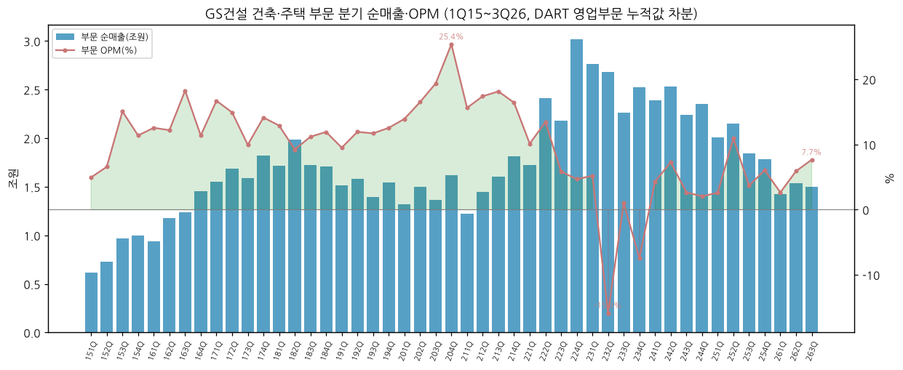
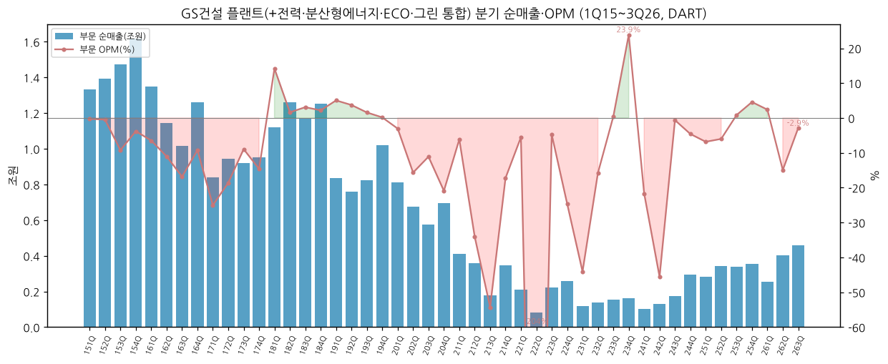
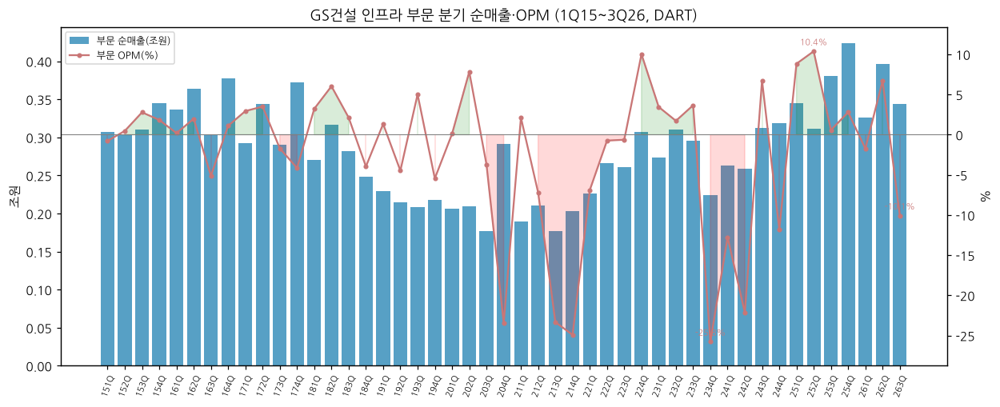
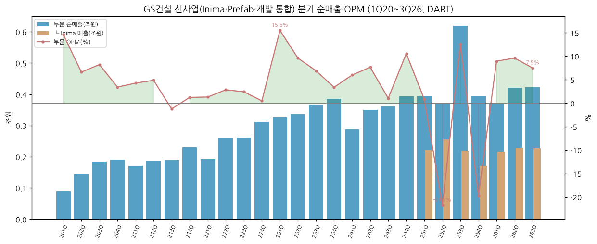

**사업본부별 최근 12분기 (억원, DART 영업부문 / GPM = IR):**

| 분기 | 건축·주택 | 플랜트 | 인프라 | 신사업 | (Inima) | 건축 OP | 플랜트 OP | 인프라 OP | 신사업 OP | 건축 GPM(IR) | 플랜트 GPM | 인프라 GPM | 전사 GPM |
|---|---|---|---|---|---|---|---|---|---|---|---|---|---|
| 2023-4Q | 25,227 | 1,616 | 2,245 | 3,849 | - | -1,869 | 386 | -579 | 131 | -3.1% | 2.7% | -20.5% | -1.8% |
| 2024-1Q | 23,866 | 1,015 | 2,630 | 2,874 | - | 1,030 | -220 | -336 | 173 | 8.8% | 3.4% | 2.4% | 9.0% |
| 2024-2Q | 25,327 | 1,295 | 2,591 | 3,503 | - | 1,846 | -590 | -574 | 268 | 11.0% | -24.0% | -11.5% | 8.3% |
| 2024-3Q | 22,368 | 1,754 | 3,129 | 3,610 | - | 597 | -11 | 211 | 38 | 7.3% | 13.4% | 10.2% | 8.3% |
| 2024-4Q | 23,548 | 2,953 | 3,186 | 3,933 | - | 483 | -135 | -375 | 416 | 9.7% | 6.9% | -5.5% | 9.1% |
| 2025-1Q | 20,096 | 2,836 | 3,455 | 3,945 | 2,216 | 524 | -194 | 305 | 33 | 9.5% | 2.4% | 14.8% | 9.5% |
| 2025-2Q | 21,484 | 3,407 | 3,113 | 3,710 | 2,557 | 2,351 | -204 | 323 | -807 | 16.9% | 1.1% | -7.2% | 9.3% |
| 2025-3Q | 18,453 | 3,396 | 3,811 | 6,185 | 2,191 | 683 | 29 | 22 | 777 | 11.8% | 9.2% | 6.2% | 12.1% |
| 2025-4Q | 17,836 | 3,563 | 4,236 | 3,947 | 1,707 | 1,079 | 163 | 118 | -775 | 17.3% | 14.1% | 9.0% | 12.3% |
| 2026-1Q | 14,213 | 2,536 | 3,264 | 3,710 | 2,159 | 377 | 61 | -57 | 332 | 12.4% | -24.2% | 3.9% | 8.3% |
| 2026-2Q | 15,368 | 4,020 | 3,965 | 4,207 | 2,298 | 909 | -600 | 266 | 404 | 17.6% | -7.0% | 22.0% | 14.6% |
| 2026-3Q | 14,997 | 4,570 | 3,437 | 4,224 | 2,270 | 1,150 | -132 | -346 | 317 | 15.6% | 4.5% | -4.5% | 11.2% |

(2024 GPM은 2025 IR의 재작성 비교값(그린→플랜트·인프라 이관 반영), 4Q23은 구체계. 신사업 = 개발·신사업 + Prefab + Inima (2026\~ 신성장사업개발본부 + Inima). 4Q25 Inima 영업손실 -836억, 신사업 -775억 — 4분기 비용 반영(사유 공시 미확인))

**연결 분기 매출·영업이익 매트릭스 (억원, DART):**

| 연도 | 1Q 매출 | 2Q | 3Q | 4Q | 1Q OP | 2Q OP | 3Q OP | 4Q OP | 분기합 매출 | 연간(DART) |
|---|---|---|---|---|---|---|---|---|---|---|
| 2015 | 23,158 | 24,911 | 27,889 | 29,769 | 200 | 382 | 109 | 530 | 105,727 | 105,726 |
| 2016 | 26,391 | 27,064 | 25,747 | 31,154 | 291 | 227 | 384 | 528 | 110,356 | 110,356 |
| 2017 | 27,009 | 29,944 | 28,203 | 31,638 | 590 | 860 | 711 | 1,026 | 116,794 | 116,795 |
| 2018 | 31,275 | 35,819 | 31,973 | 32,327 | 3,898 | 2,192 | 2,333 | 2,221 | 131,394 | 131,394 |
| 2019 | 26,019 | 25,750 | 24,416 | 27,981 | 1,914 | 2,059 | 1,877 | 1,823 | 104,166 | 104,166 |
| 2020 | 24,415 | 25,474 | 23,168 | 28,173 | 1,710 | 1,651 | 2,093 | 2,049 | 101,230 | 101,229 |
| 2021 | 20,141 | 22,317 | 21,717 | 26,191 | 1,766 | 1,249 | 1,523 | 1,927 | 90,366 | 90,366 |
| 2022 | 23,759 | 30,479 | 29,531 | 39,224 | 1,533 | 1,644 | 1,251 | 1,121 | 122,993 | 122,992 |
| 2023 | 35,127 | 34,951 | 31,075 | 33,214 | 1,589 | -4,138 | 602 | -1,932 | 134,367 | 134,367 |
| 2024 | 30,709 | 32,972 | 31,092 | 33,865 | 705 | 934 | 818 | 402 | 128,638 | 128,638 |
| 2025 | 30,629 | 31,961 | 32,080 | 29,834 | 704 | 1,621 | 1,485 | 569 | 124,504 | 124,503 |
| 2026 | 24,005 | 27,794 | 27,440 | - | 735 | 914 | 955 | - | 79,239 (9M) | - |

(4Q = 연간 − 3Q 누적. 2015는 OpenDART 분기 재무 미제공 → DART 영업부문 누적값 차분으로 산출(분기합 105,727 vs 연간 105,726). 2016\~2026은 dart_quarterly_summary와 일치)

**3Q26 핵심 (분기보고서 2026-11-13 확정치, 연간 합산은 FY26 결산 후 v2.0에서 갱신):**
- 연결 매출 **2조 7,440억** (-14.5% YoY, -1.3% QoQ) / 영업이익 **955억** (-35.7% YoY, +4.5% QoQ, OPM 3.5%) / 지배순이익 954억 — 시장 기대 하회 보도 (신한 프리뷰 1,105억, 컨센 1,137억)
- 건축·주택 매출 1.50조 (-18.7% YoY, 착공·입주 감소) but GPM 15.6% (+3.8%p YoY) / 영업이익 1,150억 (+68%)
- 플랜트 매출 4,570억 (+34.6%) / GPM 4.5%, 영업손실 -132억 · 인프라 GPM -4.5%, 영업손실 -346억 — 해외 비용 598억 (호주 North East Link 리스크 380억 + 사우디 얀부 준공지연 218억, 삼프로이코노미 2026-11-02 보도)
- 9M26 누적: 매출 7.92조 (-16.3%) / 영업이익 2,604억 (-31.6%) / 신규수주 11.79조 (분기 합, IR 하이라이트 표기는 9.9조·가이던스 17.8조 대비 55.4% — 차이 원인 미확인) / 주택 분양 13,744세대
- 부채비율 218.1% (전년말 234.2% → -16.1%p), 현금·단기금융상품 2.86조, 차입금(리스 제외) 5.42조 (IR)

**12분기 시계열 (4Q23 \~ 3Q26, 억원):**

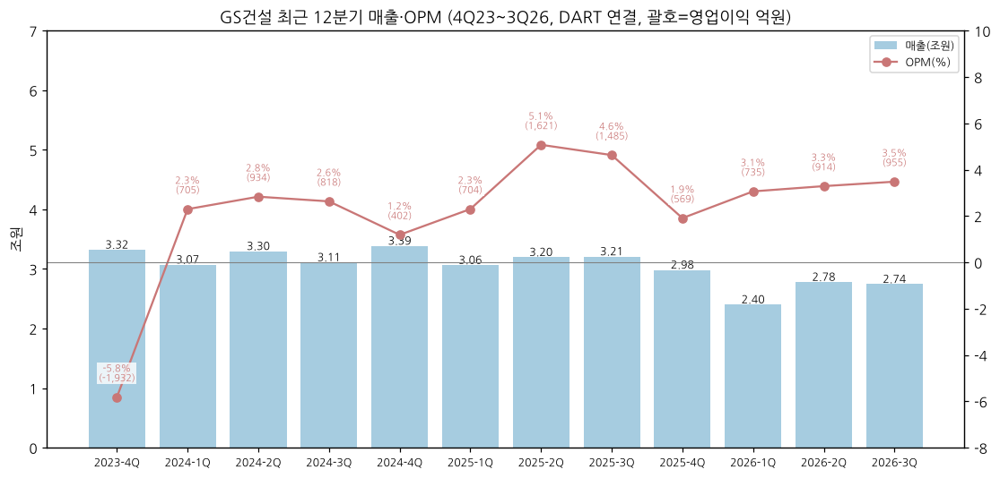

| 분기 | 매출 | 영업이익 | OPM | 순이익 | 메모 |
|---|---|---|---|---|---|
| 2023-4Q | 33,214 | -1,932 | -5.8% | -3,138 | 건축 OP -1,869억 (추가 비용, 세부 사유 IR 미기재) |
| 2024-1Q | 30,709 | 705 | 2.3% | 1,394 | 흑자전환 |
| 2024-2Q | 32,972 | 934 | 2.8% | 352 | 플랜트 GPM -24% |
| 2024-3Q | 31,092 | 818 | 2.6% | 1,208 |  |
| 2024-4Q | 33,865 | 402 | 1.2% | -315 | 4Q 비용, 순손실 -315억 |
| 2025-1Q | 30,629 | 704 | 2.3% | 137 |  |
| 2025-2Q | 31,961 | 1,621 | 5.1% | -871 | 주택 GPM 16.9%, 순손실 -871억(세전 -1,163억) |
| 2025-3Q | 32,080 | 1,485 | 4.6% | 1,221 | 신사업 OP +777억 |
| 2025-4Q | 29,834 | 569 | 1.9% | 447 | Inima -836억 |
| 2026-1Q | 24,005 | 735 | 3.1% | 107 | 매출 -21.6% (착공 감소) |
| 2026-2Q | 27,794 | 914 | 3.3% | 144 | 판관비 3,136억 (+130%) |
| 2026-3Q | 27,440 | 955 | 3.5% | 734 | 해외 비용 598억 |

**수주·수주잔고 (연결, 회사 IR):**

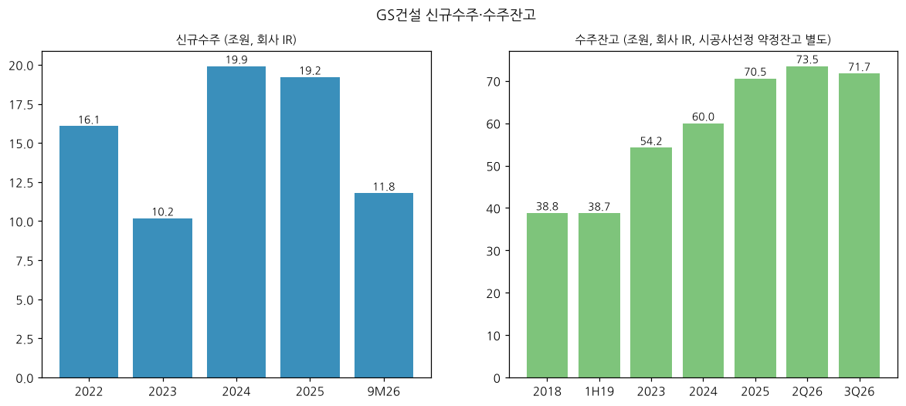

| 시점 | 신규수주 (조원) | 수주잔고 (조원) | 비고 | 출처 |
|---|---|---|---|---|
| 2018 | 11.45(계획) | 38.79 | Inima 잔고 3.76조 포함 | IR 2Q19 |
| 1H19 | 3.97 (반기) | 38.72 | 건축·주택 24.94 / 플랜트 9.28 / 인프라 4.50 | IR 2Q19 |
| 2022 | 16.07 | - |  | IR FY23 |
| 2023 | 10.18 | 54.20 | 건축·주택 32.66 / 신사업 12.59 / 인프라 6.58 | IR FY24 |
| 2024 | 19.91 | 59.95 | 신사업 17.08 (+36%, Inima 장기운영 포함) | IR FY24 |
| 2025 | 19.21 | 70.55 | 국내 46.5 / 해외 24.1, 약정잔고 16.0조 별도 | IR FY25 |
| 2Q26 | 5.22 (분기) | 73.47 |  | IR 3Q26 |
| 3Q26 | 3.96 (분기) | 71.70 | 국내 50.2 / 해외 21.5, 약정잔고 17.4조 별도 | IR 3Q26 |

- 2018 신규수주 11.45조는 연초 계획값(IR 1Q18), 실적치 미확인
- 3Q26 주택 수주잔고 38.82조: 서울 34% · 수도권 27% · 광역시 26% · 지방 13% / **재건축·재개발 71%**, 외주·도급 27%, 자체 2% (IR 3Q26, 사업시행인가 기준)
- 2026 시공권 확보(누적 5.5조, IR 3Q26): 성수1 재개발 2.15조, 부산 광안5구역 9,709억, 송파한양2차 6,856억, 서초진흥 6,793억 등 — 정비사업 집중

### ② 사업부별 개요 (매출 비중 큰 순서)

**건축·주택사업본부 — 9M26 연결 순매출의 56% (2025 63%)**

"자이(Xi) 브랜드의 재건축·재개발·도급 주택과 오피스·공장·데이터센터를 짓는 이익의 원천."

- 주택: 정비사업(재건축·재개발) 중심, 2026 9M 분양 13,744세대 (IR) (2026 계획 약 1.7만 세대로 상향, 신한 2026-10-13)
- 건축: 공장(LG화학 등), 오피스, AI 데이터센터 (LG유플러스 1239 AIDC 4,600억 수주 3Q26, 동해 100MW DC 인허가)
- 자회사 자이에스앤디(상장): 중소형 주택·Home Solution (2025 매출 1.39조)
- 주요 고객(3Q26 DART): 뉴타운맨션삼호아파트 재건축조합, ㈜하늘이엔씨, 용답동 재개발조합

**플랜트사업본부 — 9M26 14% (2025 11%)**

"중동·국내 정유·석유화학·발전·환경 EPC — 2013 손실 이후 선별 수주로 축소됐다가 2025 반등."

- 주요 고객(3Q26 DART): Saudi Aramco, LG화학, 동북아엘엔지허브터미널 / 사우디 얀부(준공 지연 비용 218억, 3Q26)
- 2025부터 그린사업본부(환경·수처리 EPC, 신재생) 흡수 / 2026 1Q·2Q GPM -24.2%·-7.0% (민자사업 잔여 운영 리스크 선반영, 비즈워치 2026-07-29)

**인프라사업본부 — 9M26 13% (2025 12%)**

"도로·철도·전력(그리드) 토목 — 싱가포르·호주 해외 비중이 높다."

- 주요 고객: Spark NEL Pty Ltd(호주 North East Link), Land Transport Authority(싱가포르), 한국전력공사 / 2025 호주사업본부 흡수
- 3Q26 GPM -4.5% (호주 NEL 예상 리스크 380억)

**신성장사업개발본부 + GS이니마 — 9M26 15% (2025 14%)**

"수처리 운영(GS이니마), 모듈러(Prefab), 해외 개발사업(베트남 등)."

- **GS이니마** (스페인, 2012 인수): 해수담수화·상하수도·산업용수 운영 (오만 OPWP, 브라질 Braskem 등) — 2025 매출 8,672억 / 영업이익 265억, 9M26 6,728억 / 1,168억 (OPM 17.4%). **2025-08 TAQA에 지분 전량 매각 SPA (1.2bn$)**, 3Q26 현재 규제 승인 등 선결조건 진행 중 (DART 분기보고서(2026.09)) — 알제리 정부 반대로 알제리 자산 분리 가능성 보도 (더구루 2026-05-29)
- **Prefab**: 폴란드 Danwood(목조 모듈러), 영국 Elements Europe(청산·법정관리 결정) 등 — 2025 영업손실 -1,396억 (2Q25 -1,144억 집중)
- 개발·신사업: 베트남 개발법인·미주개발사업팀·DC사업팀 (DART 영업조직, 2025.12)

### ③ 사업부별 디테일

**현재 가장 잘나가는 사업 (top-seller):**
- **건축·주택 마진 정상화** — IR GPM 2023 -0.3% → 2024 9.3% → 2025 13.9% → 2Q26 17.6%·3Q26 15.6%. 검단 이후 원가 재산정 현장 준공, 2022\~2023 고원가 착공분 소진
- **GS이니마** — 9M26 OPM 17.4%로 전 부문 최고 (매각 전까지 이익 기여)

**향후 큰 매출 기대 사업 (growth):**
- 정비사업 시공권 → 착공 전환 (약정잔고 17.4조 + 2026 시공권 5.5조) — 2027 매출 반등의 전제 (신한: 2027F 매출 11.49조, 영업이익 6,133억)
- AI 데이터센터 (동해 DC 1단지 100MW 인허가, 2·3단지 2027 인허가 계획 — 신한 2026-10-13) / 재생에너지전기공급사업 정관 추가 (2026-03)

**이익 outlier:**
- 플랜트: 2016\~2025 중 흑자 2개년(2018·2019). 2014\~2017 누적 영업손실 -1.40조 (2013 대규모 손실의 연장선)
- 인프라: 2020\~2024 5년 중 4년 영업손실 (해외 토목 원가)
- Prefab: 2025 -1,396억 (Elements 청산 관련)

### ④ 주요 경쟁사 (사업부별)

| 사업부 | 주요 경쟁사 |
|--------|-------------|
| 국내 주택·정비사업 | 삼성물산(래미안), 현대건설(힐스테이트·디에이치), 대우건설(푸르지오), DL이앤씨(e편한세상·아크로), 포스코이앤씨(더샵), HDC현산(아이파크), 롯데건설 |
| 해외 플랜트 (중동 정유·화학) | 삼성E&A, 현대건설·현대엔지니어링, DL이앤씨, Saipem, Técnicas Reunidas, 중국 EPC |
| 인프라 (싱가포르·호주) | 현대건설, 삼성물산, 쌍용건설, 현지 Acciona·CPB 등 |
| 수처리 운영 (GS이니마) | Veolia, Acciona Agua, Suez, Aqualia |
| 모듈러 | 국내 소수(현대엔지니어링 등), 유럽 현지 업체 |

### ⑤ 주요 매출처

> DART는 고객별 매출액을 공시하지 않음. 아래는 DART 분기보고서(2026.09) II-1 사업본부별 "주요고객정보"(알파벳/가나다 의무 순서 아님, 회사 기재 순서).

| 사업본부 | 주요 고객 | 9M26 순매출 (백만원) | 비중 |
|---|---|---|---|
| 건축·주택 | 뉴타운맨션삼호아파트지구 재건축조합, ㈜하늘이엔씨, 용답동재개발정비사업조합 | 4,457,758 | 56.3% |
| 플랜트 | Aramco(사우디), ㈜엘지화학, 동북아엘엔지허브터미널㈜ | 1,112,611 | 14.0% |
| 인프라 | Spark NEL Pty Ltd(호주), Land Transport Authority(싱가포르), 한국전력공사 | 1,066,537 | 13.5% |
| 신성장사업개발 | 불특정 다수인 등 (해외개발·모듈러) | 541,387 | 6.8% |
| Inima | Braskem, OPWP 등 | 672,752 | 8.5% |
| 기타 | 리조트 등 불특정 다수 | 72,810 | 0.9% |

- 주택 매출처는 정비사업 조합·시행사 → 특정 고객 집중도 낮음. 해외는 Aramco·싱가포르 LTA·호주 NEL 등 소수 대형 발주처

### ⑥ 생산 CAPA + 임직원

- 수주산업 → 생산 CAPA 대신 **수주잔고 71.7조 (2025 매출 대비 약 5.8년치)** + 약정잔고 17.4조가 CAPA 지표 (3Q26 IR)
- 3Q26 PF 신용보강 3.08조 (DART) — 주택 착공 속도를 제약하는 재무 CAPA

**임직원 추이 (GS건설 별도, DART 사업보고서 VIII):**

| 연도 | 직원 수 | 평균 근속(년) | 급여총액(억원) | 1인 평균(백만원) |
|---|---|---|---|---|
| 2014 | 6,583 | 10.0 | 4,926 | 75 |
| 2015 | 6,454 | 10.5 | 5,182 | 80 |
| 2016 | 6,210 | 11.2 | 5,113 | 82 |
| 2017 | 7,099 | 12.2 | 5,477 | 77 |
| 2018 | 6,831 | 13.1 | 5,629 | 82 |
| 2019 | 6,672 | 14.1 | 6,224 | 93 |
| 2020 | 6,350 | 15.0 | 6,012 | 95 |
| 2021 | 5,433 | 15.8 | 5,486 | 95 |
| 2022 | 5,422 | 15.5 | 5,609 | 102 |
| 2023 | 5,256 | 15.5 | 5,613 | 104 |
| 2024 | 5,483 | 15.5 | 4,962 | 93 |
| 2025 | 4,996 | 15.6 | 5,436 | 105 |

- 2025말 부문별 (DART): 건축·주택 2,466 / 플랜트 1,028 / 인프라 544 / 개발·신사업 122 / Prefab 35 / 기타 801 — 기간의 정함 없는 3,676 · 기간제 1,320 (26%)
- 2017 7,099명 정점 → 2025 4,996명 (-30%) — 해외 플랜트 축소와 함께 인력 감축

---

## 4. 재무 구조

> **재무제표 수치: OpenDART fnlttSinglAcntAll (연결 CFS·별도 OFS), 2026-11-25 조회.** 2014 = 2015 사업보고서 전기 컬럼. 2023\~2025는 2026-06\~07 기재정정 보고서가 있으나 정정 사유는 XBRL 작성오류·주석 정정(숫자 변경 아님, 202512 정정공시 확인). 3Q26 = 분기보고서(2026.09) 확정치. 단위 억원 → 표에서는 조원 병기

### ① 손익계산서 (12년 연결, 조원)

| 연도 | 매출 | 매출원가 | 매출총이익 | GPM | 판관비 | CIR | 영업이익 | OPM | 세전이익 | 순이익 | NPM | 지배순이익 | EPS(원) |
|---|---|---|---|---|---|---|---|---|---|---|---|---|---|
| 2014 | 9.49 | 9.06 | 0.43 | 4.5% | 0.38 | 4.0% | 0.05 | 0.5% | -0.03 | -0.02 | -0.2% | -0.04 | -667 |
| 2015 | 10.57 | 10.03 | 0.55 | 5.2% | 0.43 | 4.0% | 0.12 | 1.2% | 0.03 | 0.03 | 0.3% | 0.03 | 363 |
| 2016 | 11.04 | 10.55 | 0.49 | 4.4% | 0.35 | 3.1% | 0.14 | 1.3% | 0.02 | -0.02 | -0.2% | -0.03 | -394 |
| 2017 | 11.68 | 10.88 | 0.80 | 6.9% | 0.48 | 4.1% | 0.32 | 2.7% | -0.16 | -0.16 | -1.4% | -0.17 | -2,431 |
| 2018 | 13.14 | 11.51 | 1.63 | 12.4% | 0.56 | 4.3% | 1.06 | 8.1% | 0.84 | 0.59 | 4.5% | 0.58 | 7,788 |
| 2019 | 10.42 | 9.02 | 1.40 | 13.4% | 0.63 | 6.1% | 0.77 | 7.4% | 0.67 | 0.45 | 4.3% | 0.44 | 5,590 |
| 2020 | 10.12 | 8.59 | 1.54 | 15.2% | 0.78 | 7.8% | 0.75 | 7.4% | 0.52 | 0.33 | 3.3% | 0.31 | 3,919 |
| 2021 | 9.04 | 7.69 | 1.35 | 14.9% | 0.70 | 7.8% | 0.65 | 7.2% | 0.66 | 0.43 | 4.7% | 0.41 | 4,834 |
| 2022 | 12.30 | 11.01 | 1.29 | 10.5% | 0.73 | 5.9% | 0.55 | 4.5% | 0.66 | 0.44 | 3.6% | 0.34 | 3,997 |
| 2023 | 13.44 | 13.17 | 0.26 | 2.0% | 0.65 | 4.8% | -0.39 | -2.9% | -0.52 | -0.42 | -3.1% | -0.48 | -5,677 |
| 2024 | 12.86 | 11.75 | 1.11 | 8.7% | 0.83 | 6.4% | 0.29 | 2.2% | 0.44 | 0.26 | 2.1% | 0.25 | 2,893 |
| 2025 | 12.45 | 11.11 | 1.35 | 10.8% | 0.91 | 7.3% | 0.44 | 3.5% | 0.15 | 0.09 | 0.8% | 0.09 | 1,073 |

(EPS = DART 공시 기본주당이익. 2014\~2017 순손실은 영업이익이 이자·외환·해외 손상 등 영업외 비용을 감당하지 못한 구간)

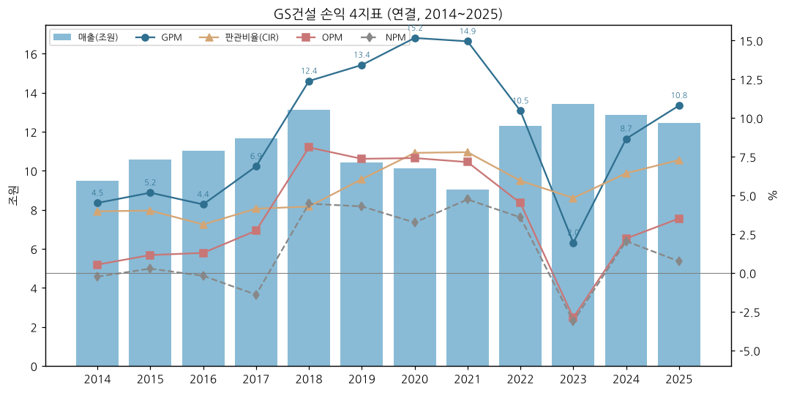

**별도 vs 연결 (억원, DART) — 종속(이니마·자이에스앤디·Prefab 등) 기여:**

| 연도 | 별도 매출 | 별도 OP | 별도 OPM | 연결 매출 | 연결 OP | 종속 기여 매출 | 종속 기여 OP |
|---|---|---|---|---|---|---|---|
| 2014 | 83,533 | 127 | 0.2% | 94,876 | 512 | 11,342 | 385 |
| 2015 | 90,698 | 1,382 | 1.5% | 105,726 | 1,221 | 15,028 | -161 |
| 2016 | 99,961 | 3,878 | 3.9% | 110,356 | 1,430 | 10,395 | -2,448 |
| 2017 | 108,117 | 3,844 | 3.6% | 116,795 | 3,187 | 8,677 | -657 |
| 2018 | 117,860 | 9,819 | 8.3% | 131,394 | 10,645 | 13,534 | 826 |
| 2019 | 94,851 | 6,809 | 7.2% | 104,166 | 7,673 | 9,315 | 863 |
| 2020 | 88,910 | 6,832 | 7.7% | 101,229 | 7,504 | 12,319 | 672 |
| 2021 | 77,959 | 5,148 | 6.6% | 90,366 | 6,465 | 12,407 | 1,317 |
| 2022 | 86,137 | 2,810 | 3.3% | 122,992 | 5,548 | 36,855 | 2,738 |
| 2023 | 93,778 | -7,094 | -7.6% | 134,367 | -3,879 | 40,589 | 3,215 |
| 2024 | 93,111 | 1,122 | 1.2% | 128,638 | 2,860 | 35,527 | 1,738 |
| 2025 | 81,002 | 4,811 | 5.9% | 124,503 | 4,378 | 43,501 | -433 |
| 3Q26(분기) | 14,077 | 702 | 5.0% | 27,440 | 955 | 13,363 | 253 |

→ 종속 매출 비중 2014 12% → 2025 35% (자이에스앤디·이니마·Prefab). 2025 별도 OP 4,811억 > 연결 4,378억 — **종속 합산이 영업이익을 깎는 구조** (Prefab·해외 법인 손실), 2026 9M은 별도 OP 786억 vs 연결 2,604억으로 역전 (이니마·자이에스앤디 기여)

### ② 재무상태표 (12년 연결, 조원)

| 연도 | 자산총계 | 부채총계 | 자본총계 | 지배지분 | 자본 YoY | 부채비율 | 유동비율 |
|---|---|---|---|---|---|---|---|
| 2014 | 13.09 | 9.51 | 3.58 | 3.27 | - | 265.6% | 141.2% |
| 2015 | 13.01 | 9.66 | 3.35 | 3.28 | -6.5% | 288.5% | 133.8% |
| 2016 | 13.38 | 10.02 | 3.35 | 3.28 | +0.2% | 298.9% | 134.8% |
| 2017 | 13.70 | 10.46 | 3.24 | 3.17 | -3.4% | 322.8% | 111.7% |
| 2018 | 12.03 | 8.41 | 3.62 | 3.55 | +11.9% | 232.0% | 123.1% |
| 2019 | 13.17 | 9.03 | 4.14 | 3.97 | +14.3% | 217.9% | 126.3% |
| 2020 | 13.77 | 9.46 | 4.31 | 4.14 | +4.1% | 219.3% | 126.6% |
| 2021 | 15.18 | 10.31 | 4.87 | 4.63 | +13.0% | 211.6% | 121.1% |
| 2022 | 16.95 | 11.59 | 5.36 | 4.83 | +9.9% | 216.4% | 114.7% |
| 2023 | 17.71 | 12.82 | 4.89 | 4.31 | -8.8% | 262.5% | 107.8% |
| 2024 | 17.80 | 12.72 | 5.09 | 4.41 | +4.1% | 250.0% | 96.0% |
| 2025 | 18.46 | 12.94 | 5.52 | 4.79 | +8.6% | 234.2% | 115.9% |
| 3Q26 | 17.33 | 11.88 | 5.45 | 4.69 | - | 218.1% | 96.8% |

(2014 자본 3.58조 = 2014 유상증자(자본금 +1,000억·자본잉여금 +4,515억 = 약 5,515억, DART 요약재무) 반영 후. 2025 자본 증가에 신종자본증권 1,968억 발행 포함 (연결 CF))

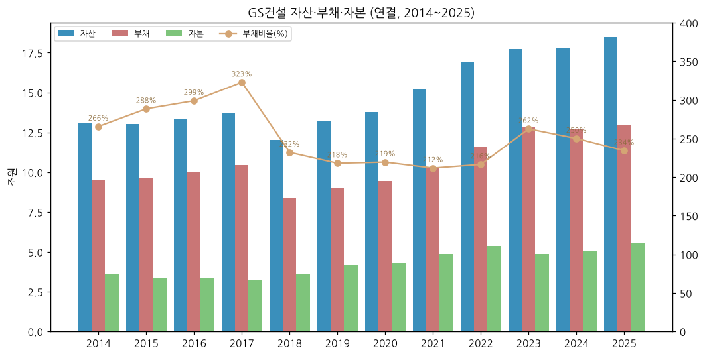

### ③ 현금흐름표 (12년 연결, 억원)

| 연도 | 영업CF | 투자CF | 재무CF | CapEx(유형) | CapEx(무형) | 배당지급 | 이자지급 | FCF |
|---|---|---|---|---|---|---|---|---|
| 2014 | 5,715 | -3,345 | 352 | 3,080 | 12 | 15 | 962 | 2,624 |
| 2015 | -78 | 5,079 | -2,282 | 2,271 | 24 | 11 | 1,002 | -2,373 |
| 2016 | 812 | -2,487 | 782 | 791 | 150 | 8 | 1,340 | -129 |
| 2017 | -2,055 | 135 | 3,000 | 208 | 100 | 7 | 1,758 | -2,363 |
| 2018 | 10,329 | -2,348 | -16,556 | 137 | 197 | 211 | 1,502 | 9,996 |
| 2019 | 7,593 | -7,476 | 1,835 | 1,428 | 172 | 830 | 1,373 | 5,992 |
| 2020 | 5,539 | -2,690 | 509 | 1,277 | 184 | 892 | 1,351 | 4,078 |
| 2021 | 11,075 | -5,312 | -49 | 1,349 | 235 | 1,206 | 1,090 | 9,491 |
| 2022 | -73 | -13,112 | 6,247 | 2,955 | 387 | 1,196 | 1,715 | -3,415 |
| 2023 | 4,698 | -7,631 | 4,965 | 4,761 | 291 | 1,352 | 3,262 | -354 |
| 2024 | 2,678 | -5,489 | 766 | 4,162 | 1,108 | 324 | 3,790 | -2,592 |
| 2025 | 5,915 | -2,470 | 5,737 | 2,260 | 690 | 418 | 4,130 | 2,965 |

(FCF = 영업CF − 유·무형자산 취득. 배당지급 = 연결 CF 지급액(비지배 포함). 이자지급은 영업CF 내 분류)

→ 2018 영업CF 1.03조로 차입금 1.66조 상환(재무CF -1.66조) — 2018 실적 정점이 재무구조 개선으로 연결. 2022 영업CF -73억(주택 운전자본 급증) 이후 이자지급 1,715억 → 2025 4,130억 (**2.4배**) — 차입 확대 + 금리 상승

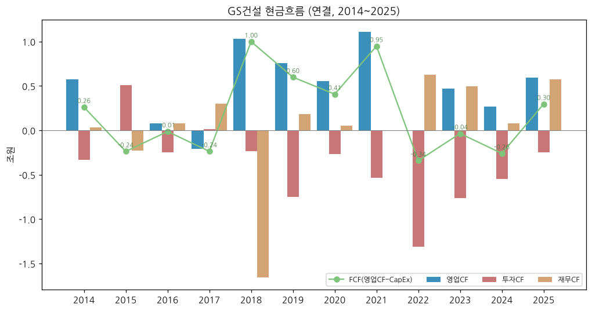

### ④ CapEx 추이 (12년, 억원)

| 연도 | 유형 | 무형 | 총 CapEx | CapEx/매출 |
|---|---|---|---|---|
| 2014 | 3,080 | 12 | 3,092 | 3.26% |
| 2015 | 2,271 | 24 | 2,295 | 2.17% |
| 2016 | 791 | 150 | 941 | 0.85% |
| 2017 | 208 | 100 | 308 | 0.26% |
| 2018 | 137 | 197 | 334 | 0.25% |
| 2019 | 1,428 | 172 | 1,601 | 1.54% |
| 2020 | 1,277 | 184 | 1,460 | 1.44% |
| 2021 | 1,349 | 235 | 1,584 | 1.75% |
| 2022 | 2,955 | 387 | 3,342 | 2.72% |
| 2023 | 4,761 | 291 | 5,052 | 3.76% |
| 2024 | 4,162 | 1,108 | 5,270 | 4.10% |
| 2025 | 2,260 | 690 | 2,950 | 2.37% |

- 건설 본업 CapEx는 미미하고, 2020년 이후 증가분은 이니마(수처리 운영 자산)·Prefab 공장·자이에스앤디 등 **종속회사 투자**가 주도한 것으로 추정 (부문별 CapEx 미공시). 2025 유형자산 2.64조 → 1.63조 감소는 회계 재분류 영향 가능성 (이니마 관련 여부 미확인 — 다음 버전 주석 확인)

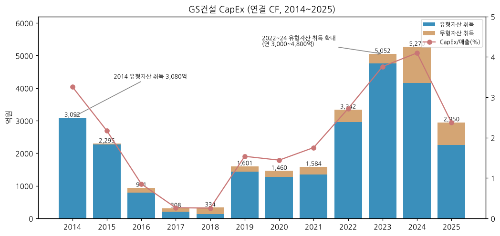

### ⑤ 부채구조 + 운전자본 (12년, 억원)

| 연도 | 유동부채 | 비유동부채 | 금융부채(DART) | 차입금(IR, 리스 제외) | 현금+단기금융 | 순차입(IR 차입금 기준) | 매출채권 | 계약자산(미청구) | 계약부채(초과청구) | 재고자산 |
|---|---|---|---|---|---|---|---|---|---|---|
| 2014 | 61,272 | 33,859 | 41,972 | - | 24,839 | - | 45,738 | - | - | 6,132 |
| 2015 | 71,393 | 25,181 | 37,052 | 34,620 | 27,975 | 6,645 | 47,488 | - | - | 7,955 |
| 2016 | 72,250 | 27,984 | 36,432 | 34,330 | 27,094 | 7,236 | 49,969 | - | - | 8,253 |
| 2017 | 85,813 | 18,756 | 40,792 | 39,050 | 27,382 | 11,668 | 47,633 | - | - | 10,907 |
| 2018 | 63,597 | 20,489 | 22,653 | 21,030 | 18,878 | 2,152 | 42,974 | - | - | 10,342 |
| 2019 | 58,009 | 32,273 | 33,363 | - | 20,773 | - | 35,052 | - | - | 8,751 |
| 2020 | 57,289 | 37,297 | 41,515 | 32,390 | 23,768 | 8,622 | 19,571 | 10,238 | 17,819 | 14,301 |
| 2021 | 67,693 | 35,417 | 41,700 | 33,650 | 31,134 | 2,516 | 22,001 | 9,603 | 25,959 | 14,771 |
| 2022 | 82,055 | 33,849 | 50,748 | 43,860 | 26,058 | 17,802 | 32,517 | 15,559 | 25,220 | 14,999 |
| 2023 | 87,962 | 40,259 | 58,240 | 52,481 | 28,379 | 24,102 | 35,290 | 12,671 | 23,527 | 13,387 |
| 2024 | 90,319 | 36,843 | 62,368 | 56,303 | 26,036 | 30,267 | 30,505 | 12,009 | 20,717 | 12,800 |
| 2025 | 78,321 | 51,041 | 66,942 | 60,682 | 35,760 | 24,922 | 27,729 | 9,596 | 20,921 | 11,633 |
| 3Q26 | 84,318 | 34,510 | 60,996 | 54,249 | 29,184 | 25,065 | 26,172 | 5,487 | 19,683 | 12,971 |

(금융부채(DART) = 단기·장기금융부채(또는 차입금·사채 계정) 합계 — 리스부채·기타금융부채 포함 가능. 차입금(IR) = IR 요약 재무상태표(2015\~2018 십억원 단위 환산, 2019 미확보). 2020년 이전 계약자산·계약부채는 '미청구공사/초과청구공사' 계정으로 OpenDART 표준계정 미매칭 → n/a. 매출채권 2014\~2019는 계약자산 포함 구분 전)

→ 순차입 2018 2,152억 (정점 실적기 최저) → 2025 2.51조 → 3Q26 2.56조. 이니마 매각대금(약 1.6\~1.8조 추정)이 유입되면 순차입은 1조 미만으로 축소 가능 (추정)

**신용등급 (DART 사업보고서(2025.12) 신용평가):** 기업어음 A2+ (2023-06, 3사) → 한국기업평가 A2 (2023-12) → 한국신용평가·NICE A2 (2024-02 수시평정, 검단 영업정지 처분 직후) → 2024-12 A2 유지. 회사채 등급은 본 수집 범위에서 미확인

**부동산 PF 우발부채 (연결, DART 분기보고서(2026.09) 주석 21, 책임준공·중도금·SOC 미포함):**

| 구분 | 2025말 | 3Q26말 |
|---|---|---|
| PF 신용보강(보증금액 기준) 합계 | 3.16조 | **3.08조** |
| └ 단독사업 | 3.06조 | 2.96조 |
| └ 컨소시엄 참여 | 0.10조 | 0.12조 |
| 특수관계자 신용보강 (기타사업) | 0.50조 | 0.51조 |
| 우발부채 → 충당부채 전환액 | 0 | 0 |
| 미착공 PF (IR) | 1.35조 | 1.35조 |

- PF 보증 3.08조 = 연결 자본 5.45조의 57% (현대건설 14.18조·자본 대비 126%보다 낮음 — 현대건설_기업개요 v1.0a 2Q26 기준, 정의 차이 주의)

### ⑥ 배당·자사주 추이 (12년)

| 연도 | DPS(원) | 연결 배당지급(억, 당해 CF) | 지배순이익(억) | 배당성향(연결, 근사) |
|---|---|---|---|---|
| 2014 | 0 | 15 | -411 | 적자 |
| 2015 | 0 | 11 | 261 | 0% |
| 2016 | 0 | 8 | -258 | 적자 |
| 2017 | 300 | 7 | -1,684 | 적자 |
| 2018 | 1,000 | 211 | 5,821 | 13.6% |
| 2019 | 1,000 | 830 | 4,434 | 18.0% |
| 2020 | 1,200 | 892 | 3,117 | 31.1% |
| 2021 | 1,300 | 1,206 | 4,085 | 27.0% |
| 2022 | 1,300 | 1,196 | 3,393 | 32.5% |
| 2023 | 0 | 1,352 | -4,819 | 적자 |
| 2024 | 300 | 324 | 2,456 | 10.4% |
| 2025 | 500 | 418 | 935 | 45.4% |

(DPS = DART 사업보고서 배당에 관한 사항(귀속연도). 배당성향 근사 = DPS × 유통주식수 ÷ 지배순이익. DART 공시 연결 현금배당성향: 2024 10.4% / 2025 45.4% (배당총액 424억))

- 2014\~2016 무배당 (2013 손실 후) → 2017 300원 재개 → 2018\~2022 1,000\~1,300원 → **2023 검단 적자로 무배당** → 2024 300원 → 2025 500원
- 자사주: 692,595주 (0.81%) 보유, **2014\~2025 신규 매입·소각 이력 없음** (DART 자기주식 현황, 연결 CF 자기주식 취득 2017 52억 1회)

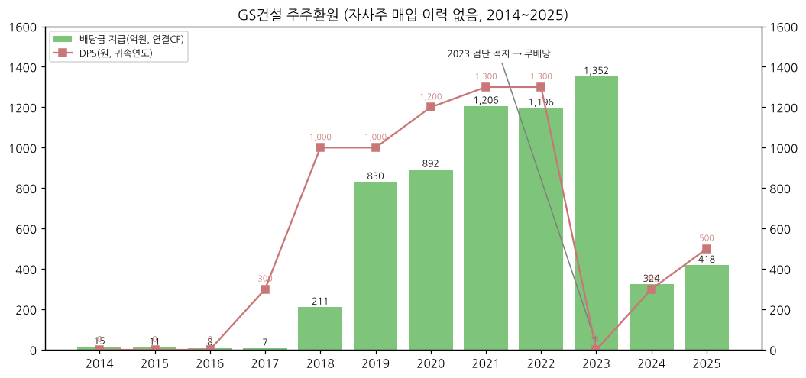

### ⑦ 재무 비율 (12년)

| 연도 | ROE(지배) | ROA | 부채비율 | 유동비율 | OP/이자지급 |
|---|---|---|---|---|---|
| 2014 | -1.3% | -0.2% | 265.6% | 141.2% | 0.5x |
| 2015 | 0.8% | 0.2% | 288.5% | 133.8% | 1.2x |
| 2016 | -0.8% | -0.2% | 298.9% | 134.8% | 1.1x |
| 2017 | -5.2% | -1.2% | 322.8% | 111.7% | 1.8x |
| 2018 | 17.3% | 4.6% | 232.0% | 123.1% | 7.1x |
| 2019 | 11.8% | 3.6% | 217.9% | 126.3% | 5.6x |
| 2020 | 7.7% | 2.4% | 219.3% | 126.6% | 5.6x |
| 2021 | 9.3% | 3.0% | 211.6% | 121.1% | 5.9x |
| 2022 | 7.2% | 2.7% | 216.4% | 114.7% | 3.2x |
| 2023 | -10.5% | -2.4% | 262.5% | 107.8% | -1.2x |
| 2024 | 5.6% | 1.5% | 250.0% | 96.0% | 0.8x |
| 2025 | 2.0% | 0.5% | 234.2% | 115.9% | 1.1x |

**주요 비율 의미:**
- **ROE**: 지배순이익 / 평균 지배지분 (2014은 2014말 단일값) — 12년 최고 17.3% (2018), 2023 -10.5%
- **부채비율**: 2017 322.8% (해외 손실기) → 2018 232.0% → 2023 262.5% (검단) → 3Q26 218.1%
- **OP/이자지급**: CF상 이자지급 기준 이자보상배율 근사 — 2025 1.1x / 2014 0.5x, 2015\~2017 1.1\~1.8x. 금융원가(외환손실 포함) 기준은 더 낮음

---

## 5. 지배 구조

### ① 그룹·계열 관계

- **GS그룹** 계열 (공정위 기업집단 GS, 그룹 회장 허태수 2020\~) — 그러나 GS건설은 지주회사 ㈜GS의 자회사가 **아니며**, 허창수 회장 일가가 개인 지분으로 직접 지배
- 허씨 일가 지분 23.64% 중 허창수 5.95%·허윤홍 3.89%(장남, 대표) / 허진수(GS칼텍스 전 회장) 3.55%·허명수 2.84%·허태수(GS그룹 회장) 1.79% 등 — **창업 2\~4세 다수가 분산 보유**
- 최대주주 지분 변동: 2021 허창수 8.29% → 2024-02 5.95% (특수관계인 증여 — 허윤홍 지분 증가로 2대 주주) (DART)
- 연결 종속기업 137개사 (2025말): 자이에스앤디(상장), GS Inima Environment S.A.U.(스페인, 매각 진행), Danwood S.A.(폴란드), 자이씨앤에이, 지에스엘리베이터 등

### ② 주주 구분

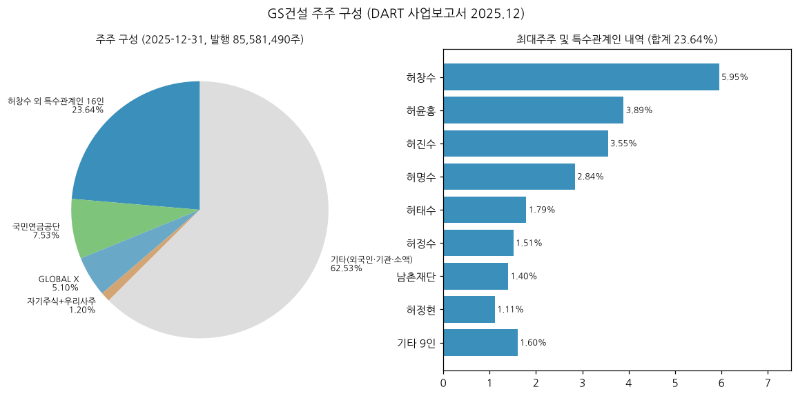

**5% 이상 주주 (보통주, DART 사업보고서(2025.12) VII):**

| 주주명 | 주식수 | 지분율 | 비고 |
|--------|--------|--------|------|
| 허창수 (최대주주) | 5,089,463 | 5.95% | 특수관계인 포함 20,232,618주 23.64% |
| 국민연금공단 | 6,442,300 | 7.5% | 단일 주주로는 최대 |
| GLOBAL X | 4,361,785 | 5.1% | ETF 운용사 |
| 우리사주조합 | 332,906 | 0.4% | |

**전체 주주 구분 (2025-12-31):**

| 구분 | 지분율 | 비고 |
|---|---|---|
| 허창수 외 특수관계인 16인 (남촌재단 포함) | 23.64% | 공시 |
| 국민연금 | 7.5% | 공시 |
| GLOBAL X | 5.1% | 공시 |
| 자기주식 | 0.81% | 692,595주 |
| 소액주주 | 63.58% | 97,058명, 53,971,610주 |
| 외국인 | 미확인 | 2026-11 cutoff 내 출처 미확보 |

- 발행주식: 보통주 85,581,490주 (액면 5,000원, 자본금 4,279억), 유통 84,888,895주 (DART 주식의 총수, 2025-12-31)

### ③ 임원·이사회

**대표이사 (각자대표, 2026-03\~):**
- **허윤홍 대표이사 사장** (1979.01): Saint Louis Univ. 국제경영·Univ. of Washington MBA → GS건설 상무보·신사업부문 대표(Danwood 이사·GS Inima 이사) → 2023-10 CEO 내정 → 2024-03 대표이사. 2026 5대 경영목표: 안전·AI 업무환경·원가 관리·선택과 집중·준법경영 (CEO스코어데일리 2026-03-25)
- **김태진 대표이사 사장**: 전 재무본부장(CFO) → 최고안전전략책임자(CSSO) → 2026-03 각자대표 (재무·안전 담당)
- **허창수 회장** (1948.10): 2002\~2026-03 대표이사 (24년), 전경련 회장(33\~38대) 역임 — 사내이사·회장 유지

**등기임원 (DART 사업보고서(2025.12), 2025-12-31 — 2026-03 주총 이전):**

| 구분 | 성명 | 직위·담당 | 주요 경력 | 임기만료 |
|---|---|---|---|---|
| 사내이사 | 허창수 (1948.10) | 회장, 대표이사 | 전 ㈜GS 대표이사, 전 LG전선 회장 | 2026-03 |
| 사내이사 | 허윤홍 (1979.01) | 사장, 대표이사 | 전 GS건설 상무보, GS Inima 이사 | 2027-03 |
| 기타비상무 | 허진수 (1953.09) | 기타비상무이사 | 전 GS칼텍스 대표이사 회장 | 2026-03 |
| 사외이사 | 최현숙 (1963.08) | 보상위원장·감사위원 | 전 IBK캐피탈 대표, 김앤장 고문 | 2026-03 |
| 사외이사 | 황철규 (1964.10) | ESG위원장·감사위원 | 전 대구고검 검사장 | 2027-03 |
| 사외이사 | 손병석 (1962.01) | 사외이사후보추천위원 | 전 국토부 1차관, 전 코레일 사장 | 2028-03 |
| 사외이사 | 이호영 (1960.09) | 감사위원장 | 회계학 박사, 전 한국회계정보학회장 | 2028-03 |

- 이사회 7인 (사내 2 + 기타비상무 1 + 사외 4). 2026-03 정기주총에서 김태진 사장 선임으로 구성 변경 (상세는 2026 반기보고서 확인 필요)

---

## 6. 기타 팩트

### ① R&D 인프라

| 연도 | 2014 | 2015 | 2016 | 2017 | 2018 | 2019 | 2020 | 2021 | 2022 | 2023 | 2024 | 2025 |
|---|---|---|---|---|---|---|---|---|---|---|---|---|
| 연구개발비용 (억원) | 484 | 449 | 463 | 541 | 527 | 483 | 339 | 340 | 347 | 720 | 729 | 693 |
| **R&D / 별도 매출** | **0.58%** | **0.50%** | **0.46%** | **0.50%** | **0.45%** | **0.51%** | **0.38%** | **0.44%** | **0.40%** | **0.77%** | **0.78%** | **0.86%** |

(DART 사업보고서 II-6 '연구개발비용 계'(백만원 → 억원), GS건설 별도. 2023 이후 약 2배 증가 — 집계 범위 변경 여부 미확인)

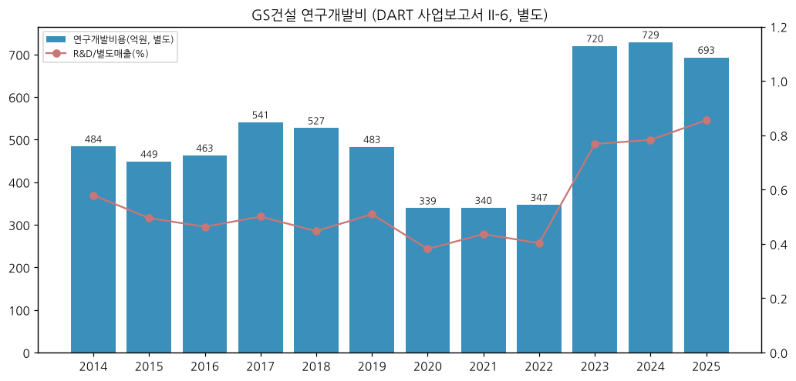

- 연구 분야: 스마트건설·모듈러(OSC)·친환경 수처리·안전 (검단 이후 품질·안전 R&D 강화) — 세부 분야는 사업보고서 본문 기준

### ② 진행 중 corporate action — 10년치 주요 이벤트

```
2026  · 허창수 회장 대표이사 사임, 허윤홍·김태진 각자대표 (2026-03)
      · 성수1 재개발 2.15조 등 시공권 5.5조, LG유플러스 AIDC 4,600억, 용산 문배동 5,717억 (3Q26)
      · GS이니마 매각 선결조건 진행 (알제리 자산 분리 가능성 보도 2026-05)
      · 자이에스앤디 투자부동산 매각 계약 (3Q26 DART)
2025  · GS이니마 지분 전량 TAQA 매각 SPA (2025-08, 1.2bn$)
      · 에너지머티리얼즈 등 비핵심 신사업 매각 추진 보도 (2025-08), Elements Europe 청산
      · 신종자본증권 1,968억 발행
2024  · 국토부 8개월·서울시 1개월 영업정지 처분 (2024-02) → 집행정지·취소소송
      · 신규수주 19.9조 (Inima 장기운영·해외 수주로 +96%)
2023  · 검단 AA13-1·2BL 전면 재시공 결정 (2023-07-05), 2023 무배당
2020  · 신사업본부 출범 (Inima·모듈러 Danwood·Elements), 분산형에너지
2019  · GS이니마 브라질 BRK Ambiental 산업용수 인수 (약 2,286억)
2018  · 영업이익 1조 클럽, 배당 1,000원 재개 확대
2017  · 배당 재개 (300원)
2015~2016 · 파르나스호텔 매각, 해외 저가수주 현장 정리
```

### ③ 기술·사업 마일스톤 — 10년치

```
2026  · 동해 AI 데이터센터 1단지(100MW) 인허가, 2·3단지 2027 계획 (신한 2026-10-13)
      · 정관에 재생에너지전기공급사업 추가 (2026-03 주총)
2025  · 신성장사업개발본부 출범 (개발·신사업 + Prefab 통합, 2026 보고부문)
2023  · 검단 사고 후 품질·안전 체계 재정비 (CSSO 신설)
2020  · 모듈러(OSC) 해외 업체 인수 — 목조(Danwood)·철골(Elements)
2019  · 수처리 운영 확장 (브라질 산업용수)
2012  · Inima 인수 — 수처리 EPC → 운영(O&M) 사업모델
```

### ④ 주요 리스크

- **검단 사고 법적 리스크 (DART 분기보고서(2026.09) 주석)**: 재시공 손실추정 충당부채 잔액 **1,869억** / LH 손해배상 피청구소송 **1,738억** (1심 진행) / 국토부·서울시 영업정지 및 LH 입찰참가자격 제한 처분 취소소송 진행 — 2026 중 서울시 일부 처분 취소 확정, 나머지 결과에 따라 회계추정 조정 가능
- **PF 우발채무**: 신용보강 3.08조 (3Q26, 단독 2.96조), 특수관계자 0.51조, 미착공 PF 1.35조 (IR)
- **이니마 매각 지연·무산**: 규제 승인(알제리 등) 미충족 시 재무개선 시나리오 후퇴 — 신한 SOTP의 비영업가치 2.7조 중 이니마 약 1.7조
- **해외 고원가 현장**: 호주 North East Link (3Q26 리스크 380억), 사우디 얀부 (218억), 싱가포르 토목 / 플랜트 민자사업 운영 리스크 (1H26 GPM 적자)
- **주택 매출 공백**: 2026 9M 건축·주택 매출 -25% YoY (착공 감소) — 정비사업 시공권의 착공 전환 지연 시 2027 회복 지연
- **이자 부담**: 이자지급 2025 4,130억 (영업이익 4,378억과 비슷), 순차입 2.56조 (3Q26)
- **환율**: 해외 매출 비중 31% (2025 IR 분기 합: 국내 8.57조 / 해외 3.88조, 2024 21%에서 상승) + 이니마(유로) 외화 자산

### ⑤ ESG 등급

| 평가기관 | 등급 | 비고 |
|---------|------|------|
| KCGS (한국ESG기준원) | **통합 A** | 2025 평가 (더팩트 2025-12-03) — 세부 E/S/G 미확인 |
| 기타 (DJSI·CDP·MSCI) | 미확인 | 다음 버전 지속가능경영보고서로 보강 |

- 이사회 내 ESG위원회 운영 (사외이사 4인 전원 위원) / 국토부 상호협력평가 4년 연속 최우수 (한국경제 2026-07-01)

### ⑥ 인증·라이선스

- 토목건축공사업 등 종합건설업 (검단 관련 영업정지 처분은 집행정지 상태)
- 기업어음 A2 (한기평·한신평·NICE, 2024\~)
- 수처리 운영 라이선스: GS이니마 (스페인·오만·브라질·알제리 등 장기 운영계약)

---

## Version Log

**v1.0 (2026-11-25) — 신규 작성 (1회 완성본)**
- ① 데이터 수집: OpenDART fnlttSinglAcntAll (연결·별도 각 44개 JSON, 2015 FY\~3Q26 + 2014 비교컬럼) → 12년 손익·재무상태·현금흐름·CapEx·배당 DART 원값 / dart_quarterly_summary 1Q16\~3Q26
- ② DART 정기공시 원문 XML 72건 파싱: 연결 영업부문 매출·영업이익 2014\~2025 (연간) + 1Q15\~3Q26 (47분기, 누적값 차분 — 분기합 = 연결 총계 100% 일치), 임직원 12년, 연구개발비 12년, DPS 12년, 신용등급, 검단 충당부채·소송, PF 우발부채, 주요고객, Inima 매각 상태
- ③ IR 실적자료 16건 (2018\~2026, irgo): 본부별 GPM, 국내/해외, 신규수주·수주잔고, 주택잔고 구성, 차입금
- ④ 차트 16종: chart1·1b·2(×4: 건축주택·플랜트·인프라·신사업(+Inima))·4·5·6·7·8·9·10·11·12 + chart13 (수주·수주잔고, 건설업 추가)
- ⑤ 3Q26 분기보고서(2026-11-13) 확정치 반영 (분기 시계열·BS만, 연간 표는 FY25 기준)

**잔여 보완 후보 (다음 갱신):**
- 지속가능경영보고서·증권사 리포트 PDF 원문(디스크 용량 부족으로 이번 미다운로드), 외국인 지분율, 회사채 등급, ESG 세부 등급
- 수주잔고 2014\~2022 연말 시계열 (DART 수주상황 현장별 합산 필요), 별도 분기 시계열
- 2025 유형자산 1.0조 감소 원인(주석), 2023 이후 R&D 집계 범위, 4Q25 Inima 영업손실 -836억 사유
- GS이니마 매각 종결 시 신사업 부문·순차입 재작성 (v1.1), FY26 결산 후 연간 표 v2.0
