# HDC현대산업개발 (IPARK현대산업개발) — 기업 개요 (v1.0)

> 마지막 update: 2026-11-25 (3Q26 분기보고서 2026-11-13 제출분 반영 — 3Q26은 확정 공시치)
> 입력 source: OpenDART fnlttSinglAcntAll (294870 연결·별도 2018-2Q\~2026-3Q 68개 JSON + 분할 전 존속 현대산업개발(현 HDC, 012630) 연결 2015\~2018-1Q) + DART 정기공시 원문 XML (294870 34건 2018.06\~2026.09, 012630 56건 2012.12\~2026.09) + 회사 IR (irgo 50건 중 텍스트 판독 가능 실적자료 15건: 1Q21·FY22·2Q23·FY23·1Q24·FY24·1Q25·2Q25·3Q25·FY25·1Q26·2Q26·3Q26) + Yahoo Finance (294870.KS 주간 2018-06\~2026-11-25, 일간 2Y) + 증권사 리포트 2건 (하나·iM 2026-07-27) + 뉴스 (딜사이트·토요경제·CEO스코어 등)
> 갱신 주기: 매분기 (실적 리뷰 모드 호출 시)
> 워치리스트: 건설·건설기계 섹터 (2026-11-23 추가, 4Q26부터 리뷰, 표준 깊이) / 서브섹터: 건설
> **Fact verify cutoff**: 2026-11-25 (주가·시총 = Yahoo 2026-11-25 23,800원 기준. 지분율 = 회사 IR 2026-06. 컨센서스 = 하나증권 2026-07-27 인용 시장 컨센 / 증권사 목표가 = 신한 2026-10-26)

> ⚠ **사명 변경**: 2026-03-26 정기주총에서 HDC현대산업개발㈜ → **아이파크현대산업개발㈜ (IPARK현대산업개발, IPARK HYUNDAI DEVELOPMENT COMPANY)** 로 변경 (DART 사업보고서(2025.12) I-2). 파일명은 워치리스트 표기(HDC현대산업개발) 유지, DART 원본 폴더는 `01310269_IPARK현대산업개발`.
> ⚠ **분할 전 데이터 처리**: 2018-05-01 인적분할(존속 HDC㈜ / 신설 HDC현대산업개발㈜) → 2018-06-12 신규 상장. **2014\~2017 손익(매출·영업이익)은 존속 현대산업개발(현 HDC) 연결 부문정보의 건설 4부문(외주주택·자체공사·일반건축·토목) 합계(내부거래 제거 전)로 보강** — 신설회사가 승계한 사업과 같은 범위. 순이익·재무상태·현금흐름은 부문 분리가 안 돼 존속 연결(유화(현대EP)·유통(아이파크몰)·악기(영창) 포함) 원값을 쓰고 표에 기준을 표기. **2018 연간 = 1\~4월(HDC 2018 사업보고서 중단영업 주석) + 5\~12월(신설회사 DART) 합산 pro forma**.

---

## 1. 기업 분류

- **Primary 분류: 사이클** (Cyclical — 국내 주택 분양·착공 사이클, 자체사업 레버리지)
- **Secondary 노트: 개발형(디벨로퍼) lumpy 이익 + 사고 리스크 디스카운트** — 자체사업(서울원 아이파크 등) 1\~2개 대형 현장이 연간 이익의 절반 이상을 좌우하고, 2021\~2022 연속 붕괴사고로 영업정지 소송이 아직 진행 중

### ① 정량 근거

**📊 Summary Box (12년, 2014\~2025):**

| 지표 | 값 |
|------|-----|
| 매출 CAGR (2014→2025, 11년) | **+2.2%** (3.27조 → 4.15조) |
| OPM 평균 | **8.7%** (12년 단순평균) |
| OPM 정점 평균 | **14.6%** (2017 13.2% · 2020 16.0%) |
| OPM 저점 평균 | **4.0%** (2014 4.4% · 2022 3.5%) |
| 사이클 주기 | 약 8\~9년 (trough-to-trough 2013→2022) |
| 사이클 회수 (12년) | 정점 2회 (2017·2020, 2016\~2020 고원) / 저점 2회 (2013\~14·2022) |

```
[전사 OPM 시계열 (12년) — 2014~2017 = 분할 전 건설 4부문 합, 순이익은 존속 연결]
연도   매출(조)  영업이익  순이익    OPM    NPM
2014     3.27     0.14     0.08    4.4    n/a   ← 분할 전 건설 4부문 (2013 미분양·해외 손실 -1,900억 정리 직후)
2015     3.42     0.28     0.24    8.3    n/a   
2016     3.56     0.42     0.33   11.7    n/a   ← 자체공사 OPM 19.8% (주택 호황)
2017     4.24     0.56     0.41   13.2    n/a   ← 외주주택 2.19조, 영업이익 5,576억
2018     4.38     0.50     0.38   11.5    8.7   ← 2018-05-01 인적분할 (PF 합산)
2019     4.22     0.55     0.41   13.1    9.8   
2020     3.67     0.59     0.22   16.0    6.0   ← OPM 정점 16.0% (외주주택 OPM 18.7%)
2021     3.36     0.27     0.18    8.1    5.2   ← 2021-06 학동 붕괴, 4Q21 화정 관련 손실 착수
2022     3.30     0.12     0.05    3.5    1.5   ← 저점: 1Q22 영업손실 -941억 (화정 붕괴)
2023     4.19     0.20     0.17    4.7    4.1   ← 외형 회복, 원가율 부담 (OPM 4%대)
2024     4.26     0.18     0.16    4.3    3.7   
2025     4.15     0.25     0.16    6.0    3.8   ← 자체공사 9,566억·OP 2,661억으로 회복 (일반건축 -1,092억)

OPM range: 3.5% ~ 16.0% = 12.5%pt  (분할 전 2013 -6.2% 포함 시 22%pt)
```

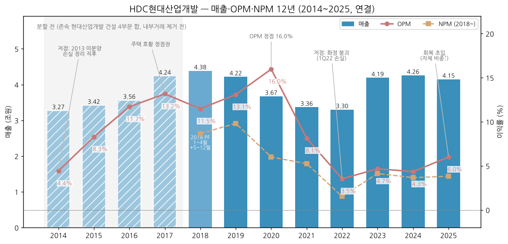

(2013 건설 4부문: 매출 3.08조, 영업손실 -1,900억 — 외주주택 -1,257억·자체공사 -604억 일괄 손실 반영. 2014 저점의 직접 원인)

### ② 산업 분류

- 산업: **건설 (주택 중심 종합건설 + 자체 개발)** — 사이클 산업 list 포함 (국내 주택 분양·PF 사이클)
- DART 업종코드 411 (건물 건설업) / KRX 건설 / 해외 매출 비중 0.5% (2025, 사실상 내수 100%)
- 워치리스트 섹터: **건설·건설기계** (2026-11-23 추가 섹터, T1 아님) / 서브섹터: **건설**

### ③ 분류 결정 논리

(1) **가장 매출 큰 사업부 기준**: 외주주택 (2025 연결 매출 2.51조, 60.6%) — 도시정비·민간수주 아파트 시공 → 국내 주택 분양 사이클에 직결 → **사이클**
(2) **이익 비중 sub-rule**: 2025 부문 영업이익 자체공사 2,661억 vs 외주주택 895억 vs 일반건축 -1,092억 → **자체공사가 연결 영업이익의 107%**. 9M26은 자체 1,841억 vs 외주 1,838억으로 반반. 자체공사는 토지 매입→분양→진행률/인도 기준 인식이라 분양 경기와 개별 현장 일정에 따라 연 1,000억\~2,700억으로 출렁임(2021 -57억 → 2025 2,661억) → 이익 변동의 원천도 사이클형 → **사이클 유지**
(3) **Boundary case 처리**: ① 2021\~2022 실적 저점은 경기 사이클(원가 급등)과 사고 비용(화정 붕괴 1Q22 영업손실 -941억)이 겹친 것 — 사고 비용은 이벤트로 분리해 보되, 사고 이후 도시정비 수주·브랜드 훼손이 2\~3년 외주 마진을 눌렀으므로 사이클 진폭을 키운 요인으로 annotation. ② 서울원 아이파크(광운대역세권, 공사비 2.9조, 2024-11\~2028-07, iM 2026-07-27)는 단일 현장이 2026\~2028 자체부문 이익을 지배 → 성장주가 아니라 **"대형 자체 프로젝트형 lumpy 이익"** 으로 Secondary에 기록
(4) **피어 대비** (같은 섹터 기업개요 cross-ref):
   - 현대건설 = 주택 사이클 + 해외 플랜트·원전 EPC 옵션 (Primary 사이클 + Secondary 꿈)
   - 대우건설 = 주택(푸르지오) + 해외 플랜트·원전 시공, 해외 비중 20%대
   - GS건설 = 주택(자이) 비중 큼 + 신사업(수처리 GS이니마 매각 등) — 검단 붕괴(2023) 사고 디스카운트가 HDC와 유사
   - DL이앤씨 = 주택(아크로·e편한세상) + 플랜트, 순현금 재무구조
   - 삼성물산 = 건설은 일부 (상사·패션·리조트·바이오 지분) → 지주형 SOTP
   - **HDC현산 = 해외·플랜트 없는 순수 국내 주택 + 자체개발 비중 최고** → 피어 중 국내 주택 사이클 베타가 가장 높고, 자체사업 성공 시 OPM 레버리지(2020 16.0%, 3Q26 15.3%)도 가장 큼

### ④ 적정 밸류에이션 방법

- **PBR (사이클 기준) 우선** — ROE 5% 내외(2023\~2025)의 저수익 구간에서는 PBR 0.2\~0.5배 밴드. 2022-12 저점 주가 10,000원(Yahoo 수정주가) / BPS 약 44,000원 → **P/B 약 0.23배**, 현재 23,800원 / 3Q26 BPS 51,212원 → **P/B 약 0.46배**
- **PER 보조** — 2026E 이익이 자체사업으로 두 배가 되는 구간에서 증권사는 PER 4.5\~6배 사용 (하나 2026E EPS 4,935원 × Target PER 6.0배 = TP 29,000원 / iM 12M fwd P/B 0.50배·P/E 4.5배 = TP 28,000원, 모두 2026-07-27). 시장 컨센서스 2026E EPS 5,555원 → 현재가 기준 PER 약 4.3배
- **왜 PBR인가**: 매출의 60%가 외주주택(GPM 5\~20%로 사이클 따라 변동)이고, 자체사업 이익은 대형 현장 1\~2개에 몰려 있어 이익 지속성이 낮음 → 시장은 이익이 아니라 자본(장부가) 대비로 가격을 매김. 영업정지 확정 리스크가 남아 있는 동안 PBR 상단은 0.5\~0.6배로 제한 (iM 2026-07-27)
- 사이클 밴드: P/B 0.23배(2022-12 저점) \~ 약 1.4배(2018-06 재상장 직후, 수정주가 기준 추정) / 최근 1년 0.34\~0.51배

### ⑤ 분기 재평가 트리거 (분류 변경 조건)

- **자체공사 매출 비중 30%+ & 연결 OPM 10%+ 가 3개 연도 연속** (서울원 이후 후속 자체 파이프라인: 청주가경 7·8, 공릉역세권, 천안 3단지 등 확인 시) → Secondary 를 "지속성장형 디벨로퍼" 후보로 격상 검토
- **영업정지 처분 확정** (학동 8개월: 서울고법 2심 진행 / 화정 1년: 형사 항소심 후 본안 진행, 집행정지 상태) → 신규 수주 공백 → 사이클 저점 재진입 가능성, 리스크 디스카운트 확대
- **서울원 아이파크 준공(2028-07) 전후 자체부문 매출 공백** 발생 시 → OPM 정점 판정 (2020 고원 이후와 같은 패턴)
- **PF 보증 (3Q26 1.46조, 자본의 43%) 이 자본의 70% 초과** 또는 충당부채 전환 발생 시 → 재무 리스크 재평가

---

## 2. 회사 개요

### ① 기본 사항

- **회사명**: 아이파크현대산업개발㈜ (IPARK현대산업개발, 舊 HDC현대산업개발㈜, 2026-03 사명 변경) / KRX **294870**
- **본사**: 서울특별시 용산구 한강대로23길 55 현대아이파크몰 9층
- **설립**: 2018-05-02 (현대산업개발㈜ 인적분할 신설) / 2018-06-12 유가증권시장 재상장. 모태는 1976 한국도시개발 → 1986 한라건설 합병으로 현대산업개발 출범
- **그룹**: HDC그룹 (지주 HDC㈜ 41.52%, 정몽규 회장 → HDC 최대주주)
- **대표이사**: 정경구 사장 (2025-03 취임, 전 HDC 대표이사) + 조태제 부사장 (2024-03 취임, 건설본부장·CSO 출신)
- **비전**: 그룹 비전 "Integrated Living Infrastructure" — LIFE / AI / ENERGY & INFRA 3축 (회사 IR 3Q26). 주거 브랜드 IPARK (2001 런칭, 창사 이래 약 50만 세대 공급, DART 사업보고서(2025.12))
- **사업 한 줄 정의**: 해외 사업이 거의 없는 국내 주택 전문 건설사 — 도시정비·민간 아파트 시공(외주주택)과, 토지를 직접 사서 개발·분양하는 자체사업(서울원 아이파크·청주가경·천안 아이파크시티)을 같이 하는 디벨로퍼형 건설사
- 발행주식 65,907,330주 (보통주, 액면 5,000원, 자본금 3,295억, 2018 이후 변동 없음) / 자기주식 2,473,299주 (2025말, 3.75%)

### ② 최근 12년 손익·자본 추이 (조원)

| 연도 | 매출 | YoY | 영업이익 | 순이익 | 자본총계 | 자본 YoY | 기준 |
|---|---|---|---|---|---|---|---|
| 2014 | 3.27 | - | 0.14 | 0.08 | 2.27 | - | 분할 전 건설 4부문 합 / 순이익·자본=존속 연결 |
| 2015 | 3.42 | +4.5% | 0.28 | 0.24 | 2.47 | +8.7% | 분할 전 건설 4부문 합 / 순이익·자본=존속 연결 |
| 2016 | 3.56 | +4.1% | 0.42 | 0.33 | 2.75 | +11.5% | 분할 전 건설 4부문 합 / 순이익·자본=존속 연결 |
| 2017 | 4.24 | +19.0% | 0.56 | 0.41 | 2.96 | +7.5% | 분할 전 건설 4부문 합 / 순이익·자본=존속 연결 |
| 2018 | 4.38 | +3.5% | 0.50 | 0.38 | 1.84 | 분할 리셋 | PF (1\~4월 중단영업 + 5\~12월 DART) / 자본=분할 후 |
| 2019 | 4.22 | -3.8% | 0.55 | 0.41 | 2.23 | +21.0% | DART 연결 |
| 2020 | 3.67 | -13.0% | 0.59 | 0.22 | 2.74 | +22.9% | DART 연결 |
| 2021 | 3.36 | -8.3% | 0.27 | 0.18 | 2.89 | +5.2% | DART 연결 |
| 2022 | 3.30 | -2.0% | 0.12 | 0.05 | 2.90 | +0.6% | DART 연결 |
| 2023 | 4.19 | +27.1% | 0.20 | 0.17 | 3.01 | +3.7% | DART 연결 |
| 2024 | 4.26 | +1.6% | 0.18 | 0.16 | 3.11 | +3.5% | DART 연결 |
| 2025 | 4.15 | -2.6% | 0.25 | 0.16 | 3.21 | +3.2% | DART 연결 |

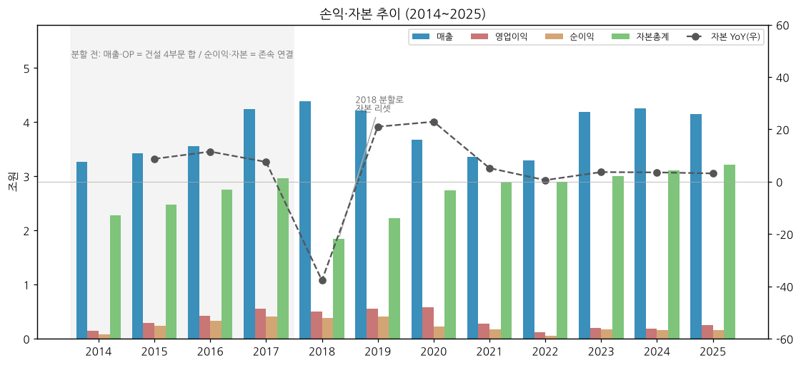

### ③ 회사 주가 역사 ★ narrative 영역

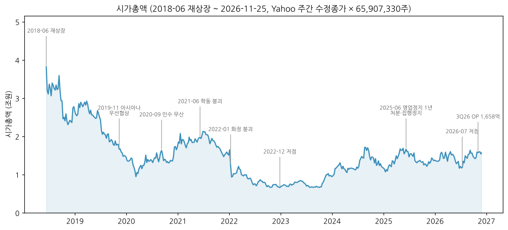

**시가총액 데이터:** 2018-06-11 \~ 2026-11-25 (Yahoo Finance 294870.KS 주간 수정종가, 발행주식 65,907,330주 고정)
- 2026-11-25 종가 **23,800원 → 시총 약 1.57조원** (하나증권 2026-07-24 기준 시총 1조 3,511억·주가 20,500원과 정합)
- **사상 최고 (재상장 이후, 수정주가): 상장 첫 주(2018-06-11 주) 종가 58,017원 → 시총 약 3.8조** / 같은 주 장중 고가 68,168원 (Yahoo 수정주가 — 배당 등 조정 반영값, 실제 체결가와 차이 가능)
- **사상 최저: 2022-12-26 주 종가 10,000원 → 시총 약 0.66조** (화정 붕괴 + 레고랜드발 PF 경색)
- 52주 범위: 장중 16,900원 (2026-07-14) \~ 25,950원 (2026-11-05) / 2026 YTD: 20,900원(1-2) → 23,800원 (+13.9%)
- 2022-12 저점 대비 +138%, 재상장 고점 대비 여전히 -59%

**사이클 history:**

```
[2018-06] 인적분할 재상장 — 주택 호황 끝물, 상장 직후 고점 (시총 3.8조)
  · 정부 부동산 규제 강화(9·13 대책) → 2018 하반기 급락

[2019-11 ~ 2020-09] 아시아나항공 인수 시도 → 무산
  · 2019-11 미래에셋과 컨소시엄 우선협상대상자 (2019-12 계약: 회사 몫 구주 2,583억 + 신주 1.75조, DART 분기보고서(2020.09)) → 그룹 재무부담 우려로 주가 하락
  · 2020-03 코로나 → 아시아나 부실 확대 → 재실사 요구
  · 2020-09 금호산업·채권단 계약 해제 → 계약금 2,500억 소송
  · 2025-03 대법원, 아시아나·금호 측 최종 승소 (계약금 반환 불가 확정)
  · 2020 OPM 16.0% 사상 최고에도 시총 1조대 (3Q20 분기 순손실 -749억 — 영업이익은 1,326억 흑자, 영업외 손실 원인은 아시아나 관련 처리로 추정·회사 설명 미확인)

[2021-06 / 2022-01] 광주 연속 붕괴사고
  · 2021-06-09 학동4구역 철거 붕괴 (사망 9명) → 서울시 영업정지 8개월 처분 (2022-03)
  · 2022-01-11 화정 아이파크 외벽 붕괴 (사망 6명) → 1Q22 영업손실 -941억, 정몽규 회장 그룹 회장직 사퇴
  · 2022-01 시총 2조 → 1조 미만으로 반토막

[2022-10 ~ 2023-10] PF 경색 + 저점권 (P/B 0.2배대)
  · 2022-12 사상 최저 10,000원

[2024 ~ 2026] 자체사업 회복 + 영업정지 리스크 공존
  · 2024-11 서울원 아이파크(광운대역세권) 착공, 2025 자체 매출 2.4배
  · 2025-05-16 서울시, 화정 사고로 영업정지 1년 처분 (2025-06-09~2026-06-08) → 법원 집행정지 인용
  · 2026-03 사명 변경 (IPARK현대산업개발)
  · 2026-10-22 3Q26 영업이익 1,658억 (6년 만의 최대 분기), 신한 TP 30,000원 (2026-10-26)
```

### ④ 회사의 주요 연혁

```
1976      한국도시개발㈜ 설립 (현대그룹 주택사업)
1986      한국도시개발 + 한라건설 합병 → 현대산업개발㈜
1996      유가증권시장 상장
1999      현대그룹에서 계열 분리, 정세영 명예회장·정몽규 회장 체제
2001-03   아파트 브랜드 IPARK 런칭
2011      용산 현대아이파크몰 본사 이전
2018-05   지주회사 전환 인적분할 → HDC㈜(존속) + HDC현대산업개발㈜(신설), 06-12 재상장
2019-11   아시아나항공 인수 우선협상대상자 선정 → 2020-09 무산
2020      HDC아이파크 제1호(용산)·제2호(공릉) 위탁관리리츠 계열 편입
2021-06   광주 학동4구역 철거 붕괴사고
2022-01   광주 화정 아이파크 외벽 붕괴사고 / HDC㈜ 지분 41.52%로 확대 (장내 매수)
2022-03   서울시 영업정지 8개월 처분 (학동) → 집행정지·소송
2024-11   서울원 아이파크 (광운대역세권 개발) 착공
2025-05   서울시 영업정지 1년 처분 (화정) → 집행정지
2025-08   학동 사고 형사 대법원 판결 (일부 무죄 유지) / 2025-11 과징금 처분 취소 확정
2026-03   사명 변경 → 아이파크현대산업개발㈜
2026-3Q   분기 영업이익 1,658억 (2020년 이후 최대)
```

---

## 3. 비즈니스 모델

### ① 실적 추이 (연결 → 부문 → 별도 부문 GPM 3단계 위계)

**연간 5년 통합 표 (억원, DART 연결 부문정보 / GPM = 회사 IR 별도):**

| 항목 | 2021 | 2022 | 2023 | 2024 | 2025 |
|------|------|------|------|------|------|
| **연결 매출액** | **33,639** | **32,983** | **41,908** | **42,562** | **41,470** |
| &nbsp;&nbsp;&nbsp;&nbsp;└ 외주주택 | 24,499 | 19,946 | 25,310 | 24,558 | 25,128 |
| &nbsp;&nbsp;&nbsp;&nbsp;└ 자체공사 | 978 | 1,533 | 4,412 | 4,008 | 9,566 |
| &nbsp;&nbsp;&nbsp;&nbsp;└ 일반건축 | 1,363 | 3,760 | 6,008 | 8,360 | 1,576 |
| &nbsp;&nbsp;&nbsp;&nbsp;└ 토목 | 5,282 | 4,627 | 3,385 | 3,841 | 2,984 |
| &nbsp;&nbsp;&nbsp;&nbsp;└ 기타 | 1,517 | 3,117 | 2,793 | 1,795 | 2,215 |
| **연결 영업이익** | **2,734** | **1,164** | **1,953** | **1,846** | **2,486** |
| &nbsp;&nbsp;&nbsp;&nbsp;└ 외주주택 | 2,699 | 213 | 1,353 | 1,238 | 895 |
| &nbsp;&nbsp;&nbsp;&nbsp;└ 자체공사 | -57 | 10 | 247 | 542 | 2,661 |
| &nbsp;&nbsp;&nbsp;&nbsp;└ 일반건축 | -102 | -169 | -10 | -267 | -1,092 |
| &nbsp;&nbsp;&nbsp;&nbsp;└ 토목 | 319 | 481 | 25 | 404 | -92 |
| &nbsp;&nbsp;&nbsp;&nbsp;└ 기타 | -124 | 629 | 338 | -70 | 114 |
| **매출 YoY (%)** | **-8.3** | **-2.0** | **+27.1** | **+1.6** | **-2.6** |
| **영업이익 YoY (%)** | **-53.3** | **-57.4** | **+67.8** | **-5.5** | **+34.7** |
| **OPM 전사 (%)** | **8.1** | **3.5** | **4.7** | **4.3** | **6.0** |
| &nbsp;&nbsp;&nbsp;&nbsp;└ 외주주택 OPM | 11.0% | 1.1% | 5.3% | 5.0% | 3.6% |
| &nbsp;&nbsp;&nbsp;&nbsp;└ 자체공사 OPM | -5.8% | 0.6% | 5.6% | 13.5% | 27.8% |
| &nbsp;&nbsp;&nbsp;&nbsp;└ 일반건축 OPM | -7.5% | -4.5% | -0.2% | -3.2% | -69.3% |
| &nbsp;&nbsp;&nbsp;&nbsp;└ 토목 OPM | 6.0% | 10.4% | 0.7% | 10.5% | -3.1% |
| **별도 부문 GPM (IR)** | | | | | |
| &nbsp;&nbsp;&nbsp;&nbsp;└ 외주주택 GPM | 13.7 | 5.1 | 9.1 | 9.7 | 9.2 |
| &nbsp;&nbsp;&nbsp;&nbsp;└ 자체공사 GPM | 27.7 | 15.9 | 11.5 | 24.4 | 34.1 |
| &nbsp;&nbsp;&nbsp;&nbsp;└ 일반건축 GPM | -2.0 | 0.2 | 2.8 | -0.2 | -6.4 |
| &nbsp;&nbsp;&nbsp;&nbsp;└ 토목 GPM | 12.8 | 23.8 | 12.9 | 16.3 | 4.8 |
| &nbsp;&nbsp;&nbsp;&nbsp;└ 해외 매출 (억원) | 745 | 938 | 690 | 762 | 202 |

(출처: 연결 매출·영업이익·부문 = OpenDART 정기보고서 연결 부문별 정보. 별도 GPM = 회사 IR 실적자료(FY22·FY23·FY24·FY25). 연결 부문 매출과 IR 별도 부문 매출은 2024·2025 외주주택·일반건축 금액이 일치 — 연결 종속(PC·호텔·리츠)은 '기타'로 분리되는 구조)

**12년 부문별 매출·영업이익률 (억원, 2013\~2017 = 존속 현대산업개발 연결 부문정보 / 2018\~ = 신설회사 DART 연결 부문정보):**

| 연도 | 외주주택 | 자체공사 | 일반건축 | 토목 | 기타 | 외주 OPM | 자체 OPM | 건축 OPM | 토목 OPM | 자체 이익비중 |
|---|---|---|---|---|---|---|---|---|---|---|
| 2013 (분할 전) | 9,002 | 9,854 | 4,096 | 7,798 | - | -14.0% | -6.1% | -4.0% | 1.6% | 적자 |
| 2014 (분할 전) | 10,575 | 12,924 | 3,642 | 5,583 | - | 8.0% | 3.6% | 1.3% | 1.6% | 32% |
| 2015 (분할 전) | 11,570 | 14,763 | 3,694 | 4,168 | - | 8.7% | 12.6% | 2.7% | -3.1% | 66% |
| 2016 (분할 전) | 15,295 | 13,150 | 3,406 | 3,752 | - | 9.5% | 19.8% | 1.9% | 1.3% | 63% |
| 2017 (분할 전) | 21,857 | 11,717 | 5,297 | 3,503 | - | 12.4% | 23.3% | 1.8% | 1.1% | 49% |
| 2018 (5\~12월) | 19,703 | 3,034 | 2,606 | 1,768 | 817 | 15.2% | 20.4% | -14.3% | -3.3% | 20% |
| 2019 | 28,683 | 7,862 | 1,461 | 2,697 | 1,461 | 13.0% | 24.0% | -8.5% | 1.9% | 34% |
| 2020 | 28,029 | 3,252 | 1,137 | 2,962 | 1,321 | 18.7% | 9.0% | 21.9% | 8.6% | 5% |
| 2021 | 24,499 | 978 | 1,363 | 5,282 | 1,517 | 11.0% | -5.8% | -7.5% | 6.0% | -2% |
| 2022 | 19,946 | 1,533 | 3,760 | 4,627 | 3,117 | 1.1% | 0.6% | -4.5% | 10.4% | 1% |
| 2023 | 25,310 | 4,412 | 6,008 | 3,385 | 2,793 | 5.3% | 5.6% | -0.2% | 0.7% | 13% |
| 2024 | 24,558 | 4,008 | 8,360 | 3,841 | 1,795 | 5.0% | 13.5% | -3.2% | 10.5% | 29% |
| 2025 | 25,128 | 9,566 | 1,576 | 2,984 | 2,215 | 3.6% | 27.8% | -69.3% | -3.1% | 107% |

(2013\~2017 부문 금액은 내부거래 제거 전. 2018은 신설회사 5\~12월 8개월분 — 1\~4월은 부문별 분리 공시 없음. '자체 이익비중' = 자체공사 OP / 부문 OP 합)

→ **2013\~2017 = 자체공사 주도 호황** (자체 OPM 3.6% → 23.3%, 이익 비중 49\~66%) → **2018\~2020 = 외주주택 주도** (외주 OPM 13\~19%, 2020 외주 OP 5,238억) → **2021\~2023 = 사고·원가 이중 저점** (외주 OPM 1.1\~5.3%, 자체 매출 1,000억대 공백) → **2024\~2026 = 자체공사 재가동** (서울원 아이파크, 2025 자체 OPM 27.8%·이익비중 107%) / 일반건축은 13년 중 9년 적자 — 2025 -1,092억

**별도 부문 매출 + GPM (회사 IR, 억원):**

| 별도 부문 | 2020 | 2021 | 2022 | 2023 | 2024 | 2025 | 9M26 |
|---|---|---|---|---|---|---|---|
| 자체 매출 | 7,062 | 5,430 | 4,464 | 5,850 | 4,008 | 9,566 | 7,591 |
| └ 자체 GPM | 28.9% | 27.7% | 15.9% | 11.5% | 24.4% | 34.1% | 31.9% |
| 외주주택 매출 | 24,220 | 20,048 | 17,015 | 23,872 | 24,558 | 25,128 | 15,379 |
| └ 외주주택 GPM | 21.0% | 13.7% | 5.1% | 9.1% | 9.7% | 9.2% | 17.6% |
| 토목 매출 | 2,565 | 4,746 | 3,868 | 2,714 | 3,079 | 2,782 | 1,668 |
| └ 토목 GPM | 15.2% | 12.8% | 23.8% | 12.9% | 16.3% | 4.8% | 12.6% |
| 일반건축 매출 | 1,002 | 1,154 | 3,581 | 5,989 | 8,360 | 1,576 | 333 |
| └ 일반건축 GPM | 28.6% | -2.0% | 0.2% | 2.8% | -0.2% | -6.4% | 1.3% |
| 해외 매출 | 532 | 745 | 938 | 690 | 762 | 202 | 70 |
| └ 해외 GPM | 3.9% | 3.6% | -25.4% | -22.8% | 3.1% | -37.9% | -2.5% |
| 기타 매출 | 1,214 | 2,184 | 2,969 | 2,512 | 1,346 | 1,638 | 1,301 |
| └ 기타 GPM | - | 31.4% | 22.6% | 13.6% | -2.7% | 8.0% | 5.6% |
| 합계 매출 | 36,595 | 34,307 | 32,835 | 41,627 | 42,114 | 40,893 | 26,342 |
| └ 합계 GPM | 21.0% | 16.2% | 8.9% | 8.5% | 9.1% | 13.9% | 20.6% |
| 별도 영업이익 (OPM) | 5,829 (15.9%) | 3,453 (10.1%) | 1,100 (3.4%) | - | 1,847 (4.4%) | 2,460 (6.0%) | 3,697 (14.0%) |

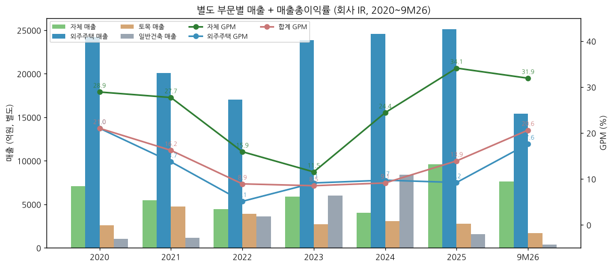

**부문별 분기 시계열 (DART 연결 부문정보, 34분기 = 2Q18(5\~6월)\~3Q26, 누적값 차분):**

각 차트 = 매출 (bar, 좌축) + 부문 영업이익률 (line, 우축, 양수 초록/음수 빨강 음영, ±60%·80% 클리핑).

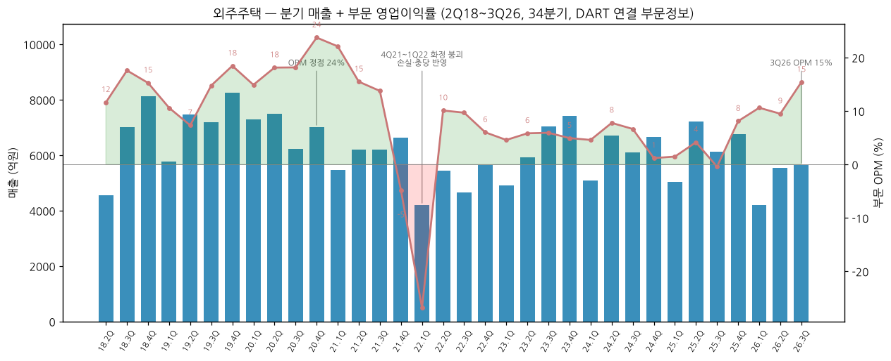
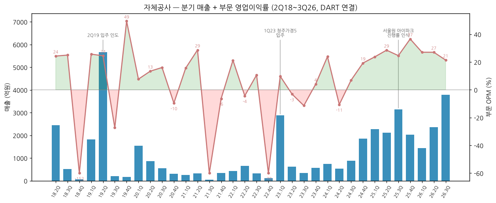
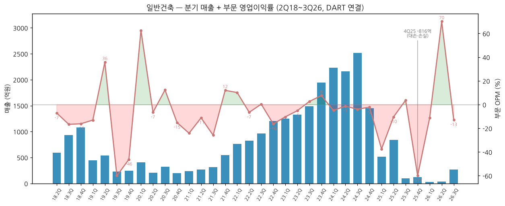
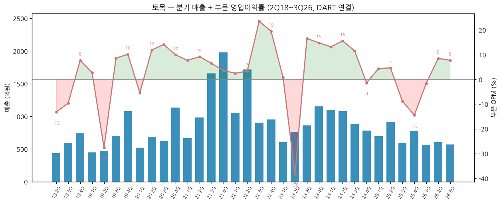
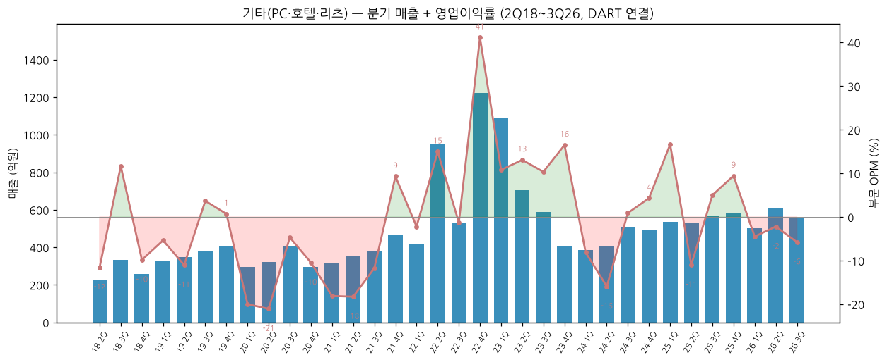

**외주주택 분기 (억원):**

| 연도 | 1Q 매출 | 2Q | 3Q | 4Q | 1Q OP | 2Q OP | 3Q OP | 4Q OP |
|---|---|---|---|---|---|---|---|---|
| 2018 | - | 4,562 | 7,007 | 8,133 | - | 530 | 1,232 | 1,240 |
| 2019 | 5,764 | 7,470 | 7,195 | 8,254 | 610 | 547 | 1,063 | 1,522 |
| 2020 | 7,299 | 7,496 | 6,225 | 7,009 | 1,087 | 1,358 | 1,130 | 1,663 |
| 2021 | 5,474 | 6,190 | 6,192 | 6,643 | 1,209 | 958 | 851 | -320 |
| 2022 | 4,196 | 5,448 | 4,651 | 5,650 | -1,126 | 550 | 450 | 340 |
| 2023 | 4,918 | 5,928 | 7,048 | 7,416 | 225 | 345 | 417 | 365 |
| 2024 | 5,094 | 6,697 | 6,100 | 6,668 | 234 | 520 | 405 | 79 |
| 2025 | 5,040 | 7,224 | 6,114 | 6,750 | 74 | 300 | -26 | 547 |
| 2026 | 4,202 | 5,539 | 5,637 | - | 445 | 525 | 868 | - |

**자체공사 분기 (억원):**

| 연도 | 1Q 매출 | 2Q | 3Q | 4Q | 1Q OP | 2Q OP | 3Q OP | 4Q OP |
|---|---|---|---|---|---|---|---|---|
| 2018 | - | 2,440 | 525 | 69 | - | 593 | 131 | -104 |
| 2019 | 1,825 | 5,666 | 202 | 169 | 469 | 1,388 | -55 | 84 |
| 2020 | 1,546 | 859 | 547 | 301 | 119 | 115 | 88 | -29 |
| 2021 | 251 | 331 | 52 | 345 | 39 | 95 | -170 | -22 |
| 2022 | 422 | 657 | 330 | 124 | 90 | -28 | 35 | -87 |
| 2023 | 2,884 | 613 | 348 | 567 | 282 | -19 | -40 | 23 |
| 2024 | 743 | 527 | 876 | 1,863 | 178 | -56 | 61 | 359 |
| 2025 | 2,272 | 2,121 | 3,149 | 2,024 | 539 | 605 | 776 | 741 |
| 2026 | 1,443 | 2,358 | 3,789 | - | 391 | 638 | 812 | - |

**연결 분기 매출·영업이익 매트릭스 (억원, DART, 4Q = 연간 − 3Q 누적):**

| 연도 | 1Q 매출 | 2Q | 3Q | 4Q | 1Q OP | 2Q OP | 3Q OP | 4Q OP | 분기합 매출 | 연간 OPM |
|---|---|---|---|---|---|---|---|---|---|---|
| 2018 | - | 8,255 | 9,395 | 10,277 | - | 997 | 1,189 | 993 | 27,927 (2Q=5\~6월) | 11.4% |
| 2019 | 8,810 | 14,492 | 8,714 | 10,149 | 1,015 | 1,958 | 938 | 1,604 | 42,165 | 13.1% |
| 2020 | 10,067 | 9,569 | 8,125 | 8,942 | 1,373 | 1,473 | 1,326 | 1,685 | 36,702 | 16.0% |
| 2021 | 6,946 | 8,124 | 8,594 | 9,975 | 1,184 | 1,049 | 664 | -162 | 33,639 | 8.1% |
| 2022 | 6,857 | 9,595 | 7,378 | 9,153 | -942 | 667 | 696 | 743 | 32,983 | 3.5% |
| 2023 | 10,749 | 9,336 | 10,332 | 11,491 | 501 | 57 | 620 | 775 | 41,908 | 4.7% |
| 2024 | 9,554 | 10,872 | 10,886 | 11,250 | 416 | 538 | 475 | 418 | 42,562 | 4.3% |
| 2025 | 9,057 | 11,632 | 10,530 | 10,250 | 540 | 803 | 730 | 413 | 41,470 | 6.0% |
| 2026 | 6,739 | 9,146 | 10,821 | - | 801 | 1,227 | 1,658 | - | 26,707 (9M) | 13.8% |

(2018-2Q는 분할 후 5\~6월 2개월. 분할 전 존속 현대산업개발 건설부문 분기: 1Q17 매출 7,980억·영업이익 1,219억 / 1Q18 매출 10,676억·영업이익 1,254억 — HDC 1Q18 분기보고서 중단영업 주석)

**3Q26 핵심 (분기 데이터만 반영, 연간 합산은 FY26 결산 후 v2.0에서 갱신):**
- 연결 매출 **10,821억** (+2.8% YoY, +18.3% QoQ) / 영업이익 **1,658억** (+127.1% YoY, OPM 15.3%) — 2020년 이후 최대 분기, 컨센서스 +11.8% 상회 (신한, 토요경제 2026-10-26)
- 순이익 1,113억 (+179% YoY) / 매출총이익률 23.0% (1Q부터 3개 분기 연속 OPM 두 자릿수)
- 별도 부문 GPM (IR 3Q26): 자체주택 29.9% (매출 3,789억, 서울원 아이파크 진행률 인식) / **외주주택 19.9% (+15.0%p YoY)** — 천안 아이파크시티·운정 아이파크 포레스트 등 우량 현장 원가율 개선 / 토목 18.3% / 일반건축 2.4%
- 9M26 누적: 연결 매출 2.67조 (연간 전망 4.23조의 63%) / 영업이익 3,686억 (2025 연간의 148%)
- 신규수주 9M26 4조 8,564억 (3Q 3조 5,567억) — 연간 목표 6.53조의 74%

**12분기 시계열 (4Q23 \~ 3Q26, 억원):**

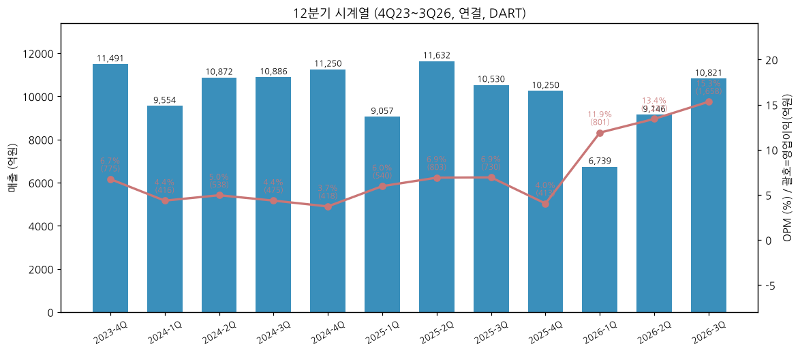

| 분기 | 매출 | 영업이익 | OPM | 순이익 | 매출총이익 | GPM | 외주주택 OP | 자체공사 OP | 일반건축 OP | 메모 |
|---|---|---|---|---|---|---|---|---|---|---|
| 2023-4Q | 11,491 | 775 | 6.7% | 552 | 1,268 | 11.0% | 365 | 23 | 148 |  |
| 2024-1Q | 9,554 | 416 | 4.4% | 305 | 824 | 8.6% | 234 | 178 | -109 |  |
| 2024-2Q | 10,872 | 538 | 5.0% | 474 | 1,129 | 10.4% | 520 | -56 | -29 |  |
| 2024-3Q | 10,886 | 475 | 4.4% | 327 | 977 | 9.0% | 405 | 61 | -98 |  |
| 2024-4Q | 11,250 | 418 | 3.7% | 452 | 1,090 | 9.7% | 79 | 359 | -31 | 일반건축 손실 지속 |
| 2025-1Q | 9,057 | 540 | 6.0% | 542 | 1,066 | 11.8% | 74 | 539 | -192 | 자체 매출 2,271억 (서울원 진행률 인식 본격화) |
| 2025-2Q | 11,632 | 803 | 6.9% | 527 | 1,472 | 12.7% | 300 | 605 | -87 |  |
| 2025-3Q | 10,530 | 730 | 6.9% | 398 | 1,298 | 12.3% | -26 | 776 | 4 | 외주주택 적자(-25억) |
| 2025-4Q | 10,250 | 413 | 4.0% | 114 | 2,081 | 20.3% | 547 | 741 | -816 | 일반건축 -816억 (대손·공사손실) |
| 2026-1Q | 6,739 | 801 | 11.9% | 493 | 1,289 | 19.1% | 445 | 391 | -3 | 매출 저점 6,739억, OPM 두 자릿수 진입 |
| 2026-2Q | 9,146 | 1,227 | 13.4% | 837 | 1,826 | 20.0% | 525 | 638 | 26 | 외주주택 마진 정상화 |
| 2026-3Q | 10,821 | 1,658 | 15.3% | 1,113 | 2,489 | 23.0% | 868 | 812 | -34 | **6년 만의 최대 분기 OP**, 컨센 대비 +11.8% (신한) |

**수주·수주잔고 (별도, 회사 IR):**

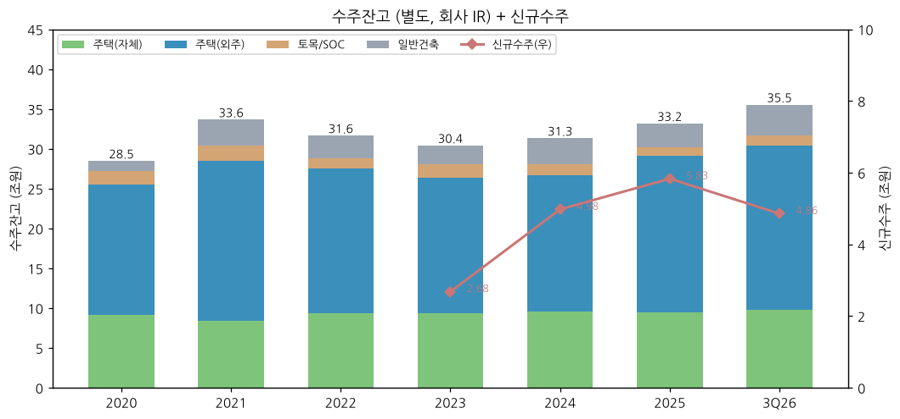

| 구분 | 2020 | 2021 | 2022 | 2023 | 2024 | 2025 | 3Q26 |
|---|---|---|---|---|---|---|---|
| 주택(자체) | 91,820 | 83,950 | 93,868 | 93,150 | 95,408 | 94,371 | 97,369 |
| 주택(외주) | 162,768 | 200,887 | 181,337 | 170,618 | 171,314 | 197,050 | 206,313 |
| 토목/SOC | 17,678 | 19,094 | 12,312 | 17,124 | 14,135 | 10,102 | 12,716 |
| 일반건축 | 12,311 | 32,417 | 28,914 | 23,159 | 32,287 | 30,080 | 38,805 |
| **합계** | **284,577** | **336,348** | **316,431** | **304,051** | **313,144** | **331,603** | **355,203** |
| 신규수주 | - | - | - | 26,784 | 49,754 | 58,304 | 48,564 |

(억원. 2022 구성은 FY25 IR 재분류값(자체 93,868) 사용 — FY22 IR 원값은 자체 107,013 / 외주 168,192. 2020 일반건축은 합계−3부문 역산. 2026 신규수주 목표 6조 5,311억(FY25 IR, 2026-02 공시) — 3Q26 IR 본문엔 6조 5,331억으로 표기돼 20억 차이)

- 3Q26 수주잔고 **35.5조** = 2025 매출(별도 4.09조) 대비 약 8.7년치 (자체 주택 잔고 9.7조 포함 — 착공 전 자체사업이 커서 잔고/매출 배수가 피어 대비 큼)
- DART 수주현황 (자체공사 제외, 2025말): 기본도급액 24.63조 / 계약잔액 **20.96조** (관급 1.04조 + 민간 19.91조)
- 연간 분양: 2026 가이던스 약 1.3만 세대 — 상반기 5,030세대, 3Q 6,337세대·4Q 1,676세대 예정 (iM 2026-07-27)

### ② 사업부별 개요 (매출 비중 큰 순서, 2025 연결)

**외주주택 (60.6%, 2.51조)**

"조합·시행사로부터 수주해 아파트를 짓는 도급 시공 — IPARK 브랜드의 본체."

- 도시정비(재건축·재개발)와 민간 시행 수주. 대금은 분양 계약자 납입금 기반 기성불·분양불
- 진행 현장(DART 3Q26 진행률 공시 현장 일부): 천안 아이파크시티 5·6단지, 운정 아이파크 포레스트(공사비 1.2조), 의정부역 센트럴 아이파크, 서대문 센트럴 아이파크(홍은13), 대전 탄방1구역, 잠실진주 재건축, 광명4R 재개발, 김해 신문 센트럴 아이파크

**자체공사 (23.1%, 9,566억)**

"직접 땅을 사서 개발·분양하는 사업 — 이익률이 외주의 3\~4배."

- 민간도시개발·복합용도개발·대단지개발. 2025 별도 GPM 34.1% (외주주택 9.2%)
- **서울원 아이파크 (광운대역세권 개발)**: 공사비 2.9조, 2024-11\~2028-07, GPM 40%대, 2Q26 기성률 6%p 상승 → 2026말 누적 39%·2027말 75% 예상, 2027년 매출 약 1조 (iM 2026-07-27)
- 후속 파이프라인 (iM): 청주가경 7·8단지 0.8조 (2026 착공) / 공릉역세권 0.4조 (2027 착공) / 천안 아이파크시티 3단지 0.5조 (2026 착공) / 천안 아이파크시티 1·2·4\~6 1.5조 (외주)

**토목 (7.2%, 2,984억)**

- 도로·철도·항만 SOC. 서울춘천고속도로·서창김포고속도로 등 민자 SOC 운영법인 지분 (HDC그룹 SOC 플랫폼)
- 남부내륙철도 3공구, 마산해양신도시 등

**일반건축 (3.8%, 1,576억)**

- 업무·상업·의료시설. 2024 매출 8,360억 → 2025 1,576억 급감 (대형 현장 준공) + 4Q25 대손·공사손실로 부문 영업손실 -1,092억
- 재가동 예정: 복정역세권 개발 1.4조 (2026 연말 착공) / 잠실 스포츠·MICE 0.5조 (2027) / 청라 의료복합 0.7조 (하나·iM 2026-07-27)

**기타 (5.3%, 2,215억)** — PC구조물 생산(HDC현대PCE), 호텔서비스업(호텔아이파크), 주거용 리츠(아이파크제1호 위탁관리리츠). ※ 아이파크몰·신라면세점·HDC현대EP는 지주 HDC㈜ 계열로 연결 범위 밖

### ③ 사업부별 디테일

**현재 가장 잘나가는 사업 (top-seller):**
- **자체주택 (서울원 아이파크)** — 9M26 별도 GPM 31.9%, 3Q26 자체 부문 OP 812억. 2027년까지 기성 본격화 구간
- **외주주택 마진 회복** — 별도 GPM 2025 9.2% → 9M26 17.6%. 2025 매출에 크게 기여한 고원가 대형 현장 준공, 2022\~2023 고원가 착공분 소진 (iM 2026-07-27)

**이익 outlier:**
- 일반건축: 13년 중 9년 적자, 2025 OPM -69.3% (4Q25 -816억) — 평택 고덕 등 일부 사업지 선제 대손충당금 (FY25 IR "일부 사업지 선제적 대손충당금 반영", 하나 2026-07-27 "평택 고덕 충당금 환입 계획 없음")
- 해외: 2025 별도 매출 202억, GPM -37.9% — 사실상 철수 단계

### ④ 주요 경쟁사 (사업부별)

| 사업부 | 주요 경쟁사 |
|--------|-------------|
| 도시정비·외주주택 | 삼성물산(래미안), 현대건설(힐스테이트·디에이치), GS건설(자이), DL이앤씨(아크로), 대우건설(푸르지오), 포스코이앤씨(더샵) |
| 자체 개발 (대형 복합개발) | 현대건설·GS건설 (시행 겸업), 시행사(엠디엠·신영 등), 태영건설 |
| 토목·SOC | 현대건설, 대우건설, DL이앤씨, 롯데건설 |
| 일반건축 | 삼성물산, 현대건설, GS건설 |

### ⑤ 주요 매출처

> DART는 고객별 매출액을 공시하지 않으며, HDC현산은 10% 이상 단일 외부고객도 없음 (분할 전 HDC 부문정보 주석 동일). 외주주택 발주처는 재건축·재개발 조합과 민간 시행사(분산), 자체공사는 개인 분양계약자, 토목은 국가철도공단·지자체 등 공공.

- 부동산 PF 보증 상위 차주 (DART 분기보고서(2026.09) 주석, 신용보강 대상): 광명4R 주택재개발정비사업조합 (본PF 연대보증, 대출잔액 1,177억) / 봄디앤씨㈜ (천안 공동주택 브릿지론 자금보충, 1,244억) 등 — 매출처라기보다 사업 상대방 리스크 지표
- 공동사업: 서울 마곡 아이파크 디어반 (지엠지개발 공동, PF 중 회사 지분 690억 단기차입금 계상)

### ⑥ 생산 CAPA + 임직원

- 수주산업 → CAPA 대신 **수주잔고 35.5조(3Q26)** 와 **연간 분양 1.3만 세대(2026E)** 가 CAPA 지표
- 생산설비: PC구조물 공장 (HDC현대PCE), 본점·지점 토지·건물 (용산·강남·해운대·고성·정선)

**임직원 추이 (별도, DART 사업보고서 직원 현황):**

| 연도 | 직원 수 | 급여총액(억원) | 1인 평균(백만원) |
|---|---|---|---|
| 2019 | 1,705 | 1,265 | 74 |
| 2020 | 1,591 | 1,252 | 79 |
| 2021 | 1,665 | 1,209 | 73 |
| 2022 | 1,830 | 1,274 | 70 |
| 2023 | 1,907 | 1,530 | 80 |
| 2024 | 1,855 | 1,644 | 89 |
| 2025 | 1,788 | 1,591 | 89 |

- 2025말 구성 (DART): 사무직 536 (남 327·여 209) / 기술직 1,252 (남 1,166·여 86) — 정규직 1,029 · 기간제 759 (기간제 42%, 현장 계약직)
- 2018 분할 직후 사업보고서는 직원 표 형식이 달라 미추출

---

## 4. 재무 구조

> **재무제표 수치: OpenDART fnlttSinglAcntAll (연결 CFS), 2026-11-25 조회.** 2018 = 신설회사 5\~12월(DART) — 손익표만 1\~4월 중단영업 합산 PF. 2014\~2017 재무상태·현금흐름 = 분할 전 존속 현대산업개발 연결 (유화·유통·악기 포함, 신설회사와 범위 다름). 3Q26 = 분기보고서(2026.09, 2026-11-13 제출) 확정치

### ① 손익계산서 (연결, 조원)

| 연도 | 매출 | 매출원가 | 매출총이익 | GPM | 판관비(대손 포함) | 영업이익 | OPM | 세전이익 | 순이익 | NPM | EPS(원) |
|---|---|---|---|---|---|---|---|---|---|---|---|
| 2017 (분할신설부문) | 4.10 | 3.36 | 0.74 | 18.1% | 0.18 | 0.56 | 13.6% | - | 0.37 | 9.0% | - |
| 2018 (PF) | 4.38 | 3.69 | 0.70 | 15.9% | 0.19 | 0.50 | 11.5% | - | 0.38 | 8.7% | - |
| 2019 | 4.22 | 3.46 | 0.75 | 17.9% | 0.20 | 0.55 | 13.1% | 0.56 | 0.41 | 9.8% | 6,277 |
| 2020 | 3.67 | 2.89 | 0.79 | 21.4% | 0.20 | 0.59 | 16.0% | 0.35 | 0.22 | 6.0% | 3,341 |
| 2021 | 3.36 | 2.87 | 0.50 | 14.8% | 0.22 | 0.27 | 8.1% | 0.29 | 0.18 | 5.2% | 2,675 |
| 2022 | 3.30 | 2.98 | 0.32 | 9.6% | 0.20 | 0.12 | 3.5% | 0.12 | 0.05 | 1.5% | 762 |
| 2023 | 4.19 | 3.81 | 0.38 | 9.1% | 0.19 | 0.20 | 4.7% | 0.24 | 0.17 | 4.1% | 2,623 |
| 2024 | 4.26 | 3.85 | 0.40 | 9.4% | 0.22 | 0.18 | 4.3% | 0.20 | 0.16 | 3.7% | 2,363 |
| 2025 | 4.15 | 3.56 | 0.59 | 14.3% | 0.34 | 0.25 | 6.0% | 0.21 | 0.16 | 3.8% | 2,400 |

(2014\~2016은 건설 4부문의 매출원가·판관비 분리 공시가 없어 표에서 제외 — 매출·영업이익은 1-① 표 참조. 판관비 = 매출총이익 − 영업이익 (대손상각비 포함). EPS = 순이익 / 65,907,330주 근사, DART 기본EPS 2025 2,476원(자기주식 차감))

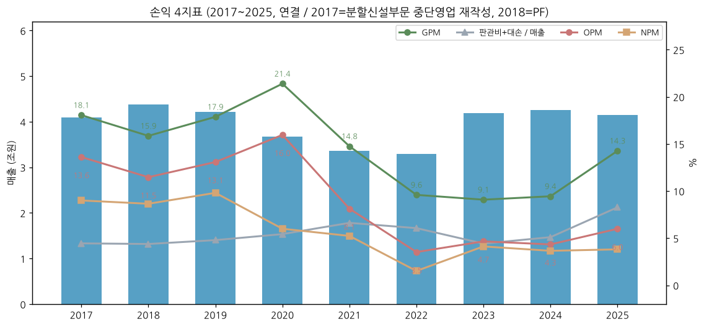

→ 2019\~2020 GPM 17\~21% (외주주택 호황) → 2022 9.6% 저점 → 2025 14.3% → **3Q26 23.0%** (분기 기준 2020년 수준 복귀)

### ② 재무상태표 (조원)

| 시점 | 자산총계 | 부채총계 | 자본총계 | 자본 YoY | 부채비율 | 유동비율 | 재고자산 | 총차입금 | 현금 | 순차입금 | 기준 |
|---|---|---|---|---|---|---|---|---|---|---|---|
| 2014 | 5.94 | 3.66 | 2.27 | - | 161.2% | - | - | - | - | - | 존속 현대산업개발 연결 |
| 2015 | 5.51 | 3.04 | 2.47 | +8.7% | 123.0% | - | - | - | - | - | 존속 현대산업개발 연결 |
| 2016 | 5.78 | 3.03 | 2.75 | +11.5% | 110.0% | - | - | - | - | - | 존속 현대산업개발 연결 |
| 2017 | 6.54 | 3.58 | 2.96 | +7.5% | 120.7% | - | - | 1.32 | 1.28 | - | 존속 현대산업개발 연결 |
| 2018 | 4.86 | 3.02 | 1.84 | 분할 리셋 | 163.7% | 157.0% | 0.78 | 0.73 | 0.89 | -0.17 | DART 연결 |
| 2019 | 4.41 | 2.18 | 2.23 | +21.0% | 97.6% | 187.4% | 0.50 | 0.59 | 0.36 | 0.23 | DART 연결 |
| 2020 | 6.12 | 3.37 | 2.74 | +22.9% | 123.0% | 192.4% | 0.45 | 1.76 | 0.53 | 1.23 | DART 연결 |
| 2021 | 6.57 | 3.68 | 2.89 | +5.2% | 127.6% | 174.1% | 0.85 | 1.76 | 0.35 | 1.41 | DART 연결 |
| 2022 | 7.34 | 4.43 | 2.90 | +0.6% | 152.8% | 157.3% | 1.57 | 2.51 | 0.56 | 1.94 | DART 연결 |
| 2023 | 7.02 | 4.01 | 3.01 | +3.7% | 133.3% | 158.4% | 1.51 | 2.09 | 0.56 | 1.54 | DART 연결 |
| 2024 | 7.46 | 4.35 | 3.11 | +3.5% | 139.6% | 153.3% | 1.85 | 2.30 | 0.82 | 1.48 | DART 연결 |
| 2025 | 7.60 | 4.39 | 3.21 | +3.2% | 136.5% | 143.3% | 1.51 | 2.50 | 0.88 | 1.62 | DART 연결 |
| 3Q26 | 7.82 | 4.45 | 3.38 | +5.1% (YTD) | 131.7% | 176.5% | 1.54 | 2.25 | 0.92 | 1.33 | DART 분기보고서 |

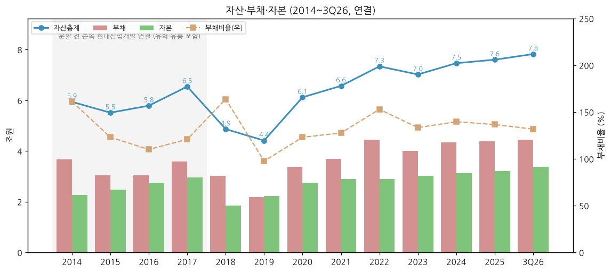

### ③ 현금흐름표 (억원)

| 연도 | 영업CF | 투자CF | 재무CF | CapEx(유형) | 투자부동산 취득 | CapEx(무형) | 배당지급 | 자사주 취득 | FCF | 기준 |
|---|---|---|---|---|---|---|---|---|---|---|
| 2014 | 5,276 | -1,652 | -4,037 | - | - | - | 59 | - | - | 존속 연결 |
| 2015 | 10,284 | -643 | -6,645 | - | - | - | 246 | - | - | 존속 연결 |
| 2016 | 8,398 | -890 | -1,458 | - | - | - | 398 | 28 | - | 존속 연결 |
| 2017 | 4,532 | -2,290 | -976 | 2,112 | 68 | 28 | 599 | 1,540 | 2,392 | 존속 연결 |
| 2018 | 4,546 | -2,489 | 283 | 59 | - | 1 | - | 7 | 4,487 | DART 연결 (5\~12월) |
| 2019 | -1,200 | -2,378 | -1,759 | 50 | - | 25 | 220 | - | -1,275 | DART 연결 |
| 2020 | -2,589 | -10,128 | 14,423 | 46 | - | 40 | 223 | - | -2,675 | DART 연결 |
| 2021 | 304 | -1,495 | -585 | 171 | 1,747 | 11 | 395 | - | 122 | DART 연결 |
| 2022 | -17,351 | 12,708 | 6,773 | 821 | 104 | 23 | 395 | - | -18,195 | DART 연결 |
| 2023 | 6,402 | -1,431 | -5,044 | 650 | 0 | 12 | 395 | 200 | 5,739 | DART 연결 |
| 2024 | 3,144 | -978 | 469 | 344 | 65 | 32 | 449 | 0 | 2,767 | DART 연결 |
| 2025 | 28 | -728 | 1,257 | 1,177 | 2 | 48 | 449 | 162 | -1,197 | DART 연결 |

(FCF = 영업CF − 유형·무형 CapEx. 투자부동산 취득은 별도 열. 2014\~2016 존속 연결 CapEx 계정은 OpenDART 표준계정 매칭 실패로 미추출)

→ **2019\~2022 4년 중 3년 영업CF 적자, 2022 -1.74조** — 자체사업 토지 매입(재고자산 0.45조 → 1.57조) + 화정 사고 후 미분양·공사비 증가. 2023 이후 플러스 전환했지만 2025 28억으로 정체 (서울원 공사비 선투입)

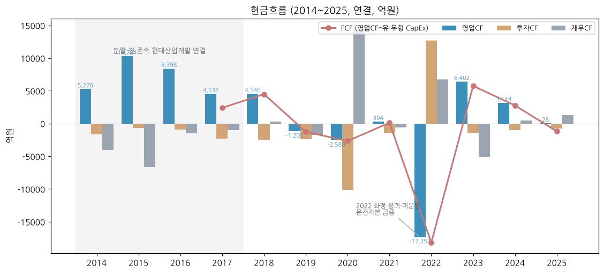

### ④ CapEx 추이 (억원)

| 연도 | 유형 | 투자부동산 | 무형 | 총 CapEx | CapEx/매출 |
|---|---|---|---|---|---|
| 2017 (분할 전 연결) | 2,112 | 68 | 28 | 2,208 | 4.12% |
| 2018 (5\~12월) | 59 | 0 | 1 | 60 | 0.21% |
| 2019 | 50 | 0 | 25 | 75 | 0.18% |
| 2020 | 46 | 0 | 40 | 86 | 0.23% |
| 2021 | 171 | 1,747 | 11 | 1,929 | 5.74% |
| 2022 | 821 | 104 | 23 | 948 | 2.87% |
| 2023 | 650 | 0 | 12 | 662 | 1.58% |
| 2024 | 344 | 65 | 32 | 442 | 1.04% |
| 2025 | 1,177 | 2 | 48 | 1,227 | 2.96% |

- 주택 건설사라 CapEx는 매출의 0.1\~2% 수준 — 사이클 판단은 CapEx보다 **재고자산(자체사업 용지)·PF 보증·수주잔고** 가 핵심

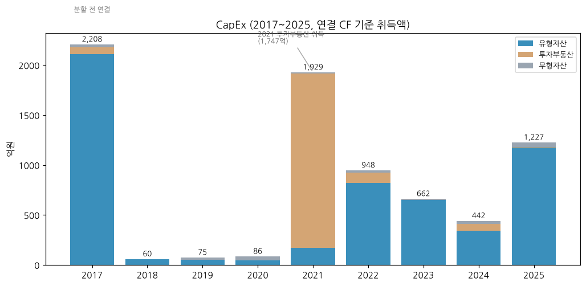

### ⑤ 부채구조 + 우발채무

**총차입금 2.25조 / 현금 0.92조 → 순차입금 1.33조 (3Q26)** — 2019년 이후 순차입 구조 (분할 직후 2018은 순현금 0.17조)

**신용등급:** 회사채 **A (안정적)** — 한국기업평가·한국신용평가·NICE신용평가 3사 동일 (2024-06 \~ 2026-06 정기평가 유지, DART 분기보고서(2026.09))

**부동산 PF 우발채무 (연결, DART 분기보고서(2026.09) 주석, 책임준공·중도금대출·SOC 제외):**

| 구분 | 3Q26말 |
|---|---|
| 부동산 PF(대출) 보증금액 합계 | **1조 4,561억** |
| └ 단독사업 | 1조 4,498억 |
| └ 컨소시엄 | 63억 |
| 관련 차입금·사채 잔액 | 1조 4,550억 |
| 우발부채 → 충당부채 전환액 | 0 |

- PF 보증 1.46조 = 3Q26 자본 3.38조의 **43%** (현대건설 2Q26 PF 보증 14.18조 = 자본의 126% 대비 낮음)
- 사고 관련 충당부채: 공사손실충당부채 119억 + 기타충당부채 24억 (3Q26). 영업정지·신용등급 하락 시 일부 차입금 기한이익 상실 조항 존재 (주석 16) — 감사인 강조사항

### ⑥ 배당·자사주 추이 (12년)

| 연도 | DPS 보통주(원) | 현금배당총액(억원) | 연결 배당성향 | 자사주 취득(억원, CF) | 비고 |
|---|---|---|---|---|---|
| 2014 | 300 | 221 | 32.1% | - | 분할 전 현대산업개발 |
| 2015 | 500 | 368 | 17.0% | - | 분할 전 |
| 2016 | 700 | 515 | 16.8% | 28 | 분할 전 |
| 2017 | 1,000 | 701 | 16.9% | 1,540 | 분할 전 (자사주 1,540억 = 분할 전 지주전환 준비) |
| 2018 | 500 | 220 | 9.6% | 7 | 분할 후 첫 배당 |
| 2019 | 500 | 220 | 5.3% | - |  |
| 2020 | 600 | 395 | 18.0% | - |  |
| 2021 | 600 | 395 | 22.4% | - |  |
| 2022 | 600 | 395 | 78.5% | - | 화정 사고로 이익 급감에도 DPS 600원 유지 |
| 2023 | 700 | 449 | 26.0% | 200 | DPS 700원으로 인상 |
| 2024 | 700 | 449 | 28.8% | - |  |
| 2025 | 700 | 439 | 27.8% | 162 | 자사주 73.5만주 장내 취득 (DART) |

(DPS·배당총액·배당성향 = DART 사업보고서 '배당에 관한 사항'. 2014\~2017은 분할 전 현대산업개발 기준)

- **주주환원 정책**: 별도 순이익의 20% 이상 배당 (iM 2026-07-27) / 자사주: 2025 73.5만주 장내 취득 → 2025말 247만주, 2026 추가 취득 포함 **468.2만주(7.1%) 소각 예정** (하나 2026-07-27, 시기는 이사회 결의)
- 2026E DPS: 하나 1,000원 / iM 1,100원 (2026-07-27 추정)

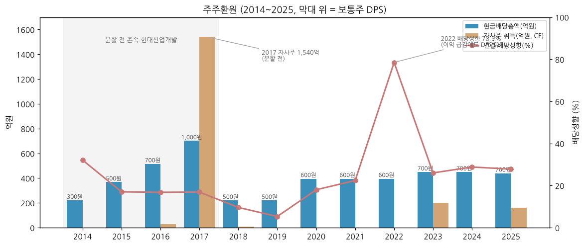

### ⑦ 재무 비율

| 연도 | ROE | ROA | 부채비율 | 유동비율 | 이자보상배율(OP/이자비용) | 순차입금(억원) |
|---|---|---|---|---|---|---|
| 2019 | 20.3% | 8.9% | 97.6% | 187.4% | 32.1x | 2,252 |
| 2020 | 8.9% | 4.2% | 123.0% | 192.4% | 17.1x | 12,287 |
| 2021 | 6.3% | 2.8% | 127.6% | 174.1% | 7.7x | 14,101 |
| 2022 | 1.7% | 0.7% | 152.8% | 157.3% | 1.8x | 19,418 |
| 2023 | 5.9% | 2.4% | 133.3% | 158.4% | 4.3x | 15,360 |
| 2024 | 5.1% | 2.2% | 139.6% | 153.3% | 3.3x | 14,759 |
| 2025 | 5.0% | 2.1% | 136.5% | 143.3% | 3.5x | 16,195 |

**주요 비율 의미:**
- **ROE**: 지배순이익 / 평균 지배지분 — 2019 20.3% 정점 → 2022 1.7% → 2025 5.0%. 증권사 2026E 9.7\~9.8% (하나·iM)
- **부채비율**: 2019 97.6% → 2022 152.8% → 3Q26 131.7%
- **이자보상배율**: OP / 이자비용(ifrs InterestExpense) — 2019 32x → 2022 1.8x → 2025 3.5x
- 2018은 8개월 실적·분할 리셋으로 비율 생략

---

## 5. 지배 구조

### ① 그룹·계열 관계

- **HDC그룹**: 정몽규 회장 → **HDC㈜ (지주, 012630)** → IPARK현대산업개발 41.52% (2022-01 장내 매수로 확대)
- HDC㈜ 산하 계열: IPARK현대산업개발, HDC아이앤콘스, HDC아이파크몰, HDC신라면세점(합작), 호텔HDC, HDC리조트, HDC현대EP, HDC랩스, HDC자산운용, 통영에코파워, 서울춘천고속도로, 부산컨테이너터미널, 북항아이브리지 등 (회사 IR 3Q26 그룹도)
- IPARK현대산업개발의 주요 연결 종속: HDC현대PCE(PC구조물), 호텔아이파크, 아이파크제1호 위탁관리리츠 / 제2호 리츠는 2026-02 해산결의
- 2018 분할 구조: 존속 HDC = 투자·부동산임대(아이파크몰) / 신설 HDC현산 = 건설·PC·호텔·콘도. 상법상 분할 전 채무 연대책임 (HDC 2018 사업보고서)

### ② 주주 구분

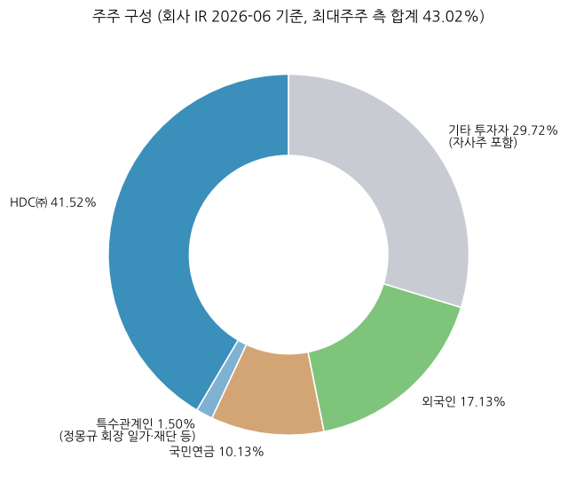

**5% 이상 주주 및 특수관계인 (보통주, DART 사업보고서(2025.12) 최대주주 현황):**

| 주주명 | 지분율 | 주식수 | 기준일 |
|--------|--------|--------|------|
| HDC㈜ (최대주주) | 41.52% | 27,366,352 | 2025-12-31 |
| 정숙영 / 정유경 / 포니정장학재단 / 박영자 외 (특수관계인) | 1.49% | 977,100 | 2025-12-31 |
| **최대주주 등 합계** | **43.01%** | **28,343,452** | 2025-12-31 (IR 2026-06: 43.02%) |
| 국민연금공단 | 10.13% | - | 회사 IR 2026-06 (2025-12: 10.45%) |

**전체 주주 구분 (회사 IR 2026-06):**

| 구분 | 지분율 | 비고 |
|---|---|---|
| 최대주주 외 | 43.02% | 공시 |
| 외국인 | 17.13% | 하나 2026-07-24 17.07% / iM 16.8% |
| 국민연금 | 10.13% | |
| 기타 투자자 | 29.72% | 자기주식 포함 (2025말 3.75%) |

### ③ 임원·이사회

**대표이사 (각자대표):**
- **정경구 대표이사 사장** (1965.06) — 서울대 사법학, HDC자산운용 대표 → HDC현산 경영본부장 → HDC㈜ 대표이사 → 2025-03 HDC현산 대표 (그룹 재무·전략통). 임기 2027-03
- **조태제 대표이사 부사장** (1961.01) — 충북대 건축, 동국대 건축학 박사, HDC현산 건설본부장·CSO(안전) → 2024-03 대표. 임기 2027-03
- 역대 대표 교체: 2022-02 하원기 → 2022-03 유병규·정익희 → 2022-07 최익훈·김회언 → 2024-03 조태제 → 2025-03 정경구 (화정 사고 후 3년간 5차례 변동, DART I-2)

**사외이사 (DART 사업보고서(2025.12) 임원 현황):**

| 성명 | 주요 경력 | 위원회 | 임기만료 |
|---|---|---|---|
| 김동수 (1955) | 제16대 공정거래위원장, 고려대 석좌교수 | 감사위원장 | 2027-03 |
| 김진오 (1968) | 前 판사, 법무법인 동인 변호사 | 보상위원장·감사위원 | 2027-03 |
| 최진희 (1978) | 고려대 경영학과 교수 | 사추위원장·감사위원 | 2026-03 |

**외부감사인:** 삼일회계법인 (제8기 2025\~, 증선위 지정) — 2025 연결·별도 적정의견. 강조사항: 사고로 인한 영업정지·신용등급 하락 가능성에 따른 회계추정 변동 / 핵심감사사항: ① 투입법 수익인식 ② 신용손상 징후 현장 금융자산 회수가능성 (DART 사업보고서(2025.12) V). 제7기(2024)는 성현회계법인

---

## 6. 기타 팩트

### ① R&D 인프라

| 연도 | 2019 | 2020 | 2021 | 2022 | 2023 | 2024 | 2025 |
|---|---|---|---|---|---|---|---|
| 연구개발비용 (억원) | 18.8 | 32.4 | 22.1 | 21.3 | 172.6 | 254.1 | 287.0 |
| **R&D / 별도 매출** | **0.04%** | **0.09%** | **0.06%** | **0.06%** | **0.41%** | **0.60%** | **0.70%** |

(DART 사업보고서 II-6 '연구개발비용 계', 별도. 2023 급증은 DXT(디지털전환)·기술팀 집계 범위 확대로 추정 — 회사 설명 미확인)

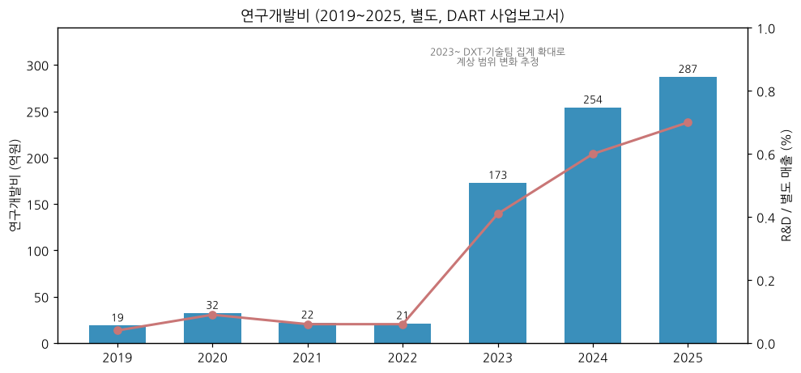

- 조직: DXT, 기술팀 (각 현업 연구개발 지원) / 지적재산권 등록 99건 (특허 93·건설신기술 5·녹색기술 1)
- 연구 방향: 제로에너지 주택, 평면 설계 저작권 (국내 최다 수준), 스마트 건설

### ② 진행 중 corporate action — 10년치 주요 이벤트

```
2026  · 사명 변경 (IPARK현대산업개발, 03월) / 자사주 468.2만주(7.1%) 소각 예정
      · 복정역세권 개발(1.4조) 연말 착공 예정, 잠실 스포츠·MICE 민간투자(0.5조) 2027 착공
      · HDC아이파크제2호 리츠 해산결의 (02월)
2025  · 서울시 영업정지 1년 처분 (화정) → 집행정지 / 아시아나 계약금 소송 최종 패소 (03월)
      · 신규수주 5.83조 (계획 대비 124%)
2024  · 서울원 아이파크 (광운대역세권) 착공 (11월) / 감사인 지정 (삼일)
2022  · HDC㈜ 지분 41.52%로 확대 (01월) / 정관 사업목적에 물류·데이터센터 추가 (03월)
      · 대표이사 연쇄 교체, 서울시 영업정지 8개월 처분 (학동)
2021  · 서창김포고속도로 계열 편입 (12월)
2020  · 아시아나항공 인수 계약 해제 (09월) / 리츠 1·2호 편입
2019  · 아시아나항공 인수 우선협상대상자 (11월, 미래에셋 컨소시엄)
2018  · 인적분할 신설·재상장 (05·06월)
```

### ③ 개발·안전 마일스톤 — 10년치

```
2026  · 3개 분기 연속 OPM 두 자릿수 (1Q 11.9% · 2Q 13.4% · 3Q 15.3%)
2025  · 학동 형사 대법원 판결 (08월, 일부 무죄 유지), 과징금 처분 취소 확정 (11월)
      · 화정 형사 1심 (01월, 일부 무죄) → 항소심 진행
2024  · 서울원 아이파크 착공 — 광운대역세권 물류부지 복합개발 (공사비 2.9조, ~2028-07)
2022  · 화정 아이파크 붕괴 (01월) → 전 현장 안전점검·안전경영실 신설
2021  · 학동4구역 철거 붕괴 (06월)
2019~2020 · 외주주택 호황 — 2020 OPM 16.0% (재상장 이후 최고)
```

### ④ 주요 리스크

- **영업정지 확정 리스크**: 학동 8개월 처분 — 서울행정법원 1심 처분 유지(2025-04), 서울고법 2심 진행 (연말 판결 예상, iM) / 화정 1년 처분 (2025-05) — 집행정지 상태, 형사 항소심 이후 본안 진행. 확정 시 신규 수주·PF 차환에 직접 타격 (DART 3Q26 주석 3, 감사인 강조사항)
- **자체사업 집중**: 서울원 아이파크 단일 현장이 2026\~2028 자체부문 이익의 대부분 → 분양률·공정 지연 시 이익 변동 큼. 증권사 FY28E EPS 추정 편차 큼 (하나 2026-07-27 추정 2028E 매출 5.19조 vs iM 2028E 영업이익 5,000억으로 2027 대비 감소)
- **PF 보증 1.46조 (3Q26)** — 브릿지론 자금보충 포함. 충당부채 전환 0이지만 지방 분양 부진 시 노출
- **일반건축 손실**: 2025 -1,092억 (평택 고덕 등 대손), 13년 중 9년 적자
- **영업CF 변동성**: 2022 -1.74조, 2025 +28억 — 자체 용지 매입·공사비 선투입 구조
- **국내 주택 정책·금리**: 해외 매출 0.5%로 국내 부동산 규제·PF 금리에 100% 노출
- **지배구조**: HDC㈜ 43%, 그룹 차원 대형 M&A(아시아나 사례) 시 재무 부담 전가 가능성

### ⑤ ESG 등급

| 평가기관 | 등급 | 비고 |
|---------|------|------|
| KCGS (한국ESG기준원) | 미확인 | 이번 수집 source에서 확인 못함 — v1.1 보강 대상 |
| 지속가능경영보고서 | 미확보 | irgo·DART 경로에 없음, 회사 홈페이지(ipark-dvp.com) 별도 확인 필요 |

- 안전보건위원회 운영 (사외이사 김진오·최진희 참여), 안전품질부문·안전경영실 별도 조직 (DART 임원 현황)
- 환경: 최근 1년 환경 관련 사고 없음 (DART 사업보고서(2025.12) II-7)

### ⑥ 인증·라이선스

- 토목건축공사업 면허 (영업정지 처분 대상 업종) / 회사채 A (안정적) 3사
- 지적재산권 99건 (특허 93, 건설신기술 5, 녹색기술 1)
- IPARK 브랜드 (2001), 평면 디자인 저작권 다수

---

## Version Log

**v1.0 (2026-11-25) — 신규 작성 (한 번에 완성본)**
- ① OpenDART fnlttSinglAcntAll: 294870 연결 34개(2018-2Q\~2026-3Q) + 별도 34개 / 분할 전 존속 HDC(012630) 연결 44개 중 2015\~2018-1Q 사용
- ② DART 정기공시 원문 XML: 294870 34건(본문+첨부, 2018.06\~2026.09), 012630 56건(2012.12\~2026.09) → 연결 부문정보(2013\~2017 존속 / 2Q18\~3Q26 신설, 34분기), 수주현황, PF 우발채무, 신용등급, 임원·직원·배당·R&D, 사고 관련 법적 진행, 분할 중단영업 주석(2017 연간·2018 1\~4월)
- ③ 회사 IR (irgo): 50건 다운로드 → 텍스트 판독 가능 실적 자료 15건으로 별도 부문 GPM(2020\~9M26)·수주잔고(2020\~3Q26)·신규수주·2026 가이던스 구성. 16건은 이미지 PDF(텍스트 없음), 1건(2025-03-13)은 타사(하나마이크론) 자료가 잘못 게시된 파일
- ④ Yahoo Finance 294870.KS 주간(2018-06\~2026-11-25)·일간 2Y, 증권사 리포트 2건 (하나·iM 2026-07-27), 뉴스 (딜사이트 3Q26 잠정, 토요경제 신한 TP, CEO스코어 영업정지)
- ⑤ 차트 18종: chart1·1b·2(×6: 외주주택·자체공사·일반건축·토목·기타 34분기 + 별도부문GPM)·4·5·6·7·8·9·10·11·12 + chart13 (수주잔고, 건설업 추가)
- ⑥ 분할 처리: 2014\~2017 손익 = 존속 연결 건설 4부문 합 / 2018 = 1\~4월 중단영업 + 5\~12월 PF / 재무상태·CF 2014\~2017 = 존속 연결 (범위 차이 표기)

**잔여 보완 후보 (v1.1):**
- 이미지 PDF IR (2Q24·3Q24·3Q25 등) OCR로 별도 부문 분기 GPM 시계열 보강
- ESG 등급(KCGS)·지속가능경영보고서, 2018 이전 임직원 수
- 4Q26 확정 후 연간 표 v2.0
