# HD건설기계 (구 HD현대건설기계) — 기업 개요 (v1.1)

> 마지막 update: 2026-11-28 (종목명 HD건설기계로 변경) / 2026-11-25 (3Q26 분기보고서 2026-11-16 제출분 반영 — 확정치)
> 입력 source: OpenDART fnlttSinglAcntAll (연결, 2Q17\~3Q26, 38개 JSON) + DART 정기공시 원문 XML 33건 (사업보고서 2017\~2025, 분기·반기 2017\~3Q26) + 합병 공시 원문 (주요사항보고서 회사합병결정 2025-07-01, 증권발행실적보고서(합병) 2026-01-02, 인프라코어 손익구조변경 2026-01-22) + 회사 IR PDF 12건 (4Q23\~3Q26) + HD현대인프라코어 DART 분기 시계열 (1Q16\~3Q25) + Yahoo Finance (267270.KS, 2017-06\~2026-11-25)
> 갱신 주기: 매분기 (실적 리뷰 모드 호출 시)
> 워치리스트: 건설·건설기계 섹터 (2026-11-23 추가, 4Q26부터 리뷰, T1 아님) / 서브섹터: 건설기계
> **Fact verify cutoff**: 2026-11-25 (주가 = Yahoo 2026-11-25 종가, 주식수·지분율 = DART 3Q26 분기보고서 2026-09-30 기준. 외국인 지분율·컨센서스 미확보)

> **사명·합병 안내**: 이 리포트의 대상 회사는 **2026-01-01 HD현대인프라코어를 흡수합병**하고 사명을 **HD건설기계(에이치디건설기계㈜, HD Construction Equipment Co., Ltd.)** 로 바꾼 통합법인이다. 존속법인은 HD현대건설기계(KRX **267270**, 종목코드 유지), 소멸법인은 HD현대인프라코어(042670). 파일명은 BT 호칭대로 "HD현대건설기계"를 유지한다. **시계열은 \~4Q25 = HD현대건설기계 단독, 1Q26\~ = 통합법인(건설기계+엔진)** 으로 단절되며, 합병 전 기간은 pro-forma(양사 단순합산 / 회사 IR 합산)를 병기한다.

---

## 0. 합병 팩트 시트 (DART 공시 원문 기준)

| 항목 | 내용 | 출처 |
|---|---|---|
| 합병 방법 | HD현대건설기계(존속)가 HD현대인프라코어(소멸)를 흡수합병, 양사 모두 유가증권시장 상장법인 | 주요사항보고서(회사합병결정) 2025-07-01 |
| 이사회 결의·합병계약일 | 2025-07-01 | 동일 |
| **합병비율** | **HD현대건설기계 보통주 1 : HD현대인프라코어 보통주 0.1621707** (기준주가: HDCE 76,408원 / 인프라코어 12,391원, 할증·할인 없음, 외부평가 미해당) | 동일 |
| 합병신주 | 공시 당시 예정 30,626,144주 → 합병 후 발행주식총수 47,974,118주 (인프라코어 자기주식 59,436주엔 신주 미교부) | 증권발행실적보고서(합병) 2026-01-02 |
| 임시주총 | 2025-09-16 (양사 승인) | 동일 |
| 주식매수청구가격 | HDCE 75,545원 / 인프라코어 11,885원 — 행사 HDCE 2,645주, 인프라코어 64,394주 (소규모) | 동일 |
| **합병기일** | **2026-01-01** (합병신주 배정 기준일 2025-12-31) | 동일 + 3Q26 분기보고서 |
| 합병등기·종료보고 | 2026-01-02 (이사회 결의로 종료보고 총회 갈음) | 동일 |
| **신주 상장일** | **2026-01-26** (3Q26 분기보고서 "확정·이행, 합병 종료" 명시) | 3Q26 분기보고서 I-1 |
| **인프라코어 상장폐지** | 합병 소멸로 상장폐지 — **정확한 상장폐지일 공시 원문 미확인** (DART 인프라코어 공시 목록에 상장폐지 공시 없음, KRX 공시 별도 확인 필요). 신주 상장일 2026-01-26 직전 매매거래정지 후 폐지가 통상 절차 (추정) | — |
| **사명 변경** | 2026-01 에이치디현대건설기계㈜ → **에이치디건설기계㈜** (2023-03 현대건설기계 → HD현대건설기계에 이은 2번째 변경), 홈페이지 hd-ce.com | 3Q26 분기보고서 I-2 |
| 합병 후 최대주주 | HD현대사이트솔루션 17,201,415주 (**36.22%**, 2026-09-30) — 합병 전 37.59% | 3Q26 분기보고서 |
| 연결 범위 | 1Q26부터 인프라코어 사업(건설기계·엔진) + 종속 15개사 신규 편입 → 종속회사 10 → 25개사. 비교기간(2025)은 HDCE 단독 숫자로 재작성 없음 | 3Q26 분기보고서 I-1 |
| 브랜드 | **HYUNDAI + DEVELON 듀얼 브랜드 유지**, 사명 HD = HYUNDAI·DEVELON 이니셜 (중복 라인업 정리) | 뉴시스 2025-07-01, 머니투데이 2026-01-02 |
| 엔진 사업 | **통합법인에 포함** — 보고부문 '건설기계' + '엔진' 2개 (주석 29 영업부문) | 3Q26 분기보고서 |

---

## 1. 기업 분류

- **Primary 분류: 사이클** (Cyclical — 글로벌 굴착기 수요 사이클 + 중국·신흥국 노출, 저마진 장비 제조)
- **Secondary 노트: 엔진(발전기·방산) 성장 옵션 일부** — 합병으로 편입된 엔진 부문(9M26 외부매출 비중 14%, 부문 OPM 11\~15%)이 데이터센터 비상발전기·방산 엔진 수요로 지속성장형 성격

### ① 정량 근거

**📊 Summary Box (HD현대건설기계 단독 2018\~2025 8개 완전연도, 연결 — 2017은 4\~12월 9개월이라 제외):**

| 지표 | 값 |
|------|-----|
| 매출 CAGR (2018→2025, 7년) | **+2.2%** (3.23조 → 3.78조) — 합병 pro-forma 2025 7.93조 (회사 IR) |
| OPM 평균 | **5.3%** (8년 단순평균) |
| OPM 정점 평균 | **6.6%** (2018 6.5% · 2023 6.7%) |
| OPM 저점 평균 | **4.0%** (2020 3.5% · 2025 4.5%) |
| 사이클 주기 | 약 5년 (peak-to-peak 2018→2023) |
| 사이클 회수 | 정점 2회 / 저점 2회 (분기로는 4Q21 -5.9% 적자 1회) |

```
[전사 OPM 시계열 (연결, DART, HD현대건설기계 단독 ~2025 / 통합 2026)]
연도   매출(조)  영업이익(억)  순이익(억)  OPM    NPM
2017*    1.89       952        466      5.0    2.5   ← 2017-04 현대중공업에서 인적분할 (4~12월)
2018     3.23     2,087      1,411      6.5    4.4   ← 1차 정점: 중국·신흥국 굴착기 호황
2019     2.85     1,578        509      5.5    1.8   ← 중국 경쟁 심화, 4Q19 OPM 1.2%
2020     2.62       916         85      3.5    0.3   ← 1차 저점: 코로나
2021     3.28     1,607      1,264      4.9    3.8   ← 원자재 급등, 4Q21 적자(-327억)
2022     3.52     1,706        994      4.9    2.8   ← 산업차량 사업 양도(2022-01)
2023     3.83     2,572      1,275      6.7    3.3   ← 2차 정점: 신흥국·북미 판가
2024     3.44     1,904        860      5.5    2.5   ← 고금리·북미 재고조정
2025     3.78     1,709        870      4.5    2.3   ← 중국 강소법인 사업재편 일회성
-------- 합병 (2026-01-01) — 시계열 단절 --------
2025PF   7.93     4,129          -      5.2      -   ← 회사 IR 합산(연결조정 반영, 감사 전)
9M26     6.83     5,973      3,564      8.7    5.2   ← 통합법인 실적 (3Q26 외환손실로 순이익 18억)

OPM range (2018~2025): 3.5% ~ 6.7% = 3.2%pt  (영업적자 연도 없음 — 진폭 낮은 사이클)
```

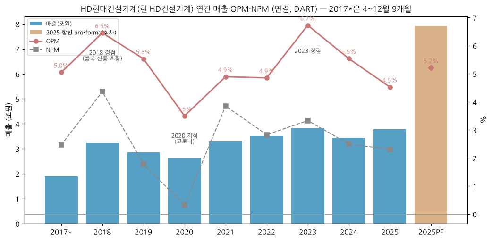

(2017*은 분할기일 2017-04-01 이후 9개월. 2019\~2020 지배순이익 32억·-97억은 종속회사(중국 강소법인 등) 손실로 연결 순이익보다 작음)

### ② 산업 분류

- 산업: **건설기계 (굴착기·휠로더·ADT) + 산업용·발전기용 엔진** — 사이클 산업 list 포함 (글로벌 건설·광산 투자 사이클, 중국 인프라 사이클)
- DART 업종: 건설 및 채광용 기계장비 제조업 (업종코드 29241) / KRX 기계·장비
- 워치리스트 섹터: **건설·건설기계** (2026-11-23 추가 2순위 섹터, T1 아님) / 서브섹터: **건설기계** (HD현대건설기계·HD현대인프라코어·두산밥캣)
- 글로벌 점유율: 2025 통합 기준 **약 2.3%** (Caterpillar 15.2%, Komatsu 11.0%, XCMG 5.8%, Deere 5.4% / Yellow Table, 매출액 기준, 3Q26 분기보고서)

### ③ 분류 결정 논리

(1) **가장 매출 큰 사업부 기준**: 건설기계 (9M26 외부매출 5.89조, 86%) → 굴착기 수요 사이클에 직결 → **사이클**
(2) **사이클 사업부 이익 비중 우선 sub-rule**: 9M26 부문 영업이익 건기 4,682억 (78%) vs 엔진 1,290억 (22%) → 이익 변동을 지배하는 것도 건기. 단독 시절 분기 OPM 범위 -5.9%(4Q21)\~9.4%(2Q23) → **사이클 유지**
(3) **Boundary case 처리**: 엔진 부문은 3Q26 매출 +24% YoY (IR 사내매출 포함 3,940억), 부문 OPM 14% — 발전기 엔진은 데이터센터 백업 전력 수요로 성장 중. 다만 매출 비중 14%·이익 비중 22%로 분류를 바꿀 수준은 아님 → **Primary 사이클 + Secondary 엔진 성장 옵션** 병기
(4) **피어 대비 (cross-ref)**:
   - **HD현대인프라코어** (소멸법인, 별도 기업개요 참조) = 같은 건기 사이클 + 엔진. 2022\~2025 합산 OPM 5.0\~8.0% — HDCE 단독보다 높았던 이유는 엔진 부문
   - **두산밥캣** = 북미 소형(컴팩트) 장비 중심, 렌탈·주택 사이클 — 같은 건기라도 지역·제품 노출이 달라 사이클 위상이 다름
   - **Caterpillar / Komatsu** = 광산·대형 장비 + 서비스·부품 매출 비중 높은 글로벌 1·2위 (합산 점유율 약 26%) — 가격결정력·딜러망으로 OPM 레벨이 HD건설기계보다 구조적으로 높음
   - **Deere** = 농기계 중심 + 건설·임업 — 같은 '장비 사이클'이나 농업 사이클 비중이 큼
   - → **HD건설기계 = 신흥국·중국 비중 높은 점유율 2%대 후발 메이커의 사이클주**. 합병으로 규모(매출 8조대)와 엔진 내재화를 얻었지만 아직 점유율·마진은 Tier-2

### ④ 적정 밸류에이션 방법

- **PBR (사이클 기준) 우선** — ROE 2018\~2025 범위 -0.8\~10.3% (단독). 통합 후 자본 4.91조 (지배 4.83조)
  - 2026-11-25 시총 약 3.53조 (74,300원 × 47,497,386주) → **P/B 약 0.73배** (3Q26 지배자본 기준, 계산치)
  - ATH 2026-04-27 종가 198,100원 기준 시총 약 9.41조 → P/B 약 1.95배 (계산치)
- **PER 보조** — 피크 이익 구간이 짧아 PER 단독 사용은 위험. trailing 지배순이익 (4Q25 PF 50억 + 9M26 3,562억 ≈ 3,612억, 추정) 기준 PER 약 9.8배
- **엔진 부문 SOTP는 참고** — 발전기·방산 엔진 성장이 이어지면 엔진 부문을 별도 멀티플로 볼 여지 (회사 IR: 엔진 중장기 매출 CAGR +12% 제시, 2026\~2031E)
- 사이클 밴드 (단독 시절, Yahoo 수정주가 기준 근사): 시총 저점 약 0.3조 (2020-03) \~ 고점 약 2.1조 (2018-01) / 통합 후 약 3.5\~9.4조

### ⑤ 분기 재평가 트리거 (분류 변경 조건)

- 엔진 부문 외부매출 비중 **20%+ & 부문 OPM 12%+ 2개 연도 연속** → Secondary 엔진 → '사이클 + 지속성장' 혼합으로 격상 검토
- 연간 **OPM 8%+ 2개 연도 연속 & 분기 OPM range 4%pt 이내** → 사이클 → 지속성장 transition 후보 (합병 시너지 구조화 확인)
- 건기 지역 중 **중국+ME/AF 비중이 30% → 20% 이하**로 축소되고 북미·유럽이 확대 → 사이클 진폭 축소 근거
- 반대로 연간 OPM 4% 미만 복귀 또는 엔진 부문 성장 정체(매출 YoY 0% 이하 2개 분기) → Secondary 삭제, 순수 사이클

---

## 2. 회사 개요

### ① 기본 사항

- **회사명**: 에이치디건설기계 주식회사 (HD Construction Equipment Co., Ltd.) — 구 HD현대건설기계(2023-03\~2025-12), 현대건설기계(2017-04\~2023-03) / KRX **267270** (유가증권시장, 2017-05-10 상장, 종목코드 합병 후 유지)
- **본사**: 경기도 성남시 분당구 분당수서로 477 (2023-03 서울 종로구에서 이전)
- **설립**: 2017-04-03 (분할기일 2017-04-01, 현대중공업 건설장비사업부문 인적분할) — 사업 기원은 1987년 현대중공업 건설장비 사업부
- **대표이사**: 문재영 사장 (2026-03-26 선임, 전 HD현대인프라코어 건기사업본부장·현대건설기계 영업본부장) — 전임 최철곤 (2021-11\~2026-03)
- **그룹**: HD현대그룹 — HD현대 → HD현대사이트솔루션(건설기계 중간지주, 36.22%) → HD건설기계
- **비전·목표**: 2030년 매출 **14.8조원** (2024 양사 합산 약 8조 → 1.5배+, 머니투데이 2026-01-02) / 2026 경영목표 매출 **8.7\~9조원, OPM 5\~7%** (IR 2026-02-09)
- **사업 한 줄 정의**: HYUNDAI·DEVELON 두 브랜드로 굴착기·휠로더·ADT를 팔고, 인천·군산 엔진공장에서 산업용·발전기용·방산 엔진을 만드는 국내 1위·글로벌 점유율 2%대 건설기계 회사. 매출의 85%가 수출 (9M26)

### ② 최근 손익·자본 추이 (억원, 연결, DART)

| 연도 | 매출 | YoY | 영업이익 | 순이익 | 자본총계 | 자본 YoY |
|---|---|---|---|---|---|---|
| 2017* | 18,867 | - | 952 | 466 | 11,709 | - |
| 2018 | 32,339 | n/m | 2,087 | 1,411 | 15,682 | +33.9% |
| 2019 | 28,521 | -11.8% | 1,578 | 509 | 15,771 | +0.6% |
| 2020 | 26,175 | -8.2% | 916 | 85 | 15,875 | +0.7% |
| 2021 | 32,843 | +25.5% | 1,607 | 1,264 | 15,478 | -2.5% |
| 2022 | 35,156 | +7.0% | 1,706 | 994 | 16,673 | +7.7% |
| 2023 | 38,250 | +8.8% | 2,572 | 1,275 | 17,711 | +6.2% |
| 2024 | 34,381 | -10.1% | 1,904 | 860 | 17,938 | +1.3% |
| 2025 | 37,765 | +9.8% | 1,709 | 870 | 19,303 | +7.6% |
| 2025 합병 PF (회사 IR) | 79,269 | - | 4,129 | - | 46,185 | - |
| 9M26 (통합) | 68,305 | - | 5,973 | 3,564 | 49,121 (9월말) | - |

(2017* 9개월. 2018 자본 +34%는 증자 등 자본 확충 (자본금 494억 → 985억). **분할 전(2016년 이전) 현대중공업 건설장비 부문 단독 손익은 DART 별도 공시가 없어 미수록**)

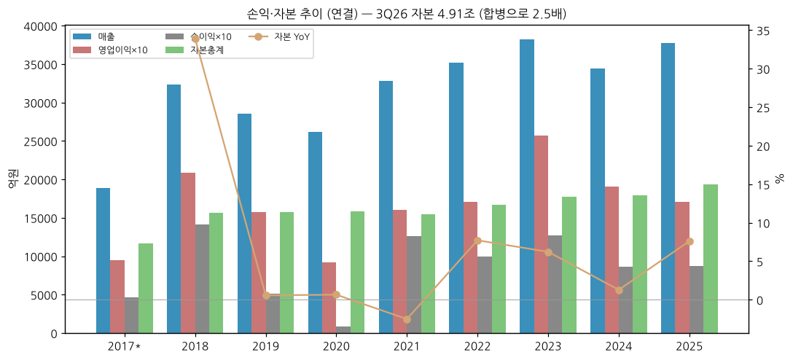

### ③ 회사 주가 역사 ★ narrative 영역

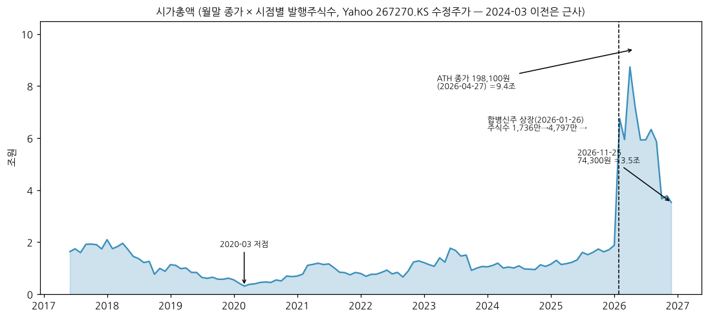

**시가총액 데이터:** 2017-06 \~ 2026-11-25 (Yahoo Finance 267270.KS 월간 종가 × 시점별 발행주식수 — 1,970만주(\~2024-03) → 1,831만(2024) → 1,736만(2025) → 4,797만(2026-01-26 합병신주 상장) → 4,750만주(2026-03 이후 자사주 소각). Yahoo 2024-03 이전 종가는 2017\~2018 증자 조정이 반영된 수정주가라 시총은 근사)
- 2026-11-25 종가 **74,300원 → 시총 약 3.53조원** (계산치)
- **사상 최고 (종가): 2026-04-27 198,100원 → 시총 약 9.41조원** (DART 3Q26 분기보고서 '최근 6개월 주가' 4월 최고 198,100원과 일치) / 장중 최고 **217,500원 (2026-04-28, Yahoo)**
- 고점 대비 2026-11-25 **-62.5%** / 2026-09-30 123,500원 → 2026-10-31 77,200원 (**한 달 -37%**) → 11-20 하루 -12.8% (91,300 → 79,600원, 원인 미확인)
- 상장 첫날 (2017-05-10) 종가 240,000원 (이투데이, 수정 전 원주가)

**사이클 history:**

```
[2017-05 ~ 2018-01] 분할 상장 직후 중국 굴착기 호황
  · 2017-05-10 상장 (첫날 종가 24만원, 수정 전)
  · 2018-01 시총 약 2.1조 (단독 시절 고점, 근사)

[2018-05 ~ 2020-03] 중국 로컬 업체 점유율 확대 + 미중 무역분쟁
  · 2019 OPM 5.5% → 2020 3.5%
  · 2020-03 코로나 저점 (시총 약 0.3조, 근사)

[2021] 원자재 슈퍼사이클·인프라 부양 기대
  · 2021-05 반등 고점 → 4Q21 영업적자 (-327억)

[2022-11 ~ 2023-07] 북미·신흥국 판가 + 2023 OPM 6.7% 정점
  · 2023-06~07 단독 시절 2차 고점

[2023-10 ~ 2024] 고금리·북미 딜러 재고조정, 중국 부진
  · 2024 매출 -10%, OPM 5.5%

[2025-07-01] 인프라코어 흡수합병 발표 → 재평가 시작
  · 2025-07 월말 92,600원 (합병 기준가 76,408원)
  · 2025-10 고점 120,000원 (장중)

[2026-01 ~ 2026-04] 통합법인 출범 + 엔진(발전기·방산) 리레이팅
  · 2026-01-26 합병신주 상장, 1Q26 OPM 8.3%
  · 2026-04-27 ATH 198,100원 (시총 약 9.4조)

[2026-05 ~ 11] 급락 — 고점 대비 -62%
  · 2Q26 OPM 10.2% (사상 최고) 이후에도 주가 하락
  · 3Q26 (2026-10-26 발표): 영업이익 1,577억 (+24% PF YoY)이나 외환손실 1,460억으로 세전 -40억·순이익 18억
  · 2026-10 한 달 -37%, 딜사이트 관련기사 제목 "시총 6조 깨진 HD건설기계"
  · 2026-11-04~09 신평 3사 회사채 등급 A0 → A+ 상향 (펀더멘털 신호와 주가 괴리)
```

### ④ 회사의 주요 연혁

```
1987      현대중공업 건설장비 사업부 출범
1988·1990 중형 굴착기·휠로더 고유 모델 개발
1990년대  북미·유럽·중국 판매·생산 법인 설립
2000년대  인도·브라질 생산법인 설립 (신흥시장 거점)
2017-04   현대중공업 인적분할 → 현대건설기계 설립 (분할기일 04-01)
2017-05   유가증권시장 상장 (05-10)
2019-04   부품사업 물적분할 (현대코어모션) → 2021-10 재흡수합병
2021-08   최대주주 HD현대 → 현대제뉴인(현 HD현대사이트솔루션) 변경 (현물출자)
          * 같은 해 현대제뉴인 컨소시엄이 두산인프라코어(현 HD현대인프라코어) 인수
2022-01   산업차량(지게차) 사업 현대제뉴인에 양도
2023-03   현대건설기계 → HD현대건설기계 사명 변경, 본사 성남 이전
2025-04   중국 강소법인 생산 중단·사업 재편 결정
2025-07   HD현대인프라코어 흡수합병 결정 (비율 1:0.1621707)
2025-09   양사 임시주총 합병 승인
2026-01   합병기일(01-01), HD건설기계 출범·사명 변경, 합병신주 상장(01-26)
2026-01   현대로템 폴란드 K2전차 2-1차 엔진 공급 계약 (01-28)
2026-03   문재영 대표이사 선임
2026-11   회사채 신용등급 A+ 상향 (한신평·한기평 11-04, NICE 11-09)
```

---

## 3. 비즈니스 모델

### ① 실적 추이 (전사 → 부문 → 지역 3단계 위계)

**연간·9M 통합 표 (억원) — 합병 단절 표기:**

| 항목 | 2023 | 2024 | 2025 | 2025 PF (IR) | 9M26 (통합) |
|------|------|------|------|------|------|
| **연결 매출액** | **38,250** | **34,381** | **37,765** | **79,269** | **68,305** |
| └ 부문별 | | | | | |
| &nbsp;&nbsp;&nbsp;&nbsp;└ 건설기계 (외부, 산업차량·부품 포함) | 38,250 | 34,381 | 37,765 | 제품 57,305 + 부품 6,843 (IR) | 58,869 |
| &nbsp;&nbsp;&nbsp;&nbsp;└ 엔진 (외부) | - | - | - | 13,264 (사내 포함) | 9,436 |
| └ 제품 유형 (DART 매출실적) | | | | | |
| &nbsp;&nbsp;&nbsp;&nbsp;└ 건설기계 제품 | - | 26,308 | 29,911 | - | 50,202 |
| &nbsp;&nbsp;&nbsp;&nbsp;└ 산업차량 | - | 4,785 | 4,172 | - | 3,169 |
| &nbsp;&nbsp;&nbsp;&nbsp;└ 부품 외 | - | 3,288 | 3,683 | - | 5,498 |
| &nbsp;&nbsp;&nbsp;&nbsp;└ 엔진·엔진부품 | - | - | - | - | 9,436 |
| └ 지역별 (DART 주석, 법인 소재지 기준, 외부) | | | | | |
| &nbsp;&nbsp;&nbsp;&nbsp;└ 한국(본사) | 2,715 | 2,536 | 2,751 | - | 35,145 |
| &nbsp;&nbsp;&nbsp;&nbsp;└ 북미 | 11,444 | 9,182 | 8,682 | - | 10,067 |
| &nbsp;&nbsp;&nbsp;&nbsp;└ 아시아 | 4,922 | 5,153 | 6,314 | - | 10,235 |
| &nbsp;&nbsp;&nbsp;&nbsp;└ 유럽 | 8,783 | 6,573 | 7,999 | - | 10,389 |
| &nbsp;&nbsp;&nbsp;&nbsp;└ 기타 | 10,386 | 10,937 | 12,020 | - | 2,469 |
| **연결 영업이익** | **2,572** | **1,904** | **1,709** | **4,129** | **5,973** |
| &nbsp;&nbsp;&nbsp;&nbsp;└ 건설기계 부문 | 2,572 | 1,904 | 1,709 | - | 4,682 |
| &nbsp;&nbsp;&nbsp;&nbsp;└ 엔진 부문 | - | - | - | - | 1,290 |
| **매출 YoY (%)** | **+8.8** | **-10.1** | **+9.8** | - | 3Q26 **+119.1** (공시) / **+6.1** (PF) |
| **영업이익 YoY (%)** | **+50.8** | **-26.0** | **-10.2** | - | 3Q26 **+182.5** (공시) / **+23.9** (PF) |
| **OPM 전사 (%)** | **6.7** | **5.5** | **4.5** | **5.2** | **8.7** |
| &nbsp;&nbsp;&nbsp;&nbsp;└ 건설기계 OPM | 6.7 | 5.5 | 4.5 | 4.0 (IR) | 8.0 |
| &nbsp;&nbsp;&nbsp;&nbsp;└ 엔진 OPM | - | - | - | 14.3 (IR) | 13.7 |

(출처: 연결 = OpenDART. 9M26 부문 = 3Q26 분기보고서 주석 29 (부문 수익 + 내부매출 차감 = 외부매출). 2025 PF = 회사 IR 2026-02-09 (합병 가정, 외부감사 미실시 내부자료). DART 지역은 **판매 법인 소재지 기준**이라 2026년엔 인프라코어 본사 수출분이 '한국'으로 잡혀 2025 이전과 비교 불가 — 고객 지역 기준은 아래 IR 표 사용. 2024\~2025 제품유형 = DART 사업보고서 II-4 매출실적. 2025 PF 건기 행은 구성 합계 표기 오류 방지를 위해 IR 원값만 기재)

**합병 pro-forma 분기 시계열 (억원, 1Q22\~4Q25 = 양사 DART 연결 단순합산, 내부거래 미제거 / 회사 PF = IR 연결조정 반영):**

| 분기 | HDCE 매출 | 인프라코어 매출 | 단순합산 매출 | HDCE OP | 인프라코어 OP | 단순합산 OP | 합산 OPM | 회사 pro-forma 매출/OP |
|---|---|---|---|---|---|---|---|---|
| 1Q22 | 9,324 | 11,545 | 20,869 | 467 | 1,049 | 1,516 | 7.3% | - |
| 2Q22 | 8,751 | 11,880 | 20,631 | 367 | 866 | 1,233 | 6.0% | - |
| 3Q22 | 8,748 | 11,769 | 20,517 | 630 | 747 | 1,377 | 6.7% | - |
| 4Q22 | 8,334 | 12,368 | 20,702 | 241 | 664 | 905 | 4.4% | - |
| 1Q23 | 10,183 | 12,878 | 23,061 | 800 | 1,526 | 2,326 | 10.1% | - |
| 2Q23 | 10,321 | 13,140 | 23,461 | 966 | 1,620 | 2,586 | 11.0% | - |
| 3Q23 | 9,287 | 10,762 | 20,049 | 539 | 897 | 1,436 | 7.2% | - |
| 4Q23 | 8,459 | 9,816 | 18,275 | 268 | 140 | 408 | 2.2% | - |
| 1Q24 | 9,791 | 11,573 | 21,364 | 536 | 928 | 1,464 | 6.9% | - |
| 2Q24 | 8,530 | 11,082 | 19,612 | 586 | 815 | 1,401 | 7.1% | - |
| 3Q24 | 8,168 | 9,098 | 17,266 | 430 | 207 | 637 | 3.7% | - |
| 4Q24 | 7,891 | 9,389 | 17,280 | 353 | -109 | 244 | 1.4% | - |
| 1Q25 | 9,068 | 10,185 | 19,253 | 417 | 678 | 1,095 | 5.7% | 18,879 / 1,013 |
| 2Q25 | 9,677 | 11,846 | 21,523 | 400 | 1,058 | 1,458 | 6.8% | 20,588 / 1,297 |
| 3Q25 | 9,547 | 11,302 | 20,849 | 558 | 809 | 1,367 | 6.6% | 19,717 / 1,273 |
| 4Q25 | 9,473 | 12,146 | 21,619 | 334 | 319 | 653 | 3.0% | 20,085 / 546 |
| **2022 합산** | | | **82,719** | | | **5,031** | **6.1%** | - |
| **2023 합산** | | | **84,846** | | | **6,756** | **8.0%** | - |
| **2024 합산** | | | **75,522** | | | **3,746** | **5.0%** | - |
| **2025 합산** | | | **83,244** | | | **4,573** | **5.5%** | 79,269 / 4,129 |

→ 단순합산 기준 2022\~2025 매출은 7.6\~8.5조에서 **정체** (CAGR 약 0%), OPM 5.0\~8.0%. 2025 회사 PF(7.93조)가 단순합산(8.32조)보다 약 4,000억 작은 것은 양사 간 내부거래(엔진 사내매출 등) 제거 영향. **통합 후 1Q26\~3Q26 OPM 8.3% / 10.2% / 7.5%는 합병 전 어느 해보다 높은 구간**

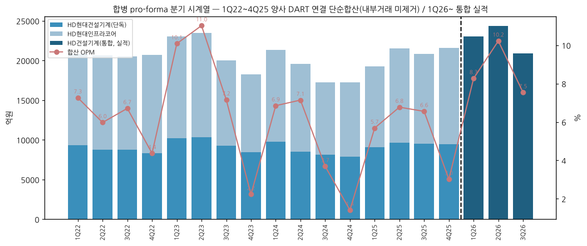

**부문별 분기 시계열:**

각 차트 = 매출 (bar, 좌축) + OPM (line, 우축). 건설기계는 \~4Q25 HDCE 단독 연결 전체(단일 부문), 1Q26\~ 통합법인 건기 부문 외부매출 (인프라코어 건기 포함 → 레벨 2배 점프는 합병 효과).

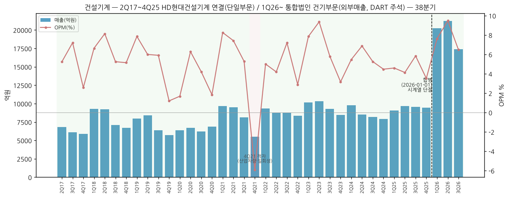
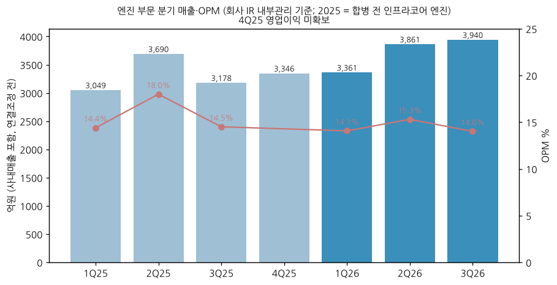
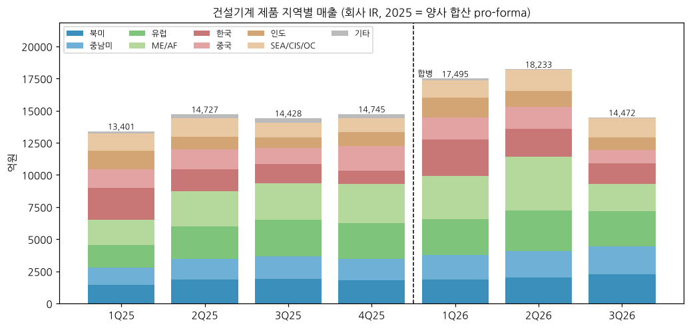

**통합법인 부문별 분기 (억원, DART 주석 29 — 외부매출 기준):**

| 분기 | 건기 매출 | 건기 OP | 건기 OPM | 엔진 매출 | 엔진 OP | 엔진 OPM | 전사 매출 | 전사 OP |
|---|---|---|---|---|---|---|---|---|
| 1Q26 | 20,256 | 1,544 | 7.6% | 2,792 | 363 | 13.0% | 23,049 | 1,907 |
| 2Q26 | 21,215 | 2,011 | 9.5% | 3,129 | 478 | 15.3% | 24,342 | 2,489 |
| 3Q26 | 17,399 | 1,127 | 6.5% | 3,514 | 449 | 12.8% | 20,915 | 1,577 |

(분기값 = 누적 차분. IR 내부관리 기준(엔진 사내매출 포함)은 3Q26 건기 16,235억·OP 1,099억(6.8%) / 엔진 3,940억·OP 552억(14.0%) / 산업차량 1,164억 — 기준 차이로 DART와 다름)

**건설기계 제품 지역별 매출 (억원, 회사 IR — 고객 지역, 2025 = 양사 합산):**

| 지역 | 1Q25 | 2Q25 | 3Q25 | 4Q25 | 2025 | 1Q26 | 2Q26 | 3Q26 | 3Q26 YoY |
|---|---|---|---|---|---|---|---|---|---|
| 북미 | 1,473 | 1,875 | 1,913 | 1,834 | 7,096 | 1,855 | 2,006 | 2,252 | +17.7% |
| 중남미 | 1,310 | 1,600 | 1,746 | 1,636 | 6,293 | 1,917 | 2,078 | 2,214 | +26.8% |
| 유럽 | 1,768 | 2,503 | 2,862 | 2,787 | 9,921 | 2,812 | 3,160 | 2,724 | -4.8% |
| ME/AF | 1,971 | 2,748 | 2,809 | 3,047 | 10,575 | 3,313 | 4,161 | 2,130 | -24.2% |
| 한국 | 2,446 | 1,730 | 1,544 | 1,032 | 6,753 | 2,854 | 2,163 | 1,604 | +3.9% |
| 중국 | 1,450 | 1,527 | 1,237 | 1,895 | 6,109 | 1,696 | 1,741 | 990 | -20.0% |
| 인도 | 1,460 | 1,009 | 802 | 1,108 | 4,379 | 1,570 | 1,232 | 1,015 | +26.6% |
| SEA/CIS/OC | 1,350 | 1,411 | 1,132 | 1,067 | 4,960 | 1,333 | 1,659 | 1,474 | +30.2% |
| 기타 | 173 | 324 | 383 | 339 | 1,220 | 145 | 33 | 69 | -82.1% |
| **건기 제품 계** | **13,400** | **14,729** | **14,430** | **14,746** | **57,305** | **17,496** | **18,234** | **14,473** | **+0.3%** |
| 건기 부품 | 1,794 | 1,813 | 1,627 | 1,609 | 6,843 | 1,787 | 1,949 | 1,762 | +8.3% |
| 엔진 (사내 포함) | 3,049 | 3,690 | 3,178 | 3,346 | 13,264 | 3,361 | 3,861 | 3,940 | +24.0% |
| 산업차량 | 1,189 | 1,147 | 1,184 | 1,131 | 4,652 | 974 | 1,032 | 1,164 | -1.7% |

(IR 3Q26 별첨. 2026-02-09 IR 별첨은 1Q25 인도·SEA 값이 서로 바뀌어 표기돼 있어 3Q26 IR 값 사용)

→ **2025 건기 제품 지역 믹스**: 신흥(ME/AF+중남미+SEA/CIS/OC) 38% / 선진(북미+유럽) 30% / 한국·중국·인도 30%. 3Q26은 중동 전쟁 장기화로 ME/AF -24%, 중국 -20% vs 북미·중남미·인도 고성장

**분기 매출·영업이익 매트릭스 (억원, DART 연결 — 2026 = 통합법인):**

| 연도 | 1Q 매출 | 2Q | 3Q | 4Q | 1Q OP | 2Q OP | 3Q OP | 4Q OP | 연간 OPM |
|---|---|---|---|---|---|---|---|---|---|
| 2017 | - | 6,832 | 6,132 | 5,903 | - | 358 | 442 | 152 | 5.0% |
| 2018 | 9,305 | 9,227 | 7,104 | 6,704 | 618 | 751 | 373 | 345 | 6.5% |
| 2019 | 7,980 | 8,404 | 6,397 | 5,741 | 627 | 504 | 378 | 69 | 5.5% |
| 2020 | 6,363 | 6,684 | 6,241 | 6,887 | 107 | 420 | 263 | 127 | 3.5% |
| 2021 | 9,649 | 9,526 | 8,138 | 5,531 | 797 | 707 | 430 | -327 | 4.9% |
| 2022 | 9,324 | 8,751 | 8,748 | 8,334 | 467 | 367 | 630 | 241 | 4.8% |
| 2023 | 10,183 | 10,321 | 9,287 | 8,459 | 800 | 966 | 539 | 268 | 6.7% |
| 2024 | 9,791 | 8,530 | 8,168 | 7,891 | 536 | 586 | 430 | 353 | 5.5% |
| 2025 | 9,068 | 9,677 | 9,547 | 9,473 | 417 | 400 | 558 | 334 | 4.5% |
| 2026 | 23,049 | 24,342 | 20,915 | - | 1,907 | 2,489 | 1,577 | - | 8.7% |

(4Q = 연간 − 3Q 누적. 2017 1Q는 분할 전. 분기합 = 연간 DART와 일치)

**3Q26 핵심 (분기보고서 2026-11-16 확정치):**
- 연결 매출 **2조 915억** (공시 +119.1% YoY / 회사 PF +6.1%, -14.1% QoQ) / 영업이익 **1,577억** (PF +23.9%, OPM 7.5%)
- 부문: 건기 외부매출 1.74조·OP 1,127억 (DART) — IR 기준 건기 OPM 6.8% (+1.3%p), 판가 인상·프로모션 축소·**미국 관세 환급 약 277억** (딜사이트 2026-10-27) / 엔진 OP 552억(IR, OPM 14.0%), 발전기·산업용 엔진 성장
- **순이익 18억 (-98% PF YoY)**: 금융원가 1,956억 중 외화환산손실 887억 + 외환차손 835억 — IR 외환손익 -1,460억 → 세전 -40억
- 9M26 누적: 매출 6.83조 (2026 목표 8.7\~9조의 76\~79%) / 영업이익 5,973억 (OPM 8.7%, 목표 5\~7% 상회)
- 일회성: 채권·판매보증 충당금 110\~150억 추가 (딜사이트 2026-10-27)

**12분기 시계열 (4Q23 \~ 3Q26, 억원):**

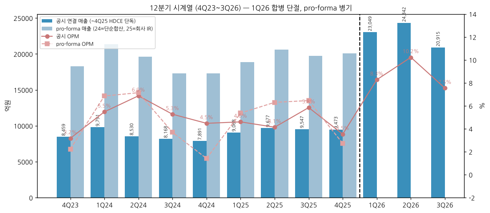

| 분기 | 공시 매출 | 공시 OP | 공시 OPM | PF 매출 | PF OP | PF OPM | 메모 |
|---|---|---|---|---|---|---|---|
| 2023-4Q | 8,459 | 268 | 3.2% | 18,275 | 408 | 2.2% | 인프라코어 4Q23 OPM 1.4% |
| 2024-1Q | 9,791 | 536 | 5.5% | 21,364 | 1,464 | 6.9% | |
| 2024-2Q | 8,530 | 586 | 6.9% | 19,612 | 1,401 | 7.1% | |
| 2024-3Q | 8,168 | 430 | 5.3% | 17,266 | 637 | 3.7% | |
| 2024-4Q | 7,891 | 353 | 4.5% | 17,280 | 244 | 1.4% | 인프라코어 영업적자 -109억 |
| 2025-1Q | 9,068 | 417 | 4.6% | 18,879 | 1,013 | 5.4% | 이하 PF = 회사 IR |
| 2025-2Q | 9,677 | 400 | 4.1% | 20,588 | 1,297 | 6.3% | |
| 2025-3Q | 9,547 | 558 | 5.8% | 19,717 | 1,273 | 6.5% | |
| 2025-4Q | 9,473 | 334 | 3.5% | 20,085 | 546 | 2.7% | 중국 사업재편·북미 관세 일회성 |
| 2026-1Q | 23,049 | 1,907 | 8.3% | - | - | - | **합병 첫 분기** |
| 2026-2Q | 24,342 | 2,489 | **10.2%** | - | - | - | 사상 최고 OPM, ME/AF +51% |
| **2026-3Q** | **20,915** | **1,577** | **7.5%** | - | - | - | **외환손실로 순이익 18억** |

(PF 2024 = 양사 DART 단순합산(내부거래 미제거), PF 2025 = 회사 IR 합산(연결조정 반영, 감사 전))

### ② 사업부별 개요 (매출 비중 큰 순서)

**건설기계 부문 — 9M26 외부매출 5.89조 (86%)**

"굴착기·휠로더를 HYUNDAI·DEVELON 두 브랜드로 전 세계 딜러망에 파는 본업."

- **건설기계 제품** (9M26 DART 매출 5.02조, 73.5%): 굴착기 (미니\~100톤급 초대형), 휠로더, 굴절식 덤프트럭(ADT, 노르웨이 법인), 컴팩트(CTL·SSL) — 수출 4.36조 / 국내 0.66조
- **부품(AM/PS)** (5,498억, 8.1%): A/S 부품, Extended Warranty, 업타임센터 (2026년 80개+ 목표, IR) — 2026 목표 7,620억 (+11%)
- **산업차량** (3,169억, 4.6%): 지게차 — 2022-01 사업은 현대제뉴인(현 HD현대사이트솔루션)에 양도, 이후 수출 유통 매출만 계상 (DART 제품유형 표)
- 생산: 울산(굴착기·휠로더)·인천 / 인도·브라질·중국(연태·산동 이관)·노르웨이 — 중국 강소법인은 2025-04 생산 중단

**엔진 부문 — 9M26 외부매출 9,436억 (14%)**

"구 두산·HD현대인프라코어의 디젤·가스 엔진 사업 — 사내 장비 탑재 + 외부 OEM·발전기·방산."

- 용도: 산업용 (두산밥캣 장비 탑재 등), **발전기용** (데이터센터 백업 1\~3MW 디젤, 가스·초대형 개발), **방산용** (K2전차 폴란드 수출분 엔진 — 현대로템 2026-01-28 계약, 튀르키예 차세대 전차 1,102억 계약 2023-02), 차량·선박용
- 생산: 인천 (대형엔진 증설), **군산 신공장** (초대형 발전용·방산·EPP, 공장증축 투자 1,394억 2023-01\~2026-12), 중국 톈진
- 2025 엔진 OPM 14.3% → 2026E 엔진 매출 1.45조 (+10%), 영업이익 1,587억 (OPM 10.9%, 군산 신공장 고정비) 전망 (IR 2026-02-09)

### ③ 사업부별 디테일

**현재 가장 잘나가는 사업 (top-seller):**
- **엔진 (발전기·방산)** — 3Q26 매출 +24% YoY (IR), 두 자릿수 OPM 유지. 회사는 엔진 중장기 매출 CAGR +12% (2026\~2031E) 제시 — 글로벌 전력 수요 증가분 중 데이터센터 비중 미국 약 50% (IEA 인용, IR 3Q26)
- **신흥 건기 (중남미·인도·SEA/CIS/OC)** — 3Q26 +27\~30% YoY, 광산·인프라 수요

**성장 중인 영역:**
- 북미 건기 3Q26 +17.7% — 데이터센터 투자·렌탈 수요로 시장 전망 상회 (IR), CONEXPO 2026 신모델 (Heavy 5종·CTL)
- AM/PS 부품 — 2026 +11% 목표, 마진 높은 매출 기반

**이익 outlier (주의):**
- **ME/AF** — 2Q26 +51% → 3Q26 -24% (중동 전쟁 장기화로 물류 제약·일부 지역 디젤 수급 차질)
- **중국** — 3Q26 -20%, 로컬 업체 가격 경쟁 (강소법인 생산 중단, 연태 일원화)
- **환율** — 3Q26 외환손익 -1,460억. 건기 영업이익엔 F/X +242억 기여 (IR 영업이익 분석) vs 영업외에선 대규모 손실

### ④ 주요 경쟁사

| 영역 | 경쟁사 | 비고 |
|---|---|---|
| 글로벌 건설기계 | Caterpillar (M/S 15.2%), Komatsu (11.0%), XCMG (5.8%), John Deere (5.4%) | 2025 Yellow Table, 매출액 기준 (3Q26 분기보고서) |
| 중국 | 산이(SANY)·XCMG·류공 등 로컬 | 중국 내 가격 경쟁 심화 (IR) |
| 컴팩트·북미 | 두산밥캣, Kubota, CNH | 같은 섹터 워치리스트 두산밥캣 기업개요 참조 |
| 국내 | Volvo CE, 두산밥캣(소형) 등 | 회사는 국내 점유율 1위 표명 (분기보고서 판매전략) |
| 엔진 | Cummins, Caterpillar(파워시스템), Volvo Penta, MTU(Rolls-Royce) 등 | 일반 업계 경쟁 구도 (공시 명시 아님) |

### ⑤ 주요 매출처

- 건설기계: 국내 대형 건설사·중기 임대업자 (직영 판매망·판매법인 위탁), 해외는 법인·딜러 경유 (T/T, L/C) — 고객별 매출 비중 공시 없음
- 엔진: 국내 직판·대리점·**사내 매출(건기 탑재)**, 해외 OEM — 두산밥캣(소형 엔진 탑재), 현대로템(K2 엔진), BMC(튀르키예) 등 공시된 계약처
- 수주잔고·수량·금액은 영업비밀로 공시 생략 (분기보고서 II-4)

### ⑥ 생산 CAPA + 임직원

| 사업소 (3Q26 누적) | 생산능력 | 생산실적 | 가동률 |
|---|---|---|---|
| HD건설기계 국내 (굴착기·휠로더) | 36,765대 | 18,466대 | 50.2% |
| 인도 (굴착기) | 6,750대 | 6,405대 | 94.9% |
| 중국 (연태, 구 인프라코어) | 14,370대 | 7,623대 | 53.1% |
| 브라질 | 3,000대 | 1,050대 | 35.0% |
| 노르웨이 (ADT) | 300대 | 281대 | 93.7% |
| 중국 강소 (OEM) | 473대 | 473대 | 100% |
| **엔진 국내 (인천·군산)** | **110,948대** | **80,125대** | **72.2%** |
| 엔진 중국 톈진 | 6,205대 | 5,905대 | 95.2% |
| **합계** | **178,811대** | **120,328대** | **67.3%** |

(2025 단독 생산능력 50,140대 → 3Q26 누적 178,811대 = 합병 편입. 출처: 3Q26 분기보고서 II-3)

- **임직원 (지배기업, 2026-09-30)**: 건설기계 2,279명 / 엔진 1,062명 / 기타 974명 = **4,315명** (2025말 단독 1,123명) — DART 직원현황
- 투자계획 (2026\~2028): 9,667억 (생산설비 노후교체 2,525억 · 신기종 형치구 3,146억 · 엔진 공장증축 등 3,995억)

---

## 4. 재무 구조 (연간 시계열, HD현대건설기계 단독 2017\~2025 + 3Q26 통합)

### ① 손익계산서 (억원)

| 연도 | 매출 | YoY | 매출총이익 | GPM | 판관비 | 영업이익 | OPM | 순이익 | NPM | 지배순이익 | EPS(원) |
|---|---|---|---|---|---|---|---|---|---|---|---|
| 2017* | 18,867 | - | 3,495 | 18.5% | 2,543 | 952 | 5.0% | 466 | 2.5% | - | 11,098 |
| 2018 | 32,339 | n/m(17=9M) | 5,445 | 16.8% | 3,358 | 2,087 | 6.5% | 1,411 | 4.4% | - | 4,585 |
| 2019 | 28,521 | -11.8% | 5,446 | 19.1% | 3,868 | 1,578 | 5.5% | 509 | 1.8% | 32 | 169 |
| 2020 | 26,175 | -8.2% | 4,628 | 17.7% | 3,712 | 916 | 3.5% | 85 | 0.3% | -97 | -506 |
| 2021 | 32,843 | +25.5% | 5,326 | 16.2% | 3,719 | 1,607 | 4.9% | 1,264 | 3.8% | 1,135 | 5,079 |
| 2022 | 35,156 | +7.0% | 6,020 | 17.1% | 4,314 | 1,706 | 4.9% | 994 | 2.8% | 1,115 | 6,112 |
| 2023 | 38,250 | +8.8% | 7,246 | 18.9% | 4,673 | 2,572 | 6.7% | 1,275 | 3.3% | 1,394 | - |
| 2024 | 34,381 | -10.1% | 6,508 | 18.9% | 4,604 | 1,904 | 5.5% | 860 | 2.5% | 1,000 | 5,595 |
| 2025 | 37,765 | +9.8% | 7,308 | 19.3% | 5,599 | 1,709 | 4.5% | 870 | 2.3% | 994 | 5,698 |
| 3Q26 분기 | 20,915 | - | 4,992 | 23.9% | 3,415 | 1,577 | 7.5% | 18 | 0.1% | 19 | 40 |

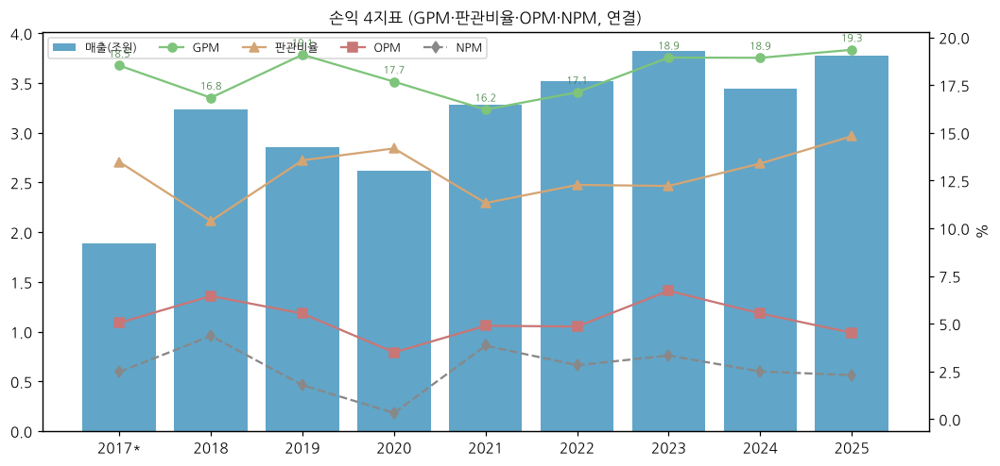

- GPM 16\~19%대 박스권 (2025 19.3%) → 통합 후 9M26 **24.7%** (엔진·부품 믹스, 3Q26 23.9%)
- 판관비율 2025 14.8% (북미 관세 대응 비용·중국 재편) — 2018 10.4% 대비 상승

### ② 재무상태표 (억원, 연말)

| 연도말 | 자산 | 유동자산 | 현금 | 매출채권 | 재고 | 유형자산 | 부채 | 유동부채 | 비유동부채 | 자본 | 지배자본 | 부채비율 | 유동비율 |
|---|---|---|---|---|---|---|---|---|---|---|---|---|---|
| 2017* | 22,287 | 15,535 | 4,260 | - | 6,912 | 5,390 | 10,577 | 7,856 | 2,721 | 11,709 | - | 90.3% | 197.7% |
| 2018 | 31,265 | 22,039 | 3,224 | - | 10,248 | 6,505 | 15,583 | 9,451 | 6,132 | 15,682 | - | 99.4% | 233.2% |
| 2019 | 31,881 | 21,515 | 2,228 | 6,291 | 8,567 | 6,692 | 16,109 | 10,528 | 5,581 | 15,771 | 12,107 | 102.1% | 204.4% |
| 2020 | 33,559 | 22,650 | 7,134 | 6,126 | 7,207 | 7,440 | 17,683 | 11,565 | 6,118 | 15,875 | 12,183 | 111.4% | 195.8% |
| 2021 | 35,543 | 24,695 | 4,463 | 7,213 | 10,128 | 7,137 | 20,065 | 14,991 | 5,074 | 15,478 | 13,267 | 129.6% | 164.7% |
| 2022 | 34,486 | 23,506 | 3,931 | 6,191 | 11,447 | 7,502 | 17,813 | 13,737 | 4,076 | 16,673 | 14,633 | 106.8% | 171.1% |
| 2023 | 32,970 | 21,992 | 4,277 | 5,815 | 10,591 | 8,173 | 15,259 | 10,142 | 5,117 | 17,711 | 15,765 | 86.2% | 216.8% |
| 2024 | 33,246 | 21,128 | 2,642 | 5,887 | 11,287 | 9,031 | 15,308 | 10,635 | 4,673 | 17,938 | 16,578 | 85.3% | 198.7% |
| 2025 | 36,027 | 22,516 | 3,379 | 7,296 | 10,841 | 9,449 | 16,724 | 11,245 | 5,479 | 19,303 | 18,052 | 86.6% | 200.2% |
| 3Q26 | 91,117 | 52,020 | 5,618 | 18,521 | 24,174 | 22,961 | 41,995 | 29,084 | 12,911 | 49,121 | 48,278 | 85.5% | 178.9% |

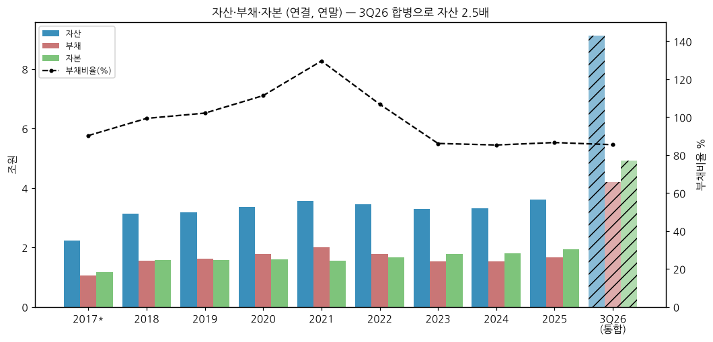

- 합병으로 자산 3.60조 → 9.11조, 자본 1.93조 → 4.91조 (사업결합으로 유형자산 1.28조 승계, 주석 41)
- 3Q26 차입금 1.74조 / 순차입금 1.18조 (IR) / 부채비율 85.5%

### ③ 현금흐름표 (억원)

| 연도 | 영업CF | 투자CF | 재무CF | 유형 CapEx | 무형 CapEx | 총 CapEx | CapEx/매출 | FCF | 배당지급 | 자사주취득 | 이자지급 |
|---|---|---|---|---|---|---|---|---|---|---|---|
| 2017* | 75 | -1,046 | 2,251 | 262 | 149 | 411 | 2.2% | -336 | 0 | 124 | 148 |
| 2018 | -596 | -2,571 | 2,177 | 710 | 204 | 915 | 2.8% | -1,511 | 24 | 143 | 290 |
| 2019 | 1,553 | -3,635 | 1,080 | 951 | 652 | 1,602 | 5.6% | -50 | 180 | 138 | 370 |
| 2020 | 2,748 | 1,359 | 829 | 981 | 187 | 1,168 | 4.5% | 1,579 | 167 | 0 | 396 |
| 2021 | -1,960 | 872 | -1,753 | 645 | 128 | 773 | 2.4% | -2,733 | 437 | 0 | 353 |
| 2022 | 2,550 | 703 | -3,753 | 604 | 80 | 683 | 1.9% | 1,867 | 229 | 357 | 340 |
| 2023 | 3,182 | -649 | -2,229 | 1,160 | 132 | 1,292 | 3.4% | 1,889 | 327 | 0 | 445 |
| 2024 | 2,606 | -1,946 | -2,538 | 1,733 | 145 | 1,878 | 5.5% | 728 | 127 | 303 | 452 |
| 2025 | 1,660 | -1,322 | 338 | 1,444 | 101 | 1,545 | 4.1% | 115 | 88 | 208 | 318 |

(FCF = 영업CF − 유·무형자산 취득. 2017*은 9개월. 9M26 누적: 영업CF 3,166 / 투자CF +918 / 재무CF −1,797 / CapEx 2,387억)

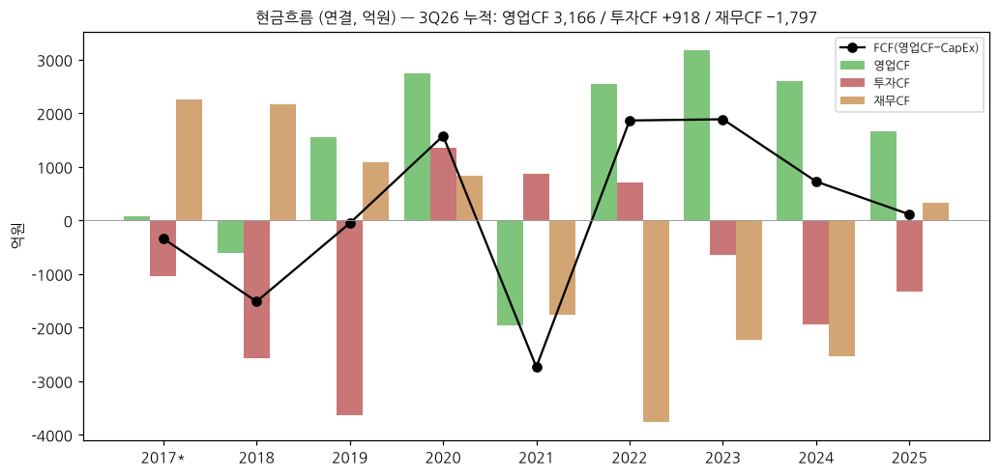

→ 영업CF 적자 2회 (2018 -596억, 2021 -1,960억 — 재고·매출채권 증가 국면). 2022\~2025 4년 연속 흑자, FCF는 2025 115억으로 CapEx 확대(울산캠퍼스) 영향

### ④ CapEx (억원)

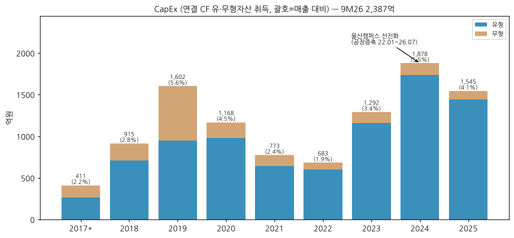

- CapEx/매출 1.9\~5.6% — 2024\~2025 울산캠퍼스 선진화(공장증축 2,072억, 2022-01\~2026-07) 집행
- 통합 후 투자계획 2026 3,136억 / 2027 3,498억 / 2028 3,033억 (분기보고서 II-3)

### ⑤ 부채구조 + 신용등급

- 회사채 등급 **A (2024-03\~2026-06, 한기평·한신평·NICE)** → **2026-11 A+ 상향** (한신평·한기평 11-04, NICE 11-09, 합병 반영 회사채 기준)
- 기업어음·전단채 A2 (2024-03 본평가)
- 2025-04 공모 회사채 발행 (증권신고서 2025-04-10, 발행실적 04-22)
- IR 기준 차입금: 2025말 PF 1.84조 → 3Q26 1.74조, 순차입금비율 24.0% (IR 3Q26)

### ⑥ 배당·자사주 (연결 CF 지급액, 억원)

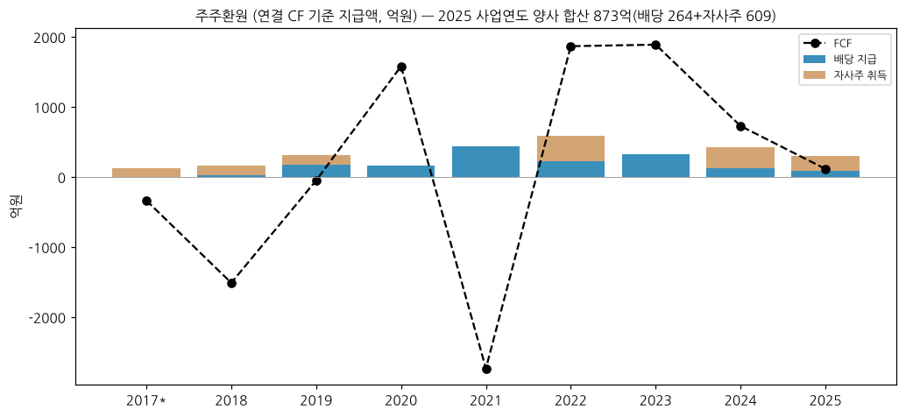

| 사업연도 | DPS (원) | 배당총액 (억) | 자사주 |
|---|---|---|---|
| 2021 | 1,200 | - | - |
| 2022 | 1,750 | - | 2022 자사주 취득 357억 (CF) |
| 2023 | 700 | 127 | 2024 소각 853,697주(04-30)·541,510주(08-30) |
| 2024 | 500 | 88 | 2025 신탁 취득·소각 |
| 2025 | 550 (합병 후 주주 기준) | 263 | 양사 합산 주주환원 873억 = 배당 264 + 자사주 609 |

(DPS = DART 사업보고서 배당 표. 2018\~2020 사업연도 DPS 미추출 — CF 배당지급 2019 180억·2020 167억)

- **주주환원 정책**: 2024\~2026 사업연도 별도 당기순이익(미실현·일회성 제외)의 **30% 이상** 환원 (HCE·HDI 공통 공시) / 2025 배당기준일 2026-02-27로 설정 → 합병 후 주주에게 배당 (IR 2026-02-09)
- 2026: 자기주식취득 신탁 체결(2026-02-06) → 해지(2026-08-10), 주식소각 결정 2026-02-06·07-29(정정)·**10-26** — 9M26 신탁 취득 424,511주

### ⑦ 재무 비율

| 연도 | ROE | ROA | 부채비율 | 유동비율 | OP/이자지급 |
|---|---|---|---|---|---|
| 2017* | n/m | n/m | 90.3% | 197.7% | 6.5x |
| 2018 | 10.3% | 5.3% | 99.4% | 233.2% | 7.2x |
| 2019 | 0.2% | 1.6% | 102.1% | 204.4% | 4.3x |
| 2020 | -0.8% | 0.3% | 111.4% | 195.8% | 2.3x |
| 2021 | 8.9% | 3.7% | 129.6% | 164.7% | 4.6x |
| 2022 | 8.0% | 2.8% | 106.8% | 171.1% | 5.0x |
| 2023 | 9.2% | 3.8% | 86.2% | 216.8% | 5.8x |
| 2024 | 6.2% | 2.6% | 85.3% | 198.7% | 4.2x |
| 2025 | 5.7% | 2.5% | 86.6% | 200.2% | 5.4x |

- ROE = 지배순이익 / 평균 지배자본 (2018은 지배 구분 미추출로 전체 기준). OP/이자지급 = 영업이익 ÷ 이자지급(CF)
- 2019\~2020 ROE 0%대 = 중국 강소법인 등 종속 손실

---

## 5. 지배 구조

### ① 그룹·계열 관계

- **HD현대그룹**: HD현대 → **HD현대사이트솔루션** (건설기계 사업형 중간지주, 정기선 회장 공동대표) → HD건설기계 (36.22%)
- 2025-07 합병 결정 시 양사 최대주주 모두 HD현대사이트솔루션 (HDCE 36.94% / 인프라코어 34.18%) — 합병 후 지분 희석 예상치 35.85% → 실제 36.22% (자사주 소각 반영)
- 연결 종속 25개사 (주요 14) — 합병으로 15개사 신규 편입 (중국·칠레·남미·노르웨이·인도·북경리스·북미·유럽·톈진엔진·독일·인니·멕시코 등)
- 2026-07-29 중국 투자법인 2곳 합병 + 상해 금융리스 잔여지분 41.26% HD한국조선해양으로부터 취득 결정

### ② 주주 구분

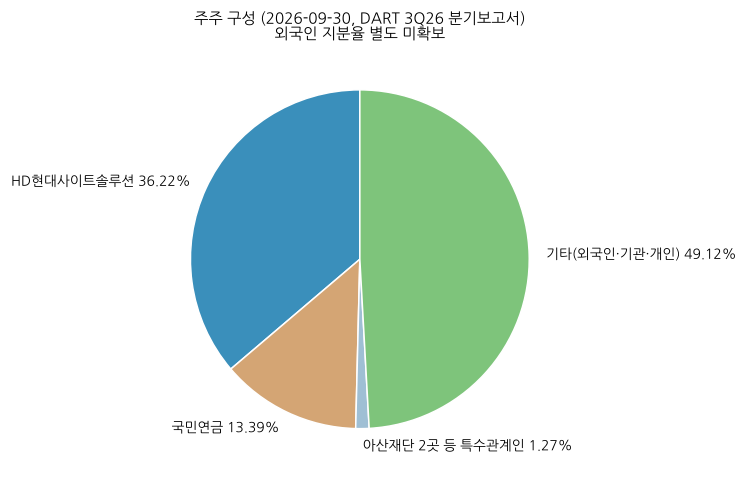

**5% 이상 주주 및 최대주주 특수관계인 (보통주, 2026-09-30, DART 3Q26 분기보고서):**

| 주주명 | 주식수 | 지분율 |
|--------|------|------|
| HD현대사이트솔루션 (최대주주) | 17,201,415 | **36.22%** |
| 국민연금공단 | 6,360,390 | **13.39%** |
| (재)아산사회복지재단 | 475,372 | 1.00% |
| (재)아산나눔재단 | 121,872 | 0.26% |
| 문재영 (대표이사) | 3,874 | 0.01% |
| 정기선 | 152 | 0.00% |
| **최대주주 등 합계** | **17,802,741** | **37.48%** |
| 소액주주 (139,080명) | 19,492,140 | 41.04% |

- 발행주식 47,497,386주 (자기주식 318주, 액면 5,000원, 자본금 2,468억) — 합병 직후 47,974,118주에서 476,732주 소각
- 국민연금 지분 추이 (DART 사업보고서 주석): 2022말 8.25% → 2023말 5.05% → 2024말 9.60% → 2025말 13.38% → 3Q26 13.39%
- **외국인 지분율: 미확보** (Fact verify cutoff 기준 검색 결과 없음)

### ③ 임원·이사회

**대표이사:**
- **문재영 대표이사 사장** (1969년생, 연세대)
    - 약력: 현대건설기계 영업본부장 → HD현대인프라코어 건설기계사업본부장 → 2025-10 통합법인 대표 내정 → 2026-03-26 정기주총 사내이사·대표 선임 (임기 2029-03)
    - 양사 경력을 모두 가진 '통합 CEO' — 영업 출신
    - 전임: 최철곤 (1960년생, 2021-11\~2026-03, 전 두산인프라코어 Heavy BG 전무)

**등기임원 (2026-09-30):**

| 구분 | 성명 | 직위·담당 | 주요 경력 | 임기만료 |
|---|---|---|---|---|
| 사내이사 | 문재영 (1969.08) | 대표이사 사장 | 전 HD현대인프라코어 건기사업본부장 | 2029-03 |
| 사내이사 (비상근) | 이상혁 (1972.05) | - | HD한국조선해양 재무지원실장 | 2027-03 |
| 독립이사 | 박기태 (1967.08) | 이사회 의장·감사위원장 | 전 삼일회계법인 부대표 | 2028-03 |
| 독립이사 | 유명희 (1967.06) | 감사위원 | 전 산업통상자원부 통상교섭본부장 | 2027-03 |
| 독립이사 | 차경환 (1969.01) | 감사위원 | 김·장 변호사, 전 수원지검장 (2026-03 재선임) | 2029-03 (추정) |

- 주요 미등기: 임형택 전무 (엔진사업본부장, 전 인프라코어 엔진영업부문장), 이윤석 전무 (재무기획) 등 — 47명 중 다수 인프라코어·사이트솔루션 출신
- 외부감사인 (인프라코어 2025): 한영회계법인 (합병결정 공시). HDCE 감사인은 원문 V장 참조

---

## 6. 기타 팩트

### ① R&D 인프라

| 연도 | 2019 | 2020 | 2021 | 2022 | 2023 | 2024 | 2025 | 9M26 |
|---|---|---|---|---|---|---|---|---|
| 연구개발비용 (억원) | 597 | 615 | 672 | 593 | 795 | 913 | 945 | **2,222** |
| R&D / 연결 매출 | 2.1% | 2.3% | 2.0% | 1.7% | 2.1% | 2.7% | 2.5% | 3.3% |

(DART 사업보고서 II-6 연구개발비용 계. 회사 공시 비율은 별도 매출 기준 — 2025 4.40%, 9M26 3.68%. 2017\~2018은 원문 양식 차이로 미추출 (2017 4\~6월 106억))

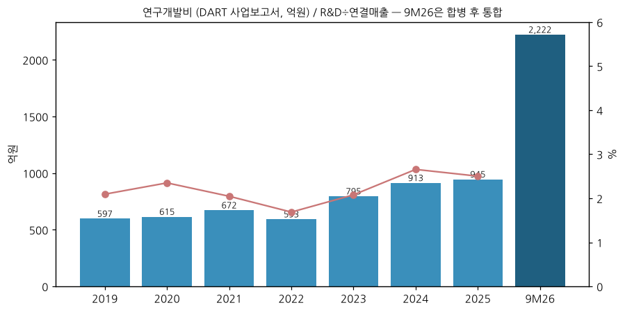

- 연구조직: 분당(제품기획·설계)·용인(제품시험) / 9M26 특허(실용신안) 1,757건·디자인 373건·상표 447건
- 연구 분야: 건설기계 핵심부품·전장품, 배기·연비 규제 대응 엔진 (Stage V), 전동화·수소 파워트레인, 1\~3MW 발전기 엔진 (IR)

### ② 진행 중 corporate action — 10년치 주요 이벤트

```
2026  · HD현대인프라코어 흡수합병 완료 (01-01), 사명 HD건설기계, 신주 상장 (01-26)
      · 자사주 소각 (2026-02·07·10 결정), 중국 투자법인 합병·상해리스 지분 취득 (07-29)
      · 종속회사 유상증자 결정 (2026-08-31, 종속회사 주요경영사항)
      · 단일판매·공급계약 (2026-01-28 K2 엔진, 2026-10-07, 2026-11-10 — 상세 원문 참조)
2025  · 합병 결정 (07-01) / 임시주총 (09-16) / 중국 강소법인 생산 중단 (04-03)
2024  · 자사주 소각 2회 (04-30, 08-30), 울산캠퍼스 선진화 투자
2022  · 산업차량 사업 현대제뉴인 양도 (01-01)
2021  · 현대코어모션 흡수합병 (10-01) / 중국·브라질 법인 잔여지분 인수 (12-31)
      · 최대주주 현대제뉴인으로 변경 (08-02)
2019  · 부품사업 물적분할 (현대코어모션, 04-01)
2017  · 현대중공업 인적분할 설립 (04-01), 상장 (05-10)
```

### ③ 제품·기술 마일스톤

```
2026  · CONEXPO 2026 신모델 (Heavy 5종·CTL), 한국 차세대 5개 기종, 20톤 초경제형 출시
      · 군산 엔진 신공장 (초대형 발전용·방산·EPP) 구축 중 (~2026-12)
      · 1~3MW 디젤 발전기 엔진 개발, 가스·수소 엔진 추가 검토 (IR 3Q26)
2025  · 양사 플랫폼 공용화·AM 사업 통합 계획 (합병 목적)
2023  · 튀르키예 차세대 전차 엔진 공급 계약 (BMC, 1,102억, ~2028-02)
```

### ④ 주요 리스크

- **환율**: 수출 85% — 3Q26 외환손익 -1,460억으로 분기 순이익 18억. 2026-10 원화 급변 국면에서 주가 -37% (월간)
- **중동 전쟁·지정학**: ME/AF 매출 3Q26 -24%, 물류·원유 수급 차질, 재료비·물류비 증가 (IR)
- **중국 경쟁**: 로컬 업체 가격 경쟁, 강소법인 생산 중단 (2025 일회성 비용)
- **미국 관세**: 2025 북미 관세 대응 비용 → 3Q26 관세 환급 277억 (일회성 플러스) — 정책 변동성
- **사이클 수요**: 북미 고금리·주택 부진, 유럽 주택착공 부진 (IR Outlook)
- **합병 통합 리스크**: 듀얼 브랜드 딜러 채널 중복, 군산공장 고정비 증가 (3Q26 엔진 이익 부담 요인)
- **소송**: 소송 등의 판결·결정 공시 2건 (2025-12-10, 2026-01-16) — 상세 원문 참조, 금액 미기재
- **채무보증**: 타인에 대한 채무보증 결정 (2026-04-27 등)

### ⑤ ESG 등급

| 평가기관 | 등급 | 비고 |
|---------|------|------|
| KCGS / MSCI 등 | **미확보** | 지속가능경영보고서 공시 (2026-06-01, 07-03 첨부정정) — 보고서 본문 미다운로드 |

- ISO 14001·ISO 45001 (DNV) 전 사업장 인증, 2025-03 2차 사후심사 완료 (분기보고서)
- 기업지배구조보고서 공시 (2026-05-29)

### ⑥ 인증·라이선스

- ISO 14001 (환경경영), ISO 45001 (안전보건) — DNV
- 엔진: EU Stage V 등 최신 배기규제 대응 엔진 라인업 (분기보고서)
- 방산: K2전차·튀르키예 전차 엔진 공급 실적

---

## Version Log

**v1.1 (2026-11-28) — 파일명·종목명 HD건설기계로 변경**
- BT 결정: 워치리스트·대시보드 종목명을 통합법인 사명 HD건설기계로 변경 (구 파일명 HD현대건설기계_기업개요). 본문 숫자 변경 없음
- HD현대인프라코어는 워치리스트에서 제외, 리포트는 히스토리 아카이브로 유지

**v1.0 (2026-11-25) — 신규 작성 (합병 통합법인 기준)**
- ① OpenDART fnlttSinglAcntAll 연결 38개 JSON (2Q17\~3Q26) → 연간 9년(2017* 9개월 포함)·분기 38분기
- ② DART 정기공시 원문 XML 33건 + 3Q26 분기보고서(2026-11-16) 파싱: 합병 일정·비율·사명 변경·연결 범위·영업부문(건기/엔진)·생산 CAPA·지역별 수익·R&D·주주·임원·신용등급
- ③ 합병 공시 원문 3건: 회사합병결정(2025-07-01), 증권발행실적보고서(2026-01-02), 인프라코어 손익구조변경(2026-01-22, FY25 매출 4.55조·OP 2,864억)
- ④ 회사 IR PDF 12건 중 6건 정독 (4Q23·4Q24·4Q25 연간·1Q26·2Q26·3Q26) — 2025 합병 PF, 사업부·지역 분기, 2026 경영계획
- ⑤ HD현대인프라코어 DART 분기 시계열 (인프라코어 에이전트 수집분 read-only 재사용) → 1Q22\~4Q25 단순합산 pro-forma
- ⑥ 차트 15종: chart1·1b·2(×4: 건설기계·엔진·지역별·합병PF)·4·5·6·7·8·9·10·11·12
- 연간 12년 미충족: 2017-04 분할 설립 → 2017(9개월)\~2025 9개 연도 + 3Q26. 분할 전 현대중공업 건설장비 부문 숫자 미보강

**잔여 보완 후보 (v1.1):**
- 인프라코어 상장폐지일 KRX 공시 원문 확인 / 외국인 지분율·컨센서스·ESG 등급 보강
- 2017\~2022 고객지역별 매출(IR 구 PDF 0바이트 재다운로드 필요), 2018\~2020 DPS
- 분할 전 (2012\~2016) 현대중공업 건설장비 부문 매출·영업이익 (현대중공업 사업보고서 부문정보)
- 4Q26 결산 후 연간 표에 2026 통합 연간 추가 (v2.0)
