# HD현대인프라코어 — 기업 개요 (v1.0)

> 마지막 update: 2026-11-25 (**2026-01-01 HD현대건설기계에 흡수합병되어 소멸·상장폐지된 법인** — 합병 전 히스토리 + 통합법인 HD건설기계 내 엔진 부문 현황)
> 입력 source: OpenDART fnlttSinglAcntAll (연결, 2015 FY\~3Q25, 40개 JSON, 2014 = 2015 사업보고서 전기 컬럼) + DART 정기공시 원문 XML 44건 (사업보고서 2014\~2024, 분기·반기 1Q15\~3Q25) + OpenDART 기업개황·주요정보 6종 (2024 사업보고서) + 네이버 증권 일별 시세 (042670, 2001-02-02\~2025-12-26) + 언론 보도 (HD건설기계 FY25·1Q26\~3Q26 실적, 합병 공시 보도)
> 갱신 주기: **종료** — 법인 소멸로 추가 갱신 없음. 향후 실적 추적은 **HD현대건설기계(통합법인 HD건설기계, KRX 267270) 리포트**에서
> 워치리스트: 건설·건설기계 섹터 / 서브섹터: 건설기계 (2026-11-23 추가 섹터, 표준 깊이)
> **Fact verify cutoff**: 2026-11-25 (최종 매매일 2025-12-26 종가 13,800원·시총 2.61조원 = 네이버 시세·stockanalysis 교차 확인. 2025 연간 = HD건설기계 FY25 발표(2026-02), 4Q25 단독 = 연간 − 9M25 DART 역산 추정)

---

## 1. 기업 분류

> ⚠ **상장폐지·합병 완료 종목.** HD현대인프라코어는 2026-01-01을 합병기일로 HD현대건설기계에 흡수합병되어 소멸했고(합병비율 인프라코어 1주 : 건설기계 0.1621707주), 존속법인은 사명을 **HD건설기계**로 바꿔 출범했다. 최종 매매일은 2025-12-26(종가 13,800원)이며 이후 매매거래가 정지됐다. **향후 실적 추적은 HD현대건설기계(통합법인) 리포트에서 한다.** 아래 분류는 합병 직전까지의 인프라코어 단독 기준이다.

- **Primary 분류: 사이클** (Cyclical — 글로벌 굴착기 수요·중국/신흥국 건설 사이클)
- **Secondary 노트: 지속성장 일부 (엔진 부문)** — 발전기(데이터센터)·방산(K2 전차)·산업용 엔진이 2022년 이후 OPM 12\~20%대로 건설기계 사이클을 완충

### ① 정량 근거

**📊 Summary Box (12년, 2014\~2025 연결):**

| 지표 | 값 |
|------|-----|
| 매출 CAGR (원공시, 2014→2025) | **-4.7%** (7.69조 → 4.55조) — 공작기계 매각(2016)·밥캣 분리(2021)에 따른 범위 축소 효과, 실질 성장률 아님 |
| 매출 CAGR (밥캣 제외 비교, 2019→2025) | **+1.6%** (4.13조 → 4.55조, DART 재작성 기준) |
| OPM 평균 (12년 원공시) | **7.3%** (밥캣 제외 2019\~2025 평균 6.9%) |
| OPM 정점 평균 | **10.0%** (2018 11.0% · 2023 9.0%) |
| OPM 저점 평균 | **2.5%** (2015 0.4% · 2024 4.5%) |
| 사이클 주기 | 약 5년 (peak-to-peak 2018→2023, trough-to-trough 2015→2020 코로나→2024) |
| 사이클 회수 (12년) | 정점 2회 / 저점 2회 (+2020 코로나 소저점) |

```
[전사 OPM 시계열 (12년, 연결, DART 원공시)]
연도   매출(조)  영업이익  순이익   OPM    NPM
2014     7.69     0.45     0.02    5.9    0.3   <- 공작기계·두산밥캣 연결 포함
2015     7.21     0.03    -0.86    0.4  -11.9   <- 1차 저점: 건기 희망퇴직·중국 손상, 순손실 8,595억
2016     5.73     0.49     0.12    8.6    2.0   <- 공작기계 매각(2016-04, 중단영업) 후 재작성
2017     6.57     0.66     0.30   10.1    4.5   <- 중국 굴착기 업턴
2018     7.73     0.85     0.39   11.0    5.1   <- OPM 정점 (밥캣 포함)
2019     8.19     0.84     0.40   10.3    4.8   <- 매출 정점 (밥캣 포함)
2020     7.93     0.66     0.29    8.3    3.6   <- 코로나
2021     4.59     0.26     0.57    5.8   12.4   <- 밥캣 분리(2021-07), 순이익은 중단영업이익 4,563억 포함
2022     4.76     0.33     0.23    7.0    4.8   <- 현대중공업그룹 편입 1년차
2023     4.66     0.42     0.23    9.0    5.0   <- 밥캣 제외 기준 정점, 엔진 OPM 13%
2024     4.11     0.18     0.11    4.5    2.6   <- 2차 저점: 건기 OPM 0.9%
2025     4.55     0.29     n/a     6.3    n/a   <- 회복 (HD건설기계 발표치, 4Q25 단독 OPM 2.6% 추정)

OPM range: 0.4% - 11.0% = 10.6%pt (원공시) / 밥캣 제외 2019-2025: 4.5% - 9.1% = 4.6%pt
```

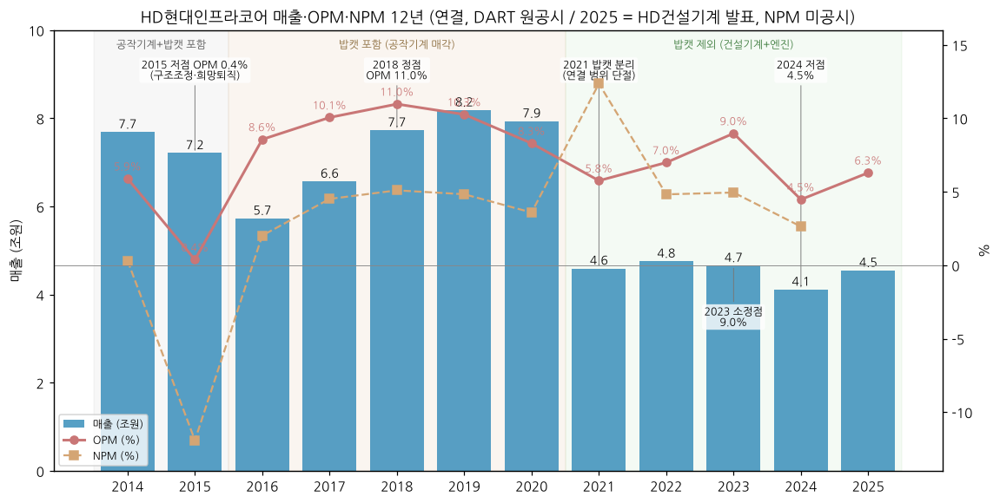

**연결 범위 단절 3회 (시계열 해석 시 필수):**
1. **2016-04 공작기계 매각** (MBK파트너스, DART 사업보고서 연혁 "2016.04 공작기계 사업부문 매각") — 2015 재작성: 매출 7.21조 → 5.96조, 영업이익 274억 → -951억
2. **2018 밥캣 Heavy 사업 재분류** — 2017 부문 재작성: 건기 2.00조 → 2.68조 / 밥캣 4.06조 → 3.38조 (연결 합계는 불변)
3. **2021-07-01 분할합병** — 두산밥캣 지분을 포함한 투자부문을 분할해 두산중공업에 합병, 존속 인프라코어는 1주당 0.3104974주로 병합 (DART 분기보고서(2021.09)). 2021 사업보고서부터 밥캣은 중단영업 → 2019·2020 재작성: 매출 8.19조→4.13조, 7.93조→3.99조

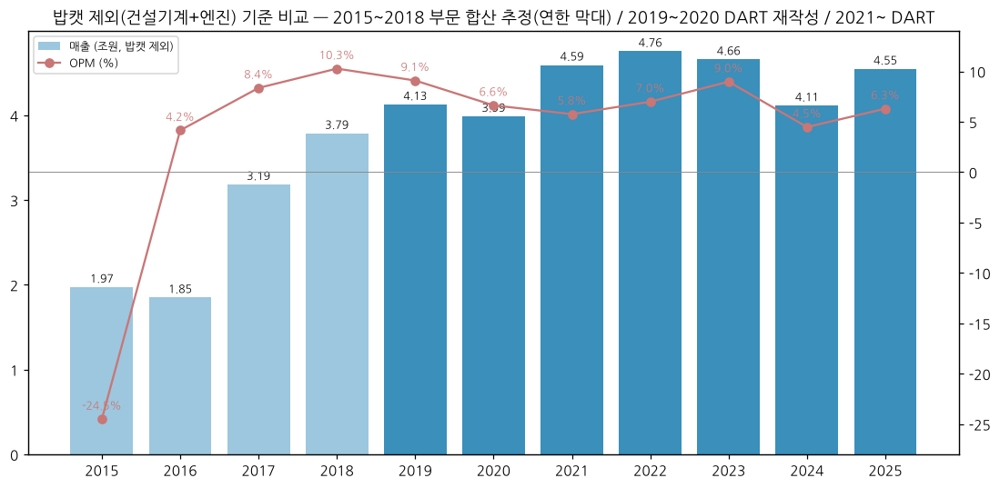

**밥캣 제외 기준 비교 (억원):**

| 연도 | 매출 | 영업이익 | OPM | 기준 |
|---|---|---|---|---|
| 2015 | 19,735 | -4,837 | -24.5% | 부문 합산(엔진+건기, 2016 사업보고서 전기 재작성) — 추정 |
| 2016 | 18,504 | 768 | 4.2% | 부문 합산 — 추정 |
| 2017 | 31,853 | 2,662 | 8.4% | 부문 합산(2018 재분류 기준) — 추정 |
| 2018 | 37,873 | 3,891 | 10.3% | 부문 합산 — 추정 |
| 2019 | 41,281 | 3,754 | 9.1% | DART 2021 사업보고서 전전기 재작성 |
| 2020 | 39,881 | 2,644 | 6.6% | DART 2021 사업보고서 전기 재작성 |
| 2021 | 45,937 | 2,645 | 5.8% | DART |
| 2022 | 47,561 | 3,325 | 7.0% | DART |
| 2023 | 46,596 | 4,183 | 9.0% | DART |
| 2024 | 41,142 | 1,842 | 4.5% | DART |
| 2025 | 45,478 | 2,864 | 6.3% | HD건설기계 FY25 발표 (인프라코어 기준) |

(2015\~2018 부문 합산은 밥캣향 엔진 매출이 내부거래로 제거된 값이라 2019\~ 재작성치보다 과소 — 2019 부문 합산 3.73조 vs 재작성 4.13조, 차이 약 0.4조가 밥캣향 엔진 매출 외부화 효과)

### ② 산업 분류

- 산업: **건설기계 (굴착기·휠로더) + 산업용 엔진** — 사이클 산업 list 포함 (글로벌 인프라·광산·중국 부동산 사이클)
- DART 업종: 29241 (건설 및 광업용 기계장비 제조업) / KRX 기계 / WICS 기계
- 워치리스트 섹터: **건설·건설기계** / 서브섹터: **건설기계** (2026-11-23 추가, T1 아님)

### ③ 분류 결정 논리

(1) **가장 매출 큰 사업부 기준**: 건설기계 (2024 순매출 2.97조, 72%; 9M25 74%) → 굴착기 수요 사이클 직결 → **사이클**
(2) **사이클 사업부 이익 비중 우선 sub-rule**: 2024 영업이익 1,842억 중 엔진 1,566억(85%) vs 건기 275억(15%) — 이익은 엔진이 지배. 그러나 엔진도 2015·2020 적자 이력이 있고(2020 4분기 OPM -7.9%), 2023\~2025 고마진은 방산(K2 폴란드 수출)·발전기 수요의 국면적 성격이 섞임 → 전사 OPM 범위가 4.5\~9.0%(밥캣 제외)로 출렁이므로 **사이클 유지**
(3) **Boundary case 처리**: 엔진 부문은 2022\~2025 OPM 12\~18%, 매출 2021 0.85조 → 2024 1.14조 (+10%/년) → 지속성장 성격 → **Primary 사이클 + Secondary 지속성장(엔진)** 병기
(4) **피어 대비**:
   - **HD현대건설기계** (합병 상대): 순수 건설기계, 2025 OPM 4.5% (1,709억 / 3.78조) — 인프라코어보다 이익 변동성이 크고 엔진 완충 없음
   - **두산밥캣**: 소형 장비(SSL·CTL)·북미 렌탈 중심, 2016\~2020 인프라코어 연결 시기 부문 OPM 7\~13% — 북미 주택·렌탈 사이클
   - **Caterpillar**: 광산·에너지(Power & Energy) 비중 높은 글로벌 1위, 딜러 서비스·부품 매출로 사이클 완충 — 인프라코어 엔진 부문의 장기 비교 대상
   - **Komatsu**: 광산·건설 장비 + 부품·서비스, 일본·북미·광산 비중
   - **Sany**: 중국 내수 1위, 중국 굴착기 사이클의 직접 경쟁자 — 인프라코어 중국 점유율 하락(2010년대 이후)의 주된 원인
   - → **인프라코어 = 중형 굴착기 사이클 + 엔진(발전·방산) 지속성장 옵션** — 순수 건설기계사(HD현대건설기계·Sany) 대비 이익 하방이 낮고, Caterpillar·Komatsu 대비 서비스·광산 비중이 작아 사이클 진폭은 큼

### ④ 적정 밸류에이션 방법

- **PBR 우선 (사이클 기준)** — 2025-12-26 시총 2.61조 / 3Q25 자본 1.99조 = **P/B 약 1.31배** (2024-12-30 시총 1.33조 / 자본 1.85조 = 0.72배, stockanalysis 연말 시총 기준)
- **SOTP 보조** — 엔진 부문을 별도 멀티플로 평가 (통합 후 HD건설기계에 대해 증권가는 엔진 사업을 멀티플 확장의 핵심으로 봄, alphadistill 2026-04)
- **PER 참고** — 이익 레벨 변동이 커 단독 지표로 부적합
- 합병 후에는 **HD건설기계(267270) 단일 종목으로만 밸류에이션 가능** — 인프라코어 주주는 0.1621707주의 HD건설기계 주식을 받음

### ⑤ 분기 재평가 트리거 (분류 변경 조건)

- 법인 소멸로 **인프라코어 단독 재평가는 종료**. 아래 트리거는 통합법인 HD건설기계 리포트로 이관:
- 엔진 부문 매출이 통합법인 매출의 **25%+ 및 OPM 15%+ 4개 분기 연속** 시 → 통합법인 Secondary 지속성장 격상 검토 (1Q26\~3Q26 엔진 비중 15\~16%, OPM 14\~15%)
- 군산 신공장 메가와트급 발전기 엔진 양산(2027 예정)이 개시되고 엔진 매출이 연 10%+ 성장 유지 시
- 건설기계 부문 OPM이 2개 연도 연속 8%+ 및 range 2%pt 이내 → 사이클 → 지속성장 transition 후보

---

## 2. 회사 개요

### ① 기본 사항

- **회사명**: HD현대인프라코어 주식회사 (HD Hyundai Infracore Co., Ltd.) / KRX 042670 (보통주) — **상장폐지 (최종 매매일 2025-12-26)**
- **본사**: 인천광역시 동구 인중로 489 (화수동) / 설립 2000-10-23 (대우중공업 분할 신설법인), 2001-02 재상장
- **대표이사 (소멸 직전)**: 조영철 사장 (HD현대사이트솔루션 대표 겸), 오승현 사장 (한국건설기계산업협회 회장)
- **그룹**: HD현대 → HD현대사이트솔루션(100% 자회사, 지분 34.86%) → HD현대인프라코어 (2025-09 기준, DART)
- **브랜드**: DEVELON (2023-03 건설기계 브랜드 리뉴얼) / 엔진 브랜드 HD현대인프라코어
- **사업 한 줄 정의**: 국내 굴착기 1위권·글로벌 20위권 건설기계(굴착기·휠로더) 업체이자, 인천 G2·기존 공장에서 연 15만 대 규모 산업용·발전용·방산용 디젤/가스 엔진을 만드는 엔진 메이커. 2026-01-01 HD현대건설기계에 흡수합병

### ② 최근 12년 손익·자본 추이 (조원, 연결, DART)

| 연도 | 매출 | YoY | 영업이익 | 순이익 | 자본총계 | 자본 YoY |
|---|---|---|---|---|---|---|
| 2014 | 7.69 | - | 0.453 | 0.024 | 3.29 | - |
| 2015 | 7.21 | -6.2% | 0.027 | -0.860 | 3.10 | -5.6% |
| 2016 | 5.73 | -20.6% | 0.491 | 0.116 | 3.45 | +11.1% |
| 2017 | 6.57 | +14.6% | 0.661 | 0.297 | 3.17 | -8.0% |
| 2018 | 7.73 | +17.7% | 0.848 | 0.394 | 3.82 | +20.4% |
| 2019 | 8.19 | +5.9% | 0.840 | 0.396 | 4.27 | +11.7% |
| 2020 | 7.93 | -3.1% | 0.659 | 0.285 | 4.49 | +5.2% |
| 2021 | 4.59 | -42.1% | 0.265 | 0.568 | 1.37 | -69.5% |
| 2022 | 4.76 | +3.5% | 0.333 | 0.230 | 1.64 | +19.4% |
| 2023 | 4.66 | -2.0% | 0.418 | 0.231 | 1.81 | +10.9% |
| 2024 | 4.11 | -11.7% | 0.184 | 0.108 | 1.85 | +1.9% |
| 2025 | 4.55 | +10.5% | 0.286 | n/a | 1.99 (3Q25) | +7.6% |

(2014 = 2015 사업보고서 전기 컬럼, 2015 = 원공시(공작기계 포함). 2016 매출 YoY -20.6%는 공작기계 중단영업 분류 효과 (재작성 2015 대비 -3.9%). 2021 YoY는 밥캣 분리 효과 (재작성 2020 대비 +15.2%). 2025 = HD건설기계 FY25 발표치, 순이익·연말 재무상태표는 소멸법인이라 미공시)

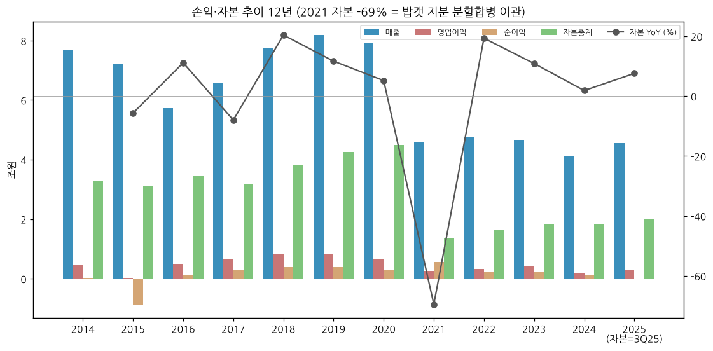

### ③ 회사 주가 역사 ★ narrative 영역

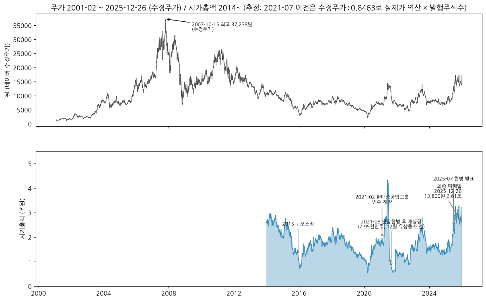

**시가총액 데이터:** 네이버 증권 일별 시세 2001-02-02 \~ 2025-12-26 (수정주가). 시총 = 종가 × 발행주식수 (2021-07 분할합병 이전은 수정주가 ÷ 0.8463으로 실제 주가 역산 — 추정. 계수는 2020-12-30 stockanalysis 시총 1.71조 / 발행주식 215,931,625주 = 7,920원 vs 수정주가 6,703원에서 산출)
- **최종 매매일 2025-12-26 종가 13,800원 → 시총 약 2.61조원** (188,851,238주, stockanalysis "Market cap 2.61T, Dec 26 2025" 일치)
- 2025 최고 종가 17,390원 (2025-10-29) — 합병 발표(2025-07-01) 후 엔진·통합 기대
- **사상 최고 (수정주가 종가): 2007-10-15 37,238원** (실제 주가 역산 약 4.4만원, 추정) — 2007 밥캣 인수 직후·중국 굴착기 붐
- 직전 저점: 2020-03-23 코로나 (수정주가 2,146원)
- 연말 시총 (stockanalysis): 2020 1.71조 / 2021 1.40조 / 2022 1.58조 / 2023 1.62조 / 2024 1.33조 / 2025-12-26 2.61조
- 합병 환산: 인프라코어 1주 = HD건설기계 0.1621707주

**사이클 history:**

```
[2005-2007] 두산그룹 편입(2005, 대우종합기계 → 두산인프라코어) + 중국 굴착기 붐
  · 2007-11 두산밥캣 인수 (Ingersoll-Rand 소형장비 사업, 대규모 차입 인수)
  · 2007-10-15 수정주가 최고 37,238원

[2008-2009] 금융위기 + 밥캣 인수 차입 부담 → 급락 (2008-10)
[2010-2011] 중국 4조위안 부양 → 2011 2차 고점 (수정주가 26,320원)
[2012-2015] 중국 굴착기 수요 급감 + 밥캣 차입 부담 + 구조조정
  · 2015 영업이익 274억, 순손실 8,595억 (건기 희망퇴직, 중국 법인 DICC 손상)
  · 2015-12 수정주가 3,974원
[2016] 공작기계 매각 (MBK, 2016-04) / 두산밥캣 IPO (2016-11)
[2017-2019] 중국 인프라 투자 업턴 → OPM 10~11% (밥캣 포함)
[2020] 코로나 저점 (2020-03 수정주가 2,146원)
[2021] 현대중공업그룹 인수
  · 2021-02-05 두산중공업 보유지분 매각 계약 (HD현대 → HD현대사이트솔루션 지위 이전)
  · 2021-07-01 분할합병 (밥캣 지분 → 두산중공업), 2021-08 최대주주 변경
  · 2021-09 현대두산인프라코어로 사명 변경, 2021-12 유상증자 115,107,913주
[2022-2023] 원자재·중동·신흥국 수요 + 엔진(방산·발전기) → 2023 영업이익 4,183억 (밥캣 제외 최대)
  · 2023-03 HD현대인프라코어 사명 변경, DEVELON 브랜드
[2024] 건설기계 다운턴 (건기 OPM 0.9%)
[2025] 합병 발표(2025-07-01) → 임시주총 승인(2025-09-16, 찬성 99%+) → 2025-12-26 최종 매매
[2026-01-01] HD현대건설기계에 흡수합병, 통합법인 HD건설기계 출범
```

### ④ 회사의 주요 연혁

```
1937       조선기계제작소 설립 (인천, 대우중공업의 모태)
1976       대우중공업 (대우그룹)
1999-2000  대우그룹 해체 → 대우중공업 분할, 대우종합기계 신설 (2000-10-23)
2005-04    두산그룹 인수 → 두산인프라코어로 사명 변경
2007-11    두산밥캣 인수 (Ingersoll-Rand Compact Equipment)
2015       구조조정·희망퇴직, 순손실 8,595억
2016-04    공작기계 사업부문 매각 (MBK파트너스)
2016-11    두산밥캣 KOSPI 상장
2017-08    신주인수권부사채 5,000억 발행
2018       밥캣 Heavy 사업 건기 부문 재분류
2021-02-05 두산중공업 보유지분 → HD현대 컨소시엄 주식매매계약
2021-07-01 분할합병 (두산밥캣 지분 등 투자부문 → 두산중공업), 주식 0.3104974:1 병합
2021-08    최대주주 변경 (두산중공업 → 현대제뉴인, 현 HD현대사이트솔루션)
2021-09    현대두산인프라코어로 사명 변경 / 2021-10 액면 5,000원 → 1,000원 감액
2021-10-29 Doosan Infracore China 잔여지분 20% 3,050억 취득 (DICC 소송 종결)
2021-12    유상증자 115,107,913주
2022-12    폴란드 K2 전차용 엔진 공급계약 (현대로템, 1,830억)
2023-02    튀르키예 차세대 전차(Altay) 엔진 공급계약 (BMC, 1,102억)
2023-03    HD현대인프라코어로 사명 변경, DEVELON 브랜드
2024-08    자사주 6,947,586주 소각 (560억 매입)
2025-07-01 HD현대건설기계와 합병 결의 (인프라코어 소멸, 비율 1 : 0.1621707)
2025-08-06 자사주 3,739,794주 소각
2025-09-16 양사 임시주총 합병 승인
2025-12-26 최종 매매일 (종가 13,800원)
2026-01-01 합병기일 — 통합법인 HD건설기계 출범 (KRX 267270, HYUNDAI·DEVELON 듀얼 브랜드)
```

(1937\~2007 연혁은 공개 연혁 기반 일반 서술로 DART 원문 미대조 — 미검증. 2016 이후는 DART 사업보고서 '경영활동 관련 중요한 사실' 기준)

---
## 3. 비즈니스 모델

### ① 실적 추이 (연결 → 부문 → 수출/내수 3단계 위계)

**연간 통합 표 (억원, 밥캣 제외 기준):**

| 항목 | 2021 | 2022 | 2023 | 2024 | 2025 |
|------|------|------|------|------|------|
| **연결 매출액** | **45,937** | **47,561** | **46,596** | **41,142** | **45,478** |
| └ 부문별 (외부 순매출) | | | | | |
| &nbsp;&nbsp;&nbsp;&nbsp;└ 건설기계 (굴착기·휠로더) | 37,389 | 37,181 | 34,980 | 29,723 | 24,642 (9M) |
| &nbsp;&nbsp;&nbsp;&nbsp;└ 엔진 (엔진·발전기·A/S) | 8,548 | 10,380 | 11,616 | 11,419 | 8,690 (9M) / 13,264 (연간, 발표) |
| └ 지역별 (연결) | | | | | |
| &nbsp;&nbsp;&nbsp;&nbsp;└ 수출 | 36,921 | 39,069 | 38,807 | 33,557 | 27,473 (9M) |
| &nbsp;&nbsp;&nbsp;&nbsp;└ 내수 | 9,016 | 8,492 | 7,789 | 7,585 | 5,860 (9M) |
| **연결 영업이익** | **2,645** | **3,325** | **4,183** | **1,842** | **2,864** |
| &nbsp;&nbsp;&nbsp;&nbsp;└ 건설기계 | 2,170 | 2,078 | 2,659 | 275 | 966 (9M) |
| &nbsp;&nbsp;&nbsp;&nbsp;└ 엔진 | 475 | 1,247 | 1,524 | 1,566 | 1,579 (9M) |
| **매출 YoY (%)** | **+15.2** (재작성 2020 대비) | **+3.5** | **-2.0** | **-11.7** | **+10.5** |
| &nbsp;&nbsp;&nbsp;&nbsp;└ 건설기계 YoY | +14.1 | -0.6 | -5.9 | -15.0 | +7.6 (9M) |
| &nbsp;&nbsp;&nbsp;&nbsp;└ 엔진 YoY | +20.1 | +21.4 | +11.9 | -1.7 | -1.9 (9M) |
| **영업이익 YoY (%)** | **+0.0** | **+25.7** | **+25.8** | **-56.0** | **+55.5** |
| **OPM 전사 (%)** | **5.8** | **7.0** | **9.0** | **4.5** | **6.3** |
| &nbsp;&nbsp;&nbsp;&nbsp;└ 건설기계 OPM | 5.8 | 5.6 | 7.6 | 0.9 | 3.9 (9M) |
| &nbsp;&nbsp;&nbsp;&nbsp;└ 엔진 OPM | 5.6 | 12.0 | 13.1 | 13.7 | 18.2 (9M) / 14.3 (연간, 발표) |

(출처: 부문 = DART 영업부문 주석 '주요 제품 등의 현황' 순매출(연결조정 반영)·부문 영업손익. 2021 부문 YoY 기준 = 2021 사업보고서 전기(2020 밥캣 제외 재작성: 건기 32,766 / 엔진 7,115). 2025 연간 = HD건설기계 FY25 실적 발표(2026-02, 인프라코어 매출 4조5,478억·영업이익 2,864억, 엔진 매출 1조3,264억·OPM 14.3%) — 엔진 연간 1.33조는 DART 9M25 부문 총매출(내부매출 포함 10,211억)과 같은 총매출 기준으로 추정, 순매출 기준 연간치 미공시. 수출/내수 = DART 사업보고서 II-4 매출실적)

**부문 연간 장기 (억원, DART 영업부문 — 연결 범위별):**

| 연도 | 엔진 매출 | 엔진 OPM | 건기 매출 | 건기 OPM | 밥캣 매출 | 밥캣 OPM | 공작기계 매출 | 공작기계 OPM | 합계 |
|---|---|---|---|---|---|---|---|---|---|
| 2014 | 6,600 | 6.9% | 56,990 (밥캣 포함) | 4.5% | - | - | 13,225 | 11.9% | 76,886 |
| 2015 | 5,777 | 0.4% | 53,753 (밥캣 포함) | -1.0% | - | - | 12,470 | 5.8% | 72,130 |
| 2015 재작성 | 5,782 | 0.4% | 13,953 | -34.8% | 39,915 | 9.7% | 중단 | - | 59,649 |
| 2016 | 4,987 | 11.8% | 13,517 | 1.3% | 38,791 | 10.7% | 중단 | - | 57,296 |
| 2017 | 5,018 | 15.1% | 20,044 | 8.3% | 40,617 | 10.3% | - | - | 65,679 |
| 2017 재분류 | 5,018 | 15.1% | 26,835 | 7.1% | 33,826 | 11.7% | - | - | 65,679 |
| 2018 | 5,324 | 19.8% | 32,549 | 8.7% | 39,428 | 11.6% | - | - | 77,301 |
| 2019 | 5,781 | 14.2% | 31,484 | 8.9% | 44,592 | 10.7% | - | - | 81,858 |
| 2020 | 4,662 | 0.5% | 32,298 | 8.1% | 42,381 | 9.3% | - | - | 79,341 |
| 2020 밥캣 제외 재작성 | 7,115 | 0.3% | 32,766 | 8.0% | 중단 | - | - | - | 39,881 |
| 2021 | 8,548 | 5.6% | 37,389 | 5.8% | 중단 | - | - | - | 45,937 |
| 2022 | 10,380 | 12.0% | 37,181 | 5.6% | - | - | - | - | 47,561 |
| 2023 | 11,616 | 13.1% | 34,980 | 7.6% | - | - | - | - | 46,596 |
| 2024 | 11,419 | 13.7% | 29,723 | 0.9% | - | - | - | - | 41,142 |
| 9M25 | 8,690 | 18.2% | 24,642 | 3.9% | - | - | - | - | 33,332 |

(2014·2015 원공시 '건기'는 두산밥캣 포함 — DART 부문 표에서 분리 불가. 2019 밥캣 매출 = 연결 합계 − 엔진 − 건기 역산. 2016\~2020 엔진 순매출은 밥캣향 엔진 공급이 내부거래로 제거된 값 → 밥캣 분리 후(2021\~) 외부매출로 전환되며 엔진 매출 레벨이 약 0.25\~0.4조 상향)

→ 엔진 OPM 2020 0.5% → 2024 13.7% → 9M25 18.2%: 2021 이후 밥캣향 소형엔진의 외부 판매 전환, 2022-12 폴란드 K2 전차 엔진(1,830억)·2023-02 튀르키예 전차 엔진(1,102억) 수주, 발전기용 엔진 수요가 겹친 결과 / 건기 OPM은 2023 7.6% → 2024 0.9%로 다운턴을 그대로 탐

**부문별 분기 시계열 (1Q15\~3Q25 = 43분기, DART 영업부문 누적값 차분 / 1Q26\~3Q26 = HD건설기계 엔진 부문 보도):**

각 차트 = 매출 (bar, 좌축, 외부 순매출) + OPM (line, 우축). 점선 = 부문 기준 변경 시점.

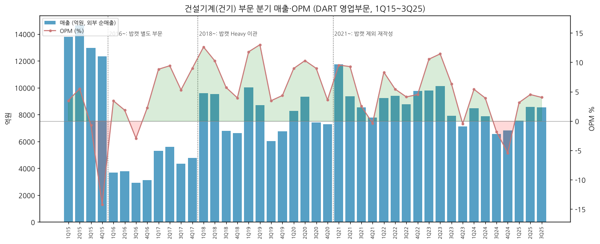
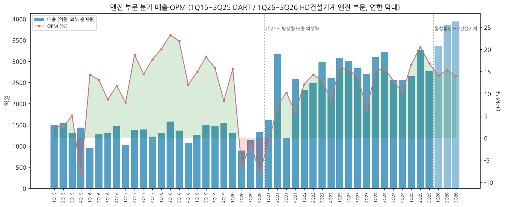
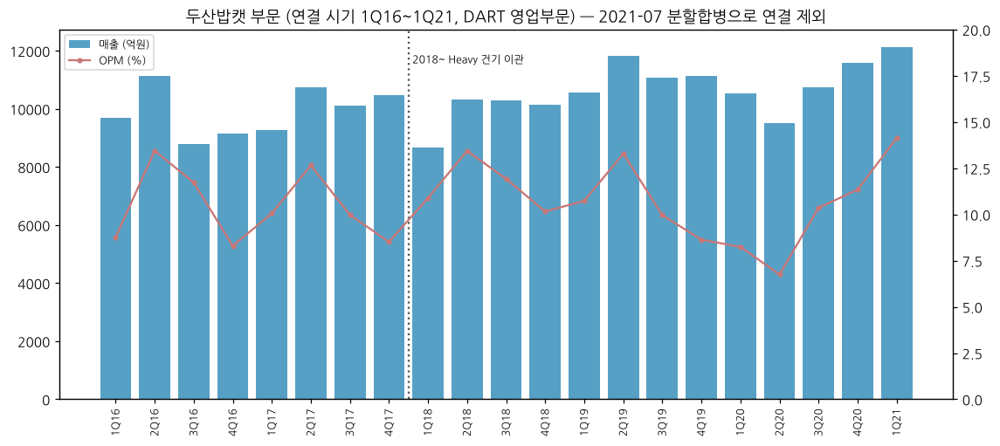

**부문별 분기 매출 (억원) · OPM 매트릭스 (DART):**

엔진:

| 연도 | 1Q | 2Q | 3Q | 4Q | 1Q OPM | 2Q OPM | 3Q OPM | 4Q OPM |
|---|---|---|---|---|---|---|---|---|
| 2015 | 1,500 | 1,539 | 1,302 | 1,437 | 2.8% | 2.4% | 5.0% | -8.4% |
| 2016 | 949 | 1,270 | 1,298 | 1,470 | 14.3% | 13.1% | 8.7% | 11.8% |
| 2017 | 1,029 | 1,383 | 1,387 | 1,220 | 8.0% | 18.8% | 14.4% | 17.7% |
| 2018 | 1,308 | 1,580 | 1,366 | 1,069 | 20.1% | 23.2% | 21.9% | 12.0% |
| 2019 | 1,263 | 1,489 | 1,477 | 1,551 | 14.9% | 18.3% | 15.8% | 8.4% |
| 2020 | 1,300 | 896 | 1,140 | 1,327 | 15.6% | -6.8% | -1.3% | -7.9% |
| 2021 | 1,612 | 3,165 | 1,183 | 2,588 | -1.2% | 7.1% | 10.3% | 5.7% |
| 2022 | 2,318 | 2,480 | 2,984 | 2,598 | 12.1% | 14.3% | 13.0% | 8.6% |
| 2023 | 3,071 | 3,006 | 2,837 | 2,702 | 16.1% | 15.4% | 13.9% | 6.4% |
| 2024 | 3,093 | 3,219 | 2,550 | 2,558 | 15.2% | 15.8% | 12.8% | 10.2% |
| 2025 | 2,654 | 3,271 | 2,765 | 미공시 | 16.6% | 20.5% | 16.8% | 미공시 |
| 2026 (HD건설기계 엔진 부문) | 3,361 | 3,861 | 3,940 | - | 14.1% | 15.3% | 14.0% | - |

(2021 분기 엔진 매출 급변(2Q 3,165 → 3Q 1,183 → 4Q 2,588)은 밥캣 분리 회계처리 과정의 누적·재작성 기준 차이로 추정 — 연간 8,548억은 DART 확정. 2026은 통합법인 엔진 부문 보도치: 1Q26 매출 3,361억·영업이익 473억(이투데이 2026-04), 2Q26 매출 3,861억·OPM 15.3%(뉴시스 2026-07-29), 3Q26 매출 3,940억·영업이익 552억(아시아경제 2026-10-26). 부문 매출 기준(총매출/순매출) 미확인 → DART 시계열과 직접 비교 시 주의)

건설기계(건기):

| 연도 | 1Q | 2Q | 3Q | 4Q | 1Q OPM | 2Q OPM | 3Q OPM | 4Q OPM |
|---|---|---|---|---|---|---|---|---|
| 2015 (밥캣 포함) | 13,781 | 14,656 | 12,965 | 12,351 | 3.5% | 5.5% | -0.7% | -14.2% |
| 2016 | 3,697 | 3,769 | 2,930 | 3,122 | 3.4% | 1.8% | -2.9% | 2.2% |
| 2017 | 5,314 | 5,607 | 4,340 | 4,784 | 8.8% | 9.4% | 5.3% | 9.0% |
| 2018 | 9,602 | 9,530 | 6,788 | 6,630 | 12.6% | 10.2% | 5.7% | 3.9% |
| 2019 | 10,009 | 8,690 | 6,017 | 6,768 | 11.8% | 13.0% | 3.5% | 4.3% |
| 2020 | 8,265 | 9,341 | 7,408 | 7,284 | 8.9% | 10.3% | 9.0% | 3.6% |
| 2021 | 11,733 | 9,348 | 8,536 | 7,772 | 9.5% | 9.3% | 2.5% | -0.4% |
| 2022 | 9,227 | 9,400 | 8,785 | 9,769 | 8.3% | 5.4% | 4.1% | 4.5% |
| 2023 | 9,808 | 10,133 | 7,925 | 7,114 | 10.5% | 11.4% | 6.3% | -0.5% |
| 2024 | 8,481 | 7,863 | 6,548 | 6,831 | 5.4% | 3.9% | -1.8% | -5.4% |
| 2025 | 7,531 | 8,574 | 8,537 | 미공시 | 3.1% | 4.5% | 4.0% | 미공시 |

(2016\~2017 = 밥캣 Heavy 판매가 밥캣 부문에 있던 기준, 2018\~ = Heavy 건기 이관 기준 → 2018 1Q 매출 급증은 분류 효과. 2021 1Q = 2022 1Q 보고서 전기(밥캣 제외 재작성) 값. 2026 통합법인 건설기계 부문은 HD현대건설기계 실적이 섞여 인프라코어(DEVELON) 단독 분리 불가 — **누락**)

두산밥캣 (연결 시기):

| 연도 | 1Q | 2Q | 3Q | 4Q | 1Q OPM | 2Q OPM | 3Q OPM | 4Q OPM |
|---|---|---|---|---|---|---|---|---|
| 2016 | 9,690 | 11,145 | 8,793 | 9,164 | 8.8% | 13.4% | 11.7% | 8.3% |
| 2017 | 9,274 | 10,744 | 10,119 | 10,480 | 10.1% | 12.7% | 10.0% | 8.5% |
| 2018 | 8,659 | 10,331 | 10,304 | 10,134 | 10.9% | 13.4% | 11.9% | 10.2% |
| 2019 | 10,554 | 11,820 | 11,073 | 11,146 | 10.7% | 13.3% | 10.0% | 8.6% |
| 2020 | 10,528 | 9,520 | 10,736 | 11,597 | 8.2% | 6.8% | 10.4% | 11.3% |
| 2021 | 12,123 | 중단영업 | - | - | 14.1% | - | - | - |

(2019 4Q 밥캣 = 연간 역산. 2021-07-01 분할합병으로 두산중공업(현 두산에너빌리티) 이관 → 이후 실적은 두산밥캣 리포트 참조)

**연결 분기 매출·영업이익 매트릭스 (억원, DART / 2015 = 부문 소계 원공시 / 4Q25 = 추정):**

| 연도 | 1Q 매출 | 2Q | 3Q | 4Q | 1Q OP | 2Q OP | 3Q OP | 4Q OP | 1Q OPM | 2Q OPM | 3Q OPM | 4Q OPM | 분기합 |
|---|---|---|---|---|---|---|---|---|---|---|---|---|---|
| 2015 | 18,337 | 19,795 | 17,298 | 16,699 | 755 | 1,285 | 200 | -1,966 | 4.1% | 6.5% | 1.2% | -11.8% | 72,129 |
| 2016 | 14,336 | 16,183 | 13,021 | 13,755 | 1,112 | 1,735 | 1,058 | 1,003 | 7.8% | 10.7% | 8.1% | 7.3% | 57,295 |
| 2017 | 15,616 | 17,734 | 15,845 | 16,484 | 1,484 | 2,147 | 1,439 | 1,538 | 9.5% | 12.1% | 9.1% | 9.3% | 65,679 |
| 2018 | 19,569 | 21,441 | 18,458 | 17,833 | 2,416 | 2,731 | 1,915 | 1,420 | 12.3% | 12.7% | 10.4% | 8.0% | 77,301 |
| 2019 | 21,826 | 22,000 | 18,567 | 19,466 | 2,500 | 2,972 | 1,546 | 1,386 | 11.5% | 13.5% | 8.3% | 7.1% | 81,859 |
| 2020 | 20,093 | 19,757 | 19,284 | 20,208 | 1,810 | 1,543 | 1,761 | 1,472 | 9.0% | 7.8% | 9.1% | 7.3% | 79,342 |
| 2021 | 24,869 | 12,513 | 9,719 | 10,360 | 2,954 | 1,092 | 337 | 118 | 11.9% | 8.7% | 3.5% | 1.1% | 57,461 |
| 2022 | 11,545 | 11,880 | 11,769 | 12,368 | 1,049 | 866 | 747 | 664 | 9.1% | 7.3% | 6.3% | 5.4% | 47,562 |
| 2023 | 12,878 | 13,140 | 10,762 | 9,816 | 1,526 | 1,620 | 897 | 140 | 11.8% | 12.3% | 8.3% | 1.4% | 46,596 |
| 2024 | 11,573 | 11,082 | 9,098 | 9,389 | 928 | 815 | 207 | -109 | 8.0% | 7.4% | 2.3% | -1.2% | 41,142 |
| 2025 | 10,185 | 11,846 | 11,302 | 12,145 (추정) | 678 | 1,058 | 809 | 319 (추정) | 6.7% | 8.9% | 7.2% | 2.6% (추정) | 45,478 |

(2016\~1Q21 = 밥캣 포함 원공시. 1Q21 24,869억은 밥캣 포함 1분기 보고서 값이고 2021 연간 45,937억은 밥캣 제외 → 분기합 57,461 ≠ 연간. 1Q21 밥캣 제외 재작성 = 매출 13,345·영업이익 1,099 (2022 1Q 보고서 전기). 2020 밥캣 제외 재작성: 1H20 21,436/1,901, 3Q20 9,178/636, 4Q20 9,267/107. 4Q25 = FY25 발표치 − 9M25 DART 누적(33,333/2,545) — 추정)

**12분기 시계열 (1Q23 \~ 4Q25, 억원):**

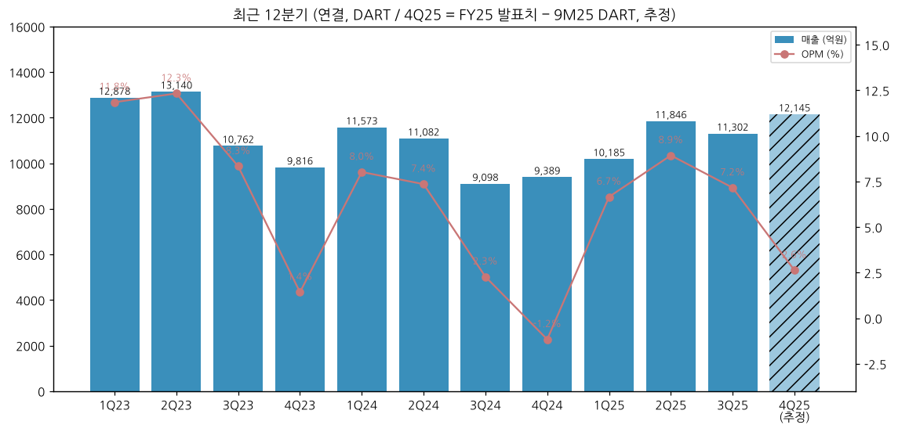

| 분기 | 매출 | 영업이익 | OPM | 엔진 매출 | 엔진 OPM | 건기 매출 | 건기 OPM | 메모 |
|---|---|---|---|---|---|---|---|---|
| 2023-1Q | 12,878 | 1,526 | 11.8% | 3,071 | 16.1% | 9,808 | 10.5% | |
| 2023-2Q | 13,140 | 1,620 | 12.3% | 3,006 | 15.4% | 10,133 | 11.4% | 분기 영업이익 정점 (밥캣 제외) |
| 2023-3Q | 10,762 | 897 | 8.3% | 2,837 | 13.9% | 7,925 | 6.3% | |
| 2023-4Q | 9,816 | 140 | 1.4% | 2,702 | 6.4% | 7,114 | -0.5% | 순손실 439억 |
| 2024-1Q | 11,573 | 928 | 8.0% | 3,093 | 15.2% | 8,481 | 5.4% | |
| 2024-2Q | 11,082 | 815 | 7.4% | 3,219 | 15.8% | 7,863 | 3.9% | |
| 2024-3Q | 9,098 | 207 | 2.3% | 2,550 | 12.8% | 6,548 | -1.8% | 건기 적자 전환 |
| 2024-4Q | 9,389 | -109 | -1.2% | 2,558 | 10.2% | 6,831 | -5.4% | 2차 저점 |
| 2025-1Q | 10,185 | 678 | 6.7% | 2,654 | 16.6% | 7,531 | 3.1% | |
| 2025-2Q | 11,846 | 1,058 | 8.9% | 3,271 | 20.5% | 8,574 | 4.5% | 엔진 OPM 사상 최고권 |
| 2025-3Q | 11,302 | 809 | 7.2% | 2,765 | 16.8% | 8,537 | 4.0% | 매출 +24.2% YoY, **DART 단독 공시 마지막 분기** |
| **2025-4Q (추정)** | **12,145** | **319** | **2.6%** | 미공시 | 미공시 | 미공시 | 미공시 | FY25 − 9M25 역산 (합병 관련 비용 등 반영 여부 미확인) |

**3Q25 핵심 (DART 분기보고서(2025.09), 마지막 단독 분기):**
- 연결 매출 **1조 1,302억** (+24.2% YoY) / 영업이익 **809억** (+290.9% YoY, OPM 7.2%) / 순이익 671억
- 엔진 OPM 16.8% (2,765억) vs 건기 OPM 4.0% (8,537억) — 9M25 영업이익의 62%가 엔진
- 9M25 누적: 매출 3.33조 (+5.0%) / 영업이익 2,546억 (+30.5%)
- **FY25 (HD건설기계 발표): 매출 4조5,478억 (+10.5%), 영업이익 2,864억 (+55.5%)**, 중국 매출 +56% (사업 재편 효과)

**통합법인 HD건설기계 실적 (참고, 언론 보도 — 상세는 HD현대건설기계 리포트):**

| 분기 | 연결 매출 | 연결 영업이익 | OPM | 건설기계 부문 매출 | 엔진 부문 매출 | 엔진 영업이익 | 엔진 OPM |
|---|---|---|---|---|---|---|---|
| 1Q26 | 23,049 | 1,907 | 8.3% | 19,275 | 3,361 | 473 | 14.1% |
| 2Q26 | 24,342 | 2,489 | 10.2% | 20,182 | 3,861 | 약 591 (추정) | 15.3% |
| 3Q26 | 20,915 | 1,577 | 7.5% | 16,235 | 3,940 | 552 | 14.0% |

(1Q26 이투데이 2026-04 / 2Q26 뉴시스 2026-07-29 / 3Q26 아시아경제 2026-10-26. 1Q26 YoY +22.1%·+88.3%는 양사 합산 전년 대비. 2026 가이던스 매출 8.7\~9.0조, 엔진 연 10% 성장(시대일보 2026-02). 부문 합계와 연결 합계의 차이는 연결조정으로 추정. **인프라코어(DEVELON) 건설기계 단독 숫자는 통합 IR에서 분리 공시되지 않음 → 누락**)

### ② 사업부별 개요 (매출 비중 큰 순서)

**건설기계 (DEVELON) — 2024 순매출의 72% / 9M25 74%**

"중대형 굴착기·휠로더를 한국·중국·신흥국·선진국에 파는 글로벌 20위권 건설기계 메이커."

- **주요 제품**: 굴착기 (DX150W-7 1.55억원, DX240LC-7 1.55억원, DX320LC-7 1.92억원 — 2024 국내 소비자가, DART), 휠로더, 굴착기 부품·A/S
- **판매망**: 국내 판매법인 1개 + 위탁판매법인 / 중국 판매법인 3개 / 유럽 2개 / 북미 1개 / 신흥(아시아·남미·CIS·중동·아프리카·대양주) 4개 + 딜러
- **생산**: 국내(인천·군산) 연 12,220대 / 해외(중국 옌타이 등) 연 20,016대 — 2024 가동률 국내 48% / 해외 36% (DART)
- 글로벌 순위 21위 (합병 전, 한국경제 2025-09-16) — 합병으로 통합 10위권 목표

**엔진 — 2024 순매출의 28% / 9M25 26% (이익의 62\~85%)**

"인천 기존·G2 공장에서 산업용·발전용·방산용·상용차 엔진을 만드는 국내 대표 디젤/가스 엔진 메이커."

- **주요 제품**: 소형 G2 엔진 (DL02 등, 두산밥캣 장비 탑재 → 지게차(독일 KION 등)·농기계로 외부 확대), 중대형 디젤·가스 엔진 (DL08, DV15 등 — 상용차·발전기·선박), **방산 전차 엔진** (폴란드 K2, 튀르키예 차세대 전차), 발전기 세트, A/S 부품
- **생산**: 인천 기존공장 연 52,000대 (2024 가동률 63%) + 인천 G2 공장 연 98,000대 (71%) (DART)
- **증설**: 2025\~2027 엔진 투자계획 2,811억 (양산시설 구축·R&D 설비) / 군산 신공장 메가와트급 발전기용 디젤엔진 2027 생산 개시 예정, 인천 대형 가스엔진 라인 증설 (아시아경제 2026-10-26)

**과거 사업 (현재 없음):**
- **공작기계** (2014 매출 1.32조, OPM 11.9%) — 2016-04 MBK파트너스에 매각 (현 DN솔루션즈)
- **두산밥캣** (2019 부문 매출 4.46조, OPM 10.7%) — 2021-07 분할합병으로 두산중공업 이관

### ③ 사업부별 디테일

**현재 가장 잘나가는 사업 (top-seller):**
- **엔진** — 9M25 OPM 18.2% (2Q25 분기 20.5%), 9M25 영업이익 1,579억으로 건기(966억)의 1.6배
  - 방산: 폴란드 K2 전차 엔진 1,830억 (현대로템, 2022-12 체결, 2025-12 종료) / 튀르키예 차세대 전차 엔진 1,102억 (BMC, 2023-02 체결, 2028-02 종료) (DART 수주현황)
  - 발전기: 데이터센터 비상발전기용 엔진 판매 호조 (2026 보도) — 통합 후 군산 MW급 공장으로 확대
  - 산업용: G2 소형엔진의 외부 OEM(지게차·농기계) 확대

**향후 큰 매출 기대 사업 (growth):**

| 항목 | 내용 | 상태 (2026-11) | 시점 |
|---|---|---|---|
| 군산 신공장 MW급 발전기 디젤엔진 | 데이터센터·발전 수요 | 완공 임박 (아시아경제 2026-10-26) | 2027 양산 |
| 인천 대형 가스엔진 라인 증설 | 발전용 가스엔진 | 증설 계획 | 미정 |
| 방산 엔진 | K2 전차 (폴란드 2차 계약 등), 튀르키예 | 진행 중 | 2028까지 기존 계약 |
| 수소·배터리팩 | 산업용·상용차 수소엔진, 배터리팩 (DART 주요 R&D 과제) | 개발 | 미정 |
| 통합 시너지 | 2030 통합 매출 14.8조 목표, 엔진 연 10% 성장 | 2026 가이던스 8.7\~9.0조 | 2030 |

**이익 outlier:**
- 2015 건기 재작성 OPM -34.8% (희망퇴직·중국 손상, 영업손실 4,860억) — 12년 최대 손실
- 2024 4Q 건기 OPM -5.4% / 연간 0.9% — 2차 저점
- 2018 2Q 엔진 OPM 23.2% (밥캣 연결 시기 최고)

### ④ 주요 경쟁사 (사업부별)

| 사업부 | 주요 경쟁사 |
|--------|-------------|
| 굴착기 (글로벌) | Caterpillar, Komatsu, Volvo CE, Hitachi CM, Liebherr, Deere (DART '경쟁요소') |
| 굴착기 (중국) | Sany, XCMG, Zoomlion, Liugong (중국 로컬) |
| 굴착기 (한국) | HD현대건설기계 (2026 합병), Volvo CE Korea |
| 산업용 엔진 | Cummins, Caterpillar(Perkins), Kubota, Yanmar, Deutz, Volvo Penta |
| 발전용·방산 엔진 | MTU (Rolls-Royce Power Systems), Cummins, Caterpillar, STX엔진 |

### ⑤ 주요 매출처

> DART는 고객별 매출액을 공시하지 않음. 사업보고서 기준 주요 판매 경로·고객군과 수주 계약.

| 구분 | 주요 고객·채널 |
|---|---|
| 건설기계 국내 | 주요 건설회사, 중기 임대업자 (위탁판매 / 할부금융) |
| 건설기계 해외 | 지역 판매법인 + 딜러 (중국·유럽·북미·신흥) |
| 엔진 국내 | 직판, 대리점 3개·딜러 3개·OEM 14개사, 사내 매출 |
| 엔진 해외 | 판매법인 3개 (북미·유럽·중국) + OEM — 두산밥캣(소형엔진 탑재), KION 등 |
| 방산 | 현대로템 (K2 폴란드, 1,830억), BMC (튀르키예, 1,102억) |

- 수출 비중: 2024 81.6% (수출 3.36조 / 내수 0.76조), 9M25 82.4% (DART)
- 주요 원재료 매입처: 모트롤, 선진정공, 캐스코드 (DART 2024)

### ⑥ 생산 CAPA + 임직원

**생산능력·가동률 (대, DART 사업보고서(2024.12)):**

| 품목 | 사업소 | 2022 생산 | 2023 생산 | 2024 생산 | 2024 능력 | 2024 가동률 |
|---|---|---|---|---|---|---|
| 굴착기·휠로더 | 국내 | 9,950 | 9,396 | 5,906 | 12,220 | 48% |
| 굴착기·휠로더 | 해외 | 8,691 | 6,051 | 7,237 | 20,016 | 36% |
| 엔진 | 인천 (기존) | 40,927 | 37,923 | 32,981 | 52,000 | 63% |
| 엔진 | 인천 (G2) | 79,220 | 72,833 | 69,564 | 98,000 | 71% |

**임직원 추이 (별도, DART 사업보고서 직원 현황):**

| 연도 | 직원 수 | 급여총액(억원) | 1인 평균(백만원) | 비고 |
|---|---|---|---|---|
| 2014 | 5,700 | 4,156 | 73 | 공작기계 포함 |
| 2015 | 4,041 | 3,891 | 96 | 공작기계 포함, 희망퇴직 |
| 2016 | 2,512 | 1,785 | 71 | 공작기계 매각 후 |
| 2017 | 2,565 | 2,008 | 78 | |
| 2018 | 2,706 | 2,274 | 84 | |
| 2019 | 2,848 | 2,503 | 88 | |
| 2020 | 2,779 | 2,402 | 86 | |
| 2021 | 2,832 | 2,701 | 95 | |
| 2022 | 2,815 | 2,712 | 96 | |
| 2023 | 2,747 | 2,678 | 98 | |
| 2024 | 2,497 | 2,777 | 111 | 건설기계 1,137 / 엔진 991 / 기타 369 |

(1인 평균 = 급여총액 / 기말 인원 근사. DART 공시 1인 평균(연평균 인원 기준)과 소폭 차이. 2015 1인 평균 급증은 희망퇴직 위로금 반영 추정)

---

## 4. 재무 구조

> **재무제표 수치: OpenDART fnlttSinglAcntAll (연결 CFS), 2026-11-25 조회.** 2014 = 2015 사업보고서 전기 컬럼. 각 연도 원공시 기준 (재작성 반영 안 함 — 2015는 공작기계 포함, 2016\~2020은 밥캣 포함). **2025는 소멸법인이라 사업보고서 미제출** → 매출·영업이익 = HD건설기계 발표, 재무상태표 = 3Q25(9월말), 현금흐름 = 9M25

### ① 손익계산서 (12년 연결, 억원)

| 연도 | 매출 | 매출원가 | 매출총이익 | GPM | 판관비 | CIR | 영업이익 | OPM | 세전이익 | 순이익 | NPM | 지배순이익 |
|---|---|---|---|---|---|---|---|---|---|---|---|---|
| 2014 | 76,886 | 59,760 | 17,126 | 22.3% | 12,596 | 16.4% | 4,530 | 5.9% | -752 | 240 | 0.3% | 420 |
| 2015 | 72,130 | 56,677 | 15,453 | 21.4% | 15,178 | 21.0% | 274 | 0.4% | -6,641 | -8,595 | -11.9% | -8,191 |
| 2016 | 57,296 | 44,045 | 13,251 | 23.1% | 8,343 | 14.6% | 4,908 | 8.6% | 821 | 1,160 | 2.0% | 632 |
| 2017 | 65,679 | 50,250 | 15,429 | 23.5% | 8,821 | 13.4% | 6,608 | 10.1% | 4,896 | 2,966 | 4.5% | 1,486 |
| 2018 | 77,301 | 59,362 | 17,939 | 23.2% | 9,457 | 12.2% | 8,481 | 11.0% | 6,164 | 3,942 | 5.1% | 2,464 |
| 2019 | 81,858 | 62,732 | 19,126 | 23.4% | 10,722 | 13.1% | 8,404 | 10.3% | 6,030 | 3,957 | 4.8% | 2,399 |
| 2020 | 79,341 | 62,059 | 17,282 | 21.8% | 10,696 | 13.5% | 6,586 | 8.3% | 4,483 | 2,851 | 3.6% | 1,488 |
| 2021 | 45,937 | 37,068 | 8,868 | 19.3% | 6,223 | 13.5% | 2,645 | 5.8% | 1,740 | 5,678 | 12.4% | 4,615 |
| 2022 | 47,561 | 37,485 | 10,076 | 21.2% | 6,751 | 14.2% | 3,325 | 7.0% | 2,787 | 2,296 | 4.8% | 2,298 |
| 2023 | 46,596 | 35,360 | 11,236 | 24.1% | 7,053 | 15.1% | 4,183 | 9.0% | 3,424 | 2,307 | 5.0% | 2,307 |
| 2024 | 41,142 | 31,854 | 9,287 | 22.6% | 7,446 | 18.1% | 1,842 | 4.5% | 1,608 | 1,084 | 2.6% | 1,084 |
| 2025 | 45,478 | n/a | n/a | n/a | n/a | n/a | 2,864 | 6.3% | n/a | n/a (9M 1,345) | n/a | n/a (9M 1,341) |

(2016·2021 세전이익·순이익 차이 = 중단영업이익 (2016 공작기계 1,966억 / 2021 밥캣 4,563억). 2015 재작성(공작기계 중단): 매출 59,649 / 영업이익 -951. 2019·2020 밥캣 제외 재작성: 41,281/3,754 · 39,881/2,644)

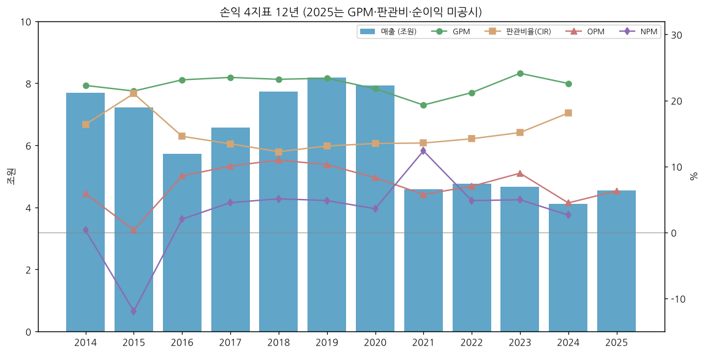

### ② 재무상태표 (12년 연결, 조원)

| 연도 | 자산총계 | 부채총계 | 자본총계 | 지배지분 | 부채비율 | 유동비율 | 현금성자산(억) | 재고자산(억) |
|---|---|---|---|---|---|---|---|---|
| 2014 | 11.96 | 8.67 | 3.29 | 2.80 | 263.6% | 122.0% | 3,630 | 17,051 |
| 2015 | 11.38 | 8.28 | 3.10 | 2.02 | 266.8% | 97.9% | 5,600 | 15,557 |
| 2016 | 10.03 | 6.58 | 3.45 | 2.06 | 190.8% | 83.5% | 5,386 | 11,770 |
| 2017 | 10.28 | 7.10 | 3.17 | 1.59 | 223.8% | 101.9% | 9,435 | 12,550 |
| 2018 | 11.03 | 7.21 | 3.82 | 1.92 | 188.7% | 117.2% | 10,530 | 15,244 |
| 2019 | 11.34 | 7.07 | 4.27 | 2.22 | 165.7% | 96.0% | 7,562 | 17,863 |
| 2020 | 12.03 | 7.54 | 4.49 | 2.38 | 167.9% | 130.1% | 16,635 | 15,899 |
| 2021 | 4.78 | 3.41 | 1.37 | 1.37 | 249.1% | 117.0% | 5,454 | 10,776 |
| 2022 | 4.74 | 3.10 | 1.64 | 1.64 | 189.7% | 151.0% | 2,984 | 13,152 |
| 2023 | 4.42 | 2.61 | 1.81 | 1.82 | 143.7% | 157.1% | 2,395 | 14,255 |
| 2024 | 4.29 | 2.44 | 1.85 | 1.85 | 132.1% | 155.0% | 2,588 | 13,643 |
| 3Q25 | 4.52 | 2.53 | 1.99 | 1.99 | 127.4% | 182.7% | 3,142 | 13,497 |

(2014\~2020 무형자산 4.1\~4.6조 = 밥캣 인수 영업권 등 → 2021 0.17조. 2016\~2020 지배지분 < 자본총계 차이 = 밥캣 비지배지분(IPO 후 약 1.4\~2.1조))

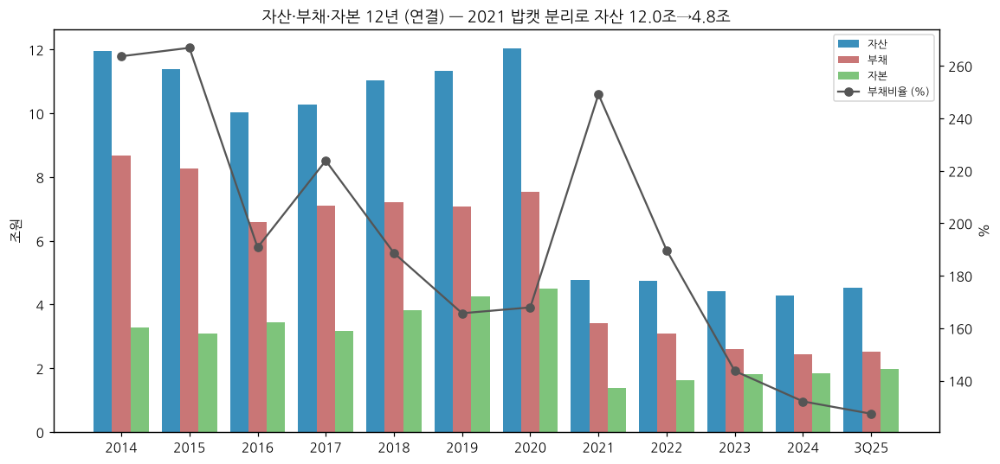

### ③ 현금흐름표 (11년 연결 + 9M25, 억원)

| 연도 | 영업CF | 투자CF | 재무CF | CapEx(유형) | CapEx(무형) | 배당지급 | FCF |
|---|---|---|---|---|---|---|---|
| 2014 | 2,313 | -4,285 | 2,814 | 2,148 | 835 | n/a | -670 |
| 2015 | 2,367 | -969 | 820 | 2,148 | 698 | n/a | -480 |
| 2016 | 5,130 | 9,096 | -14,544 | 1,739 | 642 | n/a | 2,748 |
| 2017 | 6,657 | -2,563 | 323 | 1,342 | 775 | 469 | 4,540 |
| 2018 | 8,378 | -3,128 | -4,226 | 1,508 | 1,096 | 537 | 5,774 |
| 2019 | 5,674 | -3,394 | -5,498 | 2,667 | 1,828 | 540 | 1,179 |
| 2020 | 10,508 | -5,032 | 4,289 | 2,201 | 957 | 294 | 7,350 |
| 2021 | 1,981 | -1,763 | 5,728 | 1,193 | 369 | 0 | 419 |
| 2022 | 177 | -909 | -2,142 | 895 | 313 | 0 | -1,031 |
| 2023 | 4,475 | -1,218 | -3,875 | 1,165 | 301 | 479 | 3,010 |
| 2024 | 4,433 | -1,720 | -2,743 | 1,317 | 397 | 219 | 2,718 |
| 9M25 | 1,838 (3Q 단독 기준 아님, 9M 보고서 당기) | -1,160 | -166 | 1,079 | 252 | 134 | 507 |

(FCF = 영업CF − 유·무형자산 취득. 2016 투자CF +9,096 = 공작기계 매각 대금, 재무CF -1.45조 = 차입 상환. 2017\~2020 배당지급은 두산밥캣의 비지배주주 배당 등으로 인프라코어 보통주 배당 아님(2014\~2021 보통주 DPS 0). 9M25 CF는 3분기 보고서 '당기' 컬럼 값으로, 누적/3개월 구분은 원문 재확인 필요 — ⚠️)

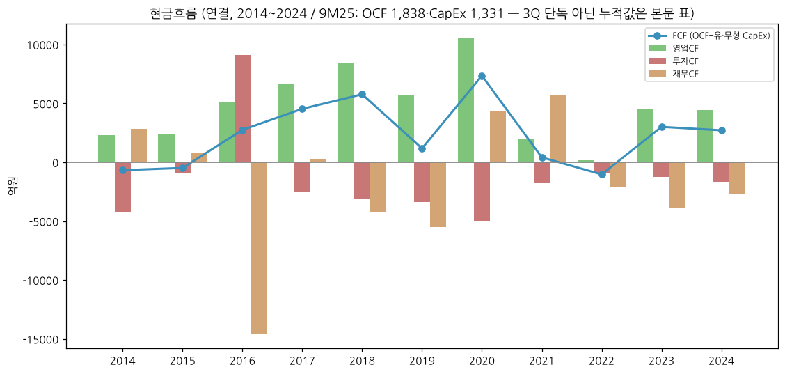

### ④ CapEx 추이 (억원)

| 연도 | 유형 | 무형 | 총 CapEx | CapEx/매출 |
|---|---|---|---|---|
| 2014 | 2,148 | 835 | 2,983 | 3.9% |
| 2015 | 2,148 | 698 | 2,846 | 3.9% |
| 2016 | 1,739 | 642 | 2,382 | 4.2% |
| 2017 | 1,342 | 775 | 2,117 | 3.2% |
| 2018 | 1,508 | 1,096 | 2,604 | 3.4% |
| 2019 | 2,667 | 1,828 | 4,495 | 5.5% |
| 2020 | 2,201 | 957 | 3,159 | 4.0% |
| 2021 | 1,193 | 369 | 1,562 | 3.4% |
| 2022 | 895 | 313 | 1,208 | 2.5% |
| 2023 | 1,165 | 301 | 1,466 | 3.1% |
| 2024 | 1,317 | 397 | 1,714 | 4.2% |

- 투자 실적 (DART 집행중인 투자, 억원): 2022 1,001 / 2023 1,282 / 2024 1,259 — 2024 엔진 594 (생산능력 증대 353) vs 건기 550
- **향후 투자계획 2025\~2027: 총 5,350억** (건기 2,073 / 엔진 2,811 / 공통 466) — 엔진 양산시설 비중 최대 (DART 사업보고서(2024.12))

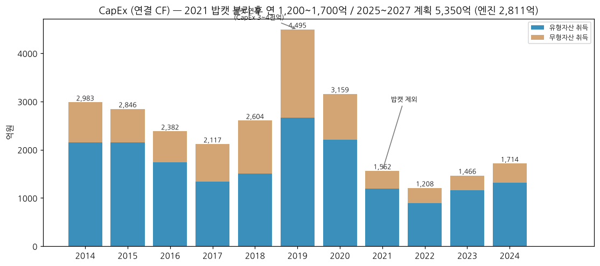

### ⑤ 부채구조 (억원)

| 연말 | 총차입금 | 현금+예금 | 순차입금 | 차입금/자본 | 이자비용 | 이자보상배율 |
|---|---|---|---|---|---|---|
| 2014 | 60,855 | 3,630 (현금성) | 57,225 | 185% | - | - |
| 2015 | 60,217 | 5,600 (현금성) | 54,617 | 194% | - | - |
| 2016 | 44,232 | 5,386 | 38,846 | 128% | - | - |
| 2017 | 46,490 | 9,435 | 37,055 | 147% | - | - |
| 2018 | 42,688 | 10,530 | 32,158 | 112% | - | - |
| 2019 | 39,035 | 7,562 | 31,474 | 91% | - | - |
| 2020 | 42,891 | 16,635 | 26,257 | 96% | - | - |
| 2021 | 17,597 | 6,253 | 11,344 | 128% | 943 | 2.8x |
| 2022 | 15,722 | 3,522 | 12,200 | 96% | 757 | 4.4x |
| 2023 | 12,539 | 2,847 | 9,692 | 69% | 694 | 6.0x |
| 2024 | 11,134 | 3,096 | 8,038 | 60% | 570 | 3.2x |
| 3Q25 | 11,714 | 3,718 | 7,996 | 59% | 392 (9M) | - |

(2014\~2021 차입금 = 단기차입금+유동성장기차입금+유동성사채+사채+장기차입금 (OpenDART BS), 현금 = 현금성자산(2014\~2020). 2021\~3Q25 = DART '위험관리' 부채비율 표 (차입금·예금). 2016 신종자본증권 5,083억은 자본 계상, 2017 BW 5,000억으로 콜옵션 상환)

→ 밥캣 인수 차입(2007)의 잔재로 2014\~2015 순차입금 5.5조 → 공작기계 매각(2016)·밥캣 IPO로 축소 → 분할합병(2021) 후 1조원대 → 3Q25 0.8조 (차입금/자본 59%)

### ⑥ 배당·자사주 추이

| 사업연도 | 보통주 DPS(원) | 배당총액(억원) | 연결 배당성향 | 자사주 |
|---|---|---|---|---|
| 2014\~2021 | 0 | 0 | - | - |
| 2022 | 240 | 474 | 20.6% | - |
| 2023 | 110 | 219 | 9.5% | - |
| 2024 | 70 | 134 | 12.4% | 560억 매입 → 6,947,586주 소각 (2024-08-13) |
| 2025 | 결산배당 없음 (소멸) | - | - | 3,739,794주 소각 (2025-08-06), 9M25 CF 자사주 취득 314억 |

(DART 배당에 관한 사항. 2025 결산배당은 소멸법인이라 없음 — HD건설기계가 2026 주주환원 873억 발표(다음 뉴스 2026-02))

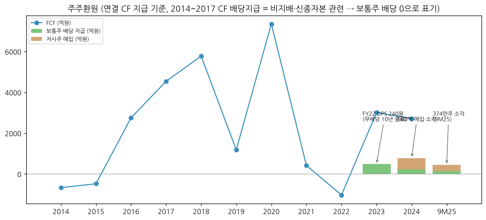

### ⑦ 재무 비율

| 연도 | ROE(지배) | ROA | 부채비율 | 유동비율 | OP/금융원가 |
|---|---|---|---|---|---|
| 2015 | -34.0% | -7.4% | 266.8% | 97.9% | 0.0x |
| 2016 | 3.1% | 1.1% | 190.8% | 83.5% | 1.1x |
| 2017 | 8.1% | 2.9% | 223.8% | 101.9% | 1.4x |
| 2018 | 14.0% | 3.7% | 188.7% | 117.2% | 2.8x |
| 2019 | 11.6% | 3.5% | 165.7% | 96.0% | 2.5x |
| 2020 | 6.5% | 2.4% | 167.9% | 130.1% | 1.7x |
| 2021 | 24.6% | 6.8% | 249.1% | 117.0% | 1.6x |
| 2022 | 15.3% | 4.8% | 189.7% | 151.0% | 1.8x |
| 2023 | 13.4% | 5.0% | 143.7% | 157.1% | 2.6x |
| 2024 | 5.9% | 2.5% | 132.1% | 155.0% | 1.2x |

**주요 비율 의미:**
- **ROE**: 지배순이익 / 평균 지배지분. 2021 24.6%는 중단영업이익(밥캣) 4,563억 + 평균자본 축소 효과로 왜곡 — 계속영업 기준 아님
- **부채비율**: 2015 266.8% → 2024 132.1% → 3Q25 127.4% (재무구조 개선 지속)
- **OP/금융원가**: 금융원가에 외환손실 포함 → 실제 이자보상배율(DART)은 2022 4.4x / 2023 6.0x / 2024 3.2x

---

## 5. 지배 구조

### ① 그룹·계열 관계

- **HD현대그룹** (2021-08 편입): HD현대(주) → HD현대사이트솔루션(주) (100%) → HD현대인프라코어 (34.86%) / HD현대건설기계 — 건설기계 중간지주 구조
- 2021 이전: **두산그룹** — 두산중공업(현 두산에너빌리티) 36.40\~34.97% → 두산인프라코어 → 두산밥캣
- 합병 후(2026-01-01\~): HD현대사이트솔루션 → **HD건설기계** (존속법인, HYUNDAI·DEVELON 듀얼 브랜드). 인프라코어 법인 소멸
- 종속기업: 16개사 (2024말, 중국·유럽·미주·기타) — Doosan Infracore China(DICC, 2021-10 잔여 20% 3,050억 취득으로 100%), 엔진 중국법인 등

### ② 주주 구분

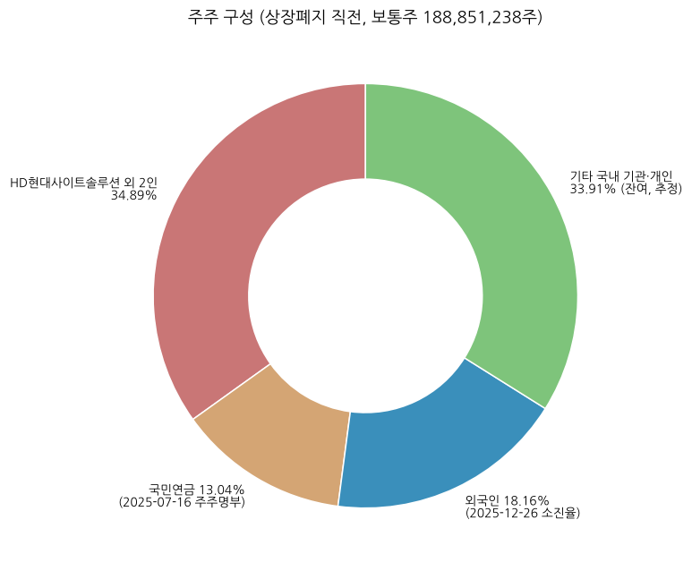

**5% 이상 주주 (보통주, 소멸 직전):**

| 주주명 | 지분율 | 기준일 / 출처 |
|--------|--------|------|
| HD현대사이트솔루션 (최대주주) | 34.86% (65,836,710주) | 2025-09-30, DART 분기보고서 |
| 최대주주 등 합계 (특수관계인 2인 포함) | 34.89% | 2025-09-30 |
| 국민연금공단 | 13.04% (25,108,043주) | 2025-07-16 주주명부 |
| 우리사주조합 | 0.26% | 2025-07-16 |

**지분 변화 history:** 두산중공업 36.40% (2014\~2016) → 34.97% (2020, BW 행사 희석) → 2021-08 현대제뉴인(현 HD현대사이트솔루션) → 34.17% (2024, 자사주 소각 전 기준) → 34.86% (2025-09, 소각 후)

**전체 주주 구분 (추정, 2025-12):**

| 구분 | 지분율 | 비고 |
|---|---|---|
| HD현대사이트솔루션 외 | 34.89% | 공시 |
| 국민연금 | 13.04% | 2025-07 |
| 외국인 | 18.16% | 네이버 증권 외국인소진율 2025-12-26 |
| 기타 국내기관·개인 | \~33.9% | 잔여 (추정) — 소액주주 121,154명, 50.81% (2025-07-16) |

- 발행주식: 보통주 188,851,238주 (액면 1,000원, 2025-09-30) — 합병 시 HD건설기계 신주 약 3,063만 주 배정 (스마트투데이 보도)

### ③ 임원·이사회

**대표이사 (소멸 직전, DART 사업보고서(2024.12)):**
- **조영철 사장** (1961.05) — 고려대 농업경제학, HD현대사이트솔루션 대표이사 겸직, 2021-10 취임
- **오승현 사장** (1965.03) — 서울대 기계공학, 한국건설기계산업협회 회장, 2022-03 취임

**등기임원:**

| 구분 | 성명 | 직위·담당 | 주요 경력 | 임기만료 |
|---|---|---|---|---|
| 사내이사 | 조영철 (1961.05) | 대표이사 사장 | HD현대사이트솔루션 대표 겸 | 2025-03 → 재선임 |
| 사내이사 | 오승현 (1965.03) | 대표이사 사장 | 한국건설기계산업협회 회장 | 2026-03 |
| 사외이사 | 전명호 (1968.04) | 감사위원 | 김앤장 변호사, 법제처 법령해석심의위원 | 2026-03 |
| 사외이사 | 강선민 (1972.01) | 감사위원 | 중앙대 경영학부 교수 (회계) | 2025-03 |
| 사외이사 | 성윤모 (1963.06) | 감사위원 | 전 산업통상자원부 장관, 전 특허청장 | 2027-03 |

(합병으로 2026-01-01 인프라코어 이사회 소멸 — 통합법인 경영진은 HD현대건설기계 리포트 참조)

---

## 6. 기타 팩트

### ① R&D 인프라

| 연도 | 2014 | 2015 | 2016 | 2017 | 2018 | 2019 | 2020 | 2021 | 2022 | 2023 | 2024 | 9M25 |
|---|---|---|---|---|---|---|---|---|---|---|---|---|
| 연구개발비용 (억원) | 2,063 | 1,918 | 976 | 1,121 | 1,351 | 1,494 | 1,367 | 1,358 | 1,612 | 1,843 | 2,016 | 1,488 |
| **R&D / 매출** | **4.9%** | **5.5%** | **4.4%** | **4.2%** | **4.4%** | **4.8%** | **5.02%** | **3.75%** | **3.82%** | **3.68%** | **4.91%** | **4.61%** |

(DART 사업보고서 II-6 '연구개발비용 계', 지배회사 기준. 2014\~2015 공작기계 포함, 2016 이후 공작기계 제외 재작성)

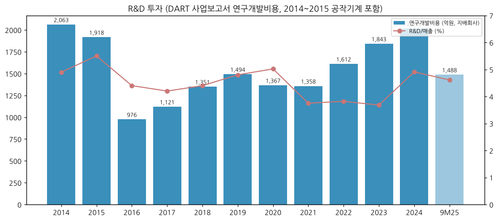

- 연구조직: 건기 제품개발 / 엔진 제품개발 — 연구인력 659명 (국내 655, 박사 9·석사 115, 2024말)
- 2024 연구과제 129건 (개량 35, 신기술·신제품 81, 미래사업 13)
- 지식재산: 출원 국내 1,083 / 해외 1,857건, 등록 국내 752 / 해외 1,153건 (2024말)
- 주요 과제: 굴착기 자동화(무인화), 유압·동력계 핵심기술 자가화, 유럽 배기규제 엔진, 디젤/가스·수소엔진, 산업·상용차용 배터리팩

### ② 진행 중 corporate action — 10년치 주요 이벤트

```
2026  · 01-01 HD현대건설기계에 흡수합병, HD건설기계 출범 (인프라코어 소멸)
      · 군산 MW급 발전기 엔진 공장 완공 임박 (2027 양산)
2025  · 07-01 합병 결의 (1 : 0.1621707) / 09-16 양사 임시주총 승인 (찬성 99%+)
      · 주식매수청구권 행사기간 09-16 → 10-10 (계약 해제 조건: 인프라코어 청구액 2,500억 초과)
      · 08-06 자사주 3,739,794주 소각 / 12-26 최종 매매일
2024  · 자사주 560억 매입·6,947,586주 소각 (08-13)
2023  · HD현대인프라코어 사명 변경 (03), 튀르키예 전차 엔진 1,102억 (02)
2022  · 폴란드 K2 전차 엔진 1,830억 (12)
2021  · 현대중공업그룹 인수 (02 계약 → 08 최대주주 변경), 07-01 밥캣 분할합병
      · 10 액면 감액 5,000→1,000원, DICC 20% 3,050억 취득 / 12 유상증자 115,107,913주
2017  · BW 5,000억 (08) — 신종자본증권 콜옵션·차입 상환
2016  · 공작기계 매각 (04) / 두산밥캣 KOSPI 상장 (11)
```

### ③ 기술·제품 마일스톤 — 10년치

```
2026  · 엔진: 데이터센터 발전기용 엔진 판매 호조, 군산 MW급 디젤엔진·인천 대형 가스엔진 라인 증설
2025  · 엔진 OPM 2Q25 20.5% (분기 최고권)
2024  · 미국·한국 특허: 건설현장 호출 공유, 주변환경 인지, 전기굴착기 전력공급장치 등
2023  · DEVELON 브랜드 (건설기계), 튀르키예 차세대 전차 엔진
2022  · K2 전차 엔진 (폴란드 수출), G2 엔진 독일 KION 지게차 공급
2020  · 한국 Stage V 배기규제 대응 엔진 (12월 발효)
2019  · 유럽 Stage V 대응
```

### ④ 주요 리스크 (소멸 전 기준 — 통합법인으로 승계)

- **건설기계 사이클**: 2024 건기 OPM 0.9%, 해외 가동률 36% (2024) — 중국·신흥국 수요 변동
- **환율**: 수출 비중 82% — 원화 강세 시 환차손 (DART: 외화 수금 > 지출 구조), 통화선도 헤지
- **우발채무**: 피소 소송 청구액 117억 (2021말) / DICC 소송은 2021-10 잔여지분 취득으로 종결
- **엔진 방산 계약 집중**: 폴란드 K2 엔진 계약 2025-12 종료 → 후속 계약 여부
- **합병 PPA**: 통합 초기 PPA 상각비 연 400\~440억 (alphadistill 2026-04) — 통합법인 이익 희석
- **배기규제**: Tier 4 Final·Stage V·China 4 대응 R&D 부담

### ⑤ ESG 등급

| 평가기관 | 등급 | 비고 |
|---------|------|------|
| KCGS | 미확인 | 소멸법인 — 본 작업에서 미조회 (❌) |

### ⑥ 인증·라이선스

- 배기규제 인증: 한국 Stage V (2020-12), 미국 EPA Tier 4 Final, 유럽 Stage V, 중국 China 4 대응 (DART)
- 방산: K2 전차용 엔진 공급 실적 (현대로템), 튀르키예 차세대 전차 (BMC)
- 건설기계관리법 형식승인 (국토교통부)

---

## Version Log

**v1.0 (2026-11-25) — 신규 작성 (합병 소멸 법인 히스토리 리포트, 최종 버전)**
- ① 데이터 수집: OpenDART fnlttSinglAcntAll (연결 40개 JSON, 2015 FY\~3Q25 + 2014 비교컬럼) → 12년 손익·재무상태·현금흐름·CapEx 원값. dart_quarterly_summary (1Q16\~3Q25)
- ② DART 정기공시 원문 XML 44건 파싱 (일부 cp949 인코딩): 영업부문 주석 → 엔진·건기·밥캣·공작기계 분기 시계열 1Q15\~3Q25 (누적값 차분), 생산능력·가동률, 수출/내수, R&D 12년, 임직원 11년, 주주·임원, 차입금·이자보상배율, 주식수 변동 (2021 병합 0.3104974, 2021-12 유상증자, 2024·2025 소각)
- ③ 합병 검증: 합병비율 1:0.1621707·합병기일 2026-01-01 (다음/한경 보도), 임시주총 2025-09-16 (한국경제), 최종 매매일 2025-12-26 (네이버 시세: 2025-12-29부터 거래량 0), 통합법인 HD건설기계·267270 (alphadistill)
- ④ 시장 데이터: 네이버 증권 일별 시세 (Yahoo Finance 042670.KS는 상장폐지로 404) + stockanalysis 연말 시총
- ⑤ 2025 연간·2026 엔진 부문 = 언론 보도 (HD건설기계 실적 발표)
- ⑥ 차트 15종: chart1·1b·2(×3: 건설기계·엔진·두산밥캣)·4·5·6·7·8·9·10·11·12 + chart13 (밥캣 제외 비교)

**잔여 보완 후보 (갱신 없음 — 필요 시 HD현대건설기계 리포트에서 처리):**
- 상장폐지일 공식 확인 (KRX 공시) — 네이버 시세 데이터는 2026-01-23까지 기준가 표시 → 상장폐지일 2026-01 하순 추정 (⚠️ 미검증)
- 2025 연간 GPM·순이익·연말 재무상태표 (통합법인 합병 주석 또는 감사보고서에서 보강 가능)
- 2014\~2015 밥캣 분리 부문 수치, KCGS ESG 등급
