> 종목: HD현대중공업 (329180.KS / 에이치디현대중공업 주식회사 / HD HYUNDAI HEAVY INDUSTRIES CO.,LTD.)
> 섹터: 조선 (섹터 T2 주도 후보)
> 서브섹터: 조선
> 작성 시각: 2026-11-14 KST (**v1.2** — HHI 분기 IR 실적발표 20건 + DART 기업정보 API 반영 / v1.1 (2026-11-03) — OpenDART 재무 API 검증 반영 / v1.0 — 신규 작성, v4.8 표준 6개 섹션 + 1번 섹션 retrofit 표준 5요소 적용)
> 적용 구조: v4.8 (6개 섹션 + 12종 차트 표준 + 합병 PF 비교 chart13 추가)
> 데이터: 연결 연간 7개년 (2019*~2025, *2019 = 6~12월 7개월) + 연결 분기 23개 (1Q21~3Q26P) + 사업부별 분기 23개 (1Q21~2Q26 DART + 3Q26P IR, 조선·해양플랜트·엔진기계·기타) + **조선 내 상선/함정(특수선) 분기 23개 (1Q21~3Q26P, IR)** + 수주잔고 연간 FY20~FY25 + 2Q26 (원화) + Yahoo 시가총액 월간 (2021.10~2026.11) + 컨센서스 2026E~2029E (BT 제공)
> 출처: **DART OpenAPI (corp_code 01390344)** — 사업보고서 2020~2025 / 분·반기보고서 2021.03~2026.06 원문 (document.xml, 영업부문 주석·연구개발·주주·임원·직원·수주상황) + 재무제표 API (fnlttSinglAcntAll, CFS) + 분기 요약 (`quarterly_summary_CFS`, 1Q21~2Q26) + 기업개황·정기보고서 주요정보 API (company / 최대주주·임원·직원·배당·자기주식·주식총수, 2025 사업보고서 rcpNo 20260320000859), **2026.10.28 연결 영업(잠정)실적 공시** (rcpNo 20261028800199), **HHI 분기 IR 실적발표 PDF 20건 (2022.02.07 4Q21 ~ 2026.10.28 3Q26, irgo.co.kr 수집)**, HD현대미포 (corp_code 00164609) 2024 사업보고서·2025 분기보고서 재무 API, Yahoo Finance v8 329180.KS, 네이버 증권 (2026-11-03 시총·외국인 지분·PER/PBR)
> 기준 시점: 확정 재무 = **2Q26 반기보고서 (2026.06.30)**, 분기 손익 = **3Q26 잠정실적 (2026.10.28 공시, 외부감사인 검토 전)**, 3Q26 사업부별 = **HHI 3Q26 IR (2026.10.28, 감사 전, 외부매출 기준)** — DART 3Q26 분기보고서 미제출 (기한 11/16)
> **Fact verify cutoff**: 2026-11-03 (시가총액·주가 = Yahoo Finance / 네이버 증권 2026-11-03 조회, 합병 비율 = 2025.08.27 언론 보도 + DART 2025 사업보고서) / v1.2 IR·기업정보 보강분 = 2026-11-14

# HD현대중공업 기업 개요 (v1.2 — 조선 T2 주도 후보, 2019 물적분할 법인 + 2025.12 HD현대미포 흡수합병)

## 1. 기업 분류

① Primary / Secondary 분류

(1) **Primary: 사이클 (조선 수주 사이클, 분할 후 7개년 OPM range +21.2%pt)**

→ 2019 물적분할 이후 7개년 연결 OPM -9.6% (2021) ~ +11.6% (2025) = range +21.2%pt, cutoff ±10%pt의 2.1배 → 정량 룰상 사이클 분류

→ 매출의 71% (FY25 부문 매출 기준)가 조선, 조선 부문 손익은 2~3년 전 수주 선가와 현재 원가(강재·인건비·환율)의 스프레드로 결정 → 전형적 수주-인도 시차 사이클

→ 2021 저점 (강재가 급등 공사손실충당금 + 통상임금 소송 충당부채) → 2023 흑전 → 2025~2026 고선가 물량 매출화로 정점권 진행 중

(2) **Secondary: 엔진기계 (발전엔진·데이터센터향) + 함정·특수선 secular 일부**

→ 엔진기계 부문 OPM FY23 10.5% → FY25 17.9% → 2Q26 24.3% — 조선 사이클과 별개로 분산 발전·데이터센터 전력 수요가 붙는 구간 (2026.09 대출력 발전엔진 공장 8,336억 투자 결정)

→ 함정·특수선 (이지스함·잠수함·미 해군 MRO·해외 함정 수출)은 DART상 조선 부문에 포함되나 **HHI IR에서 상선/함정 분리 공시** (v1.2 반영) → FY25 함정 매출 11,161억 (조선 부문의 9.0%, 연결 매출의 6.3%) / OP 1,261억 (OPM 11.3%), 9M26 8,398억 (조선의 6.0%) / OP 909억 (10.8%) → **현재 정량 비중은 한 자릿수 %로 작아 Secondary 근거로는 보조적** (3번 섹션 ①(1-1))

(3) **Entity 구조 (보고부문 4개, 2025.12 합병으로 편입된 미포 사업은 조선 부문에 포함)**

→ **조선** — FY25 부문 매출 125,175억 (71%) / 부문 OP 15,263억 — 상선 (LNG선·컨테이너선·탱커) + 함정 + (2025.12~) 미포 중형선 (PC선·중형 컨테이너선 등). IR 외부매출 기준 내역: 상선 113,470억 / OP 14,002억 (12.3%), 함정 11,161억 / OP 1,261억 (11.3%)

→ **엔진기계** — FY25 38,642억 (22%) / OP 6,936억 — 선박용 대형엔진 (2행정, Everllence·WinGD 라이선스) + 힘센(HiMSEN) 중형엔진 + 발전엔진 + HD현대엔진(유)

→ **해양플랜트** — FY25 12,390억 (7%) / OP 1,426억 — FPSO·FPU·해상구조물

→ **기타** — FY25 877억 / OP -3,248억 — 레저·공연장 + 본사 공통비

② Summary Box (분할 후 7개년 연결, 2019*~2025 + 사이클 통계)

| 지표 | 값 | 비고 |
|---|---|---|
| 매출 CAGR | **+16.2%** (2020→2025, 5년) | 2022→2025 3년 CAGR +24.8% / 2025는 미포 12월 1개월 포함 |
| OPM 평균 | **+1.1%** (2019*~2025 7개년 단순평균) | 2020~2025 6개년 +0.9% |
| OPM 정점 (연도) | **11.6% (2025)** | 분기 정점 16.4% (2Q26), 사이클 정점 진행 중 |
| OPM 저점 (연도) | **-9.6% (2021)** | 분기 저점 -21.7% (2Q21) |
| 사이클 주기 | 법인 기준 측정 불가 (7개년) — 조선 산업 장기 사이클 약 20년 (1970년대·2000년대·2020년대 수주 호황, 업계 통설) | 분할 전 구 현대중공업 시계열 미확보 |
| 사이클 회수 (7개년) | **저점 1회 (2021) / 정점 0회 (진행 중)** | 2023 흑전 후 4년째 OPM 상승 |

```
[HD현대중공업 연결 손익 시계열 (억원, DART)]
연도        매출       OP        OPM     NI(지배)
2019*      54,567     1,295     2.4%      -889   ← 2019.06.01 한국조선해양에서 물적분할 신설 (7개월), 2016~2018 저가 수주 물량 인도 구간
2020       83,120       325     0.4%    -4,314   ← 코로나 발주 공백 + 저선가 물량, 해양플랜트 적자 지속
2021       83,113    -8,003    -9.6%    -8,142   ← 사이클 저점: 2Q21 강재가 급등 공사손실충당금 + 4Q21 통상임금 소송 충당부채 / 2021.09 KOSPI 상장
2022       90,455    -2,892    -3.2%    -3,521   ← 2021 수주 호황 시작했으나 매출은 여전히 저선가 물량 → 적자 축소
2023      119,639     1,786     1.5%       247   ← 흑전: 2021~22 고선가 수주분 매출 인식 개시, 매출 +32%
2024      144,865     7,052     4.9%     6,215   ← 업사이클 가속: 조선 OPM 6.6%, Heavy-tail 선수금 유입으로 OCF 2.9조
2025      175,806    20,375    11.6%    14,155   ← 정점권 진입: 조선 12.2%·엔진 17.9%·해양 흑전 / 2025.12.01 HD현대미포 흡수합병 (12월 1개월 반영)
---------------------------------------------------------------------
2026E     245,950    39,787    16.2%    31,529   ← 컨센서스 (BT 제공) — +40% 중 약 +26%p는 합병 효과 (아래 ③(3) 참조)
2027E     264,458    46,740    17.7%    36,768   ← 컨센서스
2028E     284,283    54,707    19.2%    43,606   ← 컨센서스
2029E     313,970    57,330    18.3%        -    ← 컨센서스 (NI 미제공)

OPM range: -9.6% ~ 11.6% = +21.2%pt (cutoff ±10%pt의 2.1배 → 사이클 분류)
사이클 회수: 저점 1회 (2021) → 정점 진행 중 (2025~2026 분기 OPM 15~16%)
```

→ **컨센서스 교차검증**: BT 제공 과거치 (2021~2025 매출·OP·NI)는 DART 연결 확정치와 **5개년 전부 억원 단위까지 일치** (차이 없음)

③ 정량적 분류 근거

(1) 연간 시계열 + chart1

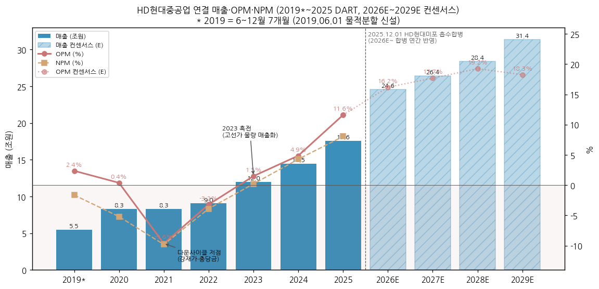

→ (출처: DART 사업보고서 2020~2025 연결 포괄손익계산서, 2026E~2029E는 BT 제공 컨센서스)

→ **사이클 위치**: 2021 저점 → 2023 흑전 → 2025 OPM 11.6% → 1~3Q26 분기 OPM 15.3% / 16.4% / 15.6% = **정점권 고원 (plateau) 진입**. 3Q26P는 조업일수 감소·원화 강세로 QoQ 매출 -9.1%, OP -13.5% (HHI 3Q26 IR 기재 사유: 조선 = 조업일수 감소·원화 강세·일회성 비용, 조선 OP QoQ -24.1%)

(2) 사업부 기여 구조 (FY25 부문 매출·OP)

→ 조선: 매출 71% / 부문 OP 합계 대비 75% → 조선 사이클이 Primary driver

→ 엔진기계: 매출 22% / OP 34% → OPM이 조선보다 5~7%pt 높은 고마진 축, Secondary 근거

→ 해양플랜트: 매출 7% / OP 7% → 2021~2024 적자 사업부, 2025 흑전 (11.5%)

→ 기타: OP -3,248억 (본사 공통비 성격) → 부문 OP 합계 20,377억 대비 -16%

(3) **합병 전/후 비교 기준 (HD현대미포 흡수합병 효과 분리)**

→ 합병은 **동일지배하 사업결합 (장부금액법)** — 미포 자산·부채를 HD한국조선해양 연결장부금액으로 인식, **과거 재무제표는 재작성하지 않음** (1Q26 분기보고서의 비교기간 1Q25 매출 38,225억 = 합병 전 수치 그대로)

→ 따라서 **2026년 보고 YoY (+30~55%)는 합병 효과 포함**, 유기적 성장은 2025 양사 단순합산 (PF) 대비로 봐야 함

| 분기 | 2025 HHI (합병 전) | 2025 HD현대미포 | 2025 단순합산 PF | 2026 HHI (합병 후) | 보고 YoY | PF 대비 YoY |
|---|---|---|---|---|---|---|
| 1Q 매출 | 38,225 | 11,838 | 50,063 | 59,163 | +54.8% | **+18.2%** |
| 2Q 매출 | 41,471 | 12,344 | 53,815 | 63,322 | +52.7% | **+17.7%** |
| 3Q 매출 | 44,179 | 13,003 | 57,182 | 57,536 (P) | +30.2% | **+0.6%** |
| 1Q 영업이익 | 4,337 | 685 | 5,022 | 9,054 | +108.8% | **+80.3%** |
| 2Q 영업이익 | 4,715 | 894 | 5,609 | 10,399 | +120.5% | **+85.4%** |
| 3Q 영업이익 | 5,573 | 2,008 | 7,581 | 8,992 (P) | +61.3% | **+18.6%** |

→ (출처: DART HHI·미포 분기/반기보고서 재무 API, 3Q26 = 2026.10.28 잠정. PF는 **양사 간 내부거래 (HHI 엔진 → 미포 조선소 납품 등) 미제거 단순합산**이라 실제 PF보다 과대 → PF 대비 성장률은 보수적(하단) 추정치)

→ 3Q26 PF 대비 OP +18.6%는 언론 보도 ("작년 3분기 양사 영업이익 단순 합산 대비 약 18.6% 증가")와 일치

→ **FY25 PF (E)**: HHI 175,806 + 미포 1~11월 (1~9월 실적 37,186 + 10~11월 3Q25 run-rate 추정 8,669) = **약 221,700억 (E)**, OP 약 25,300억 (E) → **2026E 컨센 245,950억은 PF 대비 약 +11%** (보고 기준 +40% 중 약 +26%p가 합병 효과, 나머지 약 +11%가 유기적 성장)

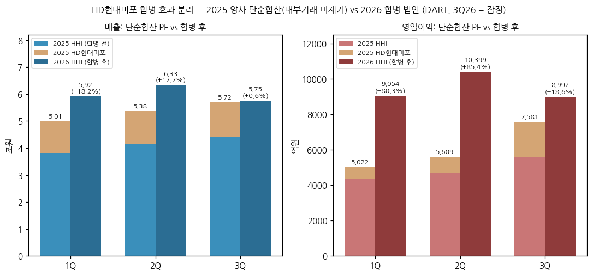

(4) 국내 피어 대비 (FY25 연결, DART)

→ **HD현대중공업** — 매출 175,806억 / OP 20,375억 / **OPM 11.6%** (국내 대형 3사 중 최고)

→ **한화오션** — 매출 127,835억 / OP 11,676억 / OPM 9.1% (FY24 2.2% → +6.9%pt)

→ **삼성중공업** — 매출 106,500억 / OP 8,622억 / OPM 8.1% (FY24 5.1% → +3.0%pt)

→ 3사 모두 같은 방향 (FY23→FY25 OPM 동반 상승) = 개별 기업 요인이 아닌 **산업 사이클** 확인

④ 산업 분류

→ **DART 사업부문** — 조선 / 해양플랜트 / 엔진기계 / 기타 (4개 보고부문)

→ **한국표준산업분류** — DART 기업개황 업종코드 **31113** (v1.2 확인). 코드 명칭은 KSIC 원표와 미대조 (v1.0 표기 '강선 건조업'은 업종코드 확인 전 추정이었음 → 잔여 보완)

→ **KRX 업종** — 운송장비·부품 (KOSPI)

→ **워치리스트 섹터** — 조선 (섹터 T2 주도 후보), 서브섹터 = 조선

⑤ 분류 결정 논리 (4단계 sub-logic)

(1) **가장 매출 큰 사업부 기준** — 조선 71% (부문 OP 75%) > 엔진기계 22% (OP 34%) > 해양 7% → 조선 수주 사이클이 Primary

(2) **사이클 사업부 영업이익 비중 우선 sub-rule** — 조선 + 해양 (둘 다 수주-인도 시차형 사이클) OP 비중 82% (FY25) → 사이클 분류 강화. 2Q26 누적 기준으로도 조선+해양 OP 비중 88% (1H26 부문 OP 합계 19,450억 중 17,105억)

(3) **Boundary case 처리** — 엔진기계 OPM 24% (2Q26) + 발전엔진 증설 + 함정 수출/MRO 확대 = secular 요소 존재 → **Primary 사이클 + Secondary 엔진기계·방산 secular 일부**. 단 엔진기계 매출의 상당 부분은 선박용 엔진 (조선 사이클 후행)이라 secular 순수 비중은 아직 낮음 (발전엔진/선박엔진 분리 공시 미확보 — HHI IR도 엔진기계를 단일 부문으로만 공시, 'DF(이중연료) 매출 비중' 정성 언급만 존재). 함정은 IR상 FY25 연결 매출의 6.3%로 정량 확인 (v1.2)

(4) **피어 cross-reference** — 국내 3사 OPM 동반 상승 (③(4)) + 미포 합병으로 중형선까지 포트폴리오 확대 → 피어 대비 **규모·마진 1위의 사이클 대표주** 위상. 순수 조선소 (삼성중공업·한화오션) 대비 엔진기계 22%가 사이클 진폭을 완충하는 구조

⑥ 적정 밸류에이션 방법 (사업부 mix → method)

→ **1차 — PBR 밴드 (사이클 기준)**: 조선+해양 OP 비중 80%+ → 이익 변동성이 커 저점 구간 PER 무의미 (2021~2022 적자). 연말 종가 기준 PBR: 2021 **1.58배** → 2022 1.86배 → 2023 1.94배 → 2024 4.84배 → 2025 **6.46배 (정점)** → 2026-11-03 **2.88배** (네이버, 2Q26 BPS 100,473원). 회사 밸류업 공시는 2024 4.5배 → 2025 5.7배 (평균주가 기준 추정)

→ **2차 — Forward PER (수주잔고 가시성 반영)**: 2Q26 수주잔고 69.5조원 = 2026E 매출의 2.8년치 → 향후 2~3년 이익 가시성이 메모리 반도체보다 높음. 2026-11-03 시총 30.3조 기준 **2026E PER 9.6배 / 2027E 8.3배 / 2028E 7.0배** (컨센 NI 기준), 네이버 추정 PER 10.71배

→ **3차 — 엔진기계 SOTP 보조**: 엔진기계 OP 비중이 30%+로 굳어지면 발전엔진 피어 (Wartsila 등) 멀티플 적용 여지 — 현재는 분리 공시 부족으로 보조 지표

→ **삼성전자 대비**: 삼성전자는 메모리 사이클 PBR 밴드 + DX 안정 사업부 PER 혼합, HD현대중공업은 **PBR 1차 + 수주잔고 기반 12MF PER 2차** — 이익 가시성은 더 길지만 신조선가 정점 통과 시 PBR 디레이팅이 이익 감소보다 먼저 온다는 사이클주 공통 패턴은 동일

⑦ 분기 재평가 트리거 (**분류 변경 조건** — 실적 추적 변수는 6번 섹션)

→ (1) **엔진기계 부문 OP 비중 (부문 OP 합계 대비) 4분기 연속 35%+ & 발전엔진 매출 별도 공시 확인 시** → Secondary 격상 → **Primary 사이클 + Secondary 지속성장 강세** (발전·데이터센터 secular 노출 확정)

→ (2) **조선 부문 OPM이 신조선가 하락 국면 (클락슨 신조선가지수 2개 분기 연속 하락)에도 4분기 연속 12%+ 유지 시** → 구조적 마진 상향 (생산성·스마트야드·선종 mix) 판정 → 사이클 진폭 축소, **사이클 → 지속성장 transition 후보**

→ (3) **수주잔고 4분기 연속 감소 + book-to-bill 1.0 미만 지속 시** → Primary 사이클 유지하되 **다운사이클 국면 판정** (Secondary 노트 강등, PBR 밴드 하단 기준 적용)

---

## 2. 회사 개요

① 기본 사항

| 항목 | 내용 |
|---|---|
| 회사명 (한글) | 에이치디현대중공업 주식회사 (2023.03 현대중공업 → HD현대중공업 상호 변경) |
| 회사명 (영문) | HD HYUNDAI HEAVY INDUSTRIES CO.,LTD. |
| 종목코드 | 329180 (KRX 유가증권시장, 2021.09 상장) |
| **설립일** | **2019년 6월 1일** (분할기일) — HD한국조선해양 (분할 전 현대중공업)에서 **물적분할** 신설. DART 기업개황 설립일 표기는 2019.06.03 |
| 본점 | 울산광역시 동구 방어진순환도로 1000 |
| **대표이사** | **이상균·금석호 각자 대표이사** (DART 기업개황) — 이상균 (부회장, 1961.01, 인하대, 前 HD현대삼호 대표) / 금석호 (사장, 1968.02, 고려대, 現 HD현대 HR지원실장 겸, 2026.03 선임) |
| 업종코드 (DART) | 31113 |
| 홈페이지 / 대표전화 | www.hhi.co.kr / 052-202-2114 |
| 발행주식수 | **104,961,225주** (합병 전 88,773,116주 + 합병신주 16,188,109주), 자기주식 28,451주 (2025 기타취득), 유통주식 104,932,774주, 발행할 주식 총수 보통주 1.2억주 (DART 주식총수 현황 2025말) |
| 최대주주 | **HD한국조선해양 69.21%** (2026.06.30, 합병 전 75.02%) |
| 종속회사 | HD현대엔진(유) (엔진기계), HD현대엠엔에스(주) (블록 생산, 2025.02 설립), HD현대이엔티(주) (2025.12 미포 합병으로 편입, 100%) 등 |
| 신용등급 | **회사채 A+ (NICE·한신평·한기평 3사, 2025.02~05 A → A+ 상향, 2025.11 합병 수시평가 A+ 유지)** |
| 시가총액 | **30조 3,338억원** (2026-11-03, 네이버 증권), 종가 289,000원 |
| 임직원 | **18,282명** (2026.06.30, 정규 15,231 + 기간제 3,051) / 2025말 18,880명 (조선 13,319 · 해양플랜트 1,872 · 엔진기계 1,849 · 기타 1,840, DART 직원현황 API) |

② 손익·자본 추이 (연결, DART 확정치)

| 연도 | 매출 | YoY | 영업이익 | OPM | NI (지배) | 자본총계 | 자산총계 | 비고 |
|---|---|---|---|---|---|---|---|---|
| 2019* (6~12월) | 54,567 | - | 1,295 | 2.4% | -889 | 56,229 | 138,695 | 분할 신설, 7개월 |
| 2020 | 83,120 | - | 325 | 0.4% | -4,314 | 53,608 | 137,997 | 첫 풀이어 |
| 2021 | 83,113 | -0.0% | -8,003 | -9.6% | -8,142 | 55,940 | 150,787 | 사이클 저점, IPO 자본 유입 |
| 2022 | 90,455 | +8.8% | -2,892 | -3.2% | -3,521 | 52,878 | 162,894 | |
| 2023 | 119,639 | +32.3% | 1,786 | 1.5% | 247 | 52,074 | 171,336 | 흑전 |
| 2024 | 144,865 | +21.1% | 7,052 | 4.9% | 6,215 | 57,044 | 193,909 | |
| **2025** | **175,806** | **+21.4%** | **20,375** | **11.6%** | **14,155** | **93,416** | **261,630** | 미포 합병 (12월분 + 순자산 2.41조 편입) |
| 2Q26 (반기말) | 1H 122,485 | +53.7% | 1H 19,453 | 15.9% | 1H 15,960 | 105,429 | 293,721 | |
| 3Q26P (분기말) | 9M 180,020 | +45.3% | 9M 28,445 | 15.8% | 9M 19,502 | 102,186 | 279,516 | 잠정 + IR 재무상태표 (감사 전) |

→ (출처: DART 사업보고서 2020~2025, 2026 반기보고서 연결재무제표. 단위 억원. 2019 수치는 2020 사업보고서 비교기간. 3Q26P 손익 = 2026.10.28 잠정공시, 자본·자산 = HHI 3Q26 IR 연결재무상태표, 9M YoY는 9M25 합병 전 123,875억 대비)

→ 3Q26P 자본 감소 (105,429 → 102,186억, -3,243억): 3Q26 순이익 3,543억 < 2Q 분기배당 6,390억 (기준일 2026.08.13) → 이 두 항목으로 -2,847억, 나머지 약 -396억은 기타포괄손익 등 (세부 미분해)

→ **2021 자본 증가**: 2021.09 IPO 신주 발행 (공모 자금 유입) — 순손실 -8,142억에도 자본 +2,332억

→ **2025 자본 +63.8%**: 순이익 14,155억 + **미포 합병 신주 발행 (식별가능 순자산 2조 4,101억 편입)** - 배당 3,339억

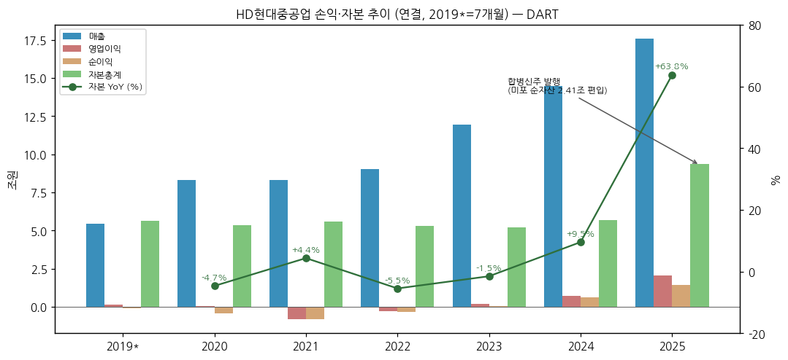

③ 법인 구조 변화 (연속성 단절 명시)

(1) **2019.06.01 물적분할** — 현대중공업 (현 HD한국조선해양)이 조선·해양·엔진 사업을 물적분할해 신설 현대중공업(주) (현 HD현대중공업) 설립, 존속법인은 중간지주사 한국조선해양으로 전환

→ **분할 전 (~2019.05) 손익은 본 법인 시계열에 포함되지 않음** — 구 현대중공업 연결 실적 (2008 정점, 2014~2016 해양플랜트 대규모 손실 등)은 HD한국조선해양 (009540) 공시 영역, 본 v1.0 미수록

→ 2019 연간 수치는 6~12월 7개월분 → 연간 비교·CAGR에서 제외 (CAGR은 2020 기준)

(2) **2021.09 KOSPI 상장** — 2021년 1~2분기는 비상장 채권발행 법인으로 분기보고서 제출 (DART 분기 시계열 1Q21부터 확보 가능)

(3) **2024.01 HD현대중공업모스(주) 흡수합병** — 소규모, 시계열 영향 미미

(4) **2025.12.01 HD현대미포(주) 흡수합병** (아래 상세)

| 항목 | 내용 |
|---|---|
| 이사회 결의 | 2025.08.27 |
| 임시주주총회 | 2025.10.23 (합병계약 승인 + 정관상 사업목적 추가) |
| **합병기일** | **2025.12.01** |
| 합병신주 상장 | 2025.12 (키움증권 자료 기준 상장 예정일 12.15) |
| **합병비율** | **HD현대미포 보통주 1주 : HD현대중공업 보통주 0.4059146주** (기준가 HHI 470,833원 / 미포 191,118원, 자본시장법상 기준주가) |
| 합병신주 | 16,188,109주 (발행주식 88,773,116 → 104,961,225주, 주식매수청구·단수주 처리분 자기주식 취득) |
| 회계처리 | **동일지배하 사업결합** — 미포 자산·부채를 HD한국조선해양 연결장부금액으로 인식, 비교기간 재작성 없음 |
| 편입 순자산 | **2조 4,101억원** (유동자산 3조 1,624억 / 비유동자산 2조 789억 / 부채 2조 8,312억) |
| 편입 수주잔고 | **11조 3,764억원** (FY25 수주상황 '사업결합' 항목) |
| 편입 CAPA | 조선 건조능력 10,000천GT → **12,467천GT** (+24.7%) |
| 부문 처리 | 미포 사업은 **조선 부문에 포함** |
| 합병 목적 (회사 공시) | 글로벌 경쟁 우위 강화 + 미래 조선업 성장 기회 극대화 (방산 매출 10년 1조→10조 목표 보도) |

→ **FY25 연결 손익에는 미포 12월 1개월분만 반영** ("HD현대미포(주)를 2025년 12월 1일 흡수합병함에 따라 HD현대미포(주)의 1개월치 매출액을 반영" — 2025 사업보고서)

→ **비교 가능 기준**: (a) 2026 이후 보고 YoY는 합병 효과 포함 → 유기적 성장은 1번 섹션 ③(3) 단순합산 PF 대비로 확인, (b) 사업부별로는 조선 부문만 영향 (해양·엔진기계는 합병 무관, 단 미포향 엔진 매출이 외부매출 → 내부매출로 전환)

→ HD현대미포 합병 전 실적 (DART, 연결): 2023 매출 40,391억 / OP -1,529억 → 2024 46,300억 / 885억 → 2025 1~9월 37,186억 / 3,587억

④ 주가 역사

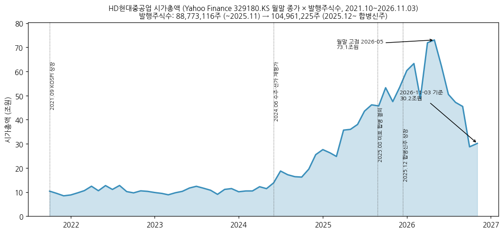

→ (출처: Yahoo Finance v8 329180.KS 월말 종가 × 발행주식수, 2021.10~2026.11.03. 상장월 2021.09는 월간 데이터 미포함)

→ **주가 변천사 (상장 후)**

(1) 2021.09~2024.05 — 시총 9~14조 박스권: 적자·흑전 초기 구간, 연말 PBR 1.6~1.9배

(2) 2024.06~2024.12 — 1차 재평가: 시총 18.7조 → 27.6조 (연말 종가 311,000원), 조선 OPM 개선 + 미 해군 MRO 자격 (2024.07)

(3) 2025 — 2차 재평가: 시총 27.6조 → 60.4조 (연말 575,000원 × 합병 후 주식수), 미포 합병 결의 (2025.08) + OPM 두 자릿수

(4) **2026.05 정점** — 월말 시총 **73.1조원** (2026-05 월말 696,000원), 일중 고가 **765,000원 (2026-05-27, Yahoo)** / 네이버 52주 최고 768,000원

(5) **2026.06~2026.10 급락** — 2026-10 월말 274,000원 (시총 28.8조, 정점 대비 -61%), 2026-11-03 종가 289,000원 / 시총 30.3조. 3Q26 잠정 (2026.10.28)은 시장 기대 하회 보도 (조업일수·원화 강세). **급락의 구조적 원인 (신조선가·수주 모멘텀·수급 등)은 본 v1.0에서 미검증** → 잔여 보완 후보

⑤ 주요 연혁

→ **2019.06** 현대중공업(주) 물적분할 설립 (존속법인 한국조선해양)

→ **2021.01** 에탄운반선 첫 인도 / 2021.06 저압식 LNG 이중연료엔진 (ME-GA) 첫 수주 / 2021.08 머스크 메탄올 추진 초대형 컨테이너선 첫 수주

→ **2021.09** 유가증권시장 상장 / 2021.11 8,100톤급 이지스함 (광개토-Ⅲ Batch-Ⅱ) 2번함 수주

→ **2022.10** 군산조선소 시범 재가동 / 2022.12 차세대 이지스함 3번함 수주

→ **2023.03** 상호 변경 (HD현대중공업), 세계 최초 대형엔진 생산누계 2억 마력 돌파

→ **2024.01** HD현대중공업모스 흡수합병 / 2024.04 3천톤급 잠수함 '신채호함' 인도, 페루 SIMA 함정 4척 수주 / 2024.07 국내 최초 美 함정 MRO 사업 참여 자격 / 2024.11 이지스구축함 '정조대왕함' 인도

→ **2025.02** HD현대엠엔에스 설립 / 2025.03 테라파워 나트륨 원자로 공급망 협약 / 2025.04 美 안두릴 무인수상정 MOU / 2025.10 美 헌팅턴 잉걸스 차세대 군수지원함 MOA

→ **2025.12.01** HD현대미포 흡수합병 완료, 합병신주 추가상장 / 페루 해군 차세대 잠수함 공동개발 계약

→ **2026.03** 대표이사 변경 (노진율 → 금석호), 독립이사 박광우 신규 선임

→ **2026.09.10** 대출력 발전엔진 공장 신설 8,336억 투자 결정 (자기자본 대비 8.92%, ~2028.05)

→ **2026.10.28** 3Q26 잠정실적 (매출 57,536억 / OP 8,992억) / 2026.11.23 임시주총 예정 (사내이사 조민수 선임)

---

## 3. 비즈니스 모델

① 실적 추이 통합 표 (5년 연간, 사업부별 → 지역별)

(1) 사업부별 (부문 매출·영업이익, 내부매출 포함, 억원)

| 부문 | FY21 | FY22 | FY23 | FY24 | FY25 | 1H26 |
|---|---|---|---|---|---|---|
| **조선 매출** | 63,206 | 64,672 | 79,015 | 106,233 | **125,175** | 96,298 |
| 조선 OP (OPM) | -1,921 (-3.0%) | -1,236 (-1.9%) | 1,488 (1.9%) | 7,026 (6.6%) | **15,263 (12.2%)** | 15,638 (16.2%) |
| **엔진기계 매출** | 14,917 | 17,411 | 27,395 | 31,654 | **38,642** | 18,753 |
| 엔진기계 OP (OPM) | 1,326 (8.9%) | 1,712 (9.8%) | 2,863 (10.5%) | 3,589 (11.3%) | **6,936 (17.9%)** | 4,213 (22.5%) |
| **해양플랜트 매출** | 4,267 | 7,853 | 12,697 | 6,492 | **12,390** | 8,351 |
| 해양 OP (OPM) | -1,693 (-39.7%) | -1,527 (-19.4%) | -372 (-2.9%) | -1,001 (-15.4%) | **1,426 (11.5%)** | 1,467 (17.6%) |
| 기타 매출 / OP | 725 / -5,715 | 780 / -1,839 | 1,161 / -2,194 | 797 / -2,563 | 877 / -3,248 | 441 / -1,868 |
| 연결 매출 (내부거래 제거 후) | 83,113 | 90,455 | 119,639 | 144,865 | 175,806 | 122,485 |
| 연결 OP | -8,003 | -2,892 | 1,786 | 7,052 | 20,375 | 19,453 |

→ (출처: DART 각 사업보고서·2026 반기보고서 연결재무제표 주석 '영업부문'. FY21 기타 -5,715억은 통상임금 소송 충당부채 신규 인식 영향 — 2021 사업보고서 주석)

→ 엔진 부문 명칭: ~FY23 '엔진' → FY24~ '엔진기계' (범위 동일)

(1-1) 조선 부문 내 상선 / 함정(특수선) 분리 (v1.2 신규, HHI IR 외부매출 기준, 억원)

| 구분 | FY21 | FY22 | FY23 | FY24 | FY25 | 9M26 (1~3Q26P) |
|---|---|---|---|---|---|---|
| **상선 매출** | 53,594 | 57,599 | 74,827 | 94,786 | **113,470** | 130,971 |
| 상선 OP (OPM) | -2,508 (-4.7%) | -1,700 (-3.0%) | 1,302 (1.7%) | 6,036 (6.4%) | **14,002 (12.3%)** | 21,192 (16.2%) |
| **함정 매출** | 9,612 | 7,073 | 4,188 | 11,447 | **11,161** | 8,398 |
| 함정 OP (OPM) | 588 (6.1%) | 464 (6.6%) | 186 (4.4%) | 990 (8.6%) | **1,261 (11.3%)** | 909 (10.8%) |
| 함정 / 조선 매출 | 15.2% | 10.9% | 5.3% | 10.8% | 9.0% | 6.0% |
| 함정 / 연결 매출 | 11.6% | 7.8% | 3.5% | 7.9% | 6.3% | 4.7% |

→ (출처: HHI 4Q21·4Q22·4Q23·4Q25 IR 연간 표 (FY24는 4Q25 IR 비교기간), 9M26 = 1Q26·3Q26 IR 분기 합산. 표기: ~FY23 '특수선' → 2024 4Q~ '함정'. 2026~ 상선에는 중형선 (구 미포) 포함 — IR 주3 "조선사업부문에 중형선(구 현대미포)과 함정(구 특수선) 포함")

→ IR 조선 계 (외부매출)는 DART 영업부문 주석 (내부매출 포함)보다 약간 작음 — FY25 IR 124,631억 vs DART 125,175억, **부문 OP는 15,263억으로 동일**. 엔진기계도 FY25 IR 37,908억 vs DART 38,642억, OP 6,933 vs 6,936억

→ **함정은 OPM이 상선보다 안정적 (FY21~FY25 4~11%)이나 매출 규모는 연 0.4~1.1조로 변동**, FY23 저점 (4,188억) 이후 FY24 1.1조로 회복 (회복 요인별 내역은 IR 미기재). 2026은 9개월 8,398억으로 FY25 페이스 (9M25 7,662억) 대비 +9.6%

(2) 지역별 (수출/내수, 제품 매출 기준, 억원)

| 구분 | FY23 | FY24 | FY25 |
|---|---|---|---|
| 수출 | 92,042 (76.9%) | 126,840 (87.6%) | **163,131 (92.8%)** |
| 내수 | 27,597 | 18,024 | 12,676 |
| 합계 | 119,639 | 144,865 | 175,806 |

→ (출처: 2025 사업보고서 'II. 사업의 내용 – 매출 및 수주상황'). 수출 비중 상승 = 함정 (내수) 대비 상선 수출 물량 확대

② 사업부별 분기 시계열 (1Q21~2Q26 DART 22개 분기 + 3Q26P IR)

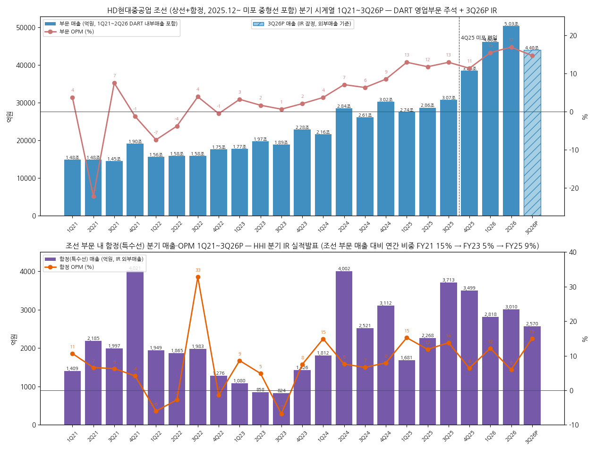

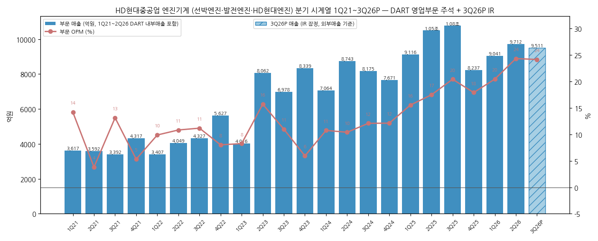

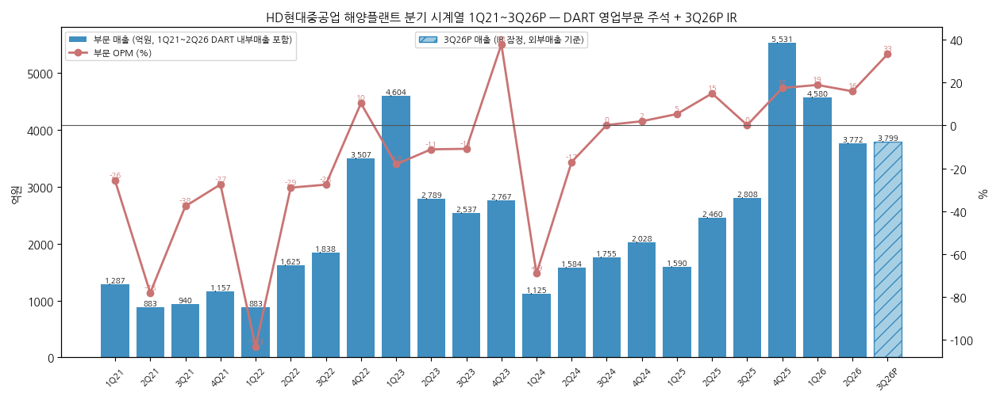

| 분기 | 조선 매출 / OP (OPM) | 해양플랜트 | 엔진기계 | 기타 |
|---|---|---|---|---|
| 1Q21 | 14,833 / 543 (3.7%) | 1,287 / -332 | 3,617 / 513 (14.2%) | 145 / -440 |
| 2Q21 | 14,835 / **-3,305 (-22.3%)** | 883 / -689 | 3,592 / 137 (3.8%) | 157 / -370 |
| 3Q21 | 14,488 / 1,085 (7.5%) | 940 / -354 | 3,392 / 446 (13.1%) | 184 / -430 |
| 4Q21 | 19,049 / -243 (-1.3%) | 1,157 / -318 | 4,317 / 230 (5.3%) | 238 / **-4,475** |
| 1Q22 | 15,566 / -1,155 (-7.4%) | 883 / -911 | 3,407 / 337 (9.9%) | 160 / -445 |
| 2Q22 | 15,780 / -601 (-3.8%) | 1,625 / -471 | 4,049 / 439 (10.8%) | 208 / -449 |
| 3Q22 | 15,781 / 614 (3.9%) | 1,838 / -507 | 4,327 / 484 (11.2%) | 200 / -445 |
| 4Q22 | 17,544 / -93 (-0.5%) | 3,507 / 363 | 5,627 / 452 (8.0%) | 212 / -500 |
| 1Q23 | 17,661 / 568 (3.2%) | 4,604 / -833 | 4,016 / 332 (8.3%) | 180 / -483 |
| 2Q23 | 19,685 / 327 (1.7%) | 2,789 / -310 | 8,062 / 1,267 (15.7%) | 212 / -600 |
| 3Q23 | 18,866 / 118 (0.6%) | 2,537 / -276 | 6,978 / 768 (11.0%) | 191 / -481 |
| 4Q23 | 22,802 / 475 (2.1%) | 2,767 / 1,047 | 8,339 / 496 (5.9%) | 578 / -630 |
| 1Q24 | 21,552 / 798 (3.7%) | 1,125 / -776 | 7,064 / 760 (10.8%) | 175 / -569 |
| 2Q24 | 28,395 / 2,009 (7.1%) | 1,584 / -270 | 8,743 / 910 (10.4%) | 210 / -693 |
| 3Q24 | 26,052 / 1,646 (6.3%) | 1,755 / 4 | 8,175 / 989 (12.1%) | 185 / -578 |
| 4Q24 | 30,235 / 2,573 (8.5%) | 2,028 / 40 | 7,671 / 931 (12.1%) | 227 / -723 |
| 1Q25 | 27,448 / 3,554 (12.9%) | 1,590 / 85 | 9,116 / 1,418 (15.6%) | 191 / -720 |
| 2Q25 | 28,632 / 3,373 (11.8%) | 2,460 / 368 | 10,517 / 1,840 (17.5%) | 226 / -866 |
| 3Q25 | 30,681 / 3,970 (12.9%) | 2,808 / 5 | 10,772 / 2,201 (20.4%) | 220 / -603 |
| 4Q25 | 38,414 / 4,367 (11.4%) | 5,531 / 968 | 8,237 / 1,476 (17.9%) | 241 / -1,058 |
| 1Q26 | **46,030 / 7,126 (15.5%)** | 4,580 / 866 | 9,041 / 1,849 (20.5%) | 197 / -791 |
| 2Q26 | **50,268 / 8,512 (16.9%)** | 3,772 / 601 | 9,712 / **2,364 (24.3%)** | 244 / -1,077 |
| **3Q26P (IR)** | **43,988 / 6,463 (14.7%)** | 3,799 / **1,265 (33.3%)** | 9,511 / 2,299 (24.2%) | 238 / -1,035 |

→ (출처: DART 분·반기·사업보고서 영업부문 주석의 **누적값 차분** (Q2 = 반기 - 1분기, Q4 = 연간 - 3분기). 부문 매출은 내부매출 포함이라 합계가 연결 매출보다 약간 큼. 단위 억원. **3Q26P = HHI 3Q26 IR (2026.10.28, 감사 전) — IR은 외부매출 기준이라 DART 부문 매출보다 약간 작게 표기됨** (2Q26 비교: 조선 IR 49,783 vs DART 50,268억, 엔진기계 9,522 vs 9,712억, 부문 OP는 동일))

→ **3Q26P 사업부별 (IR) 합계 검증**: 매출 43,988 + 3,799 + 9,511 + 238 = 57,536억, OP 6,463 + 1,265 + 2,299 - 1,035 = 8,992억 → 잠정공시 연결 수치와 일치

→ **3Q26P QoQ 사유 (IR 기재)**: 조선 매출 -11.6% / OP -24.1% (조업일수 감소·원화 강세, 일회성 비용) — 상선 OPM 17.8% → 14.7%, 함정 6.0% → 15.0% / 해양 매출 +0.7% / OP +110.5% (Ruya 공정률 확대 + 해양 프로젝트 C/O 180억 반영 → OPM 33.3%는 일회성 포함) / 엔진기계 매출 -0.1% / OP -2.7% ("원화 강세에도 판가 상승과 제품 믹스 개선", "높은 DF 매출 비중 유지")

→ **언론 수치와의 대조**: v1.1에서 HD한국조선해양 기준이라 제외했던 언론 보도 3Q26 부문 수치 중 해양 (3,798억 / 1,264억)은 HHI IR (3,799억 / 1,265억)과 사실상 일치, 엔진기계 (1조 2,012억 / 2,901억)는 HHI IR (9,511억 / 2,299억)과 불일치 → 엔진기계 언론 수치는 HHI 단독이 아닌 상위 연결 기준으로 판단, 본 문서는 IR 수치만 사용

→ **엔진기계 1H26 매출 18,753억 (1H25 19,633억 대비 -4.5%)인데 OP는 +29%** → 믹스 개선 시사. IR 기재 사유: 1Q26 "제품믹스 개선 (D/F 비중 확대) 및 판가 상승", 4Q25 매출 -24.5% QoQ는 "선박용 엔진 인도 시점 차이와 HD현대미포 합병에 따른 사내 물량 전환" → **미포향 엔진 매출의 내부거래화는 IR로 정성 확인, 금액은 미확보**

(1) 조선 부문 내 함정(특수선) 분기 시계열 (v1.2 신규, HHI IR, 억원)

| 분기 | 함정 매출 / OP (OPM) | 상선 매출 / OP (OPM) | 분기 | 함정 매출 / OP (OPM) | 상선 매출 / OP (OPM) |
|---|---|---|---|---|---|
| 1Q21 | 1,409 / 150 (10.6%) | 13,424 / 393 (2.9%) | 1Q24 | 1,812 / 270 (14.9%) | 19,739 / 528 (2.7%) |
| 2Q21 | 2,185 / 144 (6.6%) | 12,651 / -3,449 (-27.3%) | 2Q24 | 4,002 / 305 (7.6%) | 24,393 / 1,704 (7.0%) |
| 3Q21 | 1,997 / 126 (6.3%) | 12,491 / 958 (7.7%) | 3Q24 | 2,521 / 167 (6.6%) | 23,531 / 1,478 (6.3%) |
| 4Q21 | 4,021 / 168 (4.2%) | 15,028 / -410 (-2.7%) | 4Q24 | 3,112 / 248 (8.0%) | 27,123 / 2,325 (8.6%) |
| 1Q22 | 1,949 / -117 (-6.0%) | 13,618 / -1,038 (-7.6%) | 1Q25 | 1,681 / 256 (15.2%) | 25,753 / 3,298 (12.8%) |
| 2Q22 | 1,865 / -51 (-2.7%) | 13,915 / -551 (-4.0%) | 2Q25 | 2,268 / 269 (11.9%) | 26,228 / 3,104 (11.8%) |
| 3Q22 | 1,983 / **650 (32.8%)** | 13,798 / -36 (-0.3%) | 3Q25 | 3,713 / 511 (13.8%) | 26,835 / 3,459 (12.9%) |
| 4Q22 | 1,276 / -18 (-1.4%) | 16,268 / -75 (-0.5%) | 4Q25 | 3,499 / 225 (6.4%) | 34,654 / 4,141 (11.9%) |
| 1Q23 | 1,080 / 93 (8.6%) | 16,581 / 475 (2.9%) | 1Q26 | 2,818 / 343 (12.2%) | 42,780 / 6,783 (15.9%) |
| 2Q23 | 858 / 42 (4.9%) | 18,828 / 285 (1.5%) | 2Q26 | 3,010 / 180 (6.0%) | 46,773 / 8,332 (17.8%) |
| 3Q23 | 824 / -56 (-6.8%) | 18,041 / 174 (1.0%) | **3Q26P** | 2,570 / 386 (15.0%) | 41,418 / 6,077 (14.7%) |
| 4Q23 | 1,426 / 107 (7.5%) | 21,377 / 368 (1.7%) | | | |

→ (출처: HHI 분기 IR 실적발표 '사업부문별 연결기준 실적' 표, 각 분기 최신 공시본 기준. 분기 합 = 연간 IR 표 일치 (FY21~FY25 전 연도 확인). 3Q22 함정 OP 650억은 IR 기재 "특수선 L/D 환입" 영향, 2Q21 상선 -3,449억은 강재가 공사손실충당금 분기)

→ 2024.04.25 IR (1Q24)의 비교기간 1Q23 칸은 '특수선 16,581 / 상선 1,080'으로 행 라벨이 뒤바뀌어 표기 — 2023.04.27·2023.07.27 IR 원표 기준 (상선 16,581 / 특수선 1,080)으로 수록

→ 위 chart2_조선 하단 패널 = 함정 분기 매출·OPM (v1.2 추가)

③ 12분기 시계열 (연결 전사)

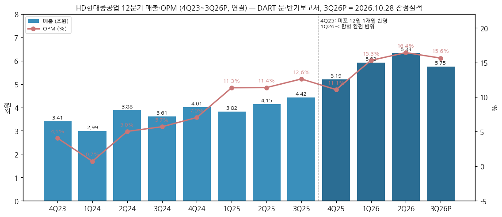

| 분기 | 매출 | YoY | 영업이익 | OPM | 비고 |
|---|---|---|---|---|---|
| 4Q23 | 34,131 | +27.6% | 1,387 | 4.1% | 해양 하자보수 충당금 환입 (IR) |
| 1Q24 | 29,877 | +13.5% | 213 | 0.7% | 해양 적자 (-776억) |
| 2Q24 | 38,840 | +26.7% | 1,956 | 5.0% | |
| 3Q24 | 36,092 | +26.5% | 2,061 | 5.7% | |
| 4Q24 | 40,056 | +17.4% | 2,822 | 7.0% | |
| 1Q25 | 38,225 | +27.9% | 4,337 | 11.3% | OPM 두 자릿수 진입 |
| 2Q25 | 41,471 | +6.8% | 4,715 | 11.4% | |
| 3Q25 | 44,179 | +22.4% | 5,573 | 12.6% | |
| 4Q25 | 51,931 | +29.6% | 5,750 | 11.1% | 미포 12월분 포함 |
| 1Q26 | 59,163 | +54.8% | 9,054 | 15.3% | 합병 완전 반영 |
| 2Q26 | **63,322** | +52.7% | **10,399** | **16.4%** | 분기 사상 최대 |
| 3Q26P | 57,536 | +30.2% | 8,992 | 15.6% | 잠정, NI 3,543억 (세전 4,749억, 영업외 -4,243억) |

→ (출처: OpenDART 분기 요약 `quarterly_summary_CFS` (1Q21~2Q26, 3개월 수치, 4Q = 연간 - 3분기 누적), 3Q26P = 2026.10.28 연결 잠정실적 공시. 전체 23개 분기 (1Q21~3Q26P) 시계열은 chart2 데이터와 동일 출처)

→ **3Q26P 영업외손익 분해 (HHI 3Q26 IR)**: 금융손익 +259억 / **외환관련손익 -4,006억** (외환손익 -6,980억, 파생손익 +3조 4,212억, 확정계약평가손익 -3조 1,238억) / 기타 -496억 → 세전 4,749억, 법인세 1,207억 → NI 3,543억 (QoQ -56.9%). 2Q26 영업외 +1,164억 대비 5,407억 악화가 NI 급감의 주원인

→ **IR ↔ DART·잠정 교차검증 (v1.2)**: (a) 3Q26 IR 매출 57,536 / OP 8,992 / NI 3,543억 = 2026.10.28 잠정공시와 일치. (b) 2Q23~2Q26 각 분기 IR 총계 = `quarterly_summary_CFS`와 억원 단위 일치 (4Q23 OP는 IR·요약 모두 1,387억 → v1.1의 1,386억 표기 정정). (c) **1Q23 IR 최초 발표 (2023.04.27)는 OP 361억 (해양 -57억)이었으나 분기보고서·이후 IR은 -415억 (해양 -833억)** → 잠정 대비 해양 -776억 하향, 사유는 IR 미기재 (잔여 보완). (d) 1Q22 최초 IR 20,017 / -2,170억 → 이후 IR·DART 20,016 / -2,174억 (경미). (e) 4Q21 IR 비교기간의 3Q21 매출 19,055억은 3Q22 IR·DART 19,005억과 50억 차이 (원문 표기 그대로)

→ **3Q26P 누적 (1~9월)**: 매출 180,020억 / OP 28,445억 / NI 19,502억 → 2026E 컨센 달성에 필요한 4Q26 = 매출 65,930억 / OP 11,342억 / NI 12,027억 (2Q26 분기 최대치 상회 필요)

(1) 연결 전사 분기 1Q21~3Q23 (v1.1 보강 — 위 12분기 표 이전 구간)

| 분기 | 매출 | YoY | 영업이익 | OPM | 비고 |
|---|---|---|---|---|---|
| 1Q21 | 19,882 | — | 284 | 1.4% |  |
| 2Q21 | 19,467 | — | -4,227 | -21.7% | 강재가 급등 공사손실충당금 (분기 OPM 저점) |
| 3Q21 | 19,005 | — | 747 | 3.9% |  |
| 4Q21 | 24,759 | — | -4,807 | -19.4% | 통상임금 소송 충당부채 |
| 1Q22 | 20,016 | +0.7% | -2,174 | -10.9% |  |
| 2Q22 | 21,660 | +11.3% | -1,083 | -5.0% |  |
| 3Q22 | 22,036 | +15.9% | 143 | 0.6% |  |
| 4Q22 | 26,742 | +8.0% | 222 | 0.8% | 흑전 |
| 1Q23 | 26,329 | +31.5% | -415 | -1.6% | 해양 적자 (-833억) |
| 2Q23 | 30,644 | +41.5% | 685 | 2.2% | 엔진기계 OPM 15.7% |
| 3Q23 | 28,535 | +29.5% | 129 | 0.5% |  |

→ (출처: OpenDART 단일회사 전체 재무제표 API (`dart_financials`, 연결) 3개월 수치, 4Q = 연간 - 3분기 누적. 분기 합계 = 연간 확정치 일치 (2021 83,113억 / 2022 90,455억·-2,892억 / 2023 OP 1~3Q + 4Q23 1,387억 = 1,786억))

→ 2021~2022 8개 분기 중 5개 분기 영업적자 → 4Q22 흑전 → 2023 OPM 0~2%대 BEP 구간 → 2024~ 이익 레버리지 본격화 (위 12분기 표)

④ 사업부별 개요 (매출 비중 순)

(1) **조선 (71%)** — LNG선·컨테이너선·원유/제품 탱커·LPG선 등 상선 + 이지스함·잠수함·호위함 등 함정 (특수선) + 2025.12~ 미포 중형선. 판매는 선주 직접 계약, 대금은 Heavy-tail 비중이 큼

(2) **엔진기계 (22%)** — 2행정 대형 선박엔진 (Everllence SE (구 MAN ES) 라이선스 2014~2033, WinGD 라이선스 2012~2031), 힘센 (HiMSEN) 4행정 중형엔진, 발전엔진 (H54DF 등 대출력), 펌프·유체기계·SCR. 연간 생산능력 16,000천BHP (HHI) + 982천BHP (HD현대엔진)

(3) **해양플랜트 (7%)** — FPSO (Petrobras 78), FPS (Shenandoah), FPU, 해상구조물 (Aramco RUYA 등). Progress/Milestone 청구

(4) **기타** — 레저·공연장 (HD아트센터 등) + 본사 공통비 배부

⑤ 사업부별 디테일

(1) 조선

(1-1) 선가 — 2025 사업보고서 주요 제품 가격 (백만달러)

| 선종 | 2023 | 2024 | 2025 |
|---|---|---|---|
| VLCC (320,000 DWT) | 128.0 | 129.0 | 128.0 |
| 수에즈막스 (157,000 DWT) | 85.0 | 90.0 | 86.0 |
| PC 탱커 (51,000 DWT) | 47.5 | 52.0 | 49.0 |
| 벌커 (180,000 DWT) | 67.0 | 76.0 | 75.0 |
| 벌커 (62,000 DWT) | 33.0 | 34.8 | 33.25 |

→ 2025 신조선가는 2024 대비 보합~소폭 하락 = **선가 정점 통과 시그널** (Primary 사이클 판단 근거). LNG선·컨테이너선 가격은 본 v1.0 미추출 (사업보고서 표 일부 파싱 실패 → 잔여 보완)

(1-2) 수주 — FY25 국내 수주량 점유율 (한국조선해양플랜트협회, 천GT, 특수선 제외)

| 회사 | 2023 | 2024 | 2025 |
|---|---|---|---|
| **HD현대중공업** | 5,304 (33.0%) | 2,792 (15.1%) | **7,057 (28.5%, 미포 포함)** |
| 한화오션 | 828 (5.2%) | 4,569 (24.8%) | 7,638 (30.9%) |
| 삼성중공업 | 3,883 (24.1%) | 3,758 (20.3%) | 4,610 (18.7%) |
| HD현대삼호 | 3,883 (24.1%) | 4,506 (24.4%) | 4,431 (17.9%) |
| HD현대미포 | 1,327 (8.3%) | 1,777 (9.6%) | - (HHI에 포함) |
| 합계 | 16,080 | 18,451 | 24,728 |

→ (출처: 2025 사업보고서. 2023 삼성중공업·HD현대삼호 수치가 동일하게 표기된 것은 원문 그대로)

→ 글로벌 신조 발주 2025 110.99M GT (2,035척) vs 2024 143.90M GT (3,205척) → 발주량은 감소, 클락슨 2026 전망 90M GT (2025 사업보고서 인용)

(1-3) 2Q21 조선 OPM -22.3% — 강재가 등 원가 상승에 따른 공사손실충당금 (2021 반기보고서 '강재가 등의 원가 상승요인' 언급), 2021 사이클 저점의 핵심 이벤트

(2) 엔진기계

→ OPM FY21 8.9% → FY25 17.9% → 2Q26 24.3%: 친환경 이중연료엔진 (LNG·메탄올·암모니아) 비중 + 발전엔진 (데이터센터·분산전원) 확대

→ 2026.09 대출력 발전엔진 전용 공장 8,336억 투자 결정 — 언론 보도 기준 엔진 생산능력 3GW → 7.2GW (2028년까지, 그룹 기준 표현일 수 있어 검증 필요)

→ 2026 반기보고서 판매전략에 '데이터센터향 전력 공급 공사 영업 강화', '그룹사 外 조선소 집중 영업' 신규 명시

(3) 해양플랜트

→ 2021~2024 4년 적자 (FY21 OPM -39.7%) → FY25 흑전 11.5% → 1H26 17.6%: 과거 저가 PJT 종료 + RUYA·FPU 등 신규 PJT 공정률 상승

→ 수주잔고 FY25말 2조 4,451억 → 2Q26말 1조 8,865억 (신규수주 2,765억 < 매출 8,351억) = **잔고 감소 중** (해양 부문 리스크)

⑥ 주요 경쟁사 (사업부별)

(1) 조선

→ 국내 — 한화오션, 삼성중공업, HD현대삼호 (그룹 내 자매사, HD한국조선해양 자회사)

→ 해외 — 중국 CSSC 계열 (후동중화 등 LNG선), 양쯔장, 일본 이마바리·JMU

(2) 함정·특수선

→ 국내 — 한화오션 (잠수함·수상함)

→ 해외 — 헌팅턴 잉걸스 (협력사, MOA 체결), 미 해군 MRO 시장 내 한화오션

(3) 엔진기계

→ 2행정 대형엔진 — 한화엔진, HD현대마린엔진 (그룹 내), 중국 CSSC 엔진 계열 (라이선서는 Everllence·WinGD 공통)

→ 발전엔진 — Wartsila, Everllence, Caterpillar, Rolls-Royce (mtu)

(4) 해양플랜트

→ 삼성중공업 (FLNG·FPSO), 한화오션, 싱가포르 Seatrium, 중국 COOEC

⑦ 주요 매출처

→ DART는 매출 10% 이상 단일 외부고객 금액만 공시 (고객명 비공개): **FY25 조선 부문 17,829억 (연결 매출의 10.1%)**, FY24 23,920억 (16.5%)

→ 선주 실명·순위는 계약상 비밀유지로 미공시, 추정 순위는 본 v1.0 미작성 (잔여 보완)

→ 주요 공사 계약 (해양·조선, 2025 반기 공시): CFP·ZOR (해양 구 PJT), Petrobras 78 FPSO (2021.05 계약), Shenandoah FPS (2021.08), FPU PJT (2023.07), RUYA Batch 1 (2024.01), 3407 FSRU (2022.10)

⑧ 생산 CAPA + 임직원 추이

| 구분 | 사업장 | 2023 | 2024 | 2025 |
|---|---|---|---|---|
| 조선 (선박) | HD현대중공업 (울산·군산 + 미포 울산) | 10,000천GT | 10,000천GT | **12,467천GT** (미포 편입) |
| 블록 | HD현대엠엔에스 | - | - | 46,031톤 |
| 해양 H-Dock 선박 생산 시 | HD현대중공업 | Max 1,200천GT | 동일 | 동일 |
| 선박엔진 | HD현대중공업 | 16,000천BHP | 16,000천BHP | 16,000천BHP |
| 엔진 | HD현대엔진(유) | 454천BHP | 982천BHP | 982천BHP |

| 시점 | 임직원 (정규+기간제) | 평균근속 | 비고 |
|---|---|---|---|
| 2020말 | 13,423 | 0.9년 | 분할 신설 법인 기준 근속 |
| 2021말 | 미확보 | - | |
| 2022말 | 12,765 | 3.2년 | |
| 2023말 | 13,277 | 3.8년 | |
| 2024말 | 14,537 | 4.3년 | 1인 평균급여 9,757만원 |
| 2025말 | **18,880** | 4.0년 | 미포 합병, 1인 평균급여 1억 1,422만원 / 부문별 조선 13,319 · 해양 1,872 · 엔진기계 1,849 · 기타 1,840 (DART 직원현황 API) |
| 2026.06 | 18,282 | 4.4년 | 소속 외 근로자 (사내협력사) 조선 26,371명 별도 |

→ (출처: DART 사업보고서 '직원 등 현황'. 평균근속은 분할 신설 법인 기준이라 실제 그룹 근속보다 짧게 표기됨)

⑨ 수주잔고 (원화, DART 수주상황)

| 시점 | 조선 | 해양플랜트 | 기타 (엔진기계 등) | 합계 | 기간 신규수주 |
|---|---|---|---|---|---|
| FY20말 | - | - | - | 127,506 | 64,831 |
| FY21말 | 166,503 | 22,605 | 29,332 | **218,440** | 174,047 (조선 125,778 / 해양 21,964 / 기타 26,305) |
| FY22말 | 258,602 | 16,726 | 56,454 | **331,782** | 203,797 (조선 156,771 / 해양 1,973 / 기타 45,052) |
| FY23말 | 323,993 | 20,111 | 70,500 | **414,605** | 202,463 (조선 144,406 / 해양 16,083 / 기타 41,974) |
| FY24말 | 339,373 | 36,297 | 93,647 | **469,318** | 199,577 (조선 121,613 / 해양 22,678 / 기타 55,287) |
| FY25말 | 443,511 | 24,451 | 95,883 | **563,845** | 156,570 (+ 사업결합 113,764) |
| 2Q26말 | 555,739 | 18,865 | 120,537 | **695,142** | 1H26 253,782 |

→ (단위 억원. 출처: 2020~2025 사업보고서 '수주상황', 2026 반기보고서. **FY21~FY24는 v1.2에서 기존 수집 원문 (`api\doc_2021.12~2024.12.zip`)을 재파싱해 보강** — v1.0 파싱 실패 원인은 2021 원문의 cp949 인코딩. 각 연도 기초잔액 = 전년 기말잔고 일치 (FY21 기초 127,506억 = FY20말). FY23말 부문 합 414,604억 vs 합계 414,605억은 원문 반올림)

→ '신규'는 원문상 FY21~FY23 '신규계약액', FY24~ '신규증감' (환율 변동·계약 취소·금액 변경 포함) → 순수 신규수주와 다를 수 있음. **USD 기준 수주·잔고는 여전히 미확보** (HHI IR 실적발표 20건 모두 손익·재무비율만 수록, 수주 슬라이드 없음)

→ **연간 book-to-bill (신규 / 연결 매출)**: FY21 2.09 → FY22 2.25 → FY23 1.69 → FY24 1.38 → FY25 0.89 (사업결합 제외) → 1H26 2.07. 잔고는 FY21~FY25 4년간 2.6배 (21.8조 → 56.4조, 합병 편입 11.4조 포함)

→ **2Q26 잔고 69.5조 = 2026E 컨센 매출의 2.8년치**, 1H26 신규수주 25.4조 vs 1H26 매출 12.2조 → book-to-bill **2.1배** (조선 2.2배, 해양 0.3배, 기타 2.3배)

---

## 4. 재무 구조 (분할 후 7개년 연결, DART)

① 손익계산서

| 연도 | 매출 | 매출원가 | GPM | 판관비 | 판관비율 | OP | OPM | NI | NPM |
|---|---|---|---|---|---|---|---|---|---|
| 2019* | 54,567 | 50,402 | 7.6% | 2,870 | 5.3% | 1,295 | 2.4% | -889 | -1.6% |
| 2020 | 83,120 | 78,379 | 5.7% | 4,416 | 5.3% | 325 | 0.4% | -4,314 | -5.2% |
| 2021 | 83,113 | 85,205 | -2.5% | 5,911 | 7.1% | -8,003 | -9.6% | -8,142 | -9.8% |
| 2022 | 90,455 | 88,826 | 1.8% | 4,520 | 5.0% | -2,892 | -3.2% | -3,521 | -3.9% |
| 2023 | 119,639 | 113,091 | 5.5% | 4,762 | 4.0% | 1,786 | 1.5% | 247 | 0.2% |
| 2024 | 144,865 | 129,925 | 10.3% | 7,887 | 5.4% | 7,052 | 4.9% | 6,215 | 4.3% |
| 2025 | 175,806 | 146,164 | **16.9%** | 9,267 | 5.3% | 20,375 | **11.6%** | 14,155 | 8.1% |

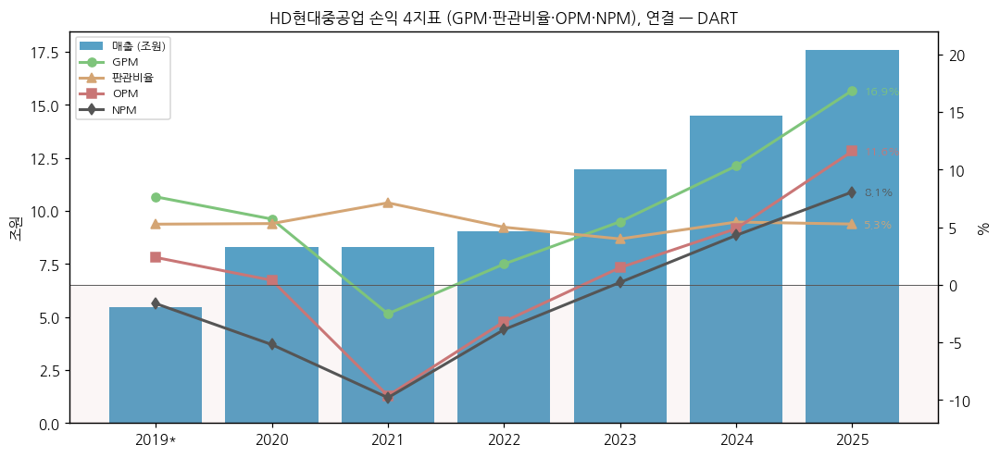

→ 판관비율은 4~7%로 안정 → **OPM 변동의 대부분은 GPM (선가-원가 스프레드)에서 발생** = 수주 사이클형 손익 구조

② 재무상태표

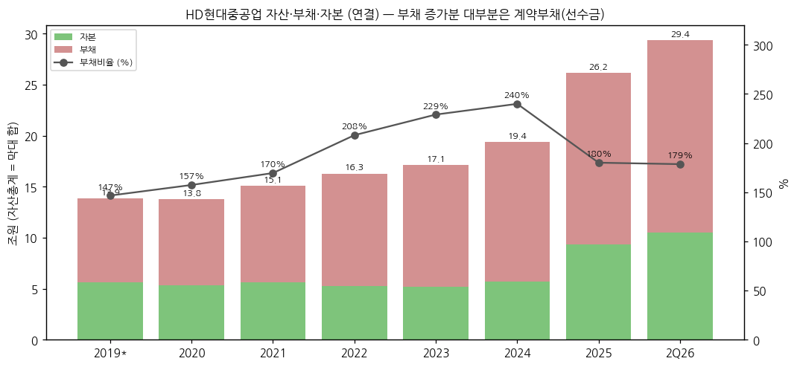

| 시점 | 자산 | 부채 | 자본 | 부채비율 | 계약부채 (선수금) | 현금성자산 | 유동비율 |
|---|---|---|---|---|---|---|---|
| 2019말 | 138,695 | 82,466 | 56,229 | 146.7% | 17,017 | 9,936 | 119.8% |
| 2020말 | 137,997 | 84,389 | 53,608 | 157.4% | 14,092 | 13,148 | 117.1% |
| 2021말 | 150,787 | 94,846 | 55,940 | 169.6% | 26,078 | 21,374 | 111.9% |
| 2022말 | 162,894 | 110,016 | 52,878 | 208.1% | 47,649 | 7,441 | 88.2% |
| 2023말 | 171,336 | 119,262 | 52,074 | 229.0% | 58,114 | 9,280 | 88.5% |
| 2024말 | 193,909 | 136,865 | 57,044 | 239.9% | 77,103 | 12,579 | 88.2% |
| 2025말 | **261,630** | 168,214 | **93,416** | **180.1%** | **108,078** | 18,699 | 97.7% |
| 2Q26말 | 293,721 | 188,292 | 105,429 | 178.6% | 110,845 | 45,509 | 103.9% |
| 3Q26P말 (IR) | 279,516 | 177,330 | 102,186 | 173.5% | 미공시 | 55,375* | 101.4% |

→ 3Q26P = HHI 3Q26 IR 연결재무상태표 (감사 전). *IR 현금은 단기금융자산 포함 정의라 위 행들의 현금성자산과 기준 다름. 유동비율 = 유동자산 167,402 / 유동부채 165,013억. IR 순차입금: FY24 -2,380억 (-4.2%) → FY25 -29,270억 (-31.3%) → **3Q26 -50,720억 (순차입금비율 -49.6%)**, 차입금 4,655억

→ 부채 증가분의 대부분은 **계약부채 (선수금)** — 2020말 1.4조 → 2025말 10.8조. 차입금은 FY24말 11,509억 → FY25말 **6,454억**, 예금 (현금성+금융상품) **35,726억** → **순현금 약 2.9조원** (FY25말, 사업보고서 '부채비율 및 순차입금비율')

→ 2025 부채비율 하락 (239.9% → 180.1%)은 합병 신주에 따른 자본 확대 + 이익 누적 효과

③ 현금흐름표

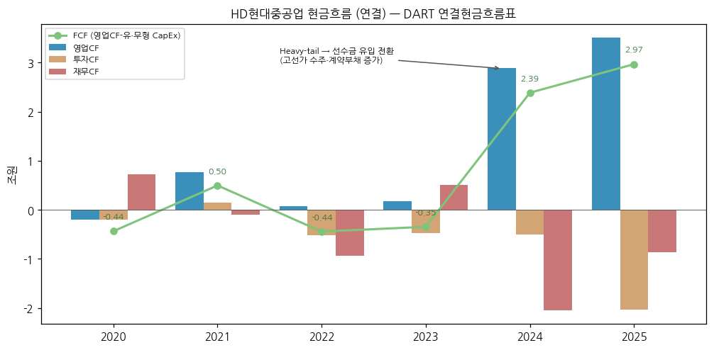

| 연도 | 영업CF | 투자CF | 재무CF | 유형 CapEx | 무형 CapEx | FCF | 배당 지급 |
|---|---|---|---|---|---|---|---|
| 2020 | -2,000 | -2,010 | 7,302 | 2,262 | 99 | -4,361 | 0 |
| 2021 | 7,621 | 1,517 | -926 | 2,440 | 212 | 4,969 | 0 |
| 2022 | 712 | -5,179 | -9,328 | 4,845 | 297 | -4,430 | 0 |
| 2023 | 1,688 | -4,779 | 5,028 | 4,782 | 357 | -3,451 | 0 |
| 2024 | **28,839** | -4,991 | -20,488 | 4,635 | 331 | **23,873** | 0 |
| 2025 | **35,104** | -20,396 | -8,603 | 5,119 | 295 | **29,690** | 3,339 |
| 1H26 | 27,260 | 5,374 | -5,835 | 2,337 | 122 | 24,801 | 4,187 |

→ (출처: DART 연결현금흐름표. 2019 7개월분 CF 미확보)

→ **2024~2025 OCF 급증 = 고선가 수주의 선수금 (계약부채) 유입** — 이익보다 현금이 먼저 오는 업사이클 특성. 다운사이클 진입 시 역으로 선수금 감소 → OCF 급감 패턴 (2022~2023 OCF 0.1~0.2조)

→ 2025 투자CF -20,396억은 CapEx 5,414억 대비 과대 — 금융상품 운용 확대 영향으로 추정 (예금이 FY24 13,889억 → FY25 35,726억으로 증가), 세부 항목 미분해

④ CapEx

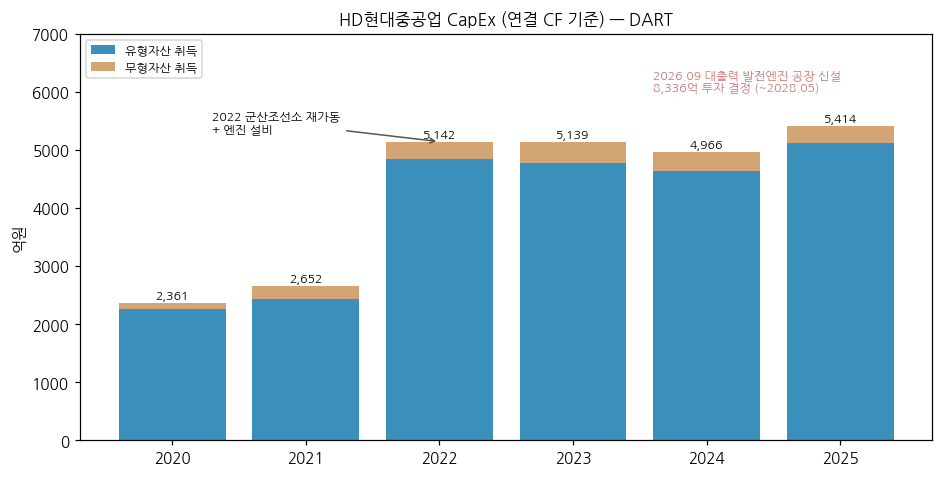

→ 유형+무형 CapEx 2020 2,361억 → 2022 5,142억 (군산조선소 재가동) → 2025 5,414억: 매출 대비 3% 내외로 낮게 유지 — 조선은 도크 신설보다 생산성 투자 위주

→ **2026.09 대출력 발전엔진 공장 8,336억 (2026.09~2028.05)** → 연평균 약 4,000억 추가, 2027~2028 CapEx 레벨업 예정 (엔진기계 secular 베팅)

⑤ 부채구조

→ 차입금 6,454억 (FY25말) vs 예금 35,726억 → 순현금, 이자보상배율 **21.1배** (FY24 4.7배)

→ 신용등급 이력 (회사채): 2023.03 NICE A / 한기평 A- / 한신평 A- → 2023.10~2024.01 3사 A → **2025.02~05 3사 A+** → 2025.11 합병 수시평가 A+ 유지. 기업어음 A2 (2023)

→ 단기차입금 중 담보부 금융기관 차입 4,000억 (FY25 주석), 공급자금융약정 (외상매출채권담보대출·Banker's Usance) 참여

→ 채무증권 발행 history 상세 (회차·금리) 미확보

⑥ 배당·자사주

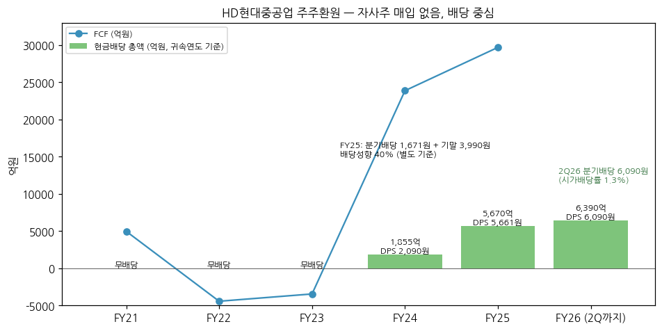

| 귀속연도 | DPS (원) | 배당총액 (억원) | 배당성향 (연결) | 비고 |
|---|---|---|---|---|
| FY21~FY23 | 0 | 0 | - | 적자·결손 구간 무배당 |
| FY24 | 2,090 | 1,855 | 29.9% | 상장 후 첫 배당 |
| FY25 | **5,661** | **5,670** | **40.0%** | 분기배당 1,671원 + 기말 3,990원 |
| FY26 (2Q 분기배당) | 6,090 | 6,390 | - | 2026.07.29 결정, 시가배당률 1.3%, 기준일 2026.08.13 |

→ (출처: 2025 사업보고서 '배당에 관한 사항', 2026.07.29 현금배당결정 공시, 2026.04.01 기업가치 제고 계획)

→ v1.2 DART 배당 API (2025 사업보고서) 대조: FY25 DPS 5,661원 / 현금배당총액 5,670억 / 연결 배당성향 40.00% / **시가배당률 1.08%** (FY24 2,090원 / 1,855억 / 29.90% / 0.70%) — 기존 표와 일치. 별도 순이익 FY25 14,225억 (연결 14,155억)

→ 자사주 매입·소각 이력 없음 (합병 과정 주식매수청구·단수주로 28,451주 보유 — DART 자기주식 API상 2025 '기타취득' 28,451주, 장내취득·신탁 0)

→ **밸류업 목표**: 주주환원율 30%+ (별도 순이익 기준, FY25 40% 달성), ROE 15%+ (FY25 18.8%), 2027 연결 매출 25.9조, 조세특례제한법상 고배당기업 요건 충족

⑦ 재무비율

| 지표 | 2020 | 2021 | 2022 | 2023 | 2024 | 2025 |
|---|---|---|---|---|---|---|
| ROE (평균자본) | -7.9% | -14.9% | -6.5% | 0.5% | 11.4% | **18.8%** |
| ROA (평균자산) | -3.1% | -5.6% | -2.2% | 0.1% | 3.4% | 6.2% |
| 부채비율 | 157.4% | 169.6% | 208.1% | 229.0% | 239.9% | 180.1% |
| 유동비율 | 117.1% | 111.9% | 88.2% | 88.5% | 88.2% | 97.7% |
| 이자보상배율 | - | - | - | - | 4.7배 | **21.1배** |
| EPS (원, 연결) | - | - | - | 278 | 7,001 | **15,702** |

→ 2025 ROE 18.8%는 회사 밸류업 공시 수치와 일치. 이자보상배율 2020~2023은 OP 적자·미산출

---

## 5. 지배 구조

① 그룹·계열 관계

→ **HD현대그룹** 조선 계열: HD현대(주) (지주) → **HD한국조선해양(주)** (조선 중간지주, 구 현대중공업 존속법인) → **HD현대중공업 69.21%** / HD현대삼호 / HD현대마린엔진 등

→ HD현대(주)의 최대주주: 정몽준 26.60% + 정기선 6.12% (HD현대일렉트릭 기업개요 v1.5 인용, DART 2025 사업보고서 기준). 정기선 = HD현대 회장·HD한국조선해양 회장

→ HD현대중공업 주요 종속: HD현대엔진(유) (엔진기계), HD현대엠엔에스(주) (블록), HD현대이엔티(주) (미포로부터 승계, 100%), HD Hyundai Asia Holdings (해외 중간지주, 2025.09~11 출자), HHIP (필리핀, 경영지원 담당 임원 존재)

→ **이중상장 구조 이슈**: 모회사 HD한국조선해양 (009540)과 자회사 HD현대중공업이 동시 상장 — 지주 할인·합병 시 지분 희석 구조 (2025 합병으로 KSOE 지분 75.02% → 69.23%)

② 주주 구분

| 주주 | 주식수 | 지분율 | 기준일 |
|---|---|---|---|
| **HD한국조선해양(주) (최대주주)** | 72,639,443 | **69.21%** | 2026.06.30 |
| (재)아산나눔재단 (특수관계) | 69,817 | 0.07% | 2025.12.31 |
| 이상균 (대표이사) | 1,188 | 0.00% | 2026.06.30 |
| 국민연금 | 8,660,789 | **8.25%** | 2026.06.30 |
| 우리사주조합 | 41,726 | 0.04% | 2026.06.30 |
| 외국인 | - | **14.06%** (소진율) | 2026.11.02 (네이버) |
| 소액주주 | 23,632,542 | 22.52% (주주수 321,865명) | 2026.06.30 |

→ 발행주식 104,961,225주 (의결권 있는 주식 104,932,774주)

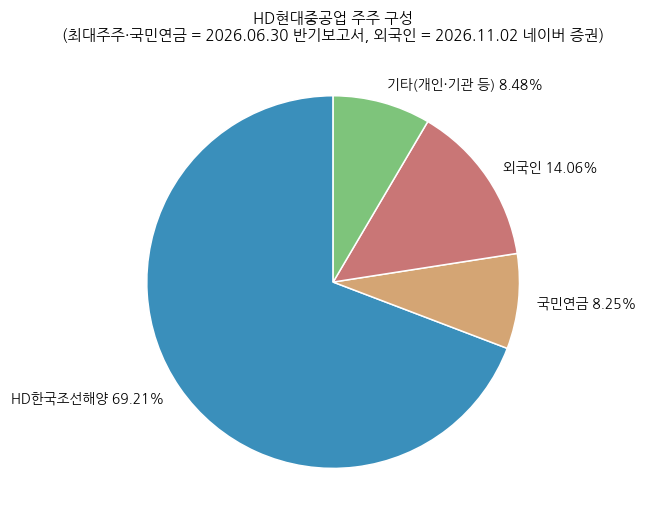

→ 최대주주 지분 변동 (DART 최대주주 API, 2025 사업보고서): HD한국조선해양 2025 기초 66,601,116주 (75.02%) → 기말 72,668,285주 (69.23%), 특수관계인 합계 (아산나눔재단 69,817주·이상균 1,188주 포함) 72,739,290주 (69.30%) → 2026.06 72,639,443주 (69.21%)

→ 국민연금 7.97% (2025말) → 8.25% (2026.06) 확대. 소액주주 22.52%는 외국인 포함 수치라 chart5의 외국인·기타 구분과 기준이 다름 (chart5 '기타' = 100 - 최대주주 - 국민연금 - 외국인)

→ 외국인 지분율 시계열 미확보

③ 임원·이사회 (2026.06.30 반기보고서)

(1) 등기이사 5명 (사내 2 + 독립 3)

| 성명 | 직위 | 출생 | 학력·경력 | 임기만료 |
|---|---|---|---|---|
| **이상균** | 부회장·대표이사 (사내) | 1961.01 | 인하대, 前 HD현대삼호 대표이사 | 2029.03.31 |
| **금석호** | 사장·대표이사 (사내) | 1968.02 | 고려대, 現 HD현대 HR지원실장 (계열사 임원 겸) | 2028.03.31 |
| 박현정 | 독립이사 | 1975.06 | 서울대 (박), 前 서울중앙지법 판사, 現 한양대 법학전문대학원 교수 | 2028.03.26 |
| 신동목 | 독립이사 | 1962.09 | 펜실베니아주립대 (박), 現 울산대 연구·재무 부총장 | 2027.03.26 |
| 박광우 | 독립이사 (2026.03 신규) | 1964.04 | 일리노이대 (박), 前 한국증권학회 회장, 現 KAIST 금융전문대학원 교수 | 2029.03.31 |

→ 2026.03 변경: 노진율 사장 (대표이사, 1964.07, 경북대) 임기만료 → 금석호 선임 / 채준 사외이사 (서울대 경영대학 학장) 임기만료 → 박광우 선임

→ **2026.11.23 임시주총**: 사내이사 **조민수** (1966.12, 조선사업부 사업대표) 신규 선임 안건 → 통과 시 사내 3 + 독립 3

→ 임원 규모 (DART 임원현황 API, 2025말): 총 153명 = 등기 5명 (사내 2·사외 3) + 미등기 148명. 2025말 기준 등기이사는 이상균·노진율 (사내), 채준·박현정·신동목 (사외), 금석호는 '대표이사 (내정)' 미등기로 기재

(2) 주요 미등기임원 (사업부 대표)

→ **주원호** (사장) — 함정·중형선사업부 사업대표 (서울대 박사) — 미포 합병 후 중형선 + 함정 통합 조직

→ **조민수** (부사장, 겸 HD한국조선해양 해외사업부 본부장) — 조선사업부 사업대표

→ **한주석** (부사장, 해군사관학교) — 엔진기계사업부 사업대표

→ **원광식** (부사장) — 해양에너지사업본부장 / **박용열** (부사장) — 함정사업본부장 / **여용화** (부사장) — 선박영업본부장 / **최헌** (부사장) — 경영지원본부장 / **류홍렬** (부사장) — 기술본부장 / **전승호** (부사장) — 안전생산본부장

---

## 6. 기타 팩트

① R&D 인프라

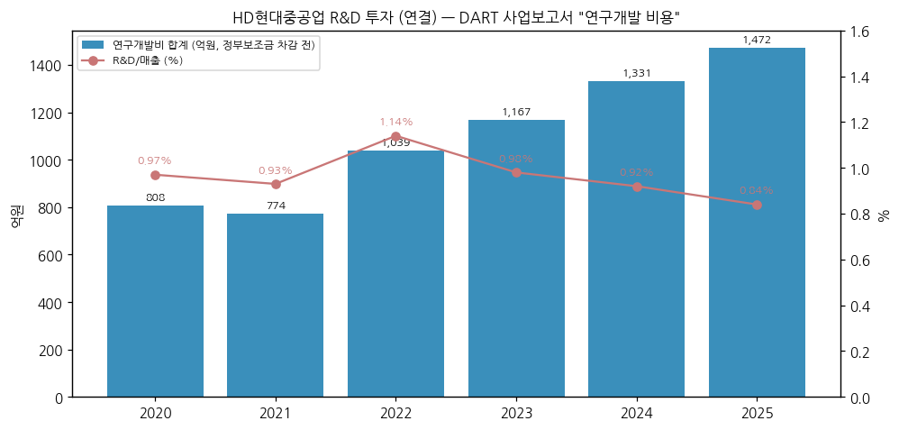

| 항목 (억원) | 2020 | 2021 | 2022 | 2023 | 2024 | 2025 |
|---|---|---|---|---|---|---|
| 연구개발비용 계 (보조금 차감 전) | 808 | 774 | 1,039 | 1,167 | 1,331 | **1,472** |
| 위탁용역비 외 | 590 | 471 | 589 | 724 | 817 | 1,100 |
| 개발비 자산화 | 89 | 92 | 292 | 295 | 315 | 274 |
| R&D / 매출 | 0.97% | 0.93% | 1.14% | 0.98% | 0.92% | **0.84%** |

→ (출처: DART 사업보고서 '연구개발 비용', 2022·2025 사업보고서 3개년 표)

→ R&D/매출 1% 미만 — **지주 HD한국조선해양 (미래기술연구원)이 그룹 R&D를 담당**하는 구조 (2025 사업보고서: "지주회사인 HD한국조선해양(주)의 우수한 R&D 인프라를 통해")

→ 기업부설연구소 (울산 본사 + 성남 분당): 선박성능·성능평가·운항시스템·선박의장·액화가스저장·그린동력시스템·지능제어·가상제품개발·수소에너지연구실 + 함정기술센터

② 진행 중 corporate action (2019~2026)

→ **2019.06** 물적분할 신설 → **2021.09** KOSPI 상장 (IPO)

→ **2023.05 / 2023.08** HD한국조선해양에 중소형선 추진패키지 사업 / 선박평형수 사업 영업양도

→ **2024.01** HD현대중공업모스 흡수합병

→ **2025.02** HD현대엠엔에스 설립 + 이영산업기계 유형자산 양수

→ **2025.12.01** HD현대미포 흡수합병 (상세 2번 섹션 ③(4))

→ **2026.06.26** 유형자산처분결정 공시 (내용 미확인 → 잔여 보완)

→ **2026.09.10** 대출력 발전엔진 공장 신설 8,336억 (진행 중, ~2028.05)

→ **TerraPower** — Natrium SMR 주기기 공급 기본협약 (Framework Agreement) 체결, 우선 협상 대상자 지위 (Preferred Supply Rights) 확보 → 개별 프로젝트 계약 미확정 (2026.09.18 해명공시, 재공시 예정 2027.03.17)

→ 美 군수지원함 — 헌팅턴 잉걸스 MOA (2025.10) + 언론 보도상 美 키윗사와 합작법인 추진 (주체·지분 미확인)

→ **2026.11.23 임시주주총회** (사내이사 선임)

③ R&D·기술 마일스톤

→ 2021.03 조선업계 최초 양자암호통신 구축 / 2021.07 10MW급 해상풍력 부유체 기본인증 (KR)

→ 2022.04 독자 단일냉매 LNG 재액화 시스템 첫 수주 / 2022.07 저압식 LNG 이중연료엔진 (ME-GA) 세계 최초 제작 / 2022.09 액화CO2운반선·암모니아추진선 기본인증

→ 2023.05 한국형 화물창 (KC-2) 적용 국내 최초 LNG 벙커링선 건조

→ 2024.05 무인함정 '테네브리스' 공개 / 2024.10 세계 첫 고압직분사 암모니아 이중연료 엔진 개발 / 2024.12 테라파워 SMR 핵심설비 개발 착수

→ 2025.01 H54DF 대출력 엔진 초도생산 FAT (HD현대엔진) / 2025.04 해군 전투용 무인수상정 개념설계 수주

④ 주요 리스크

→ **사이클 정점 리스크** — 신조선가 2025 보합~하락, 글로벌 발주 2024 143.9M GT → 2025 111.0M GT → 2026E 90M GT (클락슨 전망 인용). 3Q26P QoQ 이익 감소

→ **환율** — 매출 93%가 수출 (USD), 3Q26 원화 강세로 조선 수익성 하락 (IR 기재). 3Q26 외환관련손익 -4,006억 (확정계약평가손익 -3.1조 vs 파생손익 +3.4조의 순액)으로 NI QoQ -56.9% — 헤지 구조상 영업외 변동성 큼. 계약자산 USD 5.09조 (FY25)

→ **안전·중대재해** — 2026년 중대재해발생 공시 4건 (04.10, 07.20, 07.27, 08.31) + 생산중단 공시 3건 (04.15, 07.20, 07.27) → 조업 차질·규제 리스크

→ **원가** — 강재가 (2021 공사손실충당금 전례), 인건비·외국인 인력, 총계약원가 추정 변경 (2025 반기 기준 미래 손익 영향 -6,504억 추정 변경 공시)

→ **해양플랜트 잔고 감소** — 2Q26 잔고 1.89조, 신규수주 부진

→ **통상임금·노사** — 2021 통상임금 소송 패소 충당부채 전례

→ **지배구조** — 모자회사 이중상장, 합병 시 소액주주 희석

→ **주가 변동성** — 2026.05 정점 대비 2026.10 -61% (원인 미검증)

⑤ ESG 등급

→ 미확보 (KCGS·MSCI 등급 미조회) — 2026.07.01 지속가능경영보고서 공시, 지배구조 핵심지표 준수율 93% (2026.04 밸류업 공시), 감사위원회 전원 독립이사

⑥ 인증·라이선스

→ 정보보호 국제표준 ISO 27001·27701 (2021.03, 조선업계 최초), ISO 27017·27018 (2022.01)

→ 함정 분야 최초 방산원가관리체계 인증 (2025.05) / 美 함정 MRO 사업 참여 자격 (2024.07)

→ 엔진 라이선스: Everllence SE (구 MAN ES) 2014.01~2033.12, Winterthur Gas & Diesel 2012.01~2031.12 (생산마력 기준 로열티)

---

## Version Log

**v1.2 (2026-11-14)** — HHI 분기 IR 실적발표 20건 + DART 기업정보 API 반영 (잔여 보완 후보 채움)

→ **3Q26 사업부별 실적 (잔여 (1))**: HHI 3Q26 IR (2026.10.28)로 조선 43,988 / 6,463억, 해양 3,799 / 1,265억, 엔진기계 9,511 / 2,299억, 기타 238 / -1,035억 채움 + QoQ 사유·영업외 분해 반영. 부문 합계 = 잠정공시 일치. v1.1에서 제외했던 언론 수치는 해양만 일치, 엔진기계 불일치 → IR 수치 채택

→ **함정 (특수선) 분리 (잔여 (3) 일부)**: IR '상선/특수선(함정)' 행으로 FY21~FY25 연간 + 1Q21~3Q26P 23개 분기 시계열 신규 (3번 섹션 ①(1-1), ②(1)), 1번 섹션 함정 정량 비중 반영

→ **수주잔고 FY21~FY23 공백 (잔여 (4) 일부)**: IR에는 수주 슬라이드가 없어 기존 수집 사업보고서 원문 (2021~2024)을 재파싱 (2021 원문 cp949 인코딩이 v1.0 실패 원인) → FY21~FY24 부문별 잔고·신규 + 연간 book-to-bill 추가

→ **IR ↔ DART 교차검증**: 3Q26 IR = 잠정공시 일치, 2Q23~2Q26 IR 총계 = `quarterly_summary_CFS` 일치, 1Q23 IR 최초 OP 361억 → 확정 -415억 (해양 -776억) 발견. **4Q23 OP 1,386억 → 1,387억 정정** (IR·quarterly_summary 기준)

→ **기업정보 (잔여 (7) 일부)**: DART 기업개황 — 각자 대표이사 (이상균·금석호), 업종코드 31113, 설립일 표기 2019.06.03 / 2025 사업보고서 API — 최대주주 기초·기말 지분, 부문별 임직원 (2025말 18,880명), 임원 153명, 배당 (시가배당률 1.08%), 자기주식 28,451주 (기타취득), 발행할 주식 총수 반영

→ 3Q26P 연결재무상태표 (IR: 자산 279,516 / 부채 177,330 / 자본 102,186억, 부채비율 173.5%, 순차입금 -50,720억) 추가

→ 차트 재생성 3종: chart2_조선 (3Q26P 막대 + 하단 함정 분기 패널 추가), chart2_엔진기계·chart2_해양플랜트 (3Q26P 막대 추가). 나머지 차트는 데이터 변동 없음 (chart10의 4Q23 OP 1억 정정은 시각적 차이 없어 미재생성)

→ 3Q26은 여전히 잠정·IR 기준 — DART 3Q26 분기보고서 미제출 (기한 11/16)

**v1.1 (2026-11-03)** — OpenDART `dart_financials` 검증·보강

→ 연결 연간 7개년 (2020~2025 + 2019) 매출·OP·NI·자산·부채·자본·OCF와 분기 매출·OP를 신규 재무 API 값과 대조 → 전 항목 일치

→ ② ③ 뒤에 1Q21~3Q23 연결 전사 분기 11개 분기 표 추가 (기존은 4Q23~3Q26P 12분기만 표 수록)

→ .html 차트를 base64 inline으로 변경 (charts 폴더 없이 단독으로 열림)

→ 3Q26은 여전히 잠정실적 기준 — DART 3Q26 분기보고서 미제출 (기한 11/16)

**v1.0 (2026-11-03)** — 신규 작성

→ 작업 내역: DART OpenAPI로 사업보고서 6건 (2020~2025) + 분·반기보고서 16건 (2021.03~2026.06) 원문 + 재무 API 일괄 수집, 영업부문 주석 누적값 차분으로 사업부별 22개 분기 시계열 구축, 2026.10.28 잠정실적 반영, HD현대미포 재무 API로 합병 PF 비교 구성, 차트 15개 (12종 표준 + chart2 3개 사업부 분리 + chart13 합병 PF) 생성

→ 데이터 범위: 연간 7개년 (2019*~2025, 2019 = 7개월) / 연결 분기 23개 (1Q21~3Q26P) / 사업부별 분기 22개 (1Q21~2Q26) / 시가총액 월간 2021.10~2026.11

→ 참고: company-data MCP `dart_download_reports` 일괄 PDF 다운로드는 23건 전부 실패 → DART OpenAPI document.xml (원문 XML) 직접 fetch로 대체. 원본은 `company-overview-source\01390344_HD현대중공업\api\`에 저장

**잔여 보완 후보** (v1.2 갱신)

→ (1) **3Q26 DART 분기보고서 확정치 대조** (기한 11/16) — 연결 손익·재무상태표 확정 여부, 영업부문 주석 (내부매출 포함) 기준 3Q26 부문 수치로 chart2 3Q26P 막대 교체. *IR 기준 3Q26 사업부별은 v1.2에서 채움*

→ (2) **분할 전 구 현대중공업 장기 시계열** (2008 정점·2014~2016 해양 손실) — HD한국조선해양 (009540) 공시로 참고 시계열 보강, Summary Box 사이클 주기·회수 정량화 (미확보 유지)

→ (3) **엔진기계 내 발전엔진/선박엔진 분리** — HHI IR도 단일 부문 공시라 미확보 (1번 섹션 재평가 트리거 (1) 판정 변수). 미포향 엔진 내부거래 금액도 미확보. *함정 분리는 v1.2에서 채움*

→ (4) HHI 자체 **USD 기준 수주·잔고** — IR 실적발표에 수주 슬라이드 없음, 미확보. *원화 FY21~FY23 잔고는 v1.2에서 채움*

→ (5) LNG선·컨테이너선 신조선가 (사업보고서 가격 표 일부 미추출)

→ (6) 2026.06~10 **주가 급락 원인 검증** (신조선가·수주·수급·피어 동반 여부), IPO 공모가 확인

→ (7) 외국인 지분율 시계열, ESG 등급 (KCGS·MSCI), 업종코드 31113의 KSIC 명칭 대조, 2021말 임직원 수 (기업정보 API는 2025만 수집), 채무증권 발행 history, 2026.06.26 유형자산처분 내용

→ (8) HD현대미포 2025.10~11월 실적 (PF FY25 추정 정밀화) 및 HHI-미포 내부거래 규모 (PF 과대 계상분 제거)

→ (9) (신규) 1Q23 IR 잠정 → 분기보고서 확정 간 해양 OP -776억 하향 사유
