> Ticker: **NYSE: HII** / Huntington Ingalls Industries, Inc. (2022년부터 사명 표기 "HII")
> Sector: 조선 (섹터 T2 주도 후보) — 서브섹터: 조선 글로벌
> 작성 시각: 2026-11-14 19:55 KST (**v1.0** — 신규 작성)
> 적용 구조: v4.8 (6개 섹션 + 차트 13종, chart5 주주지분은 데이터 미확보)
> 데이터: 연결 연간 12년(2014~2025) + 분기 연결 43개(1Q16~3Q26) + 사업부별 분기 23개(1Q21~3Q26) + 사업부별 연간 10년(2016~2025) + Yahoo 월간 주가(2011.04~2026.11)
> 출처: **SEC EDGAR 10-K 13건(FY2013~FY2025) · 10-Q 15건(1Q22~3Q26) · 8-K** (company-data `sec_edgar_download_reports`, CIK 0001501585), **3Q26 실적 보도자료**(GlobeNewswire 전문 — SEC Ex.99.1 URL 직접 접근 차단으로 배포본 사용, 10-Q와 수치 대조), **3Q26 컨퍼런스콜 트랜스크립트**(Motley Fool), **Yahoo Finance v8 월간·일간 주가**, 보도 인용(HD현대중공업 협력 — Naval News·Korea Times 2025.10, 2026년 초기 가이던스 — Baird Maritime)

# HII (Huntington Ingalls Industries) 기업 개요 (v1.0 — 조선 T2 주도 후보, 조선 글로벌)
> **Fact verify cutoff**: 2026-11-14 (주가 $306.24 = 2026-11-13 종가. 시총은 종가 × 3Q26말 유통주식 3,940.6만주 근사)

## ① 기업 분류

### Phase 1 Source Audit

```
=== 자료 수집 audit (HII) ===

✅ 확보:
- SEC 10-K 13건 (FY2013~FY2025) — 연간 손익·재무상태·현금흐름·세그먼트·잔고·IR&D
- SEC 10-Q 15건 (1Q22~3Q26) — 분기 세그먼트 매출·영업이익·누적 EAC 조정·사업부별 잔고 (전년 동기 열로 1Q21~3Q21 보강)
- 10-K 분기 요약표 (FY2016~FY2020) — 1Q16~4Q20 연결 매출·영업이익·순이익
- 3Q26 보도자료 전문 + 컨퍼런스콜 트랜스크립트 (2026-10-29)
- Yahoo 월간 종가 2011.04~2026.11, 일간 종가 2026.08~11

❌ 누락:
- 5% 이상 주주·기관/개인 지분 분해 (13F·DEF 14A 미수집) → chart5 미작성
- 이사회 구성·대표이사 상세 약력 (DEF 14A 미수집)
- 2015년 이전 사업부별 손익 (Other 세그먼트 체계, 2016년 Technical Solutions 신설 전) 및 1Q16~4Q20 사업부별 분기
- ESG 등급
- SEC 8-K Ex.99.1 원문 (sec.gov 접근 403 — 배포본으로 대체)

⚠️ 기준 단절:
- 2018년 ASC 606 도입 + FAS/CAS 표시 변경 → 2016~2017년은 2019 10-K 재작성치 사용, 2014~2015는 FAS/CAS 재분류만 반영(2019 10-K 5년 요약). 1Q16~4Q16 분기는 ASC 606 이전 기준
- 2020년 세그먼트 재편(Technical Solutions 일부 → Newport News), 2022년 Technical Solutions → Mission Technologies 명칭 변경 → 사업부 연간은 최신 10-K 재작성치 사용
```

---

(1) Primary / Secondary 분류

**Primary 분류: 지속성장 (방산 독점 · 장기계약형 저성장) — 미 해군 함정 매출 81%, 잔고/매출 4~7배**

→ 12년 매출 CAGR **+5.5%**(2014 $6,957M → 2025 $12,484M), 매출이 전년보다 줄어든 해가 한 번도 없다(최저 +0.7%, 2016·2024)

→ 고객의 81%가 미 해군(2025 10-K), 계약의 46%가 고정가 인센티브(FPI), 50%가 원가가산형이다. 수요 사이클이 아니라 미 국방예산·함정 건조 계획이 매출을 정한다

**Secondary 노트: 마진 턴어라운드 진행 중 (post-COVID 계약 전환)**

→ OPM이 2016년 12.4%(정점)에서 2024년 4.6%(저점)로 내려왔다. 코로나 이전에 고정가로 계약한 함정에 인건비·자재 인플레이션과 인력 부족이 겹친 결과다

→ 회사는 조선 마진 2024년 5.2% → 2025년 5.9% → 2026년 가이던스 6.0~6.5% → 장기 9~10%를 제시한다. post-COVID 계약 비중은 2027년 말 50~55%다 (3Q26 컨콜)

(2) Summary Box (12년, 2014~2025)

| 지표 | 값 |
|---|---|
| 매출 CAGR (2014~2025) | **+5.5%** |
| 영업이익 CAGR | **-0.1%** (2014 $661M → 2025 $657M) |
| OPM 평균 | **8.4%** |
| OPM 정점 / 저점 | **12.4% (2016) / 4.6% (2024)** |
| OPM range | **7.8%p** (사이클 cutoff ±10%p 미달 → 사이클주 아님) |
| 매출 역성장 연도 | **0회** |
| 영업이익 감소 연도 | 4회 (2019·2021·2024 등 EAC 손실·인수 상각 연도) |
| 잔고/매출 | 2.8~3.1배(2014~2018) → 4.2~5.2배(2019~2025) → **3Q26 6.9배 ($86.2B)** |

```
[HII 12년 손익 시계열 ($M)]
연도   매출     영업이익  OPM    순이익   잔고
2014  6,957    661     9.5%   338    21,430   ← 분사 4년차
2015  7,020    774    11.0%   404    22,062
2016  7,068    876    12.4%   573    21,024   ← OPM 정점 (ASC 606 재작성 기준). 12월 Camber 인수 → Technical Solutions 신설
2017  7,441    881    11.8%   479    20,735
2018  8,176    951    11.6%   836    22,995   ← 세제개편으로 NPM 10.2%, 자사주 $742M
2019  8,899    736     8.3%   549    46,494   ← CVN-80/81 항모 2척 일괄 계약·Virginia Block V로 잔고 2배
2020  9,361    799     8.5%   696    46,017   ← 코로나: 2Q20 OPM 2.8%, Hydroid(무인 잠수정) 인수
2021  9,524    513     5.4%   544    48,450   ← Alion 인수($1.79B, 잠정 매입가) → 무형자산 상각, OPM 5%대 진입
2022 10,676    565     5.3%   579    47,123   ← Mission Technologies로 명칭 변경
2023 11,454    781     6.8%   681    48,121   ← 4Q23 Ingalls 분기 OPM 21.1%로 연결 분기 OPM 9.8%
2024 11,535    535     4.6%   550    48,713   ← OPM 저점: NNS 누적 EAC -$154M (3Q24·4Q24)
2025 12,484    657     5.3%   605    53,139   ← 임금 인상·외주 확대로 조선 매출 +16%대 회복
3Q26 TTM 13,530  783   5.8%   733    86,181   ← Virginia Block VI·Columbia Build II 수주 $32.4B
```

→ (출처: HII 10-K 각 연도, 2014~2017 영업이익은 2019 10-K 5년 요약(재작성) 기준. TTM = 4Q25~3Q26 합 [계산])

**한국 조선 3사 대비 (3Q26 기준)**

| 항목 | HII | 한화오션 | HD현대중공업 | 삼성중공업 |
|---|---|---|---|---|
| 3Q26 매출 | $3,537M | 3조 4,139억원 | 5조 7,536억원 [잠정] | 3조 1,504억원 [잠정] |
| 3Q26 OPM | 7.0% (조선 6.9%) | 14.2% | 15.6% | 10.7% |
| 3Q26 영업이익 YoY | +52.8% | +67.6% | +61.3% (합병 조정 +18.6%) | +42.1% |
| 주력 | 미 해군 항모·잠수함·상륙함·구축함 | 상선(LNG선)·특수선(잠수함·호위함) | 상선·해양·특수선·엔진 | 상선(LNG선)·FLNG |
| 잔고 | $86.2B (매출 6.9배) | 약 3년치 | 약 3년치 | 약 3년치 |

→ (출처: HII 10-Q, 한국 3사는 각 2026-Q3 리뷰·조선 섹터리뷰. 한국 잔고 연수는 섹터리뷰 표현 인용)

(3) 한국 조선 3사와의 경쟁·협력 지점

→ **미 해군 함정 건조·MRO (MASGA)**: 미국법(10 U.S.C. 8679)은 미 해군 함정의 해외 건조를 막고 있어, 신조 함정은 HII·GD(Electric Boat·Bath·NASSCO)·Austal USA·Bollinger 등 미국 조선소의 영역이다. 한국 3사는 MRO(정비)와 미국 내 조선소 투자·협력을 통해 접근한다. HII는 처리량 부족을 외주(distributed shipbuilding, 2026년 +30% 이상)로 메우고 있어, 블록·모듈 외주가 한국 조선사에 가장 먼저 열릴 수 있는 문이다 [판단]

→ **HD현대중공업 = 협력**: 2025년 4월 MOU(Sea-Air-Space) → 2025년 10월 차세대 군수지원함(NGLS) 개념설계 공동 추진 합의 → 2025년 10월 APEC(경주) MOA(분산 건조·군수지원함 공동 사업·AI·로봇·자동화·인도태평양 MRO) (보도 인용 — Naval News·Korea Times). 3Q26 보도자료에 "HD현대중공업과 지능형 기계화 자동용접 파일럿 시작"이 Ingalls 주요 성과로 올라갔다 (HII 3Q26 보도자료)

→ **한화(필리조선소) = 미국 내 경쟁**: 한화오션·한화시스템은 2024년 12월 필리조선소를 인수해 미국 내 조선 거점을 확보했다. 미 해군 상선형·지원함 물량(LSM 등)에서 HII Ingalls·Austal·Bollinger와 경쟁 구도가 된다. 3Q26 컨콜에서 Melius가 "HD현대의 미국 조선소 계획 등 신규 조선소가 같은 노동 풀을 쓰지 않나"고 묻자, CEO는 "조선은 지역 노동시장이라 문제 없다"고 답했다

→ **수익 구조 대비**: 한국 3사는 상선 고선가 빈티지로 OPM 10~16%, HII는 고정가 함정 계약·인력 병목으로 5~7%다. 반면 HII 잔고는 매출의 6.9배로 가시성이 훨씬 길다. 한국 조선의 미 해군 테마가 실적이 되려면 HII의 인력·처리량 병목이 계속돼 외주가 늘어야 한다는 점에서, HII의 처리량 지표는 한국 조선 테마의 선행지표다 [판단]

(4) 산업 분류

→ **GICS**: Industrials — Aerospace & Defense
→ **워치리스트**: 조선 (섹터 T2 주도 후보) — 서브섹터 "조선 글로벌" (중국선박공업·양쯔장조선·Seatrium·Fincantieri·TKMS와 함께 편입)
→ 사업 정의: 미 해군 핵항모(유일)·상륙함(유일)·핵잠수함(GD Electric Boat와 팀) 설계·건조·정비 + 무인체계·C5ISR·원자력 서비스

(5) 분류 결정 논리

(1) **매출 비중 기준** — NNS 52% + Ingalls 24% = 조선 76%(2025, 사업부 간 거래 포함 총액 기준) → 조선주
(2) **사이클 vs 지속성장** — OPM range 7.8%p로 사이클 cutoff(±10%p) 미달, 매출 역성장 0회 → 지속성장. 다만 마진이 9년간 하향했다가 2025년부터 회복 중이라 Secondary 턴어라운드
(3) **한국 조선과의 차이** — 한국 조선은 신조선가·선종 믹스가 이익을 정하는 사이클주, HII는 국방예산·계약 구조가 이익을 정하는 방산 계약주다. 같은 "조선" 섹터에 있지만 이익 드라이버가 다르다

(6) 적정 밸류에이션 방법

→ **1차 — PER + FCF 수익률**: 2026-11-13 종가 $306.24 기준 시총 약 $12.1B, PER TTM 16.5배(순이익 $733M), 2026E 16.6배·2027E 14.6배(Yahoo EPS 컨센 $18.50·$21.01, 10/23 발표 전) [계산]. FY27 FCF 약 $700M(회사 FY26+27 누적 $1.2~1.3B 가이던스 역산) 기준 FCF 수익률 약 5.8% [계산]
→ **2차 — EV/EBIT**: EV 약 $14.4B(시총 + 장기차입 $2,704M - 현금 $387M, 3Q26말) [계산] / TTM 영업이익 $783M = 약 18배
→ **P/B 보조**: 2.2배(자본 $5,492M). 영업권 $2,650M·무형 $631M이 자본의 60%라 P/B 의미는 제한적
→ **셀사이드 TP**(StockAnalysis·S&P Global, 10/14 발표 전): 12명 평균 $356.42(범위 $281~406), Strong Buy 5·Buy 1·Hold 6

(7) 분기 재평가 트리거 (분류 변경 조건)

→ ① **조선 마진 2개 분기 연속 8% 이상 + 매출 YoY 10% 이상 유지** → 지속성장 → **성장주(마진 턴어라운드 완료) 격상**
→ ② **조선 마진 5% 미만 재진입(NNS·Ingalls 대규모 EAC 손실)** → 턴어라운드 실패 → **저마진 방산 정체주로 강등**
→ ③ **미 해군 해외 건조 허용·한국 조선소와의 공동 건조 계약 체결** → 경쟁 구도 변화 → **조선 글로벌 내 포지션 재평가**

---

## ② 회사 개요

(1) 기본 사항

| 항목 | 내용 |
|---|---|
| 회사명 | Huntington Ingalls Industries, Inc. (브랜드 HII) |
| 티커 | **NYSE: HII** |
| 설립·상장 | **2011-03-31 Northrop Grumman에서 분사** (조선 부문), NYSE 상장 |
| 본사 | Newport News, Virginia |
| CEO | **Christopher D. Kastner** (President & CEO) |
| CFO | Thomas E. Stiehle |
| 사업부장 | Kara R. Wilkinson (NNS), Brian D. Blanchette (Ingalls), Edgar A. (Andy) Green III (MT) |
| 임직원 | 약 44,000명(2025 10-K) → 약 46,000명(3Q26 보도자료). 버지니아 최대 산업 고용주, 미시시피 최대 민간 고용주 |
| 노조 | 임직원의 약 45%가 단체협약 적용 |
| 유통주식 | 3,940.6만주 (2026-09-30) |
| 분기 배당 | $1.38/주 (3Q26) |
| 회계 | US GAAP, 12월 결산(캘린더 = 회계 분기) |

(2) 12년 손익·자본 추이

| 연도 | 매출 | 영업이익 | OPM | 순이익 | NPM | 자본 | 자본 YoY | 희석 EPS ($) |
|---|---|---|---|---|---|---|---|---|
| 2014 | 6,957 | 661 | 9.5 | 338 | 4.9 | 1,365 | — | 6.86 |
| 2015 | 7,020 | 774 | 11.0 | 404 | 5.8 | 1,490 | +9.2 | 8.36 |
| 2016 | 7,068 | 876 | 12.4 | 573 | 8.1 | 1,653 | +10.9 | 12.14 |
| 2017 | 7,441 | 881 | 11.8 | 479 | 6.4 | 1,758 | +6.4 | 10.46 |
| 2018 | 8,176 | 951 | 11.6 | 836 | 10.2 | 1,516 | -13.8 | 19.09 |
| 2019 | 8,899 | 736 | 8.3 | 549 | 6.2 | 1,588 | +4.7 | 13.26 |
| 2020 | 9,361 | 799 | 8.5 | 696 | 7.4 | 1,901 | +19.7 | 17.14 |
| 2021 | 9,524 | 513 | 5.4 | 544 | 5.7 | 2,808 | +47.7 | 13.50 |
| 2022 | 10,676 | 565 | 5.3 | 579 | 5.4 | 3,489 | +24.3 | 14.44 |
| 2023 | 11,454 | 781 | 6.8 | 681 | 5.9 | 4,093 | +17.3 | 17.07 |
| 2024 | 11,535 | 535 | 4.6 | 550 | 4.8 | 4,666 | +14.0 | 13.96 |
| 2025 | 12,484 | 657 | 5.3 | 605 | 4.8 | 5,073 | +8.7 | 15.39 |

→ (단위: $M, %. 출처: HII 10-K. 2014~2017 영업이익은 2019 10-K 재작성 기준, 순이익·EPS는 각 연도 보고치)
→ 2018년 자본 감소는 자사주 $742M 매입, 2021년 자본 급증은 연금 재측정 이익(기타포괄손익) 영향이 크다 [판단 — 10-K 자본변동표 세부 미확인]

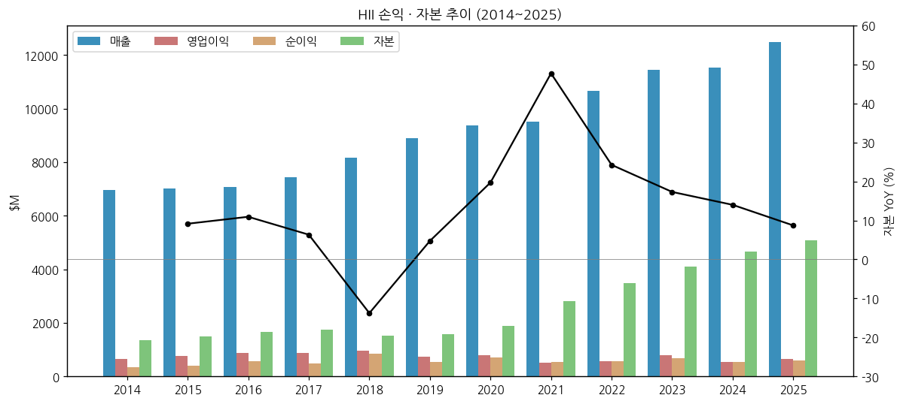

(3) 주가 역사

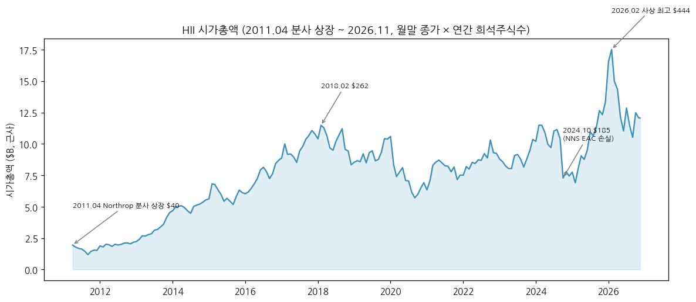

→ 2011.04 분사 상장 $40 → 2018.02 $262 → 2020.09 $141(코로나) → 2024.02 $292 → 2024.10 $185(NNS EAC 손실) → 2025년 말 $340(미 해군 조선 재건·MASGA 논의 국면 [판단]) → **2026.02 사상 최고 $444** → 2026.09 $267 → 2026-11-13 $306.24 (Yahoo 월말 종가)
→ 3Q26 실적 발표일(10/29) +13.2%($279.26 → $316.21)
→ 시총(근사)은 월말 종가 × 연간 희석주식수로 계산했다. 고점 약 $17.5B(2026.02), 현재 약 $12.1B [계산]

(4) 주요 연혁

→ **2011.03**: Northrop Grumman에서 분사, NYSE 상장 (Newport News + Ingalls(구 Northrop Grumman Shipbuilding))
→ **2016.12**: Camber 인수 → Technical Solutions 세그먼트 신설
→ **2018.12 / 2019.02**: G2(사이버보안)·Fulcrum IT 인수
→ **2019**: CVN-80·81 항모 2척 일괄 계약·Virginia Block V 수주로 잔고 $23.0B → $46.5B
→ **2020.03**: Hydroid(REMUS 무인 잠수정) 인수 → 무인체계 사업 기반
→ **2021.08**: Alion Science and Technology 인수(잠정 매입가 $1.79B) → 2022년 Mission Technologies로 명칭 변경
→ **2024 3Q~4Q**: NNS 누적 EAC 손실 -$152M(2개 분기) → OPM 3.0~3.7%, 주가 $185
→ **2025.01**: W International(사우스캐롤라이나 금속 구조물 제작사) 자산 인수 → NNS 산하 찰스턴 모듈 제작 거점
→ **2025.04~10**: HD현대중공업과 MOU → NGLS 공동 추진 → APEC MOA (보도 인용)
→ **2026.3Q**: Virginia Block VI·Columbia Build II·CVN-82 장납기 자재 등 수주 $32.4B, 잔고 $86.2B. 9월 말 CVN-75 RCOH $5.1B 계약(4Q 반영)

---

## ③ 비즈니스 모델

(1) 실적 추이 통합 표 (5년, 사업부별)

| 사업부 | 항목 | 2021 | 2022 | 2023 | 2024 | 2025 |
|---|---|---|---|---|---|---|
| **연결** | 매출 | 9,524 | 10,676 | 11,454 | 11,535 | 12,484 |
| 연결 | 영업이익 (GAAP) | 513 | 565 | 781 | 535 | 657 |
| 연결 | 세그먼트 영업이익 | 683 | 712 | 842 | 573 | 717 |
| **Newport News** | 매출 | 5,663 | 5,852 | 6,133 | 5,969 | 6,507 |
| Newport News | 세그먼트 영업이익 | 352 | 357 | 379 | 246 | 331 |
| Newport News | OPM | 6.2 | 6.1 | 6.2 | 4.1 | 5.1 |
| **Ingalls** | 매출 | 2,528 | 2,570 | 2,752 | 2,767 | 3,078 |
| Ingalls | 세그먼트 영업이익 | 281 | 292 | 362 | 211 | 233 |
| Ingalls | OPM | 11.1 | 11.4 | 13.2 | 7.6 | 7.6 |
| **Mission Technologies** | 매출 | 1,476 | 2,387 | 2,699 | 2,937 | 3,044 |
| Mission Technologies | 세그먼트 영업이익 | 50 | 63 | 101 | 116 | 153 |
| Mission Technologies | OPM | 3.4 | 2.6 | 3.7 | 3.9 | 5.0 |
| **조선 합계** | 조선 OPM (ING+NNS) | 7.7 | 7.7 | 8.3 | 5.2 | 5.9 |

→ (단위: $M, %. 출처: 10-K 세그먼트 주석. 사업부 매출은 사업부 간 거래 포함, 연결조정 2025년 -$145M [계산])

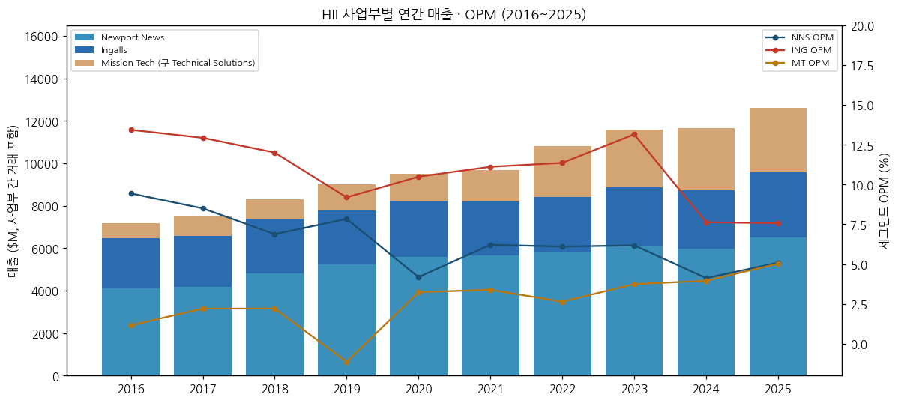

→ (2016~2025, 최신 10-K 재작성치. 2016~2019 MT는 Technical Solutions)

(2) 사업부별 분기 시계열 (1Q21~3Q26, 23개 분기)

| 분기 | 연결 매출 | GAAP 영업이익 | OPM | 순이익 | 세그먼트 영업이익 | NNS 매출 | NNS OI | Ingalls 매출 | Ingalls OI | MT 매출 | MT OI | 잔고 ($B) |
|---|---|---|---|---|---|---|---|---|---|---|---|---|
| 1Q21 | 2,278 | 147 | 6.5 | 148 | 191 | 1,407 | 93 | 649 | 91 | 259 | 7 | — |
| 2Q21 | 2,231 | 128 | 5.7 | 129 | 169 | 1,363 | 76 | 670 | 80 | 237 | 13 | — |
| 3Q21 | 2,338 | 118 | 5.0 | 147 | 163 | 1,354 | 88 | 628 | 62 | 394 | 13 | — |
| 4Q21 | 2,677 | 120 | 4.5 | 120 | 160 | 1,539 | 95 | 581 | 48 | 586 | 17 | 48.5 |
| 1Q22 | 2,576 | 138 | 5.4 | 140 | 176 | 1,390 | 81 | 631 | 86 | 590 | 9 | 47.9 |
| 2Q22 | 2,662 | 191 | 7.2 | 178 | 225 | 1,433 | 94 | 658 | 106 | 600 | 25 | 47.2 |
| 3Q22 | 2,626 | 131 | 5.0 | 138 | 166 | 1,445 | 102 | 623 | 50 | 595 | 14 | 46.7 |
| 4Q22 | 2,812 | 105 | 3.7 | 123 | 145 | 1,584 | 80 | 658 | 50 | 602 | 15 | 47.1 |
| 1Q23 | 2,674 | 141 | 5.3 | 129 | 156 | 1,506 | 84 | 577 | 55 | 624 | 17 | 47.0 |
| 2Q23 | 2,787 | 156 | 5.6 | 130 | 169 | 1,509 | 95 | 664 | 65 | 645 | 9 | 46.9 |
| 3Q23 | 2,816 | 172 | 6.1 | 148 | 187 | 1,453 | 90 | 711 | 73 | 685 | 24 | 49.4 |
| 4Q23 | 3,177 | 312 | 9.8 | 274 | 330 | 1,665 | 110 | 800 | 169 | 745 | 51 | 48.1 |
| 1Q24 | 2,805 | 154 | 5.5 | 153 | 170 | 1,434 | 82 | 655 | 60 | 750 | 28 | 48.4 |
| 2Q24 | 2,977 | 189 | 6.3 | 173 | 203 | 1,535 | 111 | 712 | 56 | 765 | 36 | 48.5 |
| 3Q24 | 2,749 | 82 | 3.0 | 101 | 97 | 1,412 | 15 | 664 | 49 | 709 | 33 | 49.4 |
| 4Q24 | 3,004 | 110 | 3.7 | 123 | 103 | 1,588 | 38 | 736 | 46 | 713 | 19 | 48.7 |
| 1Q25 | 2,734 | 161 | 5.9 | 149 | 171 | 1,396 | 85 | 637 | 46 | 735 | 40 | 48.0 |
| 2Q25 | 3,082 | 163 | 5.3 | 152 | 172 | 1,603 | 82 | 724 | 54 | 791 | 36 | 56.9 |
| 3Q25 | 3,192 | 161 | 5.0 | 145 | 179 | 1,617 | 80 | 828 | 65 | 787 | 34 | 55.7 |
| 4Q25 | 3,476 | 172 | 4.9 | 159 | 195 | 1,891 | 84 | 889 | 68 | 731 | 43 | 53.1 |
| 1Q26 | 3,099 | 155 | 5.0 | 149 | 172 | 1,665 | 88 | 725 | 49 | 748 | 35 | 54.0 |
| 2Q26 | 3,418 | 210 | 6.1 | 208 | 224 | 1,849 | 111 | 845 | 58 | 760 | 55 | 57.3 |
| **3Q26** | **3,537** | **246** | **7.0** | **217** | **262** | **1,910** | **132** | **876** | **59** | **792** | **71** | **86.2** |

→ (단위: $M, %. 출처: 10-Q(전년 동기 열 포함), 4Q = 10-K 연간 - 9개월 누적 [계산]. 1Q21~3Q21은 2022년 10-Q의 전년 동기 열)

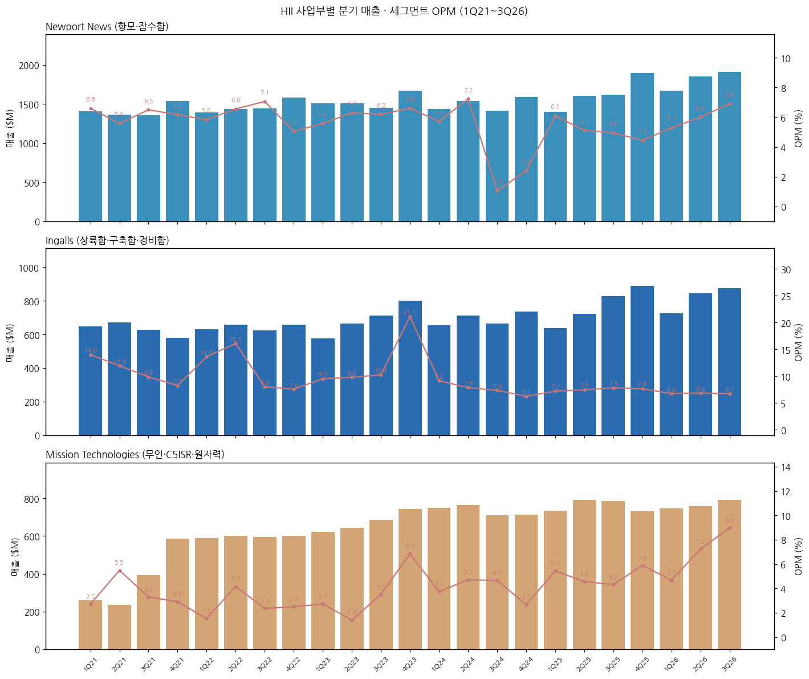

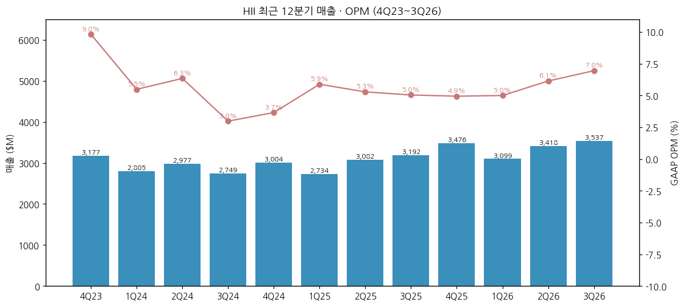

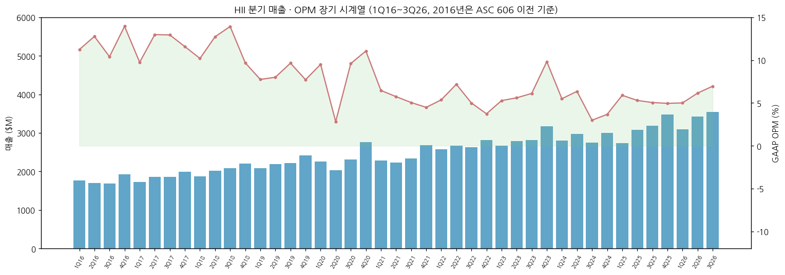

→ 1Q16~4Q20은 10-K 분기 요약표(연결만). 2020년 2Q OPM 2.8%는 코로나 영향 분기 [판단], 2023년 4Q 9.8%는 Ingalls 이익 급증(Ingalls OPM 21.1%, 원인 세부 미확인)

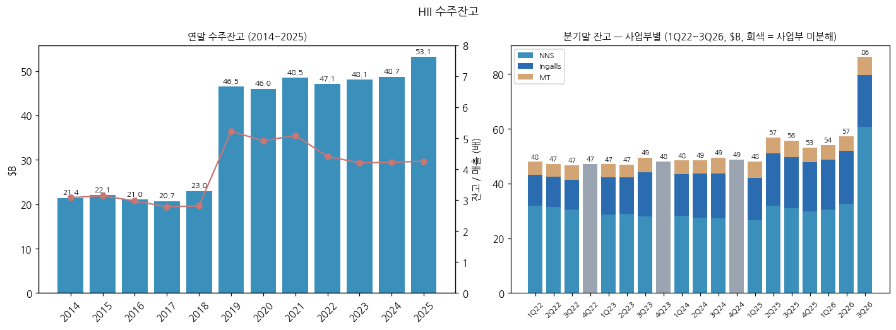

→ 잔고는 2019년 항모 2척 일괄 계약·Virginia Block V로 $23.0B → $46.5B로 한 번 뛰었고, 3Q26 Block VI·Columbia Build II로 $57.3B → $86.2B로 다시 뛰었다. 3Q26 잔고 중 funded $37.9B·unfunded $48.3B, 사업부별 NNS $60.8B·Ingalls $18.9B·MT $6.5B (10-Q). 4Q26에 CVN-75 RCOH $5.1B 추가 예정

(3) 사업부별 개요 (2025 매출 비중 순, 사업부 간 거래 포함)

**(3-1) Newport News Shipbuilding — 52%, 핵추진 함정**
→ 미 해군 핵항모의 **유일한 설계·건조사**이자 항모 RCOH(핵연료 재장전·대개조)의 **유일한 원청**이다. RCOH는 한 척에 약 4년, 항모 50년 수명 중 정비·현대화 작업의 약 35%다 (10-K)
→ 잠수함: GD Electric Boat와 팀으로 Virginia급 공격형 잠수함을 짓고(선미·거주구역·어뢰실·함교·선수 담당, 최종 조립은 교대), Columbia급 탄도미사일 잠수함(12척 계획)은 Electric Boat의 하청으로 참여한다
→ 진행 중: CVN-79 Kennedy(예비 인수시험 완료, 2027 인도), CVN-80·81, CVN-82 장납기 자재, CVN-75 Truman RCOH(2026.9 계약 $5.1B), SSN-800 Arkansas(Block IV 마지막, 2026 인도 예정)
→ 2026 3Q 잔고 $60.8B(전 분기 $32.5B) — Block VI·Columbia Build II 수주

**(3-2) Ingalls Shipbuilding — 24%, 비핵 수상함**
→ 미 해군 **상륙함(LHA·LPD)의 유일한 건조사**, 이지스 구축함(DDG 51)의 **두 건조사 중 하나**(나머지 GD Bath), 해경 경비함(NSC) 건조 (10-K)
→ 프리깃(FF(X), NSC 기반) 설계 단계 — CDR·PRR 통과, 2028년 말 진수 목표, 2027년 함정은 1Q27 계약 필요 (3Q26 컨콜)
→ 파스카굴라(미시시피) 800에이커. 2026년 LPD 30 인도, LHA 8·DDG 129는 2027년 초 인도 예정
→ 2016~2023년 OPM 9~13%의 고마진 사업부였으나 2024년 이후 7%대로 하락(임금 인상·인력 부족·DDG 생산 성과)

**(3-3) Mission Technologies — 24%, 방산 서비스·무인체계**
→ C5ISR, 사이버·전자전, 훈련·시뮬레이션, 원자력·환경 서비스(DOE JV), 무인 수중·수상체계(REMUS·Lionfish UUV, ROMULUS USV, Odyssey 자율운항 스택)
→ 무인체계 매출 2026년 $200M 이상, MT 평균보다 높은 마진 (3Q26 컨콜). MUSV 프로그램 ROMULUS 10척 수주, 매사추세츠 생산시설 25% 증설
→ 2026 가이던스: 매출 $3.0~3.2B, 세그먼트 OPM 약 6%, EBITDA 마진 약 9%

(4) 주요 경쟁사

| 사업부 | 경쟁사 | 비고 |
|---|---|---|
| Newport News | General Dynamics (Electric Boat) | 잠수함은 경쟁이자 팀(공동 건조). 항모·RCOH는 사실상 독점(정부 조선소가 대규모 투자 시 RCOH 대체 가능 — 10-K 리스크) |
| Ingalls | General Dynamics (Bath Iron Works, NASSCO), Austal USA, Bollinger, Fincantieri Marinette | 구축함은 Bath와 양분, 상륙함은 독점. 비핵 소형 함정은 중소 조선소와 경쟁 |
| Ingalls·지원함 | 한화 필리조선소(한화오션·한화시스템), HD현대중공업(협력 상대이자 잠재 경쟁) | 미국 내 신규 조선 능력. MASGA 이후 지원함·MRO에서 접점 |
| Mission Technologies | Leidos, SAIC, CACI, BAE Systems, Anduril 등 | 국방 IT·무인체계 |

→ (출처: 10-K "Competitive Environment"(GD 명시), 나머지는 [판단])

(5) 주요 매출처

→ 미 해군 81%(2025), 80%(2024), 81%(2023). 그 외 미 해경·국방부·에너지부(DOE) 등 미 정부가 사실상 전부 (10-K)
→ 계약 유형(2025): 고정가 인센티브(FPI) 약 46%, 원가가산형 약 50%, T&M 약 1%, 확정고정가 약 3% (10-K)

(6) 생산 CAPA + 임직원

→ 조선소: Newport News(버지니아), Ingalls(미시시피 파스카굴라), 찰스턴(사우스캐롤라이나, 2025년 W International 인수 — 모듈 제작)
→ 임직원: 약 42,000명(2019) → 43,000명(2022) → 44,000명(2025) → 약 46,000명(2026.3Q). 엔지니어·디자이너 약 7,000명, 19개 직종 (10-K)
→ 2026년 연초 대비 6,000명 이상 채용, 견습학교 등록 각 조선소 800명(+14%), 처리량 연초 대비 +9%(목표 +15%) (3Q26 컨콜)

---

## ④ 재무 구조 (12년)

(1) 손익계산서

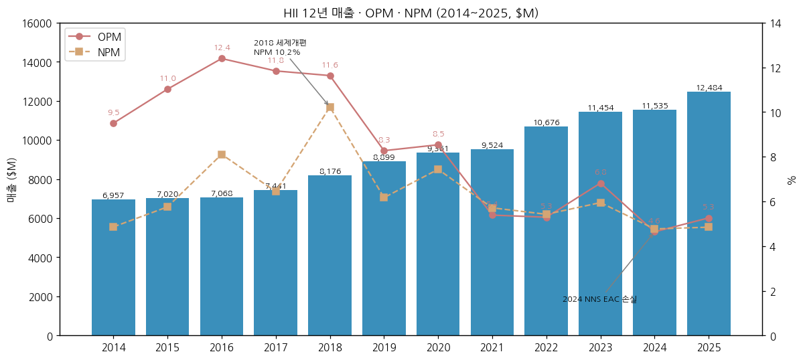

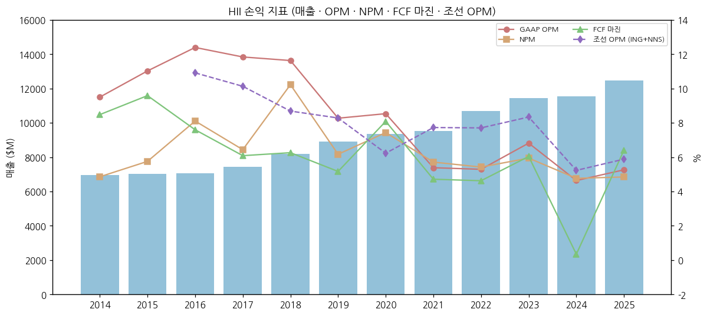

| 연도 | 매출 YoY | 영업이익 YoY | 순이익 YoY | OPM | NPM | FCF 마진 | 조선 OPM |
|---|---|---|---|---|---|---|---|
| 2015 | +0.9 | +17.1 | +19.5 | 11.0 | 5.8 | 9.6 | — |
| 2016 | +0.7 | +13.2 | +41.8 | 12.4 | 8.1 | 7.6 | 10.9 |
| 2017 | +5.3 | +0.6 | -16.4 | 11.8 | 6.4 | 6.1 | 10.1 |
| 2018 | +9.9 | +7.9 | +74.5 | 11.6 | 10.2 | 6.3 | 8.7 |
| 2019 | +8.8 | -22.6 | -34.3 | 8.3 | 6.2 | 5.2 | 8.3 |
| 2020 | +5.2 | +8.6 | +26.8 | 8.5 | 7.4 | 8.1 | 6.2 |
| 2021 | +1.7 | -35.8 | -21.8 | 5.4 | 5.7 | 4.7 | 7.7 |
| 2022 | +12.1 | +10.1 | +6.4 | 5.3 | 5.4 | 4.6 | 7.7 |
| 2023 | +7.3 | +38.2 | +17.6 | 6.8 | 5.9 | 6.0 | 8.3 |
| 2024 | +0.7 | -31.5 | -19.2 | 4.6 | 4.8 | 0.3 | 5.2 |
| 2025 | +8.2 | +22.8 | +10.0 | 5.3 | 4.8 | 6.4 | 5.9 |

→ (단위: %. [계산]. GAAP 영업이익은 FAS/CAS 조정(연금 회계 차이)·무형자산 상각을 포함해 세그먼트 영업이익보다 낮다. 2021년 이후 GAAP OPM이 세그먼트 OPM보다 0.3~1.5%p 낮은 이유)

(2) 재무상태표

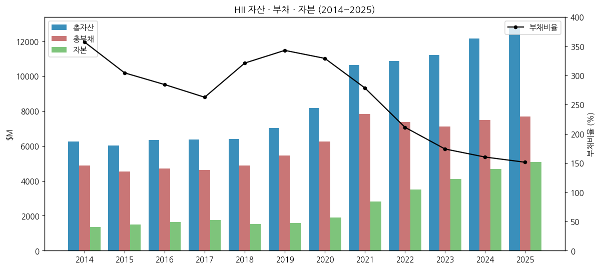

| 연도 | 총자산 | 총부채 | 자본 | 장기차입 | 현금 | 순차입 |
|---|---|---|---|---|---|---|
| 2014 | 6,239 | 4,874 | 1,365 | 1,562 | 990 | 572 |
| 2016 | 6,352 | 4,699 | 1,653 | 1,278 | 720 | 558 |
| 2018 | 6,383 | 4,867 | 1,516 | 1,283 | 240 | 1,043 |
| 2020 | 8,157 | 6,256 | 1,901 | 1,686 | 512 | 1,174 |
| 2021 | 10,627 | 7,819 | 2,808 | 3,298 | 627 | 2,671 |
| 2022 | 10,857 | 7,368 | 3,489 | 2,506 | 467 | 2,039 |
| 2023 | 11,215 | 7,122 | 4,093 | 2,214 | 430 | 1,784 |
| 2024 | 12,141 | 7,475 | 4,666 | 2,700 | 831 | 1,869 |
| 2025 | 12,749 | 7,676 | 5,073 | 2,700 | 774 | 1,926 |
| 3Q26 | 12,980 | 7,488 | 5,492 | 2,704 | 387 | 2,317 |

→ (단위: $M. 출처: 10-K·3Q26 보도자료. 순차입 = 장기차입 - 현금 [계산]. 3Q26말 영업권 $2,650M, 무형 $631M, 연금자산 $1,668M)

(3) 현금흐름표

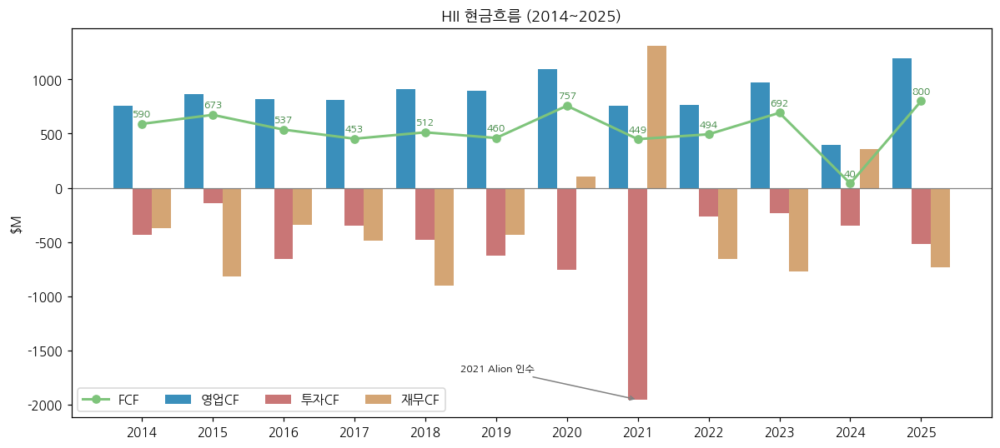

| 연도 | 영업CF | 투자CF | 재무CF | 순 CapEx | FCF |
|---|---|---|---|---|---|
| 2014 | 755 | -437 | -371 | 165 | 590 |
| 2015 | 861 | -141 | -816 | 188 | 673 |
| 2016 | 822 | -653 | -343 | 285 | 537 |
| 2017 | 814 | -349 | -484 | 361 | 453 |
| 2018 | 914 | -476 | -899 | 402 | 512 |
| 2019 | 896 | -627 | -434 | 436 | 460 |
| 2020 | 1,093 | -759 | 103 | 336 | 757 |
| 2021 | 760 | -1,954 | 1,309 | 311 | 449 |
| 2022 | 766 | -268 | -658 | 272 | 494 |
| 2023 | 970 | -236 | -771 | 278 | 692 |
| 2024 | 393 | -348 | 356 | 353 | 40 |
| 2025 | 1,196 | -521 | -732 | 396 | 800 |

→ (단위: $M. 출처: 10-K. FCF = 영업CF - (CapEx - 정부 보조금), 회사 정의. 순 CapEx = 영업CF - FCF [계산])
→ 2026년 9개월: 영업CF $99M, FCF -$182M(3Q 단독 +$429M). FY26 FCF 가이던스 $500~600M, FY26+27 누적 $1.2~1.3B

(4) CapEx

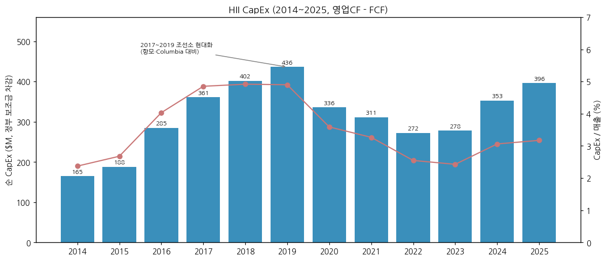

→ 2017~2019년 매출의 4.9%까지 늘린 뒤(항모·Columbia 대비 조선소 현대화), 2022~2023년 2.4~2.5%로 낮췄다. 2026년 가이던스는 약 $500M(매출의 약 3.6%)으로 연초 4~5%에서 하향 (3Q26 컨콜)

(5) 부채 구조

→ 장기차입 $2,704M(3Q26). 2021년 Alion 인수로 $3,298M까지 늘었다가 2022~2023년 상환, 2024년 $2,700M으로 재조달 (10-K). 2025년 만기 $500M 상환(2025년 9개월 현금흐름표). 유동성 약 $2.1B(현금 $387M + 신용한도, 3Q26 컨콜)
→ 채권 발행 이력 세부(만기·쿠폰)는 미확보

(6) 배당·자사주

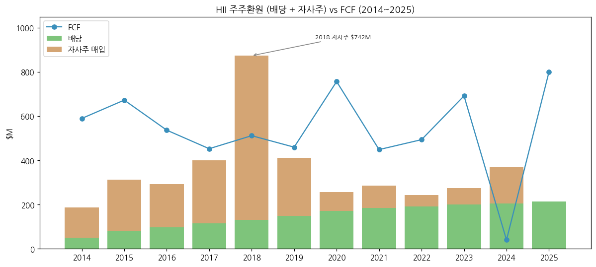

| 연도 | DPS ($) | 배당 | 자사주 | 합계 | FCF 대비 |
|---|---|---|---|---|---|
| 2014 | 1.00 | 49 | 138 | 187 | 32% |
| 2016 | 2.10 | 98 | 194 | 292 | 54% |
| 2018 | 3.02 | 132 | 742 | 874 | 171% |
| 2020 | 4.23 | 172 | 84 | 256 | 34% |
| 2022 | 4.78 | 192 | 52 | 244 | 49% |
| 2024 | 5.25 | 206 | 162 | 368 | 920% |
| 2025 | 5.43 | 213 | 0 | 213 | 27% |

→ (단위: $M. 출처: 10-K. FCF 대비 [계산]. 2024년은 FCF $40M으로 비율 왜곡)
→ 2026년 분기 배당 $1.38(연환산 $5.52, 배당수익률 약 1.8% @ $306.24) [계산]. 2025~3Q26 자사주 매입 없음 — 현금을 FCF 회복·차입 관리에 우선

(7) 재무비율

| 연도 | ROE | ROA | 부채비율 | 유동비율 | 이자보상배율 | CapEx/매출 |
|---|---|---|---|---|---|---|
| 2015 | 28.3 | 6.6 | 304 | 179 | 5.6 | 2.7 |
| 2017 | 28.1 | 7.5 | 263 | 158 | 9.4 | 4.9 |
| 2019 | 35.4 | 8.2 | 343 | 94 | 10.5 | 4.9 |
| 2021 | 23.1 | 5.8 | 278 | 115 | 5.8 | 3.3 |
| 2023 | 18.0 | 6.2 | 174 | 95 | 8.2 | 2.4 |
| 2024 | 12.6 | 4.7 | 160 | 108 | 5.6 | 3.1 |
| 2025 | 12.4 | 4.9 | 151 | 113 | 6.3 | 3.2 |

→ (단위: %, 배. [계산]. ROE·ROA는 기초·기말 평균. 부채비율 = 총부채/자본. 이자보상배율 = 영업이익/이자비용)
→ ROE가 2019년 35%에서 2025년 12%로 내려온 것은 마진 하락과 자본 축적(연금 이익 포함)이 겹친 결과다

---

## ⑤ 지배 구조

(1) 그룹·계열 관계

→ 독립 상장사(지배주주 없음). 2011년 Northrop Grumman에서 분사 — 분사 관련 세무 책임 잠재 리스크가 10-K 위험요인에 남아 있다
→ 주요 JV: 원자력·환경 서비스 JV(MT 산하, 지분법이익 3Q26 $26M)

(2) 주주 구분

→ 5% 이상 주주·기관/개인 비중은 **미확보**(13F·DEF 14A 미수집) — chart5 미작성. v1.1에서 보강

(3) 임원 (2025 10-K 기준)

| 이름 | 직책 |
|---|---|
| Christopher D. Kastner | President & CEO |
| Thomas E. Stiehle | EVP & CFO |
| Kara R. Wilkinson | EVP, President Newport News Shipbuilding |
| Brian D. Blanchette | EVP, President Ingalls Shipbuilding |
| Edgar A. Green III | EVP, President Mission Technologies |
| Eric D. Chewning | EVP, Maritime Systems & Corporate Strategy |
| Chad N. Boudreaux | EVP & Chief Legal Officer |
| Edmond E. Hughes | EVP & Chief HR Officer |

→ 이사회 구성·CEO 상세 약력은 미확보

---

## ⑥ 기타 팩트

(1) R&D

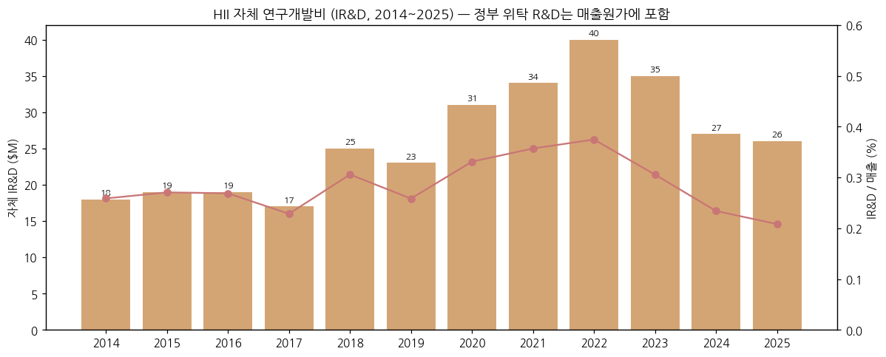

→ 자체 IR&D는 연 $17~40M(매출의 0.2~0.4%)로 작다. 함정 설계·개발 대부분은 정부 위탁 계약으로 수행돼 매출원가에 들어간다. IR&D는 G&A에 포함되고 정부 계약에 배부 가능하다 (10-K)

(2) 진행 중 corporate action (10년)

→ 2016 Camber, 2018 G2, 2019 Fulcrum IT, 2020 Hydroid, 2021 Alion, 2025 W International (10-K)
→ 2025.04~10 HD현대중공업 MOU·NGLS 공동 추진·MOA (보도 인용)
→ 2026 무인 생산시설 25% 증설, Path Robotics·GrayMatter Robotics 자동화 생산 계약 (3Q26 보도자료)

(3) 프로그램 마일스톤

→ 2026: CVN-79 예비 인수시험, Block VI·Columbia Build II 계약, CVN-82 장납기 자재, CVN-75 RCOH 계약, LPD 30·SSN-800 인도 예정, ROMULUS 10척·STINGRAI $2.2B 수주
→ 2027: CVN-79 인도, LHA 8·DDG 129 인도, 프리깃 2번함 계약(1Q)
→ 2028: 프리깃 1번함 진수 목표

(4) 주요 리스크 (10-K 위험요인 요약)

→ 미 정부 의존(사실상 전 매출) — 예산 지연·셧다운·우선순위 변경
→ 고정가 인센티브 계약(46%)의 원가 초과 — 인플레이션·인력·공급망. 2024년 NNS EAC 손실이 실제 사례
→ 숙련 인력 확보 — 임직원 45% 노조, 2025~2026년 임금 인상
→ 정부 조선소의 RCOH 진입 가능성, 경쟁 입찰·입찰 이의
→ 연금 가정(할인율·자산수익률) 변화 — 3Q26말 할인율 +118bp, 자산수익률 1.7% (컨콜)
→ Northrop 분사 관련 세무 책임

(5) ESG 등급 — 미확보

(6) 인증·라이선스 — 미 해군 원자력 추진 함정 건조·정비 자격(항모 건조·RCOH 유일 사업자), 보안 인가 시설 (10-K 서술 기반)

---

## Version Log

| 버전 | 일자 | 내용 |
|---|---|---|
| v1.0 | 2026-11-14 | 신규 작성. SEC 10-K 13건·10-Q 15건·3Q26 보도자료·컨콜 기반. 연간 12년, 분기 43개(사업부 23개), 차트 13종(chart1·1b·2·3·4·6·7·8·9·10·11·12·13·14). 한국 조선 3사 경쟁·협력 지점 추가 |

**잔여 보완 후보 (v1.1)**
→ chart5 주주지분: 13F·DEF 14A 수집 후 5% 이상 주주 표
→ 이사회·CEO 약력(DEF 14A), 채권 만기 구조
→ 1Q16~4Q20 사업부별 분기(2017~2021 10-Q 추가 다운로드)
→ 4Q26 실적(2027년 2월 초) 반영 시 연간 13년·FY27 가이던스 갱신
→ SEC Ex.99.1 원문 직접 확보
