# HL만도 — 기업 개요 (v1.0)

> 마지막 update: 2026-11-25 (3Q26 분기보고서 2026-11-16 제출분 + 3Q26 IR 2026-10-30 반영)
> 입력 source: OpenDART fnlttSinglAcntAll (연결 CFS, 2015 FY\~3Q26 44개 JSON, 2014 = 2015 사업보고서 전기 컬럼) + DART 정기공시 원문 XML 44건 (사업보고서 2015\~2025, 분기·반기 1Q16\~3Q26) + OpenDART 기업개황·주요정보 6종 (2025 사업보고서) + HL만도 IR 실적발표 PDF 26건 (1Q21\~3Q26, irgo) + Yahoo Finance 204320.KS 월간 수정종가 (2014-10\~2026-11-25) + 보도 (딜사이트 2026-10-30, 연합인포맥스 2026-08-04, 다음/머니투데이 2026-06-12)
> 갱신 주기: 매분기 (실적 리뷰 모드 호출 시)
> 워치리스트: 자동차 섹터 (2026-11-23 추가 섹터, 4Q26부터 리뷰) / 서브섹터: **부품** (현대모비스·HL만도·한온시스템·현대위아)
> **Fact verify cutoff**: 2026-11-25 (주가·시총 = Yahoo 2026-11-25 33,600원 / 지분율 = 2025-12-31 사업보고서, 국민연금은 2026-01-05 보고 기준 / 증권사 목표가 = 2026-08-04 보도 기준, 3Q26 이후 컨센서스는 미확보)

---

## 1. 기업 분류

- **Primary 분류: 사이클** (완만한 사이클 — 완성차 생산 볼륨·원가 사이클을 그대로 타는 저마진 1차 섀시 부품사, 11년 OPM range 1.5\~5.2% = 3.7%pt)
- **Secondary 노트: 꿈(휴머노이드 로봇 액추에이터) 일부 + 지속성장(전장화·수주잔고 58조) 요소** — 2025-12, 2026-06 주가 급등은 실적이 아니라 로봇 액추에이터 기대로 발생

### ① 정량 근거

**📊 Summary Box (11년, 2015\~2025 연결 — 2014는 분할 후 4개월이라 통계 제외):**

| 지표 | 값 |
|------|-----|
| 매출 CAGR (2015→2025, 10년) | **+6.0%** (5.30조 → 9.45조) |
| 매출 CAGR (3년, 2022→2025) | **+8.0%** (7.52조 → 9.45조) |
| OPM 평균 | **3.5%** |
| OPM 정점 평균 | **4.7%** (2016 5.2% · 2024 4.1%) |
| OPM 저점 평균 | **1.6%** (2017 1.5% · 2020 1.6%) |
| 사이클 주기 | 약 3\~4년 (저점→저점 2017→2020, 소정점 2021 → 정점 2024) |
| 사이클 회수 (11년) | 정점 2회 / 저점 2회 (+ 소정점 2021) |

```
[전사 OPM 시계열 (12년, 연결, DART, 억원)]
연도   매출(조)  영업이익  순이익   OPM    NPM
2014*    1.72      793     479    4.6    2.8   ← 2014-09-01 인적분할 후 4개월(9~12월)만 연결
2015     5.30    2,656   1,296    5.0    2.4   ← 분할 후 첫 풀이어
2016     5.87    3,050   2,101    5.2    3.6   ← 정점 (중국 현대·기아 호황, 영업이익 3천억 첫 돌파)
2017     5.68      835     183    1.5    0.3   ← 1차 저점: 사드 보복(중국 법인 매출 -7%) + 3Q17 통상임금 충당 (분기 영업손실 -956)
2018     5.66    1,974   1,129    3.5    2.0   ← 회복
2019     5.98    2,186   1,182    3.7    2.0
2020     5.56      887     139    1.6    0.2   ← 2차 저점: 코로나 (2Q20 매출 -31%, 영업손실 -759)
2021     6.15    2,323   1,786    3.8    2.9   ← 소정점 (반도체 부족에도 ADAS 성장, HL클레무브 출범)
2022     7.52    2,481   1,183    3.3    1.6   ← 매출 +22% vs 원자재·물류비 급등
2023     8.39    2,793   1,546    3.3    1.8   ← 북미·인도 외형 성장, 4Q23 OPM 2.3%
2024     8.85    3,588   1,582    4.1    1.8   ← 정점 (분할 후 최대 영업이익)
2025     9.45    3,571   1,228    3.8    1.3   ← 매출 최대, 품질 충당금·선행 R&D로 판관비율 11.5%

OPM range (2015~2025): 1.5% ~ 5.2% = 3.7%pt  (매출은 +6%/년 성장하나 이익률은 3~4%대에 갇힘)
```

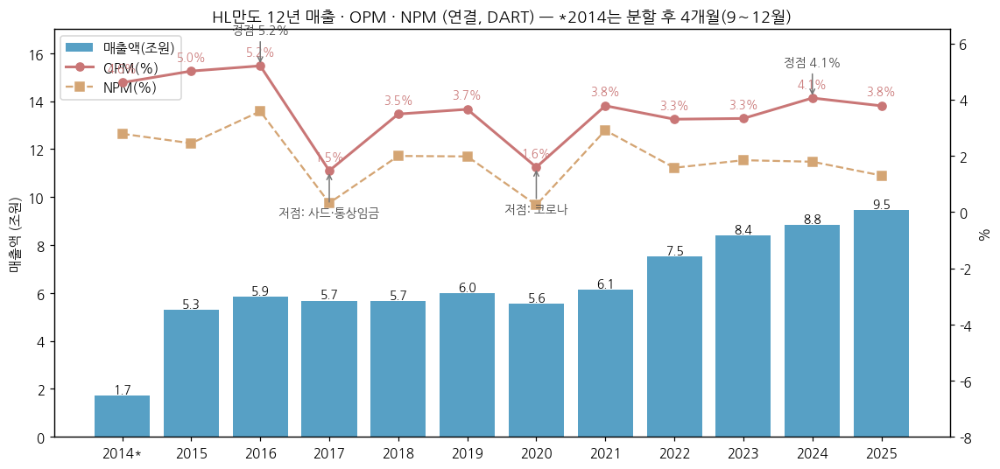

(2014 수치는 2015 사업보고서의 전기 컬럼 = 분할 신설법인 2014-09-01\~12-31. 분할 전 구 (주)만도(060980) 2014년 연간 실적은 HL홀딩스(구 한라홀딩스) 계열로 귀속되어 본 표에 미포함)

### ② 산업 분류

- 산업: **자동차 부품 (섀시: 제동·조향·현가 + ADAS/자율주행 전장)** — 사이클 산업 list 포함 (글로벌 완성차 생산량·원자재 가격·환율 사이클)
- DART 업종코드 303 (자동차 신품 부품 제조업) / KRX 운수장비 / WICS 자동차부품
- 워치리스트 섹터: **자동차** / 서브섹터: **부품** (4Q26부터 리뷰)
- DART 영업부문: 단일 사업(자동차부품 및 기타)을 **지역(한국·중국·미국·인도·기타)** 으로 구분 공시 — 사업부별(제동/조향/현가/ADAS) 매출·이익은 공시하지 않음

### ③ 분류 결정 논리

(1) **가장 매출 큰 사업부 기준** 적용 시: 사업부별 공시가 없어 제품군으로 판단 — 제동(ABS/ESC/IDB/캘리퍼)·조향(EPS/SbW)·현가(쇼크업소버/SDC) 3대 섀시 + ADAS(HL클레무브, 2025 매출 1조 8,250억 = 연결 매출의 약 19%, 내부거래 포함) → 모두 **완성차 생산 대수에 비례하는 납품형 매출** → 사이클
(2) **사이클 사업부 이익 비중 우선 sub-rule**: 이익 변동은 볼륨(2Q20 매출 -31% → 영업손실)·원가(2017 통상임금, 2022 원자재·물류, 3Q26 반도체·원자재) 쇼크가 지배. 분기 OPM은 1Q16\~3Q26 43분기 중 2개 분기 적자, 나머지 1.4\~6.4% → **변동폭은 작지만 상단이 막힌 사이클**
(3) **Boundary case 처리**: ① 전장 제품 비중이 신규 수주의 74\~85% (FY22 85%, FY25 74%, 1\~3Q26 76%) → 매출 mix가 고부가 전장으로 이동 중이나 OPM은 아직 3\~4%대 → 지속성장 격상 근거 부족. ② **로봇 액추에이터**: 4Q25 글로벌 로봇기업향 차세대 4족 보행 로봇 액추에이터 수주 (IR 4Q25), 2026-06-12 골드만삭스 리포트 후 상한가 (65,000원, 목표가 109,000원 제시) → 매출 기여 미미한데 주가를 움직이는 변수 → **Primary 사이클 + Secondary 꿈(로봇)** 병기
(4) **피어 대비**: 현대모비스 = A/S 부품 캐시카우로 **지속성장** (OPM 평균 5.6%, 현대모비스 기업개요) / 현대차 = 완성차 **사이클** (OPM 평균 5.8%) / **HL만도 = 현대차보다 낮은 이익률(3.5%)로 같은 볼륨 사이클을 타는 1차 부품사** — 고객 다변화(현대차그룹 비중 2025 약 43%)로 단일 고객 리스크는 현대모비스·현대위아보다 낮음

### ④ 적정 밸류에이션 방법

- **PER 우선 (이익 정상화 구간 기준)** — OPM이 3\~4%대로 안정적이고 적자 연도가 없어 이익 기반 평가가 작동. 증권사 타깃 P/E는 2026-08 기준 **11\~13배** (기존 13\~14배에서 하향, 18개사 중 10곳 목표가 하향, 범위 5.2만\~8.3만원 — 연합인포맥스 2026-08-04)
- **PBR 밴드 보조 (사이클 저점 하방 지지)** — 2025말 지배주주 자본 2.71조 / 46,957,120주 = BPS 약 57,800원 → 2026-11-25 33,600원 기준 **PBR 약 0.58배**. 저점 구간(2020-02 월말 20,700원) 약 0.4배 수준
- **로봇 옵션은 SOTP로 별도** — 액추에이터 매출이 공시 가능한 수준(수주 공시·매출 비중)이 되기 전까지는 가산하지 않음
- 2025 EPS 2,130원 기준 trailing PER 약 15.8배 (3Q26 외환손실 -614억으로 순이익 변동성 큼 → **영업이익 기준 EV/EBIT 병행** 권장)
- 현대모비스는 PER+배당(지속성장), **HL만도는 PER(정상 이익) + PBR 하단** — 이익률이 낮아 이익 변동 대비 PER 왜곡이 크기 때문

### ⑤ 분기 재평가 트리거 (분류 변경 조건)

- 2개 연도 연속 **OPM 5%+ 및 연간 OPM range 1%pt 이내** 시 → 사이클 → 지속성장 transition 후보 (전장 mix 효과 확인)
- **로봇 액추에이터 매출이 연결 매출의 5%+** 또는 단일 로봇 고객 수주 공시(단일판매·공급계약) 발생 시 → Secondary 꿈 → 성장 사업부로 격상 검토
- HL클레무브(ADAS) 매출이 연결의 30%+ 이고 HL클레무브 OPM이 섀시 대비 구조적으로 높다는 공시가 나올 경우 → Secondary 지속성장 격상
- 로봇 수주 무산·2027년까지 매출 0 → Secondary 꿈 삭제, 순수 사이클 복귀

---

## 2. 회사 개요

### ① 기본 사항

- **회사명**: 에이치엘만도 주식회사 (HL Mando Corporation) / KRX 204320 (보통주)
- **본사**: 경기도 평택시 포승읍 하만호길 32 / R&D센터 판교 / 국내 공장 평택·원주·익산
- **설립**: 2014-09-02 (2014-09-01 분할기일, 구 (주)만도 → 한라홀딩스 존속 + (주)만도 신설 인적분할) / 2014-10-06 유가증권시장 재상장 / 2022-09-05 상호 변경 (주식회사 만도 → 에이치엘만도)
- **그룹**: HL그룹 (구 한라그룹) — 최대주주 HL홀딩스(주) 30.25%
- **대표이사**: 조성현 (부회장, CEO 겸 자동차 Sector장) · 김현욱 (전무, CSO) 각자대표 / 정몽원 회장 사내이사 (그룹 총괄)
- **비전**: "Our vision is your freedom" — 2030 매출 14.1조원 목표 (2025→2030 CAGR +8%, 4Q25 IR)
- **사업 한 줄 정의**: 제동(IDB·ESC·EPB·캘리퍼)·조향(EPS·SbW)·현가(SDC) 섀시 시스템 + 자회사 HL클레무브의 ADAS 센서·제어기(레이더·카메라·HPC)를 현대차그룹(약 43%)·북미 OEM(GM·북미 EV 선도업체 등, 약 27%)·중국·인도 로컬 OEM에 공급하는 국내 1위 독립 섀시 부품사. 해외 19개 생산 사이트·18개 연구소 (DART 사업보고서(2025.12))

### ② 최근 12년 손익·자본 추이 (조원, 연결, DART)

| 연도 | 매출 | YoY | 영업이익 | 순이익 | 자본총계 | 자본 YoY |
|---|---|---|---|---|---|---|
| 2014* | 1.72 | - | 0.08 | 0.05 | 1.10 | - |
| 2015 | 5.30 | - | 0.27 | 0.13 | 1.37 | +24.4% |
| 2016 | 5.87 | +10.7% | 0.31 | 0.21 | 1.52 | +10.9% |
| 2017 | 5.68 | -3.1% | 0.08 | 0.02 | 1.41 | -6.8% |
| 2018 | 5.66 | -0.4% | 0.20 | 0.11 | 1.48 | +4.9% |
| 2019 | 5.98 | +5.6% | 0.22 | 0.12 | 1.59 | +7.0% |
| 2020 | 5.56 | -7.0% | 0.09 | 0.01 | 1.71 | +7.8% |
| 2021 | 6.15 | +10.5% | 0.23 | 0.18 | 2.04 | +19.6% |
| 2022 | 7.52 | +22.3% | 0.25 | 0.12 | 2.27 | +11.2% |
| 2023 | 8.39 | +11.7% | 0.28 | 0.15 | 2.36 | +3.6% |
| 2024 | 8.85 | +5.4% | 0.36 | 0.16 | 2.67 | +13.4% |
| 2025 | 9.45 | +6.9% | 0.36 | 0.12 | 2.88 | +7.6% |

(*2014 = 분할 후 4개월. 2015 YoY는 기저 불일치로 생략. 자본총계는 비지배지분·신종자본증권 포함)

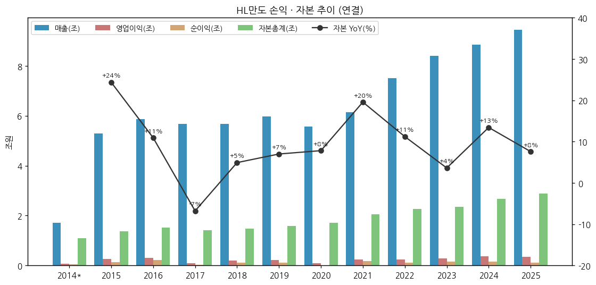

### ③ 회사 주가 역사 ★ narrative 영역

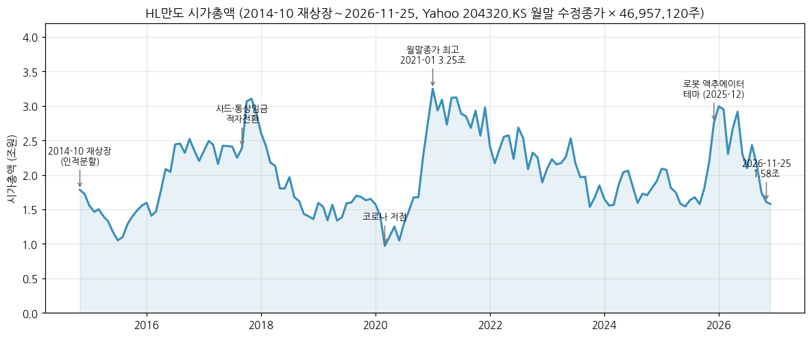

**시가총액 데이터:** 2014-10 \~ 2026-11-25 (Yahoo Finance 204320.KS 월간 수정종가 — 2018-05-08 액면분할 5:1 소급 반영, 발행주식 46,957,120주 고정 가정)
- 2026-11-25 종가 **33,600원 → 시총 약 1.58조원**
- **사상 최고 (월말 종가 기준): 2021-01 69,200원 → 시총 약 3.25조원** / 장중 최고 89,000원 (2021-01, Yahoo 월간 고가) — 애플카·전기차 부품주 랠리
- 2차 고점: 2026-06 장중 79,100원 (Yahoo 월간 고가) — 2026-06-12 골드만삭스 "로보틱스: 대전환의 시기" 리포트 후 상한가 65,000원
- 사상 최저 (월말 종가): 2020-02 20,700원 (시총 약 0.97조원) — 코로나

**국면별 narrative:**
→ **2014-10 \~ 2015 (재상장 직후 조정)**: 수정종가 38,000원 출발 → 2015 중 2만원대 (시총 1.0\~1.3조). 중국 성장 둔화·현대차 중국 판매 부진
→ **2016 \~ 2017-10 (중국·ADAS 기대 랠리)**: 2016 OPM 5.2% 정점, 시총 2.5조 → 2017-10 월말 3.1조. 그러나 2017 사드 보복·3Q17 통상임금 충당금으로 실적은 이미 저점
→ **2018 \~ 2020-02 (실적 정상화 실패 + 코로나)**: 2018-05 액면분할 후에도 시총 1.4\~1.7조 박스, 2020-02 0.97조 바닥
→ **2020-10 \~ 2021 (전기차·애플카 랠리)**: 2020-10 48,500원 → 2021-01 69,200원. 북미 EV 선도업체향 EPS·IDB 수주, HL클레무브(ADAS) 분할 기대
→ **2022 \~ 2025-09 (원가 압박·EV 캐즘)**: 매출은 7.5조 → 9.5조로 성장했지만 OPM 3%대 정체, 시총 1.5\~2.5조
→ **2025-10 \~ 2026-06 (로봇 액추에이터 테마)**: 2025-12 장중 75,800원(2026-01 바 기준), 2026-06-12 상한가. 4Q25 로봇 액추에이터 수주 + CES 2026 액추에이터 공개
→ **2026-07 \~ 현재 (밸류 디레이팅 + 3Q26 쇼크)**: 2Q26 실적 견조에도 목표가 줄하향 (부품 업종 타깃 P/E 하향, 로봇 수주 가시화는 2027년 예정 — 연합인포맥스 2026-08-04) → 3Q26 영업이익 515억(-45%)·순손실 425억 → 2026-11 3만원대 (1.58조)

### ④ 회사의 주요 연혁

| 시점 | 내용 |
|---|---|
| 1962 | 정인영 창업, 현대양행 설립 (만도 모태) — 분할 전 구 만도 연혁, 일반 공개 자료 |
| 1980 | 만도기계 출범 — 〃 |
| 1999 | 외환위기 후 한라그룹 구조조정으로 매각, (주)만도 출범 — 〃 |
| 2008 | 한라건설 컨소시엄 재인수 (한라그룹 복귀) — 〃 |
| 2010-05 | 구 (주)만도 유가증권 상장 — 〃 |
| 2014-09-01 | **인적분할** — 한라홀딩스(존속, 지주) / (주)만도(신설, 사업) (DART) |
| 2014-10-06 | (주)만도 재상장 (DART) |
| 2014-12-18 | 최대주주 정몽원 → (주)한라홀딩스 (DART) |
| 2015-08 | 멕시코 부품 공장 기공 (DART) |
| 2018-05-08 | 액면분할 5,000원 → 1,000원 (1주 → 5주) 신주 상장 (DART) |
| 2021-09-01 | ADAS 사업부문 물적분할 → (주)만도모빌리티솔루션즈 설립 (DART) |
| 2021-12 | 만도모빌리티솔루션즈 + 만도헬라일렉트로닉스 합병 → **HL클레무브 출범** (2021-12-02 공식 출범, IR) |
| 2022-05 | (주)만도차이나홀딩스 흡수합병 (DART) |
| 2022-08 | 만도 글로벌 R&D센터 토지·건물 매각 (DART) |
| 2022-09-05 | 상호 변경 — 주식회사 만도 → **에이치엘만도** (DART) |
| 2024-01 | 2개 BU 체제 개편 (MDS: Mobility Dynamic Solutions / RCS: Ride Comfort & Safety) (IR 4Q23) |
| 2024-02 | 중국 텐륜(天潤)과 합자법인 텐륜HL만도 출범 (DART) |
| 2024-09-30 | 만도브로제 지분 40% 추가 인수 → 90% 종속회사 편입 (DART) |
| 2025 4Q | 글로벌 로봇기업향 차세대 4족 보행 로봇 액추에이터 수주 (IR 4Q25) |
| 2026-01 | CES 2026 — 휴머노이드 로봇 액추에이터 공개 (IR 4Q25) |
| 2026-06-12 | 골드만삭스 리포트 후 상한가 (65,000원) |

---

## 3. 비즈니스 모델

### ① 실적 추이 (연결 → 지역부문 → 고객·제품 3단계 위계)

> HL만도는 DART에 **단일 사업(자동차부품)·지역 부문**으로만 공시. 아래 지역 매출은 **법인 소재지 기준·내부거래 제거 전** 금액 (DART 사업보고서 II-4 매출실적). IR의 "지역별 매출"은 외부고객 기준이라 숫자가 다르다.

**[5년 연간 통합 표 (억원, DART)]**

| 구분 | 2021 | 2022 | 2023 | 2024 | 2025 | 2025 비중* |
|---|---|---|---|---|---|---|
| **연결 매출** | **61,474** | **75,162** | **83,931** | **88,482** | **94,548** | 100% |
| ├ 한국 | 32,090 | 34,851 | 37,273 | 38,359 | 41,378 | 37.5% |
| ├ 중국 | 16,390 | 19,991 | 23,068 | 23,031 | 22,676 | 20.6% |
| ├ 미국 | 9,362 | 14,042 | 14,831 | 15,186 | 16,423 | 14.9% |
| ├ 인도 | 5,817 | 7,813 | 8,195 | 9,003 | 10,082 | 9.1% |
| ├ 기타 (유럽·멕시코·브라질 등) | 5,975 | 10,270 | 14,027 | 16,644 | 19,687 | 17.9% |
| └ 내부거래·연결조정 | -8,160 | -11,805 | -13,463 | -13,742 | -15,697 | - |
| 영업이익 | 2,323 | 2,481 | 2,793 | 3,588 | 3,571 | OPM 3.8% |
| **(고객)** 현대차그룹(현대차·기아·모비스·위아) | - | - | - | - | 약 43% | DART |
| **(고객)** 북미 OEM (GM 포함) | - | - | - | - | 약 27% | DART |
| **(제품)** HL클레무브 (ADAS) 매출 | - | - | - | - | 1조 8,250억 | DART (5년 CAGR 25.6%) |
| **(제품)** SDC (전자제어 서스펜션) 매출 | - | - | - | - | 1,110억 | IR 3Q26 (2030E 3,420억) |
| 신규 수주 (조원) | 11.0 | 11.0 | 16.6 | 17.6 | 11.9 | IR |

(*비중 = 내부거래 제거 전 지역 합계 대비. 2018 이전에는 인도가 '기타'에 포함되어 있다가 2019부터 분리 공시)

**[장기 지역 매출 (억원, 연간, DART — 내부거래 제거 전)]**

| 연도 | 한국 | 중국 | 미국 | 인도 | 기타 | 조정 | 연결 |
|---|---|---|---|---|---|---|---|
| 2015 | 31,431 | 14,372 | 10,241 | (기타 포함) | 5,127 | -8,179 | 52,992 |
| 2016 | 31,878 | 17,716 | 11,301 | (기타 포함) | 6,161 | -8,391 | 58,664 |
| 2017 | 30,956 | 16,432 | 8,466 | (기타 포함) | 7,622 | -6,628 | 56,847 |
| 2018 | 31,084 | 14,959 | 7,686 | (기타 포함) | 9,099 | -6,180 | 56,648 |
| 2019 | 33,234 | 13,311 | 9,209 | 5,294 | 5,939 | -7,168 | 59,819 |
| 2020 | 30,098 | 12,929 | 8,818 | 4,400 | 5,273 | -5,882 | 55,635 |
| 2021 | 32,090 | 16,390 | 9,362 | 5,817 | 5,975 | -8,160 | 61,474 |
| 2022 | 34,851 | 19,991 | 14,042 | 7,813 | 10,270 | -11,805 | 75,162 |
| 2023 | 37,273 | 23,068 | 14,831 | 8,195 | 14,027 | -13,463 | 83,931 |
| 2024 | 38,359 | 23,031 | 15,186 | 9,003 | 16,644 | -13,742 | 88,482 |
| 2025 | 41,378 | 22,676 | 16,423 | 10,082 | 19,687 | -15,697 | 94,548 |
| 1\~3Q26 | 30,251 | 16,786 | 11,914 | 8,792 | 15,919 | -12,389 | 71,275 |

→ 10년간 한국 비중(내부거래 전) 50% → 38%, 인도·기타 8% → 27%로 이동. 중국은 2016 정점 이후 사드·현대차 중국 부진으로 2020까지 -27%, 이후 중국 로컬 OEM(지리·니오·동펑 등)으로 회복했으나 2023 이후 정체

**[사업부(지역)별 분기 시계열 — 43분기 (1Q16\~3Q26)]**

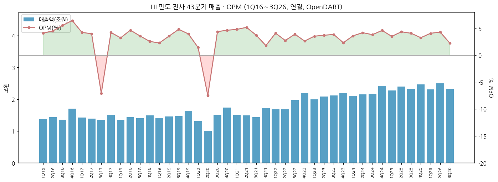

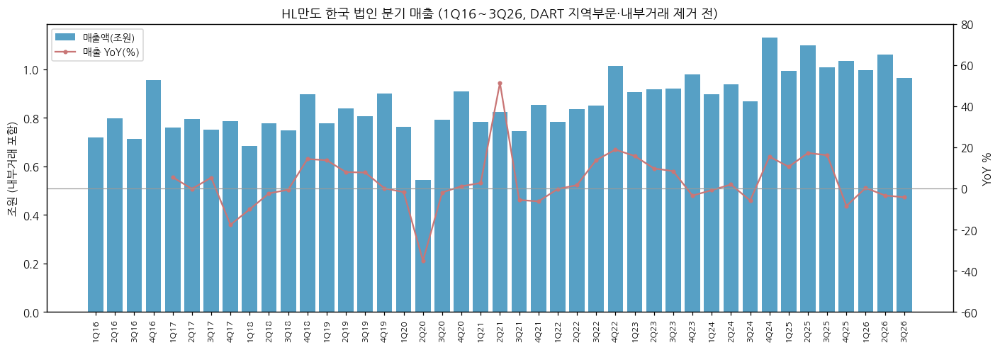

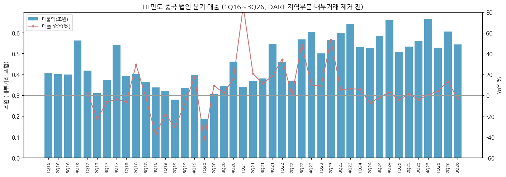

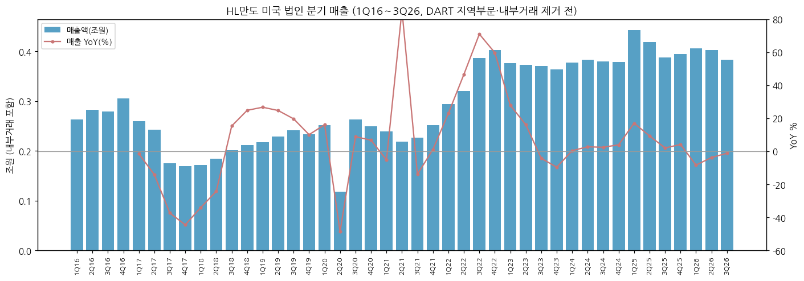

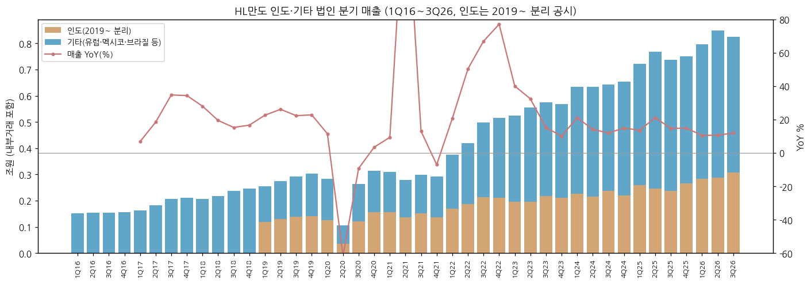

(지역 분기값 = DART 분기·반기·사업보고서 II-4 매출실적의 누적값 차분. 지역별 영업이익은 미공시 → 매출 bar + YoY line으로 대체)

**[전사 분기 실적 43분기 (억원, 연결, OpenDART — 4Q = 연간 − 3Q 누적)]**

| 분기 | 매출 | 영업이익 | OPM | 매출 YoY | 영업이익 YoY | 순이익 |
|---|---|---|---|---|---|---|
| 1Q16 | 13,664 | 559 | 4.1% | | | 413 |
| 2Q16 | 14,400 | 648 | 4.5% | | | 453 |
| 3Q16 | 13,568 | 749 | 5.5% | | | 450 |
| 4Q16 | 17,032 | 1,094 | 6.4% | | | 785 |
| 1Q17 | 14,304 | 604 | 4.2% | +4.7% | +7.9% | 352 |
| 2Q17 | 13,933 | 553 | 4.0% | -3.2% | -14.7% | 360 |
| 3Q17 | 13,509 | -956 | -7.1% | -0.4% | 적전 | -916 |
| 4Q17 | 15,101 | 635 | 4.2% | -11.3% | -42.0% | 386 |
| 1Q18 | 13,462 | 433 | 3.2% | -5.9% | -28.3% | 247 |
| 2Q18 | 14,334 | 664 | 4.6% | +2.9% | +20.1% | 391 |
| 3Q18 | 13,981 | 499 | 3.6% | +3.5% | 흑전 | 269 |
| 4Q18 | 14,871 | 378 | 2.5% | -1.5% | -40.5% | 223 |
| 1Q19 | 14,151 | 321 | 2.3% | +5.1% | -25.9% | 187 |
| 2Q19 | 14,636 | 518 | 3.5% | +2.1% | -22.0% | 326 |
| 3Q19 | 14,671 | 704 | 4.8% | +4.9% | +41.0% | 525 |
| 4Q19 | 16,361 | 643 | 3.9% | +10.0% | +70.0% | 145 |
| 1Q20 | 13,101 | 185 | 1.4% | -7.4% | -42.3% | 95 |
| 2Q20 | 10,134 | -759 | -7.5% | -30.8% | 적전 | -1,119 |
| 3Q20 | 15,015 | 656 | 4.4% | +2.3% | -6.8% | 392 |
| 4Q20 | 17,385 | 804 | 4.6% | +6.3% | +25.1% | 770 |
| 1Q21 | 15,015 | 718 | 4.8% | +14.6% | +288.0% | 522 |
| 2Q21 | 14,875 | 767 | 5.2% | +46.8% | 흑전 | 804 |
| 3Q21 | 14,360 | 532 | 3.7% | -4.4% | -19.0% | 260 |
| 4Q21 | 17,224 | 306 | 1.8% | -0.9% | -61.9% | 200 |
| 1Q22 | 16,878 | 689 | 4.1% | +12.4% | -4.0% | 333 |
| 2Q22 | 16,790 | 457 | 2.7% | +12.9% | -40.4% | 388 |
| 3Q22 | 19,684 | 766 | 3.9% | +37.1% | +44.0% | 1,352 |
| 4Q22 | 21,810 | 569 | 2.6% | +26.6% | +85.6% | -890 |
| 1Q23 | 19,967 | 702 | 3.5% | +18.3% | +1.8% | 436 |
| 2Q23 | 20,868 | 770 | 3.7% | +24.3% | +68.5% | 511 |
| 3Q23 | 21,191 | 815 | 3.8% | +7.7% | +6.4% | 193 |
| 4Q23 | 21,904 | 506 | 2.3% | +0.4% | -11.0% | 406 |
| 1Q24 | 21,073 | 756 | 3.6% | +5.5% | +7.7% | 1,457 |
| 2Q24 | 21,474 | 896 | 4.2% | +2.9% | +16.4% | 119 |
| 3Q24 | 21,717 | 825 | 3.8% | +2.5% | +1.2% | -492 |
| 4Q24 | 24,218 | 1,110 | 4.6% | +10.6% | +119.4% | 498 |
| 1Q25 | 22,710 | 792 | 3.5% | +7.8% | +4.7% | 346 |
| 2Q25 | 24,009 | 1,041 | 4.3% | +11.8% | +16.2% | 99 |
| 3Q25 | 23,213 | 942 | 4.1% | +6.9% | +14.1% | 492 |
| 4Q25 | 24,616 | 797 | 3.2% | +1.6% | -28.2% | 291 |
| 1Q26 | 23,117 | 936 | 4.0% | +1.8% | +18.2% | 531 |
| 2Q26 | 24,953 | 1,070 | 4.3% | +3.9% | +2.8% | 588 |
| 3Q26 | 23,205 | 515 | 2.2% | -0.0% | -45.3% | -425 |

(OpenDART fnlttSinglAcntAll. 2015 분기는 OpenDART 미제공. 3Q26 = 분기보고서(2026.09, 2026-11-16 제출) 확정치 — IR 잠정치와 동일)

**[지역별 최근 12분기 매출 (억원, DART — 내부거래 제거 전)]**

| 분기 | 한국 | 중국 | 미국 | 인도 | 기타 | 연결 |
|---|---|---|---|---|---|---|
| 4Q23 | 9,792 | 6,417 | 3,639 | 2,102 | 3,588 | 21,904 |
| 1Q24 | 8,988 | 5,296 | 3,779 | 2,266 | 4,085 | 21,073 |
| 2Q24 | 9,372 | 5,260 | 3,826 | 2,149 | 4,182 | 21,474 |
| 3Q24 | 8,687 | 5,852 | 3,798 | 2,381 | 4,043 | 21,717 |
| 4Q24 | 11,312 | 6,623 | 3,783 | 2,208 | 4,333 | 24,218 |
| 1Q25 | 9,938 | 5,065 | 4,423 | 2,594 | 4,620 | 22,710 |
| 2Q25 | 10,992 | 5,337 | 4,183 | 2,455 | 5,216 | 24,009 |
| 3Q25 | 10,091 | 5,617 | 3,877 | 2,382 | 4,988 | 23,213 |
| 4Q25 | 10,356 | 6,656 | 3,940 | 2,651 | 4,862 | 24,616 |
| 1Q26 | 9,968 | 5,280 | 4,055 | 2,836 | 5,136 | 23,117 |
| 2Q26 | 10,622 | 6,062 | 4,027 | 2,884 | 5,603 | 24,953 |
| 3Q26 | 9,662 | 5,445 | 3,832 | 3,072 | 5,180 | 23,205 |

**[🔎 3Q26 핵심 박스]**

| 항목 | 3Q26 | YoY | QoQ | 출처 |
|---|---|---|---|---|
| 매출 | 2조 3,205억 | 0.0% | -7.0% | DART 분기보고서 / IR |
| 영업이익 (OPM) | 515억 (2.2%) | -45.3% | -51.9% | 〃 |
| 순이익 | -425억 | 적전 | 적전 | 〃 (외환손익 -614억) |
| 외부고객 지역 매출 (IR) | 한국 7,165억 -8.6% / 중국 4,947억 -1.7% / 미주 6,344억 +0.4% / 인도 2,825억 **+30.8% (분기 최고)** / 유럽 1,925억 +3.1% | | | IR 3Q26 |
| 신규 수주 | 1.9조 (1\~3Q 누적 7.6조, 연간 목표 13.0조의 59%) | | | IR 3Q26 |
| 수주 잔고 | 58조원 (전장 비중 누적 76%) | | | IR 3Q26 |
| 재무 | 자산 7.02조 / 차입금 1.95조 / 부채비율 142.2% / 순차입금비율 40.5% | | | IR 3Q26 |

→ 이익 급감 원인 (회사 설명): ① 반도체·원자재 가격 상승에 따른 원가 부담 ② 신사업 및 HL클레무브 미래 제품(HPC 등) R&D 비용 증가 ③ 매출 측: 현대·기아 국내 생산 감소·생산 차질, 중국 내수 둔화를 인도 로컬 OEM이 상쇄
→ 2026 매출 가이던스 9.6조원 (+1.8%), 1\~3Q 누적 7.13조 = 74%

**[12분기 시계열 (전사 매출 + OPM)]**

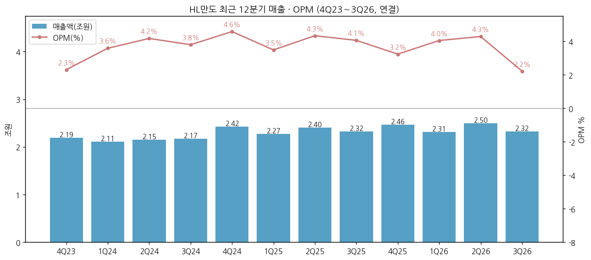

### ② 사업부별 개요 (매출 비중 큰 순서)

> 회사 내부 조직은 2024-01부터 **MDS(조향·전자제동)·RCS1(기계식 제동)·RCS2(현가)** 3개 사업부문 + 종속회사 HL클레무브(ADAS) 구조. 사업부별 매출은 미공시 → 비중은 서술로만 제시

| 사업부문 | 제품군 | 주요 제품 | 비고 |
|---|---|---|---|
| MDS (Mobility Dynamic Solution) | 조향 + 전자식 제동 | C-EPS·R-EPS·BN-EPS·DP-EPS, SbW, RWS / ABS·ESC·AHB·**IDB·IDB2** | 전장 제품 핵심. IDB2 = 세계 최초 일체형(1-Box) 통합 전자 브레이크 |
| RCS1 (Ride Comfort & Safety 1) | 기계식 제동 | 캘리퍼·드럼브레이크·마스터실린더·부스터·**EPB**(MoC) | 인도·북미 수주 확대 (마루티스즈키향 캘리퍼 첫 진입, 4Q25) |
| RCS2 | 현가 | 쇼크업소버·스트럿·**SDC**(전자제어 감쇠) | SDC 수주잔고 1.4조, 고객 10개사, 40개+ 차종 (3Q26 IR) |
| HL클레무브 (100% 자회사) | ADAS·자율주행·전장 | 레이더·카메라·ADCU·APCU·**HPC**, EPS/EMB 제어기, AVAS·SCR·FPC ECU | 2025 매출 1조 8,250억, 출범 후 5년 CAGR 25.6% (DART) |

### ③ 사업부별 디테일

- **제동 (IDB·EMB)**: ABS/TCS 독자 개발에서 출발, ESC → IDB(ESC+부스터 통합) → IDB2(1-Box·이중화). 현대차·기아 플래그십·친환경차 탑재, 북미 OEM 2개사 EPB/IDB 수주(4Q25), 중국 선도 IT기업향 IDB2 첫 진입(4Q25). 차세대 **EMB(Electro-Mechanical Brake, 유압 제거)** 개발 중 — PBV·SDV 핵심
- **조향 (EPS·SbW)**: 2004 EPS 독자 양산. 현대차·기아·북미 EV 선도업체 주요 고객. **SbW 세계 최초 양산** (DART 2025 사업보고서). 4Q25 현대·기아 주요 SUV향 DP-EPS, 1\~3Q26 중국 로컬 R-EPS·인도 C-EPS 수주
- **현가 (SDC)**: 국내 최초 ECS 개발. SDC 매출 2025 1,110억 → 2030E 3,420억 (CAGR 25%, 회사 전망). 2026 신규 수주 약 7,060억 — 중국 OEM 중심 (3Q26 IR)
- **ADAS (HL클레무브)**: 2010 전방 레이더 최초 공급. L0\~L2+/L3 풀라인업, HPC 기반 자율주차 제어기 양산, 인도 첸나이 공장 현지 최초 레이더 양산. 2025 산업부 'AI 미래차 M.AX 얼라이언스' 앵커 기업. 3Q26 HPC 신규 매출 기여 시작 (IR)
- **신사업 (로봇 액추에이터)**: 모터-감속기-제어기 통합 스마트 액추에이터 (CES 2026). 4Q25 글로벌 로봇기업향 차세대 4족 보행 로봇 액추에이터 수주 (IR). 보스턴다이내믹스 '스팟'에 액추에이터 공급 중 (머니투데이 2026-06-12 보도). DART 연구개발 과제에 "로봇 액추에이터 및 관련 제품/기술 개발" 명시 (2025 사업보고서)

### ④ 주요 경쟁사 (사업부별)

| 사업부 | 글로벌 경쟁사 | 국내 |
|---|---|---|
| 제동 (ESC·IDB·EMB) | Bosch, Continental, ZF, Aisin(Advics), Hitachi Astemo | 현대모비스 (iMEB 등) |
| 조향 (EPS·SbW) | Bosch, ZF, JTEKT, Nexteer, NSK | 현대모비스 |
| 현가 (댐퍼·SDC) | ZF(Sachs), Tenneco, KYB, Hitachi Astemo | - |
| ADAS (레이더·카메라·HPC) | Bosch, Continental, Aptiv, Mobileye, Valeo, 중국 로컬 (Desay SV 등) | 현대모비스 |

(업계 일반 구도 — DART는 경쟁사·점유율을 공시하지 않음. 점유율 수치는 미확보)

### ⑤ 주요 매출처

> DART 사업보고서(2025.12) II-4: "주요 매출처는 현대자동차, 기아 및 현대모비스, 현대위아이며 2025년 기준 매출의 약 43%. 다음으로 GM Group을 포함한 북미거점 OEM이 약 27%" → 현대차그룹 + 북미 OEM 합산 약 70%

| 구분 | 비중 | 근거 |
|---|---|---|
| 현대차그룹 (현대차·기아·현대모비스·현대위아) | 약 43% (2025 매출) | DART 사업보고서(2025.12) |
| 북미 OEM (GM 등, 북미 EV 선도업체 포함) | 약 27% (2025 매출) | 〃 |
| 기타 (중국 로컬·인도 로컬·유럽 OEM) | 약 30% (잔여) | 〃 역산 |

**신규 수주 고객 mix (IR):**

| 고객 | FY25 수주 (11.9조) | 1\~3Q26 수주 (7.6조) |
|---|---|---|
| 현대·기아 | 44% | 40% |
| 북미 OEM | 30% | 10% |
| 중국 OEM | 19% | 34% |
| 인도 OEM | 3% | 12% |
| 유럽 OEM & 그 외 | 4% | 4% |
| 전장 제품 비중 | 74% | 76% |

→ 2026 수주는 북미 비중 급감(30% → 10%), 중국·인도 로컬 급증 — 2027\~2029 매출 지역 mix가 아시아 로컬 쪽으로 이동할 신호. 비현대차그룹(Non-HKMC) 매출 비중 목표: 2022 49% → 2027 63% (IR 4Q22 당시 계획)

### ⑥ 생산 CAPA + 임직원

**생산능력·가동률 (2025, 천개, DART 사업보고서 II-3):**

| 지역 | 제동 (생산가능/실제/가동률) | 조향 | 현가 |
|---|---|---|---|
| 한국 | 11,878 / 10,741 / **90%** | 12,570 / 10,123 / 81% | 11,820 / 10,463 / 89% |
| 중국 | 16,022 / 9,211 / 57% | 3,363 / 2,113 / 63% | 30,823 / 15,044 / **49%** |
| 미국 | 9,842 / 6,717 / 68% | 1,668 / 886 / 53% | 2,976 / 1,910 / 64% |
| 기타 | 35,058 / 24,183 / 69% | 14,022 / 12,031 / 86% | 37,381 / 29,146 / 78% |

→ 중국 현가·제동 가동률 50%대 = 사드 이후 남은 유휴 CAPA (중국 로컬 OEM 수주로 채우는 중)

**임직원 (별도, 연말, DART 사업보고서):**

| 연도 | 2015 | 2016 | 2017 | 2019 | 2020 | 2021 | 2022 | 2023 | 2024 | 2025 |
|---|---|---|---|---|---|---|---|---|---|---|
| 인원 | 4,307 | 4,183 | 4,295 | 4,307 | 4,071 | 3,765 | 3,883 | 3,982 | 3,918 | 3,828 |

(2018 미파싱. 2021 감소는 ADAS 사업부문 물적분할(HL클레무브 이관) 영향. 2025 남성 평균 근속 19.4년·1인 평균 급여 1.11억. HL클레무브 국내외 2,811명 별도)

---

## 4. 재무 구조

> **재무제표 수치: OpenDART fnlttSinglAcntAll (연결 CFS), 2026-11-25 조회.** 2014 = 2015 사업보고서 전기 컬럼 (분할 후 4개월). 단위 억원 (표 ① 조원 병기). 차입금 = 단기차입금 + 유동성장기차입금 + 유동성사채 + 사채 + 장기차입금 (리스부채 제외)

### ① 손익계산서 (12년 연결, 억원)

| 연도 | 매출 | 매출총이익 | GPM | 판관비 | 판관비율 | 영업이익 | OPM | 세전이익 | 순이익 | 지배순이익 | NPM | EPS(원) |
|---|---|---|---|---|---|---|---|---|---|---|---|---|
| 2014* | 17,214 | 2,343 | 13.6% | 1,551 | 9.0% | 793 | 4.6% | 601 | 479 | 475 | 2.8% | 5,071 |
| 2015 | 52,992 | 7,511 | 14.2% | 4,855 | 9.2% | 2,656 | 5.0% | 2,012 | 1,296 | 1,258 | 2.4% | 13,433 |
| 2016 | 58,664 | 8,610 | 14.7% | 5,560 | 9.5% | 3,050 | 5.2% | 2,791 | 2,101 | 1,995 | 3.6% | 21,303 |
| 2017 | 56,847 | 6,725 | 11.8% | 5,890 | 10.4% | 835 | 1.5% | 193 | 183 | 48 | 0.3% | 511 |
| 2018 | 56,648 | 7,244 | 12.8% | 5,257 | 9.3% | 1,974 | 3.5% | 1,414 | 1,129 | 1,057 | 2.0% | 2,257 |
| 2019 | 59,819 | 8,341 | 13.9% | 6,097 | 10.2% | 2,186 | 3.7% | 1,765 | 1,182 | 1,105 | 2.0% | 2,360 |
| 2020 | 55,635 | 6,697 | 12.0% | 5,650 | 10.2% | 887 | 1.6% | 52 | 139 | 58 | 0.2% | 124 |
| 2021 | 61,474 | 9,013 | 14.7% | 6,676 | 10.9% | 2,323 | 3.8% | 2,281 | 1,786 | 1,671 | 2.9% | 3,567 |
| 2022 | 75,162 | 10,060 | 13.4% | 7,461 | 9.9% | 2,481 | 3.3% | 2,300 | 1,183 | 983 | 1.6% | 2,096 |
| 2023 | 83,931 | 11,305 | 13.5% | 8,466 | 10.1% | 2,793 | 3.3% | 2,257 | 1,546 | 1,356 | 1.8% | 2,890 |
| 2024 | 88,482 | 13,232 | 15.0% | 9,635 | 10.9% | 3,588 | 4.1% | 2,655 | 1,582 | 1,299 | 1.8% | 2,767 |
| 2025 | 94,548 | 14,437 | 15.3% | 10,859 | 11.5% | 3,571 | 3.8% | 2,178 | 1,228 | 1,000 | 1.3% | 2,130 |

(EPS는 보고 당시 주식수 기준 — 2014\~2017은 액면분할(2018-05, 1→5주) 전. 분할 환산 시 2014 1,014 / 2015 2,687 / 2016 4,261 / 2017 102원)

→ GPM은 12\~15%로 안정, **판관비율이 9%대 → 11.5%로 상승**(R&D·품질비용)하며 GPM 개선분을 흡수 — OPM 4% 천장의 원인. 세전→순이익 갭은 외환손익·법인세 (2025 법인세 949억, 세전의 44%)

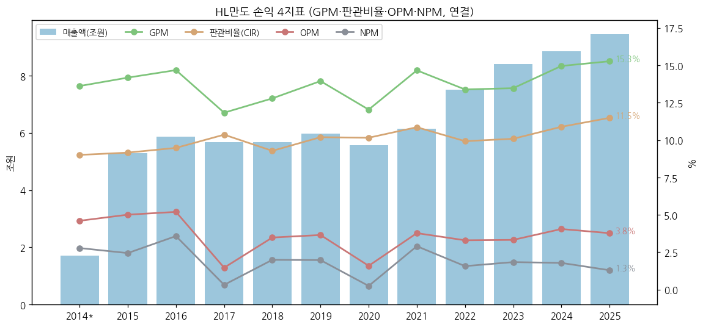

### ② 재무상태표 (12년 연결, 억원)

| 연도 | 자산 | 부채 | 자본 | 현금 | 차입금 | 순차입금 | 부채비율 | 유동비율 |
|---|---|---|---|---|---|---|---|---|
| 2014 | 38,465 | 27,483 | 10,981 | 1,604 | 13,170 | 11,567 | 250% | 93% |
| 2015 | 41,598 | 27,941 | 13,658 | 1,998 | 12,373 | 10,376 | 205% | 101% |
| 2016 | 44,644 | 29,493 | 15,151 | 1,847 | 12,895 | 11,049 | 195% | 120% |
| 2017 | 44,510 | 30,388 | 14,123 | 1,188 | 13,391 | 12,203 | 215% | 103% |
| 2018 | 44,373 | 29,555 | 14,818 | 1,176 | 13,853 | 12,676 | 199% | 107% |
| 2019 | 45,956 | 30,100 | 15,856 | 2,053 | 15,617 | 13,564 | 190% | 120% |
| 2020 | 49,383 | 32,288 | 17,096 | 5,614 | 16,784 | 11,170 | 189% | 118% |
| 2021 | 57,044 | 36,601 | 20,443 | 8,523 | 21,274 | 12,751 | 179% | 138% |
| 2022 | 58,458 | 35,721 | 22,737 | 4,921 | 19,177 | 14,257 | 157% | 139% |
| 2023 | 62,867 | 39,305 | 23,562 | 6,149 | 20,171 | 14,023 | 167% | 124% |
| 2024 | 70,520 | 43,793 | 26,728 | 5,355 | 19,889 | 14,534 | 164% | 127% |
| 2025 | 71,366 | 42,608 | 28,758 | 7,997 | 19,251 | 11,255 | 148% | 122% |
| 3Q26 (IR) | 70,156 | 41,186 | 28,970 | 7,754 | 19,501 | 11,747 | 142% | - |

(자본에 신종자본증권 포함 — 2025 신종자본증권 발행 2,890억·상환 2,000억 (현금흐름표). 3Q26 자본은 원화강세에 따른 해외사업환산손실 -2,733억 반영)

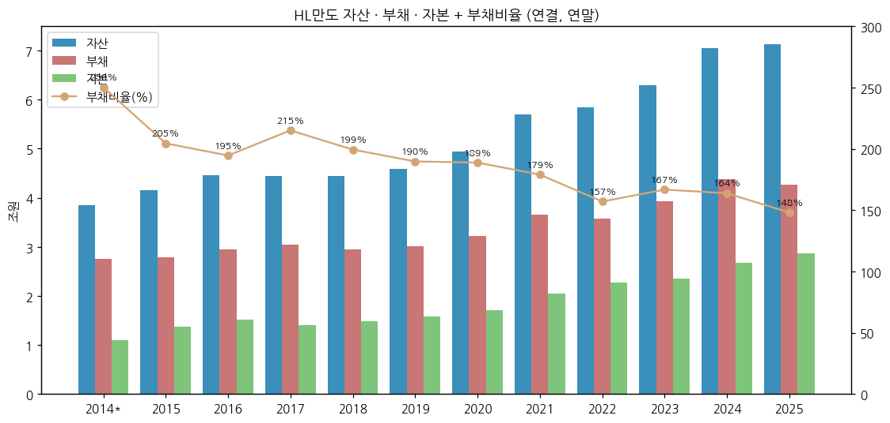

### ③ 현금흐름표 (12년 연결, 억원)

| 연도 | 영업CF | 투자CF | 재무CF | CapEx(유형+무형) | FCF |
|---|---|---|---|---|---|
| 2014 | 1,671 | -1,895 | 25 | 1,528 | 143 |
| 2015 | 2,176 | -2,486 | 711 | 3,311 | -1,134 |
| 2016 | 3,502 | -3,662 | 39 | 4,084 | -582 |
| 2017 | 2,769 | -3,774 | 410 | 3,514 | -745 |
| 2018 | 2,869 | -2,976 | 100 | 3,066 | -197 |
| 2019 | 2,725 | -3,001 | 1,147 | 2,380 | 344 |
| 2020 | 4,300 | -1,444 | 714 | 1,976 | 2,324 |
| 2021 | 4,127 | -3,766 | 2,290 | 2,409 | 1,718 |
| 2022 | -133 | -1,374 | -2,448 | 3,725 | -3,859 |
| 2023 | 4,294 | -3,224 | 182 | 4,126 | 168 |
| 2024 | 4,347 | -3,968 | -1,769 | 3,598 | 749 |
| 2025 | 7,209 | -3,637 | -956 | 3,901 | 3,308 |

→ 11년(2015\~2025) 누적 FCF 약 +2,100억 — **이익의 대부분을 CapEx·운전자본에 재투자**하는 구조. 2022 영업CF 적자는 매출 +22% 급증에 따른 운전자본(재고·매출채권) 증가. 2025 영업CF 7,209억으로 분할 후 최대

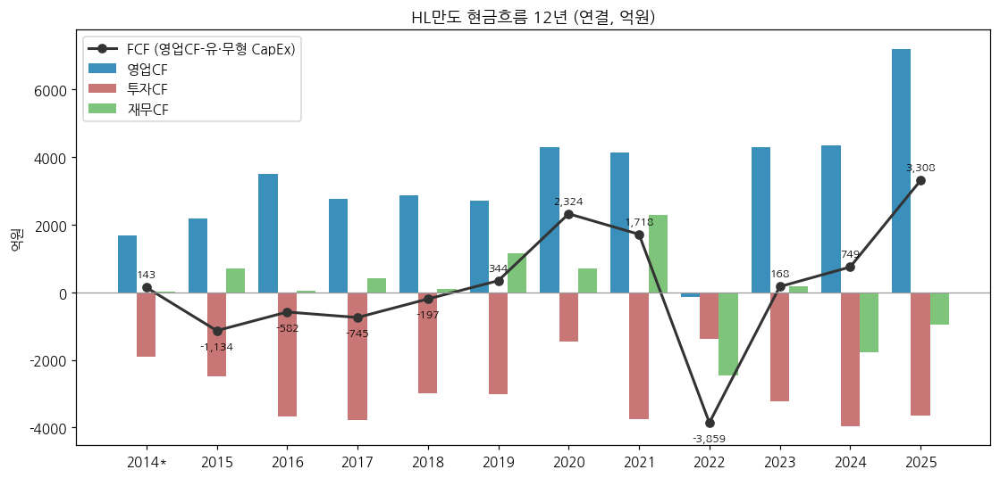

### ④ CapEx 추이 (12년, 억원)

| 연도 | 유형자산 취득 | 무형자산 취득 | 합계 | CapEx/매출 | 국면 |
|---|---|---|---|---|---|
| 2014* | 1,307 | 221 | 1,528 | 8.9% | 4개월 |
| 2015 | 2,700 | 611 | 3,311 | 6.2% | 멕시코 공장 기공 |
| 2016 | 3,365 | 719 | 4,084 | 7.0% | 증설 정점 (멕시코·인도·중국) |
| 2017 | 2,857 | 657 | 3,514 | 6.2% | |
| 2018 | 2,625 | 441 | 3,066 | 5.4% | |
| 2019 | 2,219 | 161 | 2,380 | 4.0% | |
| 2020 | 1,776 | 200 | 1,976 | 3.6% | 코로나 투자 축소 |
| 2021 | 2,073 | 336 | 2,409 | 3.9% | |
| 2022 | 3,123 | 602 | 3,725 | 5.0% | 북미 EV향 증설 재개 |
| 2023 | 3,375 | 751 | 4,126 | 4.9% | |
| 2024 | 3,095 | 503 | 3,598 | 4.1% | |
| 2025 | 3,438 | 463 | 3,901 | 4.1% | |

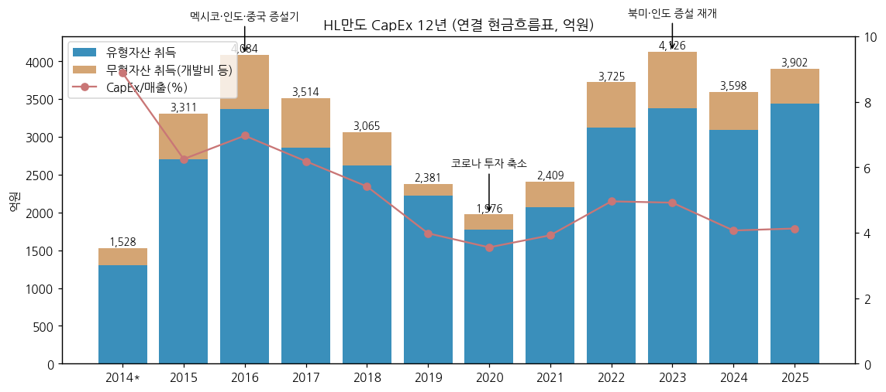

### ⑤ 부채구조 + 운전자본 (12년, 억원)

| 연도 | 차입금 | 순차입금 | 이자 지급 | 금융원가 | 이자보상(영업이익/이자지급) |
|---|---|---|---|---|---|
| 2014* | 13,170 | 11,567 | 180 | 286 | 4.4배 |
| 2015 | 12,373 | 10,376 | 379 | 659 | 7.0배 |
| 2016 | 12,895 | 11,049 | 383 | 573 | 8.0배 |
| 2017 | 13,391 | 12,203 | 340 | 615 | 2.5배 |
| 2018 | 13,853 | 12,676 | 393 | 587 | 5.0배 |
| 2019 | 15,617 | 13,564 | 441 | 438 | 5.0배 |
| 2020 | 16,784 | 11,170 | 435 | 675 | 2.0배 |
| 2021 | 21,274 | 12,751 | 496 | 587 | 4.7배 |
| 2022 | 19,177 | 14,257 | 554 | 880 | 4.5배 |
| 2023 | 20,171 | 14,023 | 931 | 1,231 | 3.0배 |
| 2024 | 19,889 | 14,534 | 1,116 | 1,379 | 3.2배 |
| 2025 | 19,251 | 11,255 | 1,064 | 1,453 | 3.4배 |

**2025말 차입 구성 (DART 재무상태표):** 단기차입금·유동성장기차입금 6,593억 / 유동성사채 2,999억 / 사채 5,985억 / 장기차입금 3,674억 + 리스부채 1,123억 (별도). 2025 사채 발행 2,489억 · 장기차입 5,091억 / 장기차입 조기상환 3,768억 — 차환 중심, 이자 지급은 2023 이후 연 1,000억 내외로 상승 (금리 상승 + 해외 법인 차입)

**운전자본 (2025말):** 매출채권 1조 8,590억 / 재고 8,045억 / 매입채무 1조 3,987억 → 순운전자본 약 1.26조 (매출의 13%)

### ⑥ 배당·자사주 추이 (12년)

| 사업연도 | 주당 배당금 | (분할 환산) | 배당성향(연결) | 배당 지급액(익년 CF) |
|---|---|---|---|---|
| FY14 | 2,000원 | 400원 | 39.4% | 187억 (2015) |
| FY15 | 4,800원 | 960원 | 35.7% | 450억 (2016) |
| FY16 | 5,000원 | 1,000원 | 23.5% | 468억 (2017) |
| FY17 | 1,000원 | 200원 | 195.8% | 94억 (2018) |
| FY18 | 500원 | 500원 | 22.2% | 234억 (2019) |
| FY19 | 550원 | 550원 | 23.3% | 258억 (2020) |
| FY20 | 무배당 | - | - | 0 (2021) |
| FY21 | 800원 | 800원 | 22.5% | 375억 (2022) |
| FY22 | 500원 | 500원 | 23.9% | 235억 (2023) |
| FY23 | 600원 | 600원 | 20.8% | 282억 (2024) |
| FY24 | 700원 | 700원 | 25.4% | 329억 (2025) |
| FY25 | 750원 | 750원 | 35.2% | 352억 (2026) |

(DART 사업보고서 배당에 관한 사항. 자기주식 0주 — 자사주 매입·소각 이력 없음 (2025 사업보고서 자기주식 현황 '-'). FY25 시가배당률 1.2%)

→ 배당성향 20\~25% 관행, FY25는 순이익 감소로 35%. FY20 무배당은 코로나 적자 분기(2Q20) 영향

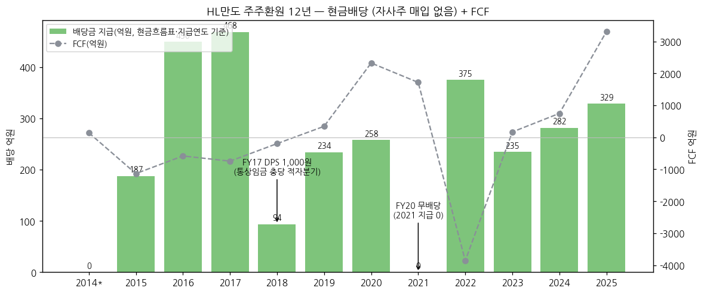

### ⑦ 재무 비율 (12년)

| 연도 | ROE* | ROA | 부채비율 | 유동비율 | 순차입금/자본 | 이자보상 |
|---|---|---|---|---|---|---|
| 2014 | (4개월) | - | 250% | 93% | 105% | 4.4배 |
| 2015 | 9.5% | 3.1% | 205% | 101% | 76% | 7.0배 |
| 2016 | 13.9% | 4.7% | 195% | 120% | 73% | 8.0배 |
| 2017 | 1.3% | 0.4% | 215% | 103% | 86% | 2.5배 |
| 2018 | 7.6% | 2.5% | 199% | 107% | 86% | 5.0배 |
| 2019 | 7.5% | 2.6% | 190% | 120% | 86% | 5.0배 |
| 2020 | 0.8% | 0.3% | 189% | 118% | 65% | 2.0배 |
| 2021 | 8.7% | 3.1% | 179% | 138% | 62% | 4.7배 |
| 2022 | 5.2% | 2.0% | 157% | 139% | 63% | 4.5배 |
| 2023 | 6.6% | 2.5% | 167% | 124% | 60% | 3.0배 |
| 2024 | 5.9% | 2.2% | 164% | 127% | 54% | 3.2배 |
| 2025 | 4.3% | 1.7% | 148% | 122% | 39% | 3.4배 |

(*ROE = 연결 순이익 / 기말 자본총계 (지배주주 자본은 2018 이후만 API 제공되어 일관성 위해 총계 사용). ROA = 순이익 / 기말 자산)

→ 부채비율 250% → 148%로 꾸준히 개선, 순차입금/자본 105% → 39%. 반면 ROE는 2016 13.9% 이후 한 자릿수 — **레버리지는 줄었지만 수익성(ROE)은 개선되지 않음**

---

## 5. 지배 구조

### ① 그룹·계열 관계

- **HL그룹 (구 한라그룹)**: 정몽원 회장 → HL홀딩스(주) (지주, 구 한라홀딩스) → HL만도 30.25%
- HL만도 → **HL클레무브 100%** (ADAS, 2021-12 출범 — 구 만도헬라일렉트로닉스 + 만도모빌리티솔루션즈) → HL Klemove Suzhou·India·Mexico·America 등
- 주요 해외 종속: HL Mando America (미국 앨라배마·조지아), HL Mando Suzhou·Beijing·Tianjin·Ningbo 등 중국 법인, HL Mando Automotive India (MAIL), 멕시코·폴란드·브라질 법인, Maysan Mando (터키, 2022-06 추가지분 인수로 종속), 만도브로제 (90%, 2024-09)
- 합작: 텐륜HL만도 (중국 산둥, 천윤공업 60% : 만도소주 40%, 2024-02 출범)
- HL클레무브 인도 자회사 지분 30%-1주를 ANAND 그룹 Gabriel India에 매각 예정 (IR)

### ② 주주 구분

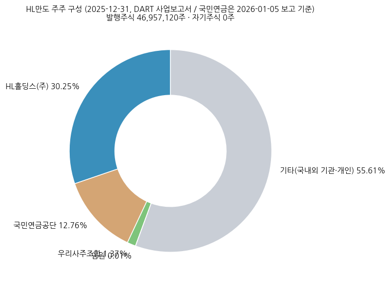

| 주주 | 주식수 | 지분율 | 기준 |
|---|---|---|---|
| 에이치엘홀딩스(주) (최대주주) | 14,203,250 | 30.25% | 2025-12-31 |
| 정몽원 (회장, 특수관계 임원) | 3,310 | 0.01% | 〃 |
| 기타 특수관계 임원 3인 | 3,093 | 0.00% | 〃 |
| **최대주주 등 합계** | 14,209,653 | **30.26%** | 〃 |
| 국민연금공단 | 5,990,117 | 12.76% | 2026-01-05 보고 |
| 우리사주조합 | 642,680 | 1.37% | 2025-12-31 |
| 소액주주 (132,897명) | 28,026,932 | 59.69% | 〃 |
| **발행주식 총수** | **46,957,120** | 100% | 자기주식 0주, 우선주 없음 |

(외국인 지분율은 이번 수집 범위에서 미확보 — KRX 조회 필요)

### ③ 임원·이사회

**이사회 7인 (사내 3 + 사외 4, DART 2025 사업보고서):**

| 이름 | 직위 | 구분 | 주요 경력 |
|---|---|---|---|
| 정몽원 (1955) | 회장 | 사내이사 | 고려대 경영, USC MBA / HL그룹 회장, HL홀딩스·HL클레무브 이사 겸직 |
| **조성현** (1960) | 부회장, **대표이사 CEO** 겸 자동차 Sector장 | 사내이사 | 고려대 기계공학 석사 / 만도 Global Steering BU장, MCE 법인장 — 2021-03 대표 선임, 2024-03 재선임 |
| 김현욱 (1966) | 전무, 대표이사 CSO 겸 Korea ER Center장 | 사내이사 | 부산대 법학 / 2023-03 대표 선임 |
| 박기찬 (1972) | 사외이사 | 사외 | 서울대 국제경제 / JP모건 IB 전무, SJL파트너스 부대표 |
| 강남일 (1969) | 사외이사 (감사위원) | 사외 | 서울대 사법학 / 서울중앙지검 금융조세조사부장 |
| 김원일 (1958) | 사외이사 (감사위원) | 사외 | 경희대 경제 / KDB산업은행 본부장 |
| 정시영 (1976) | 사외이사 (감사위원) | 사외 | 고려대 경영 / 삼일·EY한영 회계사 |

**대표이사 변동:** 2015-03 정경호 취임 (성일모·정경호 각자대표) → 2021-03 조성현 선임 → 2022-03 정몽원 대표 사임(사내이사 유지) → 2022-10 김광헌 사임 → 2023-03 김현욱 선임 (현 조성현·김현욱 각자대표)

---

## 6. 기타 팩트

### ① R&D 인프라

- 판교 R&D센터 (본사 연구소) + 해외 연구소 18개 (중국·미국·유럽·인도, MSI(Mando Softtech India) — ECU SW·영상인식) + HL클레무브 판교 R&D센터 (2022-10 개소)
- 2025 연구과제: AX PLM PJT (SDV 대응 통합 개발 환경), **로봇 액추에이터 및 관련 제품/기술 개발 (New Business)** (DART)

| 연도 | 2014* | 2015 | 2016 | 2017 | 2018 | 2019 | 2020 | 2021 | 2022 | 2023 | 2024 | 2025 |
|---|---|---|---|---|---|---|---|---|---|---|---|---|
| 연구개발비 (억원) | 779 | 2,596 | 2,832 | 3,023 | 3,150 | 3,609 | 3,227 | 3,329 | 4,050 | 3,687 | 4,893 | 4,778 |
| R&D/매출 | 4.5% | 4.9% | 4.8% | 5.3% | 5.6% | 6.0% | 5.8% | 5.4% | 5.4% | 4.4% | 5.5% | 5.1% |

(DART 사업보고서 II-6 연구개발비용 계 — 회사 정의상 2024 5.53%, 2025 5.05%. 위 비율은 연결 매출 대비 재계산)

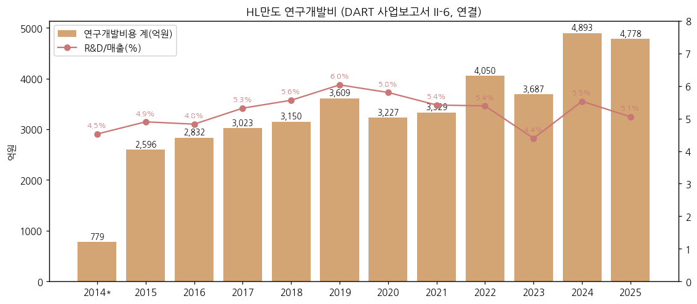

### ② 진행 중 corporate action — 10년치 주요 이벤트

| 시점 | 이벤트 | 의미 |
|---|---|---|
| 2015-08 | 멕시코 공장 기공 | 북미 현지화 |
| 2018-05 | 액면분할 1→5주 | 유통주식 확대 |
| 2021-09 | ADAS 물적분할 (만도모빌리티솔루션즈) | ADAS 독립 |
| 2021-12 | HL클레무브 출범 (만도헬라 합병) | ADAS 100% 지배 |
| 2022-05 | 만도차이나홀딩스 흡수합병 | 중국 지배구조 단순화 |
| 2022-06 | Maysan Mando (터키) 추가지분 취득 → 종속 | 유럽 현가 |
| 2022-08 | 글로벌 R&D센터 토지·건물 매각 | 자산 유동화 |
| 2024-02 | 텐륜HL만도 JV (중국) | 중국 로컬 진입 |
| 2024-09 | 만도브로제 지분 40% 인수 (90%) | 전동화 액추에이터·모터 |
| 2025 | 신종자본증권 2,890억 발행 / 2,000억 상환 | 자본 확충·차환 |
| 진행 중 | HL클레무브 인도 자회사 지분 30%-1주 Gabriel India 매각 | 인도 ADAS 파트너십 |

### ③ R&D·제품 마일스톤 — 10년치

| 시점 | 마일스톤 | 출처 |
|---|---|---|
| 2016-03 | 장거리 레이더 센서 IR52 장영실상 | DART 2016 사업보고서 |
| 2004\~ | EPS 독자 양산 (이후 C/R/BN/DP-EPS 라인업) | DART 2025 |
| 2010\~ | 전방 레이더 최초 공급 (ADAS 사업 시작) | DART 2025 (HL클레무브) |
| 시점 미기재 | IDB2 — 세계 최초 1-Box 통합 전자 브레이크 (이중화) | DART 2025 |
| 시점 미기재 | **SbW(Steer-by-Wire) 세계 최초 양산** | DART 2025 |
| 개발 중 | EMB(전동 브레이크, Oil-free) | DART 2025 |
| 2024\~2025 | HL클레무브 CES 혁신상 2년 연속 / CES 2025 혁신상 (HAECHIE·BEETLE+·AgriShield) | DART 2025, IR 4Q24 |
| 2025 | HPC 기반 자율주차 제어기 양산, 인도 첸나이 현지 최초 레이더 양산 | DART 2025 |
| 2025 4Q | 4족 보행 로봇 액추에이터 수주 | IR 4Q25 |
| 2026-01 | CES 2026 로봇 액추에이터·MiCOSA HyperPrediction·SEERU 공개 | IR 4Q25 |
| 2026 3Q | HPC(Level2) 중국 로컬 수주, HPC 신규 매출 | IR 3Q26 |

### ④ 주요 리스크

- **고객 집중**: 현대차그룹 약 43% + 북미 OEM 약 27% (DART). 3Q26 현대·기아 국내 생산 차질이 한국 매출 -8.6%로 직결
- **북미 EV 선도업체 의존**: 4Q25 중국 매출 감소 요인으로 "북미 전기차 선도 업체향 물량 감소" 명시 (IR) — EV 수요 둔화(캐즘) 노출
- **원가**: 반도체(ECU)·원자재 가격 → 3Q26 OPM 2.2%. ECU ASS'Y 매입단가 2023 51,684원 → 2025 61,257원 (+18.5%, DART)
- **환율**: 3Q26 외환손익 -614억 (순손실 전환의 주원인), 해외사업환산손실 -2,733억(기타포괄) — 원화 강세 시 손익·자본 동시 타격
- **관세·통상**: 미국 생산(앨라배마·조지아·멕시코) 비중이 높아 미국 부품 관세·USMCA 규정 변화에 노출 (정량 영향 미확보)
- **노무·통상임금**: 2017 3Q 통상임금 충당 반영으로 분기 영업손실 -956억 (DART 분기 손익)
- **품질 충당**: 2025 판관비율 +0.6%p 요인으로 "품질 충당금 설정에 따른 일회성 비용" 명시 (DART 2025 경영진단)
- **로봇 기대 디레이팅**: 액추에이터 수주 가시화 2027년 예정 — 기대와 실적의 시차 (연합인포맥스 2026-08-04)

### ⑤ ESG 등급

| 연도 | 평가 | 출처 |
|---|---|---|
| 2024\~2025 | S&P Global CSA(DJSI) 'Yearbook Member' 선정 | IR 3Q26 별첨 |
| 2025 | CSRWorks ASRA 아시아 지속가능보고서 금상 | 〃 |
| 2024\~2026 | LACP Global Top 100 (Gold·Platinum) | 〃 |
| - | KCGS(한국ESG기준원) 등급 | 미확보 (다음 버전 보완) |

### ⑥ 인증·라이선스

- 기술도입: HL클레무브 ← Hella GmbH (FPC·TOS/TAS·Radar 24GHz, 로열티 순매출 1\~2.5%, 2021-03\~) (DART)
- 기술이전: AMeM(Anevolve Mando Mobility, 인도) 로열티 순매출 1.1% (2021-07\~) (DART)
- 수상: GM 올해의 우수협력사(SOY) 3년 연속 (2023-03), 인도 HMI Best Supplier 2년 연속 (2023-03), 발명의 날 대통령표창(2023)·산업포장(2024) (DART)
- IATF 16949 등 품질 인증 세부 목록은 미수집 (다음 버전)

---

## Version Log

**v1.0 (2026-11-25) — 신규 작성 (자동차 섹터 부품 서브섹터 4종 병렬 작성 중 HL만도)**
- ① 데이터: OpenDART fnlttSinglAcntAll 연결 44개 JSON (2015 FY\~3Q26, 2015 분기 미제공) → 12년 손익·재무상태·현금흐름·CapEx·배당 DART 원값. 2014는 분할 후 4개월(2015 사업보고서 전기 컬럼)
- ② DART 정기공시 원문 XML 44건 파싱: 지역부문 매출 2015\~3Q26 (연간 + 1Q16\~3Q26 43분기, 누적 차분), 연구개발비 12년, 임직원, 배당 12년, 생산능력·가동률, 주요 매출처, 이사회, 연혁
- ③ 회사 IR PDF 26건 (1Q21\~3Q26): 수주(FY21\~1\~3Q26)·고객별 수주 mix·외부고객 지역매출·SDC·2026 가이던스·재무 요약
- ④ 차트 17종: chart1·1b·2(×5: 전사 43분기 + 한국·중국·미국·인도기타)·4·5·6·7·8·9·10·11·12 + chart13 (신규 수주, 부품업 추가)
- ⑤ 주가: Yahoo 204320.KS 월간 (timestamp는 월초 KST 기준으로 보정)

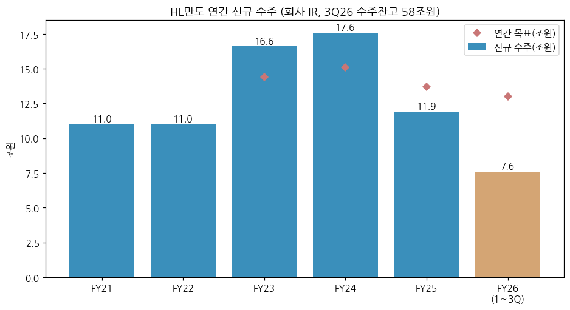

**잔여 보완 후보 (다음 버전):**
- 외국인 지분율 (KRX), KCGS ESG 등급, 3Q26 이후 컨센서스·목표가 (리포트 첨부 시)
- HL클레무브 연간 매출·영업이익 시계열 (종속회사 요약재무 주석에서 매출·순이익 행 추가 파싱)
- 지역별 당기손익 (DART 사업부문별 재무현황 표) 시계열
- 2014 이전 구 (주)만도(060980) 연간 실적 (HL홀딩스 공시) — 장기 사이클 비교용
- 연간 표는 FY26 결산 후 v2.0
