# HMM — 기업 개요 (v1.0)

> 마지막 update: 2026-11-25 (v1.0 — 첫 작성. 3Q26 분기보고서(2026-11-12 제출) 부문정보·재무상태표까지 반영)
> 입력 source: OpenDART fnlttSinglAcntAll (연결 CFS, 2015 사업보고서\~3Q26, 44개 JSON — 2014는 2015 사업보고서 전기 컬럼) + DART 정기공시 원문 XML 48건 (사업보고서 2014\~2025, 분기·반기 1Q15\~3Q26, 2014\~2017·2022·2023 사업보고서는 기재정정본) + OpenDART 기업개황·최대주주·임원·직원·배당·자기주식·주식총수 (2025 사업보고서) + HMM IR 자료 2건 (2026 기업가치 제고 계획 2026-04-02·2026-11-18, irgo 경유 — 분기 실적발표 PDF는 irgo 미게시·회사 IR 사이트 접속 실패로 미수집) + Yahoo Finance (011200.KS 월간 2000-02\~2026-11, 일간 2020-01\~2023-12·2024-11-25\~2026-11-25) + 언론 (MTN·한국센터·더팩트·서울신문·뉴시스·CEO스코어데일리, 2023-12\~2026-11)
> 갱신 주기: 매분기 (실적 리뷰 모드 호출 시)
> 워치리스트: **운송 섹터 / 서브섹터: 해운 (HMM·팬오션)** (`earnings/watchlist.md` 94행) — 2순위 섹터, 4Q26부터 리뷰
> **Fact verify cutoff**: 2026-11-25 (주가 2026-11-24 종가 **22,350원** [Yahoo Finance 011200.KS 일간], 발행주식총수 943,237,970주 [DART 사업보고서(2025.12)·분기보고서(2026.09) 자본금 5,125,197백만원 불변, 자기주식 0주] → 시가총액 **21.08조원** [계산]. 2016-04 7:1 무상감자 이후 최고 종가 **50,600원 (2021-05-27)**, 장중 최고 51,100원 (2021-05-28) → 당시 시총 **17.48조원** [계산, 당시 주식수 345,392,487주]. 시가총액 기준 최고는 **2025-07-15 종가 25,950원 × 1,025,039,496주 = 26.60조원** [계산, 197회 CB 전환 후·자사주 소각 전]. 최고 종가 대비 **-55.8%**, YTD **+9.0%** (2025-12-30 종가 20,500원), 1년 **+19.8%** (2025-11-24 18,660원), 52주 범위 17,910\~24,950원 [Yahoo meta]. 수정주가 기준 상장 후 최고는 2010-09 (Yahoo 수정 월간 고가 321,589원 = 감자 전 실제 약 45,900원 [계산, 7:1 환산])

---

## 1. 기업 분류

- **Primary 분류: 사이클 — 컨테이너 운임(SCFI) 연동형 고변동 경기민감주** (매출의 85%가 컨테이너, 이익은 운임 × 선복 수급에 레버리지. 12년 OPM -18.2%\~53.6%, range 71.8%p)
- **Secondary 노트: 순현금 자산주 + 정책금융 지배(매각 이벤트) + 벌크 장기계약 안정 이익** — 3Q26 현금·단기금융상품 12.48조 vs 시총 21.08조 (59%) [DART·계산]. 산업은행 35.42% + 해양진흥공사 35.08% = 70.50% [DART 2025말]. 벌크 부문 9M26 영업이익 3,784억 (전사의 18.8%) [DART 부문정보]

### ① 정량 근거

**📊 Summary Box (12년, 2014\~2025 연결):**

| 지표 | 값 |
|------|-----|
| 매출 CAGR (2014→2025, 11년) | **+4.8%** (6.52조 → 10.89조) — 2016 저점 4.58조 → 2022 정점 18.58조 (4.1배) |
| OPM 평균 | **10.2%** (적자 6개 연도 2014\~2019 평균 -8.4%, 흑자 6개 연도 2020\~2025 평균 28.8%) |
| OPM 정점 평균 | **41.8%** (2022 53.6% 팬데믹 슈퍼사이클 + 2024 30.0% 홍해 우회) — 2021 53.5%도 정점권 |
| OPM 저점 평균 | **-5.6%** (2016 -18.2% 한진해운 파산·채권단 관리 + 2023 7.0% 팬데믹 해소 후 운임 정상화) |
| 사이클 주기 | **불규칙 2\~7년** — 저점→저점 2016→2023 (7년), 정점→정점 2022→2024 (2년). 회사 서술 "3\~4년 주기였으나 지정학적 불안정성으로 예측 곤란" [DART 사업보고서(2025.12) II-7] |
| 사이클 회수 (12년) | **2회 완결 + 1회 진행** — ① 2020\~2023 팬데믹 공급망 사이클 ② 2024 홍해 우회 사이클 ③ 2026 미국-이란 전쟁·호르무즈 통항 제한 (3Q26 OPM 33.8%, 진행 중) |

```
[전사 OPM 시계열 (12년, 연결, DART)]
연도   매출(조)  영업이익(조)  순이익(조)   OPM     NPM   EBITDA마진
2014      6.52      -0.24        0.02     -3.6     0.3    -0.3   ← 2014 LNG선 사업부 매각 (중단영업이익 4,722억) — 2013~2016 현대그룹 유동성 위기
2015      5.77      -0.25       -0.68     -4.4   -11.8    -0.7   ← 운임 약세 + 고가 용선료 부담, 자본총계 0.23조 (부채비율 2,499%)
2016      4.58      -0.83       -0.46    -18.2   -10.0   -14.4   ← 12년 저점: 2016-04 7:1 감자·채권단 출자전환, 2016-08 한진해운 법정관리 → 산업은행 최대주주
2017      5.03      -0.41       -1.19     -8.1   -23.7    -5.9   ← 4Q17 순손실, 2M 전략적 협력(머스크·MSC) 체제
2018      5.22      -0.56       -0.79    -10.7   -15.1    -8.6   ← 2018-07 해양진흥공사 출범, 2018-09 초대형선 20척 발주 결정
2019      5.51      -0.30       -0.59     -5.4   -10.7     3.7   ← IFRS16 적용 (사용권자산 2.8조 인식) → EBITDA 흑자전환
2020      6.41       0.98        0.12     15.3     1.9    24.4   ← 흑자전환 (2010 이후 10년 만), 24,000TEU 12척 인도 + 디 얼라이언스 가입
2021     13.79       7.38        5.34     53.5    38.7    58.2   ← 팬데믹 운임 슈퍼사이클: SCFI 4Q21 4,698pt
2022     18.58       9.95       10.09     53.6    54.3    58.0   ← 사이클 정점: 영업이익 9.95조 사상 최대, SCFI 1Q22 4,851pt
2023      8.40       0.58        0.97      7.0    11.5    17.2   ← 운임 정상화 (SCFI 연평균 1,006pt, -70%) → 12년 중 흑자 저점
2024     11.70       3.51        3.78     30.0    32.3    37.6   ← 홍해 사태 희망봉 우회 → SCFI 연평균 2,506pt (+149%)
2025     10.89       1.46        1.88     13.4    17.2    23.6   ← 관세·선복 과잉, SCFI 연평균 1,581pt (-37%), 공개매수 자사주 2.14조 소각

OPM range: -18.2% ~ 53.6% (71.8%p) — 적자 6년(2014~2019) → 흑자 6년(2020~2025). 운임(SCFI)과 OPM의 동행성이 지배하는 '순수 해운 사이클' 패턴
```

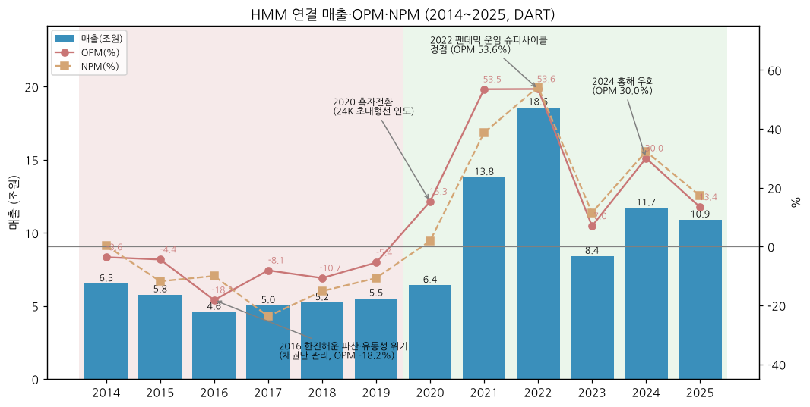

(2014 수치는 2015 사업보고서의 전기 컬럼 — 2014 매각한 LNG선 사업부를 중단영업으로 재분류한 금액. EBITDA = 영업이익 + DART 연결 부문정보 "감가상각비"(유형자산+사용권자산, 2019\~ IFRS16 포함) 합계 [계산] — 무형자산상각비(연 100억원 내외)는 미포함. 2019 IFRS16 도입으로 용선료가 감가상각·이자로 재분류돼 2018 이전과 EBITDA 직접 비교 불가)

### ② 산업 분류

- 산업: **외항 정기선(컨테이너) + 부정기선(벌크: 유조선·건화물선·다목적선·자동차선) 해운** — 국내 유일 원양 컨테이너 국적선사
- DART 업종: 50112 외항 화물 운송업 [OpenDART company.json] / KRX 운수창고업
- 워치리스트 섹터: **운송** / 서브섹터: **해운** (HMM·팬오션). 동일 섹터 항공(대한항공·제주항공)·육운(CJ대한통운)과 같은 운송 섹터 소속
- 시장 지위: 2025 사선 컨테이너 94척·99만 TEU (운항 선복 기준) [IR 2026 기업가치 제고 계획 p10]. 아시아→미주 서안 점유율 5.5% (2025, PIERS, 1\~11월) / 5.6% (2026 1\~8월) — ONE 12.8%·MSC 12.1%·CMA CGM 11.4%·COSCO 10.4%·Evergreen 9.8%·Maersk 7.8% 다음 [DART 사업보고서(2025.12)·분기보고서(2026.09) II-7]
- 얼라이언스: 2025-02 **Premier Alliance** (ONE·Yang Ming, 5년 계약) 출범 + MSC와 유럽 항로 선복 교환(4년) — 2020-04\~2025-01은 디 얼라이언스(Hapag-Lloyd·ONE·Yang Ming) [DART 사업보고서(2025.12)]
- 과세: **톤세제** (조세특례제한법 제104조의10 — 해운소득은 선박톤수×톤당운항이익 기준 과세) [DART 사업보고서(2025.12) 주석] → 세전이익 대비 법인세가 극히 낮음 (2025 법인세 1,220억 / 세전 2.00조 = 6.1% [계산])

### ③ 분류 결정 논리

(1) **가장 매출 큰 사업부 기준** 적용 시: 컨테이너 부문 = 2025 매출 9.24조, 연결의 **84.9%** [DART 사업보고서(2025.12) II-2]. 컨테이너 매출 = 수송량(TEU) × 평균운임(USD/TEU) — 2025 수송량 394만 TEU(+3.2%)는 안정적이지만 평균운임은 2022 2,881 → 2023 973 USD/TEU(-66%)로 급변 [DART II-2·3] → 매출 변동의 대부분이 **운임(가격)** 에서 발생 → **사이클**
(2) **이익 비중 sub-rule**: 컨테이너 부문 영업이익 = 2020\~2025 연결 영업이익의 68\~99% (2023 67.6%, 2022 99.1%) [DART 부문정보, 계산]. 2023 저점에서도 벌크(1,861억)가 전사 OP의 31.8%로 하방을 받쳤으나 이익의 방향은 컨테이너가 결정 → Primary 유지
(3) **Boundary case 처리**:
→ **벌크 (유조선·건화물선·다목적선·자동차선)**: 2025 매출 1.45조 (13.3%), OP 1,430억 (OPM 9.9%). 9M26 OP 3,784억 (+418.5% YoY) — 2Q26은 벌크 OP 1,564억이 컨테이너 1,986억에 육박 [DART 부문정보]. 현대글로비스·Vale(철광석), GS칼텍스·S-Oil(원유) 장기운송계약(10년 단위) 비중이 높아 컨테이너보다 변동성 낮음 [DART II-4 수주상황]. 2030 벌크 110척·1,275만 DWT 목표 [IR 2026-11] — Secondary로 분리
→ **기타 (터미널·임대)**: 매출 0.20조 (1.8%), OP 234억 — 분류 영향 없음
→ **순현금·금융수익**: 2025 이자수익 6,189억 (상각후원가 금융자산) [DART 주석 7] — 영업외 이익이 순이익을 받치는 구조 (2025 순이익 1.88조 > 영업이익 1.46조)
→ 결론: **Primary 사이클(컨테이너 운임) + Secondary(순현금 자산주·벌크 장기계약·정책금융 매각 이벤트)**
(4) **글로벌 피어 대비 (컨테이너 선사)**:
→ **Maersk (덴마크)**: 3Q26 해운 부문 OPM 20.6% / **ONE (일본)**: 21.6% / **COSCO (중국)**: 28.7% vs **HMM 33.8%** [MTN 2026-11-12, 한국센터 2026-11 — 언론 인용, 피어 원자료 미대조]. 2025 HMM OPM 약 13%는 "글로벌 경쟁 선사 상회" [IR 2026 기업가치 제고 계획 p6]
→ **Hapag-Lloyd (독일)·Evergreen (대만)**: 동일 운임 사이클 노출. 디 얼라이언스 시절 Hapag-Lloyd와 협력 → 2025-02 Premier Alliance로 이탈 [DART]
→ **HMM 차별점**: ① 선복 규모는 글로벌 8\~9위권으로 MSC·Maersk 대비 1/7\~1/6 수준 (2025 99만 TEU [IR]) — 터미널·물류 수직계열화 약함 ② 대신 **순현금 12.5조(현금·단기금융상품)** 로 피어 대비 재무 완충 최대 ③ 최대주주가 정책금융기관(산은·해진공 70.5%) — 매각·본사 이전 등 정책 변수가 주가에 직접 작용
→ 글로벌 피어 PBR·EV/EBITDA 수치 비교는 이번 버전 미수행 (잔여 보완 후보)

### ④ 적정 밸류에이션 방법

- **1순위: PBR (사이클 위치 × 순현금)** — 해운은 이익이 사이클 정점에서 최대가 되며 PER이 가장 낮아지는 "사이클주 PER 역설" (2022 PER 0.9배 → 이후 주가 정체). 자본(=누적 이익+순현금)이 이익보다 안정적이므로 PBR이 1순위
→ 연말 PBR (지배자본 기준, Yahoo 연말 종가 × 연말 발행주식수 [계산]): **저점 0.46배 (2022, 정점 이익 직후)** · 0.56배 (2024) / 고점 **2.70배 (2020, 흑자전환·자본 잠식 회복기)** · 1.27배 (2021). 회사 밸류업 자료의 Bloomberg PBR (2020 2.70 / 2021 1.27 / 2022 0.46 / 2023 0.63 / 2024 0.56 / 2025 0.73)과 동일 [IR 2026-11 p5]
→ 현재 **0.79배** (2026-11-24 시총 21.08조 / 3Q26 지배자본 26.72조 [DART]) — 2023\~2025 밴드(0.56\~0.73배) 상단 돌파
→ 시총 대비 현금·단기금융상품 12.48조 = 59% [계산] — "주가의 절반 이상이 현금" 구조
- **2순위: EV/EBITDA (리스부채 포함 EV)** — 현재 **3.8배** (EV 13.75조 = 시총 21.08조 − 순현금 7.33조 [현금·단기금융상품·유동FVPL 12.48조 − 차입금·사채 0.23조 − 리스부채 4.92조] + 비지배지분, LTM EBITDA 3.65조 [DART 4Q25\~3Q26 영업이익 + 부문정보 감가상각비 합산] [계산]). 리스부채를 포함하는 이유: 용선·리스 선박의 비용이 IFRS16상 감가상각(EBITDA 가산)으로 처리되므로 분모·분자 일관성 유지
- **3순위: PER (정상 이익 기준)** — TTM 연결 순이익 2.66조 기준 PER **7.9배** [계산]. 단, 3Q26 순이익 1.54조가 TTM의 58% → 일회성 고운임 구간 반영
- **배당수익률**: FY2025 DPS 700원 / 22,350원 = **3.1%** [계산]. 2026-11 주주환원 정책 변경 — "2030년까지 배당성향 30% 이상 (배당+자사주)" (기존 "배당성향 30%와 시가배당률 5% 중 작은 금액 이상"에서 시가배당률 기준 삭제) [IR 2026-04-02 p9 vs 2026-11-18 p9]
- **피어 차별화**: 팬오션(벌크 중심, `팬오션_기업개요.md`)은 BDI 사이클·장기계약 mix로 PBR 프레임 공통. HMM은 **순현금 비중이 시총의 절반 이상**이라 PBR 하방이 현금으로 지지되는 반면, 2030년까지 29조 투자(컨테이너 166척·147만 TEU, 벌크 110척 [CEO스코어데일리 2026-10-14]) 집행 시 순현금 → 투자자산 전환으로 "현금 프리미엄"이 축소될 수 있음

#### ④-1 운송 5사 공통 비교 박스 (통일 기준, 2026-11-28 통합 검수)

> 다섯 문서(HMM·팬오션·대한항공·제주항공·CJ대한통운)에 **같은 표**를 넣었다. 본문 ④의 회사별 수치는 각 사 고유 정의(리스 제외·단기금융상품 차감 등)라 이 표와 차이가 날 수 있음 — **운송 5사 비교는 이 표 기준**.

| 지표 (2026-11-24 종가, 3Q26 말 기준) | HMM | 팬오션 | 대한항공 | 제주항공 | CJ대한통운 |
|---|---|---|---|---|---|
| 서브섹터 | 해운(컨테이너) | 해운(벌크) | 항공(FSC) | 항공(LCC) | 물류 |
| 시가총액 (조원, 발행주식총수 기준) | 21.08 | 2.57 | 11.47 | 0.65 | 1.58 |
| LTM 매출 (조원, 4Q25\~3Q26) | 12.96 | 7.00 | 27.70 | 1.95 | 13.13 |
| LTM 영업이익 (조원) / OPM | 2.34 / 18.0% | 0.66 / 9.5% | 0.81 / 2.9% | 0.10 / 5.0% | 0.46 / 3.5% |
| LTM EBITDA (조원) / 매출 대비 | 3.65 / 28.2% | 1.08 / 15.5% | 3.85 / 13.9% | 0.25 / 13.0% | 1.16 / 8.8% |
| 순차입금 (조원, 차입금·사채 + 리스부채 − 현금및현금성자산) | 4.23 | 4.45 | 22.65 | 0.89 | 3.88 |
| 　└ 이 중 리스부채 | 4.92 | 0.53 | 12.37 | 0.82 | 1.78 |
| 비지배지분 (조원) | 0.00 | 0.00 | 0.41 | 0.00 | 0.21 |
| EV (조원) = 시총 + 순차입금 + 비지배지분 | 25.31 | 7.02 | 34.53 | 1.54 | 5.67 |
| **EV/EBITDA (LTM, 리스 포함)** | **6.9배** | **6.5배** | **9.0배** | **6.1배** | **4.9배** |
| EV/EBITDA 참고 (리스부채 제외 EV) | 5.6배 | 6.0배 | 5.8배 | 2.8배 | 3.3배 |
| **PBR** (시총 / 3Q26 지배기업 소유주지분) | **0.79배** | **0.44배** | **1.00배** | **1.21배** | **0.38배** |
| PER (시총 / LTM 연결 당기순이익, 비지배 포함) | 7.9배 | 5.5배 | 16.0배 | 4.3배 | 7.3배 |
| **배당수익률** (2025 사업연도 DPS / 종가) | 3.1% (700원) | 3.1% (150원) | 2.4% (750원) | 0% (FY2019\~ 무배당) | 1.2% (800원) |
| 일회성·주의 (LTM 구간) | 3Q26 고운임(순이익의 58%) + 단기금융상품 11.56조 미차감 | 기능통화 USD (원화 자본 환율 영향) | 2Q26 유가 급등·아시아나 적자, 3Q26 외화환산이익 | 3Q26 외환이익 + 항공기 처분이익 522억 | 신종자본증권 3,989억 자본 처리 |

(출처: 시총·종가 = Yahoo Finance 일간 × DART 발행주식총수. 매출·영업이익·순이익 = OpenDART fnlttSinglAcntAll 분기 합산(4Q25 = 연간 − 3Q 누적). EBITDA = 영업이익 + 감가상각비(사용권자산 포함) + 무형자산상각비 — HMM은 부문정보 감가상각비(무형상각 제외), 팬오션은 IR 분기 EBITDA 합산. 차입금·리스부채·현금·지배지분·비지배지분 = DART 3Q26 연결 재무상태표. 단기금융상품은 회사마다 계정 구성이 달라 순차입금에서 일괄 미차감, 신종자본증권은 자본으로 둠 — 통신 3사 박스와 같은 보수적 원칙에 리스부채만 추가. 모두 [계산])

→ **읽는 법**: 항공·해운은 리스로 배·비행기를 들여오는 구조라 **리스 포함 EV/EBITDA가 기준**(리스를 빼면 제주항공 2.8배처럼 착시). ① **해운 2사** = PBR 1배 미만의 사이클 저평가 구간 — HMM은 단기금융상품까지 넣으면 순현금 7.33조로 EV/EBITDA 3.8배까지 내려가 "현금이 주가를 받치는" 구조, 팬오션은 순차입 + 장기계약 이익 하방. ② **항공 2사** = 대한항공 EV/EBITDA 9.0배로 5사 중 최고(아시아나 통합 프리미엄 + 리스부채 12.37조), 제주항공은 PBR 1.21배지만 신종자본증권을 빼면 1.95배로 자본이 얇음. ③ **CJ대한통운** = EV/EBITDA 4.9배·PBR 0.38배로 5사 중 가장 쌈 — 다만 OPM 3.5%의 저마진 방어형이라 사이클 업사이드가 없음.

### ⑤ 분기 재평가 트리거 (분류 변경 조건)

- **벌크 부문 영업이익이 2개 연도 연속 연결 OP의 30%+** 시 → Secondary(벌크 장기계약) 격상, "사이클 + 안정 이익 하이브리드"로 재분류 검토 (현재 9M26 18.8%)
- **컨테이너 부문 OPM 2개 분기 연속 0% 하회** 시 → 사이클 하강 국면 확정, 밸류에이션을 PBR 저점 밴드(0.46\~0.56배)로 하향 기준 적용
- **산업은행·해양진흥공사 지분 매각 완료 (민간 최대주주 등장)** 시 → 정책금융 지배 Secondary 삭제, 지배구조·배당정책 프레임 재설정 (2026 단독매각 검토 보도 [더팩트 2026-04-17])
- **순현금(리스 포함)이 순차입으로 전환** (2030 투자 29조 집행) 시 → 자산주 Secondary 삭제, EV/EBITDA 1순위로 전환 검토
- **호르무즈 해협 통항 정상화 + 수에즈 운하 통항 완전 재개** 시 → 2026 운임 사이클 종료 확인 (3Q26 보고서: "점진적으로 수에즈 운하 통항이 개시되며 시장 운임 추가 하향" [DART 분기보고서(2026.09) II-7])

---

## 2. 회사 개요

### ① 기본 사항

- **회사명**: 에이치엠엠 주식회사 (HMM Company Limited) / KRX 011200 (유가증권시장 1995-10-05 상장) [DART 사업보고서(2025.12) I-1]
- **본사**: 부산광역시 부산진구 중앙대로 742 [OpenDART company.json] — 2026-05-08 임시주총 정관 변경으로 본점 서울(여의대로 108) → 부산 이전, 2026-10-13 부산 본사 현판식 (선발 인원 약 120명) [더팩트 2026-04-17, CEO스코어데일리 2026-10-14]
- **설립**: 1976-03-25 (아세아상선으로 설립 → 1983 현대상선 상호 변경 ← 미검증 일반 공개정보) → **2020-03-27 HMM으로 상호 변경** [DART 사업보고서(2025.12) I-2]
- **지배구조**: **정책금융기관 공동 지배** — 한국산업은행 35.42% (최대주주) + 한국해양진흥공사 35.08% + 국민연금 5.34% (2025-12-31) [DART 사업보고서(2025.12) VII]. 2025-05-01 상호출자제한기업집단 지정 (계열 4사: HMM·HMM오션서비스·에이치티알헤시라스·에이치엔엘트랜스) [DART I-1]
- **사업 한 줄 정의**: 국내 유일 원양 컨테이너선사(매출 85%)로, 유조선·건화물선·다목적선·자동차선 벌크 사업(13%)과 터미널(2%)을 겸영하는 종합 해운물류기업. 2025 컨테이너 수송 394만 TEU, 벌크 4,006만 MT [DART II-3]
- **조직**: 국내 1부문 6본부 21실 72팀 1TF, 해외 5권역 26법인 57지점 4해외사무소 [DART II-4]
- **대표이사**: **최원혁** 사장 (1960-05생, 성균관대 응용통계, 前 LX판토스 대표) — 2025-03-26 정기주총 선임, 임기 2027-03-26 [OpenDART exctvSttus 2025]. 전임 김경배(2022-03\~2025-03), 배재훈(\~2022-03) [DART I-2]
- **신용등급**: 기업신용 **A+ (NICE신용평가, 2025-05-19)** — 2021-12 BBB- → 2022-04 BBB → 2022-11 A-(한기평) → 2023-05 A- → 2025-05 A+ [DART 사업보고서(2025.12) I-1]
- **기능통화**: 미국 달러(USD) — 원화는 표시통화 (환산차는 기타포괄손익) [DART 주석 5]

### ② 최근 12년 손익·자본 추이 (조원, 연결, DART)

| 연도 | 매출 | YoY | 영업이익 | 순이익 | 자본총계 | 자본 YoY |
|---|---|---|---|---|---|---|
| 2014 | 6.52 | - | -0.24 | 0.02 | 0.69 | - |
| 2015 | 5.77 | -11.5% | -0.25 | -0.68 | 0.23 | -66.6% |
| 2016 | 4.58 | -20.5% | -0.83 | -0.46 | 0.95 | +316.1% |
| 2017 | 5.03 | +9.7% | -0.41 | -1.19 | 0.90 | -5.7% |
| 2018 | 5.22 | +3.9% | -0.56 | -0.79 | 1.04 | +15.9% |
| 2019 | 5.51 | +5.6% | -0.30 | -0.59 | 1.09 | +4.9% |
| 2020 | 6.41 | +16.3% | 0.98 | 0.12 | 1.69 | +54.9% |
| 2021 | 13.79 | +115.1% | 7.38 | 5.34 | 10.36 | +513.4% |
| 2022 | 18.58 | +34.7% | 9.95 | 10.09 | 20.69 | +99.7% |
| 2023 | 8.40 | -54.8% | 0.58 | 0.97 | 21.44 | +3.6% |
| 2024 | 11.70 | +39.3% | 3.51 | 3.78 | 27.86 | +29.9% |
| 2025 | 10.89 | -6.9% | 1.46 | 1.88 | 26.57 | -4.6% |

(연결 기준, OpenDART fnlttSinglAcntAll. 9M26: 매출 10.25조 (+25.2% YoY), 영업이익 2.02조 (+76.4%), 순이익 2.30조 [DART 분기보고서(2026.09), 계산]. 2015 자본총계 0.23조 = 완전자본잠식 직전 → 2016 출자전환·유상증자, 2021\~2022 영구 CB·BW 전환으로 자본 확충 + 이익 누적)

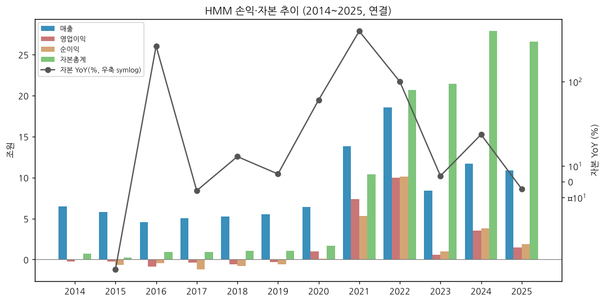

### ③ 회사 주가 역사 ★ narrative 영역

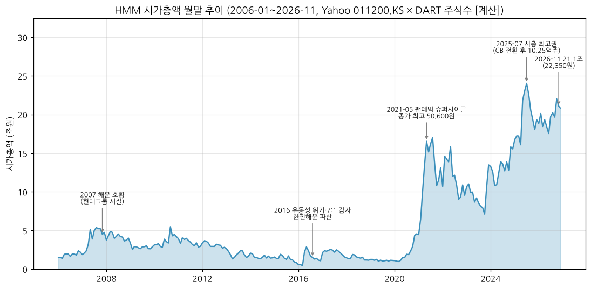

(시총 = Yahoo 월말 수정종가 × DART 발행주식수(보통주). 2016-04 7:1 무상감자 이전은 Yahoo 수정주가 ÷ 7 = 실제 주가로 환산 [계산]. 주식수는 DART 증자·전환 이력으로 시점별 반영 — **2006\~2010 구간은 2009말 추정 주식수 133.07M주 소급 가정 ⚠️**, 2015-03\~2016-03은 2015말 추정치(자본금 ÷ 액면 − 전환우선주) 사용, 2016-04\~12는 2016말 177.86M주 적용(감자\~공모 사이 월은 과대 표시 가능). 가격은 배당 미조정 종가)

(1) 2006\~2012: 현대그룹 시절 — 해운 호황과 2008 이후 장기 불황
→ 2007 해운 호황기 시총 5조원대 (2007-10\~11 월말) [Yahoo·계산]
→ 2010-09 수정주가 기준 상장 후 최고 (월간 고가 321,589원 = 감자 전 실제 약 45,900원 [계산])
→ 2010\~2013 세 차례 주주배정 유상증자 (2010-12 1,020만주·2012-12 1,100만주·2013-11 1,500만주) [DART 사업보고서(2016.12) 증자현황] — 불황기 자본 확충

(2) 2013\~2016: 유동성 위기 → 채권단 관리
→ 2014 LNG선 사업부 매각 (중단영업이익 4,722억) [DART 2015 사업보고서 전기]
→ 2015 자본총계 0.23조·부채비율 2,499% [DART, 계산]
→ 2016-04-22 **7:1 무상감자** (감소 주식 207,854,799주, 감자율 85.71%) → 2016-07 신주인수권 행사·일반공모 유상증자(1억 5,129만주, 9,530원) [DART 사업보고서(2018.12) 증자현황]
→ 2016-08 산업은행 최대주주 등극 (2016말 14.15%) [DART 사업보고서(2016.12)]. 같은 달 한진해운 법정관리 신청 → 9월 초 SCFI 미주 서안 $1,749/FEU로 급등 [DART 분기보고서(2016.09)]
→ 2016말 시총 1.08조, 2020-03-23 종가 2,190원 (감자 후 최저) [Yahoo]

(3) 2017\~2019: 산은 관리 하 재건 — 적자 지속
→ 2018-07 한국해양진흥공사 출범 [DART 사업보고서(2025.12) II-7] → 2018-10 192회 CB(4,000억)·193회 BW(6,000억) 등 영구 CB/BW 2.68조를 산은·해진공이 인수 (2018-10\~2020-04, 전환가 5,000원) [DART 사업보고서(2021.12) 미상환 CB 현황]
→ 2018-09 24,000TEU 12척·16,000TEU 8척 발주 (총 20척) — 2020\~2021 인도 [IR 2026 기업가치 제고 계획 p3 연혁, 발주 시점은 일반 공개정보 ⚠️]
→ 2014\~2019 6년 연속 영업적자 (누적 -2.59조) [DART, 계산]

(4) 2020\~2022: 팬데믹 운임 슈퍼사이클 → 주가 16배
→ 2020-04-24 세계 최대 24,000TEU급 'HMM Algeciras' 투입 [DART 사업보고서(2020.12) 선대변동], 2020-04 디 얼라이언스 정식 가입 [DART]
→ 2020 영업이익 9,808억 (10년 만의 흑자전환) → 2021 7.38조 → 2022 **9.95조 (사상 최대)** [DART]
→ **2021-05-27 종가 50,600원 (감자 후 최고, 당시 시총 17.48조)**, 2021-05-28 장중 51,100원 [Yahoo 일간, 계산]
→ 2021 연중 199회 공모 CB 1,867만주·190회·191회 사모 CB 1.44억주 전환 → 주식수 3.27억 → 4.89억주 [DART 사업보고서(2021.12)]
→ 2022말 19,550원 — 이익 정점에도 주가는 2021 고점 대비 -61%, PBR 0.46배 [Yahoo, 계산]

(5) 2023\~2024: 매각 시도·결렬 + 홍해 사이클
→ 2023-07 산은·해진공 경영권 공동매각 공고 (57.9% 매각) → **2023-12-18 하림(팬오션)·JKL파트너스 컨소시엄 우선협상대상자 선정** → **2024-02-07 협상 결렬** (산은·해진공 경영 참여 요구, 잔여 영구채 1.68조 전환 유예 요청 거부 등) [아시아경제 2023-07-21, 서울신문 2024-02-08]
→ 2023-10-19 192회 CB·193회 BW 전환 2억주 → 2024-05\~10 194·195·196회 CB 1.92억주 전환 [DART 사업보고서(2025.12) 증자현황]
→ 2024 홍해 사태 희망봉 우회 → 3Q24 영업이익 1.46조 (OPM 41.1%), 연간 3.51조 [DART]

(6) 2025\~2026-11: 공개매수·본사 이전 + 미국-이란 전쟁 운임 급등
→ 2025-04-17 197회 CB 1.44억주 전환 (산은 +7,200만주) → 발행주식 10.25억주 [DART]
→ **2025-07-15 종가 25,950원 = 시가총액 26.60조 (사상 최대)** [Yahoo 일간, 계산]
→ 2025-08-18\~09-12 **공개매수 자사주 81,801,526주 (2조 1,432억, 주당 26,200원 [계산])** → 2025-09-24 전량 이익소각 → 9.43억주 [DART 사업보고서(2025.12) I-4]
→ 2026-02\~03 미국-이란 전쟁 → 호르무즈 해협 사실상 봉쇄 (통과 물동량 평시 대비 약 -80%) [뉴시스 2026-03-04] → SCFI 2Q26 평균 2,337pt (+42%), 3Q26 3,388pt (+129%) [DART 분기보고서(2026.06·2026.09)]
→ 3Q26 영업이익 **1조 3,946억 (+369.8%, OPM 33.8%)** [DART] — 2024-3Q 이후 최대
→ **2026-11-24 22,350원 (시총 21.08조)** [Yahoo 일간]

### ④ 회사의 주요 연혁

```
1976-03-25   아세아상선 설립 (DART 설립일)
1983         현대상선으로 상호 변경                          ← 미검증 (일반 공개정보)
1995-10-05   유가증권시장 상장
2014         LNG선 사업부 매각 (중단영업 처리)
2016-04-22   7:1 무상감자 / 2016-07 출자전환·유상증자 → 2016-08 산업은행 최대주주
2017-02-01   미국 롱비치 TTI 터미널 지분 20% 인수 (USD 15.6M)
2018-07-01   한국해양진흥공사 출범 (해진공법 시행)
2018-10~2020-04  영구 CB·BW 2.68조 발행 (산은·해진공 인수, 전환가 5,000원)
2020-03-27   현대상선 → HMM 상호 변경
2020-04      디 얼라이언스 가입 / 24,000TEU 'HMM Algeciras' 투입
2021-06      13,000TEU 컨테이너선 12척 투자 결정
2022-07      15조원 중장기 경영전략 발표 / 여의도 사옥 이전
2023-02      9,000TEU 메탄올 추진선 9척 투자
2023-07      산은·해진공 경영권 매각 공고 → 2023-12-18 하림·JKL 우협
2024-02-07   매각 협상 결렬
2024-02      Premier Alliance 구축 (2025-02 출범, ONE·Yang Ming)
2024-09      2030 중장기전략 / 2045 Net-Zero 선언
2025-01      기업가치제고계획 발표
2025-05-01   상호출자제한기업집단 지정
2025-09      공개매수 자사주 2.14조 취득·소각
2025-10      13,000TEU 12척·VLCC 2척 등 투자 결정
2026-05-08   임시주총 — 본점 부산 이전 정관 변경 (2026-10-13 현판식)
2026-11-18   기업가치제고계획 갱신 (배당성향 30% 이상)
```

(출처: DART 사업보고서(2025.12) I-2 연혁·II-6·II-7, DART 사업보고서(2016.12·2018.12·2021.12) 증자·CB 현황, IR 2026 기업가치 제고 계획, 언론 — 날짜별 본문 표기)

---

## 3. 비즈니스 모델

### ① 실적 추이 (연결 → 부문 → 항로(지역) → 운영지표 3단계 위계)

**부문 정의**: 2014\~현재 **컨테이너 · 벌크 · 기타(터미널·임대)** 3부문 체계 유지 — 부문 간 내부거래 없음 (부문 합계 = 연결 매출) [DART 각 연도 연결 주석 "부문정보"]. 벌크는 유조선(원유·제품)·건화물선·다목적선·자동차선(2025 재진출)·가스선 포함

**연간 통합 표 (DART 연결 부문정보 + 사업의 내용):**

| 항목 | 2021 | 2022 | 2023 | 2024 | 2025 | 9M26 |
|---|---|---|---|---|---|---|
| **연결 매출 (조원)** | **13.79** | **18.58** | **8.40** | **11.70** | **10.89** | **10.25** |
| &nbsp;&nbsp;&nbsp;&nbsp;└ 컨테이너 | 12.95 | 17.31 | 6.96 | 10.15 | 9.24 | 8.67 |
| &nbsp;&nbsp;&nbsp;&nbsp;└ 벌크 | 0.68 | 1.09 | 1.24 | 1.34 | 1.45 | 1.45 |
| &nbsp;&nbsp;&nbsp;&nbsp;└ 기타 | 0.16 | 0.18 | 0.19 | 0.22 | 0.20 | 0.13 |
| &nbsp;&nbsp;&nbsp;&nbsp;└ 컨테이너 비중 (%) | 93.9 | 93.1 | 82.9 | 86.7 | 84.9 | 84.6 |
| └ 항로(도착지)별 매출 (조원) | | | | | | |
| &nbsp;&nbsp;&nbsp;&nbsp;└ 미주 | - | - | - | 4.27 | 3.54 | - |
| &nbsp;&nbsp;&nbsp;&nbsp;└ 구주 | - | - | - | 3.15 | 3.15 | - |
| &nbsp;&nbsp;&nbsp;&nbsp;└ 아주 | - | - | - | 1.51 | 1.43 | - |
| &nbsp;&nbsp;&nbsp;&nbsp;└ 남북항로 | - | - | - | 1.38 | 1.26 | - |
| &nbsp;&nbsp;&nbsp;&nbsp;└ 기타지역 | - | - | - | 1.40 | 1.51 | - |
| **연결 영업이익 (억원)** | **73,775** | **99,516** | **5,848** | **35,128** | **14,612** | **20,179** |
| &nbsp;&nbsp;&nbsp;&nbsp;└ 컨테이너 | 73,119 | 98,616 | 3,956 | 33,796 | 12,949 | 16,353 |
| &nbsp;&nbsp;&nbsp;&nbsp;└ 벌크 | 526 | 764 | 1,861 | 1,319 | 1,430 | 3,784 |
| &nbsp;&nbsp;&nbsp;&nbsp;└ 기타 | 130 | 135 | 31 | 14 | 234 | 41 |
| **OPM 전사 (%)** | **53.5** | **53.6** | **7.0** | **30.0** | **13.4** | **19.7** |
| &nbsp;&nbsp;&nbsp;&nbsp;└ 컨테이너 OPM | 56.5 | 57.0 | 5.7 | 33.3 | 14.0 | 18.9 |
| &nbsp;&nbsp;&nbsp;&nbsp;└ 벌크 OPM | 7.7 | 7.0 | 15.0 | 9.9 | 9.9 | 26.1 |
| **매출 YoY (%)** | +115.1 | +34.7 | -54.8 | +39.3 | -6.9 | +25.2 |
| **EBITDA 마진 (%)** | 58.2 | 58.0 | 17.2 | 37.6 | 23.6 | 29.6 |
| └ 운영지표 | | | | | | |
| &nbsp;&nbsp;&nbsp;&nbsp;└ 컨테이너 평균운임 (USD/TEU) | 2,567.30 | 2,881.07 | 972.57 | 1,604.57 | 1,214.16 | 1,482.07 |
| &nbsp;&nbsp;&nbsp;&nbsp;└ SCFI 연평균 (pt) | 3,762 [계산] | 3,410 | 1,006 | 2,506 | 1,581 | 2,411 [계산] |
| &nbsp;&nbsp;&nbsp;&nbsp;└ 컨테이너 수송량 (천 TEU) | - | 3,679 | 3,784 | 3,820 | 3,943 | 3,134 |
| &nbsp;&nbsp;&nbsp;&nbsp;└ 컨테이너 수송능력 (천 TEU, 연간 누적) | 5,009 | 4,827 | 5,511 | 5,353 | 5,851 | 4,638 |
| &nbsp;&nbsp;&nbsp;&nbsp;└ 컨테이너 가동률 (%) | - | 76.2 | 68.7 | 71.4 | 67.4 | 67.6 |
| &nbsp;&nbsp;&nbsp;&nbsp;└ 벌크 평균운임 (USD/MT) | - | - | 20.71 | 17.79 | 17.71 | - |
| &nbsp;&nbsp;&nbsp;&nbsp;└ 벌크 수송량 (천 MT) | - | 26,822 | 38,934 | 37,762 | 40,061 | 25,518 |
| &nbsp;&nbsp;&nbsp;&nbsp;└ 연료유 평균가 (USD/MT, Singapore 380CST) | - | - | 464.43 | 479.50 | 424.65 | - |

(출처: 부문 매출·영업이익 = DART 연결 주석 "부문정보" (9M26 = 1Q26+2Q26+3Q26 3개월 합). 항로별 = DART 사업보고서(2025.12) 주석 4 "지역에 대한 정보" (화물 도착지 기준 — 2021\~2023은 이번 버전 미추출). 평균운임·수송량·수송능력·가동률·연료유 = DART 사업보고서 II-2·II-3 (2022\~2025), 분기보고서(2026.09) (9M26). SCFI = HMM 정기보고서 본문 인용 (2021·9M26은 분기 평균 단순평균 [계산]). 수송능력 = "운임수입 주체 선박의 연간 누적 수송 capacity" — 선복량(TEU)과 다름)

**사업부별 분기 시계열 (억원, 1Q15\~3Q26 47개 분기, DART 부문정보 + 연결):**

> 1·2·3Q = 분기보고서 "3개월" 금액, 4Q = 사업보고서 연간 − 1\~3Q 합 [계산]. 연결 매출·영업이익·순이익은 1Q16부터 dart_quarterly_summary(CFS), 2015 4개 분기는 부문 합계(분기 순이익 미수록). 부문 합계와 연결은 4Q16(매출 −34억)·4Q23(영업이익 −6억)을 제외한 전 분기 일치 — 두 분기 차이는 사업보고서 기재정정 영향으로 추정 ⚠️. 2014 이전 분기는 미수록 (60+분기 표준 미충족 — 잔여 보완 후보)

| 분기 | 연결 매출 | 연결 OP | OPM | 매출 YoY | 순이익 | 컨테이너 매출 | 컨테이너 OP | 컨테이너 OPM | 벌크 매출 | 벌크 OP | 벌크 OPM | 기타 OP | SCFI(pt) |
|---|---|---|---|---|---|---|---|---|---|---|---|---|---|
| 1Q15 | 15,702 | 42 | 0.3% | - | - | 11,924 | 188 | 1.6% | 2,637 | -188 | -7.1% | 42 | - |
| 2Q15 | 15,214 | -631 | -4.1% | - | - | 11,339 | -494 | -4.4% | 2,754 | -133 | -4.8% | -5 | - |
| 3Q15 | 15,535 | -680 | -4.4% | - | - | 11,581 | -531 | -4.6% | 2,666 | -94 | -3.5% | -55 | - |
| 4Q15 | 11,236 | -1,266 | -11.3% | - | - | 9,790 | -1,257 | -12.8% | 2,362 | -206 | -8.7% | 197 | - |
| 1Q16 | 12,214 | -1,630 | -13.3% | -22.2% | -2,761 | 9,688 | -1,116 | -11.5% | 1,845 | -583 | -31.6% | 68 | - |
| 2Q16 | 10,168 | -2,543 | -25.0% | -33.2% | 2,160 | 8,178 | -2,182 | -26.7% | 1,385 | -397 | -28.7% | 36 | - |
| 3Q16 | 10,784 | -2,303 | -21.4% | -30.6% | 2,971 | 8,715 | -1,908 | -21.9% | 1,345 | -507 | -37.7% | 112 | - |
| 4Q16 | 12,716 | -1,861 | -14.6% | +13.2% | -6,951 | 10,758 | -1,711 | -15.9% | 1,267 | -345 | -27.3% | 199 | - |
| 1Q17 | 13,025 | -1,312 | -10.1% | +6.6% | -7,346 | 11,096 | -1,159 | -10.4% | 1,353 | -261 | -19.3% | 107 | - |
| 2Q17 | 12,420 | -1,281 | -10.3% | +22.1% | -1,737 | 10,844 | -936 | -8.6% | 1,411 | -275 | -19.5% | -69 | - |
| 3Q17 | 12,956 | -295 | -2.3% | +20.1% | -603 | 11,170 | -64 | -0.6% | 1,380 | -277 | -20.1% | 47 | - |
| 4Q17 | 11,880 | -1,180 | -9.9% | -6.6% | -2,221 | 10,429 | -1,007 | -9.7% | 1,295 | -99 | -7.6% | -74 | - |
| 1Q18 | 11,120 | -1,701 | -15.3% | -14.6% | -1,757 | 9,719 | -1,519 | -15.6% | 970 | -212 | -21.8% | 29 | - |
| 2Q18 | 12,388 | -1,998 | -16.1% | -0.3% | -2,427 | 10,887 | -1,785 | -16.4% | 923 | -273 | -29.6% | 60 | - |
| 3Q18 | 14,258 | -1,231 | -8.6% | +10.0% | -1,667 | 12,804 | -1,103 | -8.6% | 1,049 | -130 | -12.4% | 2 | - |
| 4Q18 | 14,455 | -657 | -4.5% | +21.7% | -2,053 | 12,723 | -556 | -4.4% | 1,267 | -142 | -11.2% | 41 | - |
| 1Q19 | 13,159 | -1,057 | -8.0% | +18.3% | -1,785 | 11,652 | -957 | -8.2% | 1,052 | -94 | -9.0% | -5 | 858 |
| 2Q19 | 13,970 | -1,129 | -8.1% | +12.8% | -2,007 | 12,420 | -1,011 | -8.1% | 983 | -182 | -18.5% | 64 | 772 |
| 3Q19 | 14,477 | -466 | -3.2% | +1.5% | -1,242 | 12,530 | -720 | -5.7% | 1,503 | 266 | 17.7% | -12 | 791 |
| 4Q19 | 13,525 | -345 | -2.6% | -6.4% | -864 | 11,078 | -753 | -6.8% | 1,913 | 432 | 22.6% | -24 | 823* |
| 1Q20 | 13,131 | -20 | -0.2% | -0.2% | -656 | 11,102 | -259 | -2.3% | 1,531 | 226 | 14.8% | 13 | 931 |
| 2Q20 | 13,751 | 1,387 | 10.1% | -1.6% | 281 | 11,936 | 1,041 | 8.7% | 1,361 | 305 | 22.4% | 41 | 897 |
| 3Q20 | 17,185 | 2,771 | 16.1% | +18.7% | 246 | 15,408 | 2,739 | 17.8% | 1,329 | 29 | 2.1% | 3 | 1209 |
| 4Q20 | 20,065 | 5,670 | 28.3% | +48.4% | 1,368 | 18,167 | 5,409 | 29.8% | 1,202 | 176 | 14.6% | 86 | 1975 |
| 1Q21 | 24,280 | 10,193 | 42.0% | +84.9% | 1,541 | 22,606 | 10,118 | 44.8% | 1,294 | 12 | 1.0% | 63 | 2780 |
| 2Q21 | 29,067 | 13,889 | 47.8% | +111.4% | 2,105 | 27,087 | 13,692 | 50.5% | 1,605 | 130 | 8.1% | 67 | 3259 |
| 3Q21 | 40,164 | 22,708 | 56.5% | +133.7% | 22,998 | 37,912 | 22,553 | 59.5% | 1,836 | 110 | 6.0% | 46 | 4312 |
| 4Q21 | 44,430 | 26,985 | 60.7% | +121.4% | 26,727 | 41,883 | 26,756 | 63.9% | 2,108 | 274 | 13.0% | -45 | 4698 |
| 1Q22 | 49,187 | 31,486 | 64.0% | +102.6% | 31,317 | 46,683 | 31,284 | 67.0% | 2,090 | 84 | 4.0% | 118 | 4851 |
| 2Q22 | 50,340 | 29,371 | 58.3% | +73.2% | 29,331 | 46,999 | 28,917 | 61.5% | 2,721 | 196 | 7.2% | 258 | 4211 |
| 3Q22 | 51,062 | 26,010 | 50.9% | +27.1% | 26,053 | 47,466 | 25,967 | 54.7% | 3,168 | 185 | 5.8% | -142 | 3279 |
| 4Q22 | 35,238 | 12,649 | 35.9% | -20.7% | 14,153 | 31,902 | 12,448 | 39.0% | 2,969 | 300 | 10.1% | -99 | 1299* |
| 1Q23 | 20,816 | 3,069 | 14.7% | -57.7% | 2,853 | 17,516 | 2,285 | 13.0% | 2,854 | 743 | 26.0% | 41 | 969 |
| 2Q23 | 21,300 | 1,602 | 7.5% | -57.7% | 3,128 | 17,828 | 1,335 | 7.5% | 3,001 | 226 | 7.5% | 41 | 984 |
| 3Q23 | 21,266 | 758 | 3.6% | -58.4% | 954 | 17,428 | 222 | 1.3% | 3,343 | 520 | 15.5% | 17 | 986 |
| 4Q23 | 20,628 | 424 | 2.1% | -41.5% | 2,630 | 16,873 | 114 | 0.7% | 3,233 | 372 | 11.5% | -67 | 1089 |
| 1Q24 | 23,299 | 4,070 | 17.5% | +11.9% | 4,851 | 19,358 | 3,501 | 18.1% | 3,394 | 534 | 15.7% | 35 | 2010 |
| 2Q24 | 26,634 | 6,444 | 24.2% | +25.0% | 6,608 | 22,544 | 6,067 | 26.9% | 3,484 | 341 | 9.8% | 35 | 2628 |
| 3Q24 | 35,520 | 14,614 | 41.1% | +67.0% | 17,385 | 31,878 | 14,680 | 46.0% | 3,188 | -79 | -2.5% | 12 | 3082 |
| 4Q24 | 31,549 | 10,001 | 31.7% | +52.9% | 8,978 | 27,697 | 9,548 | 34.5% | 3,309 | 522 | 15.8% | -69 | 2257 |
| 1Q25 | 28,547 | 6,139 | 21.5% | +22.5% | 7,397 | 24,658 | 5,782 | 23.5% | 3,355 | 353 | 10.5% | 4 | 1762 |
| 2Q25 | 26,227 | 2,332 | 8.9% | -1.5% | 4,713 | 21,701 | 1,875 | 8.6% | 3,968 | 332 | 8.4% | 125 | 1645 |
| 3Q25 | 27,064 | 2,968 | 11.0% | -23.8% | 3,038 | 23,409 | 2,875 | 12.3% | 3,160 | 45 | 1.4% | 48 | 1481 |
| 4Q25 | 27,076 | 3,173 | 11.7% | -14.2% | 3,639 | 22,665 | 2,416 | 10.7% | 3,987 | 700 | 17.6% | 57 | 1440 |
| 1Q26 | 27,187 | 2,691 | 9.9% | -4.8% | 3,536 | 22,712 | 1,852 | 8.2% | 4,029 | 830 | 20.6% | 9 | 1507 |
| 2Q26 | 34,020 | 3,541 | 10.4% | +29.7% | 4,114 | 28,025 | 1,986 | 7.1% | 5,584 | 1,564 | 28.0% | -8 | 2337 |
| 3Q26 | 41,271 | 13,946 | 33.8% | +52.5% | 15,352 | 35,959 | 12,515 | 34.8% | 4,897 | 1,391 | 28.4% | 41 | 3388 |

(SCFI: HMM 분기·반기·사업보고서 II-7 "사업의 현황" 본문의 분기 평균 종합지수 인용. *4Q19·4Q22는 본문 미기재 → 연평균(2019 811pt·2022 3,410pt) × 4 − 1\~3Q 합으로 역산 [계산]. 2018 이전 분기 평균은 본문에 일관 기재되지 않아 미수록)

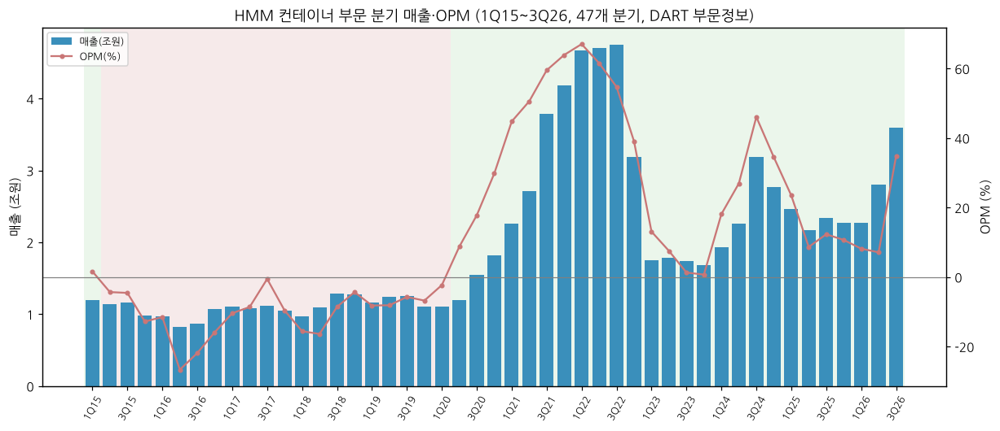
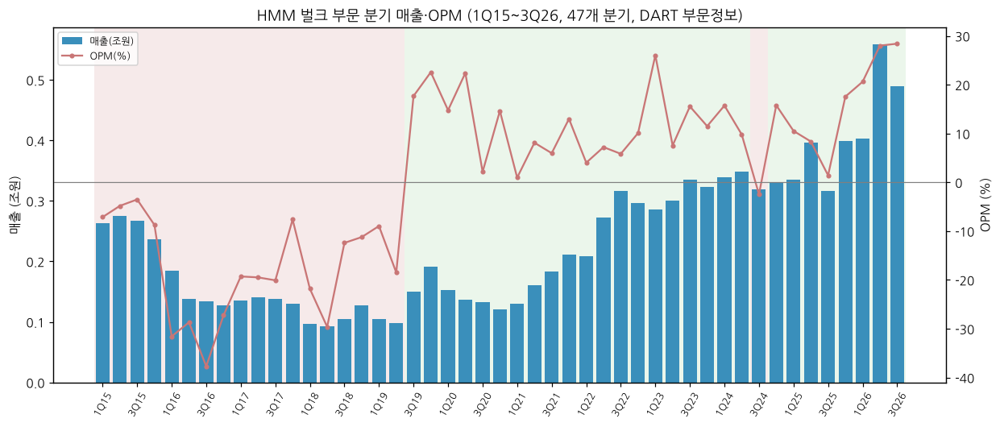
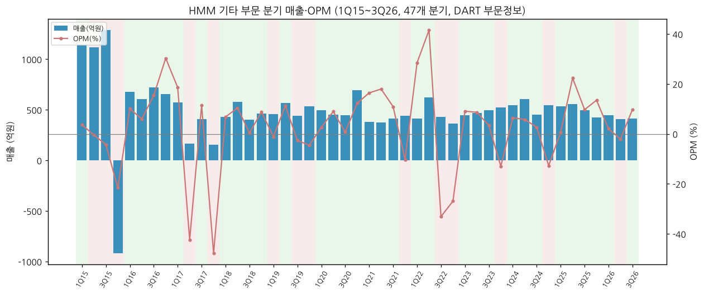

**3Q26 핵심 박스 (2026-11-12 분기보고서 [DART], 언론 보도 2026-11-12):**

| 항목 | 3Q26 | YoY | 9M26 | YoY |
|---|---|---|---|---|
| 연결 매출 | 4.127조 | +52.5% | 10.248조 | +25.2% |
| 연결 영업이익 | 13,946억 | +369.8% | 20,179억 | +76.4% |
| 연결 OPM | 33.8% | +22.8%p | 19.7% | +5.7%p |
| 연결 순이익 | 15,352억 | +405.3% | 23,002억 | - |
| 컨테이너 매출 / OP | 3.596조 / 12,515억 | +53.6% / +335.3% | 8.670조 / 16,353억 | +24.3% / +55.3% |
| 벌크 매출 / OP | 0.490조 / 1,391억 | +54.9% / 45억→1,391억 | 1.451조 / 3,784억 | +38.4% / +418.5% |
| SCFI 분기 평균 | 3,388pt | +129% | - | - |
| 컨테이너 평균운임 (누적) | - | - | 1,482 USD/TEU | (2025 연간 1,214) |

(DART 분기보고서(2026.09) 부문정보·II-2·II-7, 연결 손익. 9M25 순이익 15,148억 대비 9M26 +51.8% [계산])

→ 운임 요인 (회사 설명): 미주항로 조기 성수기의 3분기 연장 (파나마 운하 수위 저하·관세 휴전 2개월 연장), 중동항로 호르무즈 해협 통항 제한 지속 → 대체항(코파칸·푸자이라·소하르) 및 홍해 제다항 혼잡으로 고운임 유지, 동아주 항만 체선으로 실질 공급 15\~20% 감소 [DART 분기보고서(2026.09) II-7]
→ 벌크 개선: 2025 하반기부터 단기 용선 → 장기 운송계약 중심 전환 [MTN 2026-11-12], 벌크 선대 60척 (1Q25말 대비 +16척, 발주 22척 포함 시 82척) [한국센터 2026-11]
→ 3Q26 단일 고객 매출 1.27조 (연결 매출의 10% 이상, 컨테이너 부문) [DART 분기보고서(2026.09) 주석 5] — 2025 연간 주요 매출처 "얼라이언스 소속 선사" 14.8%와 같은 성격(선복 교환·슬롯 판매)으로 추정 ⚠️
→ 4Q26 회사 전망: "계절적 비수기 + 미국-이란 사태 불확실성 지속", 수에즈 통항 재개로 구주 운임 하향 압력 [DART 분기보고서(2026.09) II-7]
→ 주주환원: 2026-11-18 기업가치 제고 계획 갱신 — 2030년까지 배당성향 30% 이상 (시가배당률 5% 기준 삭제) [IR 2026-11-18 p9]

**12분기 시계열 (연결, 매출 + OPM):**

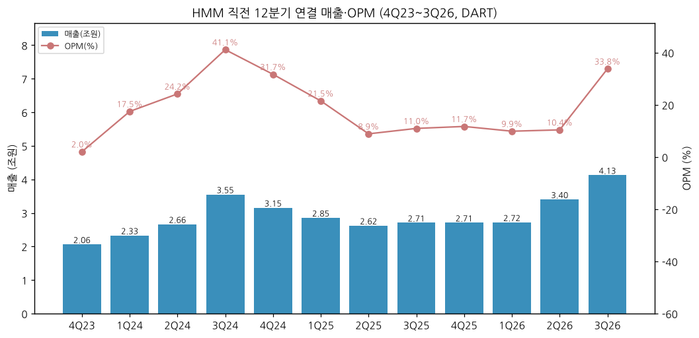

**운임 지수 vs 실적 (SCFI ↔ 컨테이너 부문):**

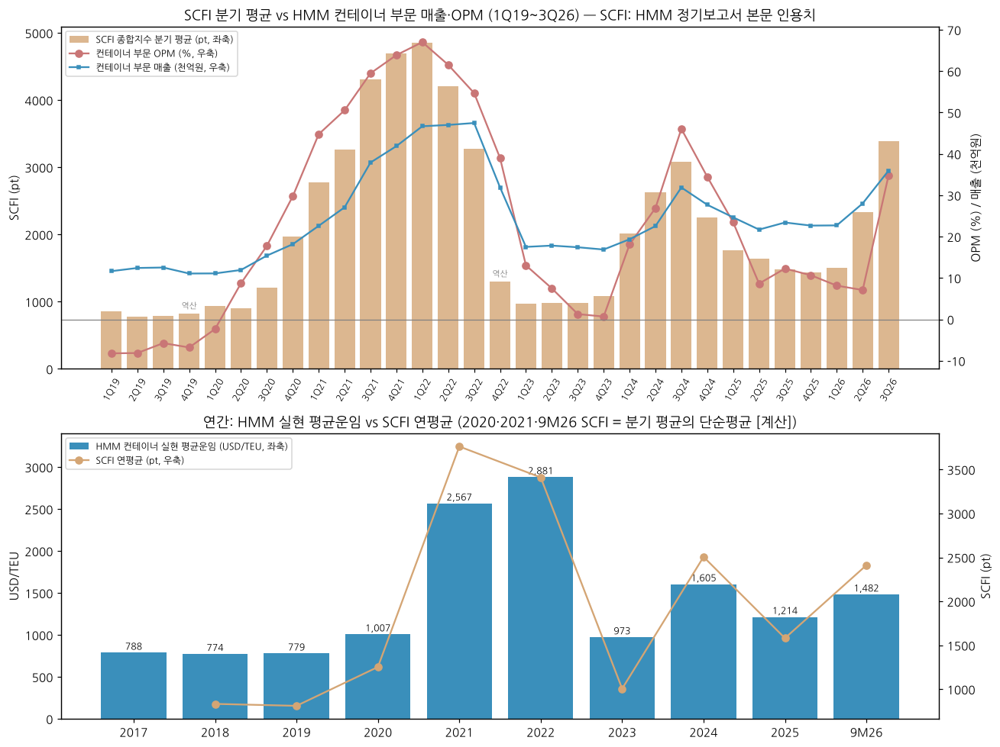

→ SCFI 분기 평균과 컨테이너 OPM의 동행성이 매우 높음 — SCFI 1,000pt 내외(2019·2023)에서 OPM 0% 전후, 2,000pt 이상에서 OPM 20\~45%, 4,000pt 이상(2021\~2022)에서 60%대 [DART, 계산]
→ 실현 평균운임(USD/TEU)은 SCFI보다 변동이 작음 — 장기계약(미주 기준 매년 4\~5월 운임 결정 [DART II-4]) 비중 때문. 2022 SCFI -9% 하락에도 평균운임은 +12% (2,567 → 2,881 USD/TEU), 2023 평균운임 -66%로 1년 시차 하락

### ② 사업부별 개요 (매출 비중 큰 순서)

| 부문 | 2025 매출 | 비중 | 2025 OP | OPM | 사업 모델 |
|---|---|---|---|---|---|
| 컨테이너 | 9.24조 | 84.9% | 1.29조 | 14.0% | 정기선 — 미주·구주·아주·남북·중동·인도 항로. 사선 70척 + 용선, 2025 운항 선복 99만 TEU [IR]. 장기계약 화물(연 1회 운임 결정) + 스팟 화물. Premier Alliance 공동운항 |
| 벌크 | 1.45조 | 13.3% | 0.14조 | 9.9% | 부정기선 — 유조선(VLCC·제품선), 건화물선(케이프·철광석·석탄), 다목적선·중량물선, 자동차선(2025 재진출), 가스선. 장기운송계약(COA·CVC) 비중 높음 |
| 기타 | 0.20조 | 1.8% | 0.02조 | 11.6% | 터미널 운영(부산신항·알헤시라스·롱비치 TTI 지분 등)·임대 |

(DART 사업보고서(2025.12) II-1·II-2·주석 4. 사선 척수 = DART II-3 선대현황(용선 제외) 2025말 컨테이너 70척·벌크 39척)

### ③ 사업부별 디테일

(1) 컨테이너 — 운임 레버리지가 전사 이익을 결정
→ 2025 매출 9.24조 (-8.9%), OP 1.29조 (-61.7%) — SCFI 연평균 -37% (2,506 → 1,581pt) [DART]
→ 미주 서안 점유율 (아시아→미주): 2023 6.4% → 2024 6.0% → 2025 5.5% → 2026(1\~8월) 5.6% / 미주 서안→아시아 8.6\~8.9% [DART II-7, PIERS]
→ 가동률(수송실적/수송능력) 2022 76.2% → 2025 67.4% — 선복 증가 대비 화물 확보 둔화 [DART II-3, 계산]
→ 선대 확장: 2025말 사선 컨테이너선 70척 (2020말 25척) [DART II-3], 운항 선복 '25 94척·99만 TEU → '30 176척·155만 TEU 목표 [IR 2026-11 p10] (언론 보도는 166척·147만 TEU [CEO스코어데일리 2026-10-14] — 수치 불일치, 원 자료 대조 필요 ⚠️)
→ 친환경 선대: LNG DF 7,700TEU 2척 운항, 메탄올 DF 9,000TEU 6척 인도(9척 중), LNG DF 13,000TEU 12척 발주 [IR 2026-11 p8]

(2) 벌크 — 장기계약 기반 "두 번째 축"
→ 2023 OP 1,861억 (컨테이너 3,956억의 47%) — 컨테이너 저점에서 하방 지지 [DART 부문정보]
→ 장기운송계약: 현대글로비스 석탄·철광석 6,946억 (2010\~2030), Vale 철광석 6,686억 (2025\~2035)·4,488억 (2026\~2036), GS칼텍스 원유 8,164억 (2022\~2032)·6,875억 (2023\~2032), S-Oil 원유 2,041억 (2025\~2030) [DART 사업보고서(2025.12) II-4 수주상황, 환율 1,447원]
→ 9M26 OP 3,784억 (+418.5%) — 원유선 시황 강세(호르무즈·대러·이란 제재로 톤마일 증가)와 장기계약 전환 효과 [DART II-7, MTN 2026-11-12]
→ 2025 BDTI TD3C(중동→중국 VLCC) WS 48.8(7월) → 123.5(11월), BDI 4Q25 평균 2,159 [DART 사업보고서(2025.12) II-7]
→ 2030 목표: 벌크 51척·706만 DWT → 110척·1,275만 DWT [IR 2026-11 p10]

(3) 기타 — 터미널 (규모 작음)
→ 부산컨테이너터미널, HMM PSA 신항만, 스페인 알헤시라스(TTIA — 지분 매각 및 재금융), 미국 롱비치 TTI 20% (TIL과 2030년까지 풋/콜옵션) [DART 사업보고서(2025.12) II-5·주석 9]
→ 2026 투자계획: 항만물류 1.13조 (2025 실적 274억) [DART II-3 설비 신설 계획] — 터미널 투자 확대 예정

### ④ 주요 경쟁사 (사업부별)

| 부문 | 글로벌 경쟁사 | 비고 |
|---|---|---|
| 컨테이너 | MSC·Maersk·CMA CGM·COSCO(OOCL 포함)·Hapag-Lloyd·ONE·Evergreen·Yang Ming | 상위 10개 선사가 세계 해상 운송 80%+ 담당, 그중 8개 선사가 얼라이언스 구성 [DART II-1]. 미주 서안 점유율 HMM 5.5% (2025) |
| 컨테이너 (국내 근해) | 고려해운·장금상선·SM상선 등 | 원양 국적선사는 HMM 단독 (일반 공개정보 ⚠️) |
| 벌크 | 팬오션·대한해운 (국내), 글로벌 탱커·드라이벌크 선주사 | `팬오션_기업개요.md` 참조 |

(3Q26 OPM 비교: HMM 33.8% vs Maersk(해운) 20.6%·ONE 21.6%·COSCO 28.7% [MTN 2026-11-12])

### ⑤ 주요 매출처

> 컨테이너 화주는 불특정 다수 (수출입 기업·포워더). 10% 이상 단일 매출처는 **얼라이언스 소속 선사** (2025 연결 매출의 14.8%) — 공동운항 선복(슬롯) 판매·교환 성격 [DART 사업보고서(2025.12) II-4]. 3Q26 단일 고객 매출 1.27조 (컨테이너) [DART 분기보고서(2026.09) 주석 5]

| 매출 원천 (2025) | 금액 | 비중 | 주요 고객 |
|---|---|---|---|
| 컨테이너 (도착지 미주) | 3.54조 (지역 전체 기준) | 32.5% | 불특정 화주, 얼라이언스 선사 |
| 구주 | 3.15조 | 28.9% | 〃 |
| 아주 | 1.43조 | 13.1% | 〃 |
| 남북항로 | 1.26조 | 11.6% | 〃 |
| 기타 지역 | 1.51조 | 13.9% | 중동·인도 + 벌크 일부 |
| 벌크 장기계약 | (부문 1.45조 내) | - | 현대글로비스·Vale·GS칼텍스·S-Oil |

(지역별 = DART 주석 4, 벌크·기타 부문 매출도 도착지 기준으로 지역에 배분 — 지역 합계 = 연결 10.89조. 비중 [계산])

### ⑥ 생산 CAPA (선대) + 임직원

**사선 선대 추이 (용선 제외, 척, DART 사업보고서 II-3):**

| 연도 | 2014 | 2015 | 2016 | 2017 | 2018 | 2019 | 2020 | 2021 | 2022 | 2023 | 2024 | 2025 | 3Q26 |
|---|---|---|---|---|---|---|---|---|---|---|---|---|---|
| 컨테이너선 | 23 | 23 | 24 | 13 | 14 | 14 | 25 | 39 | 37 | 38 | 59 | 70 | 72 |
| 벌크선 | 20 | 16 | 9 | 6 | 5 | 10 | 10 | 10 | 16 | 23 | 31 | 39 | 50 |
| 합계 | 43 | 39 | 33 | 19 | 19 | 24 | 35 | 49 | 53 | 61 | 90 | 109 | 122 |

**컨테이너 연간 수송능력 (천 TEU, 연간 누적 capacity, DART II-3):** 2012 3,966 → 2014 4,256 → 2016 4,122 → 2018 5,656 → 2020 5,224 → 2022 4,827 → 2024 5,353 → 2025 5,851

- 2017 사선 급감 (24 → 13척) = 유동성 위기 중 선박 매각·세일앤리스백 (원인 미검증 ⚠️). 2020\~2021 24K·16K 20척 인도, 2024 13K 등 21척 순증 [DART]
- **건조 중 선박 (2025말)**: 중형 컨테이너 15척 (USD 24.9억), 소형 컨테이너 12척 (USD 4.5억), 자동차운반선 5척, 다목적선 2척, 제품선 2척, 소형벌크 2척, 원유운반선 2척 — 총선가 약 USD 40.5억 [DART 사업보고서(2025.12) II-6, 계산]
- **임직원 (2025말)**: 1,933명 (육상 1,064 / 해상 869), 평균 근속 9.34년, 1인 평균 급여 1.30억 [DART 사업보고서(2025.12) VIII, OpenDART empSttus]
- 인원 추이: 2015 1,655 → 2017 1,270 → 2019 1,425 → 2021 1,678 → 2023 1,781 → 2025 1,933명 [DART 각 사업보고서 VIII] (2014·2016 미추출)

---

## 4. 재무 구조

> **재무제표 수치: OpenDART fnlttSinglAcntAll (연결 CFS), 2026-11-25 조회.** 2014 = 2015 사업보고서 전기 컬럼 (LNG선 사업부 중단영업 재분류 후). 4Q = 연간 − 3Q 누적 [dart_quarterly_summary]. 기능통화 USD → 원화 환산 표시 (환율 변동이 원화 표시 자본·자산에 영향). 감가상각비 = DART 연결 부문정보 "감가상각비" 합계 (유형+사용권, 2019\~ IFRS16). 차입금 = 단기차입금·유동성장기부채·사채·장기차입금 합계 (리스 제외), 리스부채 = (금융)리스부채 유동+비유동. 현금성 = 현금및현금성자산 + 기타유동금융자산(단기금융상품) + 유동 당기손익인식금융자산

### ① 손익계산서 (12년 연결, 억원)

| 연도 | 매출 | 매출원가 | 매출총이익 | GPM | 판관비 | 영업이익 | OPM | 세전이익 | 순이익 | NPM | 지배순이익 | EPS(원) | 감가상각비 | EBITDA | EBITDA 마진 |
|---|---|---|---|---|---|---|---|---|---|---|---|---|---|---|---|
| 2014 | 65,150 | 64,103 | 1,048 | 1.6% | 3,398 | -2,350 | -3.6% | -4,323 | 218 | 0.3% | 374 | - | 2,187 | -163 | -0.3% |
| 2015 | 57,686 | 56,858 | 828 | 1.4% | 3,364 | -2,535 | -4.4% | -6,843 | -6,805 | -11.8% | -6,695 | - | 2,116 | -420 | -0.7% |
| 2016 | 45,848 | 51,016 | -5,167 | -11.3% | 3,167 | -8,334 | -18.2% | -4,155 | -4,582 | -10.0% | -4,596 | -5,057 | 1,751 | -6,583 | -14.4% |
| 2017 | 50,280 | 51,296 | -1,015 | -2.0% | 3,052 | -4,068 | -8.1% | -11,870 | -11,907 | -23.7% | -11,910 | -6,219 | 1,107 | -2,961 | -5.9% |
| 2018 | 52,221 | 54,989 | -2,768 | -5.3% | 2,818 | -5,587 | -10.7% | -7,789 | -7,906 | -15.1% | -7,907 | -4,139 | 1,102 | -4,485 | -8.6% |
| 2019 | 55,131 | 55,172 | -41 | -0.1% | 2,956 | -2,997 | -5.4% | -5,867 | -5,898 | -10.7% | -5,899 | -3,353 | 5,034 | 2,037 | 3.7% |
| 2020 | 64,133 | 51,288 | 12,844 | 20.0% | 3,037 | 9,808 | 15.3% | 1,278 | 1,240 | 1.9% | 1,239 | 103 | 5,848 | 15,656 | 24.4% |
| 2021 | 137,941 | 60,364 | 77,577 | 56.2% | 3,802 | 73,775 | 53.5% | 53,272 | 53,372 | 38.7% | 53,371 | 13,506 | 6,470 | 80,245 | 58.2% |
| 2022 | 185,828 | 81,367 | 104,461 | 56.2% | 4,945 | 99,516 | 53.6% | 101,837 | 100,854 | 54.3% | 100,853 | 20,556 | 8,305 | 107,821 | 58.0% |
| 2023 | 84,010 | 74,261 | 9,749 | 11.6% | 3,901 | 5,848 | 7.0% | 10,543 | 9,687 | 11.5% | 9,686 | 1,667 | 8,628 | 14,476 | 17.2% |
| 2024 | 117,002 | 77,368 | 39,635 | 33.9% | 4,506 | 35,128 | 30.0% | 38,966 | 37,821 | 32.3% | 37,822 | 4,999 | 8,920 | 44,048 | 37.6% |
| 2025 | 108,914 | 88,564 | 20,351 | 18.7% | 5,739 | 14,612 | 13.4% | 20,007 | 18,787 | 17.2% | 18,784 | 1,951 | 11,039 | 25,651 | 23.6% |

(EPS = DART 공시 기본주당이익 — 2016 감자 이전 연도는 감자 전 주식수 기준. 2014 순이익 218억 = 계속영업손실 −4,504억 + 중단영업이익 4,722억 [DART 2015 사업보고서 전기]. 2019 이후 감가상각비 급증 = IFRS16 사용권자산 상각. 2025 순이익 > 영업이익 = 금융수익(이자수익 6,189억 등) 8,287억 [DART])

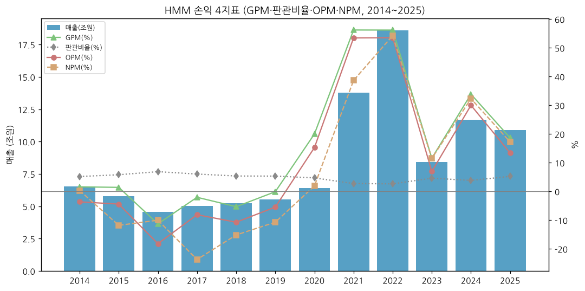

**비용 구조 포인트 (DART 사업보고서(2025.12)):**
- 연료유 매입 1.35조 (2025, 매출원가 8.86조의 15.2%) — 평균 단가 424.65 USD/MT (2024 479.50) [DART II-3, 계산]
- 매출원가율 81.3% (2025) / 66.1% (2024) / 88.4% (2023) — 운임 하락 시 고정비(용선료·감가·항비) 비중이 원가율을 급등시키는 구조 [계산]
- 판관비 5,739억 (매출의 5.3%) — 운임 변동과 무관하게 안정 (2022 4,945억)

### ② 재무상태표 (12년 연결, 억원)

| 연도 | 자산총계 | 유동자산 | 유형자산 | 사용권자산 | 부채총계 | 유동부채 | 자본총계 | 지배지분 | 부채비율 | 유동비율 | 현금성(현금+단기금융) | 차입금 | 리스부채 |
|---|---|---|---|---|---|---|---|---|---|---|---|---|---|
| 2014 | 72,658 | 16,320 | 42,550 | 0 | 65,802 | 38,690 | 6,855 | 5,945 | 960% | 42% | 6,830 | 51,755 | 1,058 |
| 2015 | 59,425 | 11,512 | 34,260 | 0 | 57,139 | 32,122 | 2,286 | 1,857 | 2,499% | 36% | 3,975 | 47,780 | 752 |
| 2016 | 43,981 | 12,900 | 22,762 | 0 | 34,468 | 8,103 | 9,513 | 9,478 | 362% | 159% | 5,396 | 25,098 | 455 |
| 2017 | 36,024 | 13,867 | 15,968 | 0 | 27,055 | 6,802 | 8,969 | 8,948 | 302% | 204% | 6,949 | 19,865 | 655 |
| 2018 | 41,214 | 17,476 | 17,341 | 0 | 30,818 | 11,056 | 10,397 | 10,385 | 296% | 158% | 8,799 | 13,936 | 9,525 |
| 2019 | 71,602 | 14,272 | 20,235 | 29,610 | 60,699 | 16,837 | 10,903 | 10,890 | 557% | 85% | 6,578 | 24,821 | 27,868 |
| 2020 | 93,734 | 22,372 | 22,999 | 39,522 | 76,848 | 28,807 | 16,885 | 16,874 | 455% | 78% | 11,563 | 24,310 | 36,831 |
| 2021 | 178,761 | 87,680 | 32,006 | 48,649 | 75,178 | 25,247 | 103,583 | 103,573 | 73% | 347% | 64,631 | 13,827 | 44,370 |
| 2022 | 259,735 | 142,801 | 41,227 | 45,679 | 52,855 | 20,518 | 206,879 | 206,863 | 26% | 696% | 128,000 | 4,655 | 34,123 |
| 2023 | 257,134 | 131,797 | 77,159 | 29,278 | 42,726 | 20,014 | 214,408 | 214,392 | 20% | 659% | 117,568 | 3,919 | 26,351 |
| 2024 | 338,486 | 179,968 | 98,464 | 47,580 | 59,930 | 23,572 | 278,555 | 278,539 | 22% | 763% | 158,417 | 2,642 | 41,129 |
| 2025 | 335,631 | 151,175 | 115,228 | 53,011 | 69,919 | 26,020 | 265,713 | 265,692 | 26% | 581% | 133,457 | 2,513 | 49,355 |

(3Q26: 자산 33.97조 / 부채 7.25조 / 자본 26.72조 / 지배지분 26.72조 / 현금성 12.48조 (현금및현금성자산 0.92조 + 단기금융상품 등) / 차입금 0.23조 / 리스부채 4.92조 / 부채비율 27.1% [DART 분기보고서(2026.09), 계산]. 2014\~2018 리스부채는 금융리스만 (운용리스 용선은 부외), 2019 IFRS16으로 리스부채 0.95조 → 2.79조)

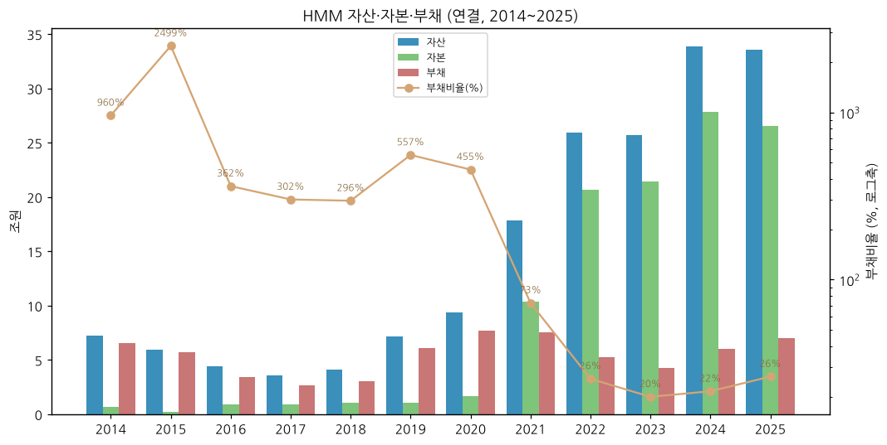

### ③ 현금흐름표 (12년 연결, 억원)

| 연도 | 영업CF | 투자CF | 재무CF | CapEx(유형) | CapEx(무형) | FCF | 리스부채 상환 | FCF−리스상환 | 배당지급 | 자사주 취득 | 이자지급 |
|---|---|---|---|---|---|---|---|---|---|---|---|
| 2014 | 371 | 1,796 | -6,198 | 3,584 | 22 | -3,235 | 902 | -4,137 | 0 | 0 | 1,719 |
| 2015 | -1,566 | 1,770 | -2,637 | 1,406 | 9 | -2,981 | 476 | -3,457 | 0 | 0 | 1,759 |
| 2016 | -6,390 | 14,739 | -5,030 | 1,552 | 122 | -8,063 | 411 | -8,475 | 0 | 0 | 926 |
| 2017 | -2,754 | -2,280 | 6,615 | 3,025 | 4 | -5,783 | 360 | -6,143 | 0 | 0 | 323 |
| 2018 | -4,169 | -6,728 | 9,874 | 3,201 | 7 | -7,377 | - | - | 0 | 0 | 372 |
| 2019 | 3,993 | -8,772 | 5,728 | 10,826 | 193 | -7,026 | - | - | 0 | 0 | 344 |
| 2020 | 14,085 | -20,342 | 11,555 | 18,297 | 215 | -4,427 | - | - | 0 | 0 | 267 |
| 2021 | 75,050 | -63,144 | -7,182 | 17,089 | 23 | 57,939 | - | - | 0 | 0 | 321 |
| 2022 | 113,189 | -48,177 | -36,014 | 4,429 | 92 | 108,668 | - | - | 2,934 | 0 | 629 |
| 2023 | 19,797 | -14,871 | -22,380 | 20,371 | 56 | -631 | 14,670 | -15,300 | 5,870 | 0 | 1,241 |
| 2024 | 48,746 | -62,322 | -5,391 | 25,370 | 77 | 23,299 | 9,495 | 13,804 | 4,825 | 0 | 1,058 |
| 2025 | 33,051 | 10,705 | -40,331 | 15,936 | 51 | 17,064 | 13,205 | 3,860 | 5,289 | 21,433 | 1,957 |

(FCF = 영업CF − 유형자산 취득 − 무형자산 취득 [계산]. 투자CF는 단기금융상품 취득·처분(2025 처분 18.94조·취득 16.39조)이 지배해 사업 투자와 무관하게 출렁임. 리스부채 상환 = 연결 CF "리스부채 상환" — 2018\~2022는 CF상 "차입금의 상환"에 합산 표시되어 분리 불가(-). 배당지급 = 연결 CF 지급액(결산 다음 해 지급))

→ 12년 누적 FCF 16.7조, 누적 배당지급 1.89조 + 자사주 취득 2.14조 [계산] — 2021\~2022 2년 FCF 18.1조가 12년 누적의 대부분
→ 해운은 용선·리스 선박 비용이 IFRS16상 재무CF(리스부채 상환)로 빠지므로 **"FCF − 리스상환"** 이 실질 잉여현금 (2025 1.73조)

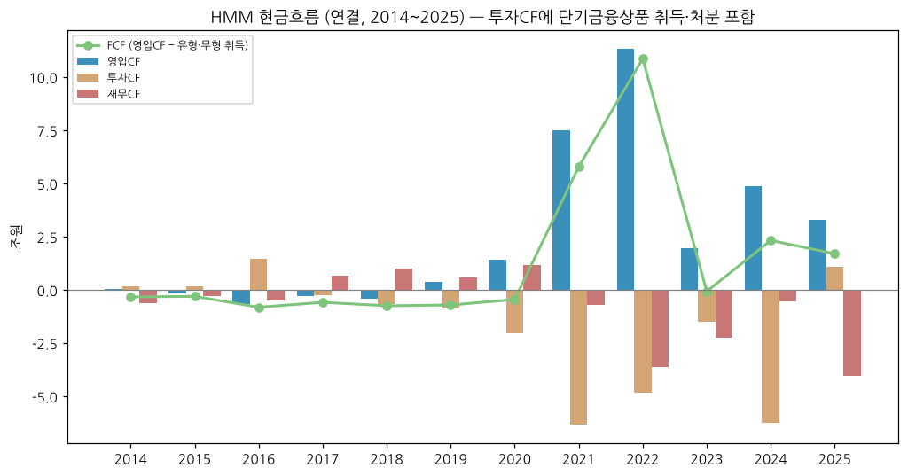

### ④ CapEx 추이 (12년, 억원)

| 연도 | 유형자산 취득 | 무형자산 취득 | 총 CapEx | CapEx/매출 | 감가상각비 | CapEx/감가상각 |
|---|---|---|---|---|---|---|
| 2014 | 3,584 | 22 | 3,606 | 5.5% | 2,187 | 1.65x |
| 2015 | 1,406 | 9 | 1,415 | 2.5% | 2,116 | 0.67x |
| 2016 | 1,552 | 122 | 1,674 | 3.7% | 1,751 | 0.96x |
| 2017 | 3,025 | 4 | 3,029 | 6.0% | 1,107 | 2.74x |
| 2018 | 3,201 | 7 | 3,208 | 6.1% | 1,102 | 2.91x |
| 2019 | 10,826 | 193 | 11,019 | 20.0% | 5,034 | 2.19x |
| 2020 | 18,297 | 215 | 18,512 | 28.9% | 5,848 | 3.17x |
| 2021 | 17,089 | 23 | 17,111 | 12.4% | 6,470 | 2.64x |
| 2022 | 4,429 | 92 | 4,521 | 2.4% | 8,305 | 0.54x |
| 2023 | 20,371 | 56 | 20,428 | 24.3% | 8,628 | 2.37x |
| 2024 | 25,370 | 77 | 25,447 | 21.7% | 8,920 | 2.85x |
| 2025 | 15,936 | 51 | 15,987 | 14.7% | 11,039 | 1.45x |

- **CapEx는 선박 인도 시점에 몰리는 "계단형"** — 2019\~2021 초대형선(24K·16K) 인도 구간 1.1\~1.8조, 2023\~2025 신조·중고선 구간 1.6\~2.5조. 리스·용선 선박은 사용권자산으로 인식돼 이 표에 미포함 (2025말 사용권자산 5.30조, 선박 4.46조 [DART II-3])
- 2025 설비투자 실적 2.42조 (선박 1.84조·컨테이너 기기 0.44조·항만물류 0.03조 등) / 2026 계획 2.98조 (항만물류 1.13조 포함) [DART 사업보고서(2025.12) II-3]
- **2030 중장기 투자 29조** (컨테이너·벌크 선대, 통합물류, 친환경, 디지털) [MTN 2026-11-12, CEO스코어데일리 2026-10-14] — 연평균 약 5.8조로 2025 실적의 2.4배 [계산]. 2025말 건조 중 선박 총선가 약 USD 40.5억 [DART II-6, 계산]

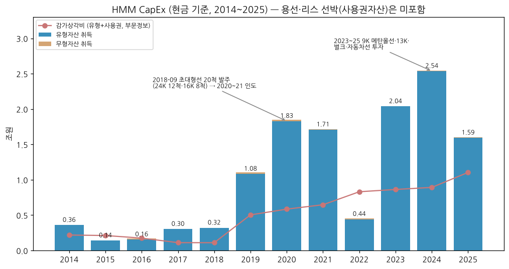

### ⑤ 부채구조 + 채무증권 (영구 CB/BW 이력)

| 연도 | 차입금 (억원) | 리스부채 (억원) | 총차입(리스 포함) | 현금성 (억원) | 순현금(리스 포함) | 순현금(리스 제외) | 이자지급 (억원) | 영업이익/이자지급 |
|---|---|---|---|---|---|---|---|---|
| 2014 | 51,755 | 1,058 | 52,813 | 6,830 | -45,983 | -44,925 | 1,719 | -1.4x |
| 2015 | 47,780 | 752 | 48,532 | 3,975 | -44,557 | -43,805 | 1,759 | -1.4x |
| 2016 | 25,098 | 455 | 25,553 | 5,396 | -20,157 | -19,702 | 926 | -9.0x |
| 2017 | 19,865 | 655 | 20,520 | 6,949 | -13,571 | -12,916 | 323 | -12.6x |
| 2018 | 13,936 | 9,525 | 23,461 | 8,799 | -14,662 | -5,137 | 372 | -15.0x |
| 2019 | 24,821 | 27,868 | 52,689 | 6,578 | -46,111 | -18,243 | 344 | -8.7x |
| 2020 | 24,310 | 36,831 | 61,141 | 11,563 | -49,578 | -12,747 | 267 | 36.7x |
| 2021 | 13,827 | 44,370 | 58,197 | 64,631 | 6,434 | 50,805 | 321 | 229.6x |
| 2022 | 4,655 | 34,123 | 38,778 | 128,000 | 89,222 | 123,345 | 629 | 158.3x |
| 2023 | 3,919 | 26,351 | 30,271 | 117,568 | 87,298 | 113,649 | 1,241 | 4.7x |
| 2024 | 2,642 | 41,129 | 43,771 | 158,417 | 114,646 | 155,775 | 1,058 | 33.2x |
| 2025 | 2,513 | 49,355 | 51,868 | 133,457 | 81,589 | 130,944 | 1,957 | 7.5x |

(순현금 = 현금성 − 차입금 (− 리스부채) [계산]. 음수 = 순차입. 3Q26 순현금 리스 포함 7.33조 / 리스 제외 12.25조)

- **2016 채무재조정**: 2016-07-20 경영정상화계획이행약정 → 일반대출·당좌대출 원금상환 2021-06까지 유예, 2022-06부터 5년 분할상환. 일부 대출은 용선료 등에 대한 출자전환 및 조건변경 관련 차입금 [DART 사업보고서(2025.12) 주석 22]
- **잔존 회사채**: 182\~188회 사채 (2014\~2015 발행, 이자율 1%, 만기 2026-06-30, 잔액 592억) — 채무재조정 후 남은 구 회사채 [DART 주석 22]
- 2025말 차입금 0.25조 (선박담보차입 USD + 산은 장비차입 등), 리스부채 4.94조 (5년 이내 만기 3.45조) [DART 주석 5·22]

**영구 CB·BW 발행·전환 이력 (산업은행·해양진흥공사 인수, 전환가 5,000원):**

| 회차 | 종류 | 발행일 | 권면총액 | 전환(행사)일 | 발행 주식수 |
|---|---|---|---|---|---|
| 190회 | 사모 CB | (2018 이전 ⚠️) | 3,000억 [계산] | 2021-06-28 | 60,000,000주 |
| 191회 | 사모 CB | (2018 이전 ⚠️) | 4,182억 [계산] | 2021-10 | 83,647,009주 |
| 192회 | 사모 CB (30년 만기) | 2018-10-25 | 4,000억 | 2023-10-19 | 80,000,000주 |
| 193회 | 사모 BW | 2018-10 | 6,000억 [계산] | 2023-10-19 | 120,000,000주 |
| 194회 | 사모 CB | 2019-05-24 | 1,000억 | 2024-05-20 | 20,000,000주 |
| 195회 | 사모 CB | 2019-06-27 | 2,000억 | 2024-06-21 | 40,000,000주 |
| 196회 | 사모 CB | 2019-10-28 | 6,600억 | 2024-10-22 | 132,000,000주 |
| 197회 | 사모 CB | 2020-04-23 | 7,200억 | 2025-04-17 | 144,000,000주 |
| 199회 | 공모 CB (전환가 12,850원) | 2020 | 2,400억 [언론·미검증 ⚠️] | 2021-01\~04 | 18,666,164주 |

(DART 사업보고서(2021.12) "미상환 전환사채 발행현황", 사업보고서(2025.12) "증자(감자)현황"·"주식의 총수". 190·191·193회 권면액은 발행 주식수 × 5,000원 [계산]. 192\~197회 = 영구채(신종자본증권) 성격 2.68조 — 2024-02 매각 결렬 당시 미전환 잔액 1.68조(194\~197회)도 2025-04까지 전량 전환 완료 → **2025-04 이후 미상환 CB·BW 없음** [DART 사업보고서(2025.12) "미상환 전환사채 — 해당사항 없음"]. 신종자본증권 수익분배금 지급: 2023 −·2025 104억 [DART CF])

→ 전환 누적 효과: 2020말 3.27억주 → 2025-04 10.25억주 (3.1배) — 이 중 산은·해진공 몫이 대부분 → 산은 지분 2020 12.61% → 2025 35.42%, 해진공 0% → 35.08% [DART]

### ⑥ 배당·자사주 추이 (12년)

| 사업연도 | DPS 보통주(원) | 현금배당총액 (억원) | 연결 지배순이익 (억원) | 연결 배당성향 | 시가배당률 (DART) | 자사주 취득 (CF, 억원) | 비고 |
|---|---|---|---|---|---|---|---|
| 2014 | 0 | 0 | 374 | - | - | 0 | 영업적자 — 무배당 |
| 2015 | 0 | 0 | -6,695 | - | - | 0 | 자본잠식 위기 |
| 2016 | 0 | 0 | -4,596 | - | - | 0 | 채권단 관리 |
| 2017 | 0 | 0 | -11,910 | - | - | 0 |  |
| 2018 | 0 | 0 | -7,907 | - | - | 0 |  |
| 2019 | 0 | 0 | -5,899 | - | - | 0 |  |
| 2020 | 0 | 0 | 1,239 | - | - | 0 | 흑자전환, 결손 보전으로 무배당 |
| 2021 | 600 | 2,934 [계산] | 53,371 | 5.5% [계산] | - | 0 | 2010 사업연도 이후 첫 배당 (일반 공개정보 ⚠️) |
| 2022 | 1,200 | 5,868 [계산] | 100,853 | 5.8% [계산] | - | 0 | 사상 최대 DPS |
| 2023 | 700 | 4,823 | 9,686 | 49.79% | 3.4% | 0 |  |
| 2024 | 600 | 5,286 | 37,822 | 13.98% | 3.2% | 0 | 배당기준일 이사회 결정 (2024 정관 변경) |
| 2025 | 700 | 6,603 | 18,784 | 35.15% | 3.4% | 21,433 | 공개매수 2.14조 (8,180만주) 전량 소각 |

(DPS·배당총액·배당성향·시가배당률 = DART 사업보고서 "배당에 관한 사항" (2023\~2025 = 2025 사업보고서 3개년 표, 2021\~2022 DPS = 2022 사업보고서). 2021·2022 총액은 DPS × 489,039,496주 [계산]. 자사주 = 연결 CF "자기주식의 취득")

- **배당 정책**: 2026-04 "2030년까지 min(배당성향 30%, 시가배당률 5%) 이상 주주환원" → **2026-11 "배당성향 30% 이상"으로 단순화** (시가배당률 기준 삭제) [IR 2026-04-02·2026-11-18 p9]. 주주환원 = 배당 + 자사주 매입·소각
- **2025 이행**: 2024 결산배당 5,286억 (주당 600원) + 자사주 81,801,526주 2조 1,432억 → 약 2.7조, 총주주환원율 72.8% (2024 순이익 대비) [IR 2026-11 p6]
- **공개매수**: 2025-08-18\~09-12 2,143,199,981,200원 (이행률 100%), 산은 35,065,870주 응모 → 2025-09-24 이익소각 [DART 사업보고서(2025.12) I-4·VII]. 3Q26 자기주식 0주
- **2026 배당 지급**: 3Q26 대주주 배당지급 산은 2,339억·해진공 2,316억 [DART 분기보고서(2026.09) X] → FY2025 결산배당 700원 × 943.2M주 = 6,603억 (2026-1H 지급)
- 현재가(22,350원) 기준 FY2025 DPS 700원 배당수익률 3.1% [계산]

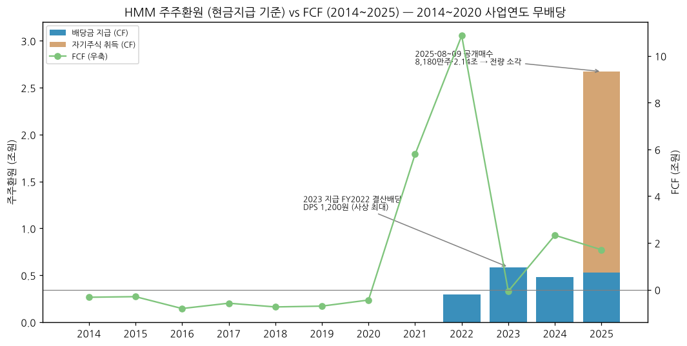

### ⑦ 재무 비율 (12년)

| 연도 | ROE(지배) | ROA | 부채비율 | 유동비율 | 영업이익/이자지급 | 연말 종가(원) | 연말 시총(조) | 연말 PBR | 연말 PER | 연말 EV/EBITDA | 배당수익률 (연말가) |
|---|---|---|---|---|---|---|---|---|---|---|---|
| 2014 | - | - | 960% | 42% | -1.4x | 8,639 | 1.46 | 2.46 | 39.1 ⚠️ | EBITDA 적자 | 0.0% |
| 2015 | -171.6% | -10.3% | 2,499% | 36% | -1.4x | 3,713 | 0.83 | 4.47 | 적자 | EBITDA 적자 | 0.0% |
| 2016 | -81.1% | -8.9% | 362% | 159% | -9.0x | 6,078 | 1.08 | 1.14 | 적자 | EBITDA 적자 | 0.0% |
| 2017 | -129.3% | -29.8% | 302% | 204% | -12.6x | 5,020 | 1.57 | 1.75 | 적자 | EBITDA 적자 | 0.0% |
| 2018 | -81.8% | -20.5% | 296% | 158% | -15.0x | 3,695 | 1.16 | 1.12 | 적자 | EBITDA 적자 | 0.0% |
| 2019 | -55.5% | -10.5% | 557% | 85% | -8.7x | 3,550 | 1.12 | 1.03 | 적자 | 28.2 | 0.0% |
| 2020 | 8.9% | 1.5% | 455% | 78% | 36.7x | 13,950 | 4.56 | 2.70 | 36.8 | 6.1 | 0.0% |
| 2021 | 88.6% | 39.2% | 73% | 347% | 229.6x | 26,900 | 13.16 | 1.27 | 2.5 | 1.6 | 2.2% |
| 2022 | 65.0% | 46.0% | 26% | 696% | 158.3x | 19,550 | 9.56 | 0.46 | 0.9 | 0.1 | 6.1% |
| 2023 | 4.6% | 3.7% | 20% | 659% | 4.7x | 19,580 | 13.49 | 0.63 | 13.9 | 3.3 | 3.6% |
| 2024 | 15.3% | 12.7% | 22% | 763% | 33.2x | 17,660 | 15.56 | 0.56 | 4.1 | 0.9 | 3.4% |
| 2025 | 6.9% | 5.6% | 26% | 581% | 7.5x | 20,500 | 19.34 | 0.73 | 10.3 | 4.4 | 3.4% |

**주요 비율 의미:**
- **ROE**: 지배순이익 / 평균 지배지분 [계산]. 2015\~2019 자본잠식 수준의 소규모 자본으로 −55\~−172% 왜곡, 2021 88.6%·2022 65.0% 정점 → 2025 6.9%. LTM(4Q25\~3Q26) ROE 약 10.0% [계산]
- **연말 PBR**: 연말 시총 / 지배지분. 회사 밸류업 자료 Bloomberg 값과 2020\~2025 전 연도 일치 (2.70 / 1.27 / 0.46 / 0.63 / 0.56 / 0.73) [IR 2026-11 p5]. 2014\~2015 PBR 2.5\~4.5배는 자본잠식 직전 소규모 자본 때문
- **EV/EBITDA**: EV = 연말 시총 − 순현금(리스 포함) [계산]. 2021\~2024 0.1\~3.3배 = 순현금이 시총에 육박. 2014\~2018 EBITDA 적자
- **연말 PER**: 지배순이익 기준. 2014는 중단영업이익(LNG선 매각) 효과로 의미 없음 ⚠️. 2022 0.9배 = 사이클 정점 PER 역설
- **배당수익률 (연말가)**: DPS / 연말 종가 [계산] — DART 시가배당률(배당결정일 직전 1주 평균가)과 다름
- 2014\~2015 연말 종가는 Yahoo 수정주가 ÷ 7 (감자 전 실제가 환산) [계산]

---

## 5. 지배 구조

### ① 그룹·계열 관계

```
대한민국 정부 (기획재정부 91.9% 등) ──100%── 한국산업은행 (회장 박상진, 2025-09-10~)
                                                │ 35.42%
한국해양진흥공사 (해양수산부 산하) ──────────── 35.08% ──┐
국민연금공단 5.34% · 소액주주 23.05% (410,469명)          │
                                                ▼        ▼
                                  에이치엠엠(주) HMM (011200) — 상호출자제한기업집단 (2025-05-01~)
   ┌──────────────────┬───────────────────┬───────────────────┬─────────────────────┐
 에이치엠엠오션서비스   에이치티알헤시라스     에이치엔엘트랜스       해외 현지법인 26개 + 선박 SPC
 (선박관리)            (금융, 알헤시라스 TTIA) (도로화물 운송)        (HMM America·Europe·China·SG 등)
   관계·공동기업: 부산컨테이너터미널, HMM PSA 신항만, TTI(롱비치) 20%, 현대무벡스 13.01%(FVOCI)
```

(DART 사업보고서(2025.12) I-1 계열회사·VII 주주현황·주석 16\~18. 연결 종속회사 34개 (2025말), 2025 HMM Brazil 신규 연결. 해양진흥공사에 대해 HMM도 3.35% 지분 보유(FVOCI, 20,974,148주) — 상호 출자 관계 [DART 주석 16])

- **교차 참조**: 해운 서브섹터 피어 `팬오션_기업개요.md` (2023-12 HMM 우선협상대상자였던 하림그룹 계열). 운송 섹터 `대한항공_기업개요.md`·`제주항공_기업개요.md`·`CJ대한통운_기업개요.md`

### ② 주주 구분

| 주주 | 주식수 | 지분율 | 기준 |
|---|---|---|---|
| 한국산업은행 (최대주주) | 334,133,427 | 35.42% | 2025-12-31 (2025-04-17 CB 전환 +72,000,000주, 2025-09-17 공개매수 응모 −35,065,870주) |
| 한국해양진흥공사 | 330,867,712 | 35.08% | 2025-12-31 |
| 국민연금 | 50,337,633 | 5.34% | 2025-12-31 |
| 우리사주조합 | 102,531 | 0.01% | 2025-12-31 |
| 소액주주 | 217,444,259 | 23.05% | 2025-12-31, 410,469명 |
| 자기주식 | 0 | 0% | 2025-09-24 전량 소각 |
| 발행주식총수 | 943,237,970 | 100% | 보통주만 (우선주 없음) |

(DART 사업보고서(2025.12) VII, OpenDART hyslrSttus 2025. 분기보고서는 주주현황 기재 생략 — 2026-09 기준 변동은 미확인. 외국인 지분율은 DART 미공시 — 이번 버전 미확보)

**5% 이상 주주 지분 추이 (연말, DART 사업보고서):**

| 연도 | 2014 | 2015 | 2016 | 2017 | 2018 | 2019 | 2020 | 2021 | 2022 | 2023 | 2024 | 2025 |
|---|---|---|---|---|---|---|---|---|---|---|---|---|
| 한국산업은행 | - | - | 14.15% | 13.13% | 13.05% | 12.94% | 12.61% | 20.69% | 20.69% | 29.20% | 33.73% | 35.42% |
| 한국해양진흥공사 | - | - | - | - | - | - | - | 19.96% | 19.96% | 28.68% | 33.32% | 35.08% |
| 현대엘리베이터 | 22.03% | 17.96% | - | - | - | - | - | - | - | - | - | - |
| 기타 5%+ | 현대중공업 12.85%·Market Vantage 8.74%·현대건설 6.06%·현대삼호중 5.75% | 현대중공업 9.90%·Market Vantage 6.74% | - | 한국투자증권 7.44%·KB증권 7.44% | - | 신용보증기금 7.70% | 신보 7.51% | 신보 5.02% | 신보 5.02% | - | 국민연금 5.10% | 국민연금 5.34% |

(2014\~2015 = 현대그룹(현정은 회장) 지배 시절. 2016-08 채권단 출자전환으로 현대그룹 지배 종료. 2017 증권사 지분은 유상증자 인수 물량 추정 ⚠️)

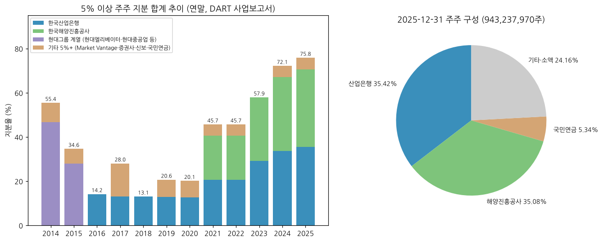

**매각 절차 이력:**
- 2023-07 산은·해진공 경영권 공동매각 공고 (지분 57.9% — 영구채 전환 전 기준) [아시아경제 2023-07-21, 서울신문 2024-02-08]
- 2023-12-18 하림(팬오션)·JKL파트너스 컨소시엄 우선협상대상자 선정 [아시아경제 2023-12-18]
- 2024-02-07 협상 결렬 발표 — 쟁점: ① 매각 후 산은·해진공 경영 참여 vs 하림의 실질 경영권 요구 ② 잔여 영구채 1.68조 전환 시 하림 지분 57.9% → 38.9% 희석, 3년 전환 유예 요청 거부 ③ 이익잉여금 약 10조 활용 ④ JKL 지분 5년 매각 제한 [서울신문 2024-02-08]
- 2026-02 산은 "신속한 매각 필요" 국회 정무위 보고 → 박상진 산은 회장 "부산 이전이 선결 과제" (2026-02-25) → 산은 보유 35.4% 단독매각 방안 검토 [더팩트 2026-04-17]
- 산은 BIS 비율 민감도: 주가 1,000원 변동 시 약 7bp (강석훈 전 회장 발언, 시점 미기재) [더팩트 2026-04-17]

### ③ 임원·이사회

- **대표이사 사장: 최원혁** — 1960-05생, 성균관대 응용통계학, 前 LX판토스 대표이사. 2025-03-26 정기주총 사내이사 선임·대표이사 선임, 임기 2027-03-26 [OpenDART exctvSttus 2025, DART 사업보고서(2025.12) I-2]
- **사내이사 이정엽** (전무, 컨테이너사업부문장, 1970-09생, 고려대 경영) — 2025-03-26 선임 [OpenDART exctvSttus 2025]
- **사외이사 (2025말 4인, 전원 감사위원)**: 서근우 (감사위원장, 서울대 경제학 박사), 우수한 (ESG위원장, Cardiff Univ. PhD), 이젬마 (Vanderbilt 경제학), 정용석 [OpenDART exctvSttus 2025]. 2026-11 밸류업 자료는 "독립이사 3명"으로 표기 — 2026 주총 이후 변동 미검증 ⚠️ [IR 2026-11-18 p3]
- **이사회 내 위원회**: 감사위원회·사외(독립)이사후보추천위원회·ESG위원회·리스크관리위원회 [DART VI, IR 2026-11 p3]. 이사회 의장 = 사외이사 아님 (지배구조 핵심지표 준수율 2025 60%, 시장 평균 54%) [IR 2026-11 p7]
- **역대 대표이사**: 유창근 (2016\~2019, 일반 공개정보 ⚠️) → 배재훈 (2019\~2022-03) → 김경배 (2022-03-29\~2025-03-26) → 최원혁 (2025-03-26\~) [DART 사업보고서(2025.12) I-2]
- **2025 조직 개편**: 대표이사 직속 CSO(미래전략실) 신설, 법무·감사·ESG 통합 공정경영센터 신설, R&D팀 → 기술혁신연구소 격상, CISO·정보보안팀 신설 [DART 사업보고서(2025.12) IV]

---

## 6. 기타 팩트

### ① R&D·디지털 인프라

- **연구개발비 금액 미공시** — DART 사업보고서 "연구개발활동"은 담당 조직(컨테이너선대기획·항로기획·물류신사업개발·수익관리·EQ팀, 벌크전략개발·친환경에너지수송팀, 해사실 R&D팀(→ 기술혁신연구소), 전략재무본부)과 회계정책만 기재, 연구개발비용 표 없음 [DART 사업보고서(2025.12) II-6]
- 대용 지표로 **무형자산 취득(CF)** 을 사용 (소프트웨어·IT 시스템·탄소배출권 포함 — 2025 무형 취득 467억 중 탄소배출권 416억 [DART 주석 20])

| 연도 | 2014 | 2015 | 2016 | 2017 | 2018 | 2019 | 2020 | 2021 | 2022 | 2023 | 2024 | 2025 |
|---|---|---|---|---|---|---|---|---|---|---|---|---|
| 무형자산 취득 (억원) | 22 | 9 | 122 | 4 | 7 | 193 | 215 | 23 | 92 | 56 | 77 | 51 |
| 매출 대비 (%) | 0.03 | 0.02 | 0.27 | 0.01 | 0.01 | 0.35 | 0.34 | 0.02 | 0.05 | 0.07 | 0.07 | 0.05 |

(OpenDART CF "무형자산의 취득". 2025 CF 무형 취득 51억 vs 주석 무형 증가 467억 차이 = 탄소배출권 무상할당 등 비현금 취득 추정 ⚠️)

- 디지털: 공급망 탄소 계산기 자체 개발 (2024-01, 전 운송 구간 탄소배출 산출) [아시아경제 2024-01-03], 정보기술 투자 2025 17억·2026 계획 28억 [DART II-3]
- 친환경 연료: LNG·바이오메탄올 보급, 바이오연료 누적 27,740MT (2024 대비 약 2배), 내부탄소가격제 도입 [IR 2026-11 p8]

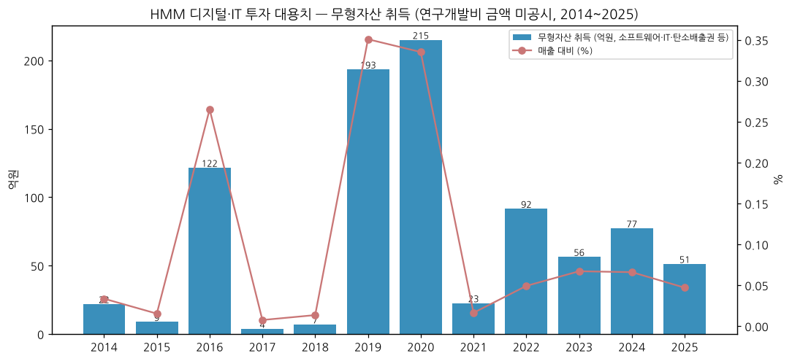

### ② 진행 중 corporate action — 10년치 주요 이벤트

| 시점 | 이벤트 | 출처 |
|---|---|---|
| 2016-04\~08 | 7:1 무상감자 → 출자전환·유상증자 → 산은 최대주주 | DART 사업보고서(2016.12·2018.12) |
| 2017-02-01 | 롱비치 TTI 지분 20% + 주주대여금 인수 (USD 15.6M) | DART 사업보고서(2025.12) II-5 |
| 2018-10\~2020-04 | 영구 CB·BW 2.68조 발행 (산은·해진공) | DART 사업보고서(2021.12) |
| 2020-03-27 | 현대상선 → HMM 상호 변경 | DART I-2 |
| 2020-09-28 | TTI 지분 풋/콜옵션 합의 (풋 2023\~2030, 콜 2027\~2030) | DART II-5 |
| 2021\~2025 | CB·BW 전환 총 7.57억주 (190\~197·199회) | DART 증자현황 |
| 2023-07\~2024-02 | 경영권 매각 (하림·JKL 우협 → 결렬) | 서울신문 2024-02-08 |
| 2023-10-06 | 다올KTB터미널인베스트41호 수익증권 31% 매입 (76억, 해진공 콜옵션 행사) | DART II-5 |
| 2025-02 | Premier Alliance 출범 + MSC 선복교환 | DART 사업보고서(2025.12) |
| 2025-08\~09 | 공개매수 자사주 2.14조 취득·소각 | DART I-4 |
| 2025-01-22 | HMM퍼시픽 계열 제외 | DART I-1 |
| 2026-05-08 | 본점 부산 이전 정관 변경 (임시주총) | 더팩트 2026-04-17, CEO스코어데일리 2026-10-14 |
| 2026-05-28 | 해진공 보유 SBK와스카 사모펀드 출자지분 매입 의무 부속합의 (최대 1,187억, HMM PSA 신항만 인수금융) | DART 분기보고서(2026.09) X |
| 2026-11-18 | 기업가치 제고 계획 갱신 (배당성향 30% 이상) | IR 2026-11-18 |

### ③ 선대·사업 마일스톤 — 10년치

- 2020-04-24 24,000TEU 'HMM Algeciras' 투입 (12척 2020 인도), 선적량 세계 신기록 [DART 사업보고서(2020.12), IR 2026-11 p3]
- 2021 16,000TEU 8척 확보, VLCC 3척 10년 장기운송계약 [IR 2026-11 p3]
- 2022 LNG 연료 추진 7,700TEU 2척 도입 [DART II-7]
- 2023 메탄올 추진 9,000TEU 9척 발주 (친환경 연료선 첫 발주) [DART]
- 2024 13,000TEU 12척 확보, '30년 155만 TEU 중장기 전략 [IR 2026-11 p3]
- 2025 23년 만에 자동차운반선 시장 복귀 (Glovis Titan 등 투입), 국내 최초 메탄올 연료 컨테이너선 도입 [IR 2026-11 p3, DART II-3]
- 2025-10 13,000TEU 12척·VLCC 2척 등 추가 투자 [DART I-2]

### ④ 주요 리스크

(1) 운임 사이클 (최대 리스크)
→ 컨테이너 OPM이 SCFI에 직결 (SCFI 1,000pt 전후 = 손익분기권). 회사 전망 "2026년 선복 초과 공급 지속, 수에즈 통항 재개 변동성" [DART 사업보고서(2025.12) II-7]
(2) 지정학 정상화 리스크 (역설적 리스크)
→ 2024 홍해·2026 호르무즈 등 공급 차질이 운임을 끌어올린 구간 — 통항 정상화 시 운임 급락 가능 (3Q26 구주항로 "수에즈 통항 개시로 운임 추가 하향") [DART 분기보고서(2026.09)]
(3) 정책·지배구조 리스크
→ 산은·해진공 70.5% 매각 오버행, 본사 부산 이전 (인력 이탈·"반쪽 이전" 우려) [더팩트], 산은 BIS 비율과 주가 연동 [더팩트 2026-04-17]
(4) 대규모 투자 리스크
→ 2030년까지 29조 투자 — 운임 하강기 투자 집행 시 순현금 축소, 2026 설비투자 계획 2.98조 [DART II-3]
(5) 환경 규제
→ IMO 중기조치(2025 MEPC 83 승인, 온실가스 집약도 차등 부과금), EU ETS·FuelEU Maritime [DART II-7]. 2025말 배출충당부채 555억 (2025 전입 578억) [DART 주석 25]
(6) 소송·규제
→ 미 연방해사위원회(FMC): IMCC의 OCEMA 회원사 대상 불공정거래 제소, Samsung Electronics America·Euromarket Designs 등의 부당비용·MQC 관련 Complaint 대응 중 [DART 사업보고서(2025.12) 주석 42]
(7) 환율·금리
→ 기능통화 USD — 원화 환산 시 자본 변동 (2025 표시통화환산손익 −7,078억) [DART CIS]. 리스부채 이자율 100bp 상승 시 세전이익 −231억 [DART II-5]

### ⑤ ESG 등급

- **한국ESG기준원(KCGS) 2025 통합 A** (환경 A·사회 A·지배구조 A) [IR 2026-11 p3]
- **MSCI ESG BBB** (2025\~) [IR 2026-11 p3]
- **EcoVadis Platinum** (전 세계 평가대상 상위 1%, 2026-06 3년 연속) [IR 2026-11 p3, CEO스코어데일리 2026-06-26]
- **CDP A-** (3년 연속) / **Sustainalytics Low Risk 13.6** (글로벌 해운산업 1위) [IR 2026-11 p3]
- 목표: 2045 Net-Zero (2024-09 선언) [DART I-2]
- 지속가능경영보고서: **이번 버전 미수집** — 온실가스 배출량(Scope 1·2·3)·탄소집약도 수치 미추출 ⚠️ (잔여 보완 후보)

### ⑥ 인증·라이선스

- 사업 근거법: 해운법 (외항 정기·부정기 화물운송사업 등록), 국제선박등록법 (국제선박 취득세·재산세 감면) [DART II-7]
- 과세 특례: 톤세제 (조세특례제한법 제104조의10, 2005 도입) [DART 주석]
- 신용등급: NICE A+ (2025-05-19, 기업신용) [DART I-1]
- 상호출자제한기업집단 (2025-05-01 지정, 공정거래법 적용 — 2024-12 공정거래 자율준수 프로그램 도입) [DART I-1·I-2]

---

## Version Log

- **2026-11-28 v1.0 통합 검수**: 운송 5사(HMM·팬오션·대한항공·제주항공·CJ대한통운) 동시 작성 후 교차 검수 — 1장 ④ 끝에 '운송 5사 공통 비교 박스'(EV/EBITDA 리스 포함·PBR·PER·배당수익률 통일 정의) 5문서 동일 삽입 / ④ 밸류에이션 문단의 미치환 코드 placeholder 14곳을 계산값으로 교체

- **v1.0 (2026-11-25)**: 첫 작성 — Phase 1 source 전수 점검 (OpenDART 재무 JSON 44개(연결), 정기공시 XML 48건(본문+첨부 2종), 기업개황·최대주주·임원·직원·배당·자기주식·주식총수, IR 2건(기업가치 제고 계획 2026-04·2026-11), Yahoo 월간·일간 시세, 언론) + v4.8 6개 섹션 + 차트 15종 (12종 표준 + chart2 부문 3종(컨테이너·벌크·기타) + chart13 SCFI vs 컨테이너 실적). 3Q26은 분기보고서(2026-11-12) 확정치 반영
- **Source audit (Phase 1)**:
  - 확보: ① DART 본문 XML 48건 (사업보고서 2014\~2025, 분기·반기 1Q15\~3Q26 — 2019.06·2019.09·2018.12·2015.03 일부 장은 텍스트 변환 시 부문정보 미탐지였으나 재파싱으로 47개 분기 전부 확보) ② DART 첨부 (사업보고서 첨부 _00760·_00761: 감사보고서·별도 — 교차검증 미사용) ③ OpenDART 재무 JSON·info JSON ④ Yahoo 011200.KS (월간 2000-02\~, 일간 2020\~2023·2024-11\~) ⑤ 언론 (매각·3Q26·부산 이전·호르무즈)
  - 누락: ① **분기 실적발표 IR PDF** — irgo 게시물 5건 중 실적 자료 없음(2021 3Q 1건 다운로드 실패), 회사 IR 사이트(hmm21.com/ir.do) web_fetch 연결 종료 → 미수집. 영향: 항로별 분기 운임·물동량·선복량(TEU) 분기 시계열 부재, 3Q26 회사 설명은 DART 본문·언론으로 대체 ② **지속가능경영보고서** — 미수집 (ESG 등급은 IR 밸류업 자료로 대체) ③ FnGuide 컨센서스·KIND 외국인 지분율 — 미확보 ④ 2014 이전 분기 (60+분기 표준 미충족, 현재 47개 분기)
- 잔여 보완 후보: ① 1Q12\~4Q14 부문 분기 시계열 (2012\~2014 분기보고서 XML 추가 다운로드) → 60+분기 ② 분기 IR PDF (회사 IR 사이트 재시도) — 선복량(TEU)·항로별 물동량 분기 시계열 ③ 2021\~2023 항로(지역)별 매출 ④ 외국인 지분율 연도별 추이 ⑤ 글로벌 피어(Maersk·Hapag-Lloyd·COSCO·ONE·Evergreen) PBR·EV/EBITDA 수치 비교 ⑥ 지속가능경영보고서 온실가스 수치 ⑦ 190·191·193·199회 CB·BW 발행일·권면액 원문 대조 ⑧ 2030 컨테이너 선대 목표 수치 불일치(176척·155만 TEU vs 166척·147만 TEU) 원 자료 대조 ⑨ 2006\~2010 발행주식수 (시총 차트 가정치) ⑩ 2026 정기주총 이후 이사회 구성 변동
