> Ticker: **Euronext Paris: HO — Thales S.A.** (ISIN FR0000121329, CAC 40) / OTC ADR THLLY
> Entity: **Thales S.A.** (본사 Meudon, France) — 방산전자·레이더·항전·우주·사이버 보안 그룹. 최대주주 프랑스 공공부문(TSA 26.6%)·Dassault Aviation(26.6%)
> Sector: 방산 — 서브섹터 **방산 글로벌** (한국 5사와 비교: 한화시스템·LIG D&A 중심, 한화에어로스페이스 일부)
> 작성 시각: **2026-11-14 KST** (**v1.0** — Phase 1 Source 수집 + audit + 12종 차트)
> 적용 구조: v4.8 (6개 섹션) + v1.5 ① 기업 분류 표준 (서술 간결판)
> 데이터 범위: **연간 12년 (2014~2025, 12월 결산)** — 2014~2019 Transport 포함 / 2020~ Transport 제외 재작성 + **H1 2026 반기 실적** + **분기 매출·수주 15Q (1Q23~3Q26)** — Thales는 **분기 EBIT 미공시** (1Q·3Q는 매출·수주만, EBIT는 반기·연간) + **HO.PA 주가 2006-11 ~ 2026-11-13**
> 출처: **Thales 실적 보도자료 (Euronext 공시 첨부·AMF 공시 사본)** — FY2015·2019·2021·2022·2023·2024·2025, H1 2024·2025·2026, 9M 2024·2025·2026, Q1 2025·2026, F126 공시(2026-07-03), **2026 Half-Yearly Financial Report**(주주·지배구조), 2017·2016 실적은 보도자료 전재 기사, 재무상태표·현금흐름 2021~2025는 StockAnalysis(회사 IFRS 재무제표 집계), **Yahoo Finance HO.PA**, Reuters(Euronext 뉴스 게재)·Baird Maritime·MarketScreener·Goldesel 기사
> ⚠️ **FY2026 연간 실적 + 2027 가이던스·중기 목표 재검토는 2027-03 초 발표 예정** (전년 3/3 발표, 정확한 날짜 미확인) — 발표 후 v1.1 갱신

# Thales 기업 개요 (v1.0 — 방산 글로벌 / 방산전자·레이더·방공 / 지속성장형)
> **Fact verify cutoff**: 2026-11-14 (주가 2026-11-13 종가 **€227.1**, 52주 범위 €211.9~€274.2, ATH 2025-09 장중 €279.3 [Yahoo Finance HO.PA] / 시가총액 **≈€46.8bn** [계산: €227.1 × 발행주식 205,941,913주, 2026-06-30 HYFR])

## Phase 1 Source Audit

```
=== 자료 수집 audit (Thales S.A.) ===

✅ 확보 (저장: company-overview-source/HO/, 텍스트 txt/)
- 연간 실적 보도자료: FY2015(2014 비교)·FY2019(2018)·FY2021(2020)·FY2022·FY2023·FY2024·FY2025
- 반기 보도자료: H1 2024·H1 2025·H1 2026 / 9M 보도자료: 2024·2025·2026 / Q1: 2025·2026
- 2026 Half-Yearly Financial Report (주주 구성·관계사·Exail 후속사건)
- F126 프로그램 종료 공시 (2026-07-03) / Yahoo Finance HO.PA 월간(20년)·일간(3개월)

❌ 누락
- thalesgroup.com 직접 다운로드: Incapsula 봇 차단 → Euronext 공시 첨부·AMF(dila) 사본으로 대체
- Universal Registration Document 2025 (대용량, 사업부 상세·임직원·R&D 총액 내역) 미수집
- 2016·2017 사업부(Defence & Security) 매출·EBIT, 2014~2020 재무상태표·현금흐름 세부
- Q1·Q3 분기 EBIT: 회사 미공시 (구조적)
- 기관별 주주 명부 (5% 미만)

⚠️ 결과 영향
- 2014~2019 매출에 Transport(2024-05 Hitachi Rail 매각) 포함 / 2020~ 제외 재작성 → 2019→2020 단절
- 2019 Gemalto 인수(DIS 신설), 2024 Imperva 인수 → 2023 사업부 재편 (Defence & Security → Defence, DIS → Cyber & Digital)
- 재무상태표·현금흐름 2021~2025 5년만 (StockAnalysis 집계값) — 12년 시계열 불가
- 2016·2017 연간은 보도자료 전재 기사(battle-updates·atc-network) 수치

Source 6종 audit:
[V] (1) 정기 보고서 — HYFR 2026 ✓ / URD 2025 ✗
[V] (2) 실적 보도자료 (연간 7·반기 3·9M 3·Q1 2) ✓
[ ] (3) Sustainability — 미수집 (보도자료 ESG 요약만)
[V] (4) 주가 (Yahoo HO.PA) ✓
[△] (5) CMD 2024 — 보도자료 인용(2028 목표)만, 원문 미수집
[△] (6) 12년 시계열 — 손익 12년 ✓ / 재무상태·CF 5년
→ 최신 실적(9M 2026, 2026-10-22)·반기(H1 2026) 확보.
```

---

## ① 기업 분류

(1) Primary / Secondary 분류

**Primary 분류: 지속성장 (방산 슈퍼사이클 수혜 구간)**

→ 매출 2014 €13.0bn → 2025 €22.1bn, Adjusted EBIT 마진 7.6% → 12.4%로 **COVID(2020) 1회를 제외하고 단조 상승**

→ 수주잔고 €53.3bn (2025말, 매출의 2.4배) — Defence 잔고 €41.1bn (2026-06, Defence 매출의 약 3.2년치, 회사 표현)

**Secondary 노트: 사이클 일부 (민항 항전·상업 위성 / 디지털 결제)**

→ Aerospace(항전·우주)는 2020 COVID와 상업 통신위성 수요 급감으로 2020 EBIT 적자(-1.8%), 2024 우주 구조조정 → 민수 사이클에 노출

→ Cyber & Digital은 결제카드·생체인식 등 소비재형 수요 + 단기 매출 → 2025~H1 2026 역성장·마진 하락

**3개 사업부 구조 (2025 연간, €m)**

→ **(1) Defence** — 매출 12,234 (55%), Adj. EBIT 1,619 (13.2%) — 레이더·방공·전자전·함정 전투체계·통신·옵트로닉스·이펙터(로켓·탄약)
→ **(2) Aerospace** — 매출 5,910 (27%), Adj. EBIT 560 (9.5%) — 민항·군용 항전(Avionics) + Thales Alenia Space(우주, Leonardo 33%)
→ **(3) Cyber & Digital** — 매출 3,852 (17%), Adj. EBIT 526 (13.7%) — Cyber(Imperva·HSM) + Digital(eSIM·결제·ID, 구 Gemalto)

(2) Summary Box (12년, 2014~2025)

| 지표 | 값 |
|------|-----|
| 매출 CAGR (2014→2025, 11년) | **+5.0%/yr** [계산] (2020→2025 Transport 제외 5년 **+7.6%**) |
| Adj. EBIT 마진 평균 (12년) | **10.1%** [계산] |
| 마진 정점 | 2025 **12.4%** (시계열 최고, H1 2026 12.5%) |
| 마진 저점 | 2014 7.6% / 2020 8.1% (COVID) |
| 사이클 | 뚜렷한 업황 사이클 없음 — 저점은 외부 충격(COVID) 1회 |
| Defence 매출 CAGR (2020→2025) | **+8.6%/yr** [계산], 마진 12.7~14.0% 밴드 (2018~2025) |

```
[Thales 12년 손익 (€m, 12월 결산, Adjusted EBIT = 회사 비GAAP 주 지표)]
연도   매출     Adj.EBIT  마진    순이익(지배)  수주     
2014  12,974     985    7.6%     714     14,363  ← 구조개선 초기
2015  14,063   1,216    8.6%     765     18,880  ← 이집트·카타르 Rafale 수출 장비 수주
2016  14,885   1,354    9.1%     946     16,514
2017  15,795   1,543    9.8%     822     14,920
2018  15,855   1,685   10.6%     982     16,034  ← IFRS 15 반영
2019  18,401   2,008   10.9%   1,122     19,142  ← Gemalto 인수(4월) — DIS 사업부 신설
2020  15,371   1,248    8.1%     483     16,824  ← COVID 저점 / 여기부터 Transport 제외 재작성
2021  16,192   1,649   10.2%   1,089     19,909
2022  17,569   1,935   11.0%   1,121     23,551  ← 우크라이나 전쟁 → 방산 수주 급증
2023  18,428   2,132   11.6%   1,023     23,132  ← Imperva 인수 합의(12월 완료)
2024  20,577   2,419   11.8%   1,420     25,289  ← Transport 매각 완료(5월), 3개 사업부 체제
2025  22,136   2,740   12.4%   1,675     25,264  ← 사상 최대 매출·마진
H1'26 10,949   1,372   12.5%     485     12,471  ← F126 종료 특별손실(순이익 -€331m), Adj. EBIT 영향 없음
```

**한국 방산 5사와의 위치 (2025 각사 주 지표)** — 상세 수치는 각사 기업개요·리뷰 참조

→ Thales Defence 매출 €12.2bn은 한국 5사 방산 매출 합계보다 큼 [판단], Defence 마진 13.2%는 한화시스템·LIG D&A 대비 높은 편이고 현대로템 방산 부문(3Q26 28.1%)보다는 낮다 [판단, 각사 리뷰 참조]

(3) 정량적 분류 근거

→ **수주 3년 연속 €23bn+** (2022 23.6 → 2023 23.1 → 2024 25.3 → 2025 25.3), 2026 9M €19.1bn (+15% 유기적)
→ **€100m 이상 대형 수주** 9M 2026 29건·€7.6bn (+42%)
→ **Defence 마진 개선** — H1 2024 12.9% → H2 2025 13.5% → **H1 2026 13.8%** (반기 최고)
→ **현금 창출** — Free operating cash flow 2021~2025 연 €2.0~2.6bn, H1 2026 €1.87bn (선수금 유입)

(4) 산업 분류

→ **GICS** — Industrials / Aerospace & Defense
→ **지수** — CAC 40
→ **워치리스트** — 섹터 방산 / 서브섹터 **방산 글로벌** (캘린더 표기 "방산전자·레이더, 프랑스 국방예산 (1·3Q 매출만)")

(5) 분류 결정 논리

→ 매출·이익의 55~60%가 Defence (2025 이익 비중 60% [계산]) → 방산 예산 사이클(유럽 재무장·NATO GDP 3.5% 목표) 위에서 생산능력 증설로 성장하는 구조 → **지속성장 Primary**
→ Aerospace·Cyber & Digital은 민수 사이클·소비재형 변동 → Secondary로 표기, 그룹 마진의 하방 요인

(6) 적정 밸류에이션 방법

→ **1차 — Forward PER** (안정적 이익 증가형): 2025 조정 EPS €9.76 기준 **~23x** [계산: €227.1 / €9.76]
→ **2차 — EV/EBIT**: EV ≈ €47.3bn [계산: 시총 €46.8bn + 순차입 €0.5bn(2026-06)] / 2026E Adj. EBIT ~€2.94~3.02bn [계산: 가이던스 매출 €23.3~23.6bn × 마진 12.6~12.8%] → **~16x** [계산]
→ **3차 — SOTP**: Defence(유럽 방산 피어 멀티플) + Avionics + Space(Airbus·Leonardo 우주 합작 'Bromo' 이관 예정) + Cyber & Digital
→ PBR 미사용 — 영업권(Gemalto·Imperva) 비중이 커 자본이 이익 체력을 반영 못함

(7) 분류 변경 조건

→ ① Defence 매출 유기적 성장률이 2개 반기 연속 한 자릿수 초반(<5%)으로 둔화 + Book-to-bill < 1.0 → 방산 사이클 정점 → **Secondary "사이클" 격상**
→ ② 우주 합작(Bromo) 완료로 Space 분리 + Cyber & Digital 매각/분리 → **순수 방산전자 플레이로 재분류**, 비교 피어를 Saab·Leonardo DRS 등으로 이동
→ ③ 그룹 Adj. EBIT 마진이 2028 목표 13~14% 상단 이상 조기 달성 → 고마진 지속성장 재평가

---

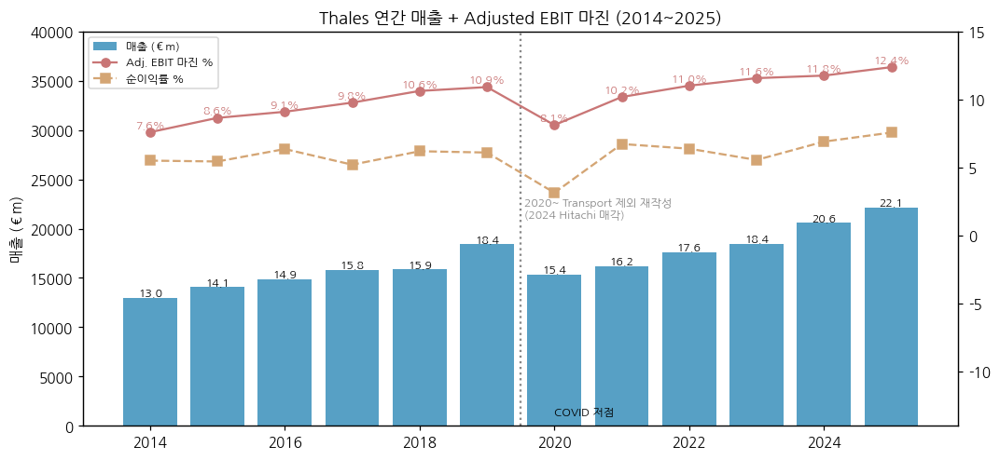

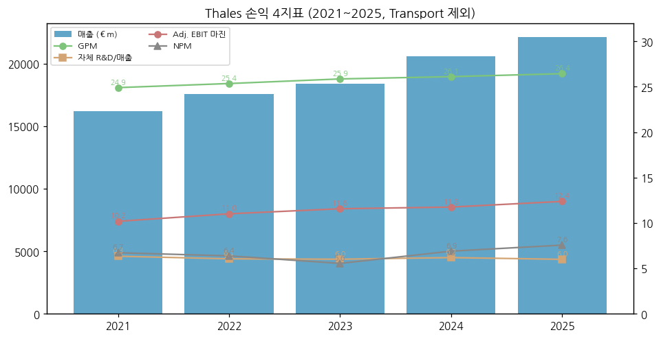

---

## ② 회사 개요

(1) 기본 정보

- **법인명** — Thales S.A. (프랑스 주식회사)
- **본사** — 4 rue de la Verrerie, 92190 Meudon, France
- **상장** — Euronext Paris (HO), CAC 40 / OTC ADR THLLY
- **회계연도** — 1월~12월 / 실적 공시: 1Q·3Q는 수주·매출만, 반기·연간에 EBIT
- **사업 한 줄 정의** — 레이더·방공·전자전·함정 전투체계·군 통신 등 **"보고·판단·연결하는" 방산전자**와 항전·위성·사이버 보안을 공급하는 유럽 최대 방산전자 그룹
- **회장 겸 CEO** — Patrice Caine (2014~)
- **CFO** — Jérémie Papin (2026-05 선임 공시)
- **임직원** — 85,000명+ (65개국, 2025 보도자료)
- **R&D** — 연 €4.5bn (고객 수탁 포함, 회사 표현) / 자체 R&D 비용 €1,328m (2025 손익)

(2) 핵심 KPI 요약 (€m)

| 항목 | 2024 | 2025 | H1 2026 | 9M 2026 | 2026 가이던스 |
|---|---|---|---|---|---|
| 수주 | 25,289 | 25,264 | 12,471 | 19,122 | Book-to-bill > 1.1 |
| 매출 | 20,577 | 22,136 | 10,949 | 16,422 | €23.3~23.6bn (유기적 +6~7% 상단, 상회 가능) |
| Adj. EBIT | 2,419 | 2,740 | 1,372 | 미공시 | 마진 12.6~12.8% |
| Adj. EBIT 마진 | 11.8% | 12.4% | 12.5% | — | 12.6~12.8% |
| 조정 순이익(지배) | 1,900 | 2,005 | 990 | — | — |
| Free operating CF | 2,027 | 2,577 | 1,865 | — | 현금전환율 100~110% |
| 순차입 | (3,044) | (1,618) | (519) | — | — |
| 수주잔고 | 50,602 | 53,323 | 52,434 | — | — |
| DPS (€) | 3.70 | 3.90 | 중간배당 공시(2026-09-30) | — | — |

(3) 주요 연혁

**1기 (~2000) — Thomson-CSF**
→ 1968 Thomson-CSF 출범 (방산전자) → 1998 민영화 → **2000 Thales로 사명 변경**

**2기 (2001~2018) — 프랑스 방산전자 + 우주·운송**
→ 2007 Alcatel-Lucent 우주·운송 사업 인수 → **Thales Alenia Space** (Leonardo 33%) 출범
→ 2009 **Dassault Aviation**이 Alcatel-Lucent 지분 인수 → 산업 파트너 (현 26.6%)
→ 2014 Patrice Caine CEO 취임 / 2015 이집트·카타르 Rafale 수출 → 레이더(RBE2)·전자전(SPECTRA) 동반 수주

**3기 (2019~2023) — 디지털 확장**
→ 2019-04 **Gemalto 인수** (~€4.8bn) → Digital Identity & Security 사업부
→ 2020 COVID 저점 (마진 8.1%) / 2021 Transport 매각 결정 (Hitachi Rail, 2024-05 완료)
→ 2022 우크라이나 전쟁 → 방공 레이더(Ground Master)·로켓 등 수주 급증
→ 2023-12 **Imperva 인수** ($3.6bn), 2023 사업부 재편 → Defence / Aerospace / Cyber & Digital (2024~ 공시)

**4기 (2024~현재) — 유럽 재무장 수혜**
→ 2024-11 CMD: 2024~2028 유기적 매출 CAGR 5~7%, 2028 Adj. EBIT 마진 13~14%
→ 2025-10 Airbus·Leonardo와 **우주 사업 통합(Bromo)** 합의 → 2027 완료 목표 (EU 경쟁당국 승인 필요)
→ 2026-05 우주 정지궤도 통신위성 2기 주문 취소 (H1 매출 약 €-150m)
→ 2026-07-03 **독일 F126 호위함 프로그램 종료** → 특별손실 약 €450m (순이익 -€331m), 수주·현금 목표 상향
→ 2026-07 **Exail 인수 합의** (Gorgé 가문 35.51% + 공개매수, 주당 €134, 수중전·관성항법) — 2027 3Q 지분 인수, 2028 초 공개매수 완료 목표
→ 2026-08 €1bn 회사채 발행 / 2026-10-22 9M 실적: 유기적 매출 +8.1%, 연간 성장 가이던스 상단 이상

(4) 회사 주가 역사

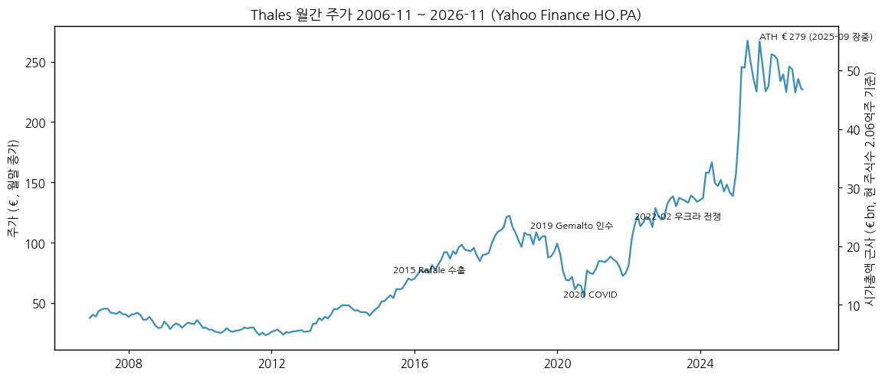

- 2006~2012: €25~47 박스권 (민수·운송 비중, 저마진)
- 2013~2018: €26 → €124 (마진 개선 + Rafale 수출)
- 2019~2021: Gemalto 인수 부담·COVID → 2020 저점 €52.5 (장중)
- 2022~2024: 우크라이나 전쟁 후 재평가 €77 → €174
- **2025**: 유럽 재무장 랠리 — **ATH 장중 €279.3 (2025-09)**, 월말 종가 고점 €267.4 (2025-04)
- **2026**: €212~274 박스권, 2026-11-13 €227.1 (ATH 대비 -19% [계산])

---

## ③ 비즈니스 모델

(1) 실적 추이 통합 표 (€m)

| 항목 | 2021 | 2022 | 2023* | 2024 | 2025 | H1 2026 |
|---|---|---|---|---|---|---|
| **수주** | 19,909 | 23,551 | 23,132 | 25,289 | 25,264 | 12,471 |
| **매출** | 16,192 | 17,569 | 18,428 | 20,577 | 22,136 | 10,949 |
| └ Defence (구 Defence & Security) | 8,633 | 9,154 | 9,628 | 10,969 | 12,234 | 6,316 |
| └ Aerospace | 4,463 | 4,705 | 5,221 | 5,471 | 5,910 | 2,779 |
| └ Cyber & Digital (구 DIS) | 2,995 | 3,618 | 3,504 | 4,024 | 3,852 | 1,797 |
| **Adj. EBIT** | 1,649 | 1,935 | 2,132 | 2,419 | 2,740 | 1,372 |
| └ Defence (마진) | 1,111 (12.9%) | 1,179 (12.9%) | 1,270 (13.2%) | 1,432 (13.1%) | 1,619 (13.2%) | 875 (13.8%) |
| └ Aerospace (마진) | 202 (4.5%) | 235 (5.0%) | 369 (7.1%) | 391 (7.2%) | 560 (9.5%) | 289 (10.4%) |
| └ Cyber & Digital (마진) | 358 (11.9%) | 494 (13.7%) | 491 (14.0%) | 585 (14.5%) | 526 (13.7%) | 195 (10.9%) |
| └ Naval Group 지분법(35%) | 69 | 119 | 91 | 93 | 94 | 39 |
| **Defence 수주** | 11,185 | 13,955 | 13,944 | 14,723 | 15,128 | 7,351 |
| **지역 매출 비중 (9M 2026)** | | | | | | 프랑스 26%·영국 6%·기타 유럽 29%·북미 11%·호주 5%·아시아 10%·중동 8%·기타 5% |

> \* 2023은 2024 보도자료의 재편 기준(Defence/C&D) 재작성값. 2021~2022는 구 기준(Defence & Security/DIS). 지역 비중은 9M 2026 보도자료 매출 지역표. Naval Group 지분법 2021~2022는 연간 보도자료 EBIT 표 역산 [계산].
> 사업부 매핑: 2019 DIS 신설(Gemalto) → 2023 재편(Defence & Security의 사이버 사업 일부 → Cyber & Digital, 명칭 Defence) → 2024 Imperva 편입.

(2) 사업부별 개요

**Defence — 매출 비중 55% (2025)**

"군의 눈(레이더·소나·광학)·귀(전자전)·신경망(통신·지휘통제)과 일부 주먹(로켓·탄약)을 만드는 사업부."

- **지상·공중 감시 레이더 / 방공**: **Ground Master (GM200·GM400 계열)** — 우크라이나·루마니아(GM200 MM/A 12기, EU SAFE)·중동 다수 수출 / **SAMP/T NG** (EUROSAM — MBDA와 합작, Thales는 Ground Fire 레이더·교전통제) / ControlView·SkyView 방공 지휘통제 / ForceShield 단거리 방공 / LMM·Starstreak 미사일 (영국 Belfast)
- **전자전**: **SPECTRA** (Rafale 자체보호, F5 차세대 개발 2026 수주), 함정·지상 전자전
- **함정 전투체계·센서**: TACTICOS 전투관리체계, SMART-L·Sea Fire 레이더, CAPTAS 소나 — 프랑스 FDI, 영국·네덜란드·그리스(Hydra급 현대화) 등 / **Naval Group 35% 지분** (잠수함·수상함 원청)
- **항공 미션시스템**: Rafale RBE2 AESA 레이더, TALIOS 표적 포드, 차세대 다목적 사격통제 레이더 (DGA 2026)
- **군 통신·네트워크**: SYNAPS 무전기, 위성통신, Hexaforce (AI 지휘통제 SW, 2026-09 출시)
- **지상 차량·이펙터**: **Bushmaster 장갑차** (호주, 2026 268대 추가), 70mm 로켓 (인도 LCH 150대 포드), 호주 탄약 공장 (Mulwala·Benalla)
- 수주잔고 €41.1bn (2026-06), Defence 매출의 약 3.2년치 (회사)

**Aerospace — 매출 비중 27%**

"여객기·군용기의 조종석 전자장비와 위성을 만드는 사업부."

- **Avionics**: 비행관리·디스플레이·IFE·항공통신(Cobham AeroComms 인수) — 두 자릿수 마진 (회사 표현)
- **Space (Thales Alenia Space 67%, Telespazio 33%)**: 통신·관측·탐사 위성 — IRIS² (330기 정부 페이로드 LoA, 2026 3Q ~€500m), Copernicus Sentinel-1 NG, ExoMars, SpainSat NG III
- Airbus·Leonardo와 우주 통합(Bromo) 추진 — 완료 시 우주 사업 지분 이관

**Cyber & Digital — 매출 비중 17%**

"데이터·결제·신원을 지키는 보안 소프트웨어·하드웨어 사업부."

- **Cyber (매출 €1,455m, 2025)**: Imperva(웹·데이터 보안), Luna HSM (2026 양자내성 Luna 8), CipherTrust
- **Digital (€2,397m)**: eSIM·보안 연결, 디지털 뱅킹·결제카드, 생체인식·ID
- 수주 ≈ 매출 (단기 사이클), 2025~H1 2026 역성장 — 결제카드 물량·Imperva 영업 통합 차질

(3) 사업부별 디테일

**현재 가장 잘나가는 것 (2026)**:
- **방공·공중감시 레이더 + 이펙터 (중동·유럽)** — 9M 2026 중동 수주 +210% 유기적, Defence 매출 +13% 유기적 / 생산능력 증설(센서·이펙터)
- **함정 (프랑스 SNLE 3G 핵잠, 그리스, 호주 정비)**, **Rafale F5** 개발 수주
- **우주 기관 수요 (ESA·EU IRIS²)** — 9M Aerospace 수주 +29%

**향후 성장 기대**:
- SAMP/T NG 수출 (Patriot 대안으로 다수 국가와 논의 중, CFO 2026-10) / 프랑스 SAMP/T NG 4기 추가
- IRIS² 추가 수주 약 €2bn (향후 수 분기, CFO 2026-10)
- Exail 인수 → 수중전(무인 기뢰대항)·관성항법

**이익 outlier**:
- Defence 마진 H1 2026 13.8% — 회사 연간 "13% 이상" 지향 (3Q 컨콜 요약 기준)
- Cyber & Digital 마진 14.5%(2024) → 10.9%(H1 2026) 하락 — Digital 결제·생체 마진 악화

(4) 주요 경쟁사 (사업부별) — **한국 방산 5사 겹침 강조**

- **레이더·방공 (Ground Master, SAMP/T NG)** — RTX(Patriot, LTAMDS), Saab(Giraffe), Hensoldt(TRML-4D), Leonardo(Kronos), IAI Elta, Aselsan / **한국: LIG D&A (천궁-II·M-SAM — 사우디·UAE·이라크 수출, 중동 방공에서 직접 경쟁) + 한화시스템 (천궁 다기능레이더(MFR)·국지방공레이더·장거리 대공레이더)** — 중동·동유럽(루마니아 SAFE) 수주전에서 겹침
- **전자전** — Elettronica, Leonardo, Hensoldt, Elbit / **한국: 한화시스템·LIG D&A (항공기·함정 전자전 장비)**
- **함정 전투체계·센서 (TACTICOS·Sea Fire·CAPTAS)** — Lockheed Martin(Aegis), Saab(9LV), Leonardo, Hensoldt / **한국: 한화시스템 (함정 전투체계·다기능레이더 — 동남아·중동 수출 함정에 탑재) + LIG D&A (소나·함정 유도무기)**
- **군 통신·지휘통제** — L3Harris, Elbit, Rohde & Schwarz, Palantir(SW) / **한국: 한화시스템 (TICN 전술통신)·LIG D&A**
- **지상 장갑차·이펙터 (Bushmaster, 70mm 로켓, 호주 탄약)** — Rheinmetall, GDLS / **한국: 한화에어로스페이스 (호주 Redback·K9 질롱 공장, 탄약)** — 호주 시장에서 겹침
- **항전·위성** — Collins(RTX), Honeywell, Safran / Airbus D&S, OHB, Maxar / **한국: 한국항공우주·한화시스템 (위성)**
- **Cyber & Digital** — Palo Alto·Cloudflare·Akamai, IDEMIA·G+D (카드·ID)

(5) 주요 매출처

> 단일 고객 10% 이상 공시 없음. 관계사 매출은 HYFR 2026 기준.

- **1. 프랑스 정부 (DGA 등)** — H1 2026 €2,080m (매출의 19% [계산]) / 9M 2026 프랑스 수주 +47%
- **2. Dassault Aviation (Rafale 장비)** — H1 2026 €780m (7% [계산])
- **3. 유럽 각국 국방부 (영국·네덜란드·독일·루마니아·그리스 등)** — 9M 2026 기타 유럽 매출 +22% [추정 순서]
- **4. 중동 국방부** — 9M 2026 중동 매출 €1,288m (+49% 유기적)
- **5. 호주 국방부** (Bushmaster·탄약·함정 정비), **인도** (Rafale 해군·LCH)
- **6. 항공사·항공기 제작사 (Airbus·Boeing), ESA·EU, 통신사·은행**

(6) 생산 CAPA + 임직원

- 방산 생산능력 증설 — 레이더·이펙터 중심 (2025 보도자료: "모든 제품군 수요 대응 위한 증설 지속"), CapEx 2021 €381m → 2025 €687m
- 임직원: 2015 62,000 → 2019 83,000(Gemalto 포함) → 2025 85,000+ (보도자료 About 문구)

---

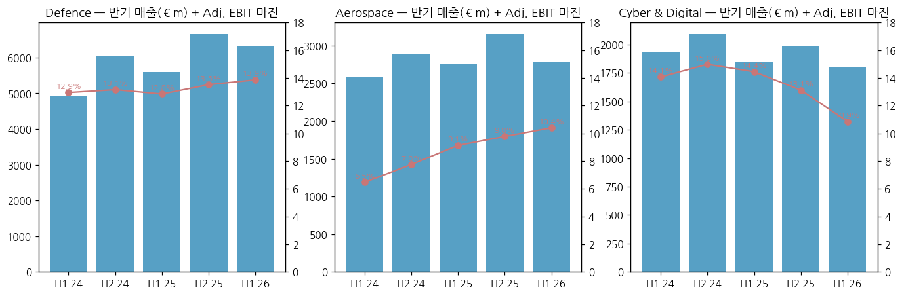

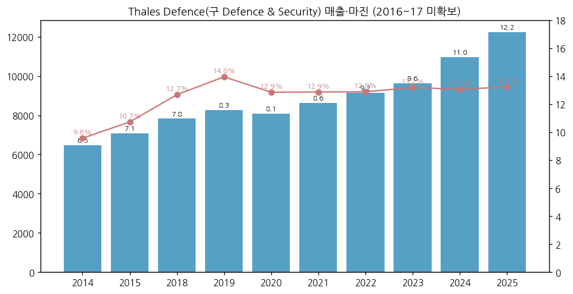

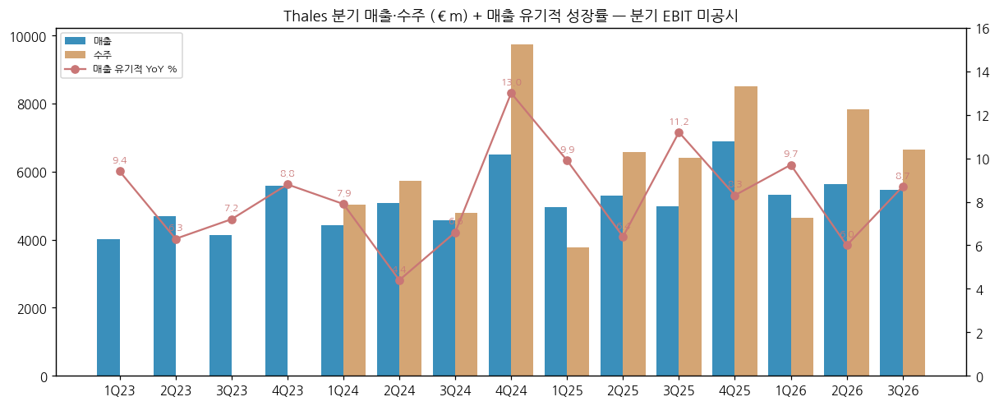

**분기 시계열 (€m) — 분기 EBIT 미공시**

| 분기 | 그룹 매출 | 유기적 YoY | 그룹 수주 | Defence 매출 | Defence 수주 |
|---|---|---|---|---|---|
| 4Q23 | 5,574 | +8.8% | 10,761 | 2,977 | — |
| 1Q24 | 4,421 | +7.9% | 5,037 | 2,305 | 3,122 |
| 2Q24 | 5,072 | +4.4% | 5,730 | 2,633 | 2,998 |
| 3Q24 | 4,576 | +6.6% | 4,783 | 2,302 | 2,831 |
| 4Q24 | 6,508 | +13.0% | 9,739 | 3,730 | 5,773 |
| 1Q25 | 4,960 | +9.9% | 3,778 | 2,691 | 1,306 |
| 2Q25 | 5,305 | +6.4% | 6,574 | 2,902 | 4,456 |
| 3Q25 | 4,991 | +11.2% | 6,409 | 2,666 | 4,192 |
| 4Q25 | 6,881 | +8.3% | 8,502 | 3,991 | 5,185 |
| 1Q26 | 5,316 | +9.7% | 4,652 | 3,047 | 2,240 |
| 2Q26 | 5,633 | +6.0% | 7,819 | 3,269 | 5,111 |
| **3Q26** | **5,473** | **+8.7%** | **6,651** | **3,043** | **3,964** |

> 2Q·4Q는 반기·연간 − 분기 역산 [계산]. 2025 분기는 2026 보도자료의 재작성 비교값 우선. 4Q25 Defence는 FY2025 보도자료 값.

---

## ④ 재무 구조

(1) 손익 (€m) + chart1b

| 연도 | 매출 | 매출총이익 | GPM | 자체 R&D | Adj. EBIT | 마진 | 순이익(지배) | 조정 EPS (€) | DPS (€) |
|---|---|---|---|---|---|---|---|---|---|
| 2014 | 12,974 | — | — | — | 985 | 7.6% | 714 | 2.75 | 1.12 |
| 2015 | 14,063 | — | — | — | 1,216 | 8.6% | 765 | 3.89 | 1.36 |
| 2016 | 14,885 | — | — | — | 1,354 | 9.1% | 946 | 4.25 | 1.60 |
| 2017 | 15,795 | — | — | — | 1,543 | 9.8% | 822 | 4.64 | 1.75 |
| 2018 | 15,855 | — | — | 881 | 1,685 | 10.6% | 982 | 5.55 | 2.08 |
| 2019 | 18,401 | — | — | 1,099 | 2,008 | 10.9% | 1,122 | 6.61 | 2.65 |
| 2020 | 15,371 | — | — | 943 | 1,248 | 8.1% | 483 | 4.40 | 1.76 |
| 2021 | 16,192 | 4,033 | 24.9% | 1,027 | 1,649 | 10.2% | 1,089 | 6.39 | 2.56 |
| 2022 | 17,569 | 4,455 | 25.4% | 1,064 | 1,935 | 11.0% | 1,121 | 7.35 | 2.94 |
| 2023 | 18,428 | 4,766 | 25.9% | 1,108 | 2,132 | 11.6% | 1,023 | 8.48 | 3.40 |
| 2024 | 20,577 | 5,374 | 26.1% | 1,274 | 2,419 | 11.8% | 1,420 | 9.24 | 3.70 |
| **2025** | **22,136** | **5,853** | **26.4%** | **1,328** | **2,740** | **12.4%** | **1,675** | **9.76** | **3.90** |

> 매출총이익 2021~2025 = StockAnalysis 집계. R&D = 보도자료 조정손익 조정표의 연구개발비. 2018 R&D는 2019 보도자료 비교값(Transport 포함 기준). 2014~2019는 Transport 포함.

→ 순이익과 조정 순이익의 차이는 인수 PPA 상각(Gemalto·Imperva)·특별손익 — 2025 조정 순이익 €2,005m vs IFRS €1,675m

(2) 재무상태표 (€m) + chart4

| 연도 | 자산 | 부채 | 자본 | 부채비율 | 현금성자산 | 순현금(순차입, 회사 정의) |
|---|---|---|---|---|---|---|
| 2021 | 32,835 | 26,116 | 6,719 | 389% | 5,049 | (795) |
| 2022 | 34,421 | 27,039 | 7,382 | 366% | 5,100 | (35) |
| 2023 | 38,786 | 31,817 | 6,969 | 457% | 3,980 | (4,190) |
| 2024 | 39,990 | 32,432 | 7,558 | 429% | 4,767 | (3,044) |
| 2025 | 39,155 | 31,168 | 7,988 | 390% | 4,447 | (1,618) |
| 2026-06 | 40,008 | 31,991 | 8,018 | 399% | 4,997 | (519) |

> 자산·부채·자본 = StockAnalysis 집계, 순차입 = 회사 보도자료. 부채비율 [계산]. 부채의 상당 부분이 계약부채(고객 선수금) — 방산 수주 증가 시 커지는 구조.

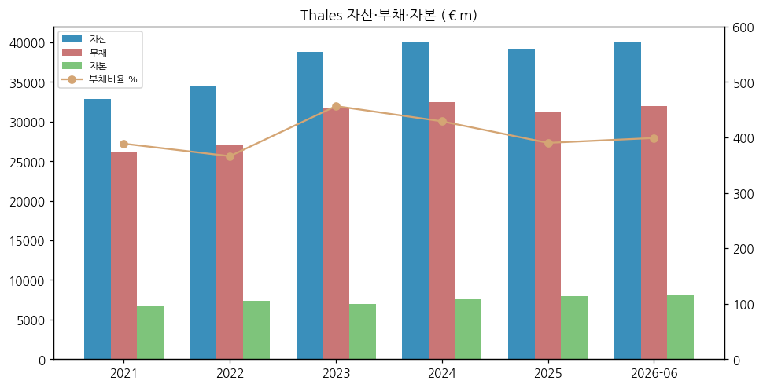

(3) 현금흐름 (€m) + chart6

| 연도 | 영업CF | 투자CF | 재무CF | CapEx | Free operating CF (회사) |
|---|---|---|---|---|---|
| 2021 | 2,833 | (493) | (2,169) | 381 | 2,515 |
| 2022 | 2,995 | (1,171) | (1,749) | 470 | 2,527 |
| 2023 | 1,596 | (4,233) | 1,591 | 540 | 2,026 |
| 2024 | 2,638 | (63) | (2,002) | 540 | 2,027 |
| 2025 | 3,322 | (910) | (2,656) | 687 | 2,577 |

→ 2023 투자CF -€4.2bn: Imperva 인수 / 2024 Transport 매각 대금 유입으로 투자CF 소폭

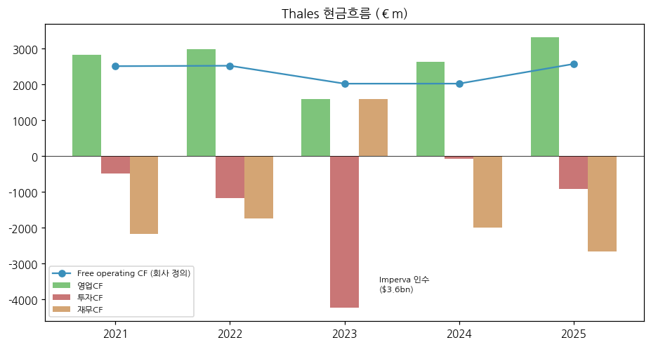

(4) CapEx + chart8

→ 매출 대비 2.4%(2021) → 3.1%(2025) [계산] — 방산 생산능력 증설

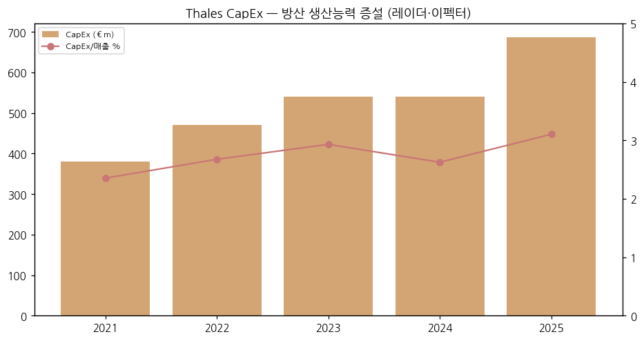

(5) 부채 구조

- 순차입 2023말 €4.2bn (Imperva) → 2026-06 €0.5bn으로 축소
- 2026-08 **€1bn 회사채 발행** / Exail 인수(~€3.9bn 보도 기준 기업가치)는 2027~2028 현금 유출 예정

(6) 배당·자사주 + chart9

→ DPS 2014 €1.12 → 2025 €3.90, 2020만 감배(€1.76) / 배당성향 약 40% (조정 순이익 대비 [계산: 3.90/9.76])
→ 자사주: 2022 €351m·2023 €491m·2024 €275m → 2025 €45m (StockAnalysis 집계)
→ 2026-09-30 중간배당 공시

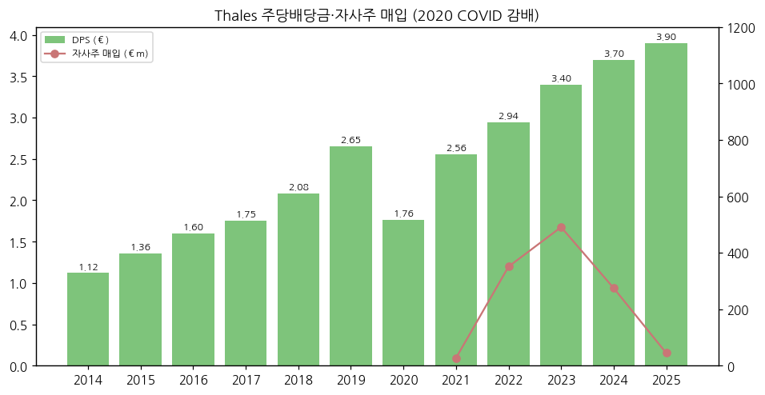

(7) 재무비율 [계산]

| 연도 | ROE (순이익/기말자본) | 부채비율 | CapEx/매출 | 자체 R&D/매출 |
|---|---|---|---|---|
| 2021 | 16.2% | 389% | 2.4% | 6.3% |
| 2022 | 15.2% | 366% | 2.7% | 6.1% |
| 2023 | 14.7% | 457% | 2.9% | 6.0% |
| 2024 | 18.8% | 429% | 2.6% | 6.2% |
| 2025 | 21.0% | 390% | 3.1% | 6.0% |

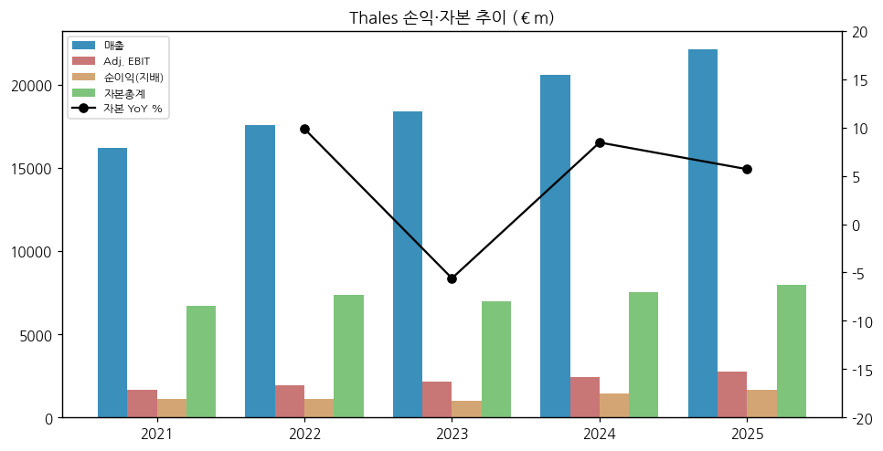

---

## ⑤ 지배 구조

(1) 그룹·계열 관계

- **프랑스 정부 (TSA 경유) — 공공부문 26.60%, 의결권 36.34%** + 황금주 1주 / Dassault Aviation과 **주주간 협약** (산업 파트너)
- **Dassault Aviation — 26.59%, 의결권 29.95%** — Rafale 공동 생산 (Thales 레이더·전자전·광학)
- **Naval Group 35%** (지분법, 나머지 프랑스 정부) — 잠수함·수상함
- **Thales Alenia Space 67% / Telespazio 33%** (Leonardo 합작, "Space Alliance") → Airbus·Leonardo와 우주 통합(Bromo) 추진
- **EUROSAM** (MBDA와 SAMP/T) 등 합작

(2) 주주 구분 (2026-06-30, HYFR) + chart5

| 주주 | 주식수 | 지분 | 의결권 |
|---|---|---|---|
| TSA (공공부문) | 54,786,654 | 26.60% | 36.34% |
| 프랑스 정부 직접 (황금주 포함) | 2,060 | — | — |
| Dassault Aviation | 54,750,000 | 26.59% | 29.95% |
| 자사주 | 480,882 | 0.23% | — |
| 임직원 | 6,039,500 | 2.93% | 3.76% |
| 기타 | 89,882,817 | 43.65% | 29.95% |
| **합계** | **205,941,913** | 100% | 100% |

→ 유통 지분 약 44% — 정부·Dassault 합계 의결권 66% → 경영권 변동 가능성 사실상 없음 [판단]

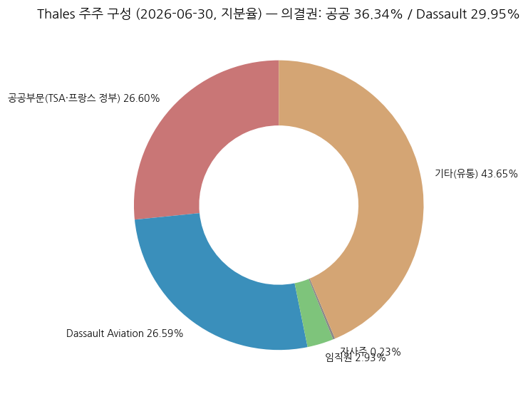

(3) 경영진

- **Patrice Caine** — 회장 겸 CEO (2014~), 프랑스 국가 엘리트 관료 출신
- **Jérémie Papin** — CFO (Finance & Information Systems, 2026-05 선임)

---

## ⑥ 기타 팩트

(1) 시가총액·밸류에이션 스냅샷 (2026-11-13)

- **주가 €227.1** / 52주 €211.9~€274.2 / ATH 장중 €279.3 (2025-09)
- **시가총액 ≈ €46.8bn** [계산] / EV ≈ €47.3bn [계산]
- P/E (2025 조정 EPS €9.76) ~23x [계산] / EV/2026E Adj. EBIT ~16x [계산]
- 셀사이드 컨센 TP 평균 €290.5 (18명, MarketScreener 2026-04 기사 시점)

(2) R&D + chart7

→ 총 R&D 연 €4.5bn (고객 수탁 포함) / 자체 R&D €1,328m (2025, 매출 6.0%)
→ 중점: AI(Hexaforce), 양자내성 암호(Luna 8), 6G, 클라우드

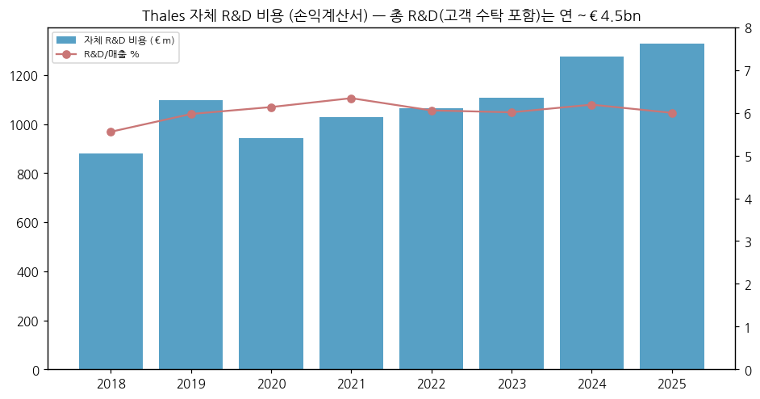

(3) 진행 중 corporate action

- **Exail 인수** — 주당 €134, Gorgé 가문 35.51% → 의무 공개매수, 2027 3Q 지분 인수·2028 초 공개매수 완료 목표
- **우주 통합 (Bromo, Airbus·Leonardo)** — 2027 완료 목표, EU 승인 필요, OHB 반대
- **F126 종료 후속** — 독일 국방부와 보상 협상 (특별손실 ~€450m는 보수적 보상 추정 포함)

(4) 주요 리스크

- **프랑스 재정** — 국방예산은 증액 기조이나 법인세 추가분담(2026 추가 세금 €90~100m 예상)
- **대형 프로그램 취소** — F126(독일), 위성 2기 취소 (2026)
- **Cyber & Digital 부진** — Imperva 통합·결제카드 물량
- **수출 규제·중동 정세** — 중동 수주 급증 구간의 정치 리스크
- **유럽 역내 조달(EU SAFE)** — 기회 요인이지만 역내 경쟁(Hensoldt·Saab·Leonardo) 심화

(5) ESG

- 보도자료 기준: 기후 교육 관리자 94.6% 이수, 여성 비율 27.6% (2025) — 상세는 URD 미수집

(6) 인증·라이선스

- 프랑스 국가 안보 관련 황금주, 수출은 프랑스 CIEEMG 승인 대상

---

## Activity 보고 (v1.0)

### ✅ 확보 — 보도자료 15건 + HYFR 2026 + 주가
### ❌ 누락 — URD 2025, 2016·2017 사업부, 2014~2020 재무상태·CF, 분기 EBIT(미공시)
### ⚠️ 추정·계산 — [계산] CAGR·마진·비율·시총·EV·멀티플·분기 역산, [추정] 매출처 순서·4Q 사업부 기준 혼재

### 🔗 핵심 source URL
- 9M 2026 보도자료: https://files.webdisclosure.com/1441721/Thales_reports_its_order_intake_and_sales_as_of_September_30_2026__Press_release__22_October_2026.pdf
- H1 2026 보도자료: https://live.euronext.com/sites/default/files/company_press_releases/attachments/2026/07/23/cpr03_lesechos_16165_1423107_Thales_reports_its_2026_halfyear_results__press_release__23_July_2026.pdf
- FY2025 보도자료: https://live.euronext.com/sites/default/files/company_press_releases/attachments/2026/03/03/cpr03_lesechos_16165_1392193_Thales_reports_its_2025_fullyear_results__press_release__3_March_2026.pdf
- 2026 HYFR: https://live.euronext.com/sites/default/files/company_press_releases/attachments/2026/07/23/cpr03_lesechos_16165_1423119_Thales__2026_HalfYearly_Financial_report.pdf

### Data Quality Confidence: **88%**
- 손익·사업부 (회사 보도자료 직접 parse): 100% / 재무상태·CF (StockAnalysis 집계): 90% / 2016·2017 (전재 기사): 90% / 매출처 순서: 60%

---

## Version Log

- **v1.0** (2026-11-14) — 초안. 보도자료 15건 + HYFR 2026 수집, 12년 손익(2014~2025) + H1 2026 + 분기 매출·수주 15Q, 12종 차트, 한국 5사 경쟁 매핑.
- **잔여 보완 (v1.1, 2027-03 FY2026 발표 후)**: FY2026 확정치·2027 가이던스·중기목표 재검토 반영, URD 2025 수집(사업부 상세·임직원·R&D), 2016·2017 사업부 보강, Bromo·Exail 진행 반영
