# JYP Ent. (제이와이피엔터테인먼트, KOSDAQ 035900) — 기업 개요 (v1.0)

> 마지막 update: 2026-11-15 작성 (3Q26 분기보고서 2026-11-13 공시 + 3Q26 IR 2026-11-11까지 반영)
> 입력 source: **OpenDART fnlttSinglAcntAll 연결재무제표(2015\~2026.3Q, 2026-11-15 조회)** + **DART 정기공시 원문 XML(사업·반기·분기보고서 2014.12\~2026.09)** + **OpenDART 정기보고서 주요정보(최대주주·임원·직원·배당·자기주식 2016\~2025)** + 회사 IR 실적발표 PDF 18건(2Q22\~3Q26, irgo 경유) + Yahoo Finance v8 월간 시세(2001-08\~2026-11)
> 2014년 손익·재무는 2015 사업보고서 비교기(전기) 수치. 분기 매출유형 시계열은 DART 「매출실적」 표(누적)에서 분기 차감으로 역산 (1Q15\~3Q26)
> 갱신 주기: 매분기 (실적 리뷰 모드 호출 시)
> **Fact verify cutoff**: 2026-11-15 (주가 43,500원 = 2026-11-13 종가, Yahoo Finance v8 / 월말 종가 고점 136,400원 = 2023-06, 장중 고점 146,600원 = 2023-06)
> 워치리스트: **엔터 섹터 (대분류 소비재) / 서브섹터 기획사** (watchlist.md 등록 완료)

---

## 1. 기업 분류

- **Primary 분류: 고성장 → 지속성장 전환기** — 2016\~2023년 매출 CAGR 33% (TWICE·Stray Kids 등 IP 라인업 확장)로 고성장, 2024년부터 재계약 IP 정산·투어 원가 상승으로 OPM이 30%대 → 17\~19%로 한 단계 하향된 채 매출만 성장
- **Secondary 노트: IP 사이클** — 핵심 IP(그룹)의 데뷔→성장→재계약(보통 7년차) 주기에 따라 이익률이 계단식으로 움직임. 2023년 OPM 정점(29.9%) 후 TWICE·DAY6(2022), 2PM(2024), Stray Kids·DAY6(2025) 등 재계약 IP의 정산 조건이 반영되며 하향

### ① 정량 근거

**📊 Summary Box (12년, 2014\~2025):**

| 지표 | 값 |
|------|-----|
| 매출 CAGR (2014→2025, 11년) | **+29.3%** (485억 → 8,219억, 17배) |
| 매출 CAGR (2016→2023 고성장 구간) | **+33.8%** |
| OPM 평균 (12년) | **22.7%** |
| OPM 정점 | **30.6%** (2020) — 2019\~2023년 28\~31% 밴드 |
| OPM 저점 | **8.3%** (2015, 2PM·miss A 공백기) / 최근 저점 18.9% (2025) |
| 사이클 주기 | 뚜렷한 경기 사이클 없음 — IP 재계약 주기(약 7년)가 이익률 계단을 만듦 |
| 매출 역성장 연도 | 1회 (2020, 코로나로 공연 매출 0) |

```
[전사 손익 시계열 (12년, 억원)]
연도   매출    영업이익  순이익   OPM    NPM
2014     485      83      79   17.0%   16.2%   
2015     506      42      32    8.3%    6.4%   ← 저점 (2PM·miss A 공백, TWICE 데뷔 첫해)
2016     736     138      85   18.8%   11.6%   
2017   1,022     195     164   19.0%   16.0%   ← TWICE 본격화, 매출 1,000억 돌파
2018   1,248     287     243   23.0%   19.4%   ← Stray Kids 데뷔
2019   1,554     435     312   28.0%   20.1%   
2020   1,444     441     296   30.6%   20.5%   ← 코로나 (공연 0) 속 OPM 정점 30.6%
2021   1,939     579     675   29.9%   34.8%   ← NI 급증 = 디어유 상장 지분법·처분 효과
2022   3,459     966     675   27.9%   19.5%   ← Stray Kids·TWICE 글로벌, 매출 +78%
2023   5,665   1,694   1,050   29.9%   18.5%   ← 영업이익 정점 1,694억
2024   6,018   1,283     977   21.3%   16.2%   ← 2Q24 투어 공백 + 원가 상승, OPM 21%
2025   8,219   1,552   1,606   18.9%   19.5%   ← 최대 매출 8,219억, NI는 디어유 지분 처분익 732억 포함
```


### ② 산업 분류

- DART 업종: 오디오물 출판 및 원판 녹음업 / 엔터테인먼트 (연예매니지먼트·음반 제작)
- 사업부문(공시): **음반사업**(음반·음원) + **매니지먼트사업**(콘서트·광고·출연·기타[MD·초상권·IP 라이선싱])
- 워치리스트: 엔터 섹터 · 서브섹터 **기획사** (하이브·에스엠·와이지엔터와 같은 묶음, 확장 큐브엔터)
- 글로벌 피어 맥락: 음원은 UMG(Republic Records)·Spotify·TME로 유통, 공연은 Live Nation 파트너십 — 엔터 섹터의 음원 글로벌·공연 글로벌 서브섹터와 직접 연결

### ③ 분류 결정 논리

1. 2016\~2023년은 신규 IP 데뷔(TWICE 2015 → Stray Kids 2018 → ITZY 2019 → NiziU 2020 → NMIXX 2022)가 매년 매출 레벨을 올린 **고성장 구간**
2. 2024년 이후는 매출은 여전히 성장(2025 +36.6%)하지만 OPM이 18\~21%로 내려와 "성장은 하되 이익률은 낮아진" **지속성장형**에 가까움 — 재계약 IP 비중 상승, 투어 총매출 인식(제작비 동반), MD 원가 확대가 원인
3. 반도체·조선 같은 가격 사이클은 없고, 실적 변동은 **앨범 발매·투어 일정(분기 간 편차)**과 **IP 재계약 시점**이 결정

### ④ 적정 밸류에이션 방법

- **PER 우선** (자본 투입이 적고 이익이 곧 현금흐름 — 2025 OCF 1,243억 / 영업이익 1,552억)
- 엔터 기획사는 역사적으로 12개월 선행 PER 20\~35배 밴드에서 거래 (2023년 고점 시 40배대) — 현재 trailing PER 약 14.6배 (주가 43,500원 × 3,553만주 = 시총 1.55조 / 최근 4개 분기 순이익 1,058억)
- PBR은 보조 지표 (2025말 자본 6,249억 기준 약 2.5배)
- 순이익에 디어유 지분 처분익(2025 732억) 같은 일회성이 섞이므로 **영업이익 기준 PER(세후 환산)**로 교차 확인 필요

### ⑤ 분기 재평가 트리거

- Stray Kids 2027 북미 14개·유럽 7개 도시 스타디움 투어 확정(회차당 4만명+) → 2Q27\~3Q27 콘서트 매출 레벨
- 신인 보이그룹 **oftheblue** 2027-01-11 데뷔 → 초동·팬덤 지표
- 주요 IP 재계약 일정 (ITZY 2026 재계약 완료, NMIXX 2029 예상)
- OPM 20% 회복 여부 (2025\~3Q26 17\~18% 횡보)
- 디어유 잔여 지분(10%) 추가 처분 여부

---

## 2. 회사 개요

### ① 기본 사항

| 항목 | 내용 |
|------|------|
| 회사명 | (주)제이와이피엔터테인먼트 (JYP Entertainment Corporation, 영문약호 JYPE) |
| 설립 / 상장 | 1996-04-25 설립 / 2001-08-30 코스닥 상장 (2013-10-17 비상장 (주)제이와이피를 흡수합병해 현재 구조) |
| 본사 | 서울 강동구 강동대로 205 (성내동, JYP Center) |
| 대표이사 | 정욱 (2011-02\~), 창업자·최대주주 박진영은 사내이사·CCO |
| 사업 한 줄 정의 | K-POP 아이돌 IP를 자체 발굴·육성해 음반·음원·공연·MD·광고로 수익화하는 종합 엔터 기획사 |
| 비전 | "Globalization by Localization" — 한국 본사 IP + 일본(NiziU·NEXZ)·중국(YAOCHEN·CIIU)·미국(GIRLSET) 현지화 그룹 |
| 발행주식 | 35,532,492주 (자기주식 2,399,433주 · 6.75%) |
| 시가총액 | **1.55조원** (2026-11-13 종가 43,500원) — 월말 고점 4.85조(2023-06) 대비 −68% |
| 임직원 | 496명 (2025말, 본사 기준) |
| 연결 종속회사 | 11개 (JYP Japan, 블루개러지[MD], JYP America, 이닛엔터테인먼트, 중국 법인 등) |

### ② 최근 12년 손익·자본 추이 (억원, 좌→우 시간순)

| 항목 | 2014 | 2015 | 2016 | 2017 | 2018 | 2019 | 2020 | 2021 | 2022 | 2023 | 2024 | 2025 |
|---|---|---|---|---|---|---|---|---|---|---|---|---|
| 매출액 | 485 | 506 | 736 | 1,022 | 1,248 | 1,554 | 1,444 | 1,939 | 3,459 | 5,665 | 6,018 | 8,219 |
| 영업이익 | 83 | 42 | 138 | 195 | 287 | 435 | 441 | 579 | 966 | 1,694 | 1,283 | 1,552 |
| 순이익 | 79 | 32 | 85 | 164 | 243 | 312 | 296 | 675 | 675 | 1,050 | 977 | 1,606 |
| OPM(%) | 17.0 | 8.3 | 18.8 | 19.0 | 23.0 | 28.0 | 30.6 | 29.9 | 27.9 | 29.9 | 21.3 | 18.9 |
| 자본총계 | 560 | 588 | 670 | 858 | 1,280 | 1,623 | 1,862 | 2,506 | 3,045 | 3,980 | 4,829 | 6,249 |
| 자본 YoY(%) | - | 5.1 | 14.0 | 27.9 | 49.2 | 26.9 | 14.7 | 34.6 | 21.5 | 30.7 | 21.3 | 29.4 |

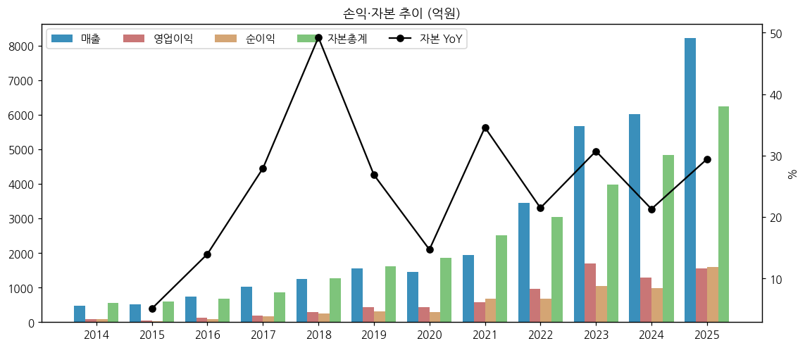

### ③ 회사 주가 역사 ★ narrative 영역

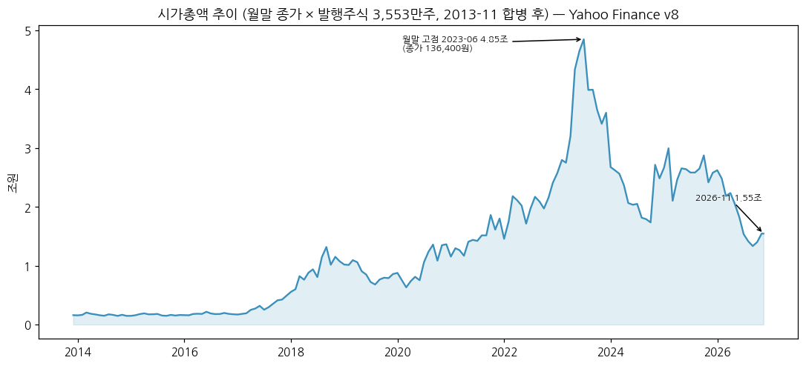

- **2013\~2016 (시총 0.2조 내외)**: 2013 합병 후 2PM·miss A 중심, 2015년 매출 정체·OPM 8%로 주가 4\~5천원대 횡보
- **2017\~2018 (0.3조 → 1.3조)**: TWICE 일본 진출 성공, 매출 1,000억 돌파 → 주가 3배 이상. 2018 Stray Kids 데뷔로 "멀티 IP 기획사" 재평가
- **2019\~2020 (조정)**: 2019 하반기 엔터 업종 조정, 2020 코로나로 공연 중단 — 다만 OPM 30%로 실적은 견조
- **2021\~2023-06 (대세 상승, 시총 4.85조 정점)**: 팬데믹 후 앨범 판매 폭증(K-POP 앨범 Top400 최대), Stray Kids 빌보드 200 1위 행진 → 2023년 6월 월말 종가 136,400원 사상 최고
- **2023 하반기\~2024 (−60%)**: 앨범 판매량 정점 통과(중국 공구 수요 둔화), 2Q24 OPM 9.8% 쇼크 → 2024-11 시총 1.7조
- **2025 (반등)**: Stray Kids 월드투어 콘서트 매출 급증, 4Q24\~2Q25 반등
- **2026 (재하락, 37,550원 저점 2026-08)**: 매출은 최대이나 OPM 17\~18% 정체, 2Q26 매출 −15% YoY → 시총 1.3\~1.5조. 2027 Stray Kids 스타디움 투어·신인 데뷔가 다음 촉매

### ④ 주요 연혁

| 연도 | 주요 사항 |
|------|-----------|
| 1996 | 설립 (태홍기획 출신 박진영) |
| 2001 | 코스닥 상장 (당시 상장사는 현 법인 전신) |
| 2008 | 2PM·2AM 데뷔 |
| 2013 | (주)제이와이피 흡수합병 — 현재 법인 구조 확립 |
| 2015 | DAY6, TWICE 데뷔 |
| 2016 | 레이블(아티스트 단위 수평 조직) 체제 개편 |
| 2018 | Stray Kids, BOY STORY(중국, TME 합작) 데뷔 / 첫 자사주 소각(389,411주) |
| 2019 | ITZY 데뷔 / 첫 현금배당(FY18 DPS 122원) |
| 2020 | 소니뮤직 합작 'Nizi Project'로 NiziU(일본) 데뷔, YAOCHEN(중국) 데뷔 |
| 2021 | Xdinary Heroes 데뷔 / 디어유(버블) 코스닥 상장 |
| 2022 | NMIXX 데뷔 / TWICE·DAY6 재계약 |
| 2023 | Republic Records 합작 'A2K' / Live Nation 전략 파트너십 / 영업이익 사상 최대 1,694억 |
| 2024 | GIRLSET(미국, VCHA 리브랜딩)·NEXZ(일본) 데뷔 / 2PM 재계약 / JYP360 → 블루개러지 사명 변경 |
| 2025 | KickFlip, CIIU(중국) 데뷔 / Stray Kids·DAY6·BOY STORY 재계약 / 디어유 지분 일부 처분(처분익 732억) / 매출 8,219억 사상 최대 |
| 2026 | dodree 데뷔, ITZY 재계약 / Stray Kids 해외 남성 아티스트 최초 도쿄 국립경기장, Rock in Rio 헤드라이너 / 3Q26 분기 최대 매출 2,675억 |
| 2027(예정) | oftheblue 데뷔(1/11), Stray Kids 북미·유럽·일본 스타디움 투어 |

---

## 3. 비즈니스 모델

### ① 실적 추이 (매출유형별·내수/수출)

**연간 매출유형별 (억원, DART 매출실적 표 기준)**

| 매출유형 | 2019 | 2020 | 2021 | 2022 | 2023 | 2024 | 2025 | 9M25 | 9M26 | 9M YoY |
|---|---|---|---|---|---|---|---|---|---|---|
| 음반·음원 | 571 | 749 | 1,128 | 1,747 | 2,628 | 2,172 | 2,579 | 1,636 | 2,007 | +22.7% |
| 콘서트 | 213 | 11 | 12 | 246 | 632 | 1,036 | 1,889 | 1,471 | 1,244 | -15.4% |
| 광고 | 172 | 119 | 126 | 218 | 284 | 343 | 450 | 331 | 432 | +30.5% |
| 출연 | 129 | 64 | 124 | 113 | 143 | 271 | 354 | 295 | 387 | +30.9% |
| 기타(MD·초상권·IP) | 469 | 501 | 549 | 1,135 | 1,979 | 2,195 | 2,947 | 2,159 | 2,296 | +6.3% |
| **합계** | 1,554 | 1,444 | 1,939 | 3,459 | 5,665 | 6,018 | 8,219 | 5,892 | 6,366 | +8.0% |

- 2026년부터 DART 표에서 MD가 '기타'와 분리 공시 — 시계열 연속성을 위해 본 표는 MD를 '기타'에 합산
- 2025 음반부문 영업이익 849억(54.7%) vs 매니지먼트부문 703억(45.3%) — 음반이 매출 31%로 이익의 절반 이상 (2025 사업보고서 부문정보)

**내수 vs 수출 (억원, 연결)**

| 구분 | 2023 | 2024 | 2025 | 2025 비중 |
|---|---|---|---|---|
| 수출 | 3,156 | 3,458 | 4,698 | 57.2% |
| 내수 | 2,509 | 2,560 | 3,520 | 42.8% |
| 합계 | 5,665 | 6,018 | 8,219 | 100% |

- 콘서트 수출 비중 71.5%(2025) — 해외 투어가 매출 성장의 축
- 지역 매출(3Q26 IR): 국내 1,311억(+29.5% YoY, 역대 최대), 기타 지역 760억(−3.4%)

**사업부별 15년 분기 시계열 (매출유형별, 1Q15\~3Q26)**

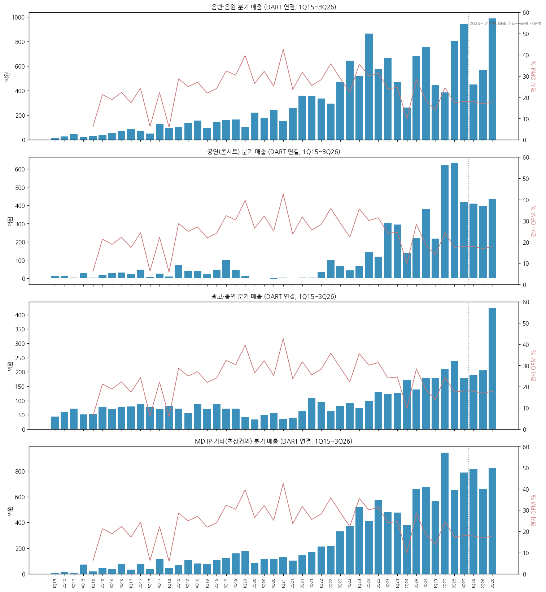

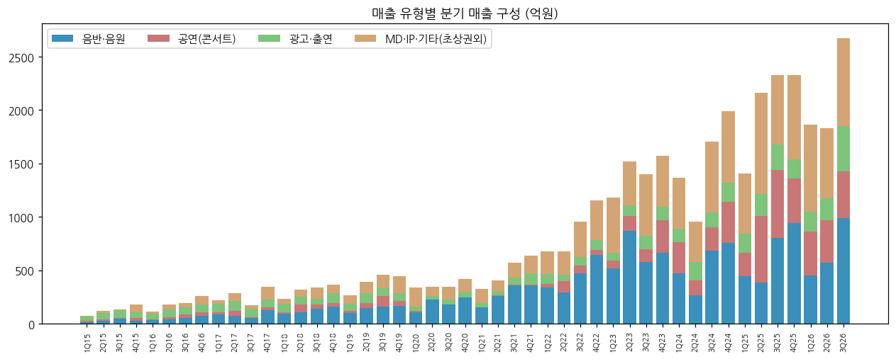

**최근 12분기 (억원)**

| 분기 | 매출 | 영업이익 | OPM | 매출 YoY | 영업이익 YoY | 순이익 |
|---|---|---|---|---|---|---|
| 4Q23 | 1,571 | 379 | 24.1% | +36.4% | +47.5% | 22 |
| 1Q24 | 1,365 | 336 | 24.6% | +15.7% | -20.0% | 315 |
| 2Q24 | 957 | 93 | 9.8% | -36.9% | -79.6% | 13 |
| 3Q24 | 1,705 | 484 | 28.4% | +22.0% | +10.5% | 388 |
| 4Q24 | 1,991 | 369 | 18.5% | +26.7% | -2.6% | 262 |
| 1Q25 | 1,408 | 196 | 13.9% | +3.2% | -41.7% | 693 |
| 2Q25 | 2,158 | 529 | 24.5% | +125.5% | +468.8% | 363 |
| 3Q25 | 2,326 | 408 | 17.5% | +36.4% | -15.7% | 272 |
| 4Q25 | 2,326 | 419 | 18.0% | +16.8% | +13.6% | 279 |
| 1Q26 | 1,860 | 334 | 17.9% | +32.1% | +70.4% | 319 |
| 2Q26 | 1,831 | 310 | 16.9% | -15.2% | -41.4% | 217 |
| 3Q26 | 2,675 | 480 | 17.9% | +15.0% | +17.6% | 243 |

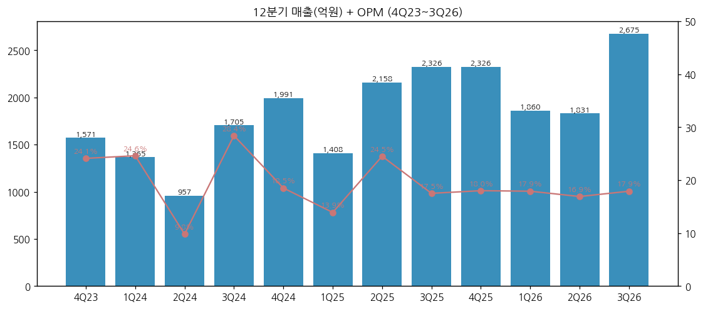

### ② 사업부별 개요 (매출 비중 큰 순서, 2025)

| 사업 | 2025 매출 | 비중 | 내용 |
|---|---|---|---|
| 기타(MD·초상권·IP) | 2,947억 | 35.9% | 블루개러지(MD 자회사, 2025 매출 1,224억)·FANS SHOP·팝업·캐릭터(SKZOO·트둥즈) 라이선싱, 팬클럽·플랫폼 |
| 음반·음원 | 2,579억 | 31.4% | 실물 앨범(국내 드림어스컴퍼니, 해외 Republic Records)·디지털 스트리밍(Spotify·Apple·TME) |
| 콘서트 | 1,889억 | 23.0% | 국내 직접, 해외 Live Nation 등 프로모터 — 2025년 +82% |
| 광고 | 450억 | 5.5% | 글로벌 럭셔리(구찌·프라다·LVMH 등)·국내 대기업 |
| 출연 | 354억 | 4.3% | 방송·페스티벌 출연, 팬미팅·쇼케이스 |

### ③ 사업부별 디테일

- **Stray Kids (최대 IP)**: 빌보드 200 9연속 1위(2026-08 <THIS & THAT>), 2026 월드투어 <RUN IT> — 도쿄 국립경기장 2회 14만명, Rock in Rio 헤드라이너(10만명), 자체 남미 페스티벌 'STRAYCITY' 3개 지역 5회 27만명. 3Q26 출연 매출 264억(+138% YoY)이 이 페스티벌 효과
- **TWICE**: 2025 북미 21회·캐나다 5회 등 스타디움급 투어, 2022 재계약. 2026 나연 솔로·캐릭터 '트둥즈' 팝업
- **DAY6 (밴드)**: 국내 공연 회차 최다(인스파이어 아레나·KSPO DOME), 멤버 솔로 투어 병행 — 국내 콘서트 매출 견인
- **ITZY·NMIXX·KickFlip·Xdinary Heroes**: 중견·신인 라인업. NMIXX는 워너 재팬과 12월 일본 정식 데뷔
- **현지화 그룹**: NiziU·NEXZ(일본, 소니뮤직), YAOCHEN·CIIU(중국), GIRLSET(미국, Republic Records). JYP Japan 2025 매출 1,547억(연결 자회사 중 최대)
- **MD (블루개러지)**: 2024 1,224억 → 3Q26 MD 매출 586억(+46.7% YoY, 분기 최대) — 투어 연계 도시 팝업, 응원봉, 캐릭터 IP가 구조적 성장 동력
- **이익 outlier**: 2Q24 OPM 9.8%(투어 공백 + 재계약 원가), 2025\~2026 콘서트 총매출 인식(대규모 국내 공연 제작비 동반)으로 매출 대비 이익 레버리지 약화

### ④ 주요 경쟁사

| 영역 | 경쟁사 |
|---|---|
| K-POP 기획사 | 하이브(BTS·SEVENTEEN·멀티레이블), 에스엠(aespa·NCT), 와이지엔터(BLACKPINK·BABYMONSTER), 큐브엔터, 스타쉽(비상장, 카카오) |
| 글로벌 레이블 | UMG·Sony Music·Warner (동시에 유통 파트너) |
| 팬덤 플랫폼 | 하이브 위버스 (JYP는 디어유 '버블' 관계사, 지분 10%) |

### ⑤ 주요 매출처

- DART 기준 단일 매출처 10% 이상 비중 합계 약 16% (2025 별도) — 거래처명은 비공개
- 음반: 국내 (주)드림어스컴퍼니, 해외 Republic Records
- 음원: Republic Records, Spotify, Apple, JYP Japan, Tencent Music (Zhuhai)
- 광고: 해외 GUCCI·Richemont·PRADA·LVMH·Versace·L'Oréal·Bottega Veneta / 국내 삼성전자·LG전자·롯데웰푸드·아모레퍼시픽 등
- 공연: 국내 직접, 해외 Live Nation 등 프로모터

### ⑥ 생산 CAPA + 임직원 추이

- 제조 설비 없음 (서비스업). 핵심 "CAPA"는 **활동 IP 수**: 본사 소속 아티스트 49명(2025말) / 2026년 발매 실물 앨범 19건, 공연 200회+ 계획
- 상표권: 국내 출원 1,225건·등록 628건, 해외 40개국 출원 2,400건·등록 1,204건 (2025말)

| 연도 | 2016 | 2017 | 2018 | 2019 | 2020 | 2021 | 2022 | 2023 | 2024 | 2025 |
|---|---|---|---|---|---|---|---|---|---|---|
| 임직원(명, 본사) | 123 | 157 | 223 | 219 | 242 | 280 | 317 | 374 | 422 | 496 |

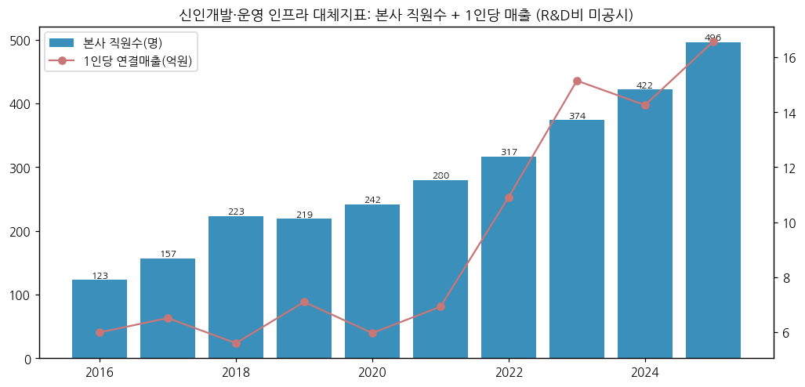

---

## 4. 재무 구조

### ① 손익계산서 (12년, 억원)

| 항목 | 2014 | 2015 | 2016 | 2017 | 2018 | 2019 | 2020 | 2021 | 2022 | 2023 | 2024 | 2025 |
|---|---|---|---|---|---|---|---|---|---|---|---|---|
| 매출액 | 485 | 506 | 736 | 1,022 | 1,248 | 1,554 | 1,444 | 1,939 | 3,459 | 5,665 | 6,018 | 8,219 |
| 매출총이익 | 183 | 156 | 273 | 393 | 562 | 761 | 769 | 1,042 | 1,566 | 2,683 | 2,564 | 3,034 |
| 판관비 | 101 | 114 | 135 | 198 | 274 | 326 | 328 | 462 | 599 | 988 | 1,281 | 1,482 |
| 영업이익 | 83 | 42 | 138 | 195 | 287 | 435 | 441 | 579 | 966 | 1,694 | 1,283 | 1,552 |
| 순이익 | 79 | 32 | 85 | 164 | 243 | 312 | 296 | 675 | 675 | 1,050 | 977 | 1,606 |
| 지배순이익 | 77 | 32 | 84 | 164 | 243 | 313 | 295 | 675 | 675 | 1,054 | 1,030 | 1,598 |
| GPM(%) | 37.8 | 30.9 | 37.1 | 38.4 | 45.0 | 48.9 | 53.3 | 53.7 | 45.3 | 47.4 | 42.6 | 36.9 |
| 판관비율(%) | 20.7 | 22.6 | 18.4 | 19.4 | 22.0 | 21.0 | 22.7 | 23.9 | 17.3 | 17.4 | 21.3 | 18.0 |
| OPM(%) | 17.0 | 8.3 | 18.8 | 19.0 | 23.0 | 28.0 | 30.6 | 29.9 | 27.9 | 29.9 | 21.3 | 18.9 |
| NPM(%) | 16.2 | 6.4 | 11.6 | 16.0 | 19.4 | 20.1 | 20.5 | 34.8 | 19.5 | 18.5 | 16.2 | 19.5 |

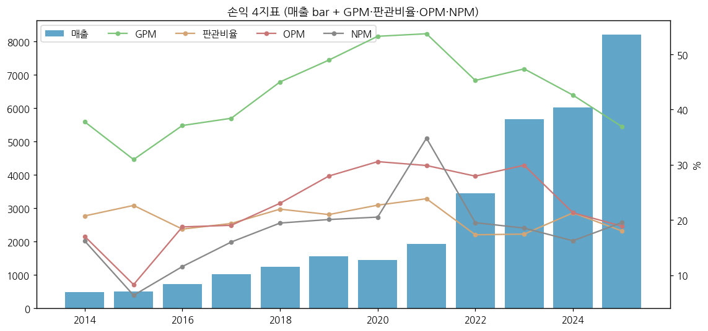

- 2021·2025 순이익은 디어유 관련 지분법·처분이익이 반영된 수치 (2025 관계기업투자처분이익 731.6억)
- 3Q26 누적(9M26): 매출 6,366억(+8.0% YoY), 영업이익 1,124억(−0.8%), OPM 17.7%

### ② 재무상태표 (12년, 억원)

| 항목 | 2014 | 2015 | 2016 | 2017 | 2018 | 2019 | 2020 | 2021 | 2022 | 2023 | 2024 | 2025 |
|---|---|---|---|---|---|---|---|---|---|---|---|---|
| 자산총계 | 739 | 741 | 866 | 1,244 | 1,593 | 2,078 | 2,239 | 3,174 | 4,111 | 5,715 | 6,788 | 8,511 |
| 유동자산 | 315 | 300 | 440 | 584 | 826 | 1,163 | 1,270 | 1,592 | 2,371 | 3,688 | 3,623 | 4,964 |
| 현금성자산 | 153 | 129 | 248 | 254 | 450 | 387 | 345 | 491 | 1,396 | 2,172 | 1,906 | 2,945 |
| 부채총계 | 179 | 153 | 195 | 387 | 314 | 455 | 377 | 668 | 1,066 | 1,735 | 1,959 | 2,261 |
| 유동부채 | 179 | 152 | 185 | 348 | 308 | 431 | 333 | 583 | 1,014 | 1,543 | 1,748 | 2,062 |
| 자본총계 | 560 | 588 | 670 | 858 | 1,280 | 1,623 | 1,862 | 2,506 | 3,045 | 3,980 | 4,829 | 6,249 |

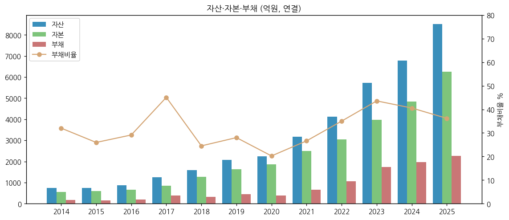

- 2024 유형자산 561억 → 1,402억: 건설중인자산 835억(신규 사옥 등 부동산 투자) 반영
- 차입금 사실상 없음 (부채 대부분 매입채무·선수금·미지급상여·리스부채)

### ③ 현금흐름표 (12년, 억원)

| 항목 | 2014 | 2015 | 2016 | 2017 | 2018 | 2019 | 2020 | 2021 | 2022 | 2023 | 2024 | 2025 |
|---|---|---|---|---|---|---|---|---|---|---|---|---|
| 영업CF | 84 | 49 | 154 | 271 | 224 | 509 | 221 | 458 | 876 | 1,512 | 893 | 1,243 |
| 투자CF | 3 | -32 | -38 | -287 | -137 | -588 | -203 | -256 | 171 | -607 | -998 | 29 |
| 재무CF | 0 | 0 | 0 | 25 | 105 | 10 | -55 | -65 | -128 | -131 | -220 | -225 |
| FCF(OCF−CapEx) | 63 | 6 | 154 | 16 | 94 | 490 | 181 | 447 | 728 | 1,382 | -221 | 1,018 |

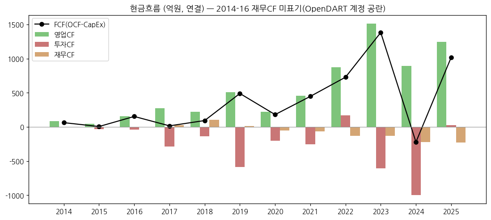

### ④ CapEx 추이 (12년, 억원)

| 항목 | 2014 | 2015 | 2016 | 2017 | 2018 | 2019 | 2020 | 2021 | 2022 | 2023 | 2024 | 2025 |
|---|---|---|---|---|---|---|---|---|---|---|---|---|
| 유형자산 취득 | 1 | 1 | 0 | 248 | 128 | 17 | 37 | 4 | 13 | 123 | 873 | 62 |
| 무형자산 취득 | 21 | 42 | 0 | 7 | 3 | 2 | 3 | 7 | 135 | 7 | 241 | 163 |
| 합계 | 21 | 42 | 1 | 255 | 130 | 20 | 40 | 11 | 148 | 130 | 1,114 | 225 |

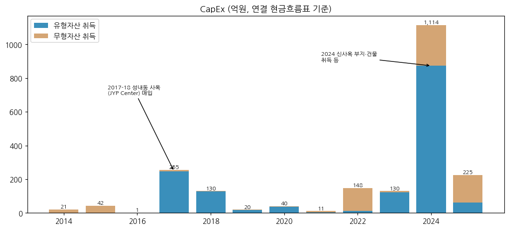

- 2017 유형 248억: 사옥 관련 취득 추정(원문 미확인) / 2024 유형 873억: 건설중인자산(신규 부동산) / 2024\~2025 무형 241·163억: 전속계약금(재계약)·개발중 무형자산

### ⑤ 부채구조

- 금융차입·사채 발행 이력 없음 (2015\~2025 연결 기준). 신용평가 미수령
- 2025말 부채 2,261억 = 매입채무 및 기타 723억 + 선수금 537억(공연·MD 선수) + 기타유동부채 436억(미지급상여 289억 등) + 당기법인세부채 308억 + 리스부채 93억
- 2025 정관 변경으로 교환사채 발행 한도 1,000억 → 8,000억 (자기주식 활용 여지)

### ⑥ 배당·자사주 추이

| 사업연도 | FY18 | FY19 | FY20 | FY21 | FY22 | FY23 | FY24 | FY25 |
|---|---|---|---|---|---|---|---|---|
| 주당배당(원) | 122 | 155 | 154 | 369 | 369 | 574 | 534 | 877 |
| 배당총액(억원) | 40 | 51 | 51 | 122 | 122 | 190 | 177 | 291 |
| 연결 배당성향 | - | 16.4% | 17.2% | 18.1% | 18.1% | 18.1% | 18.1% | 18.1% |

- 배당정책: 연결 순이익의 18.1% 고정 성향 (2021\~). FY21·FY22 DPS는 지급총액÷유통주식으로 역산
- FY25 배당수익률 1.4% (회사 공시) / 현 주가 기준 2.0%
- 자사주: 2,399,433주(6.75%) — 전량 2013 합병 시 취득분. 2018-10 389,411주 소각 이후 신규 매입 없음. "소각·임직원 보상 활용 고려" (2025 사업보고서)

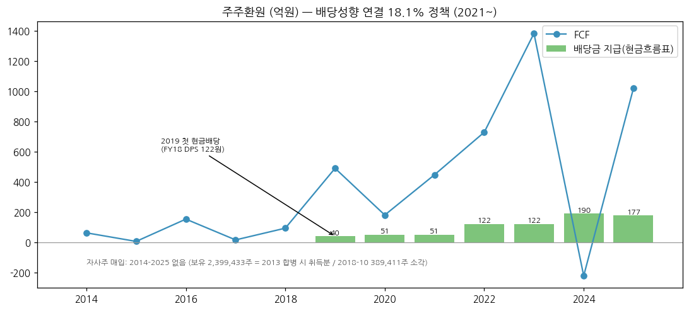

### ⑦ 재무 비율 (12년)

| 항목 | 2014 | 2015 | 2016 | 2017 | 2018 | 2019 | 2020 | 2021 | 2022 | 2023 | 2024 | 2025 |
|---|---|---|---|---|---|---|---|---|---|---|---|---|
| ROE(%) | 14.0 | 5.6 | 13.5 | 21.4 | 22.7 | 21.5 | 17.0 | 30.9 | 24.3 | 29.9 | 22.2 | 29.0 |
| ROA(%) | 10.6 | 4.4 | 10.6 | 15.5 | 17.1 | 17.0 | 13.7 | 24.9 | 18.5 | 21.4 | 15.6 | 21.0 |
| 부채비율(%) | 32.0 | 26.0 | 29.1 | 45.1 | 24.5 | 28.0 | 20.2 | 26.6 | 35.0 | 43.6 | 40.6 | 36.2 |
| 유동비율(%) | 177 | 197 | 237 | 168 | 268 | 269 | 381 | 273 | 234 | 239 | 207 | 241 |
| 현금/자산(%) | 20.8 | 17.4 | 28.7 | 20.4 | 28.2 | 18.6 | 15.4 | 15.5 | 34.0 | 38.0 | 28.1 | 34.6 |

- 이자보상배율: 이자비용 연 1\~3억(리스이자) 대비 영업이익 1,000억대 → 사실상 무의미(수백 배)

---

## 5. 지배 구조

### ① 그룹·계열 관계

- 독립 기업 (대기업집단 비소속). 최대주주 박진영(창업자·CCO)
- 연결 종속 11개사 (2025말): JYP Entertainment Japan(100%), JYP Entertainment Hong Kong(100%) → 북경걸위품문화교류(75%) 등 중국 5개사(일부 VIE 구조), (주)블루개러지(100%, MD), JYP America(100%), (주)제이와이피파트너스(100%, 신기술금융), (주)이닛엔터테인먼트(100%, 2024 설립)
- 2025 정리: JYP Publishing USA·제이와이피픽쳐스 청산, 제이와이피퍼블리싱 흡수합병
- 관계기업: **(주)디어유 10.0%** (2024말 18.05% → 2025 일부 처분, 2025말 공정가치 952억), 엘앤에스-JYP 스마트 투자조합 50%, 젠코스메티코스 27.3%, 리브뮤직 5.3%

### ② 주주 구분 (2026-09-30 기준, 3Q26 분기보고서)

| 주주 | 주식수 | 지분율 |
|---|---|---|
| 박진영 (최대주주) | 5,462,511 | 15.37% |
| 정욱 (대표이사, 특수관계) | 146,879 | 0.41% |
| 변상봉 (부사장, 특수관계) | 13,000 | 0.04% |
| 최대주주 등 합계 | 5,622,390 | 15.82% |
| 자기주식 | 2,399,433 | 6.75% |
| 소액주주 (166,498명) | 24,594,004 | 69.22% |

- 5% 이상 주주는 박진영·자기주식뿐. 국민연금 4.91%(2026-01-02 공시로 5% 미만 하회), 외국인 14.58%(2026-10-27) — 이전 작업자가 차트 작성 시 수집한 값, 외국인 시계열은 v1.1 보강 대상

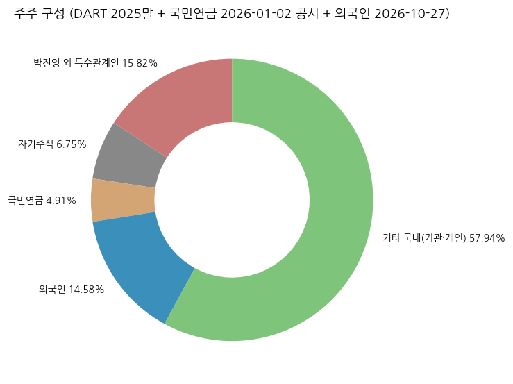

### ③ 임원·이사회 (2025말 사업보고서)

| 성명 | 직위 | 담당 | 비고 |
|---|---|---|---|
| 정욱 | 대표이사(사내이사) | CEO | 2011-02 취임, 1971년생 |
| 박진영 | 사내이사 | CCO (신인개발·제작 총괄) | 최대주주, 1972년생 |
| 변상봉 | 부사장(사내이사) | CFO | AICPA |
| 이지영 | 사내이사 | 신인개발본부·SQU4D 본부장 | 2011-07\~ |
| 박완 | 사외이사 | 감사·보상·ESG·투자심의위 | 삼화회계법인 회계사 |
| 공태용 | 사외이사 | 감사·보상·ESG·투자심의위 | 법무법인 예건 대표변호사 |
| 윤형근 | 사외이사 | 감사·보상위 | 메이머스트 전무 |
| 이정민 | 사외이사 | ESG위 | SDG Management School 교수 (2025-03 선임) |

- 미등기: 신현국(CSO, Global Business Center), 정민종(CTO), 신정철(CISO) / 2PM 김민준·닉쿤·장우영 비상근 이사
- 이사회 8인 중 사외이사 4인, 감사위원회 전원 사외이사

---

## 6. 기타 팩트

### ① R&D 인프라 (= 신인 개발)

- 엔터 기획사 특성상 R&D 비용 항목 없음 → **신인개발본부**(캐스팅팀·트레이닝팀)가 R&D에 해당. 판관비 내 신인개발비 8.5억(2025)·11.2억(2024)
- 박진영 CCO 총괄, 이지영 본부장 캐스팅·트레이닝 — TWICE·Stray Kids·ITZY·NMIXX 등 배출
- 현지화 오디션: Nizi Project(소니뮤직, 2020·2023), A2K(Republic Records, 2023), 중국 현지 그룹(TME 합작 BOY STORY 등)
- chart7은 R&D 대신 임직원 수·1인당 매출로 대체

### ② 진행 중 corporate action — 10년치

| 시점 | 내용 |
|---|---|
| 2017 | 유형자산 248억 취득 (JYP Center 사옥 관련 추정 — 원문 미확인) |
| 2018-10 | 자기주식 389,411주 소각 |
| 2020\~2021 | 디어유 투자 → 2021-11 코스닥 상장 |
| 2022 | JYP USA 설립·연결 편입 (Beyond Live Corporation 전략 투자는 사업보고서 언급, 시점 미확인) |
| 2023 | 중국 북경신성오락 등 연결 편입(종속기업 취득 현금 50억), 제이와이피파트너스(CVC) 설립, Live Nation 파트너십 |
| 2024 | 이닛엔터테인먼트 설립, JYP360 → 블루개러지 사명 변경, 신규 부동산(건설중인자산 835억) |
| 2025 | 디어유 지분 일부 처분(현금 975억 유입, 처분익 732억), 퍼블리싱 흡수합병·해외 퍼블리싱 청산, 정관 변경(배당기준일 이사회 결정·교환사채 한도 8,000억) |
| 2026 | 리브뮤직 지분 5.3% 투자(2025말), 워너 재팬과 NMIXX 일본 데뷔 협업 |

### ③ IP·라인업 마일스톤 — 10년치

| 연도 | 데뷔 / 재계약 |
|---|---|
| 2015 | DAY6, TWICE 데뷔 |
| 2018 | Stray Kids, BOY STORY 데뷔 / 2PM 재계약 |
| 2019 | ITZY 데뷔 |
| 2020 | NiziU, YAOCHEN 데뷔 |
| 2021 | Xdinary Heroes 데뷔 |
| 2022 | NMIXX 데뷔 / TWICE·DAY6 재계약 |
| 2024 | GIRLSET, NEXZ 데뷔 / 2PM 재계약 |
| 2025 | KickFlip, CIIU 데뷔 / Stray Kids·DAY6·BOY STORY 재계약 |
| 2026 | dodree 데뷔 / ITZY 재계약 |
| 2027(예정) | oftheblue(SQU4D 4인조 보이그룹) 1/11 데뷔 |

### ④ 주요 리스크

- **IP 집중도**: Stray Kids·TWICE 2개 IP 의존도가 높음 — 멤버 군입대·재계약 조건 변화가 실적에 직결 (재계약 시 정산 비율 상향 → OPM 하락 경로를 2024\~2025에 확인)
- **앨범 판매 정점 통과**: K-POP 앨범 Top400 판매량 2023 정점 후 2024\~2025 조정 (사업보고서 인용) — 중국 공구 수요 변동
- **중국 리스크**: 중국 종속회사 일부가 VIE 구조 (외국인 투자 규제 변경 시 구조 변경 가능성), 한한령류 정책 리스크
- **환율**: 매출 57%가 수출 (엔화·달러) — 원화 강세 시 매출·이익 감소
- **원가 구조 변화**: 콘서트 총매출 인식·MD 확대로 원가율 상승, 재고평가손실(2024 74억·2025 43억)
- **소송·우발채무**: 사업보고서상 중요한 진행 소송 없음 (원문 기준, 2025말)

### ⑤ ESG 등급

- K-RE100 국내 엔터 최초 참여 (2021\~ 본사 전력 100% 재생에너지, 2024\~ 블루개러지 포함)
- ESG위원회 운영(사외이사 중심), 2025 정관에 ESG 전문 신설
- 한국ESG기준원(KCGS) 등급: **미확보** (다음 버전에서 보강)

### ⑥ 인증·라이선스

- 상표권: 국내 등록 628건·해외(40개국) 등록 1,204건 (2025말)
- 중견기업 해당 (중소·벤처 미해당)

---

## Version Log

| 버전 | 일자 | 내용 |
|---|---|---|
| v1.0 | 2026-11-15 | 최초 작성 — OpenDART 재무(2015\~3Q26) + 정기보고서 원문(2014.12\~2026.09) + IR PDF 18건 + Yahoo 월간 시세. 차트 13종(chart1·1b·2·2b·4·5·6·7·8·9·10·11·12) |

**잔여 보완 후보 (v1.1)**
- 2014년 이전 손익 (2013 합병 전후 비교 불가 — 합병 전 상장사 JYP Ent.는 별도 법인)
- IR PDF 사업부(음반/MD/공연/출연/광고) 분기 시계열을 DART 매출유형 시계열과 병행 표기 (IR은 2022\~만 확보)
- 외국인 지분율 정확한 시계열(KRX), KCGS ESG 등급
- 2024 건설중인자산(835억) 용도 원문 확인
- 재계약 연도는 3Q26 IR 「Artist Line-up Expansion」 표의 열 위치를 판독한 값 — 공시·보도로 교차 확인 필요

