> Ticker: **Borsa Italiana (Euronext Milan): LDO — Leonardo S.p.A.** (FTSE MIB) / 미국 자회사 **Leonardo DRS (NASDAQ·TASE: DRS, 지분 약 71.4%)**
> Entity: **Leonardo S.p.A.** (본사 Rome, Italy) — 옛 Finmeccanica. 이탈리아 정부(경제재정부 MEF) 30.2% 보유 국영 방산·항공우주 그룹. 방산전자(유럽 + 미국 DRS + 2026-03 인수 IDV)·헬기(AgustaWestland·PZL-Świdnik)·항공(전투기·훈련기·항공구조물)·사이버·우주(JV) 5개 사업 섹터
> Sector: 방산 — 서브섹터 **방산 글로벌** (한국 5사 비교 피어: 한국항공우주·한화시스템·한화에어로스페이스·현대로템·LIG D&A)
> 작성 시각: **2026-11-14 KST** (**v1.0** — Phase 1 Source 전수 수집 + audit + 13종 차트)
> 적용 구조: v4.8 (6개 섹션) — 해외 기업 표준 (ENR·GEV 예시 준용)
> 데이터 범위: **연간 9년 (2017~2025, 12월 결산)** + **2026 9M** + **분기 그룹 16Q (4Q22~3Q26)** + **분기 섹터 10Q (2Q24~3Q26)** + **LDO.MI 주가 20년 (2006-11~2026-11-13)**
> 출처: **Leonardo IR 보도자료 (eMarket Storage 규제공시 원문 PDF) — FY2018·FY2020·FY2021·FY2023·FY2024·FY2025 연간 / 1Q·1H·9M 2024~2026 분기 (총 13건)**, 9M2026 보도자료 (2026-11-05), 2027 재무 캘린더 (2026-11-02), 주주현황 페이지, Industrial Plan 2024, 3Q/9M 2024 발표자료, **Yahoo Finance LDO.MI**, 보도 (Il Sole 24 Ore·Börsen-Zeitung·MF Milano Finanza·Finimize·Defense News)
> ⚠️ **FY2026 연간 실적 + 2027~2031 Industrial Plan: 2027-03-03 이사회 승인, 3-04 장 전 발표 예정** (회사 2027 재무 캘린더) — 발표 후 v1.1 갱신

# Leonardo 기업 개요 (v1.0 — 방산 글로벌 / 이탈리아 국영 방산 / 재무장 가속 국면)
> **Fact verify cutoff**: 2026-11-14 (주가 2026-11-13 종가 **€50.10**, 52주 고가 €66.26 (2026-03-12, ATH) / 저가 €44.25 (2026-06-26) [Yahoo Finance LDO.MI], 시가총액 **약 €29.0bn** [계산: €50.10 × 발행주식 578.15백만주])

## Phase 1 Source Audit

```
=== 자료 수집 audit (Leonardo S.p.A.) ===

✅ 확보 (총 22개 파일, 저장: company-overview-source/LDO/)
- 연간 결과 보도자료 6건: FY2018(2017 비교), FY2020(2019), FY2021, FY2023(2022), FY2024(2023 restated), FY2025(2024 UAS 제외 restated) → 2017~2025 9년 KPI·재무상태·현금흐름
- 분기 보도자료 7건: 1Q24·1H24·9M24·1Q25·1H25·9M25·1Q26·1H26·9M26 → 분기 단독(1Q·2Q·3Q·4Q) 그룹·섹터 표 (회사가 분기 단독 섹터 표를 직접 공시)
- 3Q/9M 2024 Results Presentation, Industrial Plan 2024 (2024-03-12)
- 9M2026 보도자료 웹페이지·2027 재무 캘린더·주주현황 페이지 (HTML)
- Yahoo Finance v8 LDO.MI 월간 20년 + 일간 1년

❌ 누락 (4)
- 2016년 이전 연간: FY2016·FY2017 보도자료 미수집 → 12년 대신 9년(2017~2025)
- Annual Report 본문(연결재무제표 전체·총자산·R&D 회계처리·매출처): 미수집 → 재무상태는 보도자료 "재분류 재무상태표"(순투하자본·자본·순부채)로 대체
- 컨퍼런스콜 트랜스크립트(3Q26): 공개 텍스트 미확보 → 기사(Il Sole 24 Ore·Börsen-Zeitung·Finimize·MF)로 대체
- 주주 명부 상세: 회사 공시는 3% 초과 보유자(MEF)만 → 기관/개인 분리 불가

⚠️ 결과 영향
- EBITA 정의 단절 2회: ① 2023 KPI 개정(전략 JV 평가 반영, 2023 1,289 → 1,317 restated) ② 2025 UAS 사업 매각 → 2024 비교치 UAS 제외 restated (매출 17,763 → 17,592, EBITA 1,525 → 1,482). 연간 표는 각 연도 최신 공시값(2023 restated, 2024 reported) 사용
- 섹터 재편: 2025부터 Defence Electronics & Security → Defence Electronics + Cyber & Security 분리, Aircraft·Aerostructures → Aeronautics 통합(GCAP·GIE ATR 편입). 2026-03-18부터 IDV 연결(Defence Electronics 내)
- Aircraft BU 분기값은 1Q·1H·9M 누계 차감 `[역산]`
- 시가총액 20년 차트는 현재 발행주식수(578.15백만주) 고정 가정 `[계산]` — 과거 증자 미반영
- 2026-06 이후 MEF 지분 변동 여부 미확인 (회사 페이지 "Updated March 2025")

Source 6종 audit:
[V] (1) 정기 보고서 → [△] 연간 보도자료로 대체 (Annual Report 본문 미수집)
[V] (2) IR 분기 결과 (9M2026까지, 분기 단독 섹터 표 포함) ✓
[△] (3) Sustainability → FY25 보도자료 ESG 요약(R&D·인력·탄소)만
[V] (4) 주가 (Yahoo LDO.MI 20년) ✓
[V] (5) 전략·계획 (Industrial Plan 2024, 2026 가이던스 3차 수정 이력) ✓
[△] (6) 12년 시계열 → 9년
→ 4.5/6. 최신 분기(3Q26) 확보.
```

---

## ① 기업 분류

(1) Primary / Secondary 분류

**Primary 분류: 지속성장 (정부 수요 기반 안정 마진) → 2024~ 유럽 재무장으로 성장 가속**

→ ROS(EBITA/매출) 9년 범위 **7.0%(2020) ~ 9.2%(2017)**, 평균 **8.5%** [계산] — 진폭 2.2%p로 사이클주가 아님
→ 매출 2017~2023 연 +4% 내외 → **2024 +16.2%, 2025 +9.8%, 2026 가이던스 +13.3%(IDV 포함)** — 성장률 2배 이상 상향
→ 신규수주 Book-to-bill 2017 0.99 → **2025 1.22 → 9M26 약 1.5**, 수주잔고 €33.5bn(2017) → **€60.4bn(2026-09)**

**Secondary 노트: 민항 노출 (헬기 상업 28% + 항공구조물 + ATR)**

→ 2020 COVID 때 ROS 7.0%, EBITA -25% — 민항 헬기·B787 동체·ATR 감산이 원인. 방산 단독 기업보다 민항 사이클 노출이 크다
→ 항공구조물(Aerostructures)은 2022~2025 연 €-130~-190m 적자 지속, 2026 €약 -0.1bn 전망(회사 컨콜, Quartr 요약) — 그룹 마진 1%p 이상 희석

**5개 사업 섹터 (9M26 기준, EBITA = 회사 주 지표)**

| 섹터 | 매출 €m | 비중 | EBITA €m | ROS | 성격 |
|---|---|---|---|---|---|
| Defence Electronics (유럽 전자 + Leonardo DRS + IDV) | 7,149 | 46.6% | 895 | 12.5% | 방산 100% |
| Helicopters | 4,317 | 28.1% | 347 | 8.0% | 정부 72% / 민수 28% (9M26 수주 기준) |
| Aeronautics (Aircraft BU + Aerostructures + GIE ATR) | 3,002 | 19.6% | 184 | 6.1% | Aircraft = 군용(유로파이터·M-346·F-35 날개·GCAP), 나머지 민항 |
| Cyber & Security Solutions | 623 | 4.1% | 56 | 9.0% | 정부 IT·보안 |
| Space (Telespazio 67% + 제조, TAS 33% 지분법) | 777 | 5.1% | 38 | 4.9% | 이중용도 |
| 기타·내부거래 | (521) | | (219) | | 본사·GCAP 외 |
| **합계** | **15,347** | | **1,301** | **8.5%** | |

→ (출처: Leonardo 9M2026 보도자료 p.5·16, 2026-11-05. 섹터 비중은 내부거래 전 합 기준 [계산])
→ **방산 기준(섹터 리뷰용) = Defence Electronics + Helicopters + Aircraft BU**: 9M26 매출 €13,839m, EBITA €1,518m [계산·Aircraft BU 분기 역산 포함]. 헬기 민수(약 28%)는 분리 공시가 없어 포함, 항공구조물·ATR·사이버·우주는 제외

(2) Summary Box (9년 시계열)

| 지표 | 값 |
|------|-----|
| 매출 CAGR (2017→2025, 8년) | **+6.6%/yr** [계산] (2023→2026G 3년 **+13.0%/yr**) |
| EBITA CAGR (2017→2025) | **+6.3%/yr** [계산] (2025→2026G **+26.1%**) |
| ROS 평균 (9년) | **8.5%** [계산] |
| ROS 정점 / 저점 | 9.2% (2017·2018) / **7.0% (2020 COVID)** — 2026 가이던스 **10.0%** (사상 첫 두 자릿수 목표) |
| 사이클 | 뚜렷한 사이클 없음 (진폭 2.2%p). 단 2020 1회 민항 쇼크 |
| 순부채/EBITDA | 1.6배(2017) → **0.41배(2025)** → 9M26 IDV 인수로 순부채 €3.3bn |

```
[Leonardo 9년 KPI 시계열 (€m, 12월 결산)]  * EBITA는 각 연도 최신 공시 기준
연도   신규수주   수주잔고    매출     EBITA   ROS    순이익   FOCF   그룹순부채
2017   11,595   33,507   11,734   1,077   9.2%     279    537    2,579   ← Book-to-bill 1 미만, 매출 IFRS15 restated (2017-01 사명 Leonardo)
2018   15,124   36,118   12,240   1,120   9.2%     510    336    2,351   ← 신규수주 +30% 회복
2019   14,105   36,513   13,784   1,251   9.1%     822    241    2,847   ← 매출 +12.6%, 코로나 전 정점
2020   13,754   35,516   13,410     938   7.0%     243     40    3,318   ← 저점: COVID — 민항 헬기·B787·ATR 감산, Aerostructures 적자 확대
2021   14,307   35,534   14,135   1,123   7.9%     587    209    3,122   ← 회복
2022   17,266   37,506   14,713   1,218   8.3%     932    539    3,016   ← 우크라이나 전쟁 → 유럽 국방비 상향 시작, DRS-RADA 합병·재상장(11월)
2023   17,926   39,529   15,291   1,317   8.6%     695    635    2,323   ← Cingolani CEO 취임(5월), Hensoldt 지분 인수(1월), KPI 개정(2023 restated)
2024   20,945   44,178   17,763   1,525   8.6%   1,159    826    1,795   ← 매출 +16.2%, Rheinmetall 지상장비 JV(LRMV) 설립
2025   23,782   46,624   19,503   1,752   9.0%   1,334  1,011    1,001   ← UAS 매각, 수주·EBITA 레코드, IDV 인수 계약
9M26   23,270   60,372   15,347   1,301   8.5%     792    (68)   3,325   ← IDV 연결(3/18), 잔고 €60bn 돌파, CEO Mariani 교체
2026G  ~29,500      —    ~22,100  ~2,210  ~10.0%     —   ~1,370  ~2,200   ← 11월 3차 수정 (수주만 상향)
```

→ (출처: 각 연도 연간 보도자료 KPI 표, 9M2026 보도자료. 2017 = FY2018 보도자료의 비교치, 2019 = FY2020 비교치, 2022 = FY2023 비교치)

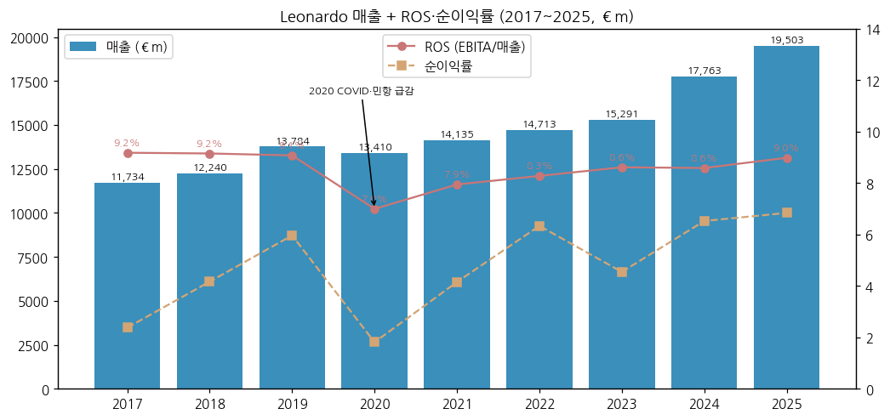

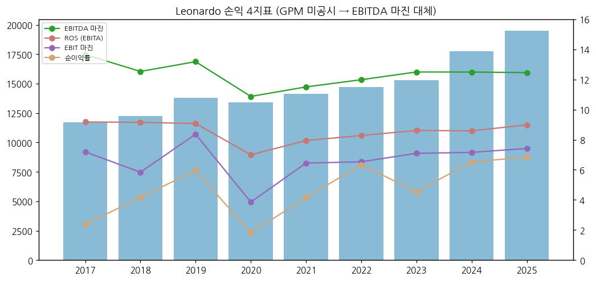

**한국 방산 5사 겹침 매핑 (경쟁·시장)**

| Leonardo 제품·사업 | 한국 경쟁 제품 | 겹치는 시장 |
|---|---|---|
| AW149 (8t급 다목적 헬기), AW101 (15t급), AW169M·AW139M | **한국항공우주 수리온(KUH-1)·LAH** | 폴란드(PZL-Świdnik 생산 AW149 32대, 2022), 영국 NMH(AW149 23대, 2026 수주), 중동·동남아 군경 헬기 |
| M-346 고등훈련기 (M-346FA 경공격) | **한국항공우주 T-50/FA-50** | 2026 오스트리아·이탈리아 M-346 수주, 폴란드(FA-50PL vs M-346 기존 운용), 동남아·남미 훈련기 |
| 방산전자: AESA 레이더(RAVEN·Kronos·BMD+ 지상레이더), 전자전, 함정 전투체계 | **한화시스템** (KF-21 AESA·TICN·함정 전투체계), **LIG D&A** (레이더·유도무기) | 그리펜용 RAVEN 레이더 수출, 중동 함정 전투체계(쿠웨이트 Falaj 3), 유럽 방공(SAMP-T NG) |
| Leonardo DRS 통합전기추진 | (공급 관계) 한국 KDDX 구축함 | DRS가 KDDX 통합전력추진 수주(9M26) — 경쟁이 아니라 한국 조선 2사 공급망 |
| IDV(장갑차·전술트럭) + LRMV(Rheinmetall JV: Panther 전차·Lynx IFV) | **현대로템 K2**, **한화에어로스페이스 K9·레드백** | 이탈리아 A2CS/MBT 프로그램(LRMV 독점), 루마니아 IFV·전술트럭(IDV 860대 추가), 남미(브라질 Centauro) |

→ 이탈리아·폴란드는 Leonardo의 내수급 시장(이탈리아 본사·폴란드 PZL-Świdnik 공장)이라 한국 업체 진입 시 **현지 생산·EU 조달(SAFE) 조건**에서 구조적 열위 `[판단]`

(3) 분류 결정 논리

→ ROS 진폭이 작고 정부 수요가 매출의 대부분이라 "사이클"이 아니라 "지속성장"이 맞다
→ 다만 2024~2026 성장률 가속은 **유럽 재무장 + M&A(IDV)** 두 요인이 섞여 있다. 9M26 기준 IDV 제외 매출 +9.0%, EBITA +29.3% — 이익 가속은 인수 효과가 아니라 마진 개선이 주도
→ 2026 가이던스 ROS 10%가 달성되면 2017~2025 박스권(7~9%)을 처음 벗어난다

(4) 적정 밸류에이션 방법

→ 1순위 **EV/EBITA** — EV 약 €33.5bn (시총 €29.0bn + 순부채 €3.3bn + 소수주주지분 €1.2bn) / 2026G EBITA €2.21bn = **약 15.2배** [계산]
→ 2순위 **SOTP** — Leonardo DRS 상장 시가(71.4%) + 지분법 JV(MBDA 25%, Hensoldt 22.8%, TAS 33%, ATR 50%)를 분리 평가 (이탈리아 증권사 Equita가 SOTP 사용, Il Sole 24 Ore 인용)
→ 보조 P/E (조정 EPS 9M26 €1.243)

(5) 분기 재평가 트리거

→ ① 2027-03 Industrial Plan 2027~2031: 중기 EBITA 목표·항공구조물 JV 재편 여부
→ ② ROS 두 자릿수(2026G 10%) 달성 여부 — 4Q26 implied ROS 13.5%
→ ③ 우주 3사 통합(Airbus·Thales·Leonardo, "Bromo") 승인·연결 범위
→ ④ 항공구조물 손익분기 시점 (B787 증산)

---

## ② 회사 개요

(1) 기본 사항

→ **회사명**: Leonardo S.p.A. (2017-01 Finmeccanica에서 사명 변경, 1948 설립)
→ **사업 한 줄 정의**: 이탈리아 정부가 최대주주인 유럽 대형 방산·항공우주 그룹 — 헬기(AgustaWestland) 세계 선두권, 유럽 방산전자 강자, 유로파이터·GCAP·F-35 파트너 `[판단]`
→ **본사**: Rome / 주요 생산 거점: 이탈리아·영국·폴란드·미국 (회사 소개문)
→ **인력**: 67,313명 (2026-09, IDV 포함)
→ **CEO**: Lorenzo Mariani (2026-05 선임, 정부 지명) / **의장**: Francesco Macrì (2026-05-07 주총)

(2) 손익·자본 추이

| 연도 | 매출 €m | EBITA | EBIT | 순이익 | 자본 | 순투하자본 | 인력 |
|---|---|---|---|---|---|---|---|
| 2017 | 11,734 | 1,077 | 844 | 279 | 4,213 | 6,790 | 45,134 |
| 2018 | 12,240 | 1,120 | 715 | 510 | 4,510 | 6,854 | 46,462 |
| 2019 | 13,784 | 1,251 | 1,153 | 822 | 5,334 | 8,112 | 49,530 |
| 2020 | 13,410 | 938 | 517 | 243 | 5,278 | 8,549 | 49,882 |
| 2021 | 14,135 | 1,123 | 911 | 587 | 6,455 | 9,560 | 50,413 |
| 2022 | 14,713 | 1,218 | 961 | 932 | 7,699 | 10,690 | 51,392 |
| 2023 | 15,291 | 1,317 | 1,085 | 695 | 8,561 | 10,924 | 53,566 |
| 2024 | 17,763 | 1,525 | 1,271 | 1,159 | 10,200 | 11,843 | 60,468 |
| 2025 | 19,503 | 1,752 | 1,447 | 1,334 | 10,740 | 11,729 | 62,762 |

→ (출처: 각 연도 연간 보도자료. 순이익 = 소수주주 포함 Net result. 2018·2019·2022 순이익은 처분이익 등 일회성 포함)

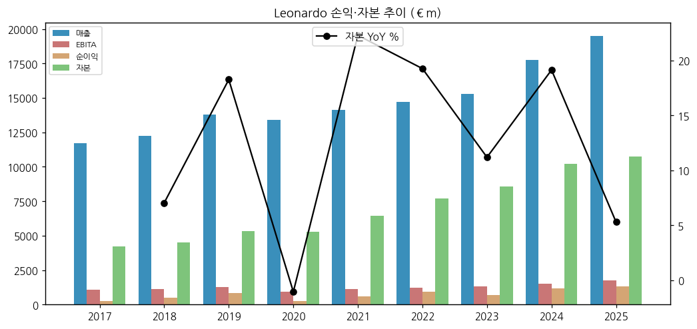

(3) 주가 역사

→ 2007 약 €12bn(시총) → **2011-11 유럽 재정위기·Finmeccanica 손상 → €2bn 이하 저점** → 2015~2017 Moretti 구조조정으로 €8~9bn → 2020 COVID €3bn대 → **2022-02 우크라이나 전쟁 이후 재평가 시작** → 2024~2025 유럽 재무장으로 3배 → **2026-03-12 ATH €66.26** → 2026-11-13 €50.10 (ATH 대비 -24%) [Yahoo Finance LDO.MI]
→ 2026 하락 요인: 6월 저점 €44.25 이후 회복했으나 11월 9M 발표 후 가이던스 미상향·Rheinmetall 실적 경고로 이틀간 약 -6% (11/4 €51.12 → 11/6 €48.07)

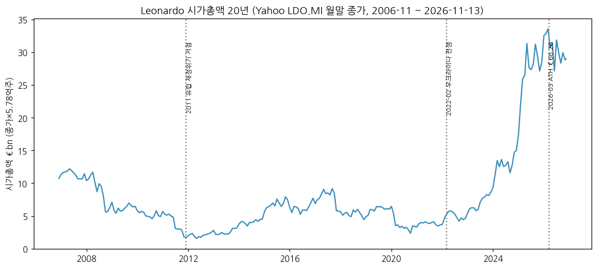

(4) 주요 연혁

| 시점 | 사건 |
|---|---|
| 1948 | Finmeccanica 설립 (IRI 산하) |
| 2000~2004 | Agusta + Westland 합병 → AgustaWestland (2004 100%) |
| 2008 | DRS Technologies 인수 (미국) |
| 2016~2017 | 사업부 통합 "One Company", 사명 Leonardo |
| 2010~ | PZL-Świdnik(폴란드) 인수(2010) — 폴란드 헬기 생산 거점 |
| 2022-11 | Leonardo DRS + RADA 합병, NASDAQ 재상장 |
| 2023-01 | Hensoldt 지분 인수 (현재 22.8%) |
| 2024~2025 | Rheinmetall과 지상장비 JV(LRMV) 설립 |
| 2025-01 | UAS(수중무기) 사업 Fincantieri에 매각 |
| 2026-03-18 | **Iveco Defence Vehicles(IDV) 인수 완료 (€약 1.6bn)** |
| 2026-05 | CEO Cingolani → **Mariani** 교체 (정부 지명) |
| 2026 | Baykar와 무인기 JV(LBA Systems), Airbus·Thales와 우주 통합 추진, DRS의 Raft 인수($450m, 4Q 종결 예정) |

---

## ③ 비즈니스 모델

(1) 실적 추이 통합 표 (섹터별, €m)

| 섹터 | 항목 | 2023 | 2024 | 2025 | 9M25 | 9M26 | 9M YoY |
|---|---|---|---|---|---|---|---|
| Defence Electronics | 매출 | 6,955* | 7,583 | 8,350 | 5,817 | 7,149 | +22.9% |
| | EBITA | 840* | 970 | 1,075 | 667 | 895 | +34.2% |
| | ROS | 12.1% | 12.8% | 12.9% | 11.5% | 12.5% | +1.0%p |
| Helicopters | 매출 | 4,725 | 5,249 | 5,833 | 4,095 | 4,317 | +5.4% |
| | EBITA | 422 | 465 | 523 | 320 | 347 | +8.4% |
| | ROS | 8.9% | 8.9% | 9.0% | 7.8% | 8.0% | +0.2%p |
| Aeronautics | 매출 | 3,574** | 3,816 | 4,238 | 2,799 | 3,002 | +7.3% |
| | EBITA | 288** | 278 | 326 | 96 | 184 | +91.7% |
| | ROS | 8.1% | 7.3% | 7.7% | 3.4% | 6.1% | +2.7%p |
| Cyber & Security | 매출 | 594 | 648 | 798 | 532 | 623 | +17.1% |
| | EBITA | 36 | 49 | 80 | 41 | 56 | +36.6% |
| Space | 매출 | — | 906 | 1,007 | 702 | 777 | +10.7% |
| | EBITA | 20 | 31 | 59 | 30 | 38 | +26.7% |
| **그룹** | 매출 | 15,291 | 17,592 | 19,503 | 13,444 | 15,347 | +14.2% |
| | EBITA | 1,317 | 1,482 | 1,752 | 945 | 1,301 | +37.7% |

→ (출처: FY2024 보도자료 2023 섹터 표, FY2025 보도자료 2024(UAS 제외)·2025 섹터 표, 9M2026 보도자료. *2023 Defence Electronics & Security(UAS 포함, Cyber 분리 후). **2023 Aeronautics = Velivoli + Aerostrutture 단순 합 [계산], GIE ATR·GCAP 미포함 — 2025 기준과 불일치. 2023 Space 매출은 지분법 구조상 표기 없음)
→ 9M26 이익 증가분 €356m 중 Defence Electronics +€228m(64%), Aeronautics +€88m(25%) — **이익 가속은 방산전자와 항공구조물 적자 축소가 끈다** [계산]

(2) 사업부별 분기 시계열 (10Q)

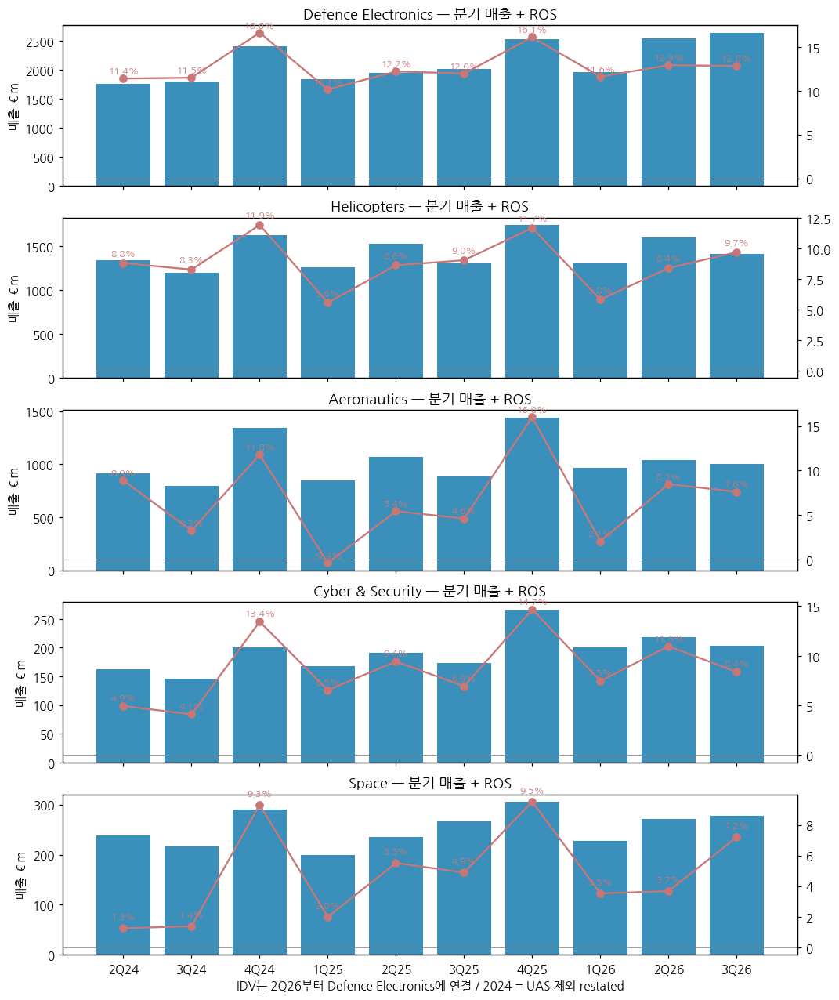

→ 4분기 계절성이 크다 — 정부 인도·검수가 연말 집중, 4Q ROS가 연중 최고(4Q25 13.3%). 1Q는 연중 최저(5~6%)

(3) 분기 그룹 시계열 (15Q)

| 분기 | 1Q24 | 2Q24 | 3Q24 | 4Q24 | 1Q25 | 2Q25 | 3Q25 | 4Q25 | 1Q26 | 2Q26 | **3Q26** |
|---|---|---|---|---|---|---|---|---|---|---|---|
| 신규수주 | 5,710 | 4,542 | 4,397 | 6,129 | 6,886 | 4,357 | 6,965 | 5,574 | 9,002 | 7,257 | **7,011** |
| 매출 | 3,620 | 4,282 | 4,054 | 5,636 | 4,159 | 4,760 | 4,525 | 6,059 | 4,448 | 5,555 | **5,344** |
| EBITA | 179 | 326 | 265 | 712 | 211 | 370 | 364 | 807 | 281 | 499 | **521** |
| ROS | 4.9% | 7.6% | 6.5% | 12.6% | 5.1% | 7.8% | 8.0% | 13.3% | 6.3% | 9.0% | **9.7%** |

→ (출처: 2025·2026 각 분기 보도자료의 분기 단독 표. 2024 = UAS 제외 restated 비교치. 2023 분기는 chart10 참조)

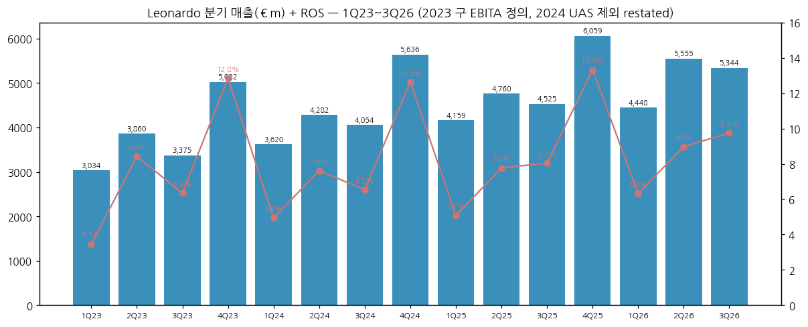

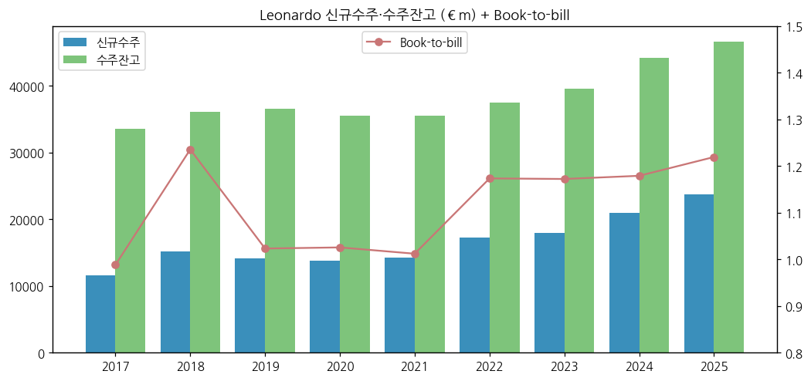

(4) 사업부별 개요·디테일

① **Defence Electronics (9M26 매출 46.6%, EBITA 69%)**
→ 유럽 전자(Electronics Europe, IDV 포함): 9M26 매출 €4,729m, EBITA €621m(13.1%). IDV 제외 매출 +14.9%. 주력: AESA 레이더(RAVEN·Kronos·지상 BMD+), 전자전, 함정 전투체계, 항공전자, 방공(SAMP-T NG 레이더), MBDA 25%·Hensoldt 22.8% 지분법
→ Leonardo DRS(미국, 지분 약 71.4%): 9M26 $2,825m(+9.2%), EBITA $318m(+30.9%) — 함정 전기추진(Columbia급 잠수함), M-SHORAD, 적외선 센서, 대드론
→ IDV(2026-03-18 연결): 전술트럭·장갑차(Centauro·SUPERAV), 인수 시 수주잔고 약 €6bn 추가. 9M 기여 매출 약 €688m·EBITA €79m [계산: 연결 − 동일범위]

② **Helicopters (28.1%)**
→ AW139·AW169·AW189 민간·이중용도, AW149·AW101·NH90(지분)·AW159 군용. 9M26 인도 120대(9M25 115대). 수주의 72%가 정부
→ PZL-Świdnik(폴란드): AW149 폴란드군 32대(2022) 생산 거점 — KAI 수리온의 폴란드·동유럽 진입 시 직접 경쟁 `[판단]`
→ 회사 2026 목표: 매출 약 +4%, ROS 9.2% (3Q26 컨콜, Quartr 요약 ⚠️)

③ **Aeronautics (19.6%)**
→ Aircraft BU: 유로파이터(이탈리아·독일·튀르키예·쿠웨이트), **M-346 훈련기**(2026 오스트리아·이탈리아 PAN), C-27J, F-35 날개(9M26 39세트), **GCAP**(영·일·이 6세대 전투기). 9M26 ROS 11.6%
→ Aerostructures BU: B787 동체·수평안정판, ATR 동체, A220. 9M26 매출 +44.1%이나 EBITA -€88m(ROS -12.0%)
→ GIE ATR(50%, 지분법): 9M26 인도 16대(11대)

④ **Cyber & Security**: 이탈리아 공공 클라우드(PSN), 영국 BeCrypt 인수(2026-04)
⑤ **Space**: Telespazio(67%) 위성 서비스 + Thales Alenia Space(33%) 제조. Airbus·Thales와 우주 통합 추진

(5) 주요 경쟁사

| 섹터 | 글로벌 경쟁 | 한국 경쟁 |
|---|---|---|
| 헬기 | Airbus Helicopters, Sikorsky(LMT), Bell(Textron) | **한국항공우주** (수리온·LAH·KUH 수출형) |
| 훈련기·전투기 | Boeing-Saab T-7, Aero L-39NG / Dassault·Saab | **한국항공우주** (T-50·FA-50·KF-21) |
| 방산전자·레이더 | Thales, Hensoldt(지분), Saab, RTX, Elbit | **한화시스템**, **LIG D&A** |
| 지상장비(IDV·LRMV) | KNDS, GDELS, Patria, Rheinmetall(JV 파트너) | **현대로템** (K2), **한화에어로스페이스** (K9·레드백) |
| 미사일(MBDA 25%) | RTX, Kongsberg, Diehl | **LIG D&A** |

(6) 주요 매출처

→ 회사는 고객별 매출을 공시하지 않음. 수주 공시 기준 주요 고객 순서 `[추정]`: ① 이탈리아 국방부 ② 영국 국방부(헬기·전자) ③ 미국 국방부(DRS) ④ 유로파이터 컨소시엄·쿠웨이트 ⑤ 폴란드 국방부 ⑥ Boeing·Airbus(항공구조물)

(7) 생산·인력

→ 인력 45,134명(2017) → 62,762명(2025) → 67,313명(2026-09, 2025년 말 대비 +4,551명 — 대부분 IDV 편입 `[추정]`)
→ 섹터별 인력(9M26): Defence Electronics 28,529 / Helicopters 14,552 / Aeronautics 12,942 / Space 4,229 / Cyber 3,418 / 기타 3,643

---

## ④ 재무 구조

(1) 손익 (9년)

| 연도 | 매출 YoY | EBITA YoY | EBITDA 마진 | ROS | EBIT 마진 | 순이익률 |
|---|---|---|---|---|---|---|
| 2018 | +4.3% | +4.0% | 12.5% | 9.2% | 5.8% | 4.2% |
| 2019 | +12.6% | +11.7% | 13.2% | 9.1% | 8.4% | 6.0% |
| 2020 | -2.7% | -25.0% | 10.9% | 7.0% | 3.9% | 1.8% |
| 2021 | +5.4% | +19.7% | 11.5% | 7.9% | 6.4% | 4.2% |
| 2022 | +4.1% | +8.5% | 12.0% | 8.3% | 6.5% | 6.3% |
| 2023 | +3.9% | +8.1% | 12.5% | 8.6% | 7.1% | 4.5% |
| 2024 | +16.2% | +15.8% | 12.5% | 8.6% | 7.2% | 6.5% |
| 2025 | +9.8% | +14.9% | 12.5% | 9.0% | 7.4% | 6.8% |

→ (출처: 연간 보도자료 [계산]. GPM은 미공시)

(2) 재무상태 (재분류 기준)

→ 순투하자본 €6.8bn(2017) → €11.7bn(2025) → €14.5bn(2026-09, IDV)
→ 그룹 순부채 €2.6bn(2017) → **€1.0bn(2025)** → €3.3bn(2026-09) — 순부채/EBITDA 0.41배(2025)
→ 신용등급: Moody's **Baa2**(2026-04 상향, positive) / S&P BBB(positive) / Fitch BBB(stable)

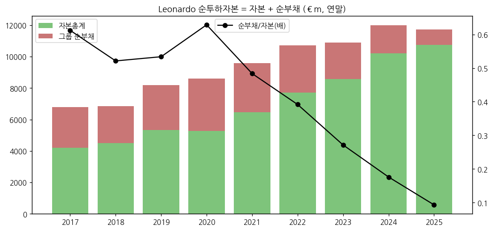

(3) 현금흐름

| 연도 | 영업CF | JV 배당수취 | 경상투자 | FOCF |
|---|---|---|---|---|
| 2017 | 795 | 295 | (553) | 537 |
| 2019 | 773 | 174 | (706) | 241 |
| 2020 | 275 | 58 | (293) | 40 |
| 2021 | 742 | 63 | (596) | 209 |
| 2022 | 1,163 | 133 | (757) | 539 |
| 2023 | 1,206 | 186 | (757) | 635 |
| 2024 | 1,562 | 148 | (884) | 826 |
| 2025 | 1,764 | 243 | (996) | 1,011 |
| 9M26 | 545 | 159 | (772) | (68) |

→ FOCF는 4Q 집중 구조(정부 선수금·연말 수금). 9M26 동일범위 FOCF +€22m는 9월 말 기준 첫 플러스(Quartr 요약). 2026G FOCF €1.37bn → 4Q 약 €1.44bn 필요 [계산]

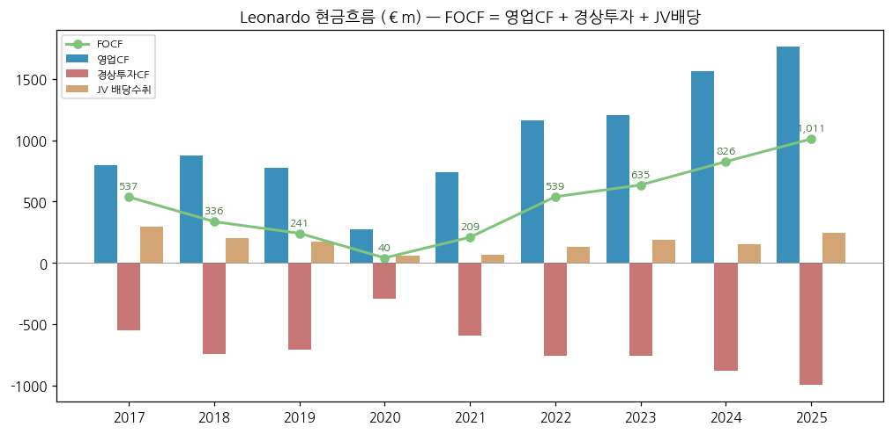

(4) CapEx

→ 경상투자 매출 대비 5% 안팎 유지. 섹터 투자(Investments) 2022 €801m → 2025 €1,072m — 헬기·방산전자 증설
→ 회사가 증설 규모를 수치로 제시하지 않음 — 2027-03 Industrial Plan에서 공개 예상 `[전망]`

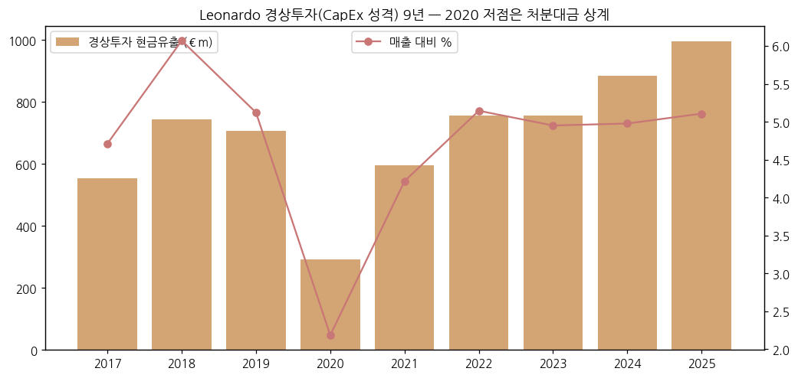

(5) 부채 구조

→ 2026-09 차입: 은행 €1,853m, 기타 €139m, JV 차입(MBDA 등) €1,816m, 리스 €644m / 현금 €1,081m. 2025년 말 €512m 채권 상환 후 채권 잔액 0. EMTN €4bn 한도 미사용, ESG 연계 Term Loan €600m 신규(9M26)

(6) 배당·자사주

| 회계연도 | DPS € | 지급 현금(지급연도) €m |
|---|---|---|
| 2017 | 0.14 | 81 (2018) |
| 2019 | 0.14 | 81 (2020) |
| 2020 | 0.00 | 0 (2021) |
| 2021 | 0.14 | 80 (2022) |
| 2023 | 0.28 | 177 (2024, 소수주주 포함) |
| 2024 | 0.52 | 343 (2025, 소수주주 포함) |
| 2025 | **0.63** | 400 (9M26 지급, 소수주주 포함) |

→ 자사주: 2026-05 주총 승인 최대 200만주(0.345%)·18개월 — 임직원 보상용, 9M26 100.1만주 €47.2m 매입. 소각형 환원 아님
→ (출처: 연간 보도자료 현금흐름표·배당 제안, 9M2026 보도자료)

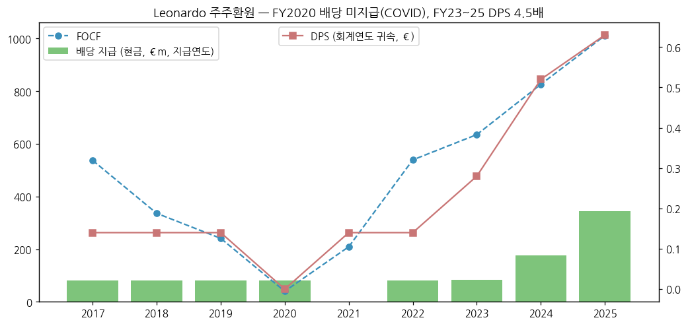

(7) 재무비율

| 지표 | 2021 | 2022 | 2023 | 2024 | 2025 |
|---|---|---|---|---|---|
| ROE (순이익/평균자본) | 10.0% | 13.2% | 8.5% | 12.4% | 12.7% |
| ROI (회사 정의) | — | — | 12.2% | 13.4% | 14.9% |
| 순부채/EBITDA | 1.92배 | 1.71배 | 1.22배 | 0.81배 | 0.41배 |
| Book-to-bill | 1.01 | 1.17 | 1.17 | 1.18 | 1.22 |

→ (출처: 연간 보도자료 [계산]. ROE 분자는 소수주주 포함 순이익)

---

## ⑤ 지배 구조

(1) 그룹·계열 관계

→ 이탈리아 정부(MEF)가 최대주주 + 정부 "Golden Power" 특별권 — 경영진은 사실상 정부 지명(2026 Cingolani → Mariani 교체가 대표 사례, Defense News 2026-04-10)
→ 주요 자회사·JV: Leonardo DRS 약 71.4%(상장), Telespazio 67%, MBDA 25%, Thales Alenia Space 33%, GIE ATR 50%, Hensoldt 22.8%, Avio 19.3%(FY25 보도자료 회사 소개), LRMV(Rheinmetall 50:50), LBA Systems(Baykar 50:50), Orizzonte Sistemi Navali(Fincantieri와 합작, 2026-09 DDX 구축함 €3.7bn 수주)

(2) 주주 구분

| 주주 | 지분 |
|---|---|
| 이탈리아 경제재정부(MEF) | **30.204%** |
| 기타 (기관·개인, 3% 미만) | 69.8% |

→ (출처: Leonardo 주주현황 페이지, "Updated March 2025". 3% 초과 보유자만 공시)

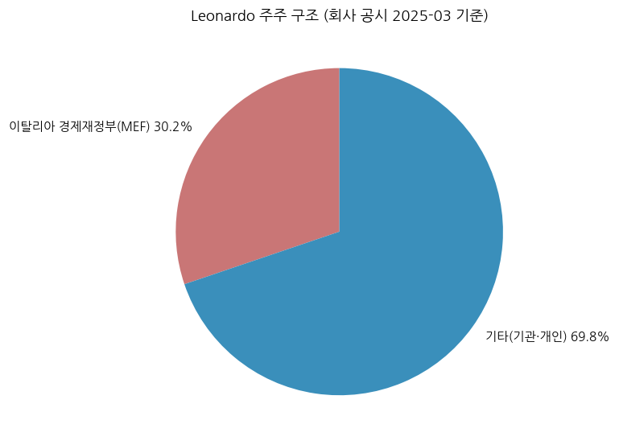

(3) 경영진

→ CEO·General Manager **Lorenzo Mariani** — 2026-05 취임(정부 지명, 전임 Roberto Cingolani). 9M26이 첫 실적 발표 (Börsen-Zeitung 2026-11-05)
→ 의장 Francesco Macrì (2026-05-07 주총 선임) / 재무보고 책임자 Giuseppe Aurilio (9M26 보도자료 서명)

---

## ⑥ 기타 팩트

(1) R&D

| 연도 | 2018 | 2019 | 2020 | 2021 | 2022 | 2023 | 2024 | 2025 |
|---|---|---|---|---|---|---|---|---|
| 총 R&D 지출 €m | ~1,500 | 1,525 | 1,646 | 1,803 | 2,003 | 2,201 | 2,490 | ~3,000 |
| 매출 대비 | 12.3% | 11.1% | 12.3% | 12.8% | 13.6% | 14.4% | 14.0% | 15.4% |

→ (출처: 각 연도 연간 보도자료 지속가능성 지표 — 자체 + 고객 펀딩 개발 포함. 2018·2025는 반올림 공시값)

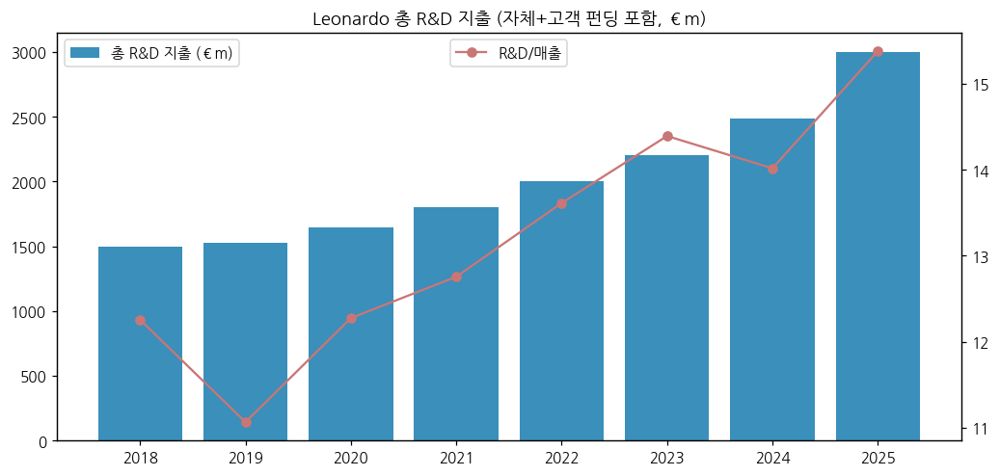

(2) 진행 중 corporate action

→ IDV 인수 완료(2026-03, €1.6bn) / GEM Elettronica 잔여 35%(€33m) / BeCrypt(€37m) / DRS의 Raft 인수($450m, 4Q26 종결 예정)
→ 우주: Airbus·Thales와 위성 사업 통합("European champion") 추진
→ Rheinmetall JV(LRMV): 이탈리아 Panther 전차 48대·Lynx 30대 옵션 €3.7bn 확정 발주(Börsen-Zeitung 2026-11-05) — Leonardo 50% 몫 수주 인식 시점(2026 vs 2027)이 쟁점

(3) R&D·프로그램 마일스톤

→ GCAP(영·일·이 6세대 전투기, Edgewing JV 2026-10 토리노 거점) / Michelangelo Dome(통합 방공 구상) / BMD+ 탄도탄 방어 레이더 국가 계약 / AW249 공격헬기

(4) 주요 리스크

→ 항공구조물 적자 지속(B787 증산 속도 의존) / USD 약세(DRS 환산, 9M26 평균 €/$ 1.16 vs 1.12) / NH90 노르웨이 분쟁 합의금 €110m+ 현금 유출(2026) / 정부 지배에 따른 경영진 교체 리스크 / 공급망·생산능력 병목(회사 "생산·인도 능력 확충" 강조)

(5) ESG

→ S&P Global CSA 85점(항공우주·방산 1위), EcoVadis Gold (2026-11-03 회사 발표) / DJSI 2010년부터 편입

(6) 인증·등급

→ 신용등급 Moody's Baa2(positive) / S&P BBB(positive) / Fitch BBB(stable) — 2026-09 기준

---

## Activity 보고 (v1.0 finalize)

→ 확보: 연간 보도자료 6건 + 분기 보도자료 9건 + 발표자료 2건 + HTML 3건 + 주가 2건
→ 누락: 2016 이전 연간, Annual Report 본문, 3Q26 컨콜 트랜스크립트, 상세 주주 명부
→ 추정·계산: Aircraft BU 분기 `[역산]`, 방산 기준 합계, IDV 기여(연결 − 동일범위), 시총 20년(현재 주식수 고정), EV/EBITA
→ Data Quality Confidence: **88%** (KPI 원문 기반 95% / 세부 재무제표·주주 70%)

## Version Log

→ **v1.0** (2026-11-14) — 초안. 2017~2025 9년 KPI + 9M26, 분기 그룹 16Q·섹터 10Q, 13종 차트, 한국 5사 겹침 매핑
→ **잔여 보완 (v1.1, 2027-03-04 FY26 발표 + Industrial Plan 후)**: FY26 확정치(10년 시계열), 4Q26 분기, 2027 가이던스·2031 목표, 우주 통합·항공구조물 JV, Annual Report 본문(총자산·매출처)·2014~2016 보강
