> Ticker: **NYSE: LEU — Centrus Energy Corp.** (SEC CIK 0001065059, 2025-12 NYSE American → NYSE 이전, 티커 유지)
> Entity: **Centrus Energy Corp.** (본사 Bethesda, Maryland, USA) — 1998년 민영화된 미국 정부 농축공사 USEC Inc.의 후신. 2014-03 챕터11 → 2014-09-30 졸업하며 Centrus로 재출범. 사업은 2개 부문: **LEU(러시아 TENEX·프랑스 Orano 등에서 조달한 농축우라늄(SWU)·천연우라늄을 전력회사에 판매)** + **Technical Solutions(DOE와 계약한 Piketon HALEU 농축 시범 캐스케이드 운영·기술용역)**. 현재는 "트레이더"지만 Piketon(오하이오)에 미국 자국 농축 공장을 짓는 **설비 보유 농축사로 전환 중**
> Sector: 원전 — 서브섹터 **원전 연료 글로벌** (Cameco·Centrus, **핵심 종목 · 섹터 델타 합산 포함**) (watchlist.md 2026-11-14 원전 글로벌 편입)
> 작성 시각: **2026-11-15 KST** (**v1.0** — Phase 1 Source 전수 수집 + audit + 13종 차트(12종 + 수주잔고) + v1.5 ① 기업 분류 표준)
> 적용 구조: v4.8 (6개 섹션) + v1.5 ① 기업 분류 표준 (Summary Box · 손익 narrative · 분류 sub-logic · 밸류에이션 · 분류 변경 조건 3종). 무배당·무자사주라 chart9는 **자금조달·희석**으로 대체
> 데이터 범위: **연간 12년 (FY2014\~FY2025, 12월 결산)** + **9M26 (1Q\~3Q26, 10-Q 2026-11-05 제출)** + **사업부 분기 55Q (1Q13\~3Q26)** + **수주잔고 FY2013\~3Q26** + **주가 2014-10(파산 졸업) \~ 2026-11-13**
> 출처: **SEC EDGAR 10-K 14건 (FY2012\~FY2025) · 10-Q 42건 (1Q13\~3Q26) · 8-K 64건 (2024-01\~2026-11) · DEF 14A 2024\~2026**, **SEC XBRL companyfacts (CIK 0001065059)**, **Oklo 10-Q 3Q26 (2026-11-06, Centrus 공급계약·Meta 선급 교차확인)**, **Yahoo Finance LEU**, **World Nuclear Association (농축 설비 점유율)**, 보도 (Motley Fool·Finviz/EarningsWhispers·World Nuclear News·NEI Magazine)
> 회계 단절: 2014-09-30 **fresh-start 회계** (파산 졸업, Predecessor 1\~9월 + Successor 10\~12월 합산으로 FY2014 작성). 분기 사업부 수치는 10-Q MD&A 부문표 원문, **4Q = 연간 − 1\~3Q 합** [계산]. 단위 $M

# Centrus Energy 기업 개요 (v1.0 — 원전 / 원전 연료 글로벌 / 사이클형 농축 트레이더 → 미국 자국 농축 설비 전환 중)
> **Fact verify cutoff**: 2026-11-15 (주가 2026-11-13 종가 **$103.78** [Yahoo Finance], 발행주식 Class A 19,899,250주 + Class B 719,200주 = **20,618,450주** [10-Q 3Q26 표지, 2026-11-01] → 시가총액 **$2.14B** [계산] / 사전납입 워런트 2,005,513주 포함 시 **$2.35B** [계산]. 종가 사상 최고 **$436.00 (2025-10-15)** · 장중 최고 $464.25 (2025-10-16) [Yahoo Finance, Motley Fool 2025-12-19 "10월 사상 최고" 보도와 일치], 52주 고저 $345.60 (2026-01-21 장중) / $84.86 (2026-11-05 장중) [Yahoo Finance]. 2014-09 파산 이전 USEC 주가는 구주 소각으로 시계열 제외)


## Phase 1 Source Audit (메모리 룰)

```
=== 자료 수집 audit (Centrus Energy) ===

✅ 확보 (저장: company-overview-source/LEU/ + LEU_CENTRUS ENERGY CORP/)
- 10-K 14건 (2013-03 ~ 2026-02 제출, FY2012~FY2025) + 10-Q 42건 (1Q13~3Q26) — sec_edgar_download_reports
- 8-K 64건 (2024-01 ~ 2026-11-12) + DEF 14A 3건 (2024~2026) — 본문만 (보도자료 Ex-99.1 원문은 SEC 403으로 미수집)
- SEC XBRL companyfacts.json (연간·분기 손익·BS·CF 정확값)
- 10-Q·10-K 인라인 XBRL + MD&A 부문표 파싱 → 사업부(LEU/Technical Solutions) 분기 55Q
- Oklo 10-Q 3Q26 (Centrus HALEU 공급계약 2026-09-30·Meta 선급 2026-11-02 교차확인)
- Yahoo Finance v8 LEU 월간(1998~) + 일간 2년 (2026-11-13까지)
- 웹: WNA 농축 설비 점유율, 3Q26 실적 요약(Finviz/EarningsWhispers), 10월 주가 급락 원인(Motley Fool), Oklo LOI(WNN·NEI)

❌ 누락 (4)
- 3Q26 컨퍼런스콜 트랜스크립트 원문 (웹 요약으로 대체 — FY26 가이던스·Investor Day 일정)
- 2025 이전 10-K 임직원 수 시계열 (FY24·FY25만 표로 확보)
- 최신 5% 주주 (Proxy가 2024~2026년 13G 인용 — BlackRock·Global X는 2023~2024 기준)
- ESG 등급·Sustainability 보고서 원문

⚠️ 결과 영향
- 연간 12년 = FY2014~FY2025. FY2014는 파산 전후(Predecessor+Successor) 합산, 순이익에 재조정 이익 $425M 포함
- 사업부 분기 55Q = 1Q13~3Q26 (2013~2016 "Contract services" = 현 Technical Solutions 동일 부문, 2026 XBRL에선 "Contract Services" 명칭)
- 4Q 사업부 수치 = 연간 − 9M [계산]. 4Q15 TS 매출 $0.3M은 10-K 재분류 영향으로 보임 [판단]
- 2020~2023 이자비용이 거의 0인 것은 8.25% 노트가 TDR(부실채무 재조정) 회계로 이자를 원금 장부가에서 차감했기 때문 → 이자보상배율 n/m

Source 6종 audit:
[V] (1) 정기 보고서 (10-K 14 + 10-Q 42) ✓
[△] (2) IR 실적 자료 (8-K 본문 ✓, 보도자료·슬라이드 원문 ✗ → 10-Q MD&A·웹 요약으로 대체)
[✗] (3) Sustainability Report ✗
[V] (4) 주가 (Yahoo LEU) ✓
[V] (5) Proxy / 지배구조 ✓
[V] (6) 12년 정확값 시계열 (XBRL) ✓
→ 4.5/6 source 확보. 최신 분기(3Q26, 10-Q 2026-11-05) 확보.
```

---

## ① 기업 분류

(1) Primary / Secondary 분류

**Primary 분류: 사이클 (농축 SWU 가격 사이클 + 연간 인도 약정에 따른 분기 변동)**

→ 매출 FY2014 $514M → FY2018 $193M (바닥) → FY2025 $449M. 12년 GAAP OPM 범위 **−47.9%\~+22.9%** (진폭 70.8%p) — 사이클 기준(±10%p)을 크게 넘는 고변동 [계산]

→ 이익의 원천은 **SWU 시장가격 사이클** — 현물 SWU는 2009-04 $163 정점 → 후쿠시마 이후 2018-08 **$34 저점** → 우크라이나 전쟁 후 2025-12 **$200**, 2026-09말 **$203** [10-Q 3Q26]. Centrus 계약가는 수년 전 체결가라 시장가를 "수년 시차"로 따라감 (10-Q 원문)

→ 분기 매출은 전력회사의 **연간 구매 약정 인도 시점**에 따라 $31M\~$176M을 오감 (2026년 1Q $77M → 2Q $176M → 3Q $56M) — 분기 단위 델타 판단 시 연간·9M 누적 필수

**Secondary 노트: 꿈 (Piketon 상업 농축 공장 — 조건부 잔고 $5.4B · DOE $900M HALEU 계약)**

→ 3Q26말 LEU 잔고 **$6.2B 중 $5.4B가 조건부**(Piketon LEU·HALEU 증설 완공·가동 마일스톤 연동) [10-Q 3Q26]. 새 원심분리기 첫 가동은 **2029년** 예정 → 2029년 이전 매출에는 거의 반영 안 됨

→ 9M26 CapEx **$226.4M** (전년 동기 $10.1M), 2026 가이던스 $350\~500M [Finviz 3Q26 요약 — 비공식 출처], 2027에 가속 예고 — 이익은 트레이딩 사업, 가치는 증설 옵션에서 나오는 **"사이클 + 꿈" 혼합**

**2개 사업부 구조 (9M26 기준)**

→ **(1) LEU** — 매출 $229.8M (75%), GP $72.6M, GPM 31.6% — SWU 판매 $155.7M + 우라늄 판매 $74.1M. 조달은 **TENEX(러시아 Rosatom 자회사, 2011년 계약, 2028년까지)** 와 **Orano(프랑스, 2030년까지)** + 재고·현물. "2027년까지 인도 예정 LEU의 절반을 훨씬 넘게 TENEX에서 조달" (10-Q 원문)

→ **(2) Technical Solutions** — 매출 $78.5M (25%), GP −$1.8M — DOE와의 **HALEU 운영계약**(Piketon 16대 원심분리기 시범 캐스케이드, cost-plus-incentive-fee) + 기타 정부·민간 기술용역. 2026-09-30 DOE 생산 옵션 종료 → 2026-10 HALEU 소유권 Centrus로 이전, 상업 운영 전환 협의 중

(2) Summary Box (12년 시계열 + 사이클 통계)

| 지표 | 값 |
|------|-----|
| 매출 CAGR (FY14→FY25, 11년) | **−1.2%/yr** [계산] — 단, 바닥 FY18→FY25 **+12.8%/yr** [계산]. FY26 가이던스 $450\~500M [웹 요약] |
| GAAP OPM 평균 (12년) | **−4.8%** [계산] (흑자 구간 FY20\~FY25 평균 **17.0%**) |
| GPM 평균 (12년) | **21.6%** [계산] (FY20\~FY25 평균 34.1%) |
| OPM 정점 | **22.9% (FY2021)** — 3Q21 포츠머스 연금비용 정산금 $43.5M이 TS 매출로 인식된 일회성 포함. 반복 이익 기준 정점은 **FY2020 20.6% · FY2022 20.3%** (저가 조달분 + 고가 장기계약) |
| OPM 저점 | **−47.9% (FY2018)** — SWU 현물 $34 저점, LEU 매출총손실. FY2015 −40.3%는 재조정가치 손상 $137.2M 포함 |
| 사이클 주기 | 약 **10년** (SWU 가격 2009 정점 → 2018 저점 → 2025\~26 신고점) — 회사 이익은 계약 시차로 2\~3년 늦게 반응 |
| 사이클 회수 (12년) | 저점 1회 (FY2018) / 정점 1회 (FY2020\~22 마진 정점, 매출은 FY24\~25 정점) |

```
[Centrus 12년 손익 시계열 ($M, 12월 결산)]  * ATC = Advanced technology costs (고객계약 밖 원심분리 자체투자)
연도    매출    GP    GPM    영업이익   OPM     순이익   
FY14    514.1  -41.3  -8.0%   -112.8  -21.9%    297.8   ← 2014-03 USEC 챕터11 → 2014-09-30 Centrus로 졸업, 순이익은 재조정 이익 $425M 포함
FY15    418.2   68.9  16.5%   -168.4  -40.3%   -187.4   ← 러시아 HEU(Megatons) 종료 후 재고 매각, ACP 재정지원 축소
FY16    311.3   45.1  14.5%    -61.7  -19.8%    -67.0   ← 2016-02 ACP(Piketon) 상업화 중단, 계약해지 $0.7B → 잔고 급감
FY17    218.4   56.8  26.0%    -44.7  -20.5%     12.2   ← 매출 바닥권, 법인세 효익으로 흑자
FY18    193.0  -17.9  -9.3%    -92.4  -47.9%   -104.1   ← SWU 현물 $34 (12년 저점, 2018-08) → GP 마이너스
FY19    209.7   32.5  15.5%    -19.7   -9.4%    -16.5   ← DOE HALEU 데모 계약 수주 (2019-10)
FY20    247.2   97.6  39.5%     51.0   20.6%     54.4   ← 흑자전환 (저가 TENEX·Orano 조달 + 고가 장기계약)
FY21    298.3  114.5  38.4%     68.3   22.9%    175.0   ← HALEU 데모 계약 일시 이익, 순이익엔 세금자산 인식 $39M
FY22    293.8  117.9  40.1%     59.7   20.3%     52.0   ← 우크라이나 전쟁 → SWU 가격 급등 시작, HALEU 운영계약(11월)
FY23    320.2  112.1  35.0%     52.4   16.4%     84.0   ← 첫 HALEU 20kg 인도 (11월), 자본 플러스 전환
FY24    442.0  111.5  25.2%     48.0   10.9%     72.0   ← 러시아 LEU 수입금지법(5월)·면제 획득, KHNP 등 조건부 잔고 $2.0B
FY25    448.7  117.5  26.2%     50.2   11.2%     78.0   ← 0% CB $805M, HALEU 900kg 완료, NYSE 이전, 순이익엔 이연법인세 효과
9M26   308.3   70.8  23.0%    -18.5   -6.0%     58.4   ← 3Q26 GP -$10.6M, 워런트 평가이익 $46.4M로 순이익 흑자

매출 CAGR 11년: -1.2% [계산] / OPM range -47.9%~+22.9% = 70.8%p [계산]
흑자 구간(FY20~FY25) 평균 GPM 34.1% · OPM 17.0% [계산] — 단 FY24~25 GPM 25~26%로 하락 (고가 우라늄 판매 비중↑ + SWU 조달 단가 상승: 9M26 SWU 평균 판매가 +12% vs 평균 원가 +30%, 10-Q)
```

**원전 연료 서브섹터 내 위치 (직접 비교는 섹터 리뷰에서 각 사 리뷰 숫자로)**

→ Cameco(채굴·전환·Westinghouse)가 **자원 보유형**이라면 Centrus는 **조달·판매 트레이더 + 미래 설비** 구조 — FY25 매출 $449M, GP $118M으로 규모는 소형, 대신 잔고/매출 **15.6배** (총잔고 $7.0B ÷ FY25 매출, [계산])

→ 농축 설비 기준 Centrus 점유율은 사실상 0% (시범 캐스케이드 16대뿐) — 세계 농축 설비 2025년 Rosatom 42.8% · Urenco 25.4% · CNNC 20.3% · Orano 11.0% [WNA Nuclear Fuel Report 2025]

(3) 정량적 분류 근거

→ **잔고 급증** — 총잔고 $3.8B (FY25말) → **$7.0B (3Q26말)**. LEU $2.9B → $6.2B (조건부 $2.3B → **$5.4B**, 그중 $5.1B 확정계약), TS $0.9B → $0.8B [10-K·10-Q]

→ **HALEU 실적** — 2023-11 첫 20kg 인도(1단계) → 2025-06 **900kg** 목표 달성(2단계) → 2026-06 Option 1a 생산 완료, 누적 **1,900kg+** [WNA] — 미국에서 유일하게 HALEU를 실제 생산한 상업 시설

→ **DOE $900M HALEU 생산 task order** (2026-01-05 선정, 2026-06-30 계약 서명) — 고정가 $900M을 **마일스톤 분할 지급**, 2032-03까지 HALEU 1MTU 인도, 옵션 5MTU×2회($17M/MTU). 완료 시 설비 소유권은 Centrus(ACO)로 [8-K 2026-07-02]. 단 **LEU 생산 task order는 탈락** (Orano 등 선정)

→ **HALEU 오프테이크 (선급 포함)** — X-energy(LEU+HALEU, 2026-08, 2030 인도), Radiant(2026-09), Antares(2026-09), **Oklo(2026-09-30 공급계약, 최대 Aurora 5기, 2029 인도 개시)** — 3사 모두 선급금 포함 [10-Q], Oklo 건은 **2026-11-02 Meta 자금이 에스크로에서 Centrus로 직접 지급(연료 주문 크레딧)** [Oklo 10-Q 3Q26]

→ **조달 리스크 집중** — 2027년까지 인도분의 절반 이상이 TENEX 조달, 미국 러시아 LEU 수입금지법 면제(waiver)는 **2027년 인도분까지** 확보 (2025-08-04 DOE) [8-K 2025-08-19]

**2026 가이던스 (3Q26 발표, 2026-11-04 — 웹 요약 기준, 보도자료 원문 미수집)**

→ 매출 **$450\~500M** 유지 → 4Q 함의 $142\~192M [Finviz 요약, 계산] / 2026 자본배치(CapEx) **$350\~500M** / 2027 CapEx는 **2026-12-07 Investor Day**에 제시 예정

(4) 산업 분류

→ **GICS** — Energy / Oil, Gas & Consumable Fuels (Coal & Consumable Fuels) [미검증 — 비공식 출처]

→ **지수** — Russell 2000 등 소형주 지수 [미검증 — 비공식 출처], S&P 500 미포함

→ **워치리스트** — 섹터 원전 / 서브섹터 **원전 연료 글로벌** (Cameco·Centrus, 섹터 델타 합산 포함)

(5) 분류 결정 논리

(1) **가장 매출 큰 사업부 기준**: LEU 75% (9M26) — SWU 가격·인도 시점에 이익이 좌우되는 **상품(commodity) 트레이딩** → 사이클

(2) **이익 진폭 원인**: FY15\~19 적자는 업황(SWU $34 저점) + ACP 중단(2016)·파산 후 비용 구조가 원인 → 업황 사이클 근거 성립. 단 FY24\~25 마진 하락은 업황이 아닌 **조달 단가 상승(러시아 제재 비용)** 과 제품 믹스 → 사이클 + 조달 리스크

(3) **Boundary case**: Primary 사이클 + Secondary 꿈. Piketon 새 캐스케이드가 2029년 가동해 **자체 생산 SWU 매출이 LEU 매출의 30%+** 가 되면 "트레이더 → 설비 보유 농축사"로 Primary를 **지속성장(장기 고정 계약형)** 으로 재분류 검토 (Urenco형)

(4) **글로벌 피어 cross-ref**:
   - **Cameco (CCJ)** — 같은 서브섹터, 우라늄 채굴·전환 + Westinghouse 49%. 자원 보유형 사이클 → Centrus보다 이익 규모·안정성 우위
   - **Urenco** (비상장, 영·네·독 정부·전력사 소유) — 서방 최대 농축사, 미국 Eunice(뉴멕시코) 4.3M SWU/년 + 0.7M 증설(2027 완공) + 2.1M 추가(2032\~36) [WNA]. Centrus가 따라가려는 모델
   - **Orano** (프랑스 국영) — Centrus의 조달처이자 미국 경쟁자 (Project IKE, Oak Ridge, DOE $900M 2026-01) [WNA]
   - **Rosatom/TENEX** — Centrus 최대 조달처이자 세계 1위(42.8%) — 제재 시 Centrus 공급 차질의 직접 원인

(6) 적정 밸류에이션 방법 (단위 밸류는 분기 실적 분석, Terminal 밸류는 테마 통합 모드)

→ **1차 — EV/매출총이익 (트레이딩 사업 정상 이익)**: EV 약 **$1.32B** [계산: 시총 $2.35B(사전납입 워런트 포함) − 순현금 $1.03B (현금 $2,236M − 전환사채 원금 $1,207.5M), 3Q26말] ÷ FY25 GP $117.5M = **11.2배** [계산]. 3Q26 후 Westerman 인수 현금 $95M 지급 반영 시 EV 약 $1.41B

→ **2차 — 조건부 잔고·설비 옵션 (꿈 부분)**: EV/총잔고 **0.19배** ($1.32B ÷ $7.0B, [계산]). 조건부 $5.4B가 Piketon 완공으로 확정되는지가 가치의 핵심 — 수치 밸류보다 **마일스톤(첫 캐스케이드 가동·DOE 지급·리스 연장)** 추적이 우선

→ **3차 — PBR**: 시총 $2.35B ÷ 자본 $1,105M = **2.1배** [계산] — 단 자본의 대부분이 2024\~26년 증자·전환사채 조달분(현금)이라 "현금 대비 프리미엄"으로 읽어야 함

→ **PER 보조 미사용 근거** — 3Q26 순이익 $31.6M 중 $46.4M이 워런트 평가이익(비현금), 투자수익(9M26 $50.2M)이 영업손실을 메우는 구조 → GAAP EPS 왜곡

(7) 분기 재평가 트리거 (**분류 변경 조건**)

→ ① **Piketon 첫 신규 캐스케이드 농축 개시 + 자체 생산 SWU 첫 매출** (회사 목표 2029) → Secondary 꿈을 해제하고 Primary를 "설비형 지속성장" 후보로 재검토

→ ② **TENEX 공급 중단 또는 2028년 이후 waiver 불허로 LEU 매출 YoY −30% 이상이 2개 연도 연속** → Primary 사이클 유지 불가, "구조적 축소 + 꿈" 으로 재분류

→ ③ **조건부 잔고 $5.4B 중 확정 전환 비중이 50% 미만으로 하락 or DOE $900M 마일스톤 지급 지연 2분기 연속** → Secondary 꿈 할인 (설비 옵션 가치 하향)

---

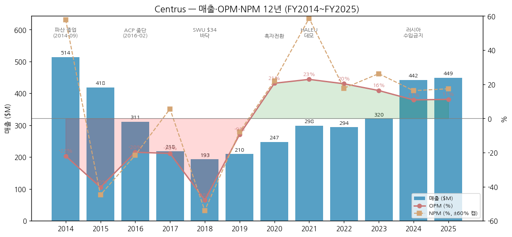

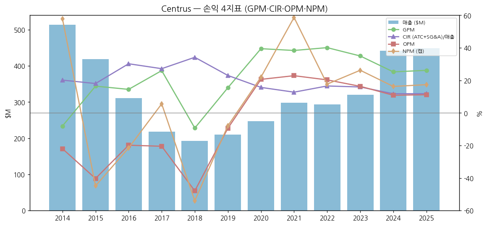

---

## ② 회사 개요

(1) 기본 정보

| 항목 | 내용 |
|---|---|
| 정식 명칭 | Centrus Energy Corp. (Delaware 법인) |
| 본사 | 6901 Rockledge Drive, Bethesda, MD |
| 설립 | 1998 USEC Inc. 민영화 (1992년 설립 미 정부 농축공사 승계) → 2014-09-30 파산 졸업 후 Centrus Energy로 개명 |
| 상장 | NYSE: LEU (2025-12 NYSE American에서 이전) |
| CEO | Amir V. Vexler (사장·CEO, 2024-01 취임 — 전 Orano USA CEO, GE 20년·GNF CEO) |
| CFO | Todd M. Tinelli (2025-08 취임) |
| 의장 | Mikel H. Williams (독립, 2014-09부터 의장) |
| 임직원 | **467명** (FY25말, Piketon 250·Oak Ridge 165·Bethesda 52) ← FY24말 322명 (10-K) |
| 주요 자회사 | United States Enrichment Corp.(Enrichment Corp., Piketon 리스 보유), American Centrifuge Operating LLC(ACO, 원심분리기 제조·운영), Westerman (2026-10 인수, 설비 제조) |
| 사업 한 줄 정의 | 해외(러시아·프랑스)에서 조달한 농축우라늄을 미국·일본 등 전력회사에 장기계약으로 팔면서, 그 현금과 정부 자금으로 미국 자국 원심분리 농축 공장(Piketon)을 짓는 회사 |
| 고객 구성 (FY25) | 상위 10개 원전 연료 고객 = 매출 77%, 상위 2개 = 31%. 지역: 미국 $335.3M (75%) · 일본 $102.7M (23%) · 기타 $10.7M (10-K) |

(2) 핵심 KPI 요약 (FY25 + 3Q26 + 9M26 + FY26 가이던스, $M)

| 지표 | FY25 | 3Q26 | 9M26 | FY26 가이던스 |
|---|---|---|---|---|
| 매출 | 448.7 | 55.5 (−25.9% YoY) | 308.3 (+1.9%) | 450\~500 [웹 요약] |
| LEU / TS 매출 | 346.2 / 102.5 | 31.8 / 23.7 | 229.8 / 78.5 | — |
| 매출총이익 (GPM) | 117.5 (26.2%) | −10.6 (−19.1%) | 70.8 (23.0%) | — |
| 영업이익 (OPM) | 50.2 (11.2%) | −29.7 | −18.5 | — |
| 순이익 / 희석 EPS | 78.0 / $3.90 | 31.6 / $1.41 (워런트 이익 $46.4M 포함) | 58.4 | — |
| CapEx | 19.7 | — | 226.4 | 350\~500 [웹 요약] |
| 현금 | 1,957.2 | 2,236.1 | — | — |
| 총잔고 ($B) | 3.8 | 7.0 | — | — |

→ (출처: 10-K FY25, 10-Q 3Q26. YoY [계산]. 가이던스는 Finviz/EarningsWhispers 3Q26 요약 — 보도자료 원문 미수집)

(3) 주요 연혁 (시대별)

| 시기 | 사건 |
|---|---|
| 1992 | 미 에너지정책법으로 정부 농축공사 USEC 설립 (Paducah·Portsmouth 기체확산 공장 운영) |
| 1993 | 미·러 **Megatons to Megawatts** (러시아 핵탄두 HEU 500톤 → 원전 연료 LEU 전환, USEC가 집행 대리인) |
| 1998 | USEC 민영화·NYSE 상장 |
| 2001 | Portsmouth(Piketon) 기체확산 공장 가동 중단 |
| 2007 | Piketon **American Centrifuge Plant(ACP)** NRC 건설·운영 허가 (3.8M SWU 설계) |
| 2011-03 | **TENEX 공급계약** 체결 (러시아 상업 SWU, 2013년부터) |
| 2013 | Megatons 프로그램 종료(12월), Paducah 기체확산 공장 가동 종료(5월) |
| 2014-03 → 09 | 챕터11 → 2014-09-30 졸업, **Centrus Energy**로 출범 (기존 주식 소각·채권자 출자전환) |
| 2016-02 | DOE 지원 축소로 **ACP 상업화 중단**, 고객 계약 $0.7B 해지 |
| 2019-10 | DOE **HALEU 데모 계약** (16대 AC100M 캐스케이드) |
| 2021 | NRC가 HALEU(최대 20%) 생산 허가, 3Q21 포츠머스 연금정산 $43.5M 회수 |
| 2022-11 | DOE **HALEU 운영계약** (기본 $150M, 최대 9년 옵션) |
| 2023-11 | 미국 70년 만의 첫 HALEU 20kg 인도, 자본 플러스 전환 |
| 2024-01 | Amir Vexler CEO 취임 |
| 2024-05 | 미국 **러시아 LEU 수입금지법** 제정 (2024-08 시행, waiver 2027년까지) / 11월 러시아의 대미 수출 금지령(건별 허가) |
| 2024-11 | 2.25% 전환사채 $402.5M, Oak Ridge 원심분리기 제조 재개($60M) |
| 2025-02 | **KHNP(한수원)와 조건부 LEU 공급 $0.8B 확정계약 전환** |
| 2025-06 | HALEU 900kg (2단계) 완료 |
| 2025-08 | **0% 전환사채 $805M**, KHNP·POSCO인터내셔널과 Piketon 투자 검토 MOU(비구속), DOE 2026\~27 waiver 획득 |
| 2025-09 | Piketon **LEU+HALEU 대규모 증설 계획** 발표 |
| 2025-12 | NYSE 이전, Oak Ridge 상업용 원심분리기 생산 개시 |
| 2026 | Oak Ridge $560M+ 투자(1월), DOE $900M HALEU task order(1월 선정·6월 계약), Fluor EPC(2월)·Geiger 시공(4월), Oklo LOI(6월)→공급계약(9-30), X-energy·Radiant·Antares 계약(8\~9월), **$500M 주식+워런트 공모(9월)**, **Westerman 인수 $116M(10월)**, 첫 신규 원심분리기 출하(10-29) |

→ (출처: 10-K 사업 개요·10-Q·8-K. 1992\~2013 연혁 일부는 공개 일반 사실 기준 [web])

(4) 회사 주가 역사 (narrative 영역)

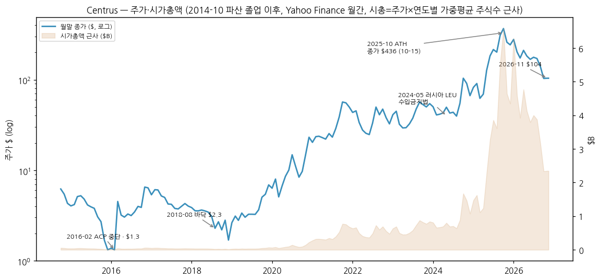

→ **2014-10\~2018 파산 후 저평가 ($1\~7)** — ACP 중단(2016-02) 직후 월말 종가 **$1.32**, 2018-08 SWU 바닥과 함께 $2대

→ **2019\~2021 HALEU 재평가 ($3 → $30)** — DOE HALEU 데모 계약 + 흑자전환

→ **2022\~2024 러시아 리스크 박스 ($25\~55)** — 우크라이나 전쟁으로 SWU 가격 급등(호재)과 TENEX 의존(악재) 공존, 2024-05 수입금지법

→ **2025 폭등 → 사상 최고** — AI 전력·원전 붐 + 증설 계획, 2025-10-15 종가 **$436.00 사상 최고** (시총 약 $8B [계산 근사: 당시 약 18.5M주])

→ **2026 급락 (−57% YTD)** — 2025말 $242.76 → 2026-11-13 **$103.78** [계산]. 9월 −18.6% (주식+워런트 공모 $500M 희석), 10월 **−26%** (Westerman 인수 발표 후 Roth $188→$115·Barclays $207→$150·UBS $185→$120·JPM $180→$120 목표가 하향) [Motley Fool 2026-11-08], 3Q26 실적 직후 2026-11-05 종가 $89.03·장중 $84.86 52주 저점 → Oklo 계약 발표 전후 $104\~117 회복 [Yahoo]. 사상 최고 대비 **−76%** [계산]

---

## ③ 비즈니스 모델

(1) 실적 추이 통합 표 (5년 + 9M26, 사업부별, $M)

| 사업부 | 항목 | 2021 | 2022 | 2023 | 2024 | 2025 | 9M26 |
|---|---|---|---|---|---|---|---|
| **LEU** | SWU 매출 | 163.3 | 196.2 | 208.2 | 246.8 | 298.7 | 155.7 |
|  | 우라늄 매출 | 22.8 | 39.4 | 60.8 | 103.1 | 47.5 | 74.1 |
|  | 매출 계 | 186.1 | 235.6 | 269.0 | 349.9 | 346.2 | 229.8 |
|  | 매출총이익 | 73.0 | 130.6 | 105.1 | 93.9 | 111.5 | 72.6 |
| | GPM | 39.2% | 55.4% | 39.1% | 26.8% | 32.2% | 31.6% |
| | 매출 비중 | 62% | 80% | 84% | 79% | 77% | 75% |
| **Technical Solutions** | 매출 | 112.2 | 58.2 | 51.2 | 92.1 | 102.5 | 78.5 |
|  | 매출총이익 | 41.5 | -12.7 | 7.0 | 17.6 | 6.0 | -1.8 |
| | GPM | 37.0% | -21.8% | 13.7% | 19.1% | 5.9% | -2.3% |
| | 매출 비중 | 38% | 20% | 16% | 21% | 23% | 25% |
| **전사** | **매출** | 298.3 | 293.8 | 320.2 | 442.0 | 448.7 | 308.3 |
|  | **매출총이익** | 114.5 | 117.9 | 112.1 | 111.5 | 117.5 | 70.8 |
| | 잔고 (연말·3Q말, $B) | 1.0+n/a | 1.0+n/a | 1.0+1.0 | 2.8+0.9 | 2.9+0.9 | 6.2+0.8 |
| | 지역: 미국 / 해외 ($M) | 220.5 / 77.8 | 154.3 / 139.5 | 281.6 / 38.6 | 253.4 / 188.6 | 335.3 / 113.4 | — |

→ (출처: 각 연도 10-K MD&A 부문표, 9M26은 3Q26 10-Q. 잔고는 "LEU + TS", FY21\~22 TS 잔고 미공시. 지역은 10-K 지역별 매출)

**수주잔고 (Backlog / Order Book) 추이 ($B)**

| 시점 | LEU 잔고 | 그중 조건부 (Piketon 연동) | TS 잔고 | 비고 |
|---|---|---|---|---|
| FY13말 | 3.3 | — | — | USEC 시절, 신규 판매 정체 |
| FY14말 | 2.7 | — | — | |
| FY15말 | 2.3 | 0.8 (ACP 마일스톤 위험) | — | "order book"으로 명칭 변경 |
| FY16말 | 1.4 | 약 5% | — | ACP 중단으로 $0.7B 해지 |
| FY17\~FY23말 | 1.3 → 1.0 | — | FY23 1.0 | 2030년까지 |
| FY24말 | 2.8 | 2.0 (확정 0.8 + 협상 1.2) | 0.9 | 2025-02 KHNP가 $0.8B 확정 전환 |
| FY25말 | 2.9 | 2.3 (확정 2.1) | 0.9 | |
| 1Q26 / 2Q26말 | 3.1 / 3.7 | — / 3.0 | 0.8 / 0.8 | |
| **3Q26말** | **6.2** | **5.4 (확정 5.1)** | **0.8** | 2040년까지. TS $0.8B = HALEU 운영계약분, DOE FY27 예산 미반영 → **사실상 위험** |

→ (출처: 10-K·10-Q 원문. 조건부 잔고 = Piketon LEU·HALEU 증설 완공·운영 마일스톤 충족 시 발효)

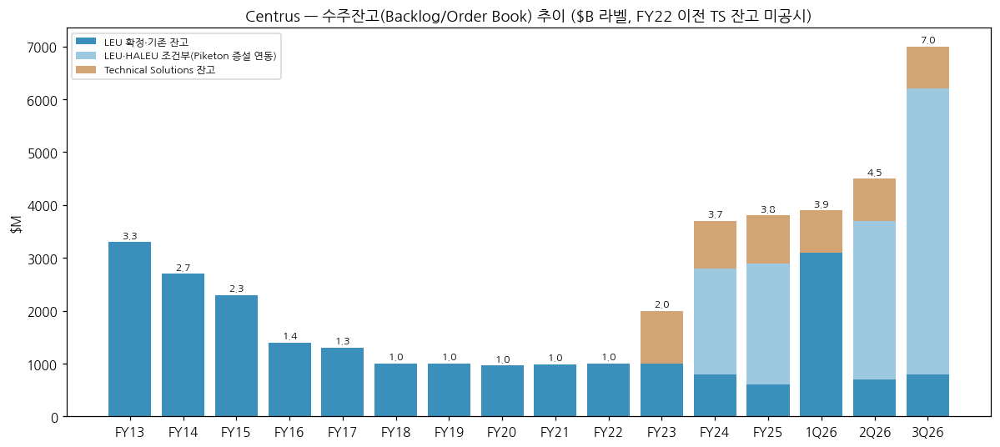

(2) 사업부별 개요 (매출 비중 큰 순서)

**LEU — 75% (9M26)**

"남이 농축한 우라늄을 사서, 장기계약으로 전력회사에 파는 사업." 매출 단위는 SWU(분리작업량 — 우라늄을 농축하는 데 드는 '일의 양')와 천연우라늄(UF6). SWU 1건 평균 주문 약 $10.2M (FY25) — 몇 건의 인도 시점이 분기 실적을 좌우. 조달: TENEX(러시아, 2028년까지) + Orano(프랑스, 2030년까지, 연간 최소·최대 물량 + 시장가 연동·상한) + 현물·재고

**Technical Solutions — 25% (9M26)**

"정부 돈으로 미국 유일의 HALEU 농축 설비를 돌려주고 수수료를 받는 사업 + 기술용역." HALEU 운영계약은 원가 + 인센티브 수수료(Option 1a: 목표원가 $99.3M + 수수료 $8.7M) 구조라 GPM이 한 자릿수. 2026-09-30 DOE 생산 옵션 종료(Option 1c 21개월 미행사 방침) → 2026-10 HALEU·설비 책임을 Centrus(ACO)가 인수, **상업 고객용 HALEU 생산**으로 전환 중 (3Q26 컨콜 요약: "16대 캐스케이드가 상업 고객용 HALEU 농축 중")

(3) 사업부별 디테일 (top-seller · growth · 이익 outlier)

→ **SWU 판매가 vs 조달원가 스프레드가 이익의 전부** — 9M26 SWU 평균 판매가 +12%, 평균 원가 +30% → LEU GPM 31.6% (FY22 55.4% 정점 대비 하락). 신규 계약은 높은 시장가 반영 중이나 TENEX 조달가·제재 관련 비용(운송·결제)도 상승 (10-Q)

→ **우라늄 매출은 들쭉날쭉** — 4Q24 $73.2M, 9M26 $74.1M 등 일회성 성격 (고객 요청 시 판매), 마진 낮음

→ **이익 outlier** — 3Q21 TS GP $41.2M (포츠머스 연금비용 정산 $43.5M 일회성), 4Q19 TS GP −$18.9M·4Q22 −$18.6M (원인 원문 미확인 — HALEU 계약 손실충당으로 보임 [판단]), 3Q26 전사 GP −$10.6M (LEU 저마진 계약 믹스 + HALEU 운영 매출 −$10.2M)

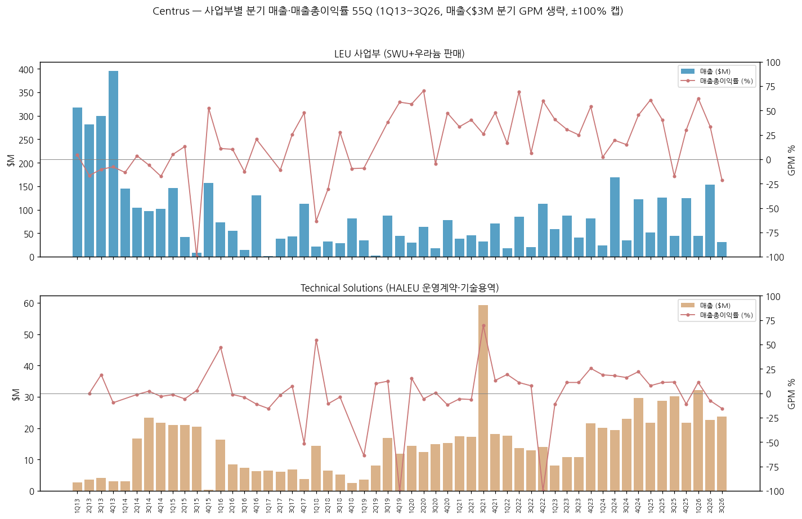

**사업부별 분기 시계열 55Q ($M, 4Q = 연간 − 9M [계산])**

| 분기 | SWU | 우라늄 | LEU 매출 | LEU GP | LEU GPM | TS 매출 | TS GP | 전사 매출 | 전사 GP | 영업이익 | OPM | 순이익 |
|---|---|---|---|---|---|---|---|---|---|---|---|---|
| 1Q13 | 290.2 | 27.6 | 317.8 | 14.0 | 4% | 2.6 | -0.7 | 320.4 | 13.3 | -13.7 | -4% | -2.0 |
| 2Q13 | 267.4 | 13.9 | 281.3 | -46.9 | -17% | 3.5 | 0.0 | 284.8 | -46.9 | -68.0 | -24% | -40.9 |
| 3Q13 | 295.8 | 3.8 | 299.6 | -30.8 | -10% | 4.2 | 0.8 | 303.8 | -30.0 | -53.3 | -18% | -44.3 |
| 4Q13 | 369.5 | 25.9 | 395.4 | -31.0 | -8% | 3.1 | -0.3 | 398.5 | -31.3 | -95.7 | -24% | -71.7 |
| 1Q14 | 145.6 | 0.0 | 145.6 | -19.7 | -14% | 3.0 | -1.2 | 148.6 | -20.9 | -39.2 | -26% | -50.8 |
| 2Q14 | 104.5 | 0.0 | 104.5 | 3.7 | 4% | 16.7 | -0.2 | 121.2 | 3.5 | -18.7 | -15% | -28.0 |
| 3Q14 | 97.4 | 0.0 | 97.4 | -5.9 | -6% | 23.3 | 0.5 | 120.7 | -5.4 | -16.4 | -14% | 418.9 |
| 4Q14 | 101.0 | 0.8 | 101.8 | -17.8 | -17% | 21.8 | -0.7 | 123.6 | -18.5 | -38.5 | -31% | -42.3 |
| 1Q15 | 103.6 | 43.2 | 146.8 | 7.2 | 5% | 21.0 | -0.3 | 167.8 | 6.9 | -11.0 | -7% | -15.4 |
| 2Q15 | 42.2 | 0.0 | 42.2 | 5.5 | 13% | 21.1 | -1.2 | 63.3 | 4.3 | -10.2 | -16% | -15.1 |
| 3Q15 | 8.8 | 0.0 | 8.8 | -25.0 | -284% | 20.4 | 0.6 | 29.2 | -24.4 | -50.4 | -173% | -55.1 |
| 4Q15 | 135.3 | 22.3 | 157.6 | 82.4 | 52% | 0.3 | -0.3 | 157.9 | 82.1 | -96.8 | -61% | -101.8 |
| 1Q16 | 59.3 | 14.3 | 73.6 | 8.1 | 11% | 16.4 | 7.7 | 90.0 | 15.8 | -10.5 | -12% | -14.6 |
| 2Q16 | 54.9 | 0.0 | 54.9 | 5.6 | 10% | 8.5 | -0.1 | 63.4 | 5.5 | -14.6 | -23% | -2.9 |
| 3Q16 | 14.1 | 0.0 | 14.1 | -1.8 | -13% | 7.3 | -0.3 | 21.4 | -2.1 | -36.7 | -171% | -41.3 |
| 4Q16 | 130.2 | 0.0 | 130.2 | 26.6 | 20% | 6.3 | -0.7 | 136.5 | 25.9 | 0.1 | 0% | -8.2 |
| 1Q17 | 0.8 | 0.0 | 0.8 | -1.5 | n/m | 6.4 | -1.0 | 7.2 | -2.5 | -24.0 | -333% | 7.6 |
| 2Q17 | 37.9 | 0.0 | 37.9 | -4.2 | -11% | 6.1 | -0.1 | 44.0 | -4.3 | -22.4 | -51% | -22.4 |
| 3Q17 | 43.5 | 0.0 | 43.5 | 11.1 | 26% | 6.8 | 0.5 | 50.3 | 11.6 | -8.5 | -17% | -8.5 |
| 4Q17 | 113.2 | 0.0 | 113.2 | 53.9 | 48% | 3.7 | -1.9 | 116.9 | 52.0 | 10.2 | 9% | 35.5 |
| 1Q18 | 17.7 | 3.6 | 21.3 | -13.5 | -63% | 14.4 | 7.9 | 35.7 | -5.6 | -26.3 | -74% | -25.0 |
| 2Q18 | 32.9 | 0.0 | 32.9 | -10.0 | -30% | 6.5 | -0.7 | 39.4 | -10.7 | -27.4 | -70% | -26.1 |
| 3Q18 | 17.6 | 11.3 | 28.9 | 8.0 | 28% | 5.2 | -0.2 | 34.1 | 7.8 | -9.1 | -27% | -7.8 |
| 4Q18 | 62.4 | 18.9 | 81.3 | -7.8 | -10% | 2.5 | -1.6 | 83.8 | -9.4 | -29.6 | -35% | -45.2 |
| 1Q19 | 12.4 | 22.7 | 35.1 | -3.2 | -9% | 3.6 | -2.3 | 38.7 | -5.5 | -20.8 | -54% | -20.9 |
| 2Q19 | 0.0 | 2.6 | 2.6 | -5.1 | n/m | 8.0 | 0.8 | 10.6 | -4.3 | -15.3 | -144% | -15.6 |
| 3Q19 | 75.0 | 12.8 | 87.8 | 33.4 | 38% | 16.9 | 2.1 | 104.7 | 35.5 | 23.1 | 22% | 22.8 |
| 4Q19 | 36.3 | 7.6 | 43.9 | 25.7 | 59% | 11.8 | -18.9 | 55.7 | 6.8 | -6.7 | -12% | -2.8 |
| 1Q20 | 30.7 | 0.0 | 30.7 | 17.4 | 57% | 14.3 | 2.2 | 45.0 | 19.6 | 8.9 | 20% | 11.3 |
| 2Q20 | 58.6 | 4.8 | 63.4 | 44.5 | 70% | 12.3 | -0.7 | 75.7 | 43.8 | 31.0 | 41% | 33.7 |
| 3Q20 | 0.1 | 18.6 | 18.7 | -0.9 | -5% | 14.9 | 0.1 | 33.6 | -0.8 | -9.5 | -28% | -7.0 |
| 4Q20 | 62.1 | 15.6 | 77.7 | 36.8 | 47% | 15.2 | -1.8 | 92.9 | 35.0 | 20.6 | 22% | 16.4 |
| 1Q21 | 38.1 | 0.0 | 38.1 | 12.7 | 33% | 17.5 | -1.0 | 55.6 | 11.7 | 0.9 | 2% | 5.1 |
| 2Q21 | 45.2 | 0.0 | 45.2 | 18.2 | 40% | 17.2 | -1.1 | 62.4 | 17.1 | 7.5 | 12% | 11.6 |
| 3Q21 | 19.1 | 12.9 | 32.0 | 8.3 | 26% | 59.3 | 41.2 | 91.3 | 49.5 | 38.2 | 42% | 42.1 |
| 4Q21 | 60.9 | 9.9 | 70.8 | 33.8 | 48% | 18.2 | 2.4 | 89.0 | 36.2 | 21.7 | 24% | 116.2 |
| 1Q22 | 12.8 | 4.9 | 17.7 | 2.9 | 16% | 17.6 | 3.4 | 35.3 | 6.3 | -3.4 | -10% | -0.4 |
| 2Q22 | 85.5 | 0.0 | 85.5 | 59.4 | 69% | 13.6 | 1.5 | 99.1 | 60.9 | 44.6 | 45% | 37.4 |
| 3Q22 | 7.7 | 12.5 | 20.2 | 1.3 | 6% | 13.0 | 1.0 | 33.2 | 2.3 | -12.8 | -39% | -6.1 |
| 4Q22 | 90.2 | 22.0 | 112.2 | 67.0 | 60% | 14.0 | -18.6 | 126.2 | 48.4 | 31.3 | 25% | 21.1 |
| 1Q23 | 58.8 | 0.0 | 58.8 | 23.9 | 41% | 8.1 | -0.9 | 66.9 | 23.0 | 8.3 | 12% | 7.2 |
| 2Q23 | 48.1 | 39.5 | 87.6 | 26.8 | 31% | 10.8 | 1.2 | 98.4 | 28.0 | 14.4 | 15% | 12.7 |
| 3Q23 | 40.5 | 0.0 | 40.5 | 10.1 | 25% | 10.8 | 1.2 | 51.3 | 11.3 | -2.9 | -6% | 8.2 |
| 4Q23 | 60.8 | 21.3 | 82.1 | 44.3 | 54% | 21.5 | 5.5 | 103.6 | 49.8 | 32.6 | 31% | 55.9 |
| 1Q24 | 23.6 | 0.0 | 23.6 | 0.5 | 2% | 20.1 | 3.8 | 43.7 | 4.3 | -10.6 | -24% | -6.1 |
| 2Q24 | 139.7 | 29.9 | 169.6 | 33.0 | 19% | 19.4 | 3.5 | 189.0 | 36.5 | 21.1 | 11% | 30.6 |
| 3Q24 | 34.8 | 0.0 | 34.8 | 5.2 | 15% | 22.9 | 3.7 | 57.7 | 8.9 | -7.6 | -13% | -5.0 |
| 4Q24 | 48.7 | 73.2 | 121.9 | 55.2 | 45% | 29.7 | 6.6 | 151.6 | 61.8 | 45.1 | 30% | 52.5 |
| 1Q25 | 51.3 | 0.0 | 51.3 | 31.2 | 61% | 21.8 | 1.7 | 73.1 | 32.9 | 20.5 | 28% | 27.2 |
| 2Q25 | 125.7 | 0.0 | 125.7 | 50.7 | 40% | 28.8 | 3.2 | 154.5 | 53.9 | 33.5 | 22% | 28.9 |
| 3Q25 | 10.7 | 34.1 | 44.8 | -7.8 | -17% | 30.1 | 3.5 | 74.9 | -4.3 | -16.6 | -22% | 3.9 |
| 4Q25 | 111.0 | 13.4 | 124.4 | 37.4 | 30% | 21.8 | -2.4 | 146.2 | 35.0 | 12.8 | 9% | 18.0 |
| 1Q26 | 41.6 | 3.0 | 44.6 | 27.9 | 63% | 32.1 | 3.6 | 76.7 | 31.5 | 0.8 | 1% | 10.0 |
| 2Q26 | 100.0 | 53.4 | 153.4 | 51.6 | 34% | 22.7 | -1.7 | 176.1 | 49.9 | 10.4 | 6% | 16.8 |
| 3Q26 | 14.1 | 17.7 | 31.8 | -6.9 | -22% | 23.7 | -3.7 | 55.5 | -10.6 | -29.7 | -54% | 31.6 |

→ (출처: 10-Q MD&A 부문표 3개월 컬럼, 영업이익·순이익은 XBRL. 3Q14 순이익 $418.9M = 파산 재조정 이익, 4Q15 영업이익에 재조정가치 손상 $137.2M 포함)

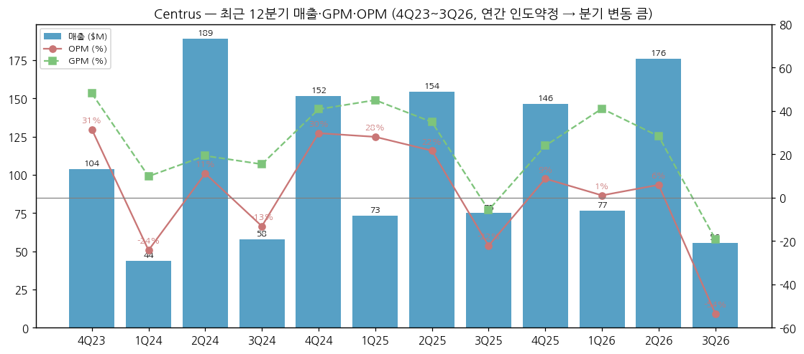

(4) 주요 경쟁사 (사업부별) — **한국 원전 연결 포함**

| 사업 | 경쟁사 | Centrus 위치 |
|---|---|---|
| 상업 LEU(SWU) | **Urenco** (25.4%, 미국 Eunice 4.3M SWU), **Orano** (11.0%, Project IKE 추진), **Rosatom/TENEX** (42.8%), CNNC (20.3%) [WNA 2025] | 설비 없음 → 조달처(TENEX·Orano)이자 경쟁자. 2029년 Piketon 가동 후 미국 자국 2번째 농축사 |
| HALEU | 현재 상업 생산자는 Centrus뿐 (서방 기준) / DOE $900M HALEU task order 공동 수주사 1곳 [원전 테마분석: General Matter — 미검증], Orano·Urenco HALEU 계획 | **선도자** — 1.9톤+ 생산 실적, 12톤/년 증설 목표(2029\~) [WNA] |
| 원심분리기 제조 | (내재화) | Oak Ridge 공장 — 미국 소유 유일의 원심분리기 기술(AC100M) |

→ **한국 연결** — **KHNP(한수원)** 는 Centrus의 조건부 LEU 장기 고객 (2025-02 $0.8B 확정계약 전환, 2025-08 공급물량 증액 — 전체 공급은 Piketon 신규 LEU 설비 자금 확보 조건부) + **KHNP·POSCO인터내셔널과 Piketon 증설 투자 검토 MOU (2025-08-25, 비구속, 한·미 정부 인사 참석)** [8-K]. 3Q26 10-Q까지 한국측 지분투자 집행 공시는 없음 (미검증 — 투자 확정 여부 공시 부재)

(5) 주요 매출처

→ 10-K는 고객명을 공개하지 않음 (Customer A/B/C 표기). FY25 상위 10개 원전 연료 고객 77%, 상위 2개 31% [10-K]. 3Q26 LEU 부문 Customer A $14.0M · B $9.0M · C $8.8M, TS 부문 Customer A(= DOE로 추정 [판단]) $18.8M [10-Q XBRL]

→ 지역: 미국 75% · 일본 23% (FY25). 2022년 이전엔 벨기에(Engie 추정 [판단]) 10%+ 고객 존재

→ 신규 HALEU 고객: Oklo(Meta 프로젝트), X-energy(Dow 텍사스 프로젝트용 추정 [판단]), Radiant, Antares — 모두 선급금 포함

(6) 생산 CAPA + 임직원 추이

→ **농축 CAPA** — 현재 Piketon 시범 캐스케이드 16대(HALEU 연 900kg 수준). ACP 원래 설계 3.8M SWU/년, NRC 허가 최대 7M SWU/년(10% 이하) [WNA]. 증설 1단계 목표: HALEU 12톤/년 (2029\~) [WNA]. 새 원심분리기 첫 대 2026-10-29 Oak Ridge에서 출하 [8-K]

→ **CapEx 계획** — Oak Ridge 고속생산 전환 $560M+ (2026-01 발표, 일자리 400+), Piketon 증설 "수십억 달러"(건설 1,000명·운영 300명), 9M26 실집행 $226.4M

→ **임직원** — 322명 (FY24말) → **467명** (FY25말) → Piketon 순증 목표 175명+ (3Q26 컨콜 요약)

---

## ④ 재무 구조

(1) 손익계산서 (12년, $M) + chart1b

| 연도 | 매출 | 매출원가 | 매출총이익 | GPM | ATC(기술투자) | SG&A | 영업이익 | OPM | 순이익 | NPM |
|---|---|---|---|---|---|---|---|---|---|---|
| FY14 | 514.1 | 555.4 | -41.3 | -8.0% | 61.3 | 42.4 | -112.8 | -21.9% | 297.8 | 57.9% |
| FY15 | 418.2 | 349.3 | 68.9 | 16.5% | 33.0 | 42.6 | -168.4 | -40.3% | -187.4 | -44.8% |
| FY16 | 311.3 | 266.2 | 45.1 | 14.5% | 47.9 | 46.2 | -61.7 | -19.8% | -67.0 | -21.5% |
| FY17 | 218.4 | 161.6 | 56.8 | 26.0% | 15.7 | 43.7 | -44.7 | -20.5% | 12.2 | 5.6% |
| FY18 | 193.0 | 210.9 | -17.9 | -9.3% | 26.1 | 39.9 | -92.4 | -47.9% | -104.1 | -53.9% |
| FY19 | 209.7 | 177.2 | 32.5 | 15.5% | 14.6 | 33.7 | -19.7 | -9.4% | -16.5 | -7.9% |
| FY20 | 247.2 | 149.6 | 97.6 | 39.5% | 2.8 | 36.0 | 51.0 | 20.6% | 54.4 | 22.0% |
| FY21 | 298.3 | 183.8 | 114.5 | 38.4% | 2.1 | 36.0 | 68.3 | 22.9% | 175.0 | 58.7% |
| FY22 | 293.8 | 175.9 | 117.9 | 40.1% | 14.8 | 33.9 | 59.7 | 20.3% | 52.0 | 17.7% |
| FY23 | 320.2 | 208.1 | 112.1 | 35.0% | 14.2 | 36.9 | 52.4 | 16.4% | 84.0 | 26.2% |
| FY24 | 442.0 | 330.5 | 111.5 | 25.2% | 17.2 | 35.0 | 48.0 | 10.9% | 72.0 | 16.3% |
| FY25 | 448.7 | 331.2 | 117.5 | 26.2% | 16.9 | 36.2 | 50.2 | 11.2% | 78.0 | 17.4% |
| 9M26 | 308.3 | 237.5 | 70.8 | 23.0% | 34.4 | 49.4 | -18.5 | -6.0% | 58.4 | 18.9% |

→ (출처: XBRL companyfacts·10-K. FY14는 Predecessor+Successor 합산 [계산]. ATC = Advanced technology costs: 고객계약 밖 원심분리 기술·입찰·증설 준비비)

(2) 재무상태표 (12년, 연말, $M) + chart4

| 연말 | 자산총계 | 현금 | 재고 | 유형자산 | 유동자산 | 유동부채 | 장기차입(장부) | 연금부채(비유동) | 이연수익·선수금 | 부채총계 | 자본총계 |
|---|---|---|---|---|---|---|---|---|---|---|---|
| FY14 | 1,157.7 | 218.8 | 462.2 | 3.5 | 842.4 | 450.4 | 240.4 | 179.3 | — | 1,136.1 | 21.6 |
| FY15 | 820.1 | 234.0 | 319.2 | 3.5 | 658.0 | 350.3 | 247.0 | 172.3 | — | 985.8 | -165.7 |
| FY16 | 713.5 | 260.7 | 177.4 | 6.0 | 560.6 | 325.7 | 234.1 | 179.9 | — | 949.6 | -236.1 |
| FY17 | 675.3 | 208.8 | 153.1 | 4.9 | 566.9 | 403.4 | 157.5 | 161.6 | — | 894.2 | -218.9 |
| FY18 | 571.7 | 123.1 | 129.7 | 4.2 | 484.5 | 438.7 | 120.2 | 168.9 | 204.5 | 893.6 | -321.9 |
| FY19 | 455.9 | 130.7 | 64.5 | 3.7 | 369.6 | 336.8 | 114.1 | 141.8 | 243.0 | 792.8 | -336.9 |
| FY20 | 486.3 | 152.0 | 64.8 | 4.9 | 406.1 | 366.1 | 108.0 | 124.4 | 281.7 | 806.9 | -320.6 |
| FY21 | 572.4 | 193.8 | 91.1 | 5.3 | 465.9 | 393.3 | 101.8 | 23.1 | 288.1 | 714.3 | -141.9 |
| FY22 | 705.5 | 179.9 | 209.2 | 5.5 | 587.1 | 449.2 | 95.7 | 43.6 | 258.4 | 779.6 | -74.1 |
| FY23 | 796.2 | 201.2 | 306.4 | 7.0 | 685.4 | 471.1 | 89.6 | 17.3 | 252.4 | 763.9 | 32.3 |
| FY24 | 1,093.4 | 671.4 | 161.6 | 9.4 | 1,015.2 | 346.8 | 472.5 | 4.0 | 183.6 | 932.0 | 161.4 |
| FY25 | 2,445.9 | 1,957.2 | 322.9 | 29.5 | 2,363.6 | 422.8 | 1,174.8 | 3.0 | 131.1 | 1,680.8 | 765.1 |
| 3Q26 | 2,871.6 | 2,236.1 | 177.7 | 312.9 | 2,485.5 | 288.7 | 1,178.8 | 2.9 | 85.3 | 1,766.5 | 1,105.1 |

→ (출처: XBRL. 부채총계 = 자산 − 자본 [계산]. 이연수익·선수금 FY14\~17 태그 미존재)

→ **자본잠식 8년 (FY15\~FY22)** — 파산 후 연금부채($170M대)·누적결손 → FY21 연금정산·흑자 누적으로 축소 → FY23 플러스 전환 → FY24\~26 전환사채·증자로 현금 $2.2B

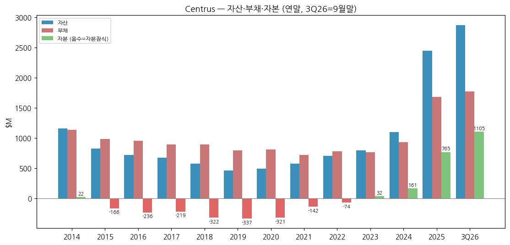

(3) 현금흐름표 (12년, $M) + chart6

| 연도 | 영업CF | 투자CF | 재무CF | CapEx | FCF | 감가상각 | 주식발행 조달 |
|---|---|---|---|---|---|---|---|
| FY14 | -110.1 | 15.5 | -0.8 | 0.0 | -110.1 | 8.7 | — |
| FY15 | 8.5 | 6.7 | 0.0 | 0.3 | 8.2 | 13.8 | — |
| FY16 | 37.7 | -1.2 | -9.8 | 3.0 | 34.7 | 13.1 | — |
| FY17 | -16.1 | 4.2 | -40.0 | 0.5 | -16.6 | 12.0 | — |
| FY18 | -74.4 | 0.4 | -11.1 | 0.1 | -74.5 | 7.4 | — |
| FY19 | 11.3 | 0.6 | -35.0 | 0.1 | 11.2 | 7.0 | 0.0 |
| FY20 | 67.1 | -1.4 | -44.4 | 1.4 | 65.7 | 7.3 | 23.1 |
| FY21 | 50.0 | -1.2 | -9.9 | 1.2 | 48.8 | 8.6 | 42.1 |
| FY22 | 20.6 | -0.7 | -4.3 | 0.7 | 19.9 | 9.6 | 3.6 |
| FY23 | 9.1 | -1.6 | 13.9 | 1.6 | 7.5 | 7.1 | 23.2 |
| FY24 | 37.0 | -4.1 | 437.1 | 4.1 | 32.9 | 10.8 | 54.7 |
| FY25 | 51.0 | -19.7 | 1224.9 | 19.7 | 31.3 | 9.9 | 523.7 |
| 9M26 | -11.1 | -226.4 | 547.0 | 226.4 | -237.5 | 6.8 | 547.7 (공모 493.8 + ATM 53.9) |

→ (출처: XBRL·10-K. FCF = 영업CF − CapEx [계산]. 9M26 영업CF −$11.1M = 고객 수금 $302M vs LEU 재고 구매·TS 지출 $305M)

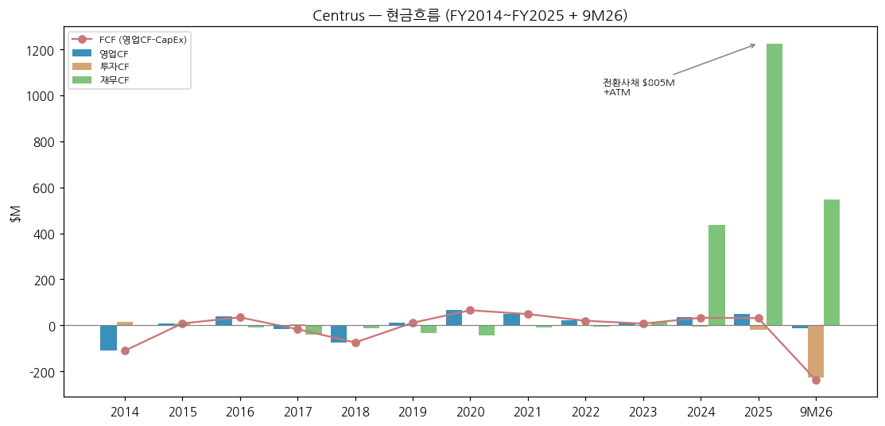

(4) CapEx + chart8

→ FY14\~FY24 연 $0\~4M (설비 없는 트레이더) → FY25 $19.7M → **9M26 $226.4M** (Piketon·Oak Ridge). 2026 가이던스 $350\~500M [웹 요약], "CapEx를 수억 달러 늘릴 것" (10-Q). 유형자산 $29.5M (FY25말) → **$312.9M (3Q26말)**

→ 정부 지원: DOE HALEU task order $900M (마일스톤 지급), §48C 세액공제 $62.4M 배정(2025-01, Oak Ridge 투자 $208M 기준, 2027-01까지 인증 필요)

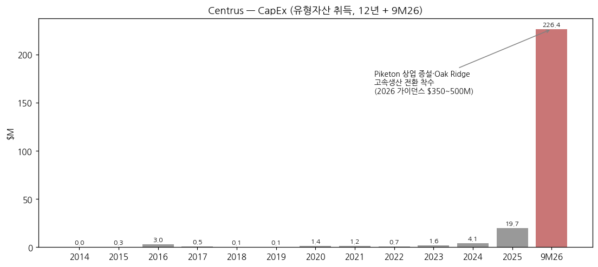

(5) 부채 구조 + 채권 history

| 채권 | 발행 | 원금 | 금리 | 만기 | 전환가 | 현황 |
|---|---|---|---|---|---|---|
| 8.0% PIK Toggle Notes | 2014-09 (파산 졸업 시) | $234.4M | 8% | 2019 | — | 2017 교환·조기상환 |
| 8.25% Notes | 2017-02 (교환) | $74.3M | 8.25% | 2027 | — | 2025-03-26 전액 상환 (상환이익 $11.8M) |
| **2.25% 전환사채** | 2024-11-07 | **$402.5M** | 2.25% (반기) | 2030-11-01 | **$97.50** (10.2564주/$1,000) | 현 주가($103.78) 기준 **내가격** → 약 4.13M주 전환 가능 [계산] |
| **0% 전환사채** | 2025-08-18 | **$805.0M** | 0% | 2032-08-15 | **$229.62** (4.3551주/$1,000) | 외가격, 약 3.51M주 [계산] |

→ 3Q26말 장기차입 장부가 $1,178.8M, 원금 합 $1,207.5M. 만기 전 원금 상환 의무 없음 [10-Q]. 8.0% PIK 노트 원금은 10-K 2015 기준 [미검증 — 원문 재확인 필요]

(6) 배당·자사주 → **자금조달·희석** + chart9

→ 배당·자사주 매입 **없음** (Section 382 NOL 보호 권리계획 2029-06까지 연장 — 5% 이상 신규 주주 제한)

| 연도 | 주식 발행 조달 | 전환사채 | 희석 가중평균 주식수 (M) | 내용 |
|---|---|---|---|---|
| FY20 | 23.1 | — | 10.1 | ATM |
| FY21 | 42.1 | — | 13.9 | ATM·워런트 |
| FY23 | 23.2 | — | 15.5 | ATM |
| FY24 | 54.7 | 402.5 | 16.4 | ATM + 2.25% CB |
| FY25 | 523.7 | 805.0 | 19.9 | ATM $143M 등 + 0% CB |
| 9M26 | 547.7 | — | 22.2 (3Q26) | **2026-09 공모 $500M**(보통주 50만주 + 사전납입 워런트 200.6만주 + 보통주 워런트 699.2만주, Guggenheim) + ATM $54M (27.8만주) |

→ **보통주 워런트 6,992,382주** — 4개 트랜치 행사가 $226.86 / $272.24 / $317.61 / $362.98, 전부 행사 시 약 $2B 유입 [8-K 2026-09-11, Finviz 요약]. 부채 분류 → 분기마다 평가손익 (3Q26 이익 $46.4M)

→ **완전희석 잠재 주식수 약 37.3M주** [계산: 발행 20.62M + 사전납입 워런트 2.01M + 2.25% CB 4.13M + 0% CB 3.51M + 보통주 워런트 6.99M] — 현 발행주식 대비 +81%

→ 잔여 shelf: $554.5M (2025-11 S-3, 3Q26말), 2026-11-02 신규 S-3 제출 [10-Q]

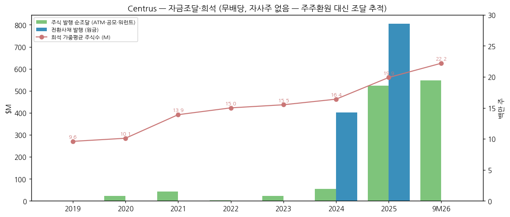

(7) 재무비율 (12년, [계산])

| 연도 | ROE | ROA | 부채비율 (부채/자본) | 유동비율 | 순현금 (현금−장기차입) | 이자보상배율 (OP/이자) |
|---|---|---|---|---|---|---|
| FY14 | n/m | 25.7% | 5260% | 1.87 | -21.6 | 적자 |
| FY15 | n/m (자본잠식) | -22.9% | 자본잠식 | 1.88 | -13.0 | 적자 |
| FY16 | n/m (자본잠식) | -9.4% | 자본잠식 | 1.72 | 26.6 | 적자 |
| FY17 | n/m (자본잠식) | 1.8% | 자본잠식 | 1.41 | 51.3 | 적자 |
| FY18 | n/m (자본잠식) | -18.2% | 자본잠식 | 1.10 | 2.9 | 적자 |
| FY19 | n/m (자본잠식) | -3.6% | 자본잠식 | 1.10 | 16.6 | 적자 |
| FY20 | n/m (자본잠식) | 11.2% | 자본잠식 | 1.11 | 44.0 | n/m (이자 미미) |
| FY21 | n/m (자본잠식) | 30.6% | 자본잠식 | 1.18 | 92.0 | n/m (이자 미미) |
| FY22 | n/m (자본잠식) | 7.4% | 자본잠식 | 1.31 | 84.2 | n/m (이자 미미) |
| FY23 | n/m (자본잠식) | 10.6% | 2365% | 1.45 | 111.6 | n/m (이자 미미) |
| FY24 | 74% | 6.6% | 577% | 2.93 | 198.9 | 30.0배 |
| FY25 | 17% | 3.2% | 220% | 5.59 | 782.4 | 4.0배 |
| 3Q26 | — | — | 160% | 8.61 | 1,057.3 | — |

→ ROE·부채비율은 FY15\~FY23 자본잠식·과소자본으로 의미 없음. 이자보상배율은 TDR 회계(FY17\~FY24)로 n/m

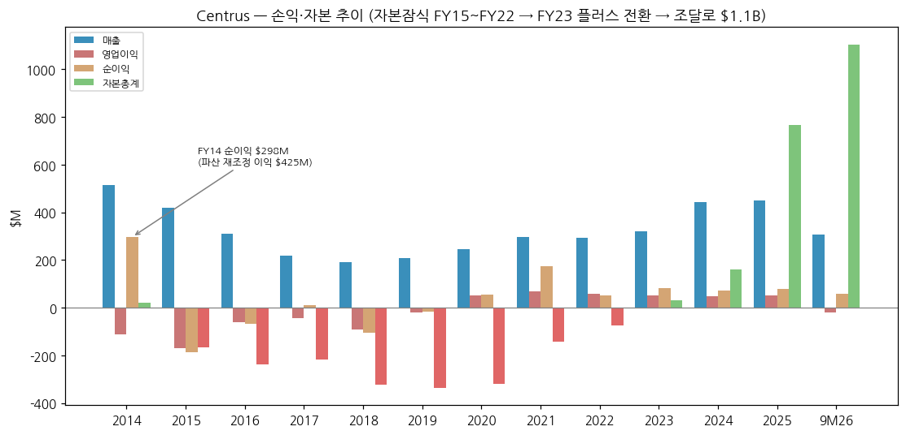

---

## ⑤ 지배 구조

(1) 그룹·계열 관계

→ 독립 상장사 (지배주주 없음). Class B 보통주 719,200주는 **Toshiba America Energy Systems(TAES)** 와 **BWXT Investment Company**가 보유 — 2014 파산 졸업 시 전략적 투자자, Class B 보유자가 이사 1인 지명 (Investor-Designated Director: Tetsuo Iguchi) [Proxy 2026]

→ BWXT는 같은 원전 서브섹터(기자재 글로벌) 종목 — Centrus 지분은 소규모 (Class B 전체가 발행주식의 약 3.5%)

(2) 주주 구분 + chart5

| 주주 | 주식수 | 지분율 (Class A) | 기준일 |
|---|---|---|---|
| D. E. Shaw & Co. | 973,718 | 5.1% | 2026-01-07 (13G/A) |
| BlackRock | 954,108 | 5.0% | 2023-12-31 (13G) |
| Global X Management | 951,660 | 5.0% | 2024-09-30 (13G) — 우라늄 ETF(URA 등) 추정 [판단] |
| 이사·임원 전체 (12명) | 142,099 | <1% | 2026-03-27 |

→ (출처: DEF 14A 2026-04-24. 분모 Class A 18,952,387주. 2026-09 공모·Westerman 지분 발행 후 지분율은 희석됨)

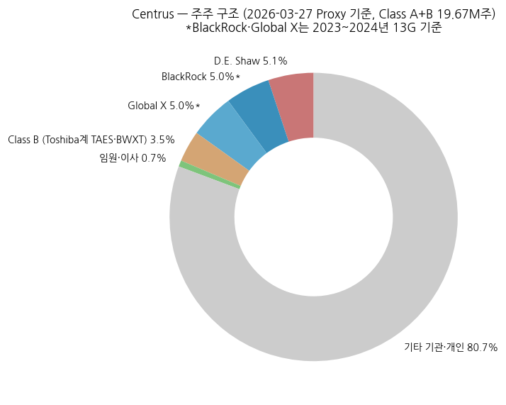

(3) 경영진·이사회

→ **CEO Amir V. Vexler** (53세) — 2024-01 취임. 전 Orano USA 사장·CEO, GE 20년(GE-Hitachi·Global Nuclear Fuel CEO·COO). 2026-08 특별 성과 RSU: **첫 캐스케이드 농축 개시 시 100% 베스팅** — 경영진 보상이 Piketon 가동 마일스톤에 직결 [8-K 2026-08-18]

→ **CFO Todd M. Tinelli** (2025-08\~, 에너지 자본조달 24년 경력), SVP Field Operations·ACO 사장 Patrick Brown (전 Urenco USA 시운전 리드), SVP Sales John Donelson

→ **이사회 8명** (2026-11 Kevin Graney 추가 — 전 GD Electric Boat 사장): 의장 Mikel Williams (Targus CEO), Adm. Kirkland Donald (HII 의장, 전 해군 원자력추진 국장), Tina Jonas, Dr. William Madia (스탠퍼드 명예부총장), Ray Rothrock, Tetsuo Iguchi(Class B 지명), Vexler

---

## ⑥ 기타 팩트

(1) 시가총액·밸류에이션 스냅샷 (2026-11-13 종가 기준)

| 항목 | 값 |
|---|---|
| 주가 | $103.78 (2026-11-13 종가) [Yahoo] |
| 시가총액 | $2.14B (발행 20.62M주) / **$2.35B** (사전납입 워런트 포함 22.62M주) [계산] |
| 순현금 | $1,028.6M [계산: 현금 $2,236.1M − CB 원금 $1,207.5M, 3Q26말] (Westerman 현금 $95M 반영 시 약 $934M) |
| EV | 약 $1.32B [계산] |
| EV/FY25 매출총이익 | 11.2배 [계산] |
| EV/총잔고 | 0.19배 [계산] |
| PBR | 2.1배 [계산: $2.35B ÷ 자본 $1,105.1M] |
| 52주 고저 | $345.60 (2026-01-21 장중) / $84.86 (2026-11-05 장중) |
| 사상 최고 | 종가 $436.00 (2025-10-15) → 현재 −76% [계산] |
| 애널리스트 | 10월 목표가 하향: Roth $115(중립)·Barclays $150·UBS $120·JPM $120 [Motley Fool] |

(2) R&D 인프라 + chart7

→ 회계상 R&D = **Advanced technology costs** (고객계약 밖 원심분리 기술·입찰·증설 준비). FY12 $1,313M (ACP 손상 포함) → FY17\~24 연 $2\~26M → 9M26 **$34.4M** (증설 Growth Costs, 비GAAP 조정 대상)

→ 기술 자산: 미국 소유 유일의 원심분리 농축 기술 **AC100M** (DOE 라이선스 기반), Oak Ridge Technology & Manufacturing Center (원심분리기 부품·조립), Piketon ACP 리스 (DOE 소유 부지, **리스 만료 2027-10-01** — 2026-12-31까지 장기 연장 목표). Palantir AI 플랫폼 도입(2026-03, 증설 관리)

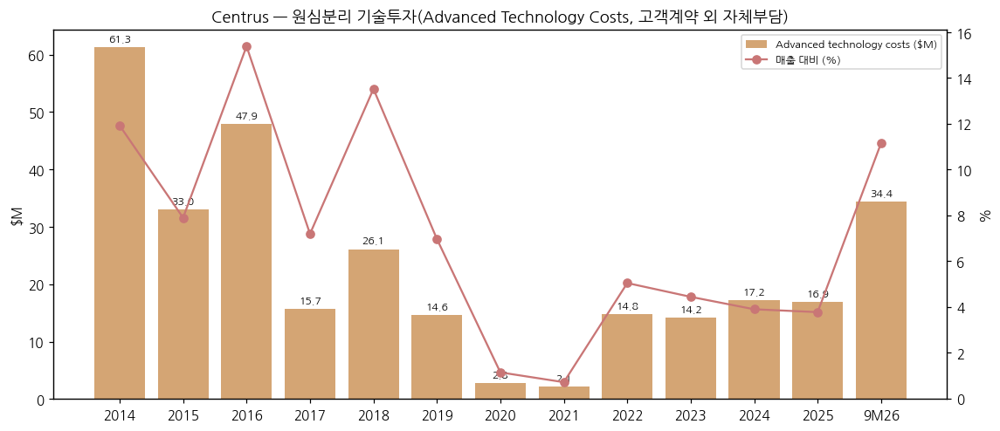

(3) 진행 중 corporate action (10년치)

| 시기 | 내용 |
|---|---|
| 2017-02 | 8% PIK 노트 → 8.25% 노트 + Series B 우선주 교환 (부채 재조정) |
| 2019-10 | DOE HALEU 데모 계약 (Centrus 비용분담 $30M + DOE $30M) |
| 2022-11 | DOE HALEU 운영계약 |
| 2024-11 | 2.25% CB $402.5M |
| 2025-03 | 8.25% 노트 전액 상환 |
| 2025-08 | 0% CB $805M, KHNP·POSCO인터 투자 검토 MOU |
| 2025-12 | NYSE 이전 |
| 2026-01\~07 | DOE $900M HALEU task order, Fluor EPC·Geiger 시공 계약 |
| 2026-03 | Oklo와 HALEU 변환(deconversion) JV 검토 (Piketon 공동입지) |
| 2026-09 | $500M 공모 (보통주+사전납입·보통주 워런트) |
| 2026-10-16 | **Westerman Holdings 인수** $116.0M (현금 $95M + 주식 $21M) — 원심분리기 케이싱 등 핵심 공급사, 석유·가스 산업 매출 보유, 1년 차 조정 EPS 증가 예상 [8-K·Motley Fool] |
| 2026-10-20 | DOE HALEU Transfer Agreement — HALEU·재고·설비 책임 ACO 이전, Piketon 리스 2027-10-01 확정 + 데모 캐스케이드 사용 허용, 해체(D&D) 책임 인수(NRC 승인 조건) |
| 2026-11-12 | Oklo HALEU 공급계약 발표 (계약일 2026-09-30, Meta 자금 선급 2026-11-02) |
| 진행 중 | HALEU 변환 RFTOP 2건 입찰 (각 최대 $80M), DOE와 캐스케이드 상업 운영 추가 계약 협의, 2026-12-07 Investor Day |

(4) 주요 리스크

→ **러시아 조달 (최대 리스크)** — 미국 수입금지법 waiver는 2027년 인도분까지만, 2028년부터는 법상 전면 금지(waiver 2028-01-01 종료). 러시아 수출금지령(2027-12-31까지, 건별 허가), 2026-09-18 **Graham Act**(러시아 제재 법제화, 최대 500% 관세 권한 — 2026-10-16 행정명령 14436으로 대부분 면제, 우라늄은 관세 대상 제외되나 동반 운송 물품은 영향 가능), 캐나다 운송사 허가 2027-03까지, TENEX 대금 결제 지연 이력 [10-Q]

→ **DOE 자금** — FY27 예산안에 HALEU 캐스케이드 운영비 미반영, DOE는 추가 생산 옵션 미행사 방침 → TS 잔고 $0.8B 사실상 소멸 위험

→ **Piketon 리스** — 2027-10-01 만료, 2026-12-31까지 연장 못 하면 Piketon 자본화 개선비 **손상 처리** 가능

→ **실행·자금** — 수십억 달러 증설의 비용 초과(인플레), 조건부 잔고는 마일스톤 미달 시 미발효, 추가 대규모 증자 가능성(10-Q 명시: "상당한 희석 가능")

→ **고객 집중·분기 변동** — 상위 2개 고객 31%, 건당 $10M 주문의 인도 시점

→ **소송** — Portsmouth GDP 방사능 노출 주장 소송 2건(Shaw·Blanton, Price-Anderson법 — 회사는 DOE 면책 주장)

→ **관세** — Section 232 핵심광물(우라늄 포함) 조사 → 2026-01 Proclamation 11001, 협상 결과에 따라 LEU 관세 가능

(5) ESG

→ 원문 미수집 (Source Audit ❌). 무탄소 전원(원전) 연료 공급사로 분류되나, 러시아 조달 의존이 거버넌스·공급망 리스크로 지적될 수 있음 [판단]

(6) 인증·라이선스

→ NRC: Piketon ACP 건설·운영 허가 (2007), HALEU(최대 20% U-235) 생산 허가 (2021), Oak Ridge 제조. 미국 Restricted Data·수출통제(10 CFR 810) 대상 기술, USW Local 689-5(2026-10까지)·SPFPA(2030까지) 단체협약

---

## Activity 보고 (v1.0 finalize)

### ✅ 확보 자료
→ 10-K 14 · 10-Q 42 · 8-K 64 · DEF 14A 3 · XBRL companyfacts · 인라인 XBRL/MD&A 부문표 55Q · Oklo 10-Q 교차확인 · Yahoo 월간·일간 · 웹 검증(WNA 점유율, 3Q26 요약, 10월 급락 원인, Oklo LOI)

### ❌ 누락 자료 (4)
→ 3Q26 보도자료·컨콜 원문 / 임직원 장기 시계열 / 최신 13F 지분 / ESG 등급

### ⚠️ 추정·계산 데이터 표시
→ 4Q 사업부 수치·시총·EV·순현금·완전희석 주식수·CAGR은 [계산]. FY26 가이던스·CapEx 가이던스·Investor Day 일정은 Finviz/EarningsWhispers 요약(원문 미확인). GICS·지수 편입은 [미검증 — 비공식 출처]. DOE HALEU 공동 수주사(General Matter)는 원전 테마분석 기준 [미검증]. KHNP·POSCO 지분투자 집행 여부는 공시 없음. ATH 시총 약 $8B는 근사

### Data Quality Confidence: **88%**

---

## Version Log

| 버전 | 일자 | 내역 |
|---|---|---|
| v1.0 | 2026-11-15 | 최초 작성 — 12년 연간·55분기 사업부·13종 차트, 3Q26 10-Q(2026-11-05) 반영, 수주잔고 FY13\~3Q26, 러시아 조달·DOE HALEU·Piketon 증설·자금조달 정리, Oklo 공급계약(2026-09-30)·Meta 선급(2026-11-02) Oklo 10-Q로 확인, KHNP 관계 확인 |

→ 잔여 보완 후보: 2026-12-07 Investor Day (2027 CapEx·증설 일정), FY26 10-K(2027-02) 반영, Piketon 리스 연장(2026-12-31 목표) 결과, 2028년 이후 러시아 조달 대체 계획, 3Q26 보도자료 원문(가이던스) 확인
