# LG디스플레이 — 기업 개요 (v1.0)

> 종목: LG디스플레이 (034220.KS / NYSE: LPL ADR 2주=1주 / 엘지디스플레이㈜ / LG Display Co., Ltd., DART corp_code 00105873)
> 섹터: IT 하드웨어 (워치리스트) / 서브섹터: 세트·디스플레이
> 작성 시각: 2026-11-25 KST (**v1.0** — 첫 작성. 3Q26 분기보고서(2026-11-16 공시)까지 반영)
> 적용 구조: v4.8 (6개 섹션 + 12종 차트 표준). 단일 사업부(Display)라 chart2는 전사 분기·제품별 매출·면적당 판가 3종(2·2b·2c)으로 분할
> 데이터: 12년 연간 연결(2014\~2025, OpenDART fnlttSinglAcntAll — 2014는 2015 사업보고서 전기 컬럼) + 47분기 연결(1Q15\~3Q26) + 제품별 27분기(1Q20\~3Q26, 연결주석 「제품별 정보」) + 면적당 판가 46분기(2Q15\~3Q26)
> 입력 source: OpenDART 정기보고서 공시원문 44건(2015.12 사업보고서\~2026.09 분기보고서) + 재무 JSON 44건 + 기업개황·주주·임원·배당 JSON + IR 실적자료 PDF 12건(1Q18\~4Q20, irgo) + Yahoo Finance v8 월간 주가(2004-07\~2026-11)
> **Fact verify cutoff**: 2026-11-24 (주가 6,850원·시가총액 3.43조원 = Yahoo Finance 2026-11-24 종가 × 500,000,000주, stockanalysis.com 2026-11-20 시총 3.41조원과 교차 확인 / 대형 패널 점유율 = DART 3Q26 분기보고서 인용 OMDIA)

---

## 1. 기업 분류

- **Primary 분류: 사이클** (Deep Cyclical — 패널 수급·판가 사이클)
- **Secondary 노트: 구조전환(턴어라운드) 진행 중** — LCD → OLED 사업구조 전환 (OLED 매출 비중 2020년 32% → 2025년 61%)

### ① 정량 근거

**📊 Summary Box (12년, 2014\~2025):**

| 지표 | 값 |
|------|-----|
| 매출 CAGR (11년, 2014→2025) | **-0.2%** (외형 정체 — 26조원 박스권) |
| OPM 평균 (12년 단순평균) | **0.6%** |
| OPM 정점 평균 | **8.2%** (2017 8.9%·2021 7.5%) |
| OPM 저점 평균 | **-8.8%** (2019 -5.8%·2023 -11.8%) |
| 사이클 주기 | 약 4년 (peak-to-peak 2017→2021, trough-to-trough 2019→2023) |
| 사이클 회수 (12년) | 정점 2회 / 저점 2회 |

```
[전사 손익 시계열 (12년, 연결)]
연도   매출(조)  영업이익  순이익   OPM    NPM
2014     26.5     1.36    0.92    5.1    3.5   
2015     28.4     1.63    1.02    5.7    3.6   
2016     26.5     1.31    0.93    4.9    3.5   
2017     27.8     2.46    1.94    8.9    7.0   ← 정점① LCD TV 패널 호황·OLED TV 흑자 기대
2018     24.3     0.09   -0.18    0.4   -0.7   ← 中 10.5세대 LCD 증설 → 판가 급락
2019     23.5    -1.36   -2.87   -5.8  -12.2   ← 저점① LCD 구조조정 개시
2020     24.2    -0.03   -0.07   -0.1   -0.3   ← 코로나 Stay-home 수요 반등
2021     29.9     2.23    1.33    7.5    4.5   ← 정점② IT·TV 수요 최대
2022     26.2    -2.09   -3.20   -8.0  -12.2   ← 수요 급랭·재고조정
2023     21.3    -2.51   -2.58  -11.8  -12.1   ← 저점② 사상 최대 적자
2024     26.6    -0.56   -2.41   -2.1   -9.1   ← 적자 축소
2025     25.8     0.52    0.30    2.0    1.2   ← 흑자전환 (광저우 LCD 매각·OLED 61%)

OPM range: -11.8% ~ 8.9% = 20.6%pt  → 사이클 cutoff(±10%pt) 충족
12년 중 영업적자 6개년 (2019·2020·2022·2023·2024 + 2018 사실상 BEP)
```

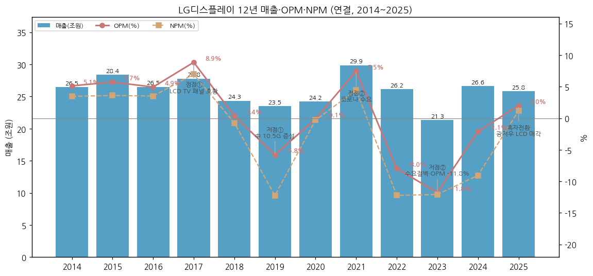

**직전 분기 흐름 (분기 연결, OpenDART):** 3Q26 매출 6.28조원(YoY -9.8%) / 영업이익 2,506억원(OPM 4.0%, YoY -41.9%). 2Q26 -1,077억원 적자에서 다시 흑자. 9M26 누적 영업이익 2,896억원 (9M25 3,485억원 대비 -17%).

### ② 산업 분류

- 산업: **디스플레이 패널** (TFT-LCD·OLED) — 반도체와 같은 장치산업형 사이클 산업
- DART 업종코드: 2621 (전자부품 제조업 — 표시장치)
- 워치리스트 섹터: IT 하드웨어 / 서브섹터 세트·디스플레이 (LG전자와 같은 칸)
- 사업부문: 단일 (Display). 제품 용도 4분류 TV / IT(모니터·노트북·태블릿) / Mobile 등(스마트폰·워치 등) / Auto

### ③ 분류 결정 논리

(1) **가장 매출 큰 제품군 기준**: 9M26 기준 Mobile 등 38.2% > IT 33.3% > TV 18.6% > Auto 9.9%. 어떤 제품이든 "패널"이라는 동일 상품의 면적당 판가(ASP)·가동률에 이익이 좌우 → 제품 mix와 무관하게 사이클 산업
(2) **이익 변동성 sub-rule**: 12년 OPM range 20.6%pt, 영업적자 6개년, ROE -37%(2024)\~+13%(2017). 지속성장 기준(OPM range 5%pt 이내) 완전 미충족 → **사이클 유지**
(3) **Boundary case**: OLED 비중이 61%(2025)까지 오르며 대형 OLED(TV·모니터)·중소형 POLED(스마트폰·워치)·차량용 Tandem OLED 중심 수주형 구조로 바뀌는 중 → 이익 변동성이 줄어드는지 관찰하는 **구조전환(턴어라운드) Secondary** 표기. 다만 2025\~3Q26 분기 OPM이 -2.1%\~+6.2%로 아직 흔들림
(4) **글로벌 피어 대비**: BOE·TCL CSOT(중국)는 LCD 점유율 확대로 규모 사이클, 삼성디스플레이(비상장, 삼성전자 SDC 부문)는 중소형 OLED 중심. LG디스플레이는 "대형 OLED 사실상 독점 + 애플 중심 중소형 OLED 2등"이라 피어 중 고객 집중도가 가장 높음 (9M26 1위 고객 매출 비중 56%, 상위 10개 92%)

### ④ 적정 밸류에이션 방법

- **PBR 우선** — 12년 중 6개년 적자, EPS가 -8,584원\~+5,038원으로 PER 산출 불가 구간이 절반. 장치산업이라 자본(설비)이 가치의 하한
- **EV/EBITDA 보조** — 연 감가상각 3.4\~5.1조원으로 영업이익보다 EBITDA가 현금창출력을 더 잘 보여줌 (2025 EBITDA 4.9조원, margin 18.9%)
- 연말 PBR 밴드 (연말 월말종가 ÷ 지배주주 BPS): 2014 1.05배 / 2015 0.72 / 2016 0.87 / 2017 0.74 / 2018 0.46 / 2019 0.51 / 2020 0.58 / 2021 0.67 / 2022 0.45 / 2023 0.63 / 2024 0.70 / 2025 0.89
- 현재(2026-11-24): 6,850원 ÷ 3Q26 BPS 12,456원(지배지분 6.23조원 ÷ 5억주) = **PBR 약 0.55배** — 12년 밴드(0.45\~1.05배) 하단부
- 피어 차별화: 삼성전자 같은 multi-segment는 PBR+PER 혼합, LG디스플레이는 단일 사이클 사업이라 PBR + EV/EBITDA 조합 (적자 구간 PER 미사용)

### ⑤ 분기 재평가 트리거 (분류 자체가 바뀌는 조건)

- **8개 분기 연속 OPM 0% 이상 + 분기 OPM range 5%pt 이내** → 사이클 → 지속성장(OLED 수주형) transition 후보 (현재 2Q26 -1.9%로 미충족)
- **OLED 매출 비중 70% 이상** 도달 + LCD(IT 중형 LCD·Auto LCD) 의존 축소 → Secondary를 "구조전환 완료"로 격상 검토
- 반대로 **연간 영업적자 재진입 + 부채비율 300% 재돌파** 시 → 구조전환 Secondary 삭제, 순수 사이클(재무위험 동반)로 복귀

---

## 2. 회사 개요

### ① 기본 사항

- **회사명**: 엘지디스플레이주식회사 (LG Display Co., Ltd.) — 법인 설립 1985-02-28, 2004-07 KRX·NYSE 동시 상장
- **본사**: 서울 영등포구 여의대로 128 LG트윈타워 / 생산: 파주·구미(국내), 광저우 OLED(중국), 하이퐁(베트남 모듈)
- **대표이사**: 정철동 (CEO, 2023년 말 선임) / 최대주주: LG전자 36.72%
- **사업 한 줄 정의**: TV·모니터·노트북·스마트폰·자동차용 **OLED·LCD 디스플레이 패널**을 만들어 글로벌 세트 업체에 파는 B2B 패널 제조사. 대형 WOLED(TV·게이밍 모니터)는 사실상 단독 공급, 중소형 POLED는 애플 등 소수 대형 고객 중심

### ② 최근 12년 손익·자본 추이 (조원, 좌→우 시간순)

| 연도 | 매출 | YoY | 영업이익 | 순이익 | 자본총계 | 자본 YoY |
|------|------|-----|----------|--------|----------|----------|
| 2014 | 26.5 | - | 1.36 | 0.92 | 11.78 | - |
| 2015 | 28.4 | +7.3% | 1.63 | 1.02 | 12.70 | +7.8% |
| 2016 | 26.5 | -6.6% | 1.31 | 0.93 | 13.46 | +6.0% |
| 2017 | 27.8 | +4.9% | 2.46 | 1.94 | 14.98 | +11.3% |
| 2018 | 24.3 | -12.4% | 0.09 | -0.18 | 14.89 | -0.6% |
| 2019 | 23.5 | -3.5% | -1.36 | -2.87 | 12.49 | -16.1% |
| 2020 | 24.2 | +3.2% | -0.03 | -0.07 | 12.74 | +2.0% |
| 2021 | 29.9 | +23.3% | 2.23 | 1.33 | 14.76 | +15.9% |
| 2022 | 26.2 | -12.5% | -2.09 | -3.20 | 11.32 | -23.3% |
| 2023 | 21.3 | -18.4% | -2.51 | -2.58 | 8.77 | -22.5% |
| 2024 | 26.6 | +24.8% | -0.56 | -2.41 | 8.07 | -8.0% |
| 2025 | 25.8 | -3.0% | 0.52 | 0.30 | 7.84 | -2.9% |

(연결 기준. 자본 YoY의 2024년 -8%는 유상증자 1.29조원 유입에도 순손실 2.41조원이 더 컸던 결과)

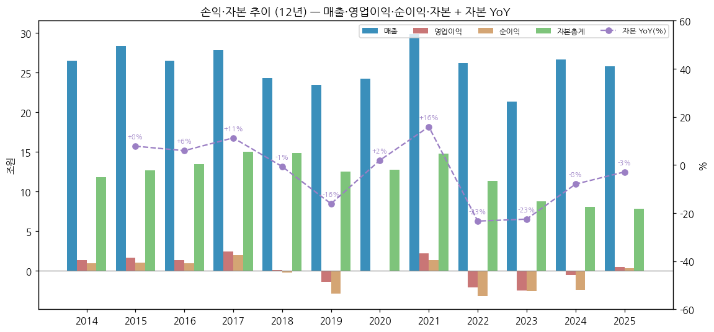

### ③ 회사 주가 역사 ★ 유일한 narrative 영역

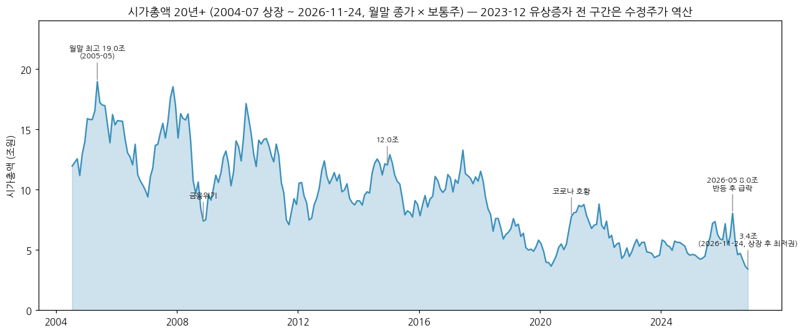

**시가총액 데이터:** 2004-07 \~ 2026-11-24 (월말 종가 × 보통주. 2024 유상증자 전 구간은 Yahoo 수정주가 ÷ 0.93557로 원주가 역산 × 357,815,700주, 2024년 이후 × 500,000,000주)
- 월말 종가 기준 최고: **약 19.0조원** (2005-05, 53,000원 × 3.58억주) / 장중 최고가 58,700원 (2007-11, 수정주가 역산)
- 연말 기준: 2014 12.0조 → 2017 10.7조 → 2018 6.5조 → 2021 8.8조 → 2022 4.5조 → 2025 5.9조
- 현재: **3.43조원** (2026-11-24, 6,850원 × 5억주) — 상장 이후 월말 기준 최저권. 1년 수익률 -45% (stockanalysis.com, 2026-11-20 기준)
- 교차 검증: stockanalysis.com 연말 시총 2021 8.80T / 2022 4.45T / 2023 4.56T / 2024 4.57T / 2025 5.91T — 본 역산값과 ±1% 이내 일치

**디스플레이 사이클 history:**

```
[2004-2007] LCD 1차 호황 · 상장
  · 2004-07 KRX·NYSE 동시 상장 (LG.Philips LCD)
  · 7세대 LCD로 대형 TV 패널 선점 → 2005-05 월말 시총 19조원 고점

[2008-2010] 금융위기 → 회복
  · 2008-02 사명 LG디스플레이로 변경, Philips 지분 단계적 매각
  · 2008 말 시총 7.5조원까지 급락 후 2010 14조원대 회복

[2011-2016] LCD 성숙기 · OLED 베팅
  · 2013 세계 최초 55인치 OLED TV 패널 공급
  · 2014 연말 시총 12.0조원 / OPM 5% 내외 정체

[2017-2019] LCD 슈퍼사이클 정점 → 중국 10.5세대 증설 충격
  · 2017 OPM 8.9% (12년 최고), P10·광저우 OLED 대규모 투자 결정
  · 2018~19 BOE 등 중국 10.5세대 LCD 가동 → TV 패널가 급락, 2019 영업손실 1.36조

[2020-2021] 코로나 Stay-home 특수
  · 2020-07 광저우 8.5세대 OLED 양산, IT·TV 수요 폭증
  · 2021 매출 29.9조(12년 최대), OPM 7.5%, FY2021 배당 650원 재개

[2022-2023] 수요 절벽 · 사상 최대 적자
  · 재고조정 + LCD 판가 하락 → 2023 영업손실 2.51조, 부채비율 308%
  · 2022 말 국내 LCD TV 패널 생산 종료, 2023-12 유상증자 결의

[2024-2026] 구조조정 · OLED 집중
  · 2024-03 유상증자 1.29조원 완료 (발행가 9,090원)
  · 2025-04-01 광저우 LCD 법인(LG Display (China)) 지분 매각 완료 → 2025 흑자전환
  · 2026-02~05 반등(월말 시총 최고 8.0조원, 2026-05) 후 급락 → 2026-11 3.4조원
  · 회사 공시상 2026 하반기 부담: 메모리 등 부품가 상승 → 세트 가격 상승·수요 둔화, 중형 LCD 출하 축소
```

### ④ 회사의 주요 연혁

| 연도 | 내용 |
|------|------|
| 1985 | 법인 설립 (DART 기업개황 설립일 1985-02-28) |
| 1999 | LG전자·Philips 합작 LG.Philips LCD 출범 |
| 2004 | KRX·NYSE 동시 상장 |
| 2008 | 사명 LG디스플레이로 변경 |
| 2013 | 세계 최초 55인치 OLED TV 패널 공급 (DART 사업보고서 「경쟁요소」 기재) |
| 2017 | 파주 P10·광저우 8.5세대 OLED 투자 결정, CapEx(유·무형) 7.0조 → 2018 8.4조(정점) |
| 2019-09 | 정호영 CEO 취임, LCD 구조조정 착수 / 10.5세대 대형 OLED 3.0조 투자 결정(2019년 3분기\~) |
| 2020-07 | 광저우 8.5세대 OLED 양산 |
| 2022 | 국내 LCD TV 패널 생산 종료 |
| 2023 | 정철동 CEO 선임(연말 인사), 2023-12 유상증자 결의 |
| 2024-03 | 유상증자 1.29조원 완료 (보통주 3.58억 → 5억주) |
| 2025-04 | 광저우 LCD 법인 매각 완료 (TCL CSOT), OLED 신기술·Infra 1.3조 투자 승인(2025-06-17) |
| 2026-04 | OLED 신기술 Infra 1.1조 투자 승인 / 10.5세대 대형 OLED 3.0조 투자 잠정 보류·재검토 이사회 보고 (2026-04-22) |

---

## 3. 비즈니스 모델

### ① 실적 추이 (제품별·지역별·고객사별)

**5년 연간 통합 표 (조원, DART 연결주석 「제품별 정보」)**

| 구분 | 2021 | 2022 | 2023 | 2024 | 2025 | 9M26 |
|------|------|------|------|------|------|------|
| **전사 매출** | 29.88 | 26.15 | 21.33 | 26.62 | 25.81 | 17.42 |
| ├ TV | 9.47 (31.7%) | 6.98 (26.5%) | 4.33 (20.3%) | 5.97 (22.4%) | 4.79 (18.6%) | 3.24 (18.6%) |
| ├ IT (모니터·노트북·태블릿) | 12.46 (41.7%) | 11.20 (42.5%) | 7.85 (36.8%) | 9.42 (35.4%) | 9.51 (36.8%) | 5.80 (33.3%) |
| ├ Mobile 등 (스마트폰·워치·산업용) | 7.95 (26.6%) | 8.19 (31.1%) | 7.15 (33.5%) | 8.94 (33.6%) | 9.37 (36.3%) | 6.65 (38.2%) |
| └ Auto | (Mobile 포함) | (Mobile 포함) | 2.00 (9.4%) | 2.28 (8.6%) | 2.14 (8.3%) | 1.73 (9.9%) |
| **OLED 매출 비중** | 32% | 40% | 48% | 55% | 61% | 62% (3Q26 보고서) |
| **면적당 판가 (4Q, USD/㎡)** | 806 | 708 | 1,064 | 873 | 1,297 | 1,250 (3Q26) |

(2022는 현금흐름위험회피 재분류 -0.21조 제외 금액이라 전사 매출과 소폭 차이. 2023 Auto는 2024 보고서의 재작성 수치. OLED 비중: 2020 32%·2021 32%·2022 40% — 2022·2025 사업보고서 기재)

**2014\~2020 제품 mix (사업보고서 MD&A 매출 비중)**

| 연도 | TV | Monitor | Notebook | Tablet | Mobile 등 |
|------|----|---------|----------|--------|-----------|
| 2014 | 39.4% | 17.6% | 10.1% | 13.4% | 19.5% |
| 2015 | 38.2% | 16.0% | 8.8% | 8.9% | 28.1% |
| 2016 | 38.2% | 15.2% | 9.0% | 10.2% | 27.4% |
| 2017 | 42.2% | 15.8% | 8.1% | 8.5% | 25.4% |
| 2018 | 40.0% | 16.6% | 11.7% | 8.2% | 23.6% |
| 2019 | 34.1% | 17.2% | 11.9% | 9.6% | 27.2% |
| 2020 | 27.8% | IT 41.7% (Monitor+Notebook+Tablet 통합 공시 시작) | | | 30.5% |

→ 핵심 변화: **TV 비중 42%(2017) → 19%(2025)** 로 반토막, Mobile 등은 20% → 36%. LCD TV 철수 + 애플향 POLED 확대가 mix를 뒤집음

**지역별 매출 (9M26, 도착지 기준, 조원)**: 중국 10.68 (61%) / 아시아(중국 제외) 3.60 (21%) / 미주 1.25 (7%) / 유럽 1.09 (6%) / 국내 0.80 (5%). 해외매출 비중 95.4% — 세트 조립이 중국·베트남 등에서 이뤄지기 때문 (최종 고객 국적과 다름)

**전사 분기 시계열 (47분기, 1Q15\~3Q26, 억원)**

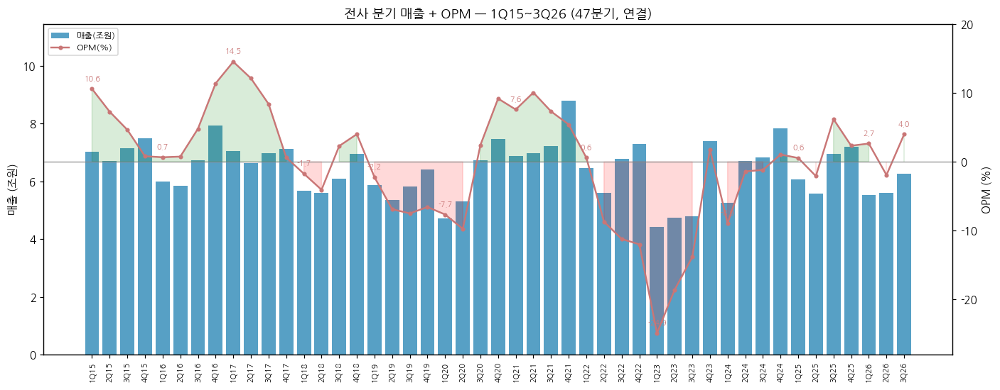

```
분기   매출(억)  영업이익  OPM    순이익
1Q15   70,223    7,439   10.6%    4,758
2Q15   67,076    4,881    7.3%    3,626
3Q15   71,582    3,329    4.7%    1,986
4Q15   74,958      607    0.8%     -135
1Q16   59,892      395    0.7%       12
2Q16   58,551      444    0.8%     -839
3Q16   67,238    3,232    4.8%    1,896
4Q16   79,360    9,043   11.4%    8,247
1Q17   70,622   10,269   14.5%    6,795
2Q17   66,289    8,043   12.1%    7,367
3Q17   69,731    5,860    8.4%    4,772
4Q17   71,261      445    0.6%      436
1Q18   56,752     -983   -1.7%     -490
2Q18   56,112   -2,281   -4.1%   -3,005
3Q18   61,024    1,401    2.3%      175
4Q18   69,478    2,793    4.0%    1,526
1Q19   58,788   -1,320   -2.2%     -626
2Q19   53,534   -3,687   -6.9%   -5,502
3Q19   58,217   -4,367   -7.5%   -4,422
4Q19   64,217   -4,219   -6.6%  -18,171
1Q20   47,242   -3,619   -7.7%   -1,989
2Q20   53,070   -5,170   -9.7%   -5,038
3Q20   67,376    1,644    2.4%      111
4Q20   74,612    6,855    9.2%    6,210
1Q21   68,828    5,230    7.6%    2,658
2Q21   69,656    7,011   10.1%    4,238
3Q21   72,232    5,289    7.3%    4,635
4Q21   88,065    4,776    5.4%    1,804
1Q22   64,715      383    0.6%      543
2Q22   56,073   -4,883   -8.7%   -3,820
3Q22   67,714   -7,593  -11.2%   -7,740
4Q22   73,016   -8,757  -12.0%  -20,938
1Q23   44,111  -10,984  -24.9%  -11,531
2Q23   47,386   -8,815  -18.6%   -6,988
3Q23   47,853   -6,621  -13.8%   -7,754
4Q23   73,959    1,317    1.8%      505
1Q24   52,530   -4,694   -8.9%   -7,613
2Q24   67,082     -937   -1.4%   -4,708
3Q24   68,213     -806   -1.2%   -3,381
4Q24   78,329      831    1.1%   -8,391
1Q25   60,653      335    0.6%   -2,370
2Q25   55,870   -1,160   -2.1%    8,908
3Q25   69,570    4,310    6.2%       12
4Q25   72,008    1,685    2.3%   -3,512
1Q26   55,340    1,467    2.7%   -5,757
2Q26   56,121   -1,077   -1.9%   -4,188
3Q26   62,770    2,506    4.0%    7,556
```
(1Q15\~4Q15: 2016 분기보고서 전기 누적값 차감·2015 사업보고서 연간 − 9M 역산. 1Q16\~: dart_quarterly_summary. 2Q25 순이익 8,908억원은 광저우 LCD 법인 매각이익 반영)

**제품별 분기 매출 (27분기, 1Q20\~3Q26, 조원)**

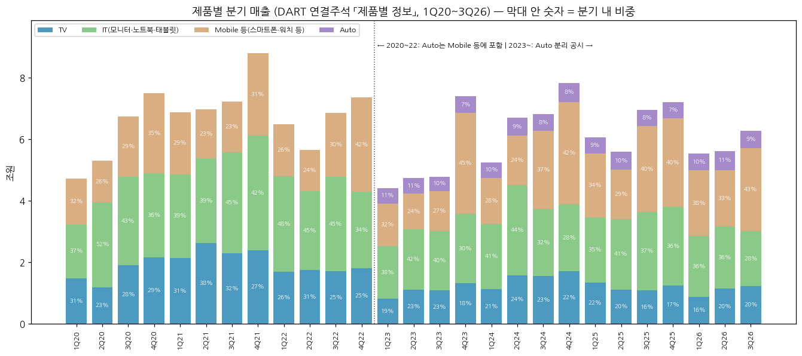

| 분기 | TV | IT | Mobile 등 | Auto | 합계(조원) | TV% | IT% | Mobile% | Auto% |
|---|---|---|---|---|---|---|---|---|---|
| 1Q20 | 1.48 | 1.75 | 1.49 | (Mobile 포함) | 4.72 | 31% | 37% | 32% | - |
| 2Q20 | 1.19 | 2.75 | 1.36 | (Mobile 포함) | 5.31 | 23% | 52% | 26% | - |
| 3Q20 | 1.90 | 2.89 | 1.95 | (Mobile 포함) | 6.74 | 28% | 43% | 29% | - |
| 4Q20 | 2.16 | 2.73 | 2.60 | (Mobile 포함) | 7.49 | 29% | 36% | 35% | - |
| 1Q21 | 2.15 | 2.72 | 2.02 | (Mobile 포함) | 6.88 | 31% | 39% | 29% | - |
| 2Q21 | 2.63 | 2.74 | 1.59 | (Mobile 포함) | 6.97 | 38% | 39% | 23% | - |
| 3Q21 | 2.29 | 3.28 | 1.65 | (Mobile 포함) | 7.22 | 32% | 45% | 23% | - |
| 4Q21 | 2.39 | 3.72 | 2.70 | (Mobile 포함) | 8.81 | 27% | 42% | 31% | - |
| 1Q22 | 1.69 | 3.10 | 1.70 | (Mobile 포함) | 6.49 | 26% | 48% | 26% | - |
| 2Q22 | 1.76 | 2.55 | 1.34 | (Mobile 포함) | 5.65 | 31% | 45% | 24% | - |
| 3Q22 | 1.72 | 3.06 | 2.08 | (Mobile 포함) | 6.85 | 25% | 45% | 30% | - |
| 4Q22 | 1.81 | 2.48 | 3.07 | (Mobile 포함) | 7.36 | 25% | 34% | 42% | - |
| 1Q23 | 0.83 | 1.69 | 1.40 | 0.50 | 4.41 | 19% | 38% | 32% | 11% |
| 2Q23 | 1.10 | 1.97 | 1.16 | 0.50 | 4.74 | 23% | 42% | 24% | 11% |
| 3Q23 | 1.09 | 1.93 | 1.30 | 0.47 | 4.79 | 23% | 40% | 27% | 10% |
| 4Q23 | 1.32 | 2.25 | 3.29 | 0.54 | 7.40 | 18% | 30% | 45% | 7% |
| 1Q24 | 1.12 | 2.13 | 1.49 | 0.51 | 5.25 | 21% | 41% | 28% | 10% |
| 2Q24 | 1.59 | 2.93 | 1.60 | 0.59 | 6.71 | 24% | 44% | 24% | 9% |
| 3Q24 | 1.55 | 2.19 | 2.53 | 0.55 | 6.82 | 23% | 32% | 37% | 8% |
| 4Q24 | 1.71 | 2.17 | 3.33 | 0.63 | 7.83 | 22% | 28% | 42% | 8% |
| 1Q25 | 1.35 | 2.11 | 2.08 | 0.53 | 6.07 | 22% | 35% | 34% | 9% |
| 2Q25 | 1.11 | 2.29 | 1.61 | 0.57 | 5.59 | 20% | 41% | 29% | 10% |
| 3Q25 | 1.09 | 2.55 | 2.80 | 0.53 | 6.96 | 16% | 37% | 40% | 8% |
| 4Q25 | 1.25 | 2.56 | 2.88 | 0.51 | 7.20 | 17% | 36% | 40% | 7% |
| 1Q26 | 0.87 | 2.00 | 2.12 | 0.55 | 5.53 | 16% | 36% | 38% | 10% |
| 2Q26 | 1.14 | 2.02 | 1.84 | 0.61 | 5.61 | 20% | 36% | 33% | 11% |
| 3Q26 | 1.23 | 1.78 | 2.69 | 0.57 | 6.28 | 20% | 28% | 43% | 9% |

(4Q = 연간 − 9M 누적. 2020\~2022 Auto는 Mobile 등에 포함. 사업부문이 하나라 제품별 영업이익은 미공시)

**면적당 판가 vs OPM (46분기)**

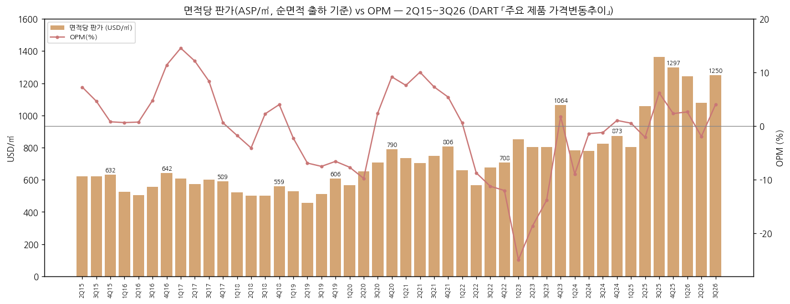

- 면적당 판가 = 출하 순면적(㎡)당 판매가격 (Cell 반제품 제외). 2Q15 620달러 → 3Q25 1,365달러(사상 최고) → 3Q26 1,250달러
- 판가 상승은 대부분 **mix 효과** (면적당 가격이 높은 모바일 OLED 비중 확대, 저가 LCD TV 철수). 3Q26 +16% QoQ도 "모바일 패널 계절적 성수기" 영향이라고 회사가 공시
- 판가가 2배 넘게 올랐는데도 OPM이 낮은 이유: 출하 면적 자체가 줄어 고정비(감가상각 4조원대) 흡수가 약함

**1Q\~3Q26 핵심 박스**

| 항목 | 1Q26 | 2Q26 | 3Q26 | 비고 |
|------|------|------|------|------|
| 매출 (조원) | 5.53 | 5.61 | 6.28 | 3Q26 YoY -9.8% |
| 영업이익 (억원) | 1,467 | -1,077 | 2,506 | 3Q26 YoY -41.9% |
| OPM | 2.7% | -1.9% | 4.0% | |
| 순이익 (억원) | -5,757 | -4,188 | 7,556 | 3Q26은 외화환산이익 영향 |
| OLED 비중 | 60% | 58%(반기) | 62% | DART 주석 |
| 면적당 판가 ($/㎡) | 1,244 | 1,079 | 1,250 | |
| 대형 패널 점유율 | | | 11.9% | OMDIA 예측치(9"+ 매출 기준), 2025 13.4% |

**최근 12분기 시계열 (rolling)**

| 분기 | 매출(조원) | QoQ | YoY | 영업이익(억원) | OPM | 순이익(억원) |
|---|---|---|---|---|---|---|
| 4Q23 | 7.40 | +54.6% | +1.3% | 1,317 | 1.8% | 505 |
| 1Q24 | 5.25 | -29.0% | +19.1% | -4,694 | -8.9% | -7,613 |
| 2Q24 | 6.71 | +27.7% | +41.6% | -937 | -1.4% | -4,708 |
| 3Q24 | 6.82 | +1.7% | +42.5% | -806 | -1.2% | -3,381 |
| 4Q24 | 7.83 | +14.8% | +5.9% | 831 | 1.1% | -8,391 |
| 1Q25 | 6.07 | -22.6% | +15.5% | 335 | 0.6% | -2,370 |
| 2Q25 | 5.59 | -7.9% | -16.7% | -1,160 | -2.1% | 8,908 |
| 3Q25 | 6.96 | +24.5% | +2.0% | 4,310 | 6.2% | 12 |
| 4Q25 | 7.20 | +3.5% | -8.1% | 1,685 | 2.3% | -3,512 |
| 1Q26 | 5.53 | -23.1% | -8.8% | 1,467 | 2.7% | -5,757 |
| 2Q26 | 5.61 | +1.4% | +0.4% | -1,077 | -1.9% | -4,188 |
| 3Q26 | 6.28 | +11.8% | -9.8% | 2,506 | 4.0% | 7,556 |

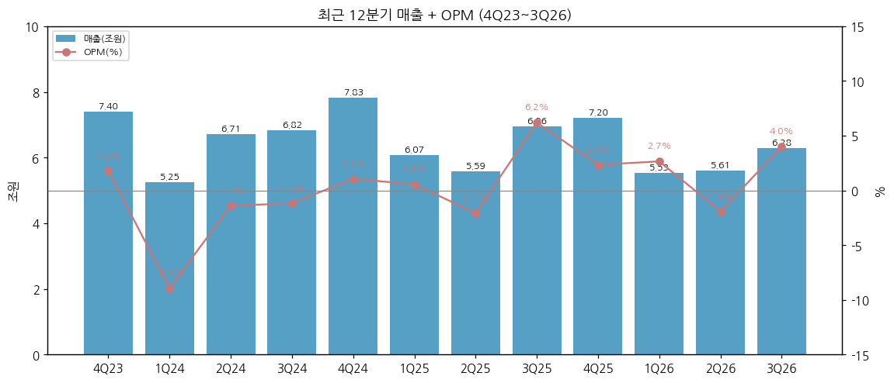

### ② 제품별 개요 (매출 비중 큰 순서, 9M26)

| 순위 | 제품군 | 9M26 매출 | 비중 | 한 줄 설명 |
|------|--------|-----------|------|------------|
| 1 | Mobile 등 | 6.65조 | 38.2% | 스마트폰·스마트워치용 플라스틱 OLED(POLED) + 항공·의료 등 산업용. 하반기(3Q·4Q) 신제품 시즌에 몰림 |
| 2 | IT | 5.80조 | 33.3% | 모니터·노트북·태블릿. LCD(IPS·Oxide) 비중이 아직 높고, OLED 게이밍 모니터·Tandem OLED 노트북/태블릿 확대 중 |
| 3 | TV | 3.24조 | 18.6% | 대형 WOLED TV 패널 (LCD TV 패널은 국내 생산 종료·광저우 LCD 매각으로 사실상 철수) |
| 4 | Auto | 1.73조 | 9.9% | 차량용 Tandem OLED·P-OLED, 대화면 LCD (8.5세대 Oxide 자동차 LCD 개발 2025) |

### ③ 제품별 디테일

- **대형 OLED (TV·모니터)**: WOLED(화이트 OLED) 방식으로 TV 패널 시장에서 사실상 단독 공급. 4Stack(2024)·DRD Platform(2025, 원가 혁신) 적용. 게이밍 모니터 OLED는 27" QHD 540Hz(DFR 720Hz) 등 "세계 최초" 고주사율 제품으로 확대 (DART 「연구개발실적」)
- **중소형 POLED (Mobile 등)**: 스마트폰·워치용. 1위 고객(가 회사) 매출이 9M26 9.77조원(56%)으로 회사 전체를 좌우 — 신제품 출시 주기(3Q 성수기)가 분기 실적 계절성을 만든다
- **IT LCD**: 모니터·노트북 IPS/Oxide LCD. 회사는 "저수익 중형 LCD 출하 축소" 전략 (3Q26 매출 YoY 감소 원인으로 언급)
- **Auto**: 2023년부터 별도 공시. 9M26 1.73조원으로 이미 2023 연간(2.00조)의 87% — 비중 10% 근접. Tandem OLED·대화면 P2P(Pillar to Pillar) LCD
- **이익 outlier**: 2Q25 순이익 8,908억원 = 광저우 LCD 매각이익 / 3Q26 순이익 7,556억원 = 기말 환율 하락에 따른 외화환산이익 (영업 외)

### ④ 주요 경쟁사

| 제품 | 경쟁사 (DART 사업보고서 「산업의 특성」 기재 + 일반 공개 정보) |
|------|------|
| 대형 OLED TV | (WOLED 단독) — 대체재: 삼성디스플레이 QD-OLED, 중국 LCD(BOE·CSOT·HKC) 미니LED TV |
| IT (모니터·노트북) | BOE, CSOT, HKC, AU Optronics, Innolux / OLED 모니터: 삼성디스플레이 QD-OLED |
| 모바일 OLED | 삼성디스플레이(1위), BOE, Visionox, Tianma |
| Auto | BOE, AUO, Innolux, Sharp, 삼성디스플레이 |

- 9"이상 중대형 패널 점유율(매출 기준, OMDIA): **TV 8.9% / IT 16.2% / 전체 11.9%** (3Q26 예측치) ← 2024 TV 14.1%·IT 19.1%·전체 15.7%에서 계속 하락 — 의도적 LCD 축소 결과
- 회사 공시 경쟁 구도: 중국은 LCD 과점화·중형 OLED 신규 Fab 진입, 대만은 저세대 Fab 폐쇄·Oxide 중형 집중, 한국은 OLED 신규 투자·LCD 차별화

### ⑤ 주요 매출처 (DART는 실명 비공개 — "가 회사·나 회사"로만 기재)

| 고객 | 9M26 매출 | 비중 | 추정 (공시 아님) |
|------|-----------|------|------------------|
| 가 회사 | 9.77조원 | 56.1% | 북미 스마트폰·PC 업체(애플)로 추정 — POLED·태블릿·노트북 패널 |
| 나 회사 | 2.38조원 | 13.6% | 최대주주 LG전자로 추정 — OLED TV 패널 |
| 상위 10개 합계 | — | 92% | |

→ 고객 집중도가 극단적. 가 회사 1곳의 제품 사이클이 회사 이익을 좌우 (리스크 섹션 참조)

### ⑥ 생산 CAPA + 임직원 추이

- 생산능력 (8세대 Glass 환산, 천장): 2024 6,063 → 2025 4,208 → 9M26 2,832 (광저우 LCD 매각으로 축소). 9M26 생산실적 2,594 → 가동률(실적/능력) 약 92%
- 공장별 9M26 평균 가동률(시간 기준): 구미 97.1% / 파주 99.8% / 광저우(OLED) 100%
- 2026년 말 생산능력: 8세대 환산 약 280만장 수준 (DART 「사업의 개요」)

| 연도 | 2015 | 2016 | 2017 | 2018 | 2019 | 2020 | 2021 | 2022 | 2023 | 2024 | 2025 |
|------|------|------|------|------|------|------|------|------|------|------|------|
| 국내 임직원 (명) | 32,603 | 32,118 | 33,335 | 30,438 | 26,665 | 25,980 | 27,702 | 29,272 | 27,791 | 25,144 | 24,430 |

(사업보고서 「직원 등 현황」, 본사 기준. 2025 남 20,948 / 여 3,482, 평균근속 남 15.3년, 1인 평균급여 남 8,900만원·여 6,700만원)

---

## 4. 재무 구조

### ① 손익계산서 (12년 연결, 조원, 좌→우 시간순)

| 항목 | 2014 | 2015 | 2016 | 2017 | 2018 | 2019 | 2020 | 2021 | 2022 | 2023 | 2024 | 2025 |
|---|---|---|---|---|---|---|---|---|---|---|---|---|
| 매출액 | 26.46 | 28.38 | 26.50 | 27.79 | 24.34 | 23.48 | 24.23 | 29.88 | 26.15 | 21.33 | 26.62 | 25.81 |
| 매출원가 | 22.67 | 24.07 | 22.75 | 22.42 | 21.25 | 21.61 | 21.59 | 24.57 | 25.03 | 20.99 | 24.04 | 22.43 |
| 매출총이익 | 3.79 | 4.31 | 3.75 | 5.37 | 3.09 | 1.87 | 2.64 | 5.31 | 1.12 | 0.35 | 2.58 | 3.38 |
| GPM(%) | 14.3 | 15.2 | 14.1 | 19.3 | 12.7 | 8.0 | 10.9 | 17.8 | 4.3 | 1.6 | 9.7 | 13.1 |
| 판관비(R&D 포함) | 2.43 | 2.69 | 2.44 | 2.90 | 2.99 | 3.23 | 2.67 | 3.07 | 3.21 | 2.86 | 3.14 | 2.86 |
| 판관비율(%) | 9.2 | 9.5 | 9.2 | 10.4 | 12.3 | 13.7 | 11.0 | 10.3 | 12.3 | 13.4 | 11.8 | 11.1 |
| 영업이익 | 1.36 | 1.63 | 1.31 | 2.46 | 0.09 | -1.36 | -0.03 | 2.23 | -2.09 | -2.51 | -0.56 | 0.52 |
| OPM(%) | 5.1 | 5.7 | 4.9 | 8.9 | 0.4 | -5.8 | -0.1 | 7.5 | -8.0 | -11.8 | -2.1 | 2.0 |
| 법인세차감전순이익 | 1.24 | 1.43 | 1.32 | 2.33 | -0.09 | -3.34 | -0.60 | 1.72 | -3.43 | -3.34 | -2.19 | 0.50 |
| 당기순이익 | 0.92 | 1.02 | 0.93 | 1.94 | -0.18 | -2.87 | -0.07 | 1.33 | -3.20 | -2.58 | -2.41 | 0.30 |
| 지배주주순이익 | 0.90 | 0.97 | 0.91 | 1.80 | -0.21 | -2.83 | -0.09 | 1.19 | -3.07 | -2.73 | -2.56 | 0.23 |
| NPM(%) | 3.5 | 3.6 | 3.5 | 7.0 | -0.7 | -12.2 | -0.3 | 4.5 | -12.2 | -12.1 | -9.1 | 1.2 |
| EPS(원) | 2,527 | 2,701 | 2,534 | 5,038 | -579 | -7,908 | -250 | 3,315 | -8,584 | -7,640 | -5,438 | 453 |
| 감가상각+무형상각 | 3.49 | 3.38 | 3.02 | 3.21 | 3.55 | 3.70 | 4.13 | 4.50 | 4.56 | 4.21 | 5.13 | 4.35 |
| EBITDA | 4.85 | 5.01 | 4.33 | 5.67 | 3.64 | 2.34 | 4.10 | 6.73 | 2.47 | 1.70 | 4.57 | 4.87 |
| EBITDA margin(%) | 18.3 | 17.6 | 16.3 | 20.4 | 15.0 | 10.0 | 16.9 | 22.5 | 9.5 | 8.0 | 17.2 | 18.9 |

(판관비 = 매출총이익 − 영업이익, 연구개발비 포함. 감가상각+무형상각은 「비용의 성격별 분류」·현금흐름표 조정항목)

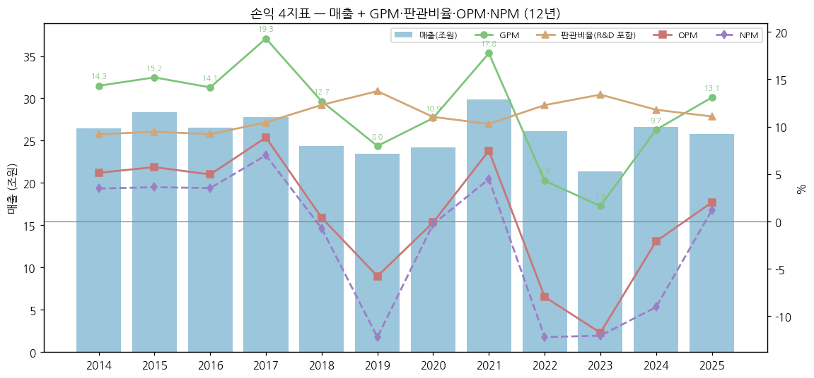

### ② 재무상태표 (12년 연결, 조원)

| 항목 | 2014 | 2015 | 2016 | 2017 | 2018 | 2019 | 2020 | 2021 | 2022 | 2023 | 2024 | 2025 |
|---|---|---|---|---|---|---|---|---|---|---|---|---|
| 자산총계 | 22.97 | 22.58 | 24.88 | 29.16 | 33.18 | 35.57 | 35.07 | 38.15 | 35.69 | 35.76 | 32.86 | 26.92 |
| 유동자산 | 9.24 | 9.53 | 10.48 | 10.47 | 8.80 | 10.25 | 11.10 | 13.19 | 9.44 | 9.50 | 10.12 | 6.98 |
| 현금및현금성자산 | 0.89 | 0.75 | 1.56 | 2.60 | 2.37 | 3.34 | 4.22 | 3.54 | 1.82 | 2.26 | 2.02 | 1.57 |
| 재고자산 | 2.75 | 2.35 | 2.29 | 2.35 | 2.69 | 2.05 | 2.17 | 3.35 | 2.87 | 2.53 | 2.67 | 2.55 |
| 유형자산 | 11.40 | 10.55 | 12.03 | 16.20 | 21.60 | 22.09 | 20.15 | 20.56 | 20.95 | 20.20 | 17.20 | 14.47 |
| 무형자산 | 0.58 | 0.84 | 0.89 | 0.91 | 0.99 | 0.87 | 1.02 | 1.64 | 1.75 | 1.77 | 1.56 | 1.48 |
| 부채총계 | 11.18 | 9.87 | 11.42 | 14.18 | 18.29 | 23.09 | 22.33 | 23.39 | 24.37 | 26.99 | 24.79 | 19.08 |
| 유동부채 | 7.55 | 6.61 | 7.06 | 8.98 | 9.95 | 10.98 | 11.01 | 13.99 | 13.96 | 13.89 | 15.86 | 9.60 |
| 자본총계 | 11.78 | 12.70 | 13.46 | 14.98 | 14.89 | 12.49 | 12.74 | 14.76 | 11.32 | 8.77 | 8.07 | 7.84 |
| 지배주주지분 | 11.43 | 12.19 | 12.96 | 14.37 | 13.98 | 11.34 | 11.40 | 13.12 | 9.88 | 7.23 | 6.54 | 6.60 |
| 비지배지분 | 0.35 | 0.51 | 0.51 | 0.61 | 0.91 | 1.15 | 1.34 | 1.64 | 1.44 | 1.54 | 1.53 | 1.24 |

3Q26 말: 자산 26.33조 / 부채 18.89조 / 자본 7.44조(지배 6.23조) / 현금 1.51조 / 재고 3.19조 (2025말 2.55조 → 성수기 재고 확대)

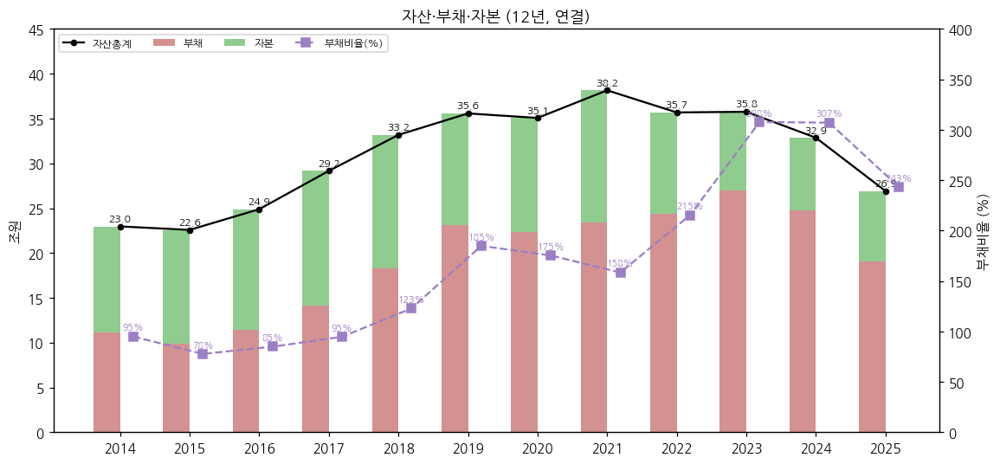

### ③ 현금흐름표 (12년 연결, 조원)

| 항목 | 2014 | 2015 | 2016 | 2017 | 2018 | 2019 | 2020 | 2021 | 2022 | 2023 | 2024 | 2025 |
|---|---|---|---|---|---|---|---|---|---|---|---|---|
| 영업활동CF | 2.86 | 2.73 | 3.64 | 6.76 | 4.48 | 2.71 | 2.29 | 5.75 | 3.01 | 1.68 | 2.41 | 2.35 |
| 투자활동CF | -3.45 | -2.73 | -3.19 | -6.48 | -7.68 | -6.76 | -2.32 | -4.26 | -6.70 | -2.59 | -1.36 | -0.98 |
| 재무활동CF | 0.40 | -0.17 | 0.31 | 0.86 | 2.95 | 4.99 | 0.93 | -2.47 | 1.95 | 1.35 | -1.33 | -1.96 |
| CapEx(유+무형) | 3.34 | 2.66 | 4.14 | 7.05 | 8.42 | 7.47 | 2.96 | 3.78 | 5.91 | 4.15 | 2.92 | 2.11 |
| FCF | -0.47 | 0.07 | -0.50 | -0.28 | -3.94 | -4.76 | -0.67 | 1.98 | -2.90 | -2.47 | -0.50 | 0.25 |
| 기말 현금 | 0.89 | 0.75 | 1.56 | 2.60 | 2.37 | 3.34 | 4.22 | 3.54 | 1.82 | 2.26 | 2.02 | 1.57 |

9M26: 영업CF 2.30조 / 투자CF -1.81조 / CapEx 2.02조(유형 1.40 + 무형 0.62) → 9M FCF 약 +0.28조

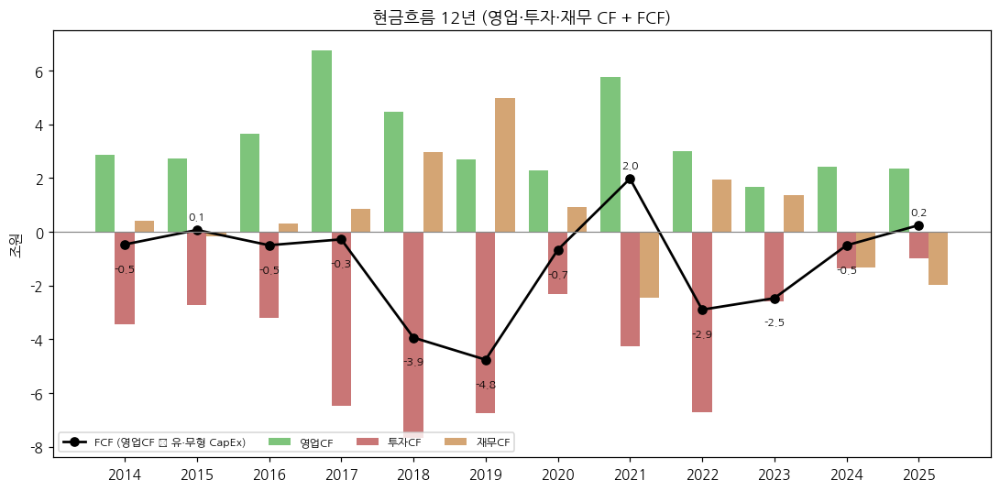

### ④ CapEx 추이 (12년)

| 항목 | 2014 | 2015 | 2016 | 2017 | 2018 | 2019 | 2020 | 2021 | 2022 | 2023 | 2024 | 2025 |
|---|---|---|---|---|---|---|---|---|---|---|---|---|
| 유형자산 취득 | 2.98 | 2.36 | 3.74 | 6.59 | 7.94 | 6.93 | 2.60 | 3.14 | 5.08 | 3.48 | 2.13 | 1.35 |
| 무형자산 취득 | 0.35 | 0.29 | 0.41 | 0.45 | 0.48 | 0.54 | 0.35 | 0.64 | 0.83 | 0.67 | 0.79 | 0.76 |
| CapEx 합계 | 3.34 | 2.66 | 4.14 | 7.05 | 8.42 | 7.47 | 2.96 | 3.78 | 5.91 | 4.15 | 2.92 | 2.11 |
| CapEx/매출(%) | 12.6 | 9.4 | 15.6 | 25.4 | 34.6 | 31.8 | 12.2 | 12.6 | 22.6 | 19.5 | 11.0 | 8.2 |
| 감가상각+무형상각 | 3.49 | 3.38 | 3.02 | 3.21 | 3.55 | 3.70 | 4.13 | 4.50 | 4.56 | 4.21 | 5.13 | 4.35 |
| CapEx/감가상각(배) | 0.96 | 0.79 | 1.37 | 2.20 | 2.37 | 2.02 | 0.72 | 0.84 | 1.30 | 0.99 | 0.57 | 0.48 |

- 2017\~2019 CapEx 7\~8.4조 = P10(파주)·광저우 8.5세대 OLED 집중 투자기 → 이후 감가상각 부담이 4조원대로 고착
- 2025 CapEx 2.1조(12년 최저), 감가상각 대비 0.5배 — 설비 축소·현금 보존 국면
- 2026 계획: 현금 기준 2조원 초반 (DART 3Q26 「설비의 신설·매입 계획」). 진행 중 투자: OLED 신기술·Infra 1.3조(2025Q3\~2027Q2), OLED 신기술 Infra 1.1조(2026Q2\~2028Q2). 10.5세대 대형 OLED 3.0조는 2026-04-22 잠정 보류

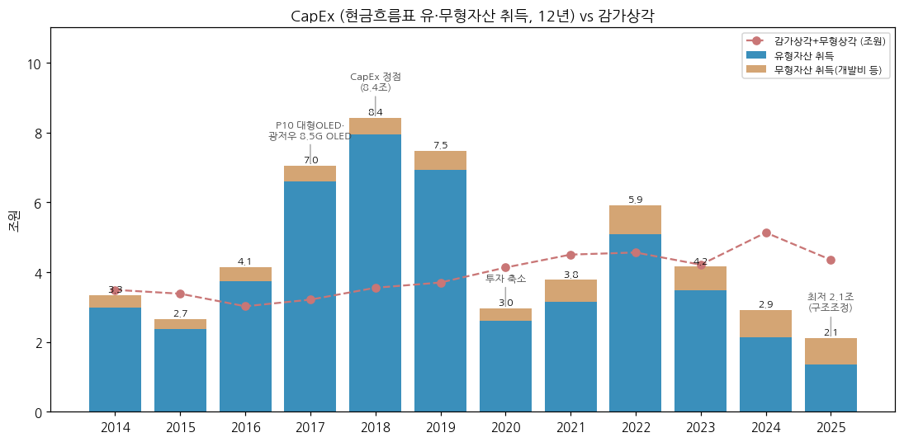

### ⑤ 부채구조 (12년, 조원)

| 항목 | 2014 | 2015 | 2016 | 2017 | 2018 | 2019 | 2020 | 2021 | 2022 | 2023 | 2024 | 2025 |
|---|---|---|---|---|---|---|---|---|---|---|---|---|
| 유동 금융부채 | 0.97 | 1.42 | 0.67 | 1.45 | 1.55 | 1.98 | 3.20 | 4.07 | 5.49 | 5.26 | 6.53 | 3.80 |
| 비유동 금융부채 | 3.28 | 2.81 | 4.11 | 4.15 | 7.03 | 11.61 | 11.12 | 8.70 | 9.62 | 11.44 | 8.09 | 8.93 |
| 금융부채 합계 | 4.25 | 4.22 | 4.78 | 5.60 | 8.58 | 13.59 | 14.32 | 12.77 | 15.11 | 16.70 | 14.62 | 12.73 |
| 현금성자산 | 0.89 | 0.75 | 1.56 | 2.60 | 2.37 | 3.34 | 4.22 | 3.54 | 1.82 | 2.26 | 2.02 | 1.57 |
| 순금융부채 | 3.36 | 3.47 | 3.22 | 3.00 | 6.22 | 10.25 | 10.10 | 9.23 | 13.29 | 14.44 | 12.60 | 11.16 |
| 순금융부채/자본(%) | 28 | 27 | 24 | 20 | 42 | 82 | 79 | 63 | 117 | 165 | 156 | 142 |
| 금융비용(I/S) | 0.22 | 0.32 | 0.27 | 0.27 | 0.33 | 0.44 | 0.80 | 0.92 | 0.97 | 1.63 | 1.82 | 1.15 |
| 이자지급(CF) | 0.17 | 0.14 | 0.13 | 0.14 | 0.21 | 0.42 | 0.55 | 0.47 | 0.50 | 0.99 | 0.92 | 0.71 |

- 금융부채 = 재무상태표 「금융부채」(유동) + 「비유동금융부채」 — 차입금·사채가 대부분 (리스부채 등 포함). 3Q26 말 차입금 11.90조원 (유동성위험 주석)
- 이자 부담: 이자지급 0.17조(2014) → 0.99조(2023) → 0.71조(2025). 2025 영업이익(0.52조)이 이자지급을 못 덮음 (이자보상배율 0.7배)
- 채무보증: 베트남 하이퐁 법인(LGDVH) USD 750백만 대출 지급보증 (3Q26)
- 통화이자율스왑: USD 1,100백만·CNY 1,680백만(외화차입 환위험) + USD 1,120백만(환율·이자율) 계약 (3Q26)

### ⑥ 배당·자사주 추이 (12년)

| 항목 | 2014 | 2015 | 2016 | 2017 | 2018 | 2019 | 2020 | 2021 | 2022 | 2023 | 2024 | 2025 |
|---|---|---|---|---|---|---|---|---|---|---|---|---|
| DPS(원, 결산기) | 500 | 500 | 500 | 500 | 0 | 0 | 0 | 650 | 0 | 0 | 0 | 0 |
| 배당총액(억원) | 1,789 | 1,789 | 1,789 | 1,789 | 0 | 0 | 0 | 2,326 | 0 | 0 | 0 | 0 |
| 배당성향(%) | 20 | 19 | 20 | 10 | 0 | 0 | 0 | 20 | 0 | 0 | 0 | 0 |
| 배당금 지급(CF, 조원) | 0.00 | 0.18 | 0.18 | 0.18 | 0.18 | 0.00 | 0.00 | 0.00 | 0.23 | 0.00 | 0.00 | 0.00 |
| 자사주 매입 | 0 | 0 | 0 | 0 | 0 | 0 | 0 | 0 | 0 | 0 | 0 | 0 |

- FY2018\~2020, FY2022\~2025 무배당. 자사주 보유·매입 없음 (DART 자기주식 현황 "-")
- 2024-03 유상증자 1.29조원(142,184,300주, 발행가 9,090원) — 주주환원과 반대 방향의 자본 확충 (희석). 유상증자 후 LG전자 지분율 36.72%

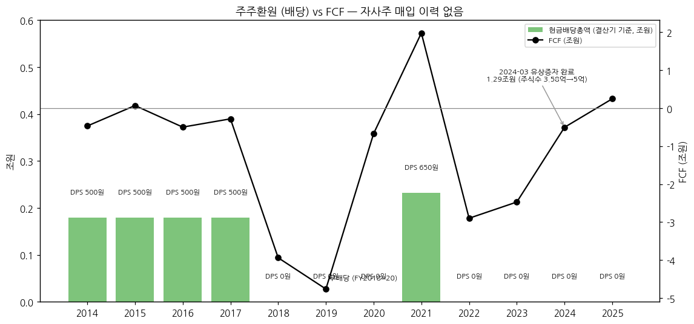

### ⑦ 재무 비율 (12년)

| 항목 | 2014 | 2015 | 2016 | 2017 | 2018 | 2019 | 2020 | 2021 | 2022 | 2023 | 2024 | 2025 |
|---|---|---|---|---|---|---|---|---|---|---|---|---|
| ROE(%, 지배) | 7.9 | 8.2 | 7.2 | 13.2 | -1.5 | -22.4 | -0.8 | 9.7 | -26.7 | -32.0 | -37.2 | 3.4 |
| ROA(%) | 4.0 | 4.5 | 3.7 | 6.6 | -0.5 | -8.1 | -0.2 | 3.5 | -9.0 | -7.2 | -7.3 | 1.1 |
| 부채비율(%) | 95 | 78 | 85 | 95 | 123 | 185 | 175 | 158 | 215 | 308 | 307 | 243 |
| 유동비율(%) | 122 | 144 | 149 | 117 | 88 | 93 | 101 | 94 | 68 | 68 | 64 | 73 |
| 이자보상배율(OP/이자지급, 배) | 8.1 | 11.9 | 10.4 | 18.0 | 0.4 | -3.3 | -0.1 | 4.7 | -4.2 | -2.5 | -0.6 | 0.7 |
| BPS(원) | 31,948 | 34,076 | 36,209 | 40,170 | 39,068 | 31,694 | 31,863 | 36,664 | 27,611 | 20,212 | 13,085 | 13,208 |

(ROE = 지배주주순이익 ÷ 평균 지배지분. BPS = 지배지분 ÷ 연말 발행주식수, 2024부터 5억주. 이자보상배율 = 영업이익 ÷ 현금흐름표 이자지급)

---

## 5. 지배 구조

### ① 그룹·계열 관계

```
㈜LG (지주회사)
 └─ LG전자 (㈜LG가 지분 30%대 보유)
     └─ LG디스플레이 36.72% (183,593,206주, 최대주주)
          ├─ 생산법인: LG Display Nanjing, Guangzhou(LGDCO, OLED), Yantai, 베트남 Haiphong(LGDVH)
          └─ 판매법인: 미국·독일·일본·대만·중국·싱가포르
```
- 2025-04-01 LG Display (China) Co., Ltd.(광저우 LCD) 지분 매각 완료로 연결 제외
- 기타비상무이사 이상우 = ㈜LG 경영관리부문장(겸 전자팀장) — 지주사가 이사회에 직접 참여

### ② 주주 구분 (2026-09-30 기준, 보통주 500,000,000주)

| 주주 | 주식수 | 지분율 | 비고 |
|------|--------|--------|------|
| LG전자㈜ | 183,593,206 | 36.72% | 최대주주 |
| Citibank N.A. | 26,404,434 | 5.28% | NYSE ADR 예탁기관 (ADR 52,408,868주 = 보통주 2,620만주) |
| 우리사주조합 | 4,102,266 | 0.82% | |
| 소액주주 (1% 미만, 417,388명) | 262,160,662 | 52.43% | 전체 주주 417,395명 |
| 기타 (1% 이상 5% 미만, 기관 등) | 약 2,374만 | 약 4.75% | 위 합계에서 역산 |

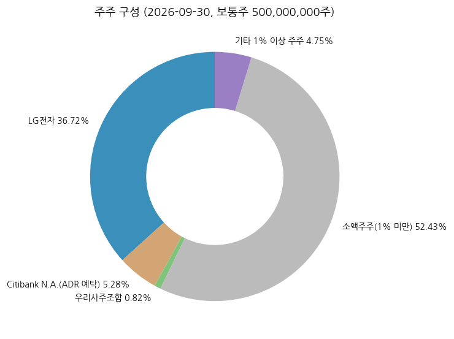

(외국인 지분율은 이번 버전에서 미확보 — KRX 외국인 보유 데이터 다음 버전 보강)

### ③ 임원·이사회 (2025년말 사업보고서 기준)

- **대표이사 정철동** (1961년생, CEO) — 경북대 전자공학. (전)LG이노텍 CEO, (전)LG화학 정보전자소재사업본부장, (전)LG디스플레이 CPO. 2025년 중 LG디스플레이 주식 22,460주 장내 매수
- **사내이사 김성현** (CFO, 부사장) — George Washington대 MBA, (전)LG유플러스 금융담당
- **기타비상무이사 이상우** — ㈜LG 경영관리부문장 겸 전자팀장, (전)LG전자 TV사업운영센터장
- **사외이사 4명**: 문두철(연세대 경영학 교수), 강정혜(서울시립대 법학전문대학원 교수), 오정석(서울대 경영대학 교수), 박상희(KAIST 신소재공학과 교수) — 감사위원회·ESG위원회·내부거래위원회 구성
- 미등기 임원 포함 임원 85명 (2025말). 사업 조직: 대형(TV) / 중형(IT) / SC(스마트폰 등 중소형) / Auto 사업부 체제

---

## 6. 기타 팩트

### ① R&D 인프라

| 항목 | 2014 | 2015 | 2016 | 2017 | 2018 | 2019 | 2020 | 2021 | 2022 | 2023 | 2024 | 2025 |
|---|---|---|---|---|---|---|---|---|---|---|---|---|
| 연구개발비용 계(억원) | 17,876 | 15,468 | 14,232 | 16,719 | 17,571 | 17,763 | 17,386 | 21,268 | 24,306 | 23,988 | 22,367 | 22,107 |
| R&D/매출(%) | 6.8 | 5.4 | 5.4 | 6.0 | 7.2 | 7.6 | 7.2 | 7.1 | 9.3 | 11.2 | 8.4 | 8.6 |

- 2017\~2019는 2019 사업보고서 집계기준 변경 후 재작성 수치, 2014\~2016은 구 기준 (주석 참조)
- 회사 공시: "매출액 대비 연구개발비 비중 약 10%대". 조직: CTO 산하 연구소(미래·기초기술) + 제품별(TV·IT·Mobile·Auto) 개발그룹, 파주·구미·마곡 분산
- 2025 손익계산서상 연구개발비(비용) 1.67조 + 개발비 자산화 0.54조

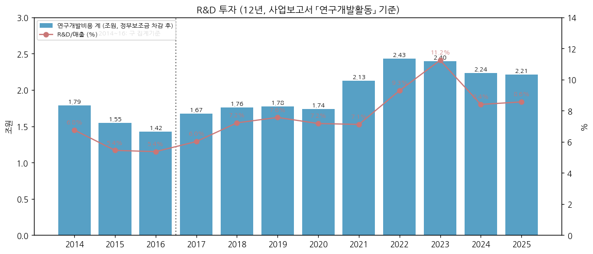

### ② 진행 중 corporate action — 10년치

| 시기 | 내용 |
|------|------|
| 2017 | 파주 P10·광저우 8.5세대 OLED 대규모 투자 결정 |
| 2019 Q3\~ | 10.5세대 대형 OLED 3.0조 투자 개시 → 2023-03 기간 연장(\~2028-03) → **2026-04-22 잠정 보류** |
| 2020-07 | 광저우 OLED 합작법인 양산 개시 |
| 2022 말 | 국내 LCD TV 패널 생산 종료 |
| 2023-12 \~ 2024-03 | 주주배정 유상증자 (결의 1.36조 → 발행가 9,090원 확정, 1.29조 조달) |
| 2025-04-01 | 광저우 LCD 법인(LG Display (China)) 지분 매각 완료 — TCL CSOT |
| 2025-06-17 | OLED 신기술·Infra 1.3조 투자 승인 (2025Q3\~2027Q2) |
| 2026-02-10 | 전 임원 특경법(배임) 혐의 고소 — 혐의금액 68.6억원 |
| 2026-04-22 | OLED 신기술 Infra 1.1조 투자 승인 (2026Q2\~2028Q2) |

### ③ R&D 마일스톤 (DART 「연구개발실적」 + 사업보고서 기재)

| 연도 | 마일스톤 |
|------|----------|
| 2013 | 세계 최초 55인치 OLED TV 패널 공급 |
| 2022 | OLED TV 패널 영국 Carbon Trust 탄소발자국 인증 (업계 최초 전과정 평가) |
| 2024 | 대형 WOLED 최초 4Stack 제품(83/77/65/55/48") / 세계 최초 77" 고해상도 투명 OLED / 세계 최초 Gaming OLED QHD 480Hz(27") / 31.5" DFR(UHD 240Hz↔FHD 480Hz) / 자사 최초 ATO 노트북 OLED / 22.3" Micro LED 모듈 |
| 2025 | 세계 최초 27" QHD 540Hz(DFR 720Hz) OLED 모니터 / 세계 최초 45" WUHD 165Hz Gaming OLED / 세계 최초 LTPO·Tandem 14" 노트북 OLED / 대형 OLED TV DRD Platform 도입(원가 혁신) / 8.5세대 차량용 38.9" Oxide LCD / 세계 최초 1Hz 노트북 LCD |

### ④ 주요 리스크

- **고객 집중**: 1위 고객 56%, 상위 10개 92% (9M26). 1위 고객의 제품 판매·패널 이원화 정책이 바로 실적에 반영
- **수요·부품가**: 회사 공시 — AI 확산에 따른 반도체(메모리) 가격 상승이 세트 가격을 올려 B2C 소비·B2B 투자 심리 위축
- **중국 경쟁**: LCD는 중국 과점, 중형 IT OLED에도 중국 신규 Fab 진입 (회사 공시). 대형 점유율 15.7%(2024) → 11.9%(3Q26E)
- **재무 위험**: 부채비율 243%(2025)·254%(3Q26), 유동비율 73%(2025), 이자보상배율 1배 미만 — 이익 회복이 늦어지면 추가 자본 확충 가능성
- **환율**: 매출 대부분 달러, 원재료는 달러·엔·위안. 달러 5% 상승 시 세전이익 +170억원(3Q26 민감도) — 하지만 영업 측면은 원화 약세가 유리, 외화부채 환산손익은 분기 순이익을 크게 흔듦 (3Q26 순이익 7,556억원)
- **소송**: LCD 담합 관련 이스라엘 구매자 집단소송(2013\~, 소장 송달 대기), 영국 Granville 민사소송(항소심 일부 패소, 상고 대응). 회사는 재무상태에 중요한 영향 없다고 판단

### ⑤ ESG 등급

- 이번 버전에서 KCGS·MSCI 등급 미확보 (다음 버전 Sustainability Report 확인)
- 이사회 내 ESG위원회 운영 (사외이사 4명 참여)

### ⑥ 인증·라이선스 (DART 「연구개발활동」 환경 인증 기재)

- 2022 OLED TV 패널 Carbon Trust 탄소발자국 인증
- 2023 27"이하 IT 하이엔드 LCD·차량용 OLED TUV Rheinland 제품 탄소발자국(PCF) 인증
- 2024 14" 노트북 LCD TUV PCR 인증, UL 바이오 기반 소재(ECV) 인증
- 2025 TUV Rheinland 「제품 탄소발자국 방법론」 인증

---

## Version Log

**v1.0 (2026-11-25)** — 첫 작성
- 데이터: OpenDART 재무 JSON 44건(2015 FY\~3Q26) + 정기보고서 공시원문 44건 + 기업개황·주주·임원·배당 JSON + irgo IR PDF 12건(1Q18\~4Q20) + Yahoo Finance 월간 주가
- 12종 차트: chart1·1b·2(47분기)·2b(제품별 27분기)·2c(면적당 판가 46분기)·4·5·6·7·8·9·10·11·12

**잔여 보완 후보 (v1.1)**
- 분기 시계열 60분기 미달 (47분기): 2011\~2014 분기는 OpenDART 재무 API 미제공 → 옛 사업보고서 원문·IR로 보강 필요
- 제품별 분기 1Q20 이전: IR PDF(2018\~2020) 제품 비중 % 추출로 2018Q1\~2019Q4 확장 가능
- 2021\~3Q26 IR 실적자료 미확보 (irgo 게시물이 2020-4Q까지) → 회사 IR 사이트(lgdisplay.com) 출하면적·가동 CAPA 데이터 보강
- 외국인 지분율·ESG 등급·신용등급 미확보
- 4Q26 실적 발표(2027-01 예정) 후 분기 시계열·12분기 차트 갱신, FY2026 결산 후 연간 표 v2.0
