> 종목: LG에너지솔루션 (373220.KS / ㈜엘지에너지솔루션 / LG Energy Solution, Ltd., DART corp_code 01515323)
> 섹터: 배터리 (워치리스트 섹터 T2) / 서브섹터: 배터리 셀
> 작성 시각: 2026-11-14 KST (**v1.0** — 첫 작성. 3Q26 분기보고서(2026-11-13 공시)·3Q26 실적설명회(2026-11-03)까지 반영)
> 적용 구조: v4.8 (6개 섹션 + 12종 차트 표준, chart2는 AMPC·연결분기·지역·ESS mix 4종 분할 2·2b·2c·2d)
> 데이터: 12년 연간 손익(2014~2020 LG화학 전지사업부문 + 2021~2025 LGES 연결) + 23분기 연결(1Q21~3Q26, OpenDART) + **15분기 AMPC 포함/제외 영업이익(1Q23~3Q26)** + 지역별 매출 2021~9M26 + 상장 이후 월간 시가총액(2022-02~2026-11)
> 출처: **DART 사업보고서 2025(rcept 20260312000217, 최우선 정성자료)·2024(20250312000405)·2023(20240314001110)·2022(20230315001342)·2021(20220315001026)·2020(20210317000676), 분기보고서 2026.09(20261113000421)·반기보고서 2026.06(20260813000255)** 외 정기보고서 24건(본문 + 감사보고서·연결감사보고서 첨부) / OpenDART 전체재무제표 연결(CFS)·별도(OFS) 2020~3Q26 / OpenDART 주요정보(최대주주·임원·직원·배당·주식총수 2021~2025 FY, 1H26, 3Q26) / **LG화학 사업보고서 2014~2020(사업부문별 요약정보 — 전지 사업부문 매출·영업이익)** / **회사 IR 실적발표 PDF 17건(1Q22~4Q25·3Q26, irgo 경유) + 컨퍼런스콜 속기록 3건(1Q26·2Q26·3Q26, 회사 홈페이지)** / LG에너지솔루션 2025 ESG Report(국문) / Yahoo Finance v8 373220.KS 월간 / 회사 IR 시세 페이지(ir.gsifn.io, 2026-11-13 15:30 시세·2026-11-12 외국인 보유) / SNE리서치 인용 보도(SBS Biz 2026-09-07, 더팩트 2026-11-04) / MarketScreener CATL 밸류에이션 / BT `earnings-review/2026-Q1_LG에너지솔루션_리뷰.md`
> **Fact verify cutoff**: 2026-11-14

# LG에너지솔루션 기업 개요 (v1.0 — 배터리 T2, EV 파우치 + 원통형(46시리즈) + 북미 ESS로 mix 전환 중인 비중국 1위 셀 메이커)

> ⚠️ **시계열 단절·표시 변경 4건 — 모든 표·차트 해석 시 주의**
> ① **2020.12.01 물적분할** — ㈜LG화학 전지사업부문이 단순·물적분할되어 LGES 신설. **2014~2020년 수치는 LG화학 사업보고서의 '전지 사업부문'(내부거래 소거 후 매출·영업이익)** 이며 LGES 법인 재무제표가 아님 → 재무상태표·현금흐름·순이익은 2020년 12월말부터만 존재. LGES 2020 사업보고서의 손익은 **2020년 12월 1개월치**(매출 1.46조, 영업손실 4,752억)라 연간 비교에서 제외
> ② **2022.01.27 유가증권시장 상장** — 신주 3,400만주 × 공모가 30만원 = **10.2조원** 유입 → 2022년 지배자본 +135%, 재무CF 11.4조. 2022년 이전 ROE·부채비율과 단순 비교 불가
> ③ **2023.1Q~ IRA 45X 첨단제조 세액공제(AMPC) 인식** — 2023~2025 DART는 AMPC를 매출이 아닌 **기타영업수익**(매출총이익 아래, 영업이익 위)으로 표시 → 매출·GPM에는 미포함, 영업이익에는 포함
> ④ **2026.1Q~ AMPC를 '매출액 및 기타수익'에 병합 표시**(회사 IR p.5 주석, 1Q26 컨콜) → 2026년 매출은 AMPC 포함. 회사 IR은 2025년만 같은 기준으로 재작성(2025 매출 23.67 → **25.32조**). **본 리포트는 2023~2025 분기에도 AMPC를 더한 '재작성 기준' 매출을 별도 열로 병기**하고, YoY는 재작성 기준으로 계산. OpenDART 단순 YoY(예: 3Q26 매출 +69.2%)는 기준 불일치로 과대 → 재작성 기준 **+59.0%**
> 부가: 2026년 DART '정부보조금수익'(3Q26 7,066억)과 회사 IR '북미생산보조금 효과'(3Q26 4,169억)가 다름 — 회사 설명상 IR 수치는 **JV 외 고객 판매분 중 당사 귀속분**(1Q26 컨콜). 본 리포트 AMPC 시계열은 IR '효과' 기준

---

## ① 기업 분류

(1) Primary / Secondary 분류

**⚠️ Boundary Case — 매출은 10년 8배 성장(고성장형), 마진은 정책·수요 사이클에 종속(사이클형)**

12년 OPM range **-5.4%(2019) ~ 6.4%(2023) = 11.8%pt** (cutoff ±10%pt 초과 → 정량 룰상 사이클). 매출은 2023년 정점 이후 2년 연속 감소(-24.1%, -7.6%)했다가 2026년 ESS로 재가속(9M26 +26.1% YoY, 재작성 기준).

**Primary 분류: 사이클 (EV 수요·정책 사이클 + 대규모 CapEx 장치산업)**

→ 2023→2025 매출 -30%(33.7조 → 23.7조, DART 표시 기준) — 북미 EV 수요 둔화·GM JV 가동 중단·미국 EV 구매보조금(30D) 종료

→ AMPC 제외 영업이익은 2024 **-9,047억**, 2025 **-3,007억** — 보고 이익의 상당 부분이 미국 정책(IRA 45X)에 의존. 4Q24·4Q25·1Q26 AMPC 포함해도 적자

→ 가동률(DART 생산실적/생산능력, 금액 기준) 2022 73.6% → 2025 **47.6%** → 9M26 57.1%

**Secondary 노트: 고성장 (ESS·원통형 신성장축)**

→ ESS 매출 비중 2025 "10% 미만" → 3Q26 "30% 초반" → 4Q26 목표 "30% 중반 이상" (1Q26·3Q26 컨콜)

→ 수주잔고: ESS **160GWh**(3Q26 말), 46시리즈 **440GWh+**(2026.4말~3Q26) — 컨콜 "28년까지 계획 Capa 물량 대부분 확정"(ESS)

→ 3Q26 매출 9.64조(+59.0% YoY, +27.6% QoQ) — 상장 이후 분기 최대

**Entity 구조 (2026.06말 DART 반기보고서 — 연결 종속회사 25개, 상장 자회사 없음)**

→ **(1) 자동차전지(EV)** — 파우치 중심(하이니켈 NCMA·고전압 Mid-Ni·LFP), 오창·남경·폴란드 브로츠와프·미국 미시간 홀랜드 + 북미 JV(GM Ultium Cells 1·2공장, 현대차 HLGA·HLI Green Power, Honda L-H Battery, NextStar(2026.3Q 100% 자회사화))

→ **(2) 소형전지** — 원통형 2170(Tesla 등 EV 전략고객), 46시리즈(오창 2025말 양산, 애리조나 2026말 가동 예정), IT 파우치(축소 중), 전동공구·LEV

→ **(3) ESS전지** — 북미 LFP 파우치 ESS(미시간 홀랜드·랜싱, 온타리오 NextStar, 테네시 Ultium 2공장 라인 전환, 오하이오 Honda JV), Vertech(SI) — 2026말 북미 ESS Capa 50GWh+

→ 회사는 **'에너지솔루션 단일 사업부문'으로 공시**(DART 영업부문 주석) — 사업부별 매출·이익 미공시. 사업부 수치는 셀사이드 추정만 존재

(2) Summary Box (12년 시계열 + 사이클 통계)

| 지표 | 12년 평균 (2014~2025) | 정점 | 저점 | 2025년 | 9M26 (누적) |
|---|---|---|---|---|---|
| 매출 (억원) | 139,838 | **337,455 (2023)** | 28,358 (2014) | 236,718 (AMPC 포함 253,186) | 237,586 (AMPC 포함) |
| 영업이익 (억원) | 4,751 | **21,632 (2023)** | -4,543 (2019) | 13,461 | 6,616 |
| AMPC 제외 영업이익 (억원) | — | 14,863 (2023) | **-9,047 (2024)** | -3,007 | -1,861 |
| OPM (%) | **1.8%** | **6.4% (2023)** | **-5.4% (2019)** | 5.7% (재작성 5.3%) | 2.8% |
| 지배순이익 (억원, 2021~) | — | 12,372 (2023) | **-10,728 (2025)** | -10,728 | -15,350 |

```
[LG에너지솔루션 12년 손익 시계열 (억원) — 2014~2020 LG화학 전지사업부문 / 2021~ LGES 연결(DART)]
연도     매출       OP       OPM     AMPC    OP(AMPC제외)  지배NI
2014    28,358      649     2.3%       -        -           -    ← LG화학 전지부문 국지 정점 (소형 IT 중심)
2015    31,471        5     0.0%       -        -           -
2016    35,616     -493    -1.4%       -        -           -    ← 저점① (2세대 EV 수주 대응 R&D·신규투자 선행)
2017    45,605      289     0.6%       -        -           -
2018    64,989    2,092     3.2%       -        -           -    ← 국지 정점 (EV 물량 본격화)
2019    83,503   -4,543    -5.4%       -        -           -    ← 저점② 12년 최저 (국내 ESS 화재 관련 충당·유럽 공장 수율)
2020   123,635   -1,656    -1.3%       -        -           -    ← 12월 물적분할 (GM 볼트 리콜·ESS 충당 영향)
2021   178,519    7,685     4.3%       0      7,685       7,925  ← LGES 첫 연간 (3Q21 GM 볼트 리콜 충당으로 분기 적자)
2022   255,986   12,137     4.7%       0     12,137       7,672  ← 상장(10.2조 조달), 메탈가 판가 연동으로 매출 +43%
2023   337,455   21,632     6.4%   6,769     14,863      12,372  ← 매출·OP·OPM 정점 / IRA AMPC 개시
2024   256,196    5,754     2.2%  14,801     -9,047     -10,187  ← EV 캐즘 + 메탈가 하락, AMPC 제외 OPM -3.5% (저점③)
2025   236,718   13,461     5.7%  16,468     -3,007     -10,728  ← 매출 추가 감소, AMPC·원가절감으로 OPM 회복 / 영업외 손실로 지배NI 적자
9M26   237,586    6,616     2.8%   8,477     -1,861     -15,350  ← AMPC 매출 병합 표시. 1Q 적자 → 3Q OPM 7.8% (ESS 급증)

OPM range: -5.4% ~ 6.4% = +11.8%pt (cutoff ±10%pt 초과 → 정량 룰상 사이클)
사이클 회수: 약 2.5회 (저점 2016·2019·2024 → 정점 2018·2023 → 2026 회복 진행)
```

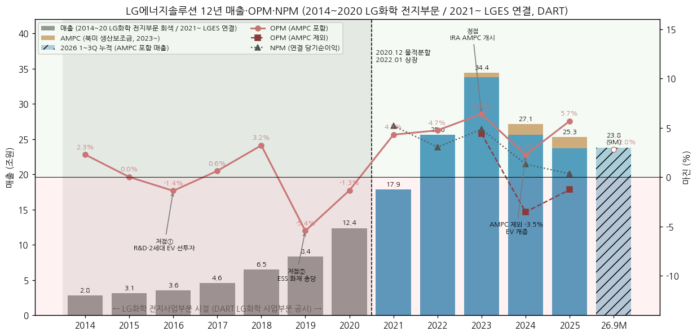

**📊 사이클 통계 (12년)**

| 지표 | 값 |
|---|---|
| 매출 CAGR (11년, 2014→2025, DART 표시) | **+21.3%** (AMPC 포함 재작성 시 +22.0%) |
| 매출 CAGR (9년, 2014→2023 정점) | **+31.7%** |
| OPM 평균 | **1.8%** |
| OPM 정점 평균 | **4.8%** (2018 3.2%, 2023 6.4%) |
| OPM 저점 평균 | **-1.5%** (2016 -1.4%, 2019 -5.4%, 2024 2.2% — 단 2024 AMPC 제외 -3.5%) |
| OPM range | **+11.8%pt** |
| 사이클 주기 | 저점→저점 3년(2016→2019)·5년(2019→2024), 정점→정점 5년(2018→2023) |
| 사이클 회수 (12년) | **약 2.5회** |

**글로벌 배터리 피어 마진·점유율 비교**

→ **LG에너지솔루션** — OPM **7.8%** (3Q26, AMPC 4,169억 + 일회성 물량 보상금 포함) / AMPC 제외 **3.5%** / 2025 연간 5.3% (재작성)

→ **CATL** — 1Q26 OPM 약 17% (BT 1Q26 리뷰 정리) — LFP·중국 내수 기반 고마진, LGES와 마진 격차 약 10%pt

→ **글로벌 EV 배터리 사용량 점유율 (SNE리서치)** — LGES 2023 13.6% → 2024 10.8% → 2025 **9.2%** (DART 2025 사업보고서) → 2026.1~7월 **8.3%**(3위, CATL 39.9%·BYD 14.7%; SBS Biz 2026-09-07)

→ **비중국 시장 점유율** — 2026.1~9월 LGES **16.4%**(2위, 전년 21.5%), CATL 33.7%, SK온 6.6%, 삼성SDI 3.5% (SNE리서치, 더팩트 2026-11-04) — 북미 사용량 -44.9%가 하락 주도

(3) 정량적 분류 근거

→ **매출의 지역 구조 급변** — 미주 비중 2021 15.8% → 2025 42.8% → 9M26 **50.0%** / 유럽 49.1% → 20.6% → 17.3% (DART 영업부문 지역 공시). 미국 정책(IRA·관세·FEOC/PFE) 민감도가 구조적으로 상승

→ **이익의 정책 의존** — 2024~2025 누적 AMPC 3.13조 vs 보고 영업이익 1.92조 → AMPC 없었다면 2년 누적 영업손실 1.21조

→ **CapEx 사이클** — 유·무형 CapEx 2021 3.5조 → 2024 **12.5조**(정점) → 2025 11.0조 → 2026 가이던스 "전년비 -40% 이상"(9M26 4.8조). 투자 사이클 하강 국면 진입

→ **고객 집중** — 매출 10% 이상 단일 고객 2~3곳: 2025 4.85조·4.59조·2.91조(합계 52%), 3Q26 분기 4.66조·3.34조(합계 **83%**). 상위 5대 매출처 약 56%(3Q26 분기보고서, 9M 누적)

(4) 산업 분류

→ DART 업종코드 **28202 (축전지 제조업)** / KOSPI 전기전자

→ 워치리스트: 섹터 **배터리(T2)**, 서브섹터 **배터리 셀** (피어: 삼성SDI) — 밸류체인 하위: 에코프로비엠·포스코퓨처엠·엘앤에프(양극재)

→ 글로벌 피어: CATL(300750.SZ), BYD, Panasonic Energy(6752.T), 삼성SDI(006400.KS), SK온(비상장, SK이노베이션 자회사)

(5) 분류 결정 논리

(1) **가장 매출 큰 사업 기준** — 9M26 기준 EV(파우치) + 소형(원통형)이 여전히 매출의 약 2/3, ESS 약 1/3 (컨콜 비중 발언). EV 수요는 보조금·연비규제·금리에 연동되는 내구재 사이클 → 사이클 분류 근거

(2) **이익 비중 sub-rule** — 2024~2025 영업이익은 AMPC가 100% 이상 설명(AMPC 제외 적자). 펀더멘털 이익은 아직 '정상화 전' → 고성장 프리미엄을 이익 기준으로 정당화하기 어려움

(3) **Boundary case 처리** — 매출 레벨(10년 8배)은 secular 성장, 마진(OPM 1.8% 평균, ±6%pt 진폭)은 사이클. 정량 룰(range 11.8pp) 우선 적용 → **Primary 사이클 + Secondary 고성장(ESS·46시리즈)**. 대안: ESS 비중이 40%+로 올라가고 AMPC 제외 OPM이 4개 분기 연속 흑자면 Primary 고성장으로 재분류 검토

(4) **국내외 피어 비교** — CATL은 중국 내수·LFP 원가로 사이클 저점에서도 두 자릿수 OPM 유지(구조적 원가 우위형). LGES·삼성SDI는 북미 정책 의존형 → '정책 사이클 + 비중국 공급망 프리미엄' 구조. BT 섹터 가설 2(2026-05-04): "LGES는 사이클 진입, 삼성SDI는 사이클 회복" — 3Q26 LGES 흑자 확대로 LGES 쪽 '저점 통과' 확인 단계

(6) 적정 밸류에이션 방법

**밸류에이션 다이얼 — 사업 mix → 지표 선택 논리**

| mix 요소 | 성격 | 적합 지표 | 근거 |
|---|---|---|---|
| EV 파우치 (매출 약 45%, 1Q26 셀사이드 추정) | 사이클·장치산업, 감가상각 큼 | **EV/EBITDA** | 감가상각비 3.69조(2025) > 영업이익 1.35조 → 이익 기준 왜곡. JV 비지배지분(7.1조)이 커서 EV 기준이 지분 구조를 반영 |
| ESS (약 30%) | 수주잔고 기반 성장 | **EV/EBITDA + 포워드 PER** | 2027~28 물량 확정 → 포워드 이익 가시성 |
| 원통형·46시리즈 (약 25~30%) | 고마진·성장 | 포워드 PER | 1Q26 셀사이드 추정 OPM 6~7% |
| 사이클 저점 하방 | 자산 기반 | **PBR** (floor 체크) | TTM 지배순이익 적자 → PER 산출 불가 구간 |

**현재 수치 (2026-11-13 종가 324,500원 기준, 시가총액 75.93조 — 회사 IR 시세 페이지·Yahoo 교차 확인)**

| 지표 | LG에너지솔루션 | CATL (2026E) | Panasonic | 삼성SDI |
|---|---|---|---|---|
| PER | **n/m** (TTM 지배순이익 -2.41조) | 12.3x | [미확보] | [미확보] |
| PBR | **4.03x** (지배자본 18.85조, 3Q26말) / 2.92x (총자본 기준) | 2.73x | [미확보] | [미확보] |
| EV/EBITDA | **약 20.5x** (TTM EBITDA 5.10조, 회사 IR 4Q25~3Q26 합) | 6.3x | [미확보] | [미확보] |

→ EV 산식: 시총 75.93조 + 차입금(리스 포함) 25.57조 − 현금성 4.26조 + 비지배지분 7.12조 = **104.4조**

→ CATL 수치: MarketScreener(참조가 237.6 CNY, 2026-10월 말 기준). Panasonic·삼성SDI 동일 출처 조회 실패 → [미확보], v1.1 보완 대상

→ 셀사이드 관행(BT 1Q26 리뷰 정리): 한화 "27F EBITDA × CATL 2개년 평균 멀티플 30% 할증", 삼성 "P/E·P/B 글로벌 피어 대비 60% 프리미엄" → **시장은 CATL 대비 프리미엄(비중국 공급망·북미 현지생산 희소성)을 EV/EBITDA로 부여**

**우선순위: ① EV/EBITDA (1차) → ② 포워드 PER (AMPC 제외 이익 흑자 정착 후 1차 승격) → ③ PBR (사이클 저점 하방 체크)**

(7) 분기 재평가 트리거 (**분류 변경 조건만** — 실적 추적 변수는 BT 섹터 메모리 tracking_variables)

→ **Primary 고성장 승격 조건**: ESS 매출 비중 40% 이상 + AMPC 제외 OPM 4개 분기 연속 흑자 + 매출 YoY +20% 이상 4개 분기 지속

→ **사이클 하강 재확인 조건**: 북미 ESS 판가 하락 또는 PFE(금지외국기업) 규정 미충족으로 AMPC 급감 → AMPC 제외 OPM 다시 -5% 이하

→ **구조 변경 조건**: AMPC 제도 변경(OBBBA 후속·45X 축소), GM·Honda JV 지분 구조 재편(2025~26 NextStar 100% 인수, Honda JV 건물 매각·리스백 같은 거래 추가), 사업부별 공시 개시

→ **밸류 지표 전환 조건**: TTM 지배순이익 흑자 전환 시 PER 병행 산출 시작

---

## ② 회사 개요

(1) 기본 사항

| 항목 | 내용 |
|---|---|
| 회사명 | ㈜엘지에너지솔루션 (LG ENERGY SOLUTION, LTD.) |
| 설립 | 2020-12-01 (㈜LG화학 전지사업부문 물적분할) |
| 상장 | 2022-01-27 KOSPI (공모가 300,000원, 신주 3,400만주) |
| 본사 | 서울 영등포구 여의대로 108 파크원 타워1 |
| 대표이사 | 김동명 (2024.03~, 前 자동차전지사업부장) |
| 최대주주 | ㈜LG화학 79.38% (2026.06말) |
| 발행주식 | 234,000,000주 (보통주만, 자기주식 0) |
| 시가총액 | **75.93조원** (2026-11-13 종가 324,500원, 회사 IR 시세 페이지) |
| 사업 한 줄 정의 | EV·ESS·IT/소형 기기용 리튬이온 2차전지(파우치·원통형·각형 예정) 셀·모듈·팩 및 ESS 시스템통합(SI) |
| 업종 | 축전지 제조업 (28202), 에너지솔루션 단일 사업부문 |
| 연결 종속회사 | 25개 (2026.06말, 주요 종속회사 16) |
| 임직원 | 12,937명 (2026.06말, 본사 기준) |
| 신용등급 | 한국신용평가·NICE **AA** / S&P **BBB** / Moody's **Baa2** (2025.11 Baa1→Baa2, LG화학 연결 지표 악화 연동) |

(2) 12년 손익·자본 추이

| 연도 | 기준 | 매출 (억원) | YoY | 영업이익 | OPM | 순이익 | 지배순이익 | 지배자본 (기말) | 지배자본 YoY |
|---|---|---|---|---|---|---|---|---|---|
| 2014 | LG화학 전지부문 | 28,358 | — | 649 | 2.3% | — | — | — | — |
| 2015 | LG화학 전지부문 | 31,471 | +11.0% | 5 | 0.0% | — | — | — | — |
| 2016 | LG화학 전지부문 | 35,616 | +13.2% | -493 | -1.4% | — | — | — | — |
| 2017 | LG화학 전지부문 | 45,605 | +28.0% | 289 | 0.6% | — | — | — | — |
| 2018 | LG화학 전지부문 | 64,989 | +42.5% | 2,092 | 3.2% | — | — | — | — |
| 2019 | LG화학 전지부문 | 83,503 | +28.5% | -4,543 | -5.4% | — | — | — | — |
| 2020 | LG화학 전지부문 | 123,635 | +48.1% | -1,656 | -1.3% | — | — | 68,796 (12월말) | — |
| 2021 | LGES 연결 | 178,519 | +44.4%* | 7,685 | 4.3% | 9,299 | 7,925 | 79,661 | +15.8% |
| 2022 | LGES 연결 | 255,986 | +43.4% | 12,137 | 4.7% | 7,798 | 7,672 | 187,322 | +135.1% (IPO) |
| 2023 | LGES 연결 | 337,455 | +31.8% | 21,632 | 6.4% | 16,380 | 12,372 | 202,006 | +7.8% |
| 2024 | LGES 연결 | 256,196 | -24.1% | 5,754 | 2.2% | 3,386 | -10,187 | 211,162 | +4.5% |
| 2025 | LGES 연결 | 236,718 | -7.6% | 13,461 | 5.7% | 808 | -10,728 | 202,155 | -4.3% |
| 9M26 | LGES 연결 (AMPC 포함) | 237,586 | +26.1%** | 6,616 | 2.8% | -15,696 | -15,350 | 188,471 | -6.8% (vs 25말) |

\* 2021 YoY는 LG화학 전지부문 2020 대비(기준 상이, 참고치) / \*\* 9M26 YoY는 9M25 재작성(AMPC 포함 18.84조) 대비

→ (출처: LG화학 사업보고서 2016·2018·2020 '사업부문별 요약 정보', OpenDART fnlttSinglAcntAll 연결, 회사 IR 3Q26 p.13)

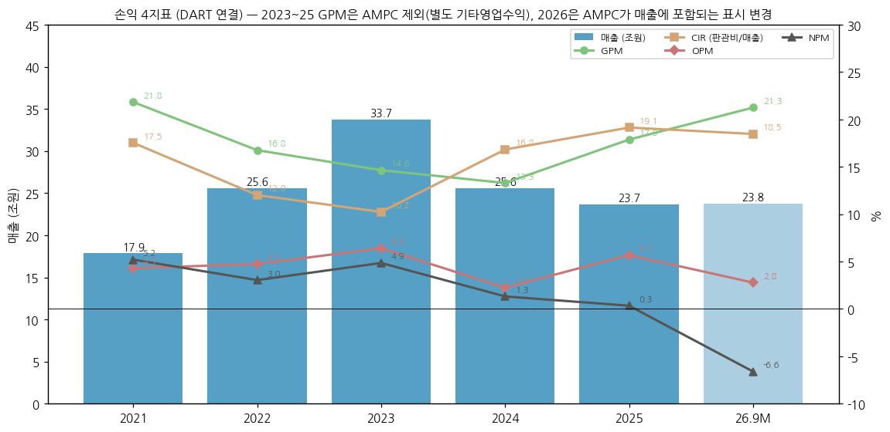

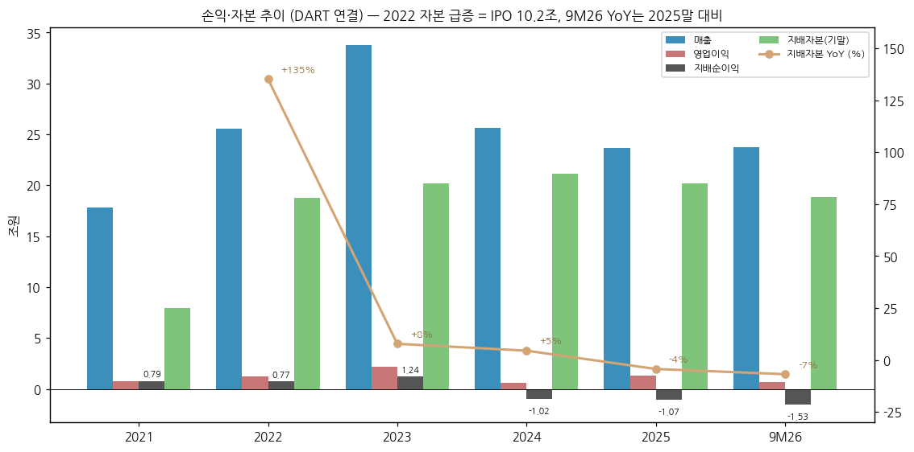

(3) 주가 역사 (상장 이후 — 2022.01 상장으로 20년 시계열 없음)

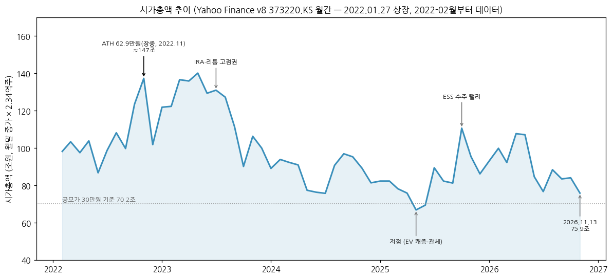

→ **데이터 한계**: Yahoo Finance v8 월간 데이터는 2022-02부터 존재(상장월 2022-01 누락). 20년 표준 대비 약 4.8년

→ **ATH**: 장중 **629,000원 (2022-11, Yahoo 월간 고가)** → 시총 약 147조. 월말 종가 기준 최고는 2023-05 599,000원(시총 140.2조)

→ **공모가 30만원 = 시총 70.2조** — 2025-05 저점(월말 28.6만원, 시총 66.9조)에서 공모가를 하회

→ **현재**: 2026-11-13 종가 324,500원, 시총 75.93조 (52주 범위 290,500~497,500원, Yahoo meta) — 고점 대비 -48%

| 국면 | 기간 | 주가 동인 |
|---|---|---|
| 상장 랠리 | 2022.01~2022.11 | IPO 수급, 메탈가 급등에 따른 판가 연동 매출 고성장, IRA 법안 통과(2022.08) |
| IRA 기대 고점권 | 2023.01~2023.07 | AMPC 개시, 북미 JV 수주(현대차·Honda·Stellantis·Toyota) |
| EV 캐즘 하락 | 2023.08~2025.05 | 리튬 가격 급락 → 판가 하락, 북미 EV 수요 둔화, 미국 관세·30D 폐지 우려 |
| ESS 리레이팅 | 2025.06~2026.05 | 북미 LFP ESS 대형 수주(2025 +90GWh), 46시리즈 수주, Tesla ESS·데이터센터 테마 |
| 실적 확인 구간 | 2026.06~현재 | 1Q26 적자·2Q26 BEP·3Q26 OPM 7.8%, 영업외 손실로 순이익 적자 지속, 부채비율 171% |

(4) 주요 연혁

| 시점 | 내용 |
|---|---|
| 1992 | LG화학(당시 럭키) 2차전지 연구 착수 (2025 ESG Report) |
| 2000년대 | 소형 리튬이온·폴리머 전지 양산, GM Volt 배터리 공급(2009 선정, 공개 보도) |
| 2016.10 | (LG화학) 2세대 EV(GM Bolt) 공급 본격화 — 전지부문 2016 영업적자 |
| 2018 | 폴란드 브로츠와프 공장 본격 가동 → 유럽 매출 확대 |
| 2019~2020 | 국내 ESS 화재 사태(충당금), SK이노베이션과 영업비밀 소송(2021.04 합의금 2조원 합의, LGES 승계) |
| 2020.12.01 | LG화학 전지사업부문 물적분할 → ㈜LG에너지솔루션 설립, LG Chem Europe 배터리 사업 인수 |
| 2021.08 | GM 볼트 EV 리콜 — 3Q21 충당금으로 분기 영업손실 3,728억 |
| 2021.08 | PT.HLI Green Power(현대차그룹 인도네시아 JV) 설립 |
| 2022.01.27 | KOSPI 상장 (공모 12.75조, 신주 10.2조) |
| 2022.02 | LG Energy Solution Vertech(구 NEC Energy Solutions, ESS SI) 인수 |
| 2022.04 | LG Energy Solution Arizona 설립 (원통형 46시리즈·ESS) |
| 2022.11 | Ultium Cells Holdings LLC 설립 (GM JV 지주) |
| 2023.02 | L-H Battery Company(Honda JV, 오하이오) 설립 |
| 2023.07 | NextStar Energy(Stellantis JV, 캐나다 온타리오) 설립 |
| 2023.12 | HLBMA LLC(현대차그룹 미국 조지아 JV) 설립 |
| 2023.10 | Toyota 미국 공급 계약(미시간 단독법인, 2025말 양산 계획) |
| 2025.03 | Ultium Cells 3공장(랜싱) 자산 USD 21.5억에 LGES Michigan이 인수 → ESS 전용 활용 |
| 2025.08~11 | LG화학 교환사채 교환·PRS(575만주) → LG화학 지분 81.84% → 79.38% |
| 2025.12 | 오창 46시리즈 양산 개시 |
| 2026.03 | 테네시 Ultium 2공장 EV 라인 일부 ESS 전환 결정 |
| 2026.05 | Honda JV(L-H Battery) 공장 건물 Honda에 매각(3조원+) 후 판매후리스, ESS 라인 가동 |
| 2026.3Q | NextStar(Stellantis 49% 지분) USD 100에 인수 → 100% 자회사, 미국 GM JV 2공장 8월 재가동, NVIDIA 'DSX Ready' BESS 파트너 선정, Big Tech향 BTM BESS 첫 직접 공급 계약 |
| 2026말 (예정) | 애리조나 46시리즈 생산 개시, 북미 ESS Capa 50GWh+ |

→ (출처: DART 2026 반기보고서 'I. 회사의 연혁', 3Q26 분기보고서 주석, 3Q25·4Q25·3Q26 IR, 1Q26~3Q26 컨콜 속기록. 1992·2000년대·소송 항목은 2025 ESG Report 및 공개 보도 기반)

---

## ③ 비즈니스 모델

(1) 실적 추이 통합 표 (5년 연간 — 3단계 위계: 전사 / AMPC 분해 / 지역)

**⚠️ 사업부(EV·ESS·소형)별 매출·영업이익은 회사 미공시 [미확보 — 단일 사업부문 공시].** 아래는 공시된 범위의 최대 분해

| 항목 (억원) | 2021 | 2022 | 2023 | 2024 | 2025 | 9M26 |
|---|---|---|---|---|---|---|
| **매출 (DART 표시)** | 178,519 | 255,986 | 337,455 | 256,196 | 236,718 | 237,586 |
| (+) AMPC (2023~25 기타영업수익 → 재작성 가산) | — | — | 6,769 | 14,801 | 16,468 | (매출 내 포함) |
| **매출 (AMPC 포함 재작성)** | 178,519 | 255,986 | 344,224 | 270,997 | 253,186 | 237,586 |
| 영업이익 | 7,685 | 12,137 | 21,632 | 5,754 | 13,461 | 6,616 |
| ㄴ AMPC 효과 (회사 IR) | — | — | 6,769 | 14,801 | 16,468 | 8,477 |
| ㄴ **AMPC 제외 영업이익** | 7,685 | 12,137 | **14,863** | **-9,047** | **-3,007** | **-1,861** |
| AMPC 제외 OPM (DART 매출 대비) | 4.3% | 4.7% | 4.4% | -3.5% | -1.3% | -0.8% |
| EBITDA (회사 IR) | 22,200 | 30,560 | 44,500 | 36,210 | 50,370 | 41,890 |
| **지역별 매출 (고객 소재지, DART)** | | | | | | |
| ㄴ 국내 | 22,353 (12.5%) | 13,499 (5.3%) | 24,124 (7.1%) | 17,470 (6.8%) | 26,780 (11.3%) | 19,868 (8.4%) |
| ㄴ 중국 | 29,105 (16.3%) | 60,674 (23.7%) | 60,819 (18.0%) | 50,398 (19.7%) | 49,188 (20.8%) | 48,980 (20.6%) |
| ㄴ 아시아/오세아니아 | 11,104 (6.2%) | 14,515 (5.7%) | 13,979 (4.1%) | 10,548 (4.1%) | 10,529 (4.4%) | 8,839 (3.7%) |
| ㄴ 미주 | 28,279 (15.8%) | 70,754 (27.6%) | 118,546 (35.1%) | 107,489 (42.0%) | 101,430 (42.8%) | **118,756 (50.0%)** |
| ㄴ 유럽 | 87,677 (49.1%) | 96,544 (37.7%) | 119,986 (35.6%) | 70,290 (27.4%) | 48,791 (20.6%) | 41,144 (17.3%) |

→ (출처: OpenDART 연결, DART 사업보고서 영업부문 주석 '지역에 대한 공시', 회사 IR 4Q23·4Q25·3Q26 Appendix. 9M26 지역 매출은 AMPC 포함 '매출액 및 기타수익' 기준이라 미주 비중이 과대)

**제품 mix 정성 지표 (회사 컨퍼런스콜 발언 — 정량 매출 아님)**

| 시점 | ESS 매출 비중 | 46시리즈 | 기타 |
|---|---|---|---|
| 2025 연간 | 10% 미만 | 오창 양산 개시(2025말) | EV 파우치 수요 둔화, 원통형 2170 견조 |
| 1Q26 | 20% 중반 | 소형 사업부 매출의 한 자릿수 중반% | JV 생산 일시 중단(GM), STLA JV 일회성 보상금 |
| 2Q26 | 20% 후반 (상반기 ESS 매출 YoY 4배+) | 출하 QoQ +60% | EV 파우치 판매물량 30%+가 Mid-Ni·LFP |
| 3Q26 | **30% 초반** (ESS 물량 QoQ +60%+) | 북미 고객 신모델 호조 | EV 매출 QoQ 두 자릿수 성장, 일회성 물량 보상금 |
| 4Q26 (가이던스) | 30% 중반 이상, ESS 출하 QoQ +40% | — | 매출 QoQ 약 +10%, 수익성은 일부 둔화(일회성 소멸·Honda JV ESS 초기 고정비) |

→ 참고(셀사이드 추정, 회사 확인 아님): 1Q26 사업부별 — 소형 1.999조(OPM 6.7%) / EV 2.950조(-10.5%) / ESS 1.606조(-13.8%) (삼성증권 추정, BT 1Q26 리뷰 인용) ⚠️ 추정치

(2) 분기 시계열

**(2-1) AMPC 포함/제외 영업이익 15분기 (배터리 섹터 핵심 변수)**

| 분기 | 매출 (재작성, 억원) | 영업이익 | AMPC | AMPC 제외 OP | OPM | AMPC 제외 OPM | 지배순이익 |
|---|---|---|---|---|---|---|---|
| 1Q23 | 88,474 | 6,332 | 1,003 | 5,329 | 7.2% | 6.0% | 5,006 |
| 2Q23 | 88,844 | 4,606 | 1,109 | 3,497 | 5.2% | 3.9% | 4,324 |
| 3Q23 | 84,391 | 7,312 | 2,156 | 5,156 | 8.7% | 6.1% | 3,277 |
| 4Q23 | 82,514 | 3,382 | 2,501 | 881 | 4.1% | 1.1% | -236 |
| 1Q24 | 63,177 | 1,573 | 1,890 | -317 | 2.5% | -0.5% | -5 |
| 2Q24 | 66,097 | 1,953 | 4,478 | -2,525 | 3.0% | -3.8% | -4,718 |
| 3Q24 | 73,438 | 4,483 | 4,660 | -177 | 6.1% | -0.2% | 1,332 |
| 4Q24 | 68,285 | -2,255 | 3,773 | -6,028 | -3.3% | -8.8% | -6,797 |
| 1Q25 | 67,227 | 3,747 | 4,577 | -830 | 5.6% | -1.2% | -1,457 |
| 2Q25 | 60,562 | 4,922 | 4,908 | 14 | 8.1% | 0.0% | -2,974 |
| 3Q25 | 60,654 | 6,013 | 3,655 | 2,358 | 9.9% | 3.9% | 2,472 |
| 4Q25 | 64,743 | -1,220 | 3,328 | -4,548 | -1.9% | -7.0% | -8,768 |
| 1Q26 | 65,550 | -2,078 | 1,898 | -3,976 | -3.2% | -6.1% | -6,760 |
| 2Q26 | 75,602 | 1,133 | 2,410 | -1,277 | 1.5% | -1.7% | -3,775 |
| **3Q26** | **96,434** | **7,560** | **4,169** | **3,391** | **7.8%** | **3.5%** | **-4,815** |

→ (출처: OpenDART 분기 연결 — 2023~25 AMPC = 영업이익 − (매출총이익 − 판관비), 회사 IR 'Tax Credit 제외 영업이익'과 십억원 단위 일치 확인. 2026 AMPC = 회사 IR·컨콜 '북미생산보조금 효과'. 4Q = 연간 − 3Q 누적)

→ 3Q26 AMPC 제외 OP 3,391억에는 **고객 일회성 물량 보상금**(금액 미공시) 포함 → 순수 펀더멘털 흑자 여부는 4Q26 확인 필요

→ 3Q26 영업외 손실 9,872억: 외화채 파생상품 평가손실·이자비용·**소형 IT 파우치 자산 손상**, 9M26 누적 매각예정자산 손상차손에 Honda 관련 4,821억 포함(3Q26 분기보고서 주석) → 영업흑자에도 순손실 지속

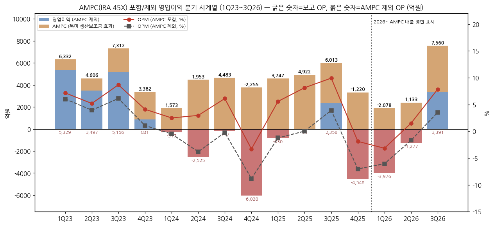

**(2-2) 연결 분기 23분기 (1Q21~3Q26)**

| 분기 | 매출 | OPM | 분기 | 매출 | OPM | 분기 | 매출 | OPM |
|---|---|---|---|---|---|---|---|---|
| 1Q21 | 42,541 | 8.0% | 1Q22 | 43,423 | 6.0% | 1Q23 | 88,474 | 7.2% |
| 2Q21 | 51,310 | 14.1% | 2Q22 | 50,706 | 3.9% | 2Q23 | 88,844 | 5.2% |
| 3Q21 | 40,274 | -9.3% | 3Q22 | 76,482 | 6.8% | 3Q23 | 84,391 | 8.7% |
| 4Q21 | 44,394 | 1.7% | 4Q22 | 85,375 | 2.8% | 4Q23 | 82,514 | 4.1% |

→ 2024~2026 분기는 (2-1) 표 참조. 3Q21 -9.3%는 GM 볼트 리콜 충당금 영향, 2Q21 14.1%는 상장 전 최고 분기 마진(일회성 요인 분해는 [미확보])

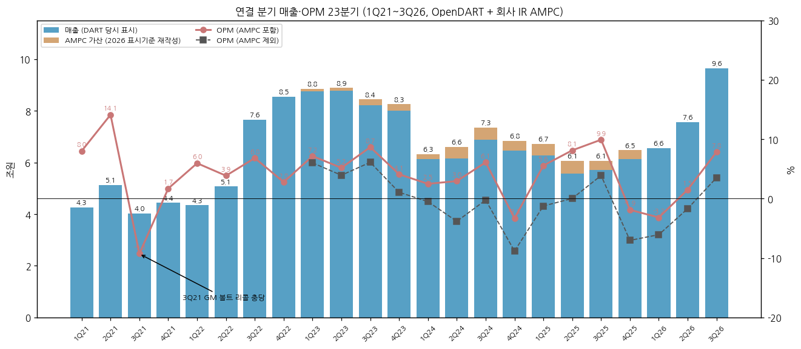

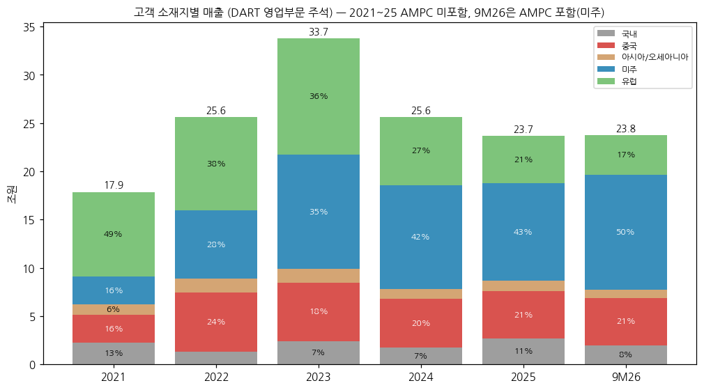

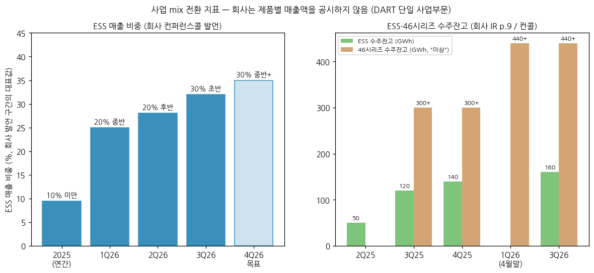

**(2-3) 12분기 rolling (4Q23~3Q26)**

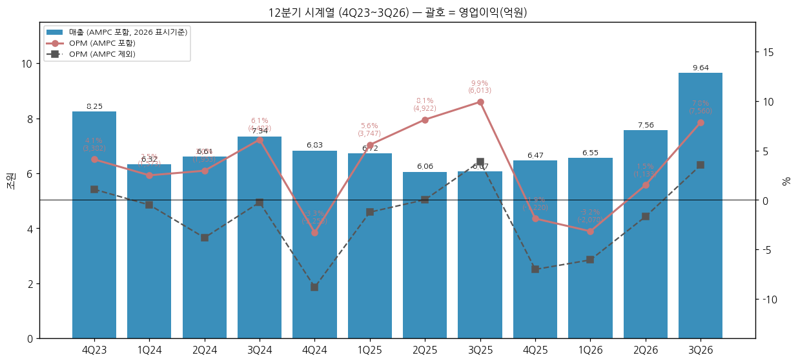

→ 3Q26 매출 9.64조 = 12분기 최대, 4Q23(8.25조) 대비 +17%. OPM은 AMPC 포함 기준 -3.3%(4Q24) ~ 9.9%(3Q25) 범위에서 진동

(3) 사업별 디테일 (매출 비중 큰 순서 — 3Q26 컨콜 기준 정성 서술)

(3-1) **자동차전지(EV 파우치) — 매출 약 40% 내외 (추정 구간)**

→ 제품: 하이니켈 NCMA(프리미엄), **고전압 Mid-Ni**(중저가, 2026.1Q 양산 본격화), LFP 파우치, LMR 각형(라인 전환 준비)

→ 3Q26: 유럽 고전압 Mid-Ni 출하 +10% 이상, 북미 GM JV 2026.8월 재가동, 아시아 고객 견조 → 매출 QoQ 두 자릿수 성장

→ 폴란드 공장 감가상각비가 유의미하게 하락 → 유럽 가격 경쟁력 개선(3Q26 컨콜). 2029년 폴란드 46시리즈 현지 생산 계획

→ 리스크: 미국 CAFE 연비기준 완화(49.3→34.9mpg), 30D 보조금 종료 → 북미 EV 수요 둔화 (북미 EV 배터리 사용량 2026.1~9월 -44.9%, SNE)

(3-2) **ESS전지 — 매출 30% 초반 (3Q26)**

→ 북미 LFP 파우치 ESS 현지생산: 홀랜드(MI)·랜싱(MI, 구 Ultium 3공장)·온타리오(NextStar)·테네시(Ultium 2공장 일부 전환)·오하이오(Honda JV 일부 라인) — 2026말 **50GWh+**, 2027말 **70GWh**(신규 각형 라인 포함)

→ 글로벌 ESS Capa 12GWh(2024말) → 36GWh(2025말, 북미 60%+) → 60GWh+(2026말, 북미 80%+) (4Q25 IR p.11)

→ 신규 수주 +55GWh(2024) → +90GWh(2025) → 2026E 90GWh+ / 수주잔고 50 → 120 → 140 → **160GWh** (2Q25 → 3Q25 → 4Q25 → 3Q26)

→ 차별화: 비중국(Non-PFE) 현지 셀 + Vertech SI(시스템통합)·자체 PCS/EMS, NVIDIA 'DSX Ready' BESS 파트너(국내 배터리사 유일), Big Tech향 BTM 직접 공급

→ 수익성: 다수 사이트 동시 Ramp-up으로 개선 속도 "시장 기대 대비 다소 슬로우"(3Q26 컨콜) — 4Q26 Honda JV ESS Capa 초기 고정비 부담

(3-3) **소형전지(원통형·IT) — 매출 약 25~30% (추정 구간)**

→ 2170 원통형: EV 전략고객(시장에서는 Tesla로 인식) 신모델 판매 호조로 EV향 원통형 출하 1H26 YoY +50%

→ **46시리즈**: 오창 2025말 양산(4680~46120 다양한 규격), 애리조나 2026말 가동(북미 원통형 Capa 10GWh(2026) → 20GWh+(2027)), 수주잔고 300GWh+(2025말) → **440GWh+**(2026.4말) — Legacy OEM부터 미주 EV 스타트업까지

→ Tabless 2170: 전동공구용 오창 양산 중, BBU향 LFP 2170 2027.2Q 양산 목표, HEV향 애리조나 2027말

→ IT 파우치: 사업 축소 — 3Q26 소형 IT 파우치 자산 손상 인식

(3-4) **신사업** — 소듐이온(ESS향 샘플 2026내, 북미 고객 테스트 2027), 건식전극 LFP 파일럿, 전고체, BaaS·EaaS, UPS/BBU, 로봇·선박·UAM

(4) 주요 경쟁사

| 사업 | 경쟁사 | 비고 |
|---|---|---|
| EV 배터리 (글로벌) | CATL, BYD, Panasonic, SK온, 삼성SDI, CALB, Gotion, EVE | 2026.1~7월 글로벌 3위(8.3%), 상위 10위 중 7개 중국계(합산 72.8%) |
| EV 배터리 (비중국) | CATL 33.7%, LGES 16.4%, BYD 10.8%, SK온 6.6%, 삼성SDI 3.5% | 2026.1~9월 SNE리서치 |
| 북미 ESS | Tesla(자체 셀+CATL), 삼성SDI(각형 LFP 2026.4Q~), Fluence, 중국계(관세·PFE 규제) | BT 섹터 가설 1: "미국 ESS 사실상 한국 셀 독점 구간" |
| 원통형 | Panasonic, 삼성SDI, Tesla(4680 내재화), EVE | 46시리즈 상업 양산 선점 경쟁 |

(5) 주요 매출처

→ DART는 고객명을 '외부고객1·2·3'으로만 공시 (고객명 비공개)

| 연도 | 외부고객1 | 외부고객2 | 외부고객3 | 합계 비중 |
|---|---|---|---|---|
| 2022 | 48,586억 | 32,447억 | 26,080억 | 41.9% |
| 2023 | 61,358억 | 57,118억 | 42,667억 | 47.5% |
| 2024 | 60,909억 | 45,349억 | 31,147억 | 53.6% |
| 2025 | 48,455억 | 45,917억 | 29,102억 | 52.2% |
| 3Q26 (3개월) | 46,628억 | 33,449억 | — | **83.0%** |

→ 상위 5대 매출처 비중 **약 56%** (3Q26 분기보고서, 9M 누적)

→ 주요 고객(공개 계약·JV 기준): GM(Ultium Cells JV), Tesla(원통형·ESS), 현대차그룹(HLGA·HLI JV), Honda(L-H Battery JV), Stellantis(NextStar, 2026.3Q 지분 정리 후 공급 관계는 미확인), Toyota, Renault·VW(유럽 Mid-Ni/LFP), 북미 유틸리티·디벨로퍼, Hyperscaler — **매출 순위는 미공시, 순서는 추정 불가**

(6) 생산 CAPA + 임직원 추이

| 연도 | 생산능력 (금액, 억원) | 생산실적 (억원) | 평균가동률 | 임직원 (본사) | 1인 평균 급여 (남/여) |
|---|---|---|---|---|---|
| 2021 | 297,133 | 216,106 | 72.7% | 9,564 | 9,400만/6,600만 |
| 2022 | 466,181 | 343,109 | 73.6% | 11,080 | 1.05억/7,100만 |
| 2023 | 556,368 | 385,563 | 69.3% | 12,166 | 1.30억/9,200만 |
| 2024 | 477,121 | 275,776 | 57.8% | 12,635 | 1.25억/8,700만 |
| 2025 | 514,743 | 245,017 | **47.6%** | 12,922 | 1.19억/8,000만 |
| 9M26 | 400,053 | 228,430 | 57.1% | 12,937 (1H26) | — |

→ (출처: DART 사업보고서 '생산능력, 생산실적 및 가동률'(금액 기준, 국내·남경·미시간·브로츠와프 등 연결), OpenDART 직원현황)

→ GWh 기준 Capa(회사 IR): 2022 IR 기준 2025E 글로벌 Capa 계획 **520GWh**(북미 41%·아시아 37%·유럽 22%) → 이후 증설 속도 조절·EV→ESS 라인 전환으로 계획 하향(최신 총 Capa GWh 미공시 [미확보])

---

## ④ 재무 구조 (연결, OpenDART — 2020.12~ / 2021~2025 연간 + 3Q26)

(1) 손익계산서

| 항목 (억원) | 2021 | 2022 | 2023 | 2024 | 2025 | 9M26 |
|---|---|---|---|---|---|---|
| 매출 | 178,519 | 255,986 | 337,455 | 256,196 | 236,718 | 237,586 |
| 매출총이익 | 38,988 | 42,905 | 49,430 | 34,060 | 42,321 | 50,498 |
| GPM | 21.8% | 16.8% | 14.6% | 13.3% | 17.9% | 21.3%* |
| 판관비 | 31,303 | 30,768 | 34,567 | 43,106 | 45,328 | 43,882 |
| CIR (판관비/매출) | 17.5% | 12.0% | 10.2% | 16.8% | 19.1% | 18.5% |
| 기타영업수익 (AMPC) | — | — | 6,769 | 14,801 | 16,468 | (매출 포함) |
| 영업이익 | 7,685 | 12,137 | 21,632 | 5,754 | 13,461 | 6,616 |
| OPM | 4.3% | 4.7% | 6.4% | 2.2% | 5.7% | 2.8% |
| 금융원가 | 2,953 | 5,190 | 8,572 | 12,606 | 11,044 | 23,542 |
| 당기순이익 | 9,299 | 7,798 | 16,380 | 3,386 | 808 | -15,696 |
| NPM | 5.2% | 3.0% | 4.9% | 1.3% | 0.3% | -6.6% |
| 지배순이익 | 7,925 | 7,672 | 12,372 | -10,187 | -10,728 | -15,350 |
| EPS (원, 연결) | 3,963 | 3,306 | 5,287 | -4,354 | -4,585 | — |

\* 9M26 GPM은 AMPC(정부보조금수익)가 매출에 포함된 수치 → 2025 이전과 직접 비교 불가
→ EPS 출처: DART '배당에 관한 사항'(연결 주당순이익, 2022·2024·2025 사업보고서)

→ **연결 순이익 > 지배순이익 괴리**: 2024 순이익 +3,386억인데 지배순이익 -10,187억 — AMPC가 귀속되는 북미 JV(Ultium 등) 이익의 상당 부분이 **비지배지분(GM 등)**에 귀속되고, 본사·단독법인 손실은 지배주주 부담. 배터리 셀 JV 구조의 핵심 특성

(2) 재무상태표

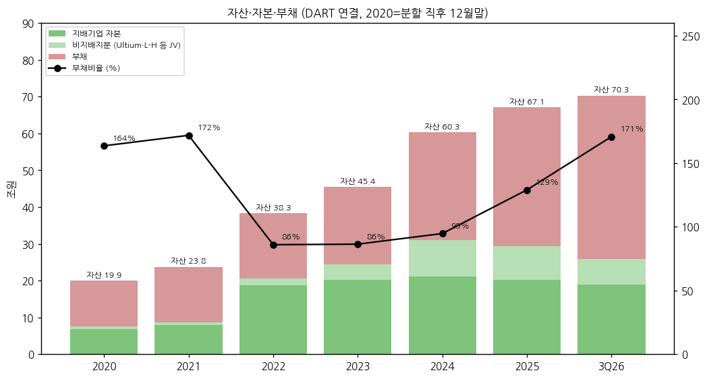

| 항목 (억원) | 2020말 | 2021 | 2022 | 2023 | 2024 | 2025 | 3Q26 |
|---|---|---|---|---|---|---|---|
| 자산 | 199,418 | 237,641 | 382,994 | 454,371 | 603,068 | 671,480 | 703,139 |
| ㄴ 유형자산 | 86,836 | 110,508 | 153,310 | 236,547 | 383,496 | 407,948 | 407,965 |
| 부채 | 123,764 | 150,218 | 177,057 | 210,636 | 293,402 | 378,263 | 443,458 |
| ㄴ 차입금 (리스 포함, IR) | 약 61,600 | 69,690 | 81,090 | 109,320 | 153,910 | 225,120 | 255,650 |
| 자본 | 75,654 | 87,424 | 205,938 | 243,735 | 309,665 | 293,217 | 259,682 |
| ㄴ 지배자본 | 68,796 | 79,661 | 187,322 | 202,006 | 211,162 | 202,155 | 188,471 |
| ㄴ 비지배지분 | 6,858 | 7,763 | 18,615 | 41,729 | 98,503 | 91,061 | 71,211 |
| 부채비율 | 164% | 172% | 86% | 86% | 95% | 129% | **171%** |
| 순차입금 (IR) | — | 56,850 | 21,710 | 58,630 | 114,920 | 187,330 | **213,030** |

→ 3Q26 자본 -4.3조 QoQ: 분기순손실 + **원화 강세에 따른 해외사업장 환산손실**(9M26 -1.64조) + NextStar 지분 인수로 비지배지분 1.41조 → 지배자본 대체(3Q26 분기보고서 자본변동표)

→ 2025말 매각예정자산 3.91조 = Honda JV(L-H Battery) 건설중 공장 건물 → 2026.5월 매각 완료(3조원+), 판매후리스로 리스부채 0.39조 → 2.54조 증가

(3) 현금흐름표

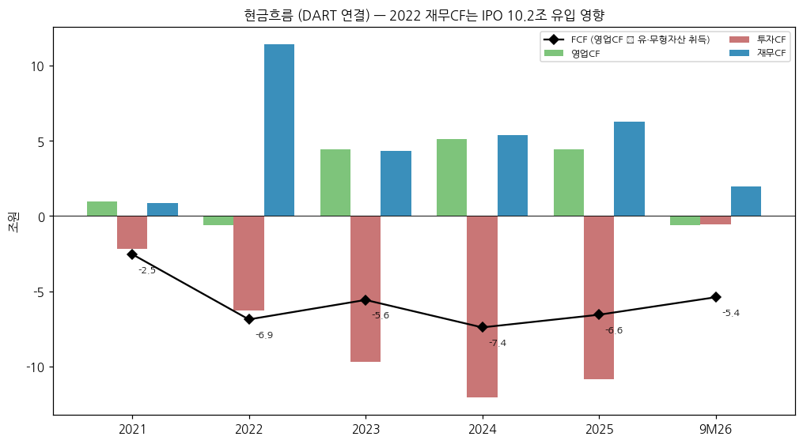

| 항목 (억원) | 2021 | 2022 | 2023 | 2024 | 2025 | 9M26 |
|---|---|---|---|---|---|---|
| 영업CF | 9,786 | -5,798 | 44,442 | 51,117 | 44,323 | -6,290 |
| 투자CF | -21,781 | -62,594 | -97,193 | -120,654 | -108,813 | -5,311 |
| 재무CF | 8,828 | 114,146 | 43,547 | 53,815 | 62,859 | 19,564 |
| CapEx (유·무형) | 35,164 | 62,981 | 100,254 | 125,204 | 109,987 | 47,727 |
| **FCF** | **-25,378** | **-68,779** | **-55,812** | **-74,087** | **-65,664** | **-54,017** |
| ㄴ 비지배주주 출자 유입 | — | — | 3,842 | 33,757 | 18,334 | 639 |
| EBITDA (IR) | 22,200 | 30,560 | 44,500 | 36,210 | 50,370 | 41,890 |

→ 상장 이후 5년 연속 FCF 적자, 누적 약 -34.4조(2021~9M26) → IPO 10.2조 + 차입 순증 + JV 파트너 출자로 조달

→ 9M26 영업CF 적자: ESS 매출 확대에 따른 매출채권·재고 증가(운전자본 -3.25조, IR) / 투자CF 소폭: Honda JV 건물 매각대금 3조+ 유입 상쇄

(4) CapEx

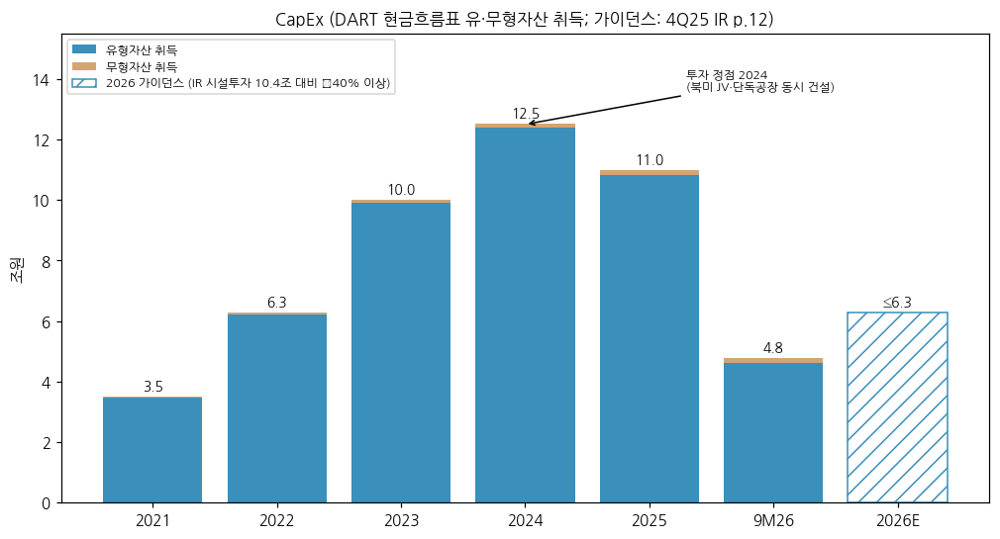

→ 정점 2024 **12.5조** (북미 JV 4곳 + 애리조나 단독 + 미시간 동시 건설) → 2025 11.0조 → 2026 가이던스 "YoY -40% 이상"(4Q25 IR p.12, IR 시설투자 기준 10.4조 → 약 6.3조 이하) → 9M26 4.8조(DART 'Capex 3.8조 사용' 표현은 신·증설 기준)

→ 잔여 약정: 애리조나 신규공장 USD 23.6억, Honda JV 출자 USD 18.02억 중 18.01억 출자 완료, NextStar USD 14.64억 출자 결정 중 11.2억 출자 (3Q26 분기보고서 주석)

(5) 부채구조 + 채무증권 발행 history

| 구분 (2026.09말, 백만원) | 금액 |
|---|---|
| 단기차입금 | 3,023,435 |
| 유동성 장기차입금 | 1,408,150 |
| 유동성사채 | 2,247,930 |
| 유동성 리스부채 | 204,487 |
| 장기차입금 | 5,235,865 |
| 사채 | 11,106,809 |
| 비유동 리스부채 | 2,338,352 |
| **차입금(사채·리스 포함) 합계** | **25,565,028** |

→ 미상환 회사채 권면 합계 **13.43조** (3Q26 분기보고서 '채무증권 발행실적'): 원화 녹색채 2023.06 5,050억(4.30%)·2024.02 1.42조·2025.02 1.60조·2026.03 7,700억 / 달러채 2019.04(LG화학 이관, 3.63%)·2023.09 USD 6억(5.75%)·2024.07 USD 20억(5.38~5.50%)·2025.04 USD 20억(5.25~5.88%, SOFR+170bp 포함)·2026.04 USD 16억(5.00~5.88%)

→ GM 관련 차입금 잔액 1.1조(만기 2030.04, DOE 정책자금은 GM이 2025년 중 상환) / Ultium Cells 차입금 USD 7.92억 중 지분율만큼 USD 3.96억 지급보증

→ 회사 방침(3Q26 컨콜): 본사 2026년 추가 차입 계획 없음, 2027년은 차환·운영자금 범위 최소 조달, 개선 현금흐름은 차입 상환 우선 + 자산 유동화 병행

(6) 배당·자사주

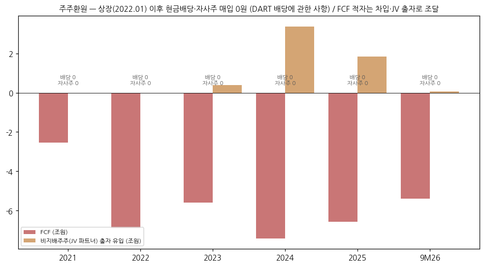

→ **상장(2022.01) 이후 현금배당 0원, 자기주식 0주** (DART '배당에 관한 사항' 2021~2025, 1H26·3Q26) — 성장 투자 단계로 무배당 유지

→ 2024.03 정관 개정: 배당기준일을 배당금액 확정 후로 정할 수 있도록 변경(제도 정비, 실제 배당 없음)

(7) 재무비율 (연결)

| 지표 | 2021 | 2022 | 2023 | 2024 | 2025 | 3Q26 / TTM |
|---|---|---|---|---|---|---|
| ROE (지배, 평균자본) | 10.7% | 5.7% | 6.4% | -4.9% | -5.2% | -12.3% (TTM) |
| ROA (연결순이익/평균자산) | 4.3% | 2.5% | 3.9% | 0.6% | 0.1% | — |
| 부채비율 | 172% | 86% | 86% | 95% | 129% | 171% |
| 차입금비율 (IR) | 80% | 39% | 45% | 50% | 77% | 98% |
| 순차입금/EBITDA | 2.6x | 0.7x | 1.3x | 3.2x | 3.7x | 4.2x (TTM) |
| 유동비율 | 101% | 164% | 157% | 127% | 110% | 113% |
| 영업이익/금융원가* | 2.6x | 2.3x | 2.5x | 0.46x | 1.22x | 0.28x (9M) |

\* 금융원가에 외환손실·파생손실 포함 → 보수적 이자보상배율 대용치. 이자 지급액(CF) 기준: 2024 6,006억 → 2025 8,732억

---

## ⑤ 지배 구조

(1) 그룹·계열 관계

```
구광모 외 특수관계인 ── ㈜LG (지주, 구광모 16.60%, 2026.05말)
                           └── ㈜LG화학 (㈜LG 34.95%)
                                  └── ㈜LG에너지솔루션 (LG화학 79.38%)
                                         ├── 국내: ㈜아름누리(장애인 표준사업장)
                                         ├── 중국: LGES Nanjing / Battery Nanjing / Technology Nanjing / China / Xensol Energy
                                         ├── 유럽: LGES Wroclaw(폴란드), LGES Europe(독일), Baterias De Castilla(스페인)
                                         ├── 북미 단독: LGES Michigan(홀랜드·랜싱), Arizona, Arizona ESS, Vertech(SI), Fund I·II
                                         ├── 북미 JV(연결): Ultium Cells Holdings/LLC(GM 50:50, 주주약정으로 지배력), L-H Battery(Honda), HLBMA(현대차 조지아), NextStar(2026.3Q 100%)
                                         └── 아시아 JV: PT. HLI Green Power(현대차, 인도네시아), LGES India, Japan, Taiwan, Australia
```

→ LGES Michigan이 Ultium Cells Holdings·HLBMA 지분 50% 보유 — 과반 미만이나 주주간 약정상 의사결정 과반 행사 + 생산·원가관리로 지배력 인정 → 연결(3Q26 분기보고서 주석). GM은 특정 상황 시 풋옵션, 양사 콜옵션·우선매수권 보유

→ LG화학 지분 축소 경로: 교환사채(2023.07·2025.05 발행, 교환대상 LGES 594.9만주 예탁) + PRS 계약(2025.10, 575만주) → LG화학의 LGES 지분 유동화가 오버행 요인

(2) 주주 구분

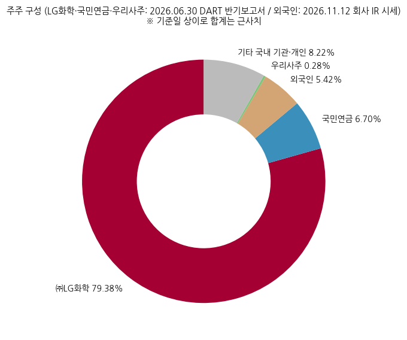

| 구분 | 주식수 | 지분율 | 기준일 / 출처 |
|---|---|---|---|
| ㈜LG화학 (최대주주) | 185,747,525 | **79.38%** | 2026.06.30 DART 반기 |
| 국민연금공단 | 15,679,408 | 6.70% | 2026.06.30 DART 반기 |
| 우리사주조합 | 651,206 | 0.28% | 2026.06.30 DART 반기 |
| 외국인 | 12,672,518 | **5.42%** | 2026.11.12 회사 IR 시세(ir.gsifn.io) |
| 소액주주 (814,200명) | 31,921,861 | 13.64% | 2026.06.30 DART 반기 |
| 유통주식 (LG화학 제외) | 48,252,475 | 20.62% | 계산값 |

→ 최대주주 변동 이력: 2020.12 LG화학 100% → 2022.01 IPO 구주매출로 81.84% → 2025.11 PRS·EB 교환으로 79.38%

→ 외국인 지분이 5%대로 낮은 것은 유통주식이 20.6%에 불과하기 때문(외국인/유통주식 ≈ 26%)

(3) 임원·이사회 (2026.06말, DART 반기보고서 — 등기임원 7명, 미등기 107명)

| 성명 | 직위 | 구분 | 주요 경력 | 임기 만료 |
|---|---|---|---|---|
| 김동명 | 사장 / 대표이사 CEO | 사내이사 | KAIST 재료공학 박사, 前 자동차전지사업부장 (2024.03 대표 선임) | 2027.03 |
| 이창실 | 부사장 CFO 겸 CRO | 사내이사 | Aalto MBA, 前 LG화학 전지 경영관리총괄 | 2028.03 |
| 권봉석 | 부회장 | 기타비상무이사 | ㈜LG COO, 前 LG전자 CEO | 2028.03 |
| 박진규 | 이사회 의장 | 독립이사 | 前 산업통상자원부 제1차관, 고려대 특임교수 (2026.03 재선임, 의장) | 2029.03 |
| 한승수 | 감사위원장 | 독립이사 | 고려대 경영대 교수, 前 금감원 회계심의위원 | 2027.03 |
| 여미숙 | 내부거래위원장 | 독립이사 | 前 서울고법 부장판사, 한양대 로스쿨 교수 | 2027.03 |
| 이명규 | 독립이사후보추천위원장 | 독립이사 | 서울대 재료공학부 교수 (2026.03 신규) | 2029.03 |

→ 이사회 7인 중 독립이사 4인, **2026년부터 이사회 의장을 독립이사(박진규)가 맡음**. 감사위원회 전원 독립이사(2024.03~)

→ 대표이사 변천: 김종현(2020.12~2021.11) → 권영수(2021.11~2024.03) → 김동명(2024.03~)

---

## ⑥ 기타 팩트

(1) R&D 인프라

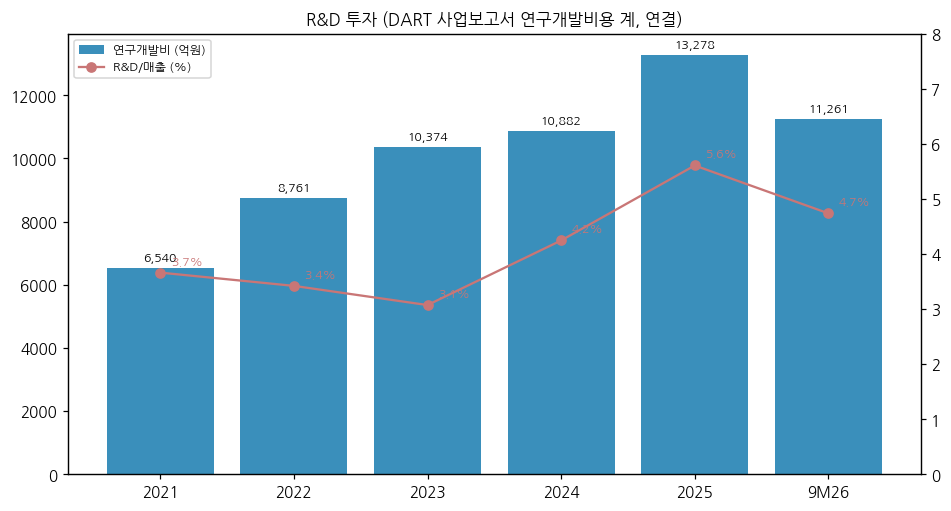

| 연도 | 연구개발비 (억원) | R&D/매출 |
|---|---|---|
| 2021 | 6,540 | 3.7% |
| 2022 | 8,761 | 3.4% |
| 2023 | 10,374 | 3.1% |
| 2024 | 10,882 | 4.2% |
| 2025 | 13,278 | 5.6% |
| 9M26 | 11,261 | 4.7% |

→ 조직: CTO, 사업부 개발센터(자동차·소형·ESS), 생산기술혁신센터, 개발품질, CDO(AI/빅데이터) / 대전·과천·마곡 연구소 + 미국·독일·폴란드·중국·일본 R&D 네트워크

→ 특허(2025말): 등록 국내 12,942·해외 38,464건, 출원 중 국내 14,151·해외 24,547건 (DART 2025 사업보고서)

(2) 진행 중 corporate action (설립 이후)

| 시점 | 내용 | 규모 |
|---|---|---|
| 2021.04 | SK이노베이션 영업비밀 분쟁 합의 | 2조원(현금 1조 + 로열티 1조) |
| 2022.01 | KOSPI 상장 | 신주 10.2조 |
| 2022.02 | Vertech 인수 (ESS SI) | [미확보] |
| 2022~2023 | 북미 JV 설립: Ultium 3공장 체제(GM), L-H Battery(Honda), NextStar(Stellantis), HLBMA(현대차) | Honda JV 출자 USD 18.0억, NextStar USD 14.6억, HLBMA USD 10.8억 |
| 2025.03 | Ultium Cells 3공장(랜싱) 자산 인수 | USD 21.5억 |
| 2025 | Ultium Cells 유상감자 (비지배주주 GM 지분 환급) | 감자 현금유출 7,535억(2025 CF) |
| 2026.05 | Honda JV 공장 건물 Honda에 매각 + 판매후리스 | 3조원+ (손상차손 4,821억) |
| 2026.3Q | NextStar Stellantis 지분 49% USD 100에 인수 | 비지배지분 1.41조 → 지배지분 대체 |

(3) R&D·사업 마일스톤

→ 2023.10 Toyota 수주(미시간 단독, 연 20GWh × 10년) / 고전압 Mid-Ni 2025 양산 목표 제시(3Q23 IR)

→ 2024 4680 양산·건식전극 파일럿 라인 구축 계획(2Q24 IR) / 2025말 오창 46시리즈 양산

→ 2026: 고전압 Mid-Ni·LFP 양산 본격화(1Q), LMR 각형 라인 전환, 소듐이온 ESS 샘플, LFP 2170(2027.2Q 양산 목표), 건식 LFP 파일럿

→ 차세대: 전고체·바이폴라·소듐 전지 개발(DART 2025 R&D 실적표)

(4) 주요 리스크

→ **정책**: IRA 45X(AMPC) — PFE 소재 비중 요건(MACR) 2026 40% → 2027 35% 이하로 강화, 미충족 시 AMPC 상실 위험. 회사: LFP 양극재 Non-PFE 공급사 4개사 이상 확보 추진(3Q26 IR p.11) / 미국 CAFE 완화·30D 종료 / EU IAA(산업가속법) 현지산 요건 강화(2026.12 세부규칙, 2027 상반기 최종안)

→ **고객 집중**: 3Q26 상위 2개 고객이 분기 매출 83% — 단일 고객 정책 변화에 민감

→ **재무**: 부채비율 171%·순차입금/EBITDA 4.2x, 신용등급 하향(S&P BBB+→BBB, Moody's Baa1→Baa2) / 원화 강세 시 외화 순자산 환산손실(9M26 -1.64조)·외화채 파생손실

→ **환율 민감도** (3Q26 분기보고서): USD 10% 상승 시 세전이익 -7,649억(외화 화폐성 순부채 기준), 단 국내 USD 차입금 헷지 감안 시 **+1,452억** / EUR 10% 상승 시 -2,465억

→ **소송·우발**: 소형전지·GM 볼트 EV 관련 소비자 집단소송 6건 진행(3Q26 분기보고서), GM 볼트 리콜 충당부채

→ **JV 구조**: GM 풋옵션·콜옵션, Ultium 비지배주주 지급의무 USD 5.14억, 선수금 보증

(5) ESG 등급

| 평가기관 | FY2022 | FY2023 | FY2024 | 비고 |
|---|---|---|---|---|
| MSCI | BB | BBB | BBB | 2025 ESG Report |
| S&P Global CSA | 54점 | 66점 | 69점 (추정 판독) | 2025 ESG Report 표 판독 — 연도 배치 ⚠️ 재확인 필요 |
| CDP Climate | A- | B | [미확보] | 회사 ESG 평가 페이지 |
| KCGS(한국ESG기준원) | — | A | [미확보] | 회사 ESG 평가 페이지 |

→ 기후 목표: 2030 전 사업장 RE100, 2040 Scope 1·2 탄소중립, 2050 밸류체인(Scope 3) 넷제로 / 배터리 업계 최초 RE100·EV100 가입(2021.04) / 재생에너지 사용률(연결) 44% 수준(2025 ESG Report Factbook)

(6) 인증·라이선스

→ ISO 14001 기반 환경경영, 제품 LCA·EPD 인증 확대(2025 ESG Report)

→ 녹색채권 프레임워크(2019~, 연차 Green Bond Report 발간), RMI(책임있는 광물 이니셔티브) 회원

→ NVIDIA 'DSX Ready' BESS 파트너(2026.09)

---

## Version Log

| 버전 | 일자 | 작업 내역 |
|---|---|---|
| v1.0 | 2026-11-14 | 첫 작성 — v4.8 표준 6섹션 + 차트 15종(12종 표준 + chart2 4분할). Source 6종 전수 점검: ① DART 정기보고서 본문 24건(2020 사업~3Q26 분기) ② 첨부(감사·연결감사보고서 각 6건) ③ 회사 IR 17건(1Q22~4Q25·3Q26; 1Q24 파일은 4Q23과 동일 파일로 확인 — irgo 업로드 오류) + 1Q26~3Q26 컨콜 속기록 3건(회사 홈페이지 보완) ④ 2025 ESG Report(국문) ⑤ Yahoo v8 월간(2022-02~) ⑥ 신용등급(DART·ESG Report)·외국인 지분(회사 IR 시세)·SNE 점유율(보도)·CATL 밸류(MarketScreener). 2014~2020은 LG화학 사업보고서 전지부문 수치로 보강 |

**잔여 보완 후보 (v1.1)**

→ 1Q26·2Q26 IR 프레젠테이션 PDF (irgo 미게시 — 속기록으로 대체) 확보 후 수치 대조

→ 2022~2024 IR PDF 대부분이 이미지 PDF → OCR로 분기별 제품 코멘트·Capa(GWh) 시계열 정리

→ Panasonic·삼성SDI 밸류에이션 멀티플(동일 출처·동일 시점) 확보 → 밸류에이션 다이얼 표 완성

→ 2014~2020 LG화학 전지부문 내 제품별(소형·자동차·ESS) 매출 비중 — LG화학 IR 확인

→ 2022 EPS, CDP 2024·KCGS 2024~25 등급 확인

→ 4Q26 실적(2027-01 예정) 시 AMPC 제외 OP 흑자 지속 여부·ESS 비중 30% 중반 달성 여부로 분류 재평가
