# LG이노텍 — 기업 개요 (v1.0)

> 마지막 update: 2026-11-25 (3Q26 분기보고서 2026-11-12 제출분 + 3Q26 IR 실적자료 반영)
> 입력 source: OpenDART fnlttSinglAcntAll (연결, 2015 사업보고서\~3Q26, 44개 JSON — 2013·2014는 2015 사업보고서 전기·전전기 컬럼) + DART 정기공시 원문 XML 52건 (사업보고서 2013\~2025, 분기·반기 1Q14\~3Q26, 기재정정본 우선) + OpenDART 기업개황·주주·임원·직원·배당 (2015·2018·2021·2023·2025 사업보고서, 3Q26) + LG이노텍 IR 실적 PDF 2건 (3Q25·3Q26, irgo 경유) + Yahoo Finance (011070.KS 월간 2008-07\~2026-11, 일간 2025-11\~2026-11-24)
> 갱신 주기: 매분기 (실적 리뷰 모드 호출 시)
> 분기 시계열: 사업부별 **51분기 (1Q14\~3Q26)** — 표준 60분기 대비 9분기 부족 (2011\~2013 분기보고서 미수집, 잔여 보완 후보)
> **Fact verify cutoff**: 2026-11-25 (시가총액·ATH는 Yahoo Finance 일간·월간 + 국내 언론 교차 확인, 점유율은 DART 3Q26 분기보고서 회사 추정치)
> 워치리스트: IT 하드웨어 — 전자부품·기판

---

## 1. 기업 분류

- **Primary 분류: 사이클** (고객 신제품·스펙 사이클형 부품주 — 박마진·고레버리지)
- **Secondary 노트: 꿈(옵션) 일부** — 패키지솔루션의 FC-BGA·AI 서버 기판, 로봇·자율주행 센싱. 2026년 주가 재평가의 핵심이지만 매출 비중은 8%대

### ① 정량 근거

**📊 Summary Box (12년, 2014\~2025):**

| 지표 | 값 |
|------|-----|
| 매출 CAGR (2014→2025, 11년) | **+11.7%** (6.47조 → 21.90조) |
| OPM 평균 | **4.6%** |
| OPM 정점 평균 | **5.8%** (2014 4.9% · 2017 3.9% · 2021 8.5%) |
| OPM 저점 평균 | **2.7%** (2016 1.8% · 2018 3.3% · 2025 3.0%) |
| 사이클 주기 | 약 3\~4년 (peak-to-peak: 2014→2017→2021) |
| 사이클 회수 (12년) | 정점 3회 / 저점 3회 |

```
[전사 OPM 시계열 (12년, 연결, 억원)]
연도   매출      영업이익   순이익   OPM    NPM
2014   64,661    3,140     1,127    4.9%   1.7%   ← 정점① (기판소재 OP 2,232억, LED 적자 -1,073억)
2015   61,381    2,237       951    3.6%   1.5%
2016   57,546    1,048        50    1.8%   0.1%   ← 저점① (광학 1H16 적자, LED 적자 지속)
2017   76,414    2,965     1,748    3.9%   2.3%   ← 정점② (3D센싱·듀얼카메라, 매출 +33%)
2018   79,821    2,635     1,631    3.3%   2.0%   ← 저점② (광학 1H18 적자)
2019   83,021    4,031     1,023    4.9%   1.2%   (LED 포함 자체 공시 기준)
2020   95,418    6,810     2,361    7.1%   2.5%   ← 회복 (LED 중단영업 분리)
2021  149,456   12,642     8,883    8.5%   5.9%   ← 정점③ (매출 +57%, 기판소재 OPM 23%)
2022  195,894   12,718     9,798    6.5%   5.0%   (매출 최대폭 증가, 4Q22 광학 마진 급락)
2023  206,053    8,308     5,652    4.0%   2.7%   ← 다운사이클 진입
2024  212,008    7,060     4,493    3.3%   2.1%
2025  218,966    6,650     3,413    3.0%   1.6%   ← 저점③ (카메라모듈 단가 -5.4%)

OPM range: 1.8% ~ 8.5% = 6.7%pt (연간)
분기 OPM range: -3.0% (2Q16) ~ +11.3% (1Q21) = 14.3%pt
→ 연간 진폭은 작지만(박마진 구조), 분기 진폭·영업레버리지가 커서 사이클 분류
```

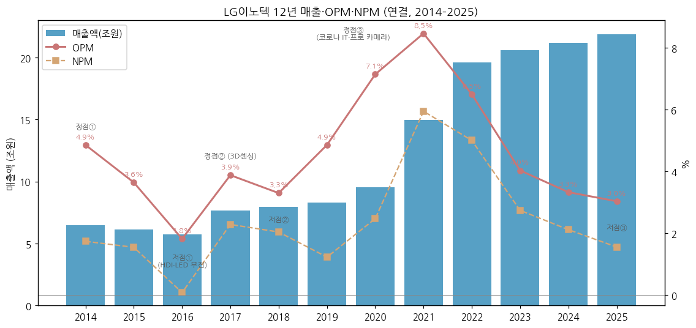

(2013년: 매출 6조 2,115억, 영업이익 1,362억, OPM 2.2% — 2015 사업보고서 전전기 컬럼)

### ② 산업 분류

- 산업: **전자부품 (카메라모듈) + 반도체 패키지 기판 + 차량 전장부품**
- DART 업종 코드: 262 (전자부품 제조업)
- 워치리스트 섹터: IT 하드웨어 — 전자부품·기판 (삼성전기·이수페타시스·대덕전자·심텍과 동일 서브섹터)
- 그룹: LG그룹 (지배기업 LG전자 40.79%, LG전자에 유의적 영향력 ㈜LG)

### ③ 분류 결정 논리

(1) **가장 매출 큰 사업부 기준**: 광학솔루션 매출 비중 83.6% (2025) → 카메라모듈 = 고객 신모델 출시 주기에 연동된 연간 사이클 + 다년 스펙 사이클 (듀얼→트리플→3D센싱→폴디드줌)
(2) **영업이익 비중 sub-rule**: 2025 광학 영업이익 비중 72.5%, 패키지 19.4%, 모빌리티 8.1% → 광학 사이클이 전사 이익을 결정. 단일 고객 매출이 3Q26 누적 매출의 **80%** (14.0조/17.4조) → 고객 1곳의 제품 사이클·단가인하(CR) 협상이 이익을 좌우
(3) **Boundary case 처리**: 매출 CAGR +11.7%는 고성장처럼 보이지만 2022\~2025 매출은 19.6조→21.9조로 정체, OPM은 6.5%→3.0%로 하락 — 외형 성장과 이익 성장이 분리된 구간. FC-BGA·AI 기판(패키지)의 이익 비중이 아직 20% 안팎이라 Primary 변경 불가, Secondary(꿈) 표기
(4) **피어 cross-reference**:
   - 삼성전기: 카메라모듈 + MLCC + 패키지기판 3축 — MLCC 사이클이 더 크게 작동, 고객 분산
   - Sunny Optical (2382.HK): 중화권 안드로이드 고객 중심 카메라모듈 — 매출 다변화, 마진 구조 유사
   - 이수페타시스·대덕전자·심텍: AI 서버·메모리 기판 pure-play → 기판 사이클 단독. LG이노텍은 기판이 매출의 8%에 불과해 "기판주 프리미엄"이 실적으로 검증되지 않은 상태

### ④ 적정 밸류에이션 방법

- **PBR 우선 (사이클·박마진 기준)** — 순이익이 3,400억\~9,800억으로 연간 3배 가까이 흔들려 PER 단독은 불안정 (2016 EPS 209원 → PER 422배)
- **PER 보조 (정상화 EPS 기준)** — 2021\~2022 정점 PER 6\~10배, 2023\~2024 8\~10배
- **연말 PBR 밴드 (2014\~2025)**: 하단 **0.72배** (2024) \~ 상단 **2.60배** (2021), 중앙값 약 1.4배
  - 2026-06-01 장중 ATH 1,788,000원 → PBR 약 **6.6배** (2Q26 BPS 약 26.9만원) — 밴드 이탈, FC-BGA 옵션 가치가 반영된 구간
  - 2026-11-24 종가 284,500원 → PBR **1.10배** (3Q26 BPS 약 25.97만원), TTM PER **10.7배** (4Q25\~3Q26 순이익 6,299억)
- **삼성전기 대비**: 삼성전기는 MLCC·기판 비중이 커서 PER 프리미엄이 상시 부여. LG이노텍은 카메라모듈 박마진 → PBR 1배 근처가 역사적 지지선. 패키지솔루션이 전사 이익의 30%+를 넘으면 SOTP(광학 PBR + 패키지 PER) 전환 검토

| 연도 | 연말 종가(원) | 시총(조) | BPS(원) | 연말 PBR | 연중 PBR 고점 | EPS(원) | 연말 PER |
|------|------|------|------|------|------|------|------|
| 2014 | 112,500 | 2.66 | 71,689 | 1.57 | 2.11 | 4,761 | 23.6 |
| 2015 | 98,500 | 2.33 | 74,586 | 1.32 | 1.60 | 4,018 | 24.5 |
| 2016 | 88,400 | 2.09 | 75,153 | 1.18 | 1.31 | 209 | 422 |
| 2017 | 144,000 | 3.41 | 82,434 | 1.75 | 2.28 | 7,385 | 19.5 |
| 2018 | 86,400 | 2.04 | 89,511 | 0.97 | 1.90 | 6,892 | 12.5 |
| 2019 | 140,000 | 3.31 | 93,160 | 1.50 | 1.50 | 4,322 | 32.4 |
| 2020 | 182,500 | 4.32 | 102,587 | 1.78 | 2.03 | 9,978 | 18.3 |
| 2021 | 364,000 | 8.61 | 140,049 | 2.60 | 2.68 | 37,536 | 9.7 |
| 2022 | 252,500 | 5.98 | 180,261 | 1.40 | 2.30 | 41,405 | 6.1 |
| 2023 | 239,500 | 5.67 | 199,225 | 1.20 | 1.61 | 23,883 | 10.0 |
| 2024 | 162,000 | 3.83 | 226,240 | 0.72 | 1.35 | 18,985 | 8.5 |
| 2025 | 271,000 | 6.41 | 243,531 | 1.11 | 1.23 | 14,420 | 18.8 |

(주가: Yahoo Finance 월간, 시총 = 종가 × 23,667,107주. BPS·EPS = 연결 자본총계·당기순이익 ÷ 유통주식 23,664,507주)

### ⑤ 분기 재평가 트리거

- 패키지솔루션 영업이익이 **2개 분기 연속 전사 영업이익의 35% 이상** → Secondary(꿈) → Primary 혼합(사이클 + 고성장) 격상 검토, 밸류에이션 SOTP 전환
- FC-BGA(AI 서버·데이터센터향) 매출이 패키지솔루션 매출의 **30%+** 로 분기 공시·IR에서 확인 → 고성장 Secondary 격상
- 단일 고객 매출 비중이 **70% 이하**로 하락 (현재 80%) → 고객 사이클 의존도 완화, 사이클 진폭 축소 가정 재검토
- 광학솔루션 OPM이 **4개 분기 연속 5% 이상** 유지 (계절 비수기 포함) → 사이클 → 지속성장 transition 후보

---

## 2. 회사 개요

### ① 기본 사항

- **회사명**: 엘지이노텍 주식회사 (LG Innotek Co., Ltd.)
- **설립**: 1976-02-24 금성정밀공업(주) 설립 (사실상 전신 금성알프스전자 1970-08-22) / 상장 2008-07-24 유가증권시장 / 2009-07-01 LG마이크론 합병
- **본사**: 서울 강서구 마곡중앙10로 30 LG사이언스파크 / 대표이사 문혁수 (사장, 2024-03 선임)
- **사업 한 줄 정의**: 스마트폰 카메라모듈 세계 1위권 업체가 반도체 패키지 기판(RF-SiP·FC-CSP·FC-BGA)과 차량 전장부품(모터·통신·조명·AP모듈)을 함께 운영하는 LG그룹 소재·부품 계열사
- **생산 거점**: 국내 구미·광주·파주 / 해외 생산법인 중국·인도네시아·폴란드·멕시코·베트남 (연결 종속기업 11개, 2025년 말)
- **신용등급**: 회사채 **AA-** (한국신용평가·한국기업평가·NICE, 2025-06 정기평정), CP·단기사채 **A1**

### ② 최근 12년 손익·자본 추이 (조원, 연결)

| 연도 | 매출 | YoY | 영업이익 | 순이익 | 자본총계 | 자본 YoY |
|------|------|-----|----------|--------|----------|----------|
| 2014 | 6.47 | - | 0.31 | 0.11 | 1.70 | - |
| 2015 | 6.14 | -5.1% | 0.22 | 0.10 | 1.77 | +4.0% |
| 2016 | 5.75 | -6.2% | 0.10 | 0.005 | 1.78 | +0.8% |
| 2017 | 7.64 | +32.8% | 0.30 | 0.17 | 1.95 | +9.7% |
| 2018 | 7.98 | +4.5% | 0.26 | 0.16 | 2.12 | +8.6% |
| 2019 | 8.30 | +4.0% | 0.40 | 0.10 | 2.20 | +4.1% |
| 2020 | 9.54 | +14.9% | 0.68 | 0.24 | 2.43 | +10.1% |
| 2021 | 14.95 | +56.6% | 1.26 | 0.89 | 3.31 | +36.5% |
| 2022 | 19.59 | +31.1% | 1.27 | 0.98 | 4.27 | +28.7% |
| 2023 | 20.61 | +5.2% | 0.83 | 0.57 | 4.71 | +10.5% |
| 2024 | 21.20 | +2.9% | 0.71 | 0.45 | 5.35 | +13.6% |
| 2025 | 21.90 | +3.3% | 0.67 | 0.34 | 5.76 | +7.6% |

(각 연도 자체 사업보고서 기준. 2019년은 LED 포함 수치 — 2020 사업보고서는 LED를 중단영업으로 분리해 2019 매출을 7.98조로 재작성. 2020년 순이익은 LED 중단영업손실 -948억 포함)

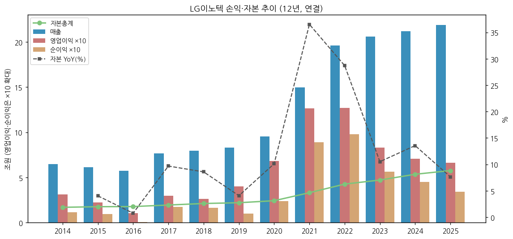

### ③ 회사 주가 역사 ★ narrative 영역

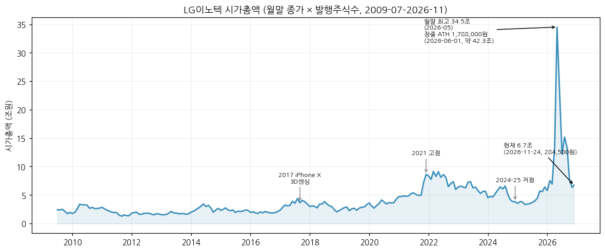

**시가총액 데이터:** 2009-07 \~ 2026-11-24 (월말 종가 × 발행주식수, 2014 이전 20,167,107주 근사 / 2014 이후 23,667,107주)
- 장중 ATH: **1,788,000원 (2026-06-01)** → 시총 약 **42.3조원** [Yahoo Finance 일간, 2026-11-25 확인]
- 종가 기준 최고: 1,530,000원 (2026-06-01) → 약 36.2조원
- 2026년 이전 고점: 2022년 장중 414,500원 (시총 약 9.8조)
- 현재: **284,500원 (2026-11-24)** → 시총 **약 6.7조원** — ATH 대비 -84%
- 발행주식수: 23,667,107주 (보통주, 자기주식 2,600주) / 우선주 없음

**주가 사이클 history:**

```
[2008-2010] 상장 + LG마이크론 합병 + LED 기대
  · 2008-07 상장, 2009-07 LG마이크론(포토마스크·테이프기판) 합병
  · 2010 LED(TV BLU) 성장 기대 → 장중 19만원대

[2011-2016] LED 적자 · 박스권 (7~15만원)
  · LED 사업부 매년 1,000억 안팎 적자 (2014 -1,073억, 2015 -1,453억)
  · 2016 광학 1H 적자 + 순이익 50억 → 주가 7만원대 저점

[2017] 1차 카메라 스펙 사이클 — iPhone X 3D센싱·듀얼카메라
  · 매출 +33% (7.64조), 4Q17 광학 매출 2.08조
  · 장중 18.8만원 / PBR 고점 2.28배

[2018-2019] 조정 → 회복
  · 2018 광학 1H 적자 → 연말 8.6만원 (PBR 0.97배)
  · 2019 트리플카메라 + 기판 이익 회복, 2020-10 LED 사업 중단 결의

[2020-2022] 2차 사이클 — 코로나 IT 수요 + 프로 모델 카메라 + 반도체 기판
  · 2021 매출 +57% (14.9조), 영업이익 1.26조, 기판소재 OPM 23%
  · 2022년 장중 41.45만원 (시총 ~9.8조) / 2022-02 FC-BGA 진출 (4,130억 투자 결의)

[2023-2025] 다운사이클 — 매출 정체·마진 하락
  · OPM 4.0% → 3.3% → 3.0%, 카메라모듈 단가 하락 (2025 -5.4%)
  · 2024 연말 16.2만원 (PBR 0.72배, 12년 최저)

[2026] AI 기판 재평가 → 급등 → 급락
  · 연초 26만원대 → 4~5월 KOSPI 랠리 + FC-BGA(AI 서버) 성장성 재평가
  · 2026-05-29 장중 145.9만원, 2026-06-01 장중 178.8만원 (ATH)
  · 이후 반도체 밸류에이션 하락·급등 부담·메모리 가격 상승에 따른 스마트폰 부품 단가인하(CR) 우려로 급락
  · 2026-09-14 51.4만원 → 3Q26 영업이익 -53% (948억) 발표 후 2026-11-24 28.45만원
```

(2026 급등·급락 배경: 더팩트 2026-05-29, 다음뉴스 2026-09-14 보도 기준 — 아래 Source 참조)

### ④ 주요 연혁

| 연도 | 내용 |
|------|------|
| 1970 | 금성알프스전자(주) 설립 (사실상 전신) |
| 1976 | 금성정밀공업(주) 설립 (법인 설립일) |
| 1995 | LG전자부품(주) / LG정밀(주) 상호 변경 |
| 1998 | LG C&D |
| 1999 | LG정밀과 합병 |
| 2000-05 | 엘지이노텍 주식회사로 상호 변경 |
| 2008-07 | 유가증권시장 상장 |
| 2009-07 | LG마이크론(주) 흡수합병 (포토마스크·테이프기판 편입) |
| 2016-01 | 차량용 카메라 → 전장부품 사업부 이관 |
| 2018 | 전장부품의 전자부품 → 기타 부문 분리 |
| 2020-10 | LED 사업부문 생산·영업 중단 결의 |
| 2022-02 | FC-BGA 시장 진출, 시설투자 4,130억 결의 |
| 2022-03 | LG Innotek Huizhou(LED 중국법인) 지분 100% 매각 |
| 2022-07 | 구미 사업장 1조 4천억 투자 MOU (구미 4공장 인수, FC-BGA·카메라 라인) |
| 2022-12 | LG디스플레이와 구미 부동산 전세계약 (생산 목적, 2027-12까지) |
| 2024-01 | 기타부문 통합 (전자부품→전장, 그 외→광학) |
| 2024-03 | 대표이사 정철동 → 문혁수 |
| 2025-05 | Aeva Technologies(미국 FMCW 라이다) 보통주 3,509,719주 취득 (주당 US$9.26) |
| 2025 | 기판소재 → 패키지솔루션, 전장부품 → 모빌리티솔루션으로 사업부 명칭 변경 |
| 2026 | 글로벌 고객향 PC CPU용 FC-BGA 신규 양산 (3Q26 IR) |

---

## 3. 비즈니스 모델

### ① 실적 추이 통합 표 (5년 연간 + 3Q26 누적, 억원)

| 구분 | 2021 | 2022 | 2023 | 2024 | 2025 | 3Q26 누적 |
|------|------|------|------|------|------|------|
| **전사 매출** | **149,456** | **195,894** | **206,053** | **212,008** | **218,966** | **174,292** |
| 광학솔루션 | 115,178 | 159,650 | 172,899 | 178,001 | 183,185 | 145,327 |
| 　└ 비중 | 77.1% | 81.5% | 83.9% | 84.0% | 83.6% | 83.4% |
| 패키지솔루션 (구 기판소재) | 15,709 | 16,938 | 13,221 | 14,600 | 17,200 | 14,174 |
| 　└ 비중 | 10.5% | 8.6% | 6.4% | 6.9% | 7.9% | 8.1% |
| 모빌리티솔루션 (구 전장부품) | 13,903 | 14,464 | 15,675 | 19,406 | 18,581 | 14,791 |
| 　└ 비중 | 9.3% | 7.4% | 7.6% | 9.1% | 8.5% | 8.5% |
| 기타 (2024 통합) | 4,706 | 4,846 | 4,258 | - | - | - |
| **전사 영업이익** | **12,642** | **12,718** | **8,308** | **7,060** | **6,650** | **6,359** |
| 광학솔루션 OP (OPM) | 9,514 (8.3%) | 8,771 (5.5%) | 6,612 (3.8%) | 5,966 (3.4%) | 4,822 (2.6%) | 4,652 (3.2%) |
| 패키지솔루션 OP (OPM) | 3,628 (23.1%) | 3,762 (22.2%) | 1,256 (9.5%) | 708 (4.8%) | 1,289 (7.5%) | 1,357 (9.6%) |
| 모빌리티솔루션 OP (OPM) | -839 (-6.0%) | -166 (-1.1%) | -15 (-0.1%) | 387 (2.0%) | 539 (2.9%) | 350 (2.4%) |
| 기타 OP | 340 | 350 | 455 | - | - | - |
| **제품별 (광학 내)** | | | | | | |
| 카메라모듈 / 3D센싱 비중 | - | - | - | - | - | 87% / 13% (3Q26) |
| **제품별 (패키지 내)** | | | | | | |
| 반도체기판 / 디스플레이솔루션 | - | - | - | - | - | 69% / 31% (3Q26) |
| **제품별 (모빌리티 내, 3Q26)** | | | | | | ES(모터·파워) 54% / CS(통신) 31% / LS(조명) 15% |
| **지역별 (매출 발생 법인 기준)** | | | | | | |
| 대한민국 | - | - | - | 207,470 | 215,088 | 170,932 |
| 중국 | - | - | - | 1,928 | 1,622 | 1,345 |
| 기타 | - | - | - | 2,610 | 2,255 | 2,015 |
| 수출 비중 (내수/수출 구분) | - | - | - | 96.3% | 96.3% | 96.2% |

(사업부 수치 = 각 연도 자체 사업보고서 기준. 2023년은 2024년 재편 전 기준 — 2024 기준 재작성치는 광학 172,948억 / 모빌리티 19,884억(OP 421억). 지역별은 "매출 발생 법인 소재지" 기준이라 대부분 한국 본사로 집계 — 실질 고객 지역과 다름. 제품 비중은 3Q26 IR 자료)

**사업부 매핑 history (분기 시계열 해석 시 주의):**
- 2014\~2017: 광학솔루션 "등" / 기판소재 / 전장부품(차량+전자부품) / LED — 4개
- 2016-01: 광학의 차량용 카메라 → 전장부품 이관 (2015 재작성)
- 2018\~2019: 광학 / 기판 / 전장 / LED / 기타(전자부품 분리) — 5개
- 2020\~2023: LED 중단(2020-10 결의), 광학 / 기판 / 전장 / 기타 — 4개. 2022-01 차량 카메라모듈(차량CM) → 광학 재이관
- 2024\~: 기타 통합 → 광학 / 기판소재(→패키지솔루션) / 전장부품(→모빌리티솔루션) — 3개

#### 사업부별 분기 시계열 (1Q14\~3Q26, 51분기, 억원)

각 분기 = 해당 연도 자체 분기·반기·사업보고서 누적치 차감 (4Q = 연간 − 3Q 누적). 부문 분류는 해당 연도 기준 (재편 시점에 불연속).

| 분기 | 전사 매출 | 전사 OP | OPM | 광학 매출 | 광학 OP | 광학 OPM | 패키지 매출 | 패키지 OP | 패키지 OPM | 모빌리티 매출 | 모빌리티 OP | 모빌리티 OPM | LED+기타 매출 | LED+기타 OP |
|---|---|---|---|---|---|---|---|---|---|---|---|---|---|---|
| 1Q14 | 14,588 | 631 | 4.3% | 5,863 | 352 | 6.0% | 3,576 | 440 | 12.3% | 2,667 | 140 | 5.2% | 2,639 | -301 |
| 2Q14 | 15,429 | 899 | 5.8% | 5,896 | 309 | 5.2% | 4,265 | 646 | 15.1% | 2,601 | 96 | 3.7% | 2,819 | -151 |
| 3Q14 | 16,493 | 1,029 | 6.2% | 6,325 | 346 | 5.5% | 4,902 | 694 | 14.2% | 2,591 | 67 | 2.6% | 2,837 | -77 |
| 4Q14 | 18,150 | 580 | 3.2% | 9,376 | 645 | 6.9% | 4,171 | 452 | 10.8% | 2,641 | 27 | 1.0% | 2,200 | -543 |
| 1Q15 | 15,413 | 690 | 4.5% | 7,119 | 451 | 6.3% | 3,830 | 470 | 12.3% | 2,644 | 100 | 3.8% | 2,206 | -330 |
| 2Q15 | 14,471 | 489 | 3.4% | 7,061 | 463 | 6.6% | 3,567 | 372 | 10.4% | 2,346 | 30 | 1.3% | 1,973 | -376 |
| 3Q15 | 15,588 | 607 | 3.9% | 7,747 | 521 | 6.7% | 3,701 | 395 | 10.7% | 2,731 | 56 | 2.0% | 1,887 | -366 |
| 4Q15 | 15,909 | 451 | 2.8% | 8,312 | 379 | 4.6% | 3,585 | 342 | 9.6% | 2,797 | 110 | 3.9% | 1,781 | -381 |
| 1Q16 | 11,950 | 4 | 0.0% | 4,454 | -117 | -2.6% | 3,200 | 312 | 9.8% | 2,792 | 53 | 1.9% | 1,721 | -244 |
| 2Q16 | 11,205 | -340 | -3.0% | 4,082 | -303 | -7.4% | 2,735 | 111 | 4.1% | 2,715 | 4 | 0.2% | 1,869 | -152 |
| 3Q16 | 13,845 | 206 | 1.5% | 6,678 | -14 | -0.2% | 2,833 | 212 | 7.5% | 2,778 | 123 | 4.4% | 1,730 | -115 |
| 4Q16 | 20,546 | 1,178 | 5.7% | 13,291 | 1,561 | 11.7% | 2,755 | -147 | -5.3% | 3,043 | -33 | -1.1% | 1,627 | -203 |
| 1Q17 | 16,447 | 668 | 4.1% | 9,242 | 727 | 7.9% | 2,639 | 85 | 3.2% | 3,072 | -4 | -0.1% | 1,673 | -140 |
| 2Q17 | 13,396 | 325 | 2.4% | 6,349 | 117 | 1.8% | 2,706 | 244 | 9.0% | 2,713 | -10 | -0.4% | 1,768 | -26 |
| 3Q17 | 17,872 | 559 | 3.1% | 10,357 | 319 | 3.1% | 2,831 | 291 | 10.3% | 3,136 | -16 | -0.5% | 1,707 | -34 |
| 4Q17 | 28,698 | 1,412 | 4.9% | 20,837 | 1,251 | 6.0% | 3,245 | 322 | 9.9% | 3,425 | -7 | -0.2% | 1,367 | -154 |
| 1Q18 | 17,205 | 168 | 1.0% | 10,141 | -21 | -0.2% | 2,622 | 188 | 7.2% | 2,190 | 6 | 0.3% | 2,441 | -5 |
| 2Q18 | 15,179 | 134 | 0.9% | 8,138 | -98 | -1.2% | 2,951 | 306 | 10.4% | 2,399 | -18 | -0.7% | 2,000 | -57 |
| 3Q18 | 23,132 | 1,297 | 5.6% | 15,952 | 1,213 | 7.6% | 2,914 | 225 | 7.7% | 2,396 | -64 | -2.7% | 2,122 | -78 |
| 4Q18 | 24,305 | 1,036 | 4.3% | 16,738 | 1,084 | 6.5% | 3,101 | 196 | 6.3% | 2,647 | -78 | -2.9% | 2,046 | -166 |
| 1Q19 | 13,686 | -114 | -0.8% | 6,661 | -276 | -4.1% | 2,569 | 228 | 8.9% | 2,729 | -6 | -0.2% | 1,992 | -60 |
| 2Q19 | 15,223 | 188 | 1.2% | 8,301 | 36 | 0.4% | 2,770 | 385 | 13.9% | 2,647 | -148 | -5.6% | 1,772 | -85 |
| 3Q19 | 24,459 | 1,865 | 7.6% | 16,824 | 1,606 | 9.5% | 3,059 | 566 | 18.5% | 2,934 | -165 | -5.6% | 1,924 | -143 |
| 4Q19 | 29,652 | 2,093 | 7.1% | 22,472 | 2,342 | 10.4% | 2,862 | 401 | 14.0% | 3,010 | -201 | -6.7% | 1,537 | -450 |
| 1Q20 | 20,109 | 1,380 | 6.9% | 13,343 | 1,253 | 9.4% | 2,897 | 500 | 17.3% | 2,833 | -39 | -1.4% | 1,240 | -335 |
| 2Q20 | 15,399 | 429 | 2.8% | 9,296 | 129 | 1.4% | 2,957 | 645 | 21.8% | 2,329 | -224 | -9.6% | 888 | -122 |
| 3Q20 | 22,298 | 894 | 4.0% | 14,584 | 223 | 1.5% | 3,192 | 755 | 23.7% | 3,282 | -1 | -0.0% | 1,347 | -83 |
| 4Q20 | 37,612 | 4,107 | 10.9% | 30,566 | 2,866 | 9.4% | 3,396 | 638 | 18.8% | 3,429 | -126 | -3.7% | 97 | 730 |
| 1Q21 | 30,703 | 3,468 | 11.3% | 22,593 | 2,433 | 10.8% | 3,585 | 818 | 22.8% | 3,344 | 107 | 3.2% | 1,217 | 110 |
| 2Q21 | 23,547 | 1,519 | 6.5% | 15,541 | 691 | 4.4% | 3,612 | 848 | 23.5% | 3,262 | -111 | -3.4% | 1,134 | 91 |
| 3Q21 | 37,976 | 3,357 | 8.8% | 29,098 | 2,269 | 7.8% | 4,236 | 1,189 | 28.1% | 3,424 | -222 | -6.5% | 1,218 | 121 |
| 4Q21 | 57,231 | 4,298 | 7.5% | 47,945 | 4,121 | 8.6% | 4,275 | 772 | 18.1% | 3,873 | -614 | -15.8% | 1,138 | 18 |
| 1Q22 | 39,517 | 3,671 | 9.3% | 30,885 | 2,492 | 8.1% | 4,150 | 1,071 | 25.8% | 3,138 | -10 | -0.3% | 1,345 | 119 |
| 2Q22 | 37,026 | 2,899 | 7.8% | 28,035 | 1,672 | 6.0% | 4,517 | 1,237 | 27.4% | 3,305 | -85 | -2.6% | 1,169 | 75 |
| 3Q22 | 53,874 | 4,448 | 8.3% | 44,395 | 3,147 | 7.1% | 4,356 | 1,169 | 26.8% | 3,808 | 22 | 0.6% | 1,317 | 111 |
| 4Q22 | 65,477 | 1,700 | 2.6% | 56,335 | 1,461 | 2.6% | 3,915 | 286 | 7.3% | 4,214 | -92 | -2.2% | 1,015 | 44 |
| 1Q23 | 43,759 | 1,453 | 3.3% | 35,447 | 1,037 | 2.9% | 3,302 | 259 | 7.8% | 3,817 | 47 | 1.2% | 1,194 | 110 |
| 2Q23 | 39,072 | 184 | 0.5% | 30,820 | -280 | -0.9% | 3,355 | 445 | 13.3% | 3,900 | -69 | -1.8% | 997 | 87 |
| 3Q23 | 47,636 | 1,834 | 3.9% | 39,066 | 1,368 | 3.5% | 3,289 | 235 | 7.1% | 4,120 | 77 | 1.9% | 1,161 | 154 |
| 4Q23 | 75,586 | 4,837 | 6.4% | 67,566 | 4,487 | 6.6% | 3,275 | 317 | 9.7% | 3,839 | -71 | -1.8% | 905 | 103 |
| 1Q24 | 43,336 | 1,760 | 4.1% | 35,142 | 1,519 | 4.3% | 3,282 | 96 | 2.9% | 4,912 | 146 | 3.0% | - | - |
| 2Q24 | 45,553 | 1,517 | 3.3% | 36,803 | 1,025 | 2.8% | 3,782 | 271 | 7.2% | 4,967 | 220 | 4.4% | - | - |
| 3Q24 | 56,851 | 1,304 | 2.3% | 48,369 | 1,141 | 2.4% | 3,703 | 118 | 3.2% | 4,779 | 45 | 0.9% | - | - |
| 4Q24 | 66,268 | 2,479 | 3.7% | 57,687 | 2,281 | 4.0% | 3,833 | 222 | 5.8% | 4,748 | -24 | -0.5% | - | - |
| 1Q25 | 49,828 | 1,251 | 2.5% | 41,384 | 734 | 1.8% | 3,769 | 288 | 7.6% | 4,675 | 229 | 4.9% | - | - |
| 2Q25 | 39,346 | 114 | 0.3% | 30,527 | -336 | -1.1% | 4,162 | 226 | 5.4% | 4,657 | 224 | 4.8% | - | - |
| 3Q25 | 53,694 | 2,037 | 3.8% | 44,812 | 1,619 | 3.6% | 4,377 | 288 | 6.6% | 4,506 | 131 | 2.9% | - | - |
| 4Q25 | 76,098 | 3,248 | 4.3% | 66,462 | 2,806 | 4.2% | 4,892 | 487 | 10.0% | 4,743 | -45 | -1.0% | - | - |
| 1Q26 | 55,348 | 2,953 | 5.3% | 46,106 | 2,423 | 5.3% | 4,371 | 377 | 8.6% | 4,871 | 153 | 3.1% | - | - |
| 2Q26 | 55,272 | 2,458 | 4.4% | 45,179 | 1,676 | 3.7% | 4,984 | 619 | 12.4% | 5,109 | 163 | 3.2% | - | - |
| 3Q26 | 63,671 | 948 | 1.5% | 54,041 | 553 | 1.0% | 4,818 | 360 | 7.5% | 4,811 | 35 | 0.7% | - | - |

(전사 = DART 연결 손익계산서 / 부문 = DART "사업부문별 매출액 및 주요손익" 표. LED+기타 매출은 내부거래 제거 전 금액이라 부문 합계가 전사와 소폭 다를 수 있음. 4Q20 기타 OP +730억은 2020 사업보고서가 LED 중단영업을 연간 기준으로 재분류하면서 생긴 역산 왜곡 — 실제 분기 이익 아님)

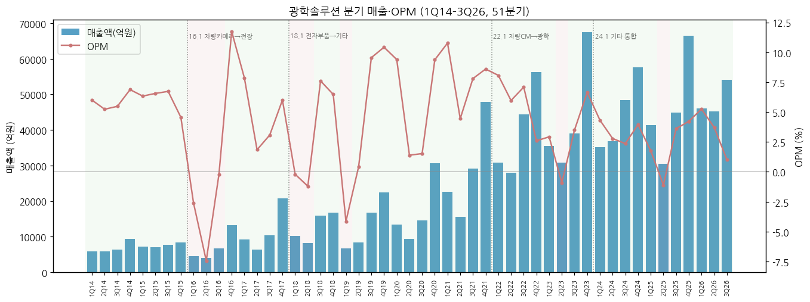

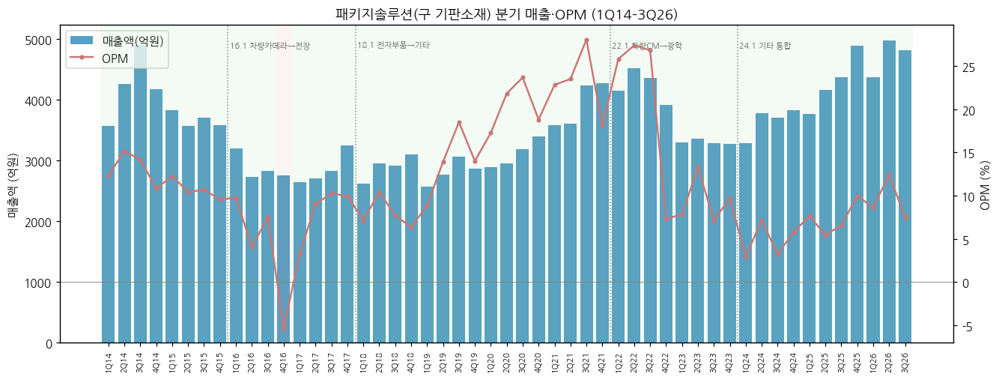

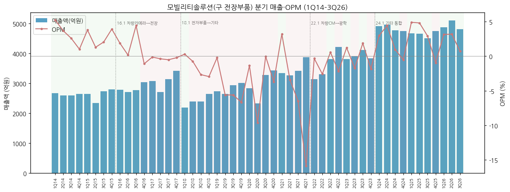

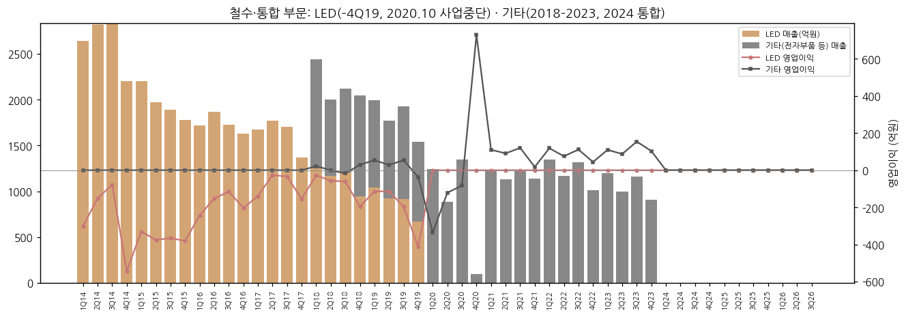

**분기 패턴 (계절성):** 광학 매출은 매년 4Q 최대 (주요 고객 신모델 하반기 출시), 1H 비수기에 OPM 0% 안팎 또는 적자 (1Q16·2Q16·1Q18·2Q18·1Q19·2Q23·2Q25). 전사 연간 영업이익의 35\~60%가 4Q에 집중되는 구조 (2021 34% · 2023 58% · 2025 49%).

#### 최근 12분기 시계열 (4Q23\~3Q26)

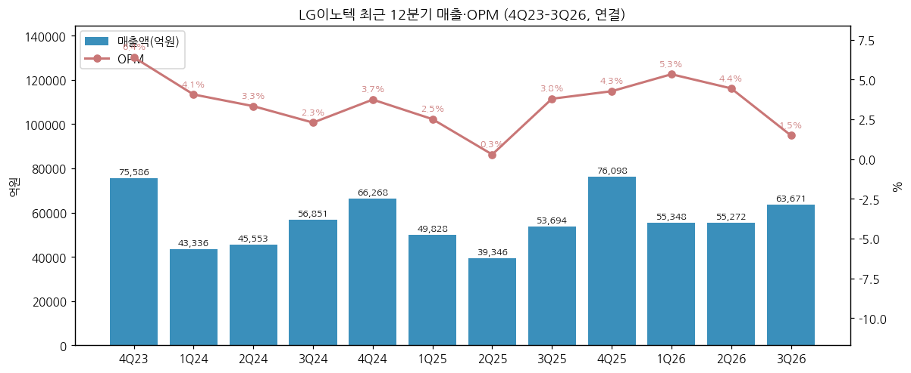

> **📌 3Q26 핵심 박스 (2026-10-27 IR / 2026-11-12 분기보고서)**
> - 매출 **6조 3,671억 (YoY +18.6%, QoQ +15.2%)** — 3분기 기준 사상 최대, 3분기 첫 6조 돌파
> - 영업이익 **948억 (YoY -53.4%, QoQ -61.4%)**, OPM **1.5%** (3Q25 3.8%, 2Q26 4.4%) / EBITDA 3,310억 (5.2%)
> - 순이익 952억 (YoY -25.8%) — 상반기 원자재 매입 시점 원화 약세 → 3Q 출하 시점 원화 강세로 환율 손실 (Korea Times 보도)
> - 광학솔루션 5조 4,041억 (+20.6% YoY): 주요 고객 신모델 양산 본격화, 고사양·프리미엄 수요, 북미 고객향 차량 카메라 공급 확대. 부문 OP 553억 (OPM 1.0%) — 매출 증가에도 이익 급감
> - 패키지솔루션 4,818억 (+10.1% YoY): RF-SiP·메모리용 FC-CSP 견조, **글로벌 고객향 PC CPU용 FC-BGA 신규 양산·공급 확대**. OP 360억 (7.5%)
> - 모빌리티솔루션 4,811억 (+6.8% YoY): 통신·파워·조명 성장, 디지털키·AP모듈 양산 확대. OP 35억 (0.7%)
> - 재무: 부채비율 100.1% (2025말 107.0%), 차입금 2조 234억, 순차입금비율 13.4%
> - 4Q26 회사 전망: 모바일 신모델 안정적 공급 확대, RF-SiP·FC-CSP 수요 지속(디스플레이는 계절 둔화), FC-BGA 생산능력 적기 확대

### ② 사업부별 개요 (매출 비중 순)

| 사업부 | 2025 매출 비중 | 2025 OP 비중 | 주요 제품 | 주요 고객·전방 |
|------|------|------|------|------|
| 광학솔루션 | 83.6% | 72.5% | 스마트폰 카메라모듈(고화소·OIS·폴디드줌), 3D센싱모듈, 차량 카메라모듈, 로봇 비전센싱 | 북미 스마트폰 고객 (단일 고객 비중 80%), 북미 자동차 OEM |
| 패키지솔루션 | 7.9% | 19.4% | 반도체기판(RF-SiP·AiP·FC-CSP·FC-BGA), 테이프기판(COF), 포토마스크 | 스마트폰 AP·RF, 메모리, PC CPU, 디스플레이 패널 |
| 모빌리티솔루션 | 8.5% | 8.1% | 모터·센서(EPS 모터·TAS/TOS), 차량 통신모듈(5G·V2X·디지털키), 조명(Nexlide), 파워모듈, AP모듈 | 글로벌 완성차·Tier1 |

### ③ 사업부별 디테일

**(1) 광학솔루션 — 고정비 큰 조립 사업, 하반기 레버리지**
- 모바일 카메라모듈 시장점유율(회사 추정): **35.8% (3Q26)** / 33.4% (2025) / 35.1% (2024)
- 원재료 매입 구조 (3Q26 누적 12.9조): Image Sensor 40% (Sony·ST Micro), Actuator 26% (Alps·Mitsumi·Luxshare), Lens 13% (Largan·Genius), 기타 21% → 원재료가 매출의 약 89%를 차지하는 저부가 구조. 이미지센서 평균가 2025 +4.7%, 3Q26 +4.1%
- 카메라모듈 판가: 2025 -5.4%, 3Q26 누적 +5.8% (사양 상승 효과)
- 생산능력 (3Q26 누적): 4억 5,049만 개, 가동률 81.7% (구미·중국·베트남) — 베트남 완결형 생산 비중 확대가 원가 개선 핵심 과제
- 이익 outlier: 4Q16 OPM 11.7% (듀얼카메라 첫해), 1Q21 10.8%, 4Q19 10.4% / 저점 2Q16 -7.4%, 1Q19 -4.1%

**(2) 패키지솔루션 — 이익 비중이 매출 비중의 2\~3배**
- 반도체기판 점유율 18.9%, Tape Substrate 46.0% (세계 1위), Photomask 16.5% (TAM 기준) — 3Q26 회사 추정
- 2020\~2022 OPM 20\~28% (RF-SiP·AiP 통신용 기판 호황) → 2023\~2024 5\~10%로 하락 → 2025\~2026 회복 (7.5\~12.4%)
- 가동률: 반도체기판 94.4%, 포토마스크 94.1%, 테이프기판 65.1% (3Q26)
- FC-BGA: 2022-02 진출 (4,130억), 구미 4공장 라인, 2025-01 북미 빅테크향 양산 돌입 (언론 보도), 2026 PC CPU용 신규 양산 → AI 서버·데이터센터용 고다층·대면적 FC-BGA는 "단계적 진입" 단계 (3Q26 IR)
- 원재료 가격: CCL/PP 2025 +15.0%, 3Q26 +13.7% — 원가 부담 요인

**(3) 모빌리티솔루션 — 만성 적자에서 흑자 전환 (2024\~)**
- 2017\~2023 연속 적자 (2021 -839억 최대) → 2024 기타부문 전자부품 편입 후 흑자 (2024 +387억, 2025 +539억)
- 수주: 신규수주 2023 3.8조 / 2024 5.1조 / 2025 4.8조, 수주잔고 2025말 19.2조 (3Q26 IR)
- 판가: 모터/센서 2025 +26.3%, 차량통신 +10.2% (고부가 mix)
- 신사업: 차량 AP모듈(디지털 콕핏·자율주행 연산), 디지털키(UWB·BLE), SWIR 라이다(최대 250m), Aeva(FMCW 라이다) 지분 투자

### ④ 주요 경쟁사 (사업부별)

| 사업부 | 국내 | 해외 |
|------|------|------|
| 광학솔루션 (카메라모듈) | 삼성전기, 파트론, 엠씨넥스 | Sunny Optical, O-Film, Q Tech, Cowell(고위전자), Foxconn/Sharp |
| 패키지솔루션 (반도체기판) | 삼성전기, 대덕전자, 심텍, 코리아써키트 | Ibiden, Shinko, Unimicron, AT&S, Kinsus |
| 패키지솔루션 (테이프기판·포토마스크) | 스템코 / SKE | Chipbond, LB-Semicon / Photronics, DNP |
| 모빌리티솔루션 | 현대모비스, LG전자 VS, 만도 | Bosch, Continental, Nidec, Denso |

(경쟁사 목록은 업계 일반 구도 기준, DART 미기재 — 투자 판단 시 개별 확인 필요)

### ⑤ 주요 매출처

- DART 공시: "매출액 10% 이상 단일 고객 매출 = 광학/패키지 등 **14조 93억원** (3Q26 누적, 전사 매출의 **80.4%**)", "상위 10개 고객 매출 = 전체 매출의 **86%**"
- 고객명은 비밀유지로 미공시. 단일 고객은 북미 스마트폰 업체로 업계·언론에서 일반적으로 해석 (IR에서도 "북미 고객"으로 표현)
- 판매경로: 사업부 Direct 판매 99% 이상 / 판매법인·지사: 미국·대만·중국·일본·독일

### ⑥ 생산 CAPA + 임직원 추이

| 품목 | 사업소 | 2024 생산능력 | 2025 생산능력 | 3Q26 누적 | 3Q26 가동률 |
|------|------|------|------|------|------|
| Camera Module (천 개) | 구미·중국·베트남 | 623,513 | 591,411 | 450,487 | 81.7% |
| 반도체기판 (천 시트) | 구미 | 957 | 1,017 | 697 | 94.4% |
| Tape Substrate (천 m) | 구미 | 24,156 | 23,601 | 18,248 | 65.1% |
| Photomask (천 개) | 구미 | 3.668 | 3.522 | 2.705 | 94.1% |
| 모터/센서 (천 개) | 광주·중국·멕시코 | 23,304 | 17,673 | 13,169 | 60.0% |
| 차량통신 (천 개) | 광주 | 20,158 | 18,223 | 13,679 | 70.4% |

| 연도 | 임직원 수 (국내, 정규+기간제) | 연간 급여총액 | 1인 평균 |
|------|------|------|------|
| 2015 | 8,797명 | 5,575억 | 약 6,300만원 |
| 2018 | 8,978명 | 6,420억 | 약 7,200만원 |
| 2021 | 12,415명 | 8,370억 | 약 6,700만원 |
| 2023 | 13,812명 | 12,231억 | 약 8,900만원 |
| 2025 | 12,211명 | 11,842억 | 약 9,700만원 |

(2025 사업부별: 광학 6,013명 / 패키지 2,357명 / 모빌리티 1,366명 / 본사 등 2,475명. 해외 생산법인 인원 미포함)

---

## 4. 재무 구조 (12년 시계열, 연결, 억원)

### ① 손익계산서

| 연도 | 매출 | 매출원가 | 매출총이익 | GPM | 판관비 | 판관비율 | 영업이익 | OPM | 세전이익 | 순이익 | NPM |
|------|------|------|------|------|------|------|------|------|------|------|------|
| 2014 | 64,661 | 56,032 | 8,628 | 13.3% | 5,489 | 8.5% | 3,140 | 4.9% | 1,916 | 1,127 | 1.7% |
| 2015 | 61,381 | 53,654 | 7,726 | 12.6% | 5,490 | 8.9% | 2,237 | 3.6% | 1,221 | 951 | 1.5% |
| 2016 | 57,546 | 51,021 | 6,523 | 11.3% | 5,475 | 9.5% | 1,048 | 1.8% | 107 | 50 | 0.1% |
| 2017 | 76,414 | 67,566 | 8,846 | 11.6% | 5,881 | 7.7% | 2,965 | 3.9% | 2,387 | 1,748 | 2.3% |
| 2018 | 79,821 | 71,181 | 8,639 | 10.8% | 6,004 | 7.5% | 2,635 | 3.3% | 1,840 | 1,631 | 2.0% |
| 2019 | 83,021 | 72,731 | 10,289 | 12.4% | 6,257 | 7.5% | 4,031 | 4.9% | 1,582 | 1,023 | 1.2% |
| 2020 | 95,418 | 82,514 | 12,903 | 13.5% | 6,093 | 6.4% | 6,810 | 7.1% | 4,428 | 2,361 | 2.5% |
| 2021 | 149,456 | 128,150 | 21,305 | 14.3% | 8,663 | 5.8% | 12,642 | 8.5% | 11,932 | 8,883 | 5.9% |
| 2022 | 195,894 | 172,150 | 23,743 | 12.1% | 11,026 | 5.6% | 12,718 | 6.5% | 11,351 | 9,798 | 5.0% |
| 2023 | 206,053 | 187,419 | 18,633 | 9.0% | 10,324 | 5.0% | 8,308 | 4.0% | 6,393 | 5,652 | 2.7% |
| 2024 | 212,008 | 194,570 | 17,436 | 8.2% | 10,376 | 4.9% | 7,060 | 3.3% | 5,888 | 4,493 | 2.1% |
| 2025 | 218,966 | 201,470 | 17,495 | 8.0% | 10,845 | 5.0% | 6,650 | 3.0% | 4,086 | 3,413 | 1.6% |
| 3Q26 누적 | 174,292 | 159,485 | 14,806 | 8.5% | - | - | 6,359 | 3.6% | 6,205 | 4,940 | 2.8% |

(판관비 = DART "영업비용" 계정 — 판매비·관리비·연구개발비(비용처리분) 포함. 3Q25 누적 영업이익 3,402억 대비 3Q26 누적 +87%)

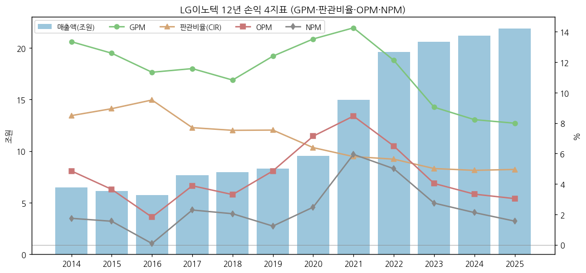

→ GPM이 2021 14.3% → 2025 8.0%로 6%pt 하락. 판관비율도 같은 기간 5.8% → 5.0%로 낮아져 OPM 하락분 일부를 흡수 — 마진 하락의 원인은 원가(판가 인하 + 센서·부품 단가 상승) 쪽

### ② 재무상태표

| 연도 | 자산총계 | 유동자산 | 현금 | 매출채권 | 재고자산 | 유형자산 | 부채총계 | 유동부채 | 차입금 | 자본총계 | 이익잉여금 |
|------|------|------|------|------|------|------|------|------|------|------|------|
| 2014 | 44,288 | 20,820 | 3,965 | 12,448 | 3,536 | 18,976 | 27,323 | 16,466 | 14,603 | 16,965 | 4,510 |
| 2015 | 39,143 | 17,888 | 3,603 | 10,571 | 3,031 | 16,473 | 21,493 | 12,954 | 10,643 | 17,651 | 5,220 |
| 2016 | 43,237 | 20,844 | 3,413 | 12,728 | 4,032 | 17,294 | 25,452 | 17,337 | 10,813 | 17,785 | 5,424 |
| 2017 | 58,775 | 27,344 | 3,695 | 16,377 | 6,413 | 25,996 | 39,267 | 24,972 | 15,026 | 19,508 | 7,413 |
| 2018 | 57,561 | 22,333 | 6,212 | 9,131 | 5,202 | 29,273 | 36,378 | 15,843 | 21,267 | 21,182 | 9,067 |
| 2019 | 57,708 | 25,309 | 7,996 | 11,092 | 4,881 | 27,076 | 35,662 | 20,462 | 19,183 | 22,046 | 9,892 |
| 2020 | 60,386 | 31,617 | 6,946 | 11,142 | 8,594 | 23,678 | 36,109 | 22,842 | 17,257 | 24,277 | 12,215 |
| 2021 | 77,414 | 41,133 | 5,659 | 18,953 | 13,920 | 31,464 | 44,271 | 33,102 | 14,891 | 33,142 | 20,481 |
| 2022 | 97,936 | 47,137 | 5,779 | 17,929 | 19,788 | 41,310 | 55,278 | 42,704 | 20,186 | 42,658 | 29,691 |
| 2023 | 112,043 | 53,490 | 13,896 | 22,509 | 15,720 | 48,556 | 64,897 | 42,191 | 27,377 | 47,146 | 34,135 |
| 2024 | 113,782 | 58,531 | 13,294 | 27,839 | 15,752 | 44,798 | 60,243 | 39,548 | 26,520 | 53,539 | 38,681 |
| 2025 | 119,309 | 67,783 | 14,064 | 33,984 | 17,888 | 37,242 | 61,678 | 45,072 | 22,624 | 57,631 | 41,912 |
| 3Q26 | 122,999 | 73,437 | 11,971 | 33,456 | 25,657 | 35,768 | 61,535 | 48,926 | 20,234 | 61,463 | 46,872 |

(차입금 = 유동 + 비유동 차입금·사채 합계. 3Q26 재고 2.57조는 성수기 직전 원재료·제품 확보 영향. 유형자산은 2023 4.86조 정점 이후 CapEx 축소로 감소)

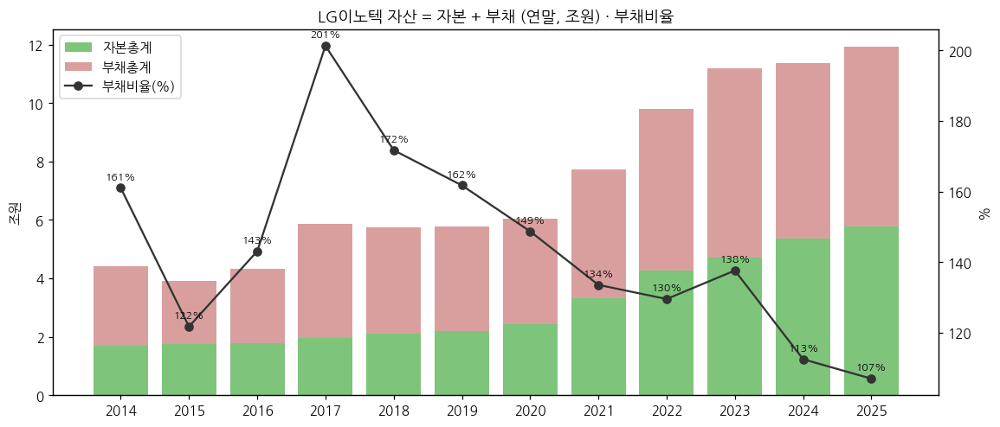

### ③ 현금흐름표

| 연도 | 영업CF | 투자CF | 재무CF | CapEx (유형+무형) | FCF (영업CF−CapEx) |
|------|------|------|------|------|------|
| 2014 | 7,430 | -3,088 | -4,402 | 3,187 | 4,243 |
| 2015 | 6,784 | -3,062 | -4,085 | 3,176 | 3,608 |
| 2016 | 3,318 | -3,559 | 65 | 3,754 | -436 |
| 2017 | 4,460 | -8,344 | 4,225 | 8,629 | -4,169 |
| 2018 | 10,623 | -14,145 | 6,036 | 15,041 | -4,418 |
| 2019 | 7,690 | -3,543 | -2,389 | 5,823 | 1,867 |
| 2020 | 9,503 | -8,262 | -1,672 | 8,560 | 942 |
| 2021 | 11,776 | -10,083 | -3,096 | 10,972 | 804 |
| 2022 | 15,150 | -19,967 | 4,414 | 17,987 | -2,837 |
| 2023 | 21,041 | -19,044 | 6,083 | 18,829 | 2,211 |
| 2024 | 11,101 | -9,695 | -2,198 | 9,486 | 1,615 |
| 2025 | 13,314 | -7,963 | -4,529 | 7,545 | 5,769 |

(3Q26 분기: 영업CF 2,553억, 감가상각비 2,361억, 투자CF -2,134억 — IR 기준)

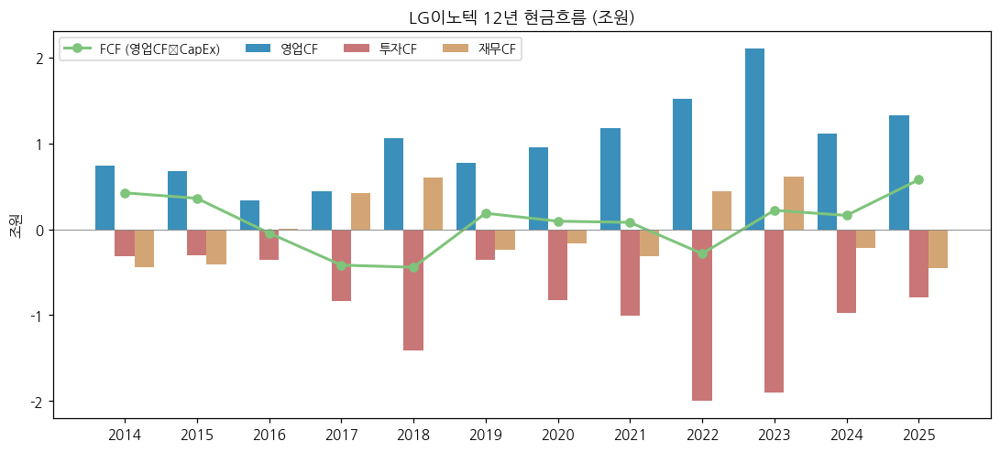

→ 12년 누적 FCF 약 +0.9조원 (2014\~2025 합계 9,199억). 카메라 스펙 사이클마다 대규모 CapEx(2017\~2018, 2022\~2023)가 FCF를 마이너스로 돌리는 패턴

### ④ CapEx

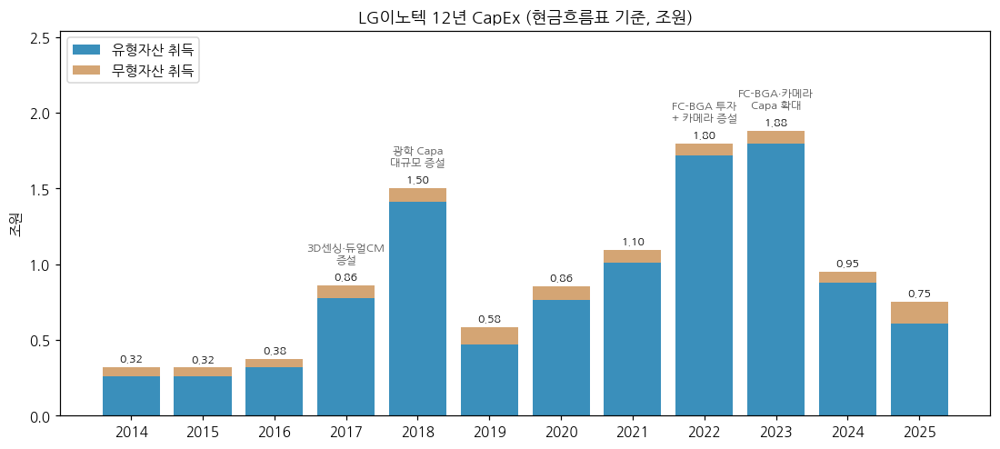

| 구간 | CapEx 합계 | 주요 투자 |
|------|------|------|
| 2014\~2016 | 1.01조 (연 0.3조대) | 유지보수 수준 |
| 2017\~2018 | 2.37조 | 3D센싱모듈·듀얼카메라 Capa 증설 |
| 2019\~2021 | 2.54조 | 트리플·고사양 카메라 |
| 2022\~2023 | 3.68조 | FC-BGA 진출(4,130억 결의), 구미 1.4조 투자 MOU(4공장 인수), 카메라 Capa |
| 2024\~2025 | 1.70조 | 투자 효율화 (2025년 3월 구미 6,000억 추가 투자 계획 보도 — FC-BGA·카메라모듈) |

- 3Q26 말 자산 취득 약정액 2,468억 (DART 우발채무·약정 주석)
- 유형자산 감가상각 (3Q26 누적 6,875억) > 증가 5,402억 → 순유형자산 감소 국면

### ⑤ 부채구조 + 채무증권

| 연도 | 차입금 | 부채비율 | 순차입금 (차입금−현금) | 순차입금/자본 | 이자보상배율 (영업이익/이자지급) |
|------|------|------|------|------|------|
| 2014 | 14,603 | 161% | 10,638 | 62.7% | 5.0배 |
| 2016 | 10,813 | 143% | 7,400 | 41.6% | 3.1배 |
| 2018 | 21,267 | 172% | 15,055 | 71.1% | 5.2배 |
| 2020 | 17,257 | 149% | 10,311 | 42.5% | 13.5배 |
| 2021 | 14,891 | 134% | 9,232 | 27.9% | 30.2배 |
| 2022 | 20,186 | 130% | 14,407 | 33.8% | 24.2배 |
| 2023 | 27,377 | 138% | 13,481 | 28.6% | 8.6배 |
| 2024 | 26,520 | 113% | 13,226 | 24.7% | 5.8배 |
| 2025 | 22,624 | 107% | 8,560 | 14.9% | 6.8배 |
| 3Q26 | 20,234 | 100% | 8,263 | 13.4% | - |

- 회사채 신용등급 AA- (3사 동일, 2023\~2025 유지) / CP·단기사채 A1
- 외화: US$50백만 보증부 사모사채 (신한은행 지급보증, 통화스왑 계약환율 1,171원, 2026-10-26 만기)
- 대출 약정 한도 (3Q26): 수출입금융 2.30조, 포괄한도 8,297억(종속기업), 외상매출채권담보대출 2,340억, 일반대출 2,679억
- 공동현금약정 (Bank Mendes Gans, notional cash pooling)
- 회사채 발행 history 상세(회차·금리·만기)는 v1.1 보강 대상

### ⑥ 배당·자사주

| 연도 | DPS (원) | 배당총액 (억원) | 연결 배당성향 |
|------|------|------|------|
| 2013 | 0 | 0 | - |
| 2014 | 250 | 59 | 5.3% |
| 2015 | 350 | 83 | 8.7% |
| 2016 | 250 | 59 | 119.5% |
| 2017 | 250 | 59 | 3.4% |
| 2018 | 300 | 71 | 4.4% |
| 2019 | 300 | 71 | 6.9% |
| 2020 | 700 | 166 | 7.0% |
| 2021 | 3,000 | 710 | 8.0% |
| 2022 | 4,150 | 982 | 10.0% |
| 2023 | 2,610 | 618 | 10.9% |
| 2024 | 2,090 | 495 | 11.0% |
| 2025 | 1,880 | 445 | 13.0% |

- 배당 정책: 연결 순이익의 약 10\~13% 결산배당 (분기·중간배당 없음). 2025 배당수익률 0.7%
- 자사주: 기타취득 2,600주 보유 외 매입·소각 이력 없음
- 2016년 배당성향 119.5%는 순이익이 50억으로 급감한 영향

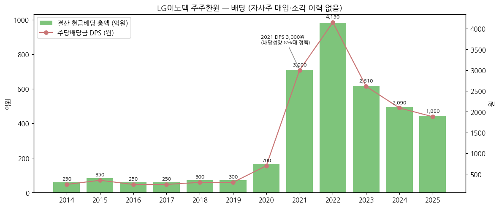

### ⑦ 재무비율

| 연도 | ROE | ROA | 부채비율 | 유동비율 | 매출채권회전(일) | 재고회전(일) |
|------|------|------|------|------|------|------|
| 2014 | 7.5% | 2.5% | 161% | 126% | 70 | 20 |
| 2015 | 5.5% | 2.3% | 122% | 138% | 63 | 18 |
| 2016 | 0.3% | 0.1% | 143% | 120% | 81 | 26 |
| 2017 | 9.4% | 3.4% | 201% | 109% | 78 | 31 |
| 2018 | 8.0% | 2.8% | 172% | 141% | 42 | 24 |
| 2019 | 4.7% | 1.8% | 162% | 124% | 49 | 21 |
| 2020 | 10.2% | 4.0% | 149% | 138% | 43 | 33 |
| 2021 | 30.9% | 12.9% | 134% | 124% | 46 | 34 |
| 2022 | 25.9% | 11.2% | 130% | 110% | 33 | 37 |
| 2023 | 12.6% | 5.4% | 138% | 127% | 40 | 28 |
| 2024 | 8.9% | 4.0% | 113% | 148% | 48 | 27 |
| 2025 | 6.1% | 2.9% | 107% | 150% | 57 | 30 |

(ROE·ROA = 순이익 ÷ 기초·기말 평균. 회전일수 = 연말 잔액 ÷ 매출 × 365, 연말 성수기 직후라 실제 연중 평균보다 높게 나올 수 있음)

---

## 5. 지배 구조

### ① 그룹·계열 관계

```
㈜LG (지주회사)
  └─ LG전자㈜ ── 유의적 영향력
        └─ LG이노텍 40.79% (최대주주, 9,653,181주)
              └─ 연결 종속기업 11개 (해외 생산법인: 중국·인도네시아·폴란드·멕시코·베트남 등, 주요 종속 6개)
```

- 지배기업: LG전자 (지분율 40.8%) / LG전자에 유의적 영향력: ㈜LG (3Q26 분기보고서 특수관계자 주석)
- 주요 특수관계 거래: LG전자 및 종속기업, LG디스플레이(구미 부동산 전세계약), ㈜LG(상표권·라이선스 약정)
- LG브랜드: ㈜LG와 상표권 사용 계약

### ② 주주 구분

| 주주 | 주식수 | 지분율 | 기준일 |
|------|------|------|------|
| LG전자㈜ | 9,653,181 | 40.79% | 2025-12-31 (3Q26 동일) |
| 국민연금공단 | 2,468,255 | 10.43% | 2025-12-31 |
| 문혁수 (대표이사) | 2,500 | 0.01% | 2026-09-30 |
| 소액주주 (1% 미만, 94,425명) | 12,697,311 | 53.65% | 2025-12-31 |
| 자기주식 | 2,600 | 0.01% | 2025-12-31 |

(소액주주 합계에 외국인·기관 소액 보유분 포함. 외국인 지분율은 이번 수집에서 미확보 — v1.1 보강)

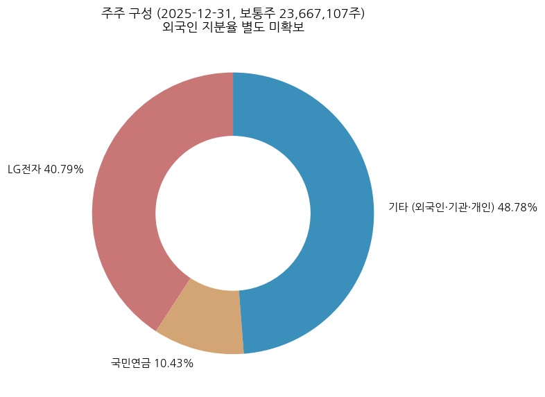

### ③ 임원·이사회 (2026-09-30 기준)

| 성명 | 구분 | 직위 | 담당 | 주요 경력 |
|------|------|------|------|------|
| 문혁수 | 사내이사 | 사장 | 대표이사·CEO, 경영위원회 위원장 | CSO, 광학솔루션사업부장, KAIST 박사 (1970년생, 재직 11년 9개월) |
| 경은국 | 사내이사 | 전무 | CFO | LG디스플레이 회계담당 (2026-03 신규 선임, 임기 2029-03) |
| 박충현 | 기타비상무이사 | 이사 | 독립이사후보추천위원 | ㈜LG 전자팀장 (2026-03 신규) |
| 이희정 | 독립이사 | 이사 | 이사회 의장, ESG위원장 | 고려대 법전원 교수 |
| 박래수 | 독립이사 | 이사 | 감사위원장 | 숙명여대 경영학 교수 |
| 노상도 | 독립이사 | 이사 | 내부거래위원장 | 성균관대 시스템경영공학 교수 |
| 김정회 | 독립이사 | 이사 | 독립이사후보추천위원장 | 한국반도체산업협회 부회장, 산업부 통상교섭실장 |

- 이사회 7인 (사내 2 / 기타비상무 1 / 독립 4), 이사회 의장 = 독립이사 (이희정)
- 사업부장: 광학솔루션 노승원 전무, 패키지솔루션 조지태 전무, 모빌리티솔루션 유병국 전무 (2025-12 기준)
- 2026-03 주총: 박지환 사내이사 퇴임, 이상우 기타비상무 사임 → 경은국·박충현 선임

---

## 6. 기타 팩트

### ① R&D 인프라

| 연도 | 연구개발비용 계 (억원) | 매출 대비 |
|------|------|------|
| 2014 | 4,186 | 6.5% |
| 2015 | 4,426 | 7.2% |
| 2016 | 4,456 | 7.7% |
| 2017 | 5,222 | 6.8% |
| 2018 | 5,271 | 6.6% |
| 2019 | 5,337 | 6.4% |
| 2020 | 4,747 | 5.0% |
| 2021 | 5,643 | 3.8% |
| 2022 | 7,530 | 3.8% |
| 2023 | 7,176 | 3.5% |
| 2024 | 7,447 | 3.5% |
| 2025 | 7,713 | 3.5% |
| 3Q26 누적 | 6,073 | 3.5% |

(연구개발비용 계 = 비용처리 연구개발비 + 제조경비 + 개발비 자산화. 2025: 비용처리 5,774억 / 제조경비 1,621억 / 자산화 313억. 2017\~2018은 2019 사업보고서 재작성치)

- 조직: CTO 산하 + 사업부 연구소 (광학솔루션·광학소자/소재·차세대패키지·미래기술·모듈/시스템 등)
- 등록 지식재산권 (2026-09-30 누적): 국내 6,386건 / 해외 8,590건
- 국내외 대학·연구기관 공동연구, LG사이언스파크(마곡) 본사

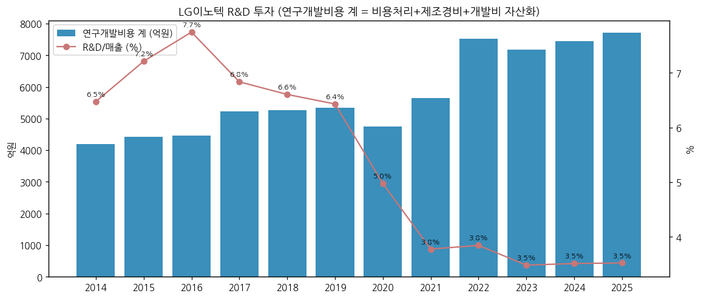

### ② 진행 중 corporate action (10년)

| 일자 | 내용 | 출처 |
|------|------|------|
| 2016-01 | 차량용 카메라 → 전장부품 사업부 조직 변경 | DART |
| 2018 | 전장부품 내 전자부품 → 기타 부문 분리 | DART |
| 2020-10-28 | LED 사업부문 생산·영업 중단 이사회 결의 | DART |
| 2022-01 | 차량CM 사업담당 → 광학솔루션 이관 | DART |
| 2022-02-22 | FC-BGA 시설·설비 4,130억 투자 결의 | LG 보도자료 |
| 2022-03-28 | LG Innotek Huizhou (LED 중국 생산법인) 지분 100% 매각 완료 | DART |
| 2022-07-06 | 구미 사업장 1조 4천억 투자 MOU (구미 4공장 인수, FC-BGA·카메라 라인) | LG 보도자료 |
| 2022-12-23 | LG디스플레이 구미 부동산 전세계약 (2027-12-31까지) | DART |
| 2024-01 | 기타부문 통합 — 3개 사업부 체제 | DART |
| 2025-05-14 | Aeva Technologies 보통주 3,509,719주 취득 (주당 US$9.26, 약 US$32.5백만) | DART |
| 2025-09-02 | ㈜스마트레이더시스템 신주인수 (주당 7,326원, 총 59억) | DART |
| 2025 | 사업부 명칭 변경 (패키지솔루션·모빌리티솔루션) | DART |

### ③ R&D 마일스톤

| 연도 | 사업부 | 내용 | 출처 |
|------|------|------|------|
| 2022 | 패키지 | FC-BGA 사업 진출 공식화, 전담 임원 조직 신설 (2021-12) | LG 보도자료 |
| 2025 | 광학 | 차세대 UDC(Under Display Camera) — AI 화질 복원 SW, 차량 운전자 모니터링용 | DART |
| 2025 | 패키지 | 반도체 기판 Cu-Post 기술 양산 적용 (솔더볼 약 20% 축소) | DART |
| 2025 | 패키지 | 친환경 스마트 IC 기판 (표면 도금 공정 제거, 탄소 약 50% 감소) | DART |
| 2025 | 모빌리티 | 자계 강건화 TAS/TOS, Nexlide-A+ 면광원 DRL 세계 최초 양산 | DART |
| 2025 | 모빌리티 | SWIR 고성능 라이다 (최대 250m), UWB/BLE 디지털키, EV 1.8kW DC-DC 컨버터 | DART |
| 2026 | 모빌리티 | 차량용 AP 모듈 (AP·메모리·PMIC 집적), 램프용 광지향성 필름, 스마트홈 복합통신 모듈(WiFi+BT+Thread) | DART |
| 2026 | 패키지 | PC CPU용 FC-BGA 글로벌 고객향 신규 양산 | 3Q26 IR |
| 2026 | 광학 | 로봇 비전센싱 개발·공급 (4Q26 전망) | 3Q26 IR |

(2016\~2021 마일스톤(듀얼카메라·3D센싱·트리플카메라 등)은 원문 XML 연구개발 실적 표 추가 추출 후 v1.1 보강)

### ④ 주요 리스크

- **고객 집중**: 단일 고객 매출 80.4% (3Q26 누적) — 신모델 판매·스펙 채택·단가인하(CR) 협상 결과가 연간 이익을 결정
- **환율**: 수출 비중 96%, 원재료(이미지센서 등) 달러 매입 → 매입\~출하 시차의 환율 변동이 손익 변동 (3Q26 순이익 -25.8%의 원인으로 보도)
- **원가**: 이미지센서 +4.1%, CCL/PP +13.7%, 차량 IC +16.8% (3Q26 vs 2025 평균가) — 판가 전가 지연 시 마진 압박
- **메모리 가격 상승 → 스마트폰 수요·부품 단가 압박** (2026-09 주가 급락 배경으로 보도)
- **FC-BGA 투자 부담**: 단계적 증설에 따른 감가상각, 고객 다변화 초기 단계
- **소송**: 정상 영업 과정의 소송 진행 중이나 경영진은 재무상태에 중요한 영향 없다고 판단 (3Q26 주석)
- **지정학·관세**: 미국 관세·대외환경 변화 (DART 패키지 시장여건), 중국·베트남·멕시코 생산 거점

### ⑤ ESG

- 탄소중립 목표: 2040년 Scope1·2 순배출 0 (2022 수립, SBT 기준), RE100 가입
- 온실가스 배출 (tCO2eq): 2023 417,881 / 2024 441,842 / 2025 422,279
- CDP 한국위원회 기후변화 대응 우수기업 7년 연속 수상
- KCGS·MSCI 등급: 이번 수집에서 미확보 (v1.1 보강)

### ⑥ 인증·라이선스

- UL 폐기물 매립 제로(Zero Waste to Landfill) — 구미1/1A/2/3·파주·광주·연태법인 Platinum
- 폴란드 브로츠와프 법인 TUV Rheinland Zero Waste 인증
- 구미·광주·파주 순환자원 인정 (폐플라스틱 Tray·Reel case)
- ㈜LG 상표권 사용 계약

---

## Source

- DART 3Q26 분기보고서 (2026-11-12), 2025 사업보고서 (2026-03-12) 외 정기공시 52건 — OpenDART API
- LG이노텍 IR: 2026년 3분기 실적 (2026-10-27), 2025년 3분기 실적 (2025-10-30)
- Yahoo Finance 011070.KS 월간·일간 (2026-11-24 종가 284,500원, 2026-06-01 장중 1,788,000원)
- [더팩트, '연초 26만→장중 145만원' LG이노텍, 거침없는 질주 배경 (2026-05-29)](https://news.tf.co.kr/read/economy/2327571.htm)
- [다음뉴스, "180만원→50만원" '황제주' 급락, 무슨 일이 (2026-09-14)](https://v.daum.net/v/61L5lb0HHM)
- [Korea Times, LG Innotek Q3 net down 25.8% on fluctuating exchange rate (2026-10-27)](https://www.koreatimes.co.kr/business/companies/20261027/lg-innotek-q3-net-down-258-on-fluctuating-exchange-rate)
- [LG 보도자료, LG이노텍 FC-BGA 투자 첫발 (2022-02-23)](https://www.lg.co.kr/media/release/24497)
- [LG 보도자료, 구미 공장에 1조 4천억 투자 (2022-07-06)](https://lg.co.kr/media/release/25037)
- [디지털데일리, 구미사업장 6000억 추가 투자 (2025-03-25)](https://www.ddaily.co.kr/page/view/2025032509375886838)
- [지디넷코리아, 북미 빅테크향 FC-BGA 양산 돌입 (2025-01-10)](https://zdnet.co.kr/view/?no=20250110192555)

---

## Version Log

- **v1.0 (2026-11-25)**: 첫 작성. OpenDART 재무 JSON(2015\~3Q26) + 정기공시 XML 52건(2013\~3Q26) 사업부문 표 파싱으로 51분기 사업부별 시계열 구축, 12년 연간 7종 표, 12종 차트(chart2 4종 포함 15개 PNG), 3Q26 핵심 박스, 2026 AI 기판 재평가·급락 narrative
- 잔여 보완 후보:
  ① 2011\~2013 분기보고서 XML 추가 수집 → 60+분기 표준 충족 (현재 51분기)
  ② IR 실적 PDF 과거분 — irgo 25건 중 4건 다운로드 실패(2015\~2017), 나머지는 실적 외 자료 → 회사 IR 사이트(lginnotek.com) 분기 실적 PDF 직접 수집 시 카메라모듈/3D센싱, 반도체기판/디스플레이 등 제품별 분기 비중 시계열 확보 가능
  ③ 외국인 지분율 (KRX·네이버 금융 — 이번 세션 접근 실패)
  ④ 회사채 발행 history (회차·금리·만기)
  ⑤ ESG 등급 (KCGS·MSCI), Sustainability Report 기반 R&D 거점·인증 보강
  ⑥ 2016\~2021 R&D 마일스톤 (원문 XML 연구개발 실적 표)
  ⑦ 2025년 연중 저점 (Yahoo 월간 저가 121,000원은 이상치 의심 — 일간 데이터로 재확인)
