# LG전자 (066570) — 기업 개요 v1.0

> **작성일**: 2026-11-25 · **데이터 cutoff**: 3Q26 (분기보고서 2026-11-16 공시, IR 2026-10-28)
> **Fact verify cutoff**: 2026-11-25 (주가·시총은 Yahoo Finance v8 2026-11-24 종가, ATH는 일간 종가 기준)
> **기준**: K-IFRS 연결, 단위 억원(별도 표기 없을 때), 연간 2014\~2025 (12년), 분기 1Q16\~3Q26 (전사 43분기) / 사업부 1Q17\~3Q26 (39분기)
> **1차 소스**: OpenDART 재무 JSON(fnlttSinglAcntAll) · 정기보고서 공시원문 XML 44건 · LG전자 IR 실적발표 PDF 33건(irgo) · Yahoo Finance v8 · LG전자 IR 홈페이지
> **워치리스트**: IT 하드웨어 › 세트·디스플레이 (LG전자, LG디스플레이)
> **표기 주의**: 주가 숫자는 보통주(066570) 기준. 시가총액은 보통주 발행주식수 × 종가 (우선주 066575 제외)

---

## 1. 기업 분류

### Primary: **사이클 (저마진 완만 사이클 — 소비재 수요·패널가·물류비·이노텍 아이폰 사이클)**
### Secondary: **지속성장 (B2B: 전장 VS · HVAC/데이터센터 냉각 ES · webOS 플랫폼 · 구독)** + 꿈 옵션 주석 (로보틱스 액추에이터·홈로봇, 2026 주가 급등 요인)

#### Summary Box (2014\~2025, 12년)

| 지표 | 값 |
|---|---|
| 매출 CAGR (2014→2025, 11년) | **+3.8%** (59.0조 → 89.2조) |
| OPM 평균 | **3.8%** (range 2.1\~5.2%) |
| OPM 정점 평균 (사이클 정점) | **4.8%** (2018 4.4%, 2021 5.2%) |
| OPM 저점 평균 (사이클 저점) | **2.9%** (2015 2.1%, 2019 3.9%, 2025 2.8%) |
| 사이클 주기 | 약 3\~4년 (2015 저점 → 2018 정점 → 2019 저점 → 2021 정점 → 2025 저점) |
| 사이클 회수 (12년) | 정점 2회 / 저점 3회 |

#### ① 정량 근거 — 12년 매출·영업이익·OPM (사이클 history)

| 연도 | 매출액(조원) | 영업이익(조원) | OPM | 사이클 마커 |
|---|---|---|---|---|
| 2014 | 59.0 | 1.83 | 3.1% | 가전·TV 안정, MC 소폭 흑자 |
| 2015 | 56.5 | 1.19 | 2.1% | ← **저점** (MC·TV 동반 부진) |
| 2016 | 55.4 | 1.34 | 2.4% | MC 대규모 적자 (G5 부진) |
| 2017 | 61.4 | 2.47 | 4.0% | 가전 프리미엄(시그니처)·OLED TV 상승 |
| 2018 | 61.3 | 2.70 | 4.4% | ← **정점 ①** (H&A·HE 동반 최대, ZKW 인수) |
| 2019 | 62.3 | 2.44 | 3.9% | ← 저점 (MC 적자 1.0조, TV 패널가 하락) |
| 2020 | 63.3 | 3.20 | 5.1% | 코로나 펜트업 가전 수요 |
| 2021 | 74.7 | 3.86 | 5.2% | ← **정점 ②** (MC 철수·중단영업 분류, 이노텍 아이폰 호황) |
| 2022 | 83.5 | 3.55 | 4.3% | 인플레이션·물류비, HE 적자권 |
| 2023 | 84.2 | 3.55 | 4.2% | VS 흑자 정착, 원가 개선 |
| 2024 | 87.7 | 3.42 | 3.9% | 해상운임 급등·TV 경쟁 심화 |
| 2025 | 89.2 | 2.48 | 2.8% | ← **저점** (美 관세, MS 적자 0.75조, 4Q 희망퇴직) |
| 1\~3Q26 | 71.4 (누적) | 4.03 (누적) | 5.7% | 회복 (누적 영업이익 YoY +56%) |

→ 매출은 2021년 MC 철수에도 불구하고 VS·이노텍 성장으로 74.7조 → 89.2조 우상향, OPM은 2\~5% 박스권에서 3\~4년 주기 왕복
→ 12년간 OPM 최고 5.2%(2021) — 고정비 레버리지가 큰 사이클주가 아니라 **"저마진·고매출 회전형" 완만 사이클**
→ 연결 영업이익의 20\~35%를 LG이노텍(아이폰 카메라모듈, 지분 40.8%)이 좌우 → 이노텍 사이클이 전사 사이클에 중첩

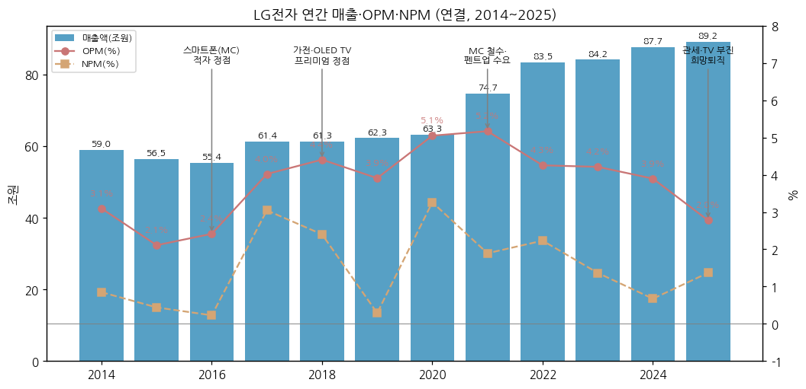

#### ② 산업 분류

- DART 업종코드 264 (통신 및 방송 장비 제조업 계열) / KRX 유가증권 전기·전자
- 워치리스트: IT 하드웨어 › 세트·디스플레이 (그룹 내 패널 공급사 LG디스플레이와 같은 서브섹터)
- 실질 사업 mix (2025 매출 비중): HS 29.3% · 이노텍 24.5% · MS 21.8% · VS 12.5% · ES 10.5% · 기타 1.4% [2025 사업보고서]
- 회사 정의 B2B 비중(이노텍 제외): 3Q26 35%, 2Q26 37% [IR 3Q26]

#### ③ 분류 결정 논리

(1) 가장 매출 큰 사업부 기준: HS(생활가전) 29% + MS(TV) 22% = 소비재 51% → 내구 소비재 수요 사이클(금리·주택·교체 주기)에 연동. HS OPM은 2017\~2025 분기 기준 -2.6\~13.6% 진폭, 4Q 계절 저점이 반복
(2) 사이클 사업부 영업이익 비중 우선 sub-rule: 2025 영업이익 2.48조 중 HS 1.28조 + ES 0.65조 = 78% (가전·공조). MS는 -0.75조로 사이클 진폭을 키움. 이노텍(0.67조)은 아이폰 출하 사이클 → 이익 기준으로도 사이클 성격 우세
(3) Boundary case: VS(전장)는 2022년 흑자 전환 이후 수주잔고 기반 매출 → OPM 5\~7%로 안정(3Q26 6.7%, 7개 분기 연속 한 자릿수 중반 이상 [IR 3Q26]). ES는 데이터센터 냉각(칠러·CDU) 수주 3조원+ [IR 3Q26] → 두 사업부가 **지속성장 Secondary**. 다만 VS+ES 영업이익 비중은 2025년 기준 49%(2.48조 중 1.21조) 수준까지 올라왔으나 매출 비중은 23%에 불과 → Primary 변경까지는 미달
(4) 피어 cross-reference: Whirlpool(가전 단일, OPM 4\~8% 사이클)·Samsung DX(OPM 5\~8%)·Daikin(HVAC, OPM 9\~11% 지속성장) 대비 LG전자는 가전+TV+전장+이노텍 복합체라 OPM 레벨이 낮고 진폭은 작음 → "사이클(완만)"이 가장 정확

#### ④ 적정 밸류에이션 방법

- **PBR 우선 (사이클 밴드)**: 12년 연말 PBR(보통주 시총/지배주주자본) 0.63\~1.43x 밴드. 저점권 0.63\~0.76x(2015·2016·2018·2022·2024·2025), 정점권 1.31\~1.43x(2017·2020·2021) — 이익 저점에서 PER이 70\~377배로 왜곡되는 해가 있어(2015·2016·2019) PER 단독 사용 불가
- **PER 보조**: 정상 이익 연도 PER 8\~12x(2017·2018·2020·2022). VS·ES 지속성장 비중이 커질수록 PER 가중치 상향
- **SOTP 보조**: 이노텍 지분(40.8%) 시가 + 인도법인(LG Electronics India, 85% 보유, 2025-10 상장) 지분 가치가 본사 가치의 상당 부분 → 지주사형 할인 논쟁 존재
- **2026년 특이**: 2026-06-02 종가 ATH 392,500원 시점 PBR 약 2.6x (보통주 시총 약 63.9조 / 지배자본 24.7조) — 로보틱스·엔비디아 피지컬 AI 협력 기대("꿈") 프리미엄. 2026-11-24 143,200원 기준 PBR 약 0.94x, TTM PER 약 17.7x (지배순이익 TTM 1.32조) — 밴드 중간으로 회귀
- Whirlpool·Electrolux(PBR 단독) 대비 LG전자는 PBR + SOTP 혼합 — 상장 자회사(이노텍·인도법인) 가치 반영 필요

| 연도말 | 종가(원) | 보통주 시총(조원) | 지배자본(조원) | PBR | PER |
|---|---|---|---|---|---|
| 2014 | 59,100 | 9.7 | 11.7 | 0.83x | 24.2x |
| 2015 | 53,800 | 8.8 | 11.6 | 0.76x | 70.8x |
| 2016 | 51,600 | 8.4 | 12.0 | 0.70x | 109.8x |
| 2017 | 106,000 | 17.3 | 13.2 | 1.31x | 10.1x |
| 2018 | 62,300 | 10.2 | 14.3 | 0.72x | 8.2x |
| 2019 | 72,100 | 11.8 | 14.3 | 0.82x | 377x |
| 2020 | 135,000 | 22.1 | 15.4 | 1.43x | 11.2x |
| 2021 | 138,000 | 22.6 | 17.2 | 1.31x | 21.9x |
| 2022 | 86,500 | 14.2 | 19.0 | 0.75x | 11.8x |
| 2023 | 101,800 | 16.7 | 19.7 | 0.85x | 23.4x |
| 2024 | 83,500 | 13.7 | 21.0 | 0.65x | 37.2x |
| 2025 | 91,900 | 15.0 | 23.9 | 0.63x | 15.6x |
| 2026-11-24 | 143,200 | 23.3 | 24.7 (3Q26) | 0.94x | 17.7x (TTM) |

#### ⑤ 분기 재평가 트리거 (분류 변경 조건)

- VS + ES 합산 영업이익 비중이 4개 분기 연속 50% 이상 + 합산 OPM 6% 이상 유지 시 → Primary를 "지속성장"으로 격상 검토
- 전사 분기 OPM이 4개 분기 연속 3\~6% 범위(4Q 계절 저점 포함) 안에서 움직이면 → 사이클 진폭 축소, "지속성장 transition 후보"
- 로보틱스(액추에이터·홈로봇) 또는 AIDC 냉각 매출이 전사 매출의 5%+ 공시 시 → Secondary "고성장/꿈" 추가 표기
- 이노텍 지분 매각·분리 등 연결 구조 변화 시 → 분류·밸류에이션(SOTP) 전면 재검토

---

## 2. 회사 개요

### ① 기본 사항

| 항목 | 내용 |
|---|---|
| 회사명 | LG전자㈜ (LG Electronics Inc.) |
| 설립 | 2002-04-01 (舊 LG전자 인적분할 — 지주회사 LG와 사업회사 LG전자로 분할), 모태 1958 금성사 |
| 상장 | 유가증권시장 2002-04-22 (보통주 066570 / 우선주 066575), 우선주 일부 GDR 런던 상장 |
| 본점 | 서울특별시 영등포구 여의대로 128 LG트윈타워 |
| 대표이사 | 류재철 (CEO, 2025-11 선임 / 2026-03 정기주총 사내이사 선임) — 전임 조주완 (2022\~2025) |
| 최대주주 | ㈜LG 35.26% (보통주) |
| 임직원 (본사) | 34,144명 (2025말, 남 28,568 · 여 5,576), 평균 근속 남 14.2년 · 여 11.5년, 1인 평균 급여 남 1.22억 · 여 0.95억 |
| 연결 종속기업 | 183개 / 관계·공동기업 22개 (3Q26) |
| 신용등급 | 국내 AA (한신평·NICE·한기평, 2025-06) / S&P BBB (Positive, 2025-10) / Moody's Baa1 (Stable, 2026-01 상향) |
| 사업 한 줄 정의 | 생활가전·공조(HVAC)·TV/IT·전장 부품을 만드는 글로벌 종합 가전사 + 카메라모듈·기판 자회사 LG이노텍 연결 |
| 중장기 비전 | 2030 매출 100조 & "Triple 7" (매출 성장률 7% · OPM 7% · EV/EBITDA 7x), 2030 B2B·구독·플랫폼 등 전환 영역이 매출 52% · 영업이익 76% [밸류업 2024-10-22] |

### ② 12년 손익·자본 추이

| 연도 | 매출(조원) | 영업이익(조원) | 당기순이익(조원) | 지배주주자본(조원) | 자본 YoY |
|---|---|---|---|---|---|
| 2014 | 59.0 | 1.83 | 0.50 | 11.7 | - |
| 2015 | 56.5 | 1.19 | 0.25 | 11.6 | -0.6% |
| 2016 | 55.4 | 1.34 | 0.13 | 12.0 | +3.5% |
| 2017 | 61.4 | 2.47 | 1.87 | 13.2 | +10.2% |
| 2018 | 61.3 | 2.70 | 1.47 | 14.3 | +8.1% |
| 2019 | 62.3 | 2.44 | 0.18 | 14.3 | -0.1% |
| 2020 | 63.3 | 3.20 | 2.06 | 15.4 | +8.0% |
| 2021 | 74.7 | 3.86 | 1.42 | 17.2 | +11.6% |
| 2022 | 83.5 | 3.55 | 1.86 | 19.0 | +10.1% |
| 2023 | 84.2 | 3.55 | 1.15 | 19.7 | +4.0% |
| 2024 | 87.7 | 3.42 | 0.59 | 21.0 | +6.6% |
| 2025 | 89.2 | 2.48 | 1.22 | 23.9 | +13.6% |

→ 순이익률은 0.2\~3.3% — 영업외(지분법 LG디스플레이 손실, 환손실, 4Q 일회성 충당) 변동이 큼
→ 2025 자본 +13.6%는 인도법인 IPO(구주매출 15%, 연결자본거래 현금유입 1.82조) 영향 포함

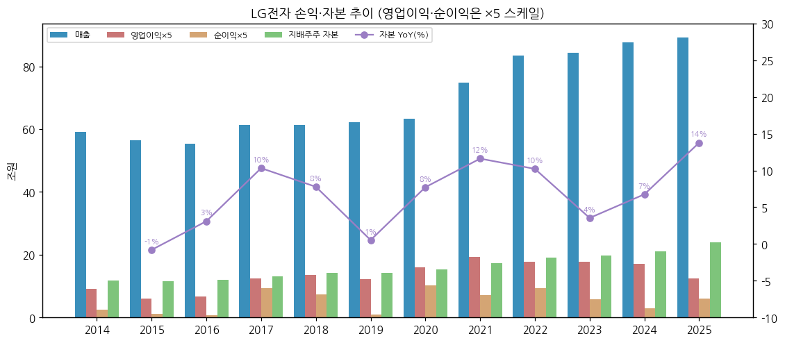

### ③ 주가 역사 (시가총액 20년)

- 2006\~2009: 휴대폰(초콜릿폰·샤인폰)·LCD TV 전성기 — 2008년 보통주 시총 25조권(월말 기준)
- 2010\~2016: 스마트폰 대응 실패(옵티머스·G 시리즈), MC 적자 누적 → 2016년 시총 6.6\~9조 바닥
- 2017: 가전 프리미엄(LG 시그니처)·OLED TV로 재평가, 연말 106,000원 (PBR 1.31x)
- 2018\~2019: ZKW 인수(2018-08, 약 1.4조원)·MC 적자로 정체, 0.7\~0.8x PBR
- 2020-12\~2021-01: MC 철수 검토 공식화(2021-01) + 마그나 JV(전장) 기대로 급등, 2021-01 당시 사상 최고권 (MC 종료 발표 2021-04-05)
- 2022\~2025: 인플레이션·물류비·관세로 이익 정체, 2025말 91,900원 (PBR 0.63x — 12년 최저권)
- **2026**: 로봇 액추에이터 브랜드 공개·엔비디아 피지컬 AI 협력 기대로 5월 연속 상한가(5/21, 5/29, 6/1) → **일간 종가 ATH 392,500원 (2026-06-02), 보통주 시총 약 63.9조** · 장중 고가 438,000원 · 같은 날 프리마켓 기준 시총 약 73조원으로 코스피 10위 진입 보도 [Yahoo Finance v8 · 스마트투데이 2026-06-02] → 이후 2026-11-24 143,200원 (보통주 시총 23.3조)으로 ATH 대비 -64%
- 2026-05-29: 종가 293,000원, 상한가(+29.93%), 연초 대비 +220% 이상 [서울신문 2026-05-29]

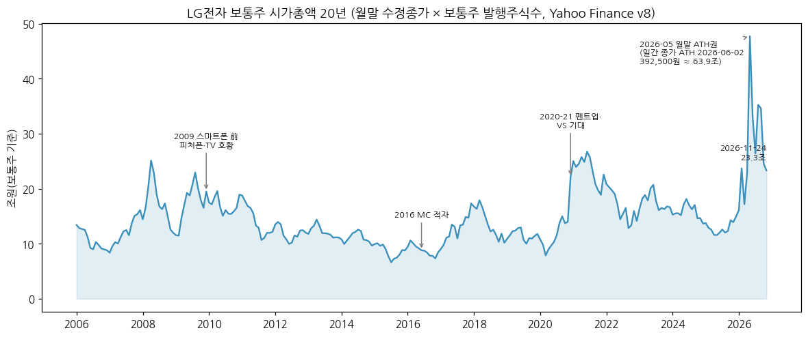

### ④ 주요 연혁

| 연도 | 내용 |
|---|---|
| 1958 | 금성사 설립 (국내 최초 라디오 A-501 1959) |
| 1995 | LG전자로 사명 변경 |
| 2002 | 지주회사 LG와 인적분할, LG전자㈜ 신설·재상장 |
| 2013 | VC(자동차부품) 사업본부 신설 |
| 2018 | 오스트리아 램프업체 ZKW 인수 (LG전자 70%·㈜LG 30%) |
| 2021 | MC(스마트폰) 사업 종료 (7월), LG마그나 이파워트레인 출범 (7월, 마그나와 JV), CEM 사업 LG화학 양도 (11월) |
| 2022 | 전기차 충전기 업체 애플망고(→하이비차저) 인수 — 2025-08 사업 종료·청산 |
| 2024 | 기업가치 제고 계획 (10월), 스마트홈 플랫폼 Athom 지분 80% 인수 (6월) |
| 2025 | Bear Robotics 지분 61.14% 인수 (5월), 유럽 온수 솔루션 OSO 인수 (9월), **LG Electronics India 현지 상장** (10월), 조직개편 HS·MS·VS·ES 4본부 체제, 4Q 희망퇴직 |
| 2026 | 회사 첫 주주가치 목적 자사주 매입 1천억원 결의 (1월), Moody's Baa1 상향 (1월), 로봇 액추에이터 사업화·AIDC 냉각 장기공급계약 (5GW, 3Q) |

---

## 3. 비즈니스 모델

### ① 실적 추이 통합 표 (5년 연간, 사업부별 — 억원)

> 2025 조직개편(HS·MS·VS·ES) 기준. 2024는 IR 재작성치, 2021\~2023은 옛 H&A·HE·BS 기준 (H&A ≈ HS + ES, HE + BS ≈ MS)

| 사업부 | 2021 | 2022 | 2023 | 2024 | 2025 | 2025 비중 |
|---|---|---|---|---|---|---|
| **매출** | | | | | | |
| H&A → HS (생활가전) | 271,105 | 298,954 | 301,683 | 248,057 | 261,497 | 29.3% |
| H&A 內 → ES (공조) | (H&A 포함) | (H&A 포함) | (H&A 포함) | 88,211 | 93,230 | 10.5% |
| HE + BS → MS (TV·IT·ID) | 226,958 | 218,170 | 196,160 | 208,890 | 194,263 | 21.8% |
| VS (전장) | 67,005 | 86,496 | 101,476 | 106,205 | 111,357 | 12.5% |
| LG이노텍 | 149,500 | 195,922 | 206,053 | 212,008 | 218,966 | 24.5% |
| 연결 합계 | 747,216 | 834,673 | 842,278 | 877,282 | 892,009 | 100% |
| **영업이익** | | | | | | |
| HS | 22,093 (H&A) | 11,359 (H&A) | 19,943 (H&A) | 13,011 | 12,840 | |
| ES | - | - | - | 6,753 | 6,473 | |
| MS | 14,129 (HE+BS) | 306 (HE+BS) | 3,342 (HE+BS) | 2,682 | -7,509 | |
| VS | -9,364 | 1,696 | 2,439 | 1,158 | 5,590 | |
| LG이노텍 | 12,594 | 12,706 | 8,308 | 7,060 | 6,650 | |
| 연결 합계 | 38,638 | 35,510 | 35,491 | 34,197 | 24,784 | |

**제품별 (2025, 사업보고서 주요 제품 현황)**: HS 냉장고·세탁기·청소기 (LG, DIOS, TROMM, SIGNATURE, 오브제컬렉션) / MS TV·모니터·PC(그램)·사이니지·webOS / VS 텔레매틱스·AV/AVN·모터·인버터·램프(ZKW) / ES 에어컨·HVAC·데이터센터 냉각(칠러·CDU) / 이노텍 카메라모듈·반도체기판·모터/센서
→ HS+ES 매출 35.4조 중 냉장고·세탁기·에어컨 26.5조 (74.7%) [2025 사업보고서]

**지역별 (소재지 기준, 억원)**

| 지역 | 2023 | 2024 | 2025 | 2025 비중 |
|---|---|---|---|---|
| 대한민국 | 342,719 | 356,758 | 365,941 | 41.0% |
| 미주 | 214,949 | 228,959 | 229,352 | 25.7% |
| 유럽 | 121,293 | 136,229 | 137,709 | 15.4% |
| 아시아·아프리카 등 | 143,666 | 155,336 | 159,007 | 17.8% |

→ 한국 41%는 이노텍(본사 소재지 한국, 실수요는 애플향 수출) 포함 효과 — 최종 수요처 기준 해외 비중은 이보다 훨씬 큼

**신사업 KPI (3Q26 IR)**: B2B 매출 5.9조(3Q26, 이노텍 제외) · 구독 매출 7,000억원대(3Q26, YoY +8%) · AIDC 냉각 3Q 누적 수주 3조원+, 2,200억원 증설 투자 · CDU 1MW·2.6MW 엔비디아 승인

### ① 사업부별 분기 시계열 (1Q17\~3Q26, IR 실적발표 부록 — 억원)

> 출처: LG전자 IR 실적발표 PDF 33건 부록 "사업부문별 실적". 같은 분기가 여러 PDF에 나오면 가장 최근 발표(재작성치) 사용. 1Q17 이전 사업부 분기는 IR PDF 미확보 (⚠ 잔여 보완)
> 매핑: VC(2017) → VS(2018\~) / B2B(2017) → BS(2018\~2024, 2019년 IT 사업 이관으로 규모 단절) / MC는 1Q21까지 (2Q21부터 중단영업) / H&A(\~2023) → HS + ES(2024\~ 재작성) / HE + BS(\~2023) → MS(2024\~) / 2026 3Q IR부터 Athom이 기타 → HS 이관(과거 재작성)

**A. 2017\~2023 (옛 사업부 체계)**

| 분기 | H&A 매출 | H&A OP | H&A OPM | HE 매출 | HE OP | HE OPM | BS(B2B) 매출 | BS(B2B) OP | BS(B2B) OPM | VS(VC) 매출 | VS(VC) OP | VS(VC) OPM | MC 매출 | MC OP | MC OPM | 이노텍 매출 | 이노텍 OP | 이노텍 OPM |
|---|---|---|---|---|---|---|---|---|---|---|---|---|---|---|---|---|---|---|
| 1Q17 | 45,045 | 5,114 | 11.4% | 38,355 | 3,270 | 8.5% | 5,194 | 270 | 5.2% | 8,472 | -155 | -1.8% | 29,864 | 1 | 0.0% | 16,447 | 668 | 4.1% |
| 2Q17 | 50,403 | 4,494 | 8.9% | 36,704 | 2,824 | 7.7% | 5,316 | 225 | 4.2% | 8,404 | -186 | -2.2% | 25,647 | -1,397 | -5.4% | 13,396 | 326 | 2.4% |
| 3Q17 | 47,807 | 4,114 | 8.6% | 40,592 | 3,908 | 9.6% | 6,420 | 546 | 8.5% | 8,330 | -308 | -3.7% | 26,842 | -3,809 | -14.2% | 17,873 | 559 | 3.1% |
| 4Q17 | 41,895 | 766 | 1.8% | 48,680 | 3,363 | 6.9% | 6,687 | 478 | 7.1% | 8,180 | -420 | -5.1% | 29,230 | -2,163 | -7.4% | 28,698 | 1,412 | 4.9% |
| 1Q18 | 49,239 | 5,576 | 11.3% | 41,419 | 5,730 | 13.8% | 6,427 | 788 | 12.3% | 8,400 | -170 | -2.0% | 21,344 | -1,318 | -6.2% | 17,205 | 168 | 1.0% |
| 2Q18 | 52,581 | 4,618 | 8.8% | 38,455 | 4,052 | 10.5% | 5,885 | 390 | 6.6% | 8,728 | -325 | -3.7% | 20,491 | -1,837 | -9.0% | 15,179 | 134 | 0.9% |
| 3Q18 | 48,509 | 4,130 | 8.5% | 37,348 | 3,229 | 8.6% | 5,767 | 351 | 6.1% | 11,760 | -429 | -3.6% | 20,173 | -1,442 | -7.1% | 23,132 | 1,297 | 5.6% |
| 4Q18 | 43,279 | 1,126 | 2.6% | 45,900 | 2,056 | 4.5% | 5,978 | 149 | 2.5% | 13,988 | -274 | -2.0% | 16,754 | -3,185 | -19.0% | 24,305 | 1,036 | 4.3% |
| 1Q19 | 54,659 | 7,276 | 13.3% | 31,215 | 2,473 | 7.9% | 16,513 | 1,680 | 10.2% | 13,470 | -154 | -1.1% | 15,104 | -2,035 | -13.5% | 13,686 | -114 | -0.8% |
| 2Q19 | 61,028 | 7,175 | 11.8% | 29,863 | 1,523 | 5.1% | 14,947 | 1,242 | 8.3% | 14,231 | -557 | -3.9% | 16,133 | -3,130 | -19.4% | 15,223 | 188 | 1.2% |
| 3Q19 | 53,307 | 4,288 | 8.0% | 32,098 | 2,884 | 9.0% | 15,112 | 1,117 | 7.4% | 13,401 | -602 | -4.5% | 15,222 | -1,611 | -10.6% | 24,460 | 1,865 | 7.6% |
| 4Q19 | 46,161 | 1,222 | 2.6% | 39,684 | 1,010 | 2.5% | 14,392 | 820 | 5.7% | 13,552 | -636 | -4.7% | 13,208 | -3,322 | -25.2% | 29,652 | 2,092 | 7.1% |
| 1Q20 | 54,190 | 7,383 | 13.6% | 29,713 | 3,171 | 10.7% | 17,094 | 1,887 | 11.0% | 13,194 | -996 | -7.5% | 9,986 | -2,378 | -23.8% | 20,109 | 1,380 | 6.9% |
| 2Q20 | 51,570 | 6,121 | 11.9% | 22,576 | 1,054 | 4.7% | 13,079 | 728 | 5.6% | 9,125 | -2,047 | -22.4% | 13,087 | -2,065 | -15.8% | 15,399 | 429 | 2.8% |
| 3Q20 | 61,577 | 6,555 | 10.6% | 36,705 | 3,167 | 8.6% | 14,843 | 533 | 3.6% | 16,559 | -697 | -4.2% | 15,248 | -1,484 | -9.7% | 22,298 | 894 | 4.0% |
| 4Q20 | 55,416 | 2,847 | 5.1% | 42,842 | 1,921 | 4.5% | 15,117 | 460 | 3.0% | 19,150 | -63 | -0.3% | 13,850 | -2,485 | -17.9% | 38,526 | 3,364 | 8.7% |
| 1Q21 | 67,090 | 9,036 | 13.5% | 40,088 | 3,937 | 9.8% | 14,506 | 1,641 | 11.3% | 17,308 | -52 | -0.3% | 9,987 | -2,801 | -28.0% | 30,718 | 3,453 | 11.2% |
| 2Q21 | 68,151 | 6,507 | 9.5% | 40,427 | 3,317 | 8.2% | 12,948 | 764 | 5.9% | 17,013 | -3,438 | -20.2% | - | - | - | 23,557 | 1,510 | 6.4% |
| 3Q21 | 70,613 | 5,016 | 7.1% | 41,816 | 2,059 | 4.9% | 13,024 | 410 | 3.1% | 16,110 | -5,380 | -33.4% | - | - | - | 37,984 | 3,352 | 8.8% |
| 4Q21 | 65,251 | 1,534 | 2.4% | 49,860 | 1,598 | 3.2% | 14,289 | 403 | 2.8% | 16,574 | -494 | -3.0% | - | - | - | 57,241 | 4,279 | 7.5% |
| 1Q22 | 79,704 | 4,468 | 5.6% | 40,651 | 1,872 | 4.6% | 18,738 | 1,031 | 5.5% | 18,777 | -67 | -0.4% | - | - | - | 39,524 | 3,668 | 9.3% |
| 2Q22 | 80,676 | 4,338 | 5.4% | 34,578 | -189 | -0.5% | 15,381 | 143 | 0.9% | 20,305 | 500 | 2.5% | - | - | - | 37,030 | 2,899 | 7.8% |
| 3Q22 | 74,729 | 2,298 | 3.1% | 37,121 | -554 | -1.5% | 14,292 | -144 | -1.0% | 23,454 | 961 | 4.1% | - | - | - | 53,885 | 4,449 | 8.3% |
| 4Q22 | 63,845 | 255 | 0.4% | 44,917 | -1,075 | -2.4% | 12,492 | -778 | -6.2% | 23,960 | 302 | 1.3% | - | - | - | 65,483 | 1,690 | 2.6% |
| 1Q23 | 80,292 | 10,152 | 12.6% | 33,521 | 2,039 | 6.1% | 14,796 | 657 | 4.4% | 23,865 | 565 | 2.4% | - | - | - | 43,759 | 1,453 | 3.3% |
| 2Q23 | 79,931 | 5,973 | 7.5% | 31,391 | 1,264 | 4.0% | 13,327 | 26 | 0.2% | 26,645 | 917 | 3.4% | - | - | - | 39,072 | 184 | 0.5% |
| 3Q23 | 74,638 | 4,995 | 6.7% | 35,622 | 1,157 | 3.2% | 13,309 | -205 | -1.5% | 25,035 | 886 | 3.5% | - | - | - | 47,636 | 1,834 | 3.9% |
| 4Q23 | 66,822 | -1,177 | -1.8% | 41,506 | -701 | -1.7% | 12,688 | -895 | -7.1% | 25,931 | 71 | 0.3% | - | - | - | 75,586 | 4,837 | 6.4% |

**B. 2024\~3Q26 (현 사업부 체계)**

| 분기 | HS 매출 | HS OP | HS OPM | MS 매출 | MS OP | MS OPM | VS 매출 | VS OP | VS OPM | ES 매출 | ES OP | ES OPM | 이노텍 매출 | 이노텍 OP | 이노텍 OPM |
|---|---|---|---|---|---|---|---|---|---|---|---|---|---|---|---|
| 1Q24 | 61,291 | 5,865 | 9.6% | 50,613 | 1,810 | 3.6% | 26,617 | 518 | 1.9% | 25,890 | 3,356 | 13.0% | 43,336 | 1,760 | 4.1% |
| 2Q24 | 64,163 | 4,290 | 6.7% | 50,766 | 1,268 | 2.5% | 26,921 | 828 | 3.1% | 25,357 | 2,489 | 9.8% | 45,552 | 1,517 | 3.3% |
| 3Q24 | 62,822 | 3,545 | 5.6% | 51,385 | 108 | 0.2% | 26,113 | 11 | 0.0% | 21,441 | 1,564 | 7.3% | 56,851 | 1,305 | 2.3% |
| 4Q24 | 59,781 | -689 | -1.2% | 56,126 | -504 | -0.9% | 26,554 | -199 | -0.7% | 15,523 | -656 | -4.2% | 66,269 | 2,478 | 3.7% |
| 1Q25 | 66,996 | 6,432 | 9.6% | 49,503 | 49 | 0.1% | 28,432 | 1,251 | 4.4% | 30,544 | 4,067 | 13.3% | 49,828 | 1,251 | 2.5% |
| 2Q25 | 65,974 | 4,383 | 6.6% | 43,934 | -1,917 | -4.4% | 28,494 | 1,262 | 4.4% | 26,442 | 2,505 | 9.5% | 39,346 | 114 | 0.3% |
| 3Q25 | 65,835 | 3,647 | 5.5% | 46,525 | -3,026 | -6.5% | 26,467 | 1,496 | 5.7% | 21,672 | 1,329 | 6.1% | 53,694 | 2,038 | 3.8% |
| 4Q25 | 62,692 | -1,622 | -2.6% | 54,301 | -2,615 | -4.8% | 27,964 | 1,581 | 5.7% | 14,572 | -1,428 | -9.8% | 76,098 | 3,247 | 4.3% |
| 1Q26 | 69,431 | 5,697 | 8.2% | 51,694 | 3,718 | 7.2% | 30,644 | 2,116 | 6.9% | 28,223 | 2,485 | 8.8% | 55,348 | 2,953 | 5.3% |
| 2Q26 | 70,757 | 6,859 | 9.7% | 51,146 | 2,194 | 4.3% | 30,259 | 1,912 | 6.3% | 27,261 | 2,358 | 8.6% | 55,273 | 2,458 | 4.4% |
| 3Q26 | 70,444 | 2,592 | 3.7% | 50,215 | 1,467 | 2.9% | 28,261 | 1,903 | 6.7% | 21,736 | 872 | 4.0% | 63,671 | 948 | 1.5% |

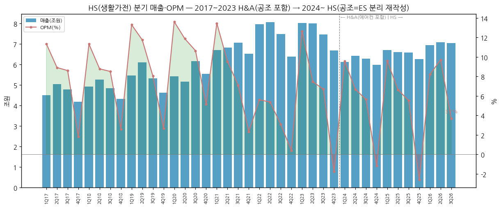
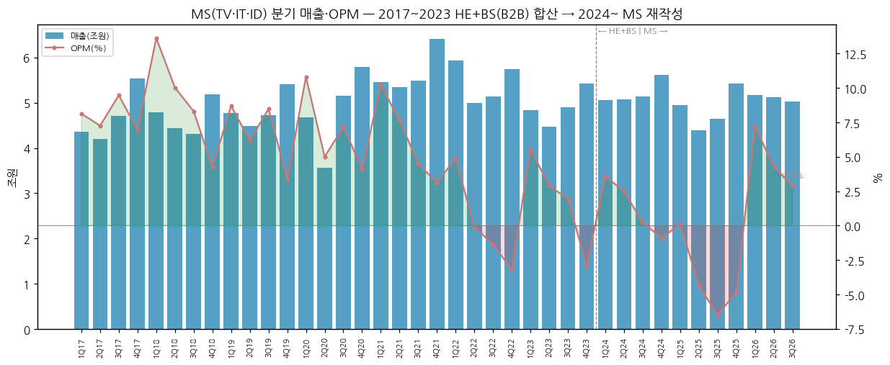
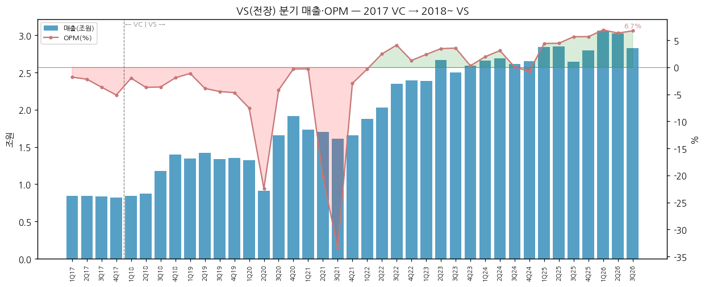
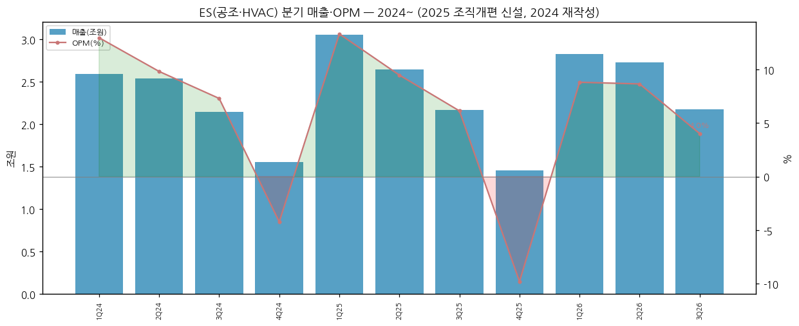
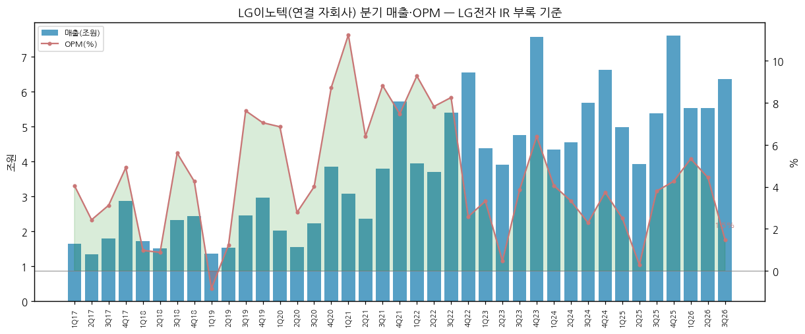
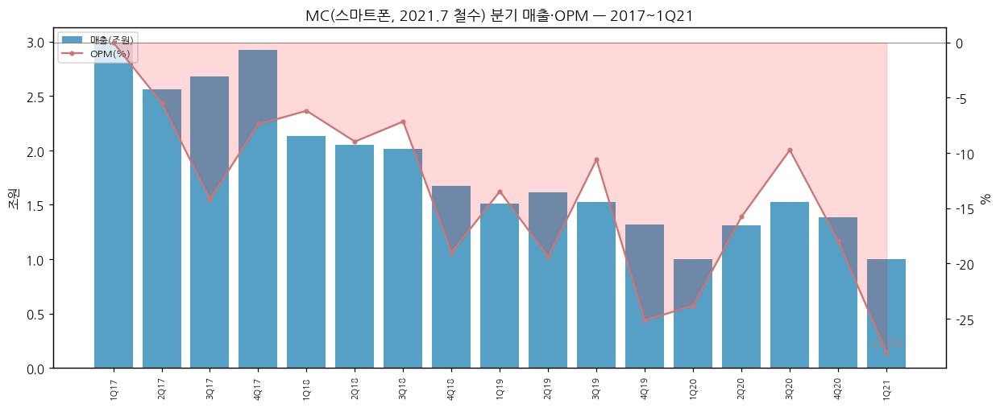

### ① 전사 분기 시계열 (1Q16\~3Q26, OpenDART — 억원)

| 분기 | 매출액 | 영업이익 | OPM | 순이익 |
|---|---|---|---|---|
| 1Q16 | 133,621 | 5,052 | 3.8% | 1,981 |
| 2Q16 | 140,029 | 5,846 | 4.2% | 2,685 |
| 3Q16 | 132,242 | 2,832 | 2.1% | -815 |
| 4Q16 | 147,778 | -352 | -0.2% | -2,587 |
| 1Q17 | 146,572 | 9,215 | 6.3% | 8,357 |
| 2Q17 | 145,514 | 6,641 | 4.6% | 5,149 |
| 3Q17 | 152,241 | 5,161 | 3.4% | 3,361 |
| 4Q17 | 169,635 | 3,669 | 2.2% | 1,828 |
| 1Q18 | 151,230 | 11,078 | 7.3% | 7,299 |
| 2Q18 | 150,193 | 7,710 | 5.1% | 3,265 |
| 3Q18 | 154,270 | 7,488 | 4.9% | 4,971 |
| 4Q18 | 157,723 | 757 | 0.5% | -807 |
| 1Q19 | 149,151 | 9,006 | 6.0% | 5,780 |
| 2Q19 | 156,293 | 6,522 | 4.2% | 1,060 |
| 3Q19 | 157,006 | 7,815 | 5.0% | 3,457 |
| 4Q19 | 160,612 | 1,018 | 0.6% | -8,497 |
| 1Q20 | 147,278 | 10,904 | 7.4% | 10,867 |
| 2Q20 | 128,338 | 4,954 | 3.9% | 656 |
| 3Q20 | 169,196 | 9,590 | 5.7% | 6,492 |
| 4Q20 | 187,809 | 6,502 | 3.5% | 2,623 |
| 1Q21 | 188,095 | 15,166 | 8.1% | 11,691 |
| 2Q21 | 171,139 | 8,781 | 5.1% | -2,920 |
| 3Q21 | 187,867 | 5,407 | 2.9% | 5,165 |
| 4Q21 | 210,087 | 6,777 | 3.2% | 213 |
| 1Q22 | 211,114 | 18,805 | 8.9% | 14,010 |
| 2Q22 | 194,640 | 7,923 | 4.1% | 3,380 |
| 3Q22 | 211,768 | 7,466 | 3.5% | 3,364 |
| 4Q22 | 218,575 | 693 | 0.3% | -2,123 |
| 1Q23 | 204,159 | 14,974 | 7.3% | 5,465 |
| 2Q23 | 199,985 | 7,419 | 3.7% | 1,953 |
| 3Q23 | 207,093 | 9,967 | 4.8% | 4,853 |
| 4Q23 | 231,041 | 3,131 | 1.4% | -764 |
| 1Q24 | 210,959 | 13,354 | 6.3% | 5,854 |
| 2Q24 | 216,944 | 11,961 | 5.5% | 6,295 |
| 3Q24 | 221,764 | 7,519 | 3.4% | 902 |
| 4Q24 | 227,615 | 1,353 | 0.6% | -7,138 |
| 1Q25 | 227,398 | 12,591 | 5.5% | 8,756 |
| 2Q25 | 207,351 | 6,394 | 3.1% | 6,096 |
| 3Q25 | 218,738 | 6,889 | 3.1% | 4,611 |
| 4Q25 | 238,522 | -1,090 | -0.5% | -7,259 |
| 1Q26 | 237,272 | 16,737 | 7.1% | 10,051 |
| 2Q26 | 238,265 | 15,791 | 6.6% | 7,813 |
| 3Q26 | 238,241 | 7,819 | 3.3% | 7,084 |

### 3Q26 핵심 박스

> **3Q26 (2026-10-28 IR / 2026-11-16 분기보고서)**: 매출 238,241억원 (YoY +8.9%, QoQ 0.0%) · 영업이익 7,819억원 (YoY +13.5%, OPM 3.3%) · 순이익 7,084억원
> - HS 70,444억 (OPM 3.7%, YoY -1.8%p — 물류비·마케팅비) / MS 50,215억 (OPM 2.9%, 전년 -6.5% → 흑자, +9.4%p) / VS 28,261억 (OPM 6.7%, 7개 분기 연속 한 자릿수 중반+) / ES 21,736억 (OPM 4.0%, 비수기)
> - 지분법이익 3,065억원 (전년 -145억) — 영업외 개선
> - 1\~3Q26 누적: 매출 713,778억 (+9.2%) · 영업이익 40,347억 (+55.9%)
> - 주주환원: 2026년 매입 자사주 73만주 4Q 내 전량 소각 예정, 2027년 1천억원 추가 주주환원 예고
> - 4Q26 가이드(정성): 금리·원자재·환율 불확실성, 지역별 수요 편차, 메모리·LCD 패널가 상승으로 MS 원가 부담

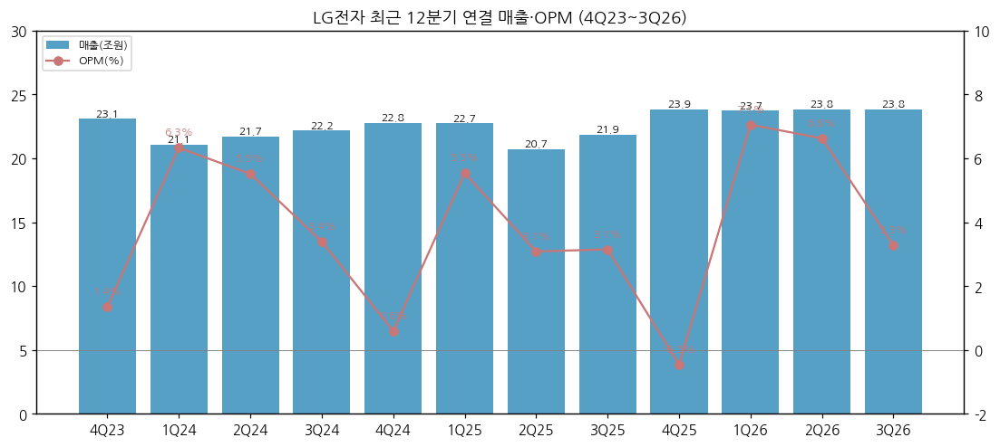

### ② 사업부별 개요 (매출 비중 큰 순)

| 사업부 | 2025 매출 | 비중 | 주요 제품 | 성격 |
|---|---|---|---|---|
| HS (Home appliance Solution) | 26.1조 | 29.3% | 냉장고·세탁기·청소기·부품 외판·구독 | 사이클(완만), 4Q 계절 저점 |
| 이노텍 (연결 자회사) | 21.9조 | 24.5% | 카메라모듈(모바일 점유율 33.4%)·FC-BGA·전장부품 | 아이폰 사이클 (3Q 상승·1H 저점) |
| MS (Media entertainment Solution) | 19.4조 | 21.8% | TV(OLED 13년 연속 1위)·모니터·그램·사이니지·webOS | 사이클 + 패널가 민감, 적자 반복 |
| VS (Vehicle Solution) | 11.1조 | 12.5% | 텔레매틱스(점유율 23.0%)·AV/AVN(12.2%)·ZKW 램프·SDV | 지속성장 (수주잔고 기반) |
| ES (Eco Solution) | 9.3조 | 10.5% | 가정·상업용 에어컨, 칠러, 히트펌프, AIDC 냉각 | 지속성장 + 계절성 (2Q 성수기) |

### ③ 사업부별 디테일

**HS (생활가전)**
- Top-seller: 냉장고·세탁기 (HS+ES 매출의 74.7%가 냉장고·세탁기·에어컨), 프리미엄 브랜드 LG SIGNATURE·오브제컬렉션
- Growth: 가전 구독(한국 + 말레이시아·태국·중동 확대), 글로벌 사우스 현지화(인도 스리시티 3번째 가전공장 착공), 컴프레서·모터 부품 외판, 기능성 유리 파우더 소재
- 이익 outlier: 4Q 저점 반복 (4Q24 -689억 · 4Q25 -1,622억 — 물류비·희망퇴직), 1Q 정점 (1Q20 13.6%, 1Q21 13.4%, 1Q23 12.7%)
- 생산 CAPA (2025): 냉장고 1,010만대(한국·인도·중국·멕시코) / 세탁기 1,753만대(한국·중국·태국·미국 테네시) — 냉장고 가동률 100%+
- 신사업: 홈로봇 개발, 로봇 액추에이터 '악시움' 브랜드 공개(2026), Bear Robotics(서빙로봇) 61% 인수

**MS (TV·IT·ID)**
- 점유율 (금액기준, OMDIA·IDC 기반 회사 추정): TV 15.3%(2025) ← 16.1%(2024) ← 16.3%(2023) / 모니터 6.0%(수량) / 사이니지 23.7%(수량, 중국 제외)
- OLED TV 13년 연속(2013\~2025) 1위, 2025 TV 시장 2.08억대(YoY -0.1%), 2026 2.10억대(+1.0%) 전망 [2025 사업보고서]
- 이익 outlier: 2025년 연간 영업적자 -7,509억 (3Q25 -6.5%, 4Q25 희망퇴직 비용), 2026년 흑자 복귀 (1Q26 7.2%)
- webOS 플랫폼(광고·콘텐츠) 사업 — 타사 TV 브랜드에 webOS 공급 확대
- TV 생산 CAPA 2,401만대 (한국·멕시코·폴란드·브라질·인도네시아), 실생산 1,759만대

**VS (전장)**
- 2013 VC 출범 → 2018 ZKW 인수 → 2021 LG마그나 JV(구동부품 분리) → 2022 연간 흑자 전환 → 2025 OPM 5.0% (영업이익 5,590억)
- 텔레매틱스 세계 점유율 23.0%, AV/AVN 12.2% (TechInsights 기반 회사 추정, 2025)
- 성장 동인: SDV·AIDV 대응 고성능 컴퓨팅, 차량용 webOS, ZKW 램프 LED·ADAS 연계, 수주잔고의 매출 전환
- 3Q26 OPM 6.7% (영업이익 1,903억) — 분기 최고 수준

**ES (공조·HVAC)**
- 2025 조직개편으로 H&A에서 분리 신설 (2024 재작성). 분기 OPM 2024 1Q 13.0% → 계절성 큼 (3Q·4Q 비수기)
- 데이터센터 냉각: 칠러 + 공랭·액체 냉각, CDU 600kW → 1MW·2.6MW 엔비디아 승인, 에어 컨트롤 컨셉트사와 5GW AIDC 냉각 장기공급계약, 3Q26 누적 수주 3조원+ [IR 3Q26]
- 유럽 히트펌프·온수 (OSO 인수 2025-09), 에어컨 CAPA 1,251만대 (한국·인도·중국·태국)

**LG이노텍 (연결 자회사, 지분 40.8%)**
- 모바일 카메라모듈 세계 점유율 33.4%(2025, 금액, 회사 추정) — 최대 고객 애플
- 매출 2017 7.6조 → 2025 21.9조 (2.9배), 영업이익 2021\~2022 1.26\~1.27조 정점 → 2025 0.67조
- 3Q26 매출 63,671억 · 영업이익 948억 (OPM 1.5%) — 아이폰 신모델 램프업 분기임에도 저마진 [IR 3Q26 부록]

**MC (스마트폰, 종료)**: 2017\~2020 누적 영업적자 3.37조원 (2017 -7,368억 · 2018 -7,782억 · 2019 -10,098억 · 2020 -8,412억, IR 부록), 2021-07-31 사업 종료

### ④ 주요 경쟁사

| 사업부 | 경쟁사 |
|---|---|
| HS | 삼성전자 DA, Whirlpool, Haier(GE Appliances), Electrolux, Midea, Bosch(BSH) |
| MS | 삼성전자 VD, TCL, Hisense, Sony, Xiaomi / 모니터 Dell·HP·Lenovo·ASUS·대만·중국 게이밍 브랜드 |
| VS | Harman(삼성전자), Continental, Bosch, Visteon, Denso, Aptiv / 램프 Valeo·Hella(Forvia)·Koito |
| ES | Daikin, Carrier, Trane, Johnson Controls, 삼성전자, Midea, Gree / 데이터센터 냉각 Vertiv·Schneider |
| 이노텍 | Sunny Optical, O-Film(중국), 삼성전기(카메라모듈·FC-BGA) |

### ⑤ 주요 매출처

- DART 공시: Best Buy, HOME DEPOT, LOWE'S 등 — 2025 10대 매출처 비중 연결 매출의 31.5% [2025 사업보고서]
- 추정 순서 (DART는 개별 금액 미공개): ① 애플(이노텍 매출 대부분, 연결 매출의 약 20%대 추정) ② 미국 양판점(Best Buy·Home Depot·Lowe's) ③ 글로벌 완성차 OEM(VS — GM 등) — ⚠ 순서·비중은 공시가 아닌 추정

### ⑥ 생산 CAPA + 임직원

| 품목 | 2023 CAPA | 2024 CAPA | 2025 CAPA | 2025 실생산 | 주요 생산지 |
|---|---|---|---|---|---|
| 냉장고 (천대) | 9,417 | 10,251 | 10,104 | 11,213 | 한국·인도·중국·멕시코 |
| 세탁기 (천대) | 17,290 | 16,705 | 17,525 | 16,765 | 한국·중국·태국·미국 |
| TV (천대) | 27,492 | 25,898 | 24,005 | 17,588 | 한국·멕시코·폴란드·브라질·인도네시아 |
| 모니터 (천대) | 6,433 | 6,659 | 10,573 | 5,187 | 중국 |
| 텔레매틱스·AV 등 (천개) | 38,953 | 42,882 | 42,245 | 38,302 | 한국·중국·베트남·오스트리아 |
| 에어컨 (천대) | 12,864 | 13,130 | 12,512 | 12,721 | 한국·인도·중국·태국 |
| 카메라모듈 (천개) | 646,927 | 623,513 | 591,411 | 483,093 | 한국·중국·베트남 |

- 국내 사업장: 창원(가전·WEF 등대공장), 평택, 구미, 이노텍 구미·광주·파주 / 해외: 미국 테네시(세탁기, WEF 등대공장), 멕시코 레이노사·몬테레이, 폴란드 므와바·브로츠와프, 인도 노이다·푸네(+스리시티 건설), 베트남 하이퐁, 중국 남경·태주·천진 등
- 본사 임직원: 37,909명(2016) → 40,110명(2019) → 34,645명(2022) → 34,144명(2025) — MC 철수(2021)로 감소 [DART 직원현황]

---

## 4. 재무 구조 (12년, 연결 — 억원)

> 2014 값은 2015 사업보고서 전기 비교치. 2021년부터 MC 중단영업 반영(2020 이전은 MC 포함 원보고치) — 2020→2021 매출 증가율 일부는 기준 차이

### ① 손익계산서

| 연도 | 매출액 | 매출총이익 | GPM | 판관비 | 영업이익 | OPM | 당기순이익 | 지배주주순이익 | NPM | 매출 YoY |
|---|---|---|---|---|---|---|---|---|---|---|
| 2014 | 590,408 | 137,416 | 23.3% | 69,730 | 18,286 | 3.1% | 5,014 | 3,994 | 0.8% |  |
| 2015 | 565,090 | 128,739 | 22.8% | 66,079 | 11,923 | 2.1% | 2,491 | 1,244 | 0.4% | -4.3% |
| 2016 | 553,670 | 137,367 | 24.8% | 66,897 | 13,378 | 2.4% | 1,263 | 769 | 0.2% | -2.0% |
| 2017 | 613,963 | 146,587 | 23.9% | 121,902 | 24,685 | 4.0% | 18,695 | 17,258 | 3.0% | +10.9% |
| 2018 | 613,417 | 150,810 | 24.6% | 123,778 | 27,033 | 4.4% | 14,728 | 12,401 | 2.4% | -0.1% |
| 2019 | 623,062 | 153,356 | 24.6% | 128,994 | 24,361 | 3.9% | 1,799 | 313 | 0.3% | +1.6% |
| 2020 | 632,620 | 163,169 | 25.8% | 131,220 | 31,950 | 5.1% | 20,638 | 19,683 | 3.3% | +1.5% |
| 2021 | 747,216 | 188,729 | 25.3% | 150,091 | 38,638 | 5.2% | 14,150 | 10,317 | 1.9% | +18.1% |
| 2022 | 834,673 | 202,362 | 24.2% | 166,853 | 35,510 | 4.3% | 18,631 | 11,964 | 2.2% | +11.7% |
| 2023 | 842,278 | 198,027 | 23.5% | 162,536 | 35,491 | 4.2% | 11,506 | 7,129 | 1.4% | +0.9% |
| 2024 | 877,282 | 213,792 | 24.4% | 179,596 | 34,197 | 3.9% | 5,914 | 3,675 | 0.7% | +4.2% |
| 2025 | 892,009 | 208,417 | 23.4% | 183,633 | 24,784 | 2.8% | 12,204 | 9,606 | 1.4% | +1.7% |

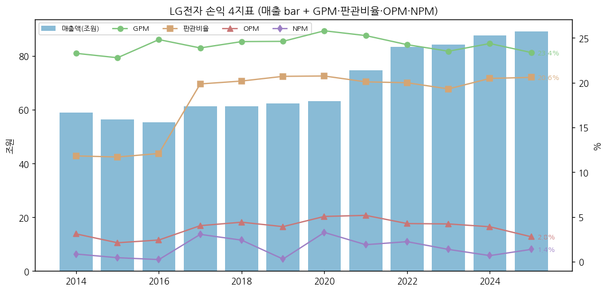

### ② 재무상태표

| 연도 | 자산총계 | 유동자산 | 현금성자산 | 재고자산 | 유형자산 | 부채총계 | 유동부채 | 자본총계 | 지배주주자본 | 부채비율 |
|---|---|---|---|---|---|---|---|---|---|---|
| 2014 | 370,684 | 174,827 | 22,444 | 57,113 | 105,969 | 240,773 | 156,806 | 129,911 | 117,194 | 185.3% |
| 2015 | 363,139 | 163,976 | 27,102 | 48,727 | 104,603 | 233,304 | 147,797 | 129,835 | 116,266 | 179.7% |
| 2016 | 378,553 | 169,906 | 30,151 | 51,710 | 112,224 | 244,985 | 157,444 | 133,567 | 119,871 | 183.4% |
| 2017 | 412,210 | 191,950 | 33,506 | 59,084 | 118,008 | 265,473 | 175,365 | 146,737 | 132,243 | 180.9% |
| 2018 | 443,284 | 193,629 | 42,704 | 60,214 | 133,340 | 280,215 | 171,350 | 163,069 | 142,533 | 171.8% |
| 2019 | 448,599 | 197,535 | 47,774 | 58,634 | 145,054 | 284,347 | 176,579 | 164,251 | 143,301 | 173.1% |
| 2020 | 482,042 | 232,394 | 58,963 | 74,472 | 139,740 | 306,621 | 202,075 | 175,421 | 154,375 | 174.8% |
| 2021 | 534,815 | 274,878 | 60,515 | 97,540 | 147,008 | 333,834 | 236,199 | 200,980 | 172,306 | 166.1% |
| 2022 | 551,561 | 274,882 | 63,224 | 93,888 | 158,318 | 326,641 | 223,325 | 224,920 | 189,921 | 145.2% |
| 2023 | 602,408 | 303,412 | 84,876 | 91,254 | 168,186 | 367,423 | 241,604 | 234,985 | 196,648 | 156.4% |
| 2024 | 656,296 | 339,235 | 75,730 | 107,294 | 170,752 | 404,179 | 273,074 | 252,117 | 209,948 | 160.3% |
| 2025 | 686,202 | 348,699 | 87,698 | 110,850 | 167,143 | 400,681 | 271,832 | 285,520 | 238,874 | 140.3% |

→ 3Q26: 자산 70.75조 · 부채 41.19조 · 자본 29.56조(지배 24.70조) · 부채비율 139.3% · 순차입금(리스 포함) 4.83조 [IR 3Q26]

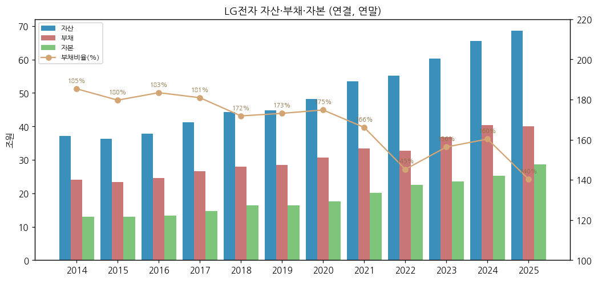

### ③ 현금흐름표

| 연도 | 영업CF | 투자CF | 재무CF | CapEx(유형+무형) | FCF(영업CF-CapEx) |
|---|---|---|---|---|---|
| 2014 | 20,292 | -23,967 | 643 | 25,841 | -5,549 |
| 2015 | 26,188 | -19,332 | -1,889 | 22,308 | 3,879 |
| 2016 | 31,580 | -23,907 | -2,788 | 24,761 | 6,819 |
| 2017 | 21,663 | -25,829 | 8,408 | 32,193 | -10,530 |
| 2018 | 45,416 | -44,203 | 8,193 | 38,444 | 6,972 |
| 2019 | 36,892 | -20,833 | -11,170 | 25,446 | 11,446 |
| 2020 | 46,286 | -23,145 | -9,939 | 30,830 | 15,455 |
| 2021 | 26,774 | -24,655 | -2,823 | 32,591 | -5,817 |
| 2022 | 31,078 | -32,275 | 4,483 | 37,528 | -6,449 |
| 2023 | 59,136 | -52,897 | 15,032 | 41,376 | 17,760 |
| 2024 | 38,427 | -42,119 | -7,047 | 36,680 | 1,746 |
| 2025 | 42,805 | -30,136 | -3,195 | 39,074 | 3,731 |

→ 2023 영업CF 5.9조 최대 (재고 축소), 2025 재무CF에 인도법인 IPO 현금유입 1.82조 포함

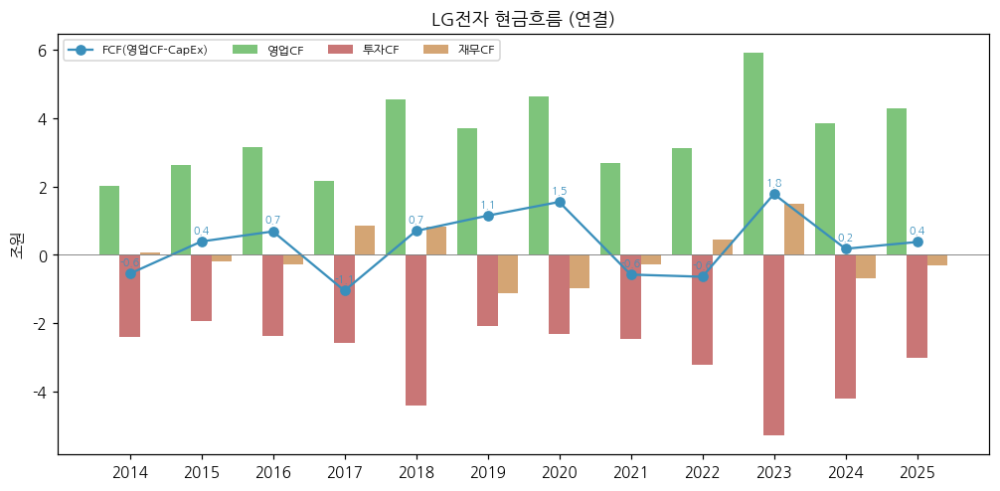

### ④ CapEx

| 연도 | 유형자산 취득 | 무형자산 취득 | 합계 | CapEx/매출 | 감가상각 대비 메모 |
|---|---|---|---|---|---|
| 2014 | 21,659 | 4,182 | 25,841 | 4.4% | |
| 2015 | 17,473 | 4,836 | 22,308 | 3.9% | |
| 2016 | 20,190 | 4,571 | 24,761 | 4.5% | |
| 2017 | 25,755 | 6,438 | 32,193 | 5.2% | |
| 2018 | 31,665 | 6,779 | 38,444 | 6.3% | |
| 2019 | 20,721 | 4,725 | 25,446 | 4.1% | |
| 2020 | 22,819 | 8,012 | 30,830 | 4.9% | |
| 2021 | 26,481 | 6,110 | 32,591 | 4.4% | |
| 2022 | 31,168 | 6,360 | 37,528 | 4.5% | |
| 2023 | 32,699 | 8,677 | 41,376 | 4.9% | |
| 2024 | 23,564 | 13,116 | 36,680 | 4.2% | |
| 2025 | 26,153 | 12,920 | 39,074 | 4.4% | |

→ 2023\~2025 무형자산 취득 1.3조 수준(개발비 자산화 + 이노텍 FC-BGA 등), 유형 CapEx는 2023 3.3조 정점
→ 2026: AIDC 냉각 수주 대응 2,200억원 증설 투자 진행 [IR 3Q26]

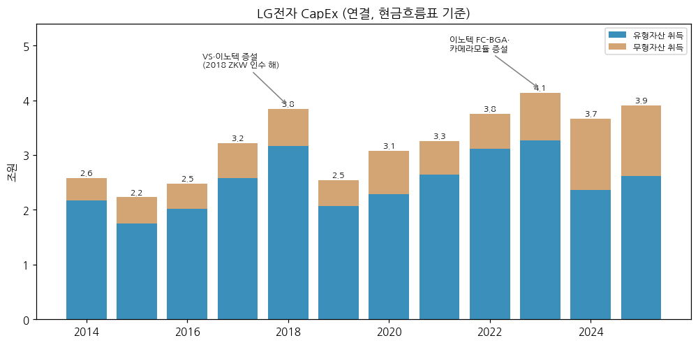

### ⑤ 부채구조 + 채무증권

| 연도 | 차입금(사채 포함, 리스 제외) | 현금성자산 | 순차입금 | 차입금/자본 | 금융비용(외환손실 포함) | 이자의 지급(CF) | 이자보상배율(영업이익/이자지급) |
|---|---|---|---|---|---|---|---|
| 2014 | 90,024 | 22,444 | 67,580 | 69.3% | 7,525 | 4,398 | 4.2x |
| 2015 | 88,272 | 27,102 | 61,171 | 68.0% | 9,031 | 4,662 | 2.6x |
| 2016 | 86,590 | 30,151 | 56,439 | 64.8% | 8,841 | 4,337 | 3.1x |
| 2017 | 94,505 | 33,506 | 60,999 | 64.4% | 8,311 | 3,844 | 6.4x |
| 2018 | 109,012 | 42,704 | 66,308 | 66.9% | 7,966 | 4,258 | 6.3x |
| 2019 | 104,873 | 47,774 | 57,100 | 63.8% | 7,140 | 4,112 | 5.9x |
| 2020 | 99,198 | 58,963 | 40,234 | 56.5% | 11,160 | 3,730 | 8.6x |
| 2021 | 99,316 | 60,515 | 38,800 | 49.4% | 6,904 | 3,185 | 12.1x |
| 2022 | 110,452 | 63,224 | 47,228 | 49.1% | 12,319 | 3,747 | 9.5x |
| 2023 | 133,208 | 84,876 | 48,332 | 56.7% | 14,255 | 5,600 | 6.3x |
| 2024 | 139,825 | 75,730 | 64,095 | 55.5% | 11,326 | 6,231 | 5.5x |
| 2025 | 126,442 | 87,698 | 38,744 | 44.3% | 14,403 | 6,246 | 4.0x |

- 3Q26 차입금 11.83조 (리스 포함), 차입금비율 44.3%, 순차입금비율 16.4% [IR 3Q26]
- 신용등급: 국내 AA (2023\~2025 유지) / S&P BBB(Stable) 2021\~2024 → BBB(Positive) 2025-10 / Moody's Baa2 → Baa1(Stable) 2026-01
- ⚠ 회사채 발행 내역(회차별)은 다음 버전에서 공시원문 "채무증권 발행실적" 표로 보강

### ⑥ 배당·자사주

| 연도 | 보통주 DPS(원) | 현금배당총액(억원) | 연결 배당성향 | 비고 |
|---|---|---|---|---|
| 2014 | 400 | 729 | 18.3% | |
| 2015 | 400 | 729 | 58.6% | |
| 2016 | 400 | 729 | 94.8% | 이익 급감에도 DPS 유지 |
| 2017 | 400 | 729 | 4.2% | |
| 2018 | 750 | 1,359 | 11.0% | DPS 인상 |
| 2019 | 750 | 1,359 | 434.4% | 순이익 급감 |
| 2020 | 1,200 | 2,169 | 11.0% | 역대 최대 DPS (당시) |
| 2021 | 850 | 1,539 | 14.9% | |
| 2022 | 700 | 1,269 | 10.6% | |
| 2023 | 800 | 1,449 | 20.3% | |
| 2024 | 1,000 | 1,809 | 49.2% | 밸류업: 배당성향 25%+ · 최소 DPS 1,000원 (2024\~2026) |
| 2025 | 1,350 | 2,439 | 25.4% | 중간배당 900억 포함, 총액 +35% |

- 자사주: 2025년 761,427주 소각(이익소각) / 2026-01-29 1천억원(보통주 905,083주·우선주 189,371주) 매입 결의 — 회사 첫 주주가치 목적 매입, 2년 2천억원 주주환원 계획의 일부 [한국경제 2026-01-29] / 2026년 매입 73만주 4Q26 내 소각 예정 [IR 3Q26]
- 밸류업 (2024-10-22): 2024\~2026 사업연도 지배순이익(일회성 제외)의 25% 이상 환원, 2027년 ROE 10% 이상 목표 [LG전자 뉴스룸]

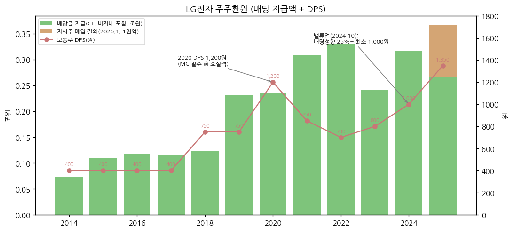

### ⑦ 재무비율

| 연도 | ROE(지배) | ROA | 부채비율 | 유동비율 | OPM | 재고/매출 |
|---|---|---|---|---|---|---|
| 2014 | 3.4% | 1.4% | 185.3% | 111.5% | 3.1% | 9.7% |
| 2015 | 1.1% | 0.7% | 179.7% | 110.9% | 2.1% | 8.6% |
| 2016 | 0.7% | 0.3% | 183.4% | 107.9% | 2.4% | 9.3% |
| 2017 | 13.7% | 4.7% | 180.9% | 109.5% | 4.0% | 9.6% |
| 2018 | 9.0% | 3.4% | 171.8% | 113.0% | 4.4% | 9.8% |
| 2019 | 0.2% | 0.4% | 173.1% | 111.9% | 3.9% | 9.4% |
| 2020 | 13.2% | 4.4% | 174.8% | 115.0% | 5.1% | 11.8% |
| 2021 | 6.3% | 2.8% | 166.1% | 116.4% | 5.2% | 13.1% |
| 2022 | 6.6% | 3.4% | 145.2% | 123.1% | 4.3% | 11.2% |
| 2023 | 3.7% | 2.0% | 156.4% | 125.6% | 4.2% | 10.8% |
| 2024 | 1.8% | 0.9% | 160.3% | 124.2% | 3.9% | 12.2% |
| 2025 | 4.3% | 1.8% | 140.3% | 128.3% | 2.8% | 12.4% |

→ ROE(지배)는 12년 대부분 10% 미만 — 2017(13.7%)·2020(13.2%)만 두 자릿수. 밸류업 목표 2027 ROE 10%+는 정점 사이클 수준 요구

---

## 5. 지배 구조

### ① 그룹·계열 관계

- ㈜LG (지주, 최대주주 구광모 16.60%) → LG전자 35.26% → LG이노텍 40.8%(연결) / LG Electronics India 85%(2025-10 상장 후) / ZKW 70% / Bear Robotics 61.14% / Athom 80%
- 관계·공동기업: LG디스플레이 지분 36.72%(최대주주, 지분법 — LG디스플레이 2025 사업보고서 최대주주 현황) · LG마그나 이파워트레인 51%(공동기업) 등 22개
- ⚠ 이노텍·LG디스플레이·LG마그나 지분율은 2025 사업보고서 기준 확인값으로 다음 버전에서 3Q26 기준 재확인

### ② 주주 구분 (2025-12-31)

| 주주 | 주식수 | 지분율 (보통주) |
|---|---|---|
| ㈜LG | 57,433,029 | 35.26% |
| 국민연금공단 | 10,458,598 | 6.42% |
| 우리사주조합 | 70,784 | 0.04% |
| 외국인 (전체 주식 기준, IR 페이지) | - | 약 31% (2025말) · 32% (2024말) · 30% (2023말) |
| 기타 국내 (기관·개인) | - | 잔여 |

- 발행주식: 보통주 162,886,387주 · 우선주 17,185,992주 (2025말, 소각 후) / 자기주식 보통주 1,749주 · 우선주 4,693주
- 3Q26 최대주주 등: ㈜LG 35.26% 유지, 류재철 CEO 2,349주 취득 [분기보고서 3Q26]

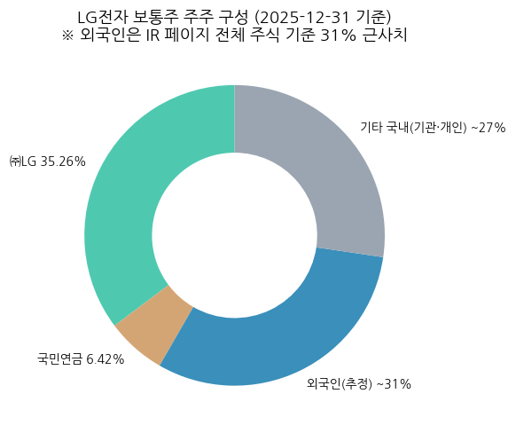

### ③ 임원·이사회

- 이사회 (2026-03 주총 후): 사내이사 류재철(대표이사 CEO)·김창태(CFO) / 기타비상무이사 권봉석(㈜LG COO) / 사외이사 강수진·류충렬·서승우(재선임)·강성춘
- 류재철 CEO: H&A사업본부장(2021\~2024)·HS사업본부장 역임, 가전 사업 프리미엄·구독 전환 주도 → 2025-11 CEO 선임, 2026-03 사내이사 선임 (조주완 퇴임)
- 대표이사 변천: 조성진(2016\~2018) → 권봉석(2019\~2021) → 조주완(2022\~2025) → 류재철(2025-11\~)

---

## 6. 기타 팩트

### ① R&D 인프라

| 연도 | 연구개발비용 총계(억원) | R&D/매출 | 비고 |
|---|---|---|---|
| 2014 | 36,629 | 6.2% | |
| 2015 | 38,098 | 6.7% | |
| 2016 | 38,793 | 7.0% | MC 포함 |
| 2020 | 32,890 | 5.2% | |
| 2021 | 35,721 | 4.8% | MC 철수 후 |
| 2022 | 40,370 | 4.8% | |
| 2023 | 42,834 | 5.1% | |
| 2024 | 47,632 | 5.4% | |
| 2025 | 52,878 | 5.9% | 판관비 2.78조 · 제조원가 1.92조 · 개발비 자산화 0.57조 |
| 1\~3Q26 | 35,879 | 5.0% | |

- 2017\~2019 총계는 원문 표 구조 차이로 미추출 (⚠ 잔여 보완) — 차트는 손익계산서 판관비 내 연구개발비를 함께 표시
- 조직: 사업본부 산하 연구소(1\~2년 출시) + CTO 부문 선행연구, 국내 서초·가산·창원·마곡 + 해외 약 24개 연구소 [2025 사업보고서]
- AI: 가전 전용 온디바이스 AI칩 DQ-1·DQ-C, OLED TV 알파11 프로세서, 그램 온디바이스 AI(엑사원)

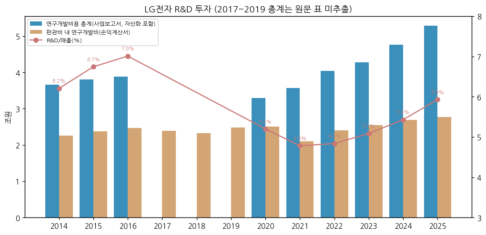

### ② 진행 중 corporate action (10년)

| 시점 | 내용 |
|---|---|
| 2018-08 | ZKW 인수 (약 1.4조원, LG전자 70%) |
| 2021-07 | MC 사업 종료 / 전기차 모터·PE 사업 분할 → LG마그나 이파워트레인 (마그나 49%) |
| 2021-11 | CEM 사업 LG화학 양도 / Cybellum(차량 사이버보안) 69.56% 인수 |
| 2021-12 | Inspur LG 등 중국 휴대폰 합작 지분 매각 |
| 2022-10 | 애플망고(EV 충전기) 60% 인수 → 2025-08 하이비차저 청산 |
| 2024-06 | Athom(스마트홈 플랫폼) 80% 인수 |
| 2025-05 | Bear Robotics 61.14% 인수 (서빙·물류 로봇) |
| 2025-09 | OSO Group(노르웨이 온수 솔루션) 100% 인수 |
| 2025-10 | LG Electronics India NSE·BSE 상장 (구주매출 15%) |
| 2025-12 | LG Electronics (Qinhuangdao) 지분 전량 매각 |
| 2026-01 | 자사주 1천억원 매입 결의 |

### ③ R&D 마일스톤

| 연도 | 내용 |
|---|---|
| 2013 | 세계 최초 OLED TV 양산 출시 → 2013\~2025 OLED TV 13년 연속 1위 |
| 2016 | LG SIGNATURE 프리미엄 가전 브랜드 |
| 2019 | 롤러블 OLED TV 공개 |
| 2021 | 美 주도 6G 연합 의장사 선정 |
| 2022 | 창원 LG스마트파크 WEF 등대공장, UP가전 |
| 2023 | 美 테네시 공장 WEF 등대공장, UP가전 2.0, 6G 테라헤르츠 실외 500m 전송 |
| 2024 | 차량용 webOS 전기차 확대, 차량 솔루션 '알파웨어', 스마트팩토리 사업 |
| 2025 | 가전 OS·온디바이스 AI칩 확대, AIDC 냉각 솔루션 |
| 2026 | 로봇 액추에이터 '악시움' 공개, CDU 2.6MW 엔비디아 승인('DSX Ready'), LG 데이터 팩토리 4Q 가동 |

### ④ 주요 리스크

- 美 관세: 2025 관세 비용 부담이 HS·MS 수익성 압박 [IR 2Q25] — 멕시코·베트남·인도 생산지 스윙으로 대응
- 물류비·원자재: 해상운임(2024 급등), 철판·레진·구리, LCD 패널·메모리 가격(4Q26 MS 원가 부담 전망)
- 환율: 해외 매출 비중 높음, 4개 해외 금융센터 운영·파생 헤지 (투기 목적 금지)
- TV 경쟁: TCL·Hisense 등 중국 업체 점유율 상승 → 2025 MS 적자
- 이노텍 집중도: 애플 의존 → 연결 이익 변동성
- 지분법: LG디스플레이(36.72%) 손익이 순이익에 반영
- 구조조정 비용: 2025 4Q 희망퇴직 (MS 중심)
- 테마 변동성: 2026 로봇·엔비디아 기대로 주가 2026-04말 대비 +217%(6/2 프리마켓) 후 -64% 조정 — 펀더멘털 대비 주가 괴리 확대 구간 존재

### ⑤ ESG

- DJSI World 13년 연속 편입 (2024) / CDP Climate Change A- (2025) / 한국ESG기준원 환경 A (2025)
- RE100 가입(2023), LG전자 2030 탄소중립, SBTi 감축목표 검증(2021)
- 온실가스 배출: 692,539 tCO2e(2023) → 728,069(2024) → 709,243(2025)

### ⑥ 인증·라이선스

- 국내 생산사업장·연구소 환경·안전보건 통합인증 (2010\~), 녹색기업 사업장
- 엔비디아 CDU 승인 (600kW·1MW·2.6MW) / 글로벌 OEM 전장 공급 자격 다수

---

## Source Audit (v1.0)

- ✅ OpenDART 재무 JSON 44건 (2015 FY\~3Q26, 연결) → 12년 연간 + 43분기
- ✅ 정기보고서 공시원문 XML 44건 (2016\~3Q26) → 사업의 내용·점유율·CAPA·R&D·주주·연혁
- ✅ IR 실적발표 PDF 33건 (1Q18\~3Q26, irgo) → 사업부 분기 39분기 (1Q17\~3Q26)
- ✅ 기업개황·주주·배당·직원 JSON (2016·2019·2022·2025 사업연도)
- ✅ Yahoo Finance v8 월간(2002\~) + 일간(2y) → 시총 20년·ATH
- ✅ LG전자 IR 홈페이지(주주 구성·밸류업), 언론(ATH·자사주)
- ❌ IR PDF 5건 다운로드 실패 (3Q17·4Q17·2Q21·3Q21 등) — 인접 분기 PDF 부록으로 전 분기 복원
- ❌ 1Q17 이전 사업부 분기 (IR 미확보) → 60+분기 표준 미달 (39분기)
- ❌ 2017\~2019 연구개발비용 총계 (원문 표 미추출)
- ❌ CSR/지속가능경영보고서 미다운로드 (ESG는 사업보고서 기재 사항으로 대체)
- ⚠ 외국인 지분율은 IR 페이지 연말 반올림 값(전체 주식 기준), 주요 매출처 순서는 추정

## Version Log

| 버전 | 일자 | 내용 |
|---|---|---|
| v1.0 | 2026-11-25 | 첫 작성 — v4.8 표준 6섹션 + 17개 차트 (chart2 6종), 3Q26 반영 |

**잔여 보완 후보 (v1.1)**: 2016 이전 사업부 분기(사업보고서 부문정보 주석) · 2017\~2019 R&D 총계 · 회사채 회차별 발행 내역 · CSR 보고서 · 3Q26 기준 이노텍/LGD 지분율 재확인 · 4Q26 결산 후 2026 연간 반영 (v2.0)
