# LG화학 — 기업 개요 (v1.0)

> 마지막 update: 2026-11-25 (v1.0 — 첫 작성. 3Q26 분기보고서(2026-11-16 제출)·3Q26 실적설명회 IR(2026-11-05) 반영)
> 입력 source: OpenDART fnlttSinglAcntAll (연결 CFS, 2015 사업보고서\~3Q26, 44개 JSON — 2014는 2015 사업보고서 전기 컬럼) + DART 정기공시 원문 XML 본문 52건 + 감사보고서 첨부 16건 (사업·반기·분기 2013.12\~2026.09, 기재정정본 우선 — 2014\~2015 분기 사업부문은 '사업부문별 요약 정보' 누계 차감, 2021\~2Q23 분기 사업부문은 연결 주석 '부문별 정보') + OpenDART 기업개황·최대주주·임원·직원·배당·자기주식·주식총수 (2025 사업보고서·2026 3분기) + LG화학 IR 실적발표 PDF 27건 (1Q19\~3Q26, irgo 경유 — 2021\~2Q23 발표분 9건은 사업부 차트가 이미지라 DART 부문정보로 대체) + LG화학 지속가능경영보고서 2025 (URL 확인, 다운로드는 PC 디스크 공간 부족으로 실패 — ESG는 언론·DART 기준) + Yahoo Finance (051910.KS 월간 2001-05\~2026-11, 일간 2019-01\~2026-11-25 / 051915.KS 우선주 일간) + 언론 (머니투데이·SBS Biz·지디넷코리아·CEO스코어데일리·디지털데일리·비즈워치·한국경제·아이뉴스24 등, 2025-04\~2026-11)
> 갱신 주기: 매분기 (실적 리뷰 모드 호출 시)
> 워치리스트: **소재 / 정유·화학 섹터 / 서브섹터: 화학 (label: 석유화학 부문)** (`earnings/watchlist.md` 84\~86행, 137행) — 2026-11-23 추가 섹터, 4Q26부터 리뷰. 기업 개요는 연결 전체(석유화학 + 첨단소재 + 생명과학 + 팜한농 + LG에너지솔루션)를 다룬다
> **Fact verify cutoff**: 2026-11-24 (보통주 종가 **213,500원** [Yahoo Finance 051910.KS 일간] × 발행 보통주 70,592,343주 [DART 사업보고서(2025.12)] = 보통주 시가총액 **15.07조원**, 우선주 98,100원 × 7,688,800주 = 0.75조 포함 시 **15.83조원** [계산]. 사상 최고 종가 **1,028,000원 (2021-02-05)** → 당시 보통주 시총 **72.57조원** [계산] (장중 최고 1,050,000원, 2021-01-14). 고점 대비 **-79.2%**. YTD **-35.9%** (2025-12-30 종가 333,000원), 1년 **-40.4%** (2025-11-24 종가 358,500원). 자회사 LGES 지분가치 약 **58.4조원** (185,747,525주 × 2026-11-24 종가 약 314,500원 [mydailybyte 2026-11-25 장중 페이지 "307,000원, 전일 대비 -7,500원"에서 역산 — 추정, Yahoo 미검증]) = LG화학 시총의 **3.7배**)

> ⚠️ **시계열 해석 주의 4건**
> ① **2020-12-01 전지사업 물적분할** — ㈜LG에너지솔루션(LGES) 신설. LG화학이 지배(79.38%, 2026-06말)하므로 **연결 실적은 분할 전후 연속** (전지 → 'LG에너지솔루션' 부문으로 이름만 바뀜). 다만 2022-01 LGES IPO 이후 순이익·자본의 상당 부분이 비지배지분(2025말 14.26조)으로 빠진다
> ② **사업부 재편·매각에 따른 소급** — 2019-04 조직개편(기초소재 → 석유화학, EP는 첨단소재로), 2021-02 LCD 편광판 매각, 2023 편광판·편광판소재 매각 결정, 2025-06 Water Solutions(1.4조)·2025-08 에스테틱(2,000억) 매각 → IR·DART는 매각 사업을 중단영업으로 빼고 과거를 다시 쓴다. 본 리포트는 **분기마다 가장 최신 소급본**을 사용 (출처 열 표기)
> ③ **2026-1Q\~ LGES 북미생산보조금(IRA AMPC)을 매출에 병합** — 2023\~2025 DART는 AMPC를 '기타영업수익'(영업이익엔 포함, 매출엔 미포함)으로 표시. IR은 2025년만 같은 기준으로 소급(2025 매출 45.93 → **47.58조**). 따라서 **3Q26 매출 YoY는 DART 단순 비교 +38.4%가 아니라 소급 기준 +34.0%**
> ④ **부문 매출 기준 차이** — 2021\~2Q23 분기 사업부문은 DART '총부문수익'(부문간 매출 포함). 석유화학·LGES는 IR 발표치와 일치(3Q23 교차검증 오차 0%)하나 **첨단소재는 IR과 기준이 달라 크게 다름**(3Q23 IR 1.71조 vs DART 1.31조). 첨단소재 시계열은 2021\~2Q23 구간을 참고치로만 볼 것

---

## 1. 기업 분류

- **Primary 분류: 사이클 — 석유화학 스프레드 사이클 + 배터리(LGES) 투자 사이클의 이중 사이클형** — 12년 OPM range 1.9\~11.8% (9.9%p), 정점 2회(2017·2021)·저점 2회(2019·2024). 석유화학 부문은 2021 OPM 19.7% → 2023\~2025 3년 연속 적자로, 국내 화학업 전형의 "중국 증설 사이클" 경로를 그대로 밟음
- **Secondary 노트: 지주형(LGES 79% 보유) + 첨단소재(양극재) 성장 옵션 + 생명과학 신약 옵션** — 2025 연결 매출의 51.5%가 LGES, 석유화학 38.2% [DART 사업보고서(2025.12) II-1]. 시가총액(15.8조)이 LGES 지분가치(약 58.4조)의 27%에 불과해, **주가는 본업 이익보다 "LGES 지분 할인율 + 석유화학 구조조정"에 연동**

### ① 정량 근거

**📊 Summary Box (12년, 2014\~2025 연결):**

| 지표 | 값 |
|------|-----|
| 매출 CAGR (2014→2025, 11년) | **+6.7%** (22.58조 → 45.93조) — 성장 대부분이 전지(LGES): 전지 2.84조 → 25.32조 (+22.0%/년), 석유화학 17.08조 → 17.89조 (+0.4%/년) [계산] |
| OPM 평균 | **6.6%** (12년 단순평균, 최고 11.8% 2021 · 최저 1.9% 2024) |
| OPM 정점 평균 | **11.6%** (2017 11.4% · 2021 11.8%) |
| OPM 저점 평균 | **2.5%** (2019 3.1% · 2024 1.9%) — 2025 2.6%도 저점권 |
| 사이클 주기 | **약 4\~5년** (정점→정점 2017→2021 = 4년, 저점→저점 2019→2024 = 5년) |
| 사이클 회수 (12년) | **2회** (① 2015\~2019: 저유가 스프레드 확대 → ESS 화재·미중 무역분쟁, ② 2020\~2024/25: 코로나 리오프닝 → 중국 대규모 증설·EV 수요 둔화) |
| 석유화학 부문 OPM (참고) | 정점 16.1% (2017)·19.7% (2021) / 저점 -0.8% (2023)·-0.5% (2024)·-2.0% (2025) [부문 합산, 계산] |

```
[전사 손익 시계열 (12년, 연결, DART, 조원)]
연도   매출   영업이익  순이익   OPM    NPM   지배순이익  비고 (사이클 변곡점)
2014   22.58    1.31     0.85    5.8    3.8     0.87   ← 유가 급락(하반기) 재고손실, 석화 OPM 6.5%
2015   20.21    1.82     1.15    9.0    5.7     1.15   ← 저유가 → 납사 원가↓, 에틸렌 스프레드 확대 (1차 상승 시작)
2016   20.66    1.99     1.28    9.6    6.2     1.28   ← 석화 OPM 14.8%, 팜한농 인수(2016)
2017   25.70    2.93     2.02   11.4    7.9     1.95   ← ★1차 정점: 석화 OPM 16.1%, LG생명과학 합병(2017-01)
2018   28.18    2.25     1.52    8.0    5.4     1.47   ← 미국 ECC(에탄 크래커) 신증설 + 미중 무역분쟁, 4Q18 OPM 3.9%
2019   28.62    0.90     0.38    3.1    1.3     0.31   ← ▼1차 저점: ESS 화재 충당금, 전지 OP -4,543억, 석화 9.1%
2020   30.08    1.80     0.68    6.0    2.3     0.51   ← 코로나 → 하반기 위생·가전 수요 폭증, 2020-12 LGES 분할
2021   42.65    5.03     3.95   11.8    9.3     3.67   ← ★2차 정점: 석화 OPM 19.7%(분기 최고 25.1% 2Q21), GM 리콜 충당 3Q21
2022   51.86    3.00     2.20    5.8    4.2     1.85   ← 고유가·중국 봉쇄로 스프레드 붕괴, 4Q22 석화 적자, 양극재 고성장
2023   55.25    2.53     2.05    4.6    3.7     1.34   ← 매출 정점(LGES 33.7조) / 석화 적자 전환 (-0.8%)
2024   48.92    0.92     0.52    1.9    1.1    -0.69   ← ▼2차 저점: 중국 에틸렌 증설 공급과잉 + EV 캐즘, 지배 순손실
2025   45.93    1.18    -0.98    2.6   -2.1    -1.82   ← 석화 -2.0%, 4Q25 영업손실 4,133억, 워터솔루션 매각(중단영업 +0.82조)
OPM range: 1.9 ~ 11.8% = 9.9%p  (매출은 전지 덕에 2배, 이익률은 석화 스프레드 사이클에 종속)
```

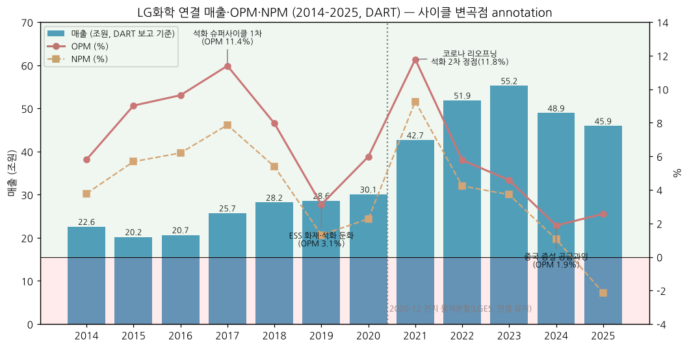

(2014는 2015 사업보고서 전기 컬럼. 각 연도는 해당 연도 사업보고서의 보고 기준 — 이후 매각 사업 소급(예: 2024 매출 48.92 → 2025 사업보고서 재작성 48.70조)은 반영하지 않음. 9M26: 매출 41.92조 (DART, AMPC 병합), 영업이익 1,111억, 지배순손실 8,829억 [DART 분기보고서(2026.09)])

### ② 산업 분류

- 산업: **석유화학(NCC·합성수지) + 전지소재(양극재) + 2차전지(LGES) + 제약·바이오 + 농화학(팜한농)** 의 복합 화학 기업
- DART 업종: 20111 석유화학계 기초화학물질 제조업 / KRX 화학
- 워치리스트: 대분류 **소재** / 섹터 **정유·화학** / 서브섹터 **화학**·**정유·화학** — label "석유화학 부문" (정유·화학 섹터에서는 석유화학 부문 중심으로 추적, 배터리 섹터에서는 자회사 LGES가 별도 종목)
- 시장 지위 (국내 점유율, 2025, DART 사업보고서 II-2): PVC 48.2% · ABS 47.7% · BPA 42.5% · LDPE 37.4% · 가소제 32.6% / NBL(라텍스) 세계 20.4% / OLED 재료 세계 12.6% / 성장호르몬 국내 49.2% · DPP-4 당뇨치료제 23.9%
- 에틸렌 CAPA: 여수 NCC 2기 약 200만톤 [머니투데이 2026-11-05] + 대산 NCC (규모는 이번 버전 미검증) — 여수 2공장 80만톤은 "완전 폐쇄 고려하지 않음" (2026-03 주총, CEO스코어데일리 2026-03-31), GS칼텍스(90만톤)와 통합 협의 중 [머니투데이 2026-11-05]

### ③ 분류 결정 논리

(1) **가장 매출 큰 사업부 기준** 적용 시: LGES = 2025 연결 매출의 51.5%, 석유화학 38.2% [DART 사업보고서(2025.12) II-1]. LGES는 EV·ESS 수요와 미국 정책(IRA)에 좌우되는 **설비투자 사이클형** — 2023 매출 33.7조 → 2025 23.7조(-30%, DART 표시 기준), AMPC 제외 시 2024\~2025 영업적자 (LGES 기업개요 1장) → 매출 기준으로도 **사이클**

(2) **이익 비중 sub-rule**: 2014\~2021 연결 영업이익의 81\~158%를 석유화학이 벌었다 (2017 석화 2.81조 / 연결 2.93조 = 96%, 2019 1.42조 / 0.90조 = 158% — 전지 적자 상쇄, 2021 4.08조 / 5.03조 = 81%) [부문 합산, 계산]. 2022 이후 석화 이익이 사라지면서 이익 주도권이 LGES로 넘어감 (2023 LGES 2.16조 / 연결 2.53조 = 86%). 두 축 모두 **경기·정책 사이클** → **사이클 유지**. 3Q26도 석유화학 -1,756억 vs LGES +7,560억 [IR 3Q26]

(3) **Boundary case 처리 — "사이클 화학 + 지주형 + 성장 옵션"의 혼합 구조**:

| 구성요소 | 3Q26 매출 | 3Q26 OP | 성격 | 분류에 미치는 영향 |
|---|---|---|---|---|
| 석유화학 | 4.76조 | -1,756억 | NCC·PE·ABS·PVC 스프레드 사이클, 중국 증설 직격 | **Primary 사이클의 원천** |
| LG에너지솔루션 (79.38% → 76.59% 예정) | 9.64조 | 7,560억 | EV·ESS·IRA 정책 사이클, 별도 상장 | 연결 이익의 핵심이지만 **주가는 LGES 지분 할인으로 반영** → 지주형 |
| 첨단소재 (양극재 60%대 + 전자·엔지니어링소재) | 1.07조 | 400억 | 북미 EV 고객 물량에 연동 | 성장 옵션 (2027 양극재 출하 2배 가이던스) |
| 생명과학 | 3,370억 | 230억 | 경기 비탄력, 신약 L/O | 안정·옵션 (매출 비중 2%) |
| 팜한농 | 1,000억 | -210억 | 계절성(1H 성수기) | 영향 미미 |

(출처: IR 3Q26 p.5\~9, 부문간 내부거래 포함이라 합계 ≠ 연결 매출)
→ 결론: 매출은 LGES가 과반이지만 **LG화학 주주 입장의 "본업"은 석유화학 + 첨단소재 + 생명과학**이고, LGES는 상장 지분(시장가 58.4조)으로 평가된다. 본업 중 석유화학이 매출의 75% 안팎이라 **Primary = 사이클**, LGES 보유 구조는 **Secondary(지주형)** 로 둔다. 2020-12 물적분할 → 2022-01 중복상장 이후 "지주사 할인" 논쟁(팰리서캐피탈 2026 주주제안)이 밸류에이션의 핵심 변수

(4) **국내외 피어 cross-ref** (같은 날 정유·화학 6종목 병렬 작성 — 각 사 `*_기업개요.md`와 교차 확인 필요):
→ **롯데케미칼**: 순수 NCC·범용 비중이 가장 높은 "순수 석화 사이클형". 대산 NCC 110만톤 폐쇄 승인(대산 1호, HD현대케미칼과 통합), 여수 NCC 여천NCC 통합안(2026-03 최종안 제출) — LG화학보다 구조조정 속도가 빠름 [머니투데이 2026-03-20]. 같은 사이클이지만 LG화학은 다운스트림(ABS·SAP·고무) 비중이 높아 2023\~2025 적자 폭이 상대적으로 작았음
→ **한화솔루션(케미칼)**: 케미칼(PVC·가성소다) + 태양광(큐셀) 혼합 — LG화학과 같은 "화학 + 에너지전환 사업" 구조지만 태양광은 연결 사업부, LG화학은 상장 자회사(LGES)라는 차이. 여천NCC 지분(50%)으로 여수 구조조정에 함께 묶여 있음
→ **금호석유화학**: 합성고무(SBR·NBL)·페놀 중심 다운스트림 — NBL에서 LG화학(세계 20.4%)과 직접 경쟁. NCC가 없어 원료 스프레드보다 제품 스프레드 사이클
→ **SK이노베이션**: **배터리 자회사(SK온) 보유 구조가 가장 유사한 피어** — 정유·석화 사이클 + 배터리 투자 사이클의 이중 사이클형. 차이는 SK온이 비상장(재무적 투자자 지분)이고 적자 지속이라 "지분 유동화 카드"가 LG화학보다 약하다는 점
→ **S-Oil**: 정유 중심 + 샤힌 프로젝트(에틸렌 180만톤, 2027 초 가동 예정) — **LG화학 석유화학의 공급 측 리스크 요인** ("내년 샤힌 프로젝트 가동으로 국내 일부 기초유분과 PE 공급과잉 심화" — LG화학 3Q26 컨콜 [지디넷코리아 2026-11-05])
→ **글로벌 (BASF·Dow·LyondellBasell)**: 2023\~2025 유럽·미국 화학사도 중국 증설·수요 부진으로 구조조정(설비 폐쇄·배당 축소) 국면 — 업종 전체가 같은 다운사이클. 단 미국 에탄 기반(Dow·LYB)은 원가 우위로 저점 OPM이 납사 기반 동북아보다 높음. 이번 버전에서는 글로벌 피어 수치를 검증하지 않음 (다음 버전 보강)

### ④ 적정 밸류에이션 방법

**사업부 mix → 밸류에이션 다이얼**

```
  [순수 석화 사이클]  ←──────────●───────────→  [지주·성장]
   PBR·EV/EBITDA                 ↑              SOTP·NAV 할인율
                       LG화학 현재 위치: SOTP(LGES 지분 할인) 1순위
                                    + 본업 PBR 보조
```

- **1순위: SOTP (LGES 지분가치 할인 + 본업 가치 − 순차입금)** — 시총 15.83조 < LGES 지분 시장가 58.4조. 시장은 LGES 지분을 크게 할인하고(지주사 할인 + 오버행) 석화 본업을 음(-)의 가치로 본다
→ 간단 계산 [계산, 추정]: LGES 지분 58.4조 × (1 − 할인율 d) + 본업 가치 − 별도 순차입금 ≈ 15.83조. 본업 가치를 0으로 놓아도 시총은 LGES 지분의 27% → **할인율 73% 이상이 반영된 상태** (팰리서캐피탈 "NAV 대비 70% 넘게 저평가, 약 60조원 가치 훼손" 주장과 같은 방향 [CEO스코어데일리 2026-03-31])
→ 회사 대응: 2026-01 "약 5년간 LGES 지분을 70% 수준까지 점진 유동화" → 2025-10 PRS 2조 + 2026-10-28 LGES 6,535,939주(약 2.5조, 주당 382,500원 기준) PRS 매각 결정, 처분 예정 2026-11-27 → 지분 79.38% → **76.59%** [SBS Biz 2026-10-28]. 매각대금 세후 현금의 약 20%(4,000억)를 주주환원(자사주 3,000억 매입·소각 + 2026 결산배당 재원)
- **2순위: PBR (본업 사이클 저점 판단용)** — 연말 PBR (보통주 시총 / 지배지분, [계산]): 0.99배(2014) → 1.77배(2017) → **3.22배(2020, 배터리 기대)** → 2.00배(2021) → 1.09배(2023) → **0.53배(2024)** → 0.72배(2025). 현재 **0.47배** (보통주 15.07조 / 3Q26 지배지분 31.81조), 우선주 포함 0.50배
- **3순위: EV/EBITDA (연결, 참고)** — EV = 시총 15.83조 + 순차입금 26.86조 (3Q26 차입금 35.55조 − 현금 8.69조) + 비지배지분 11.80조 = 54.49조 / LTM EBITDA 6.89조 (LTM 영업이익 0.70조 + IR 감가상각 6.19조) ≈ **7.9배** [계산]. LGES 비중이 커서 석화 피어와 직접 비교 불가 — 석화 본업만의 EV/EBITDA는 별도 재무 미공시로 산출 보류
- **PER은 사용 불가** — 2024\~LTM 지배 순손실 (LTM 지배순이익 -2.28조)
- **피어 차별화**: 롯데케미칼·금호석유화학은 PBR + 스프레드 사이클 프레임, LG화학과 SK이노베이션은 SOTP(배터리 자회사) 프레임이 우선

### ⑤ 분기 재평가 트리거 (분류 변경 조건)

- **석유화학 구조조정 확정**: 여수 NCC(GS칼텍스 통합 또는 감축) 재편안이 정부 승인 + 석화 매출 비중이 연결(LGES 제외 본업 기준)의 50% 미만으로 하락 시 → 본업 Primary를 "사이클" → "스페셜티 소재·지주 혼합형"으로 재검토 (현재 본업 매출 중 석화 약 75%)
- **LGES 지분 할인율 축소**: 시총 / LGES 지분가치 비율이 27% → 50%+ 로 회복 (자사주 소각·주주환원 정책 상향, 지분 유동화 대금의 환원 비율 20% → 상향 등) 시 → 지주형 Secondary를 "할인 해소형"으로 갱신
- **양극재(첨단소재) 흑자 정착**: 첨단소재 OPM 4개 분기 연속 5%+ 및 매출 1.5조/분기 회복(2027 양극재 출하 2배 가이던스 검증) 시 → Secondary에 "성장(전지소재)" 비중 확대
- **석화 스프레드 반등 신호**: 석유화학 부문 2개 분기 연속 OPM 5%+ (중국·동북아 설비 폐쇄 2031년까지 약 800만톤 vs 신증설 2,900만톤 — 회사 전망 [머니투데이 2026-11-05]) 시 → 사이클 저점 통과 판정
- **재무 안정성 이탈**: 국내 신용등급 AA → AA- 하향, 또는 순차입금비율 70%+ (3Q26 60.4%) 시 → 사이클 저점 장기화 + 유동화 압력 리스크로 분류 메모 추가

---
## 2. 회사 개요

### ① 기본 사항

- **회사명**: ㈜LG화학 (LG Chem, Ltd.) / KRX 051910 (보통주), 051915 (우선주) — 유가증권시장 2001-04-25 상장 [DART 사업보고서(2025.12) I-1]
- **본사**: 서울특별시 영등포구 여의대로 128 LG트윈타워
- **설립**: 1947 락희화학공업사(럭키) 창업(일반 연혁, 미검증) → 2001-04-01 기존 ㈜LG화학(현 지주사 ㈜LG의 전신)에서 분할되어 현 법인 신설 (DART 사업보고서 I-1, OpenDART est_dt 2001-04-01) → 2009-04 LG하우시스 분할 → 2016 팜한농 인수 → 2017-01-02 LG생명과학 흡수합병 → 2020-12-01 전지사업부 물적분할(LGES)
- **지배구조**: ㈜LG 31.52% 최대주주 (특수관계인 포함 31.54%, 발행주식총수 기준 / 보통주 기준 34.95%) [DART 분기보고서(2026.09) VII, 사업보고서(2025.12) VII-3]. 국민연금 8.56% (보통주 기준)
- **사업 한 줄 정의**: 국내 최대 석유화학사(여수·대산 NCC, PVC·ABS·SAP 국내 1위권)이면서, 세계 3위권 배터리 셀 메이커 LGES(지분 79.38%)의 모회사이자 양극재·전자소재·신약·농화학까지 가진 복합 화학 그룹
- **대표이사**: 김동춘 사장 (CEO 겸 첨단소재사업본부장 — 전 전자소재사업부장, 2026-03-31 제25기 주총 사내이사 선임. 전임 신학철 부회장) [DART 사업보고서(2025.12) VI, 분기보고서(2026.09) VII]. CFO 차동석 사장
- **연결 종속회사**: 76개 (상장 1 = LGES, 2025말) [DART 사업보고서(2025.12) I-1]
- **임직원 (별도)**: 12,869명 (석유화학 5,800 · 첨단소재 3,462 · 생명과학 1,834 · 공통 1,773), 평균 근속 14년, 1인 평균 급여 1.07억원 (2025말) [DART 사업보고서(2025.12) VIII]
- **신용등급**: 국내 **AA** (한국기업평가, 2026-07-01 AA+ → AA 하향 [한국경제 2026-07-01]; 한국신용평가·NICE는 2025-06 AA+, 이후 변동 미검증) / 해외 **Moody's Baa2** (2025-11-17, Baa1에서 하향) · **S&P BBB** (2025-03-04, BBB+에서 하향) [DART 사업보고서(2025.12) I-1 사]

### ② 최근 12년 손익·자본 추이 (조원, 연결, DART)

| 연도 | 매출 | YoY | 영업이익 | OPM | 순이익 | 지배순이익 | 자본총계 | 지배지분 | 자본 YoY |
|---|---|---|---|---|---|---|---|---|---|
| 2014 | 22.58 | - | 1.31 | 5.8% | 0.85 | 0.87 | 12.27 | 12.14 | - |
| 2015 | 20.21 | -10.5% | 1.82 | 9.0% | 1.15 | 1.15 | 13.10 | 12.99 | +6.8% |
| 2016 | 20.66 | +2.2% | 1.99 | 9.6% | 1.28 | 1.28 | 14.05 | 13.94 | +7.2% |
| 2017 | 25.70 | +24.4% | 2.93 | 11.4% | 2.02 | 1.95 | 16.34 | 16.17 | +16.3% |
| 2018 | 28.18 | +9.7% | 2.25 | 8.0% | 1.52 | 1.47 | 17.32 | 17.08 | +6.0% |
| 2019 | 28.63 | +1.6% | 0.90 | 3.1% | 0.38 | 0.31 | 17.38 | 17.00 | +0.4% |
| 2020 | 30.08 | +5.1% | 1.80 | 6.0% | 0.68 | 0.51 | 18.79 | 18.04 | +8.1% |
| 2021 | 42.65 | +41.8% | 5.03 | 11.8% | 3.95 | 3.67 | 23.21 | 21.69 | +23.5% |
| 2022 | 51.86 | +21.6% | 3.00 | 5.8% | 2.20 | 1.85 | 37.48 | 31.45 | +61.5% |
| 2023 | 55.25 | +6.5% | 2.53 | 4.6% | 2.05 | 1.34 | 40.94 | 32.19 | +9.2% |
| 2024 | 48.92 | -11.5% | 0.92 | 1.9% | 0.52 | -0.69 | 48.00 | 33.28 | +17.2% |
| 2025 | 45.93 | -6.1% | 1.18 | 2.6% | -0.98 | -1.82 | 47.11 | 32.85 | -1.9% |

(연결 기준, OpenDART fnlttSinglAcntAll, 각 연도 사업보고서 보고치. 2022 자본 +61.5% = LGES IPO 공모 10.2조 유입(비지배지분 1.52 → 6.03조). 2024\~2025 지배순손실은 LGES 비지배 몫을 뺀 뒤 석화 적자·손상(2025 유형자산 손상 1.89조 [DART 사업보고서(2025.12) II-3])이 반영된 결과. 3Q26말 자본총계 43.61조로 2025말 대비 -7.4% — 환율 하락에 따른 해외사업장 환산손실(9M26 기타포괄 -4.6조) 영향 [DART 분기보고서(2026.09)])

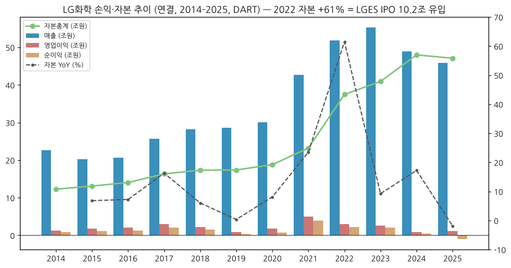

### ③ 회사 주가 역사 ★ narrative 영역

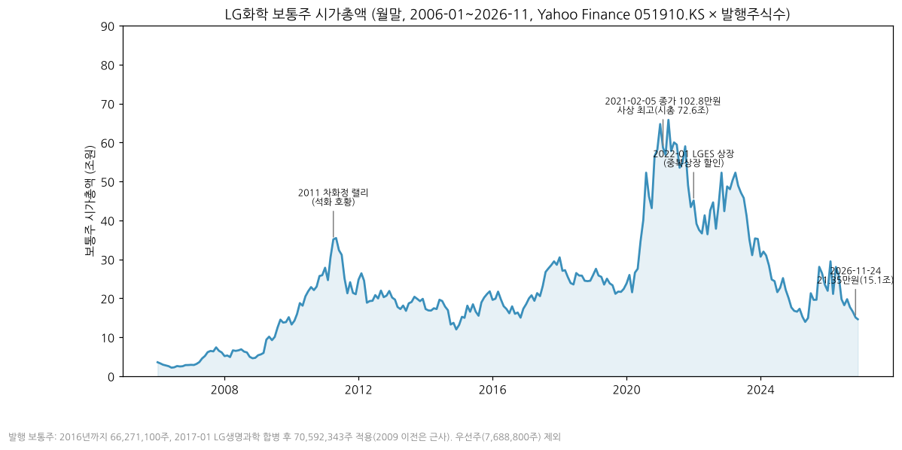

> 가격 처리: Yahoo Finance 051910.KS 월말 종가 × 발행 보통주 (2016년까지 66,271,100주, 2017-01 LG생명과학 합병 후 70,592,343주). 2009 이전 주식수는 근사치. 우선주 제외. 사상 최고 종가는 일간 데이터 기준

(1) 2006\~2011: 중국 수요 + "차·화·정" 랠리 → 1차 대세 상승
→ 2006 월말 종가 3만원대 → 2009-12 228,500원 → **2011-05 월말 535,000원** (당시 보통주 시총 약 35조 [계산]) — 중국 경기부양·석화 호황 + 전지(2차전지) 기대

(2) 2011\~2019: 장기 박스권 (월말 18\~43만원)
→ 2014-12 181,000원 (유가 급락 재고손실, 10년 박스 저점) → 2015\~2017 저유가 스프레드 확대로 영업이익 1.3조 → 2.9조, 2017-11 41.75만원
→ 2018\~2019 미국 에탄크래커 증설·미중 무역분쟁 + 국내 ESS 화재 → 2019 OPM 3.1%, 주가 30만원대

(3) 2020\~2021-02: 배터리 재평가 → **사상 최고**
→ 2020-03 305,000원(코로나 저점) → 2020-12 824,000원 (+170%) — EV 배터리 수주·흑자 전환, 석화 위생·가전 수요 폭증 (3Q20 석화 OPM 20.1%)
→ 2020-09 전지 물적분할 결정 발표 → 소액주주 반발(중복상장 할인 우려), 2020-10 "3년간 보통주 최소 1만원 배당" 공시로 보완 [DART 사업보고서(2022.12) V-6]
→ **2021-02-05 종가 1,028,000원 (보통주 시총 72.57조)** — 사상 최고 [Yahoo]. 2021 연간 영업이익 5.03조(사상 최대)

(4) 2021-03\~2024: LGES 상장(중복상장 할인) + 석화 다운사이클
→ 2022-01-27 LGES 상장 (공모가 30만원) → LG화학 주가에서 배터리 프리미엄이 LGES로 이전
→ 2022 하반기 중국 봉쇄·고유가로 석화 스프레드 붕괴 (4Q22 석화 영업손실) / 2023 양극재 고성장 기대로 2023-04 74만원 반등 후 하락
→ 2024 중국 에틸렌 대규모 증설 + EV 캐즘 → **2024-12 월말 250,000원** (보통주 시총 17.6조, PBR 0.53배)

(5) 2025\~2026: 자산 경량화·지분 유동화 기대 vs 석화 적자 장기화
→ 2025-05 장중 182,400원 (DART 월간 최저가 [사업보고서(2025.12) VII-4]) → 워터솔루션 1.4조 매각(2025-06)·에스테틱 2,000억 매각(2025-08)·LGES 지분 PRS 2조(2025-10) → 2025-11 장중 419,500원
→ 2026-01 "LGES 지분 5년간 70%까지 유동화" 발표 [비즈워치 2026-01-29], **2026-02 월말 417,500원** (2026 고점권)
→ 2026-03-31 주총: 팰리서캐피탈 권고적 주주제안·선임독립이사 안건 부결 [CEO스코어데일리 2026-03-31]
→ 2026 중동 전쟁 → 유가 급등·납사 수급 불안 → 원료가 역래깅으로 3Q26 석화 적자 전환 [머니투데이 2026-11-05]. 2026-10-28 LGES 지분 2.5조 추가 매각 + 자사주 3,000억 소각 발표에도 11-06 실적 다음 날 -5.7% [mydailybyte 2026-11-09]
→ **2026-11-24 종가 213,500원 (보통주 시총 15.07조)** — YTD -35.9%, 사상 최고 대비 -79.2%

### ④ 회사의 주요 연혁

```
1947         락희화학공업사 창업 (럭키 → LG그룹 모태)  (미검증 — 회사 일반 연혁)
1969         국내 최초 PVC 공장 (울산)  (미검증 — 회사 일반 연혁)
1976         여수 PVC 공장 / 1990년대 여수 NCC 가동 (미검증 — 회사 일반 연혁)
1992         2차전지 연구 착수 (LGES 2025 ESG Report)
2001-04-01   기존 ㈜LG화학에서 분할 → 현 ㈜LG화학 신설, 2001-04-25 상장
2009-04-01   LG하우시스(건자재) 인적분할
2011         카자흐스탄 에탄 기반 PE 80만톤 합작 투자 결정 (총 42.4억불)
2016         팜한농(구 동부팜한농) 인수  (일반 연혁 — DART 2016 사업보고서 미대조)
2017-01-02   LG생명과학 흡수합병 (생명과학사업본부)
2019-04      조직개편: 기초소재 → 석유화학 / 첨단소재 신설
2020-12-01   전지사업부 물적분할 → ㈜LG에너지솔루션 설립
2021-02      LCD 편광판 사업 매각 완료
2021-06      여수 제2 NCC Complex 증설 완료
2022-01-27   LGES 유가증권시장 상장 (공모 10.2조)
2023-01      미국 항암제 회사 AVEO Pharmaceuticals 인수 (USD 5.71억)
2023-07      LGES 주식 대상 교환사채 발행 (1차, 2차 2025-05 — LGES 기업개요 5장)
2024-02      LG Chem America Advanced Materials 설립 (테네시 양극재)
2025-06-13   Water Solutions(RO 필터) 사업 매각 계약 — 1.4조원 (양수: Korea Water Solution Holdings)
2025-08-07   에스테틱 사업 매각 계약 — 2,000억원 (VIG파트너스)
2025-10      LGES 지분 PRS 약 2조원 (575만주)
2026-01-29   LGES 지분 5년간 70% 수준까지 점진 유동화 방침
2026-03-31   제25기 주총 — 김동춘 사내이사 선임, 팰리서 주주제안 부결
2026-10-28   LGES 6,535,939주(약 2.5조) PRS 처분 결정 + 자사주 1,389,851주(약 3,000억) 매입·소각 결정
2026-10-30   대산 BPA 사업 국도화학 계열에 784억원 매각 결정 (CEO스코어데일리)
```

(출처: DART 사업보고서(2025.12) I-1·I-2·II-6, 사업보고서(2014.12) II(카자흐스탄), SBS Biz 2026-10-28, CEO스코어데일리 2026-03-31·2026-10-30, 비즈워치 2026-01-29, 디지털데일리 2026-02-02, 아이뉴스24(워터솔루션) / 1969·1976 항목은 회사 일반 연혁으로 이번 버전 미검증)

---

## 3. 비즈니스 모델

### ① 실적 추이 (연결 → 부문 → 제품군 3단계 위계)

**(1) 연결 + 사업부문 5년 (억원)**

| 구분 (억원) | 2021 | 2022 | 2023 | 2024 | 2025 | 9M26 | 비고 |
|---|---|---|---|---|---|---|---|
| **연결 매출** | 426,547 | 518,649 | 552,498 | 489,161 | 459,322 | 419,186 | DART 보고 기준 (9M26은 AMPC 병합) |
| **연결 영업이익** | 50,255 | 29,957 | 25,292 | 9,168 | 11,809 | 11,111 | |
| 연결 OPM | 11.8% | 5.8% | 4.6% | 1.9% | 2.6% | 2.7% | |
| 석유화학 매출 | 207,596 | 217,234 | 178,085 | 191,600 | 178,850 | 145,560 | 부문간 포함 |
| └ 영업이익 | 40,815 | 10,745 | -1,435 | -1,050 | -3,560 | 4,160 | |
| └ OPM | 19.7% | 4.9% | -0.8% | -0.5% | -2.0% | 2.9% | |
| LG에너지솔루션 매출 | 178,207 | 255,986 | 337,456 | 256,200 | 253,180 | 237,580 | 부문간 포함 |
| └ 영업이익 | 7,711 | 12,159 | 21,628 | 5,740 | 13,460 | 6,610 | |
| └ OPM | 4.3% | 4.8% | 6.4% | 2.2% | 5.3% | 2.8% | |
| 첨단소재 매출 | 47,924 | 70,821 | 78,148 | 60,810 | 40,630 | 29,150 | 부문간 포함 |
| └ 영업이익 | 2,359 | 9,080 | 5,693 | 4,480 | 1,460 | 170 | |
| └ OPM | 4.9% | 12.8% | 7.3% | 7.4% | 3.6% | 0.6% | |
| 생명과학 매출 | 7,604 | 9,091 | 11,829 | 13,340 | 13,540 | 10,190 | 부문간 포함 |
| └ 영업이익 | 670 | 735 | 282 | 1,100 | 1,290 | 1,170 | |
| └ OPM | 8.8% | 8.1% | 2.4% | 8.2% | 9.5% | 11.5% | |
| 팜한농 매출 | n/a | n/a | n/a | 7,620 | 7,750 | 6,400 | 부문간 포함 |
| └ 영업이익 | n/a | n/a | n/a | 440 | 380 | 390 | |
| └ OPM | n/a | n/a | n/a | 5.8% | 4.9% | 6.1% | |

(출처: 연결 = OpenDART 사업보고서 보고치. 부문 = 2021\~2Q23 DART 연결 주석 '부문별 정보'(총부문수익·보고부문영업이익, 누계 차감) + 3Q23\~3Q26 LG화학 IR 실적발표(각 분기 최신 소급본). 부문 합계는 내부거래 제거 전이라 연결과 다름. 팜한농은 2021\~2Q23 DART에서 '공통부문 및 기타'에 포함되어 분리 불가(n/a). 2025 LGES 25.32조는 IR의 AMPC 병합 소급치 — LGES 기업개요의 DART 표시치 23.67조와 기준 차이)

**(2) 사업부문 12년 (억원, 연간 = 분기 합산)**

| 연도 | 석유화학 매출 | 석화 OP | 석화 OPM | 전지/LGES 매출 | 전지 OP | 전지 OPM | 첨단소재(정보전자) 매출 | 첨단 OP | 생명과학 매출 | 생명 OP |
|---|---|---|---|---|---|---|---|---|---|---|
| 2014 | 170,804 | 11,173 | 6.5% | 28,358 | 649 | 2.3% | 26,573(정보전자) | 1,581 | - | - |
| 2015 | 144,635 | 16,769 | 11.6% | 31,471 | 5 | 0.0% | 22,882(정보전자) | 1,173 | - | - |
| 2016 | 144,471 | 21,386 | 14.8% | 35,617 | -493 | -1.4% | 26,561(정보전자) | -550 | 5,322 | 472 |
| 2017 | 174,269 | 28,081 | 16.1% | 45,606 | 289 | 0.6% | 30,587(정보전자) | 1,114 | 5,514 | 536 |
| 2018 | 169,877 | 20,314 | 12.0% | 65,197 | 2,092 | 3.2% | 47,127 | 713 | 5,751 | 495 |
| 2019 | 155,480 | 14,164 | 9.1% | 83,503 | -4,543 | -5.4% | 34,547 | 71 | 6,278 | 372 |
| 2020 | 142,659 | 19,679 | 13.8% | 123,557 | 3,883 | 3.1% | 36,107 | 1,628 | 6,613 | 539 |
| 2021 | 207,596 | 40,815 | 19.7% | 178,207 | 7,711 | 4.3% | 47,924 | 2,359 | 7,604 | 670 |
| 2022 | 217,234 | 10,745 | 4.9% | 255,986 | 12,159 | 4.8% | 70,821 | 9,080 | 9,091 | 735 |
| 2023 | 178,085 | -1,435 | -0.8% | 337,456 | 21,628 | 6.4% | 78,148 | 5,693 | 11,829 | 282 |
| 2024 | 191,600 | -1,050 | -0.5% | 256,200 | 5,740 | 2.2% | 60,810 | 4,480 | 13,340 | 1,100 |
| 2025 | 178,850 | -3,560 | -2.0% | 253,180 | 13,460 | 5.3% | 40,630 | 1,460 | 13,540 | 1,290 |

(2014\~2015 = DART 사업보고서 '사업부문별 요약 정보' (2015는 기초소재), 2016\~2017 = IR 구조직(기초소재, EP 포함 / 정보전자소재), 2018 이후 = IR 신조직(첨단소재 = 정보전자 + 재료 + EP 등). 전지 2014\~2020은 LG에너지솔루션_기업개요 1장 표와 동일 수치(2018 65,197 vs LGES 문서 64,989 — 2019 IR 신조직 재분류 차이 0.3%))

**(3) 석유화학 제품군 (IR 매출 비중, 3Q26)**: NCC/PO 34% · ABS 29% · PVC/가소제 11% · 아크릴/SAP 12% · HPM(고무·특수수지 등) 14% (2026-07-01 조직개편 소급 — 알코올을 PVC/가소제에서 아크릴/SAP로 이관) [IR 3Q26 p.5]. 2018\~2020 비중: NCC/PO 32\~34%, ABS 27\~32%, PVC 14\~15%, 아크릴/SAP 12\~15%, 고무/특수수지 9\~11% [IR 2019\~2021 Appendix]

**(4) 첨단소재 제품군 (3Q26)**: 전지소재(양극재 등) 36% · 전자소재/기타 35% · 엔지니어링소재 29% [IR 3Q26 p.6] — 2Q26 전지소재 비중 26%에서 상승

**(5) 연결 지역·내수 구성 (2025, DART)**: 수출 21.57조 (47.0%) / 내수 24.36조 (53.0%). 석유화학 수출 비중 57.5% (10.10 / 17.57조) [DART 사업보고서(2025.12) II-4]

**① 사업부별 15년 분기 시계열 (chart2, 매출 bar + OPM line)**

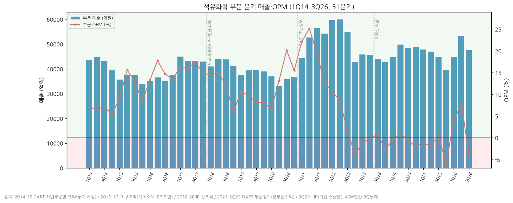

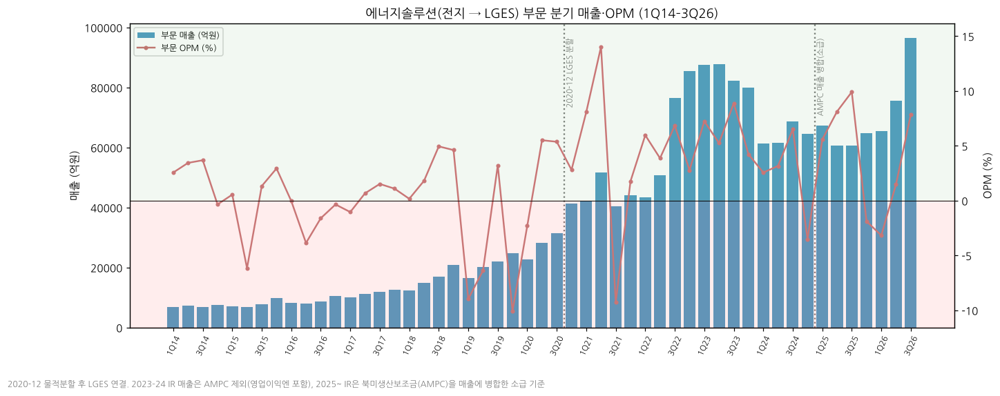

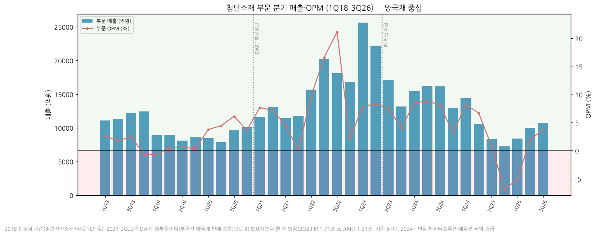

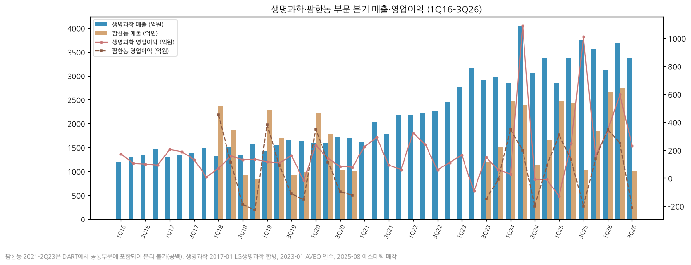

**석유화학 부문 분기 시계열 (1Q14\~3Q26, 51분기, 억원 / OPM)**

| 연도 | 1Q 매출 / OPM | 2Q | 3Q | 4Q | 출처 |
|---|---|---|---|---|---|
| 2014 | 43,639 / 7.1% | 44,714 / 6.5% | 43,064 / 7.1% | 39,386 / 5.4% | DART |
| 2015 | 35,643 / 9.0% | 37,600 / 15.7% | 37,497 / 12.9% | 33,895 / 8.3% | DART |
| 2016 | 35,120 / 13.3% | 36,528 / 17.8% | 35,247 / 14.7% | 37,576 / 13.5% | IR19구 |
| 2017 | 44,953 / 16.3% | 43,186 / 15.9% | 43,160 / 17.5% | 42,970 / 14.7% | IR19구 |
| 2018 | 41,003 / 14.6% | 44,025 / 15.1% | 43,844 / 12.1% | 41,005 / 5.9% | IR19신 |
| 2019 | 37,488 / 10.6% | 39,364 / 9.7% | 39,648 / 8.1% | 38,980 / 8.1% | IR21 |
| 2020 | 36,959 / 6.6% | 33,128 / 13.1% | 35,836 / 20.1% | 36,736 / 15.5% | IR21 |
| 2021 | 44,352 / 22.2% | 52,674 / 25.1% | 56,301 / 19.3% | 54,269 / 12.6% | DART |
| 2022 | 59,635 / 10.6% | 59,876 / 8.6% | 54,931 / 1.7% | 42,792 / -3.9% | DART |
| 2023 | 45,786 / -1.1% | 45,589 / -0.3% | 44,110 / 0.8% | 42,600 / -2.7% | DART, IR24-10, IR25-02 |
| 2024 | 44,610 / -0.5% | 49,820 / 0.9% | 48,310 / -0.6% | 48,860 / -2.1% | IR25-04, IR25-08, IR25-10, IR26-01 |
| 2025 | 47,810 / -1.2% | 46,960 / -1.9% | 44,610 / 0.7% | 39,470 / -6.1% | IR26-04, IR26-07, IR26-11 |
| 2026 | 44,720 / 3.7% | 53,290 / 8.0% | 47,550 / -3.7% | - | IR26-11 |

(출처 표기: DART = 공시원문 누계 차감, IR19구/IR19신 = 2019-04 실적자료 Appendix 조직개편 전·후, IR21 = 2021-01 실적자료 Appendix, IR yy-mm = 해당 월 IR 발표본(최신 소급). 분기 최고 OPM 25.1% (2Q21), 최저 -6.1% (4Q25))

**① 12분기 연결 + 부문 (억원)**

| 분기 | 연결 매출 | 연결 OP | OPM | 석유화학 매출 | 석화 OP | 석화 OPM | LGES 매출 | LGES OP | 첨단소재 매출 | 첨단 OP | 생명과학 OP | 팜한농 OP |
|---|---|---|---|---|---|---|---|---|---|---|---|---|
| 4Q23 | 131,348 | 2,474 | 1.9% | 42,600 | -1,170 | -2.7% | 80,010 | 3,380 | 13,190 | 530 | 60 | -10 |
| 1Q24 | 116,094 | 2,646 | 2.3% | 44,610 | -210 | -0.5% | 61,290 | 1,570 | 15,450 | 1,320 | 30 | 350 |
| 2Q24 | 122,997 | 4,059 | 3.3% | 49,820 | 460 | 0.9% | 61,620 | 1,950 | 16,210 | 1,430 | 1,090 | 200 |
| 3Q24 | 126,704 | 4,984 | 3.9% | 48,310 | -290 | -0.6% | 68,780 | 4,480 | 16,170 | 1,320 | -10 | -200 |
| 4Q24 | 123,366 | -2,520 | -2.0% | 48,860 | -1,010 | -2.1% | 64,510 | -2,260 | 12,980 | 410 | -10 | 90 |
| 1Q25 | 121,710 | 4,470 | 3.7% | 47,810 | -560 | -1.2% | 67,230 | 3,750 | 14,400 | 1,180 | -130 | 310 |
| 2Q25 | 114,177 | 4,768 | 4.2% | 46,960 | -900 | -1.9% | 60,560 | 4,920 | 10,600 | 710 | 250 | 130 |
| 3Q25 | 111,962 | 6,797 | 6.1% | 44,610 | 290 | 0.7% | 60,650 | 6,010 | 8,380 | 70 | 1,010 | -200 |
| 4Q25 | 111,971 | -4,133 | -3.7% | 39,470 | -2,390 | -6.1% | 64,740 | -1,220 | 7,250 | -500 | 160 | 140 |
| 1Q26 | 122,468 | -497 | -0.4% | 44,720 | 1,650 | 3.7% | 65,550 | -2,080 | 8,430 | -430 | 340 | 350 |
| 2Q26 | 141,759 | 5,996 | 4.2% | 53,290 | 4,270 | 8.0% | 75,600 | 1,130 | 9,990 | 200 | 600 | 250 |
| 3Q26 | 154,960 | 5,612 | 3.6% | 47,550 | -1,760 | -3.7% | 96,430 | 7,560 | 10,730 | 400 | 230 | -210 |

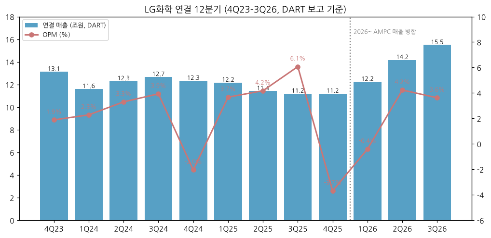

(연결 = DART 보고 기준(2026 분기는 AMPC 병합 → 2025 이전과 매출 기준 상이), 부문 = IR. **3Q26: 매출 15.50조 (YoY +38.4% DART 단순 / +34.0% IR 소급 기준 11.56조 대비, QoQ +9.3%), 영업이익 5,612억 (YoY -17.4%, QoQ -6.4%), OPM 3.6%, 당기순손실 6,000억 (지배 -6,482억)** [DART 분기보고서(2026.09), IR 3Q26]. **석유화학 3Q26: 매출 4.755조 (YoY +6.6%), 영업손실 1,756억 (OPM -3.7%)**)

### ② 사업부별 개요 (매출 비중 큰 순서, 2025 DART 외부매출 기준)

| 순위 | 사업부 | 2025 외부매출 | 비중 | 주요 제품 | 생산 거점 |
|---|---|---|---|---|---|
| 1 | LG에너지솔루션 | 23.66조 | 51.5% | EV·ESS·소형 배터리 | 오창, 남경, 미시간, 폴란드, 북미 JV |
| 2 | 석유화학 | 17.57조 | 38.2% | 에틸렌·프로필렌, PE·PP·PVC·ABS·SAP·아크릴·합성고무·NBL | 여수·대산·나주·익산, 중국 천진·영파, 미국 오하이오 |
| 3 | 첨단소재 | 2.64조 | 5.7% | 양극재, 분리막, EPC, OLED 재료, 반도체 소재 | 청주, 구미, 중국 우시·광주, 미국 테네시(양극재, 2027-1Q 본격 양산) |
| 4 | 생명과학 | 1.35조 | 2.9% | 제미글로(당뇨), 유트로핀(성장호르몬), 백신(유펜타·유폴리오), 포티브다(신장암, AVEO) | 익산·오송·온산, 중국 북경, 인도 |
| 5 | 공통 및 기타 (팜한농) | 0.72조 | 1.6% | 작물보호제, 종자, 비료 | 구미·완주·울산 |

(출처: DART 사업보고서(2025.12) II-1·II-2·II-4. 외부매출 = 내부거래 소거 후, Water Solutions·편광판 제외 소급)

### ③ 사업부별 디테일

**(1) 석유화학 — 원가(납사) vs 제품가 스프레드 사이클의 본체**
→ 원재료: 납사·EDC 매입 11.09조 (2025, 연결 매입액의 47.6%, GS칼텍스·Mitsui 등). 국내 납사 848,660원/톤 (2025) vs 920,293원 (2024) [DART 사업보고서(2025.12) II-3]
→ 제품가 (국제 평균, 원/톤, 2023→2024→2025): PVC 1,059→1,052→998천 / LDPE 1,297→1,492→1,478천 / ABS 1,701→1,914→1,860천 / 합성고무(BR) 1,996→2,495→2,204천 / BPA 1,661→1,757→1,646천 [DART 사업보고서(2025.12) II-2]
→ 가동률 (금액 기준): 2023 75.9% → 2024 83.4% → 2025 **78.1%** [DART 사업보고서(2025.12) II-3]
→ 사이클 메커니즘: (i) 2015\~2017 저유가 → 납사 원가 하락이 제품가 하락보다 커서 에틸렌·ABS 스프레드 확대 (석화 OPM 11.6% → 16.1%), (ii) 2018\~2019 미국 셰일 에탄크래커(ECC) 증설 + 무역분쟁, (iii) 2020\~2021 코로나 위생(NB라텍스·PVC)·가전(ABS) 특수 → 2Q21 분기 OPM 25.1%, (iv) **2022\~2025 중국 대규모 에틸렌·PE·ABS 증설 → 자급률 상승·수출 축소 → 3년 연속 적자**, (v) 2026 중동 전쟁발 고유가 → 1Q\~2Q26 재고효과로 흑자(2Q26 OPM 8.0%) → 3Q26 원료가 역래깅으로 적자 재전환
→ 경영진 코멘트 (3Q26 컨콜, 차동석 CFO): "석유화학은 원료 가격 역래깅 영향과 비용 증가로 적자 전환했으나 첨단소재와 에너지솔루션의 수익성 개선에 힘입어 전사 실적은 안정적인 수준을 유지했다" / "글로벌 설비 일부 폐쇄에도 공급과잉 상황이 지속될 것" / "내년 샤힌 프로젝트가 가동을 시작하면서 국내 일부 기초유분과 폴리에틸렌(PE) 제품의 공급과잉이 심화될 전망" [지디넷코리아 2026-11-05]
→ 시사점: 회사 스스로 **2027년까지 업황 회복을 전제하지 않음** — 실적 반등은 스프레드가 아니라 구조조정(NCC 감축·통합)과 고부가 전환(반도체용 IPA, EV 타이어용 SSBR, 자동차용 ABS)에서 나와야 한다
→ 구조조정: 여수 NCC 2기(약 200만톤) 중 GS칼텍스(90만톤)와 통합(GS칼텍스의 LG NCC 인수 유력안) 협상 — 공정거래법상 증손회사 지분 요건·자산가치 이견이 걸림돌 [머니투데이 2026-03-20]. "연내 재편 계획안 제출 목표, 일부 절차상 지연" (차동석 CFO, 3Q26) [머니투데이 2026-11-05]. 정부 최소 감축 목표 270만톤 (업계 전체) [머니투데이 2026-03-20]. 대산 BPA(16.5만톤) 784억원 매각 결정 [CEO스코어데일리 2026-10-30]

**(2) LG에너지솔루션 (상세는 `LG에너지솔루션_기업개요.md` 참조 — 여기서는 LG화학 연결 관점만)**
→ 지분율 79.38% (185,747,525주, 2026-06말) → 2026-11-27 6,535,939주 처분 예정분 반영 시 **76.59%** [SBS Biz 2026-10-28]. 2025-10 PRS 575만주·교환사채 교환으로 81.84% → 79.38% (LGES 기업개요 5장)
→ 3Q26 IR: 매출 9.64조, 영업이익 7,560억 (OPM 7.8%, 북미생산보조금 포함) — LG화학 연결 영업이익 5,612억보다 큼 (나머지 부문 합계 적자)
→ LG화학 연결 CapEx의 약 79%: 2025 LGES 신·증설 10.48조 vs LG화학 본업 2.66조 [DART 사업보고서(2025.12) II-3-마]
→ 수치 정합: 본 문서 LGES 부문 연간치는 LGES 기업개요와 2014\~2020·2022\~2024 일치(±0.2%), **2021은 17.82조(LG화학 부문정보) vs 17.85조(LGES 연결)**, **2025는 25.32조(IR AMPC 병합 소급) vs 23.67조(LGES DART 표시)** — 기준 차이

**(3) 첨단소재 — 양극재(전지소재) + 전자소재 + 엔지니어링소재**
→ 2022 매출 7.08조·OPM 12.8% (리튬가 급등기 양극재 판가↑) → 2025 4.06조·3.6% → 9M26 2.92조·0.6% — 북미 고객(GM 등) 전동화 전략 변경, 메탈가 하락 [DART 사업보고서(2025.12) II-1]
→ 가동률 2023 53.9% → 2024 65.9% → 2025 **53.1%** [DART 사업보고서(2025.12) II-3]
→ 경영진 코멘트 (3Q26 컨콜): "2027년에는 올해 3분기부터 출하가 시작된 프로젝트 공급 물량이 본격적으로 확대되고 연중 출하가 지속되면서 연간 출하량은 올해 대비 2배 이상 증가할 것으로 예상한다" / "내년에도 메탈 가격 하락세가 이어질 경우 물량 증가에 비해 매출 성장 폭은 제한적일 수 있다" [지디넷코리아 2026-11-05]
→ 시사점: 물량 2배 ≠ 매출 2배 — 2027 첨단소재 리뷰의 핵심 체크는 **출하량 vs 판가(메탈 연동)** 분리. 테네시 양극재 공장 시양산 → 2027-1Q 본격 양산, 고밀도 LFP 양극재 4만톤 공급망(2028\~2029 수요 대응)
→ 전자소재: 매출 약 1조 → 2030 2조 목표, 반도체 스트리퍼·PID·유리기판 TGV 소재 [CEO스코어데일리 2026-10-30]. OLED 재료 세계 점유율 12.6%

**(4) 생명과학 — 안정 + 신약 L/O 옵션**
→ 매출 2016 5,322억 → 2025 1.35조 (CAGR +10.9% [계산]). 2023-01 AVEO 인수(USD 5.71억)로 미국 항암 진출, 2023 OPM 2.4%(인수 비용) → 2025 9.5%
→ 희귀비만 치료제(경구) 라이선스 아웃 — 총 1.15조, 변경계약 추가 선급금 4,700억(4Q26 반영 예상) [mydailybyte 2026-11-09, IR 3Q26 p.7 "희귀비만치료제 L/O 변경 계약 체결에 따른 추가 선급금 수취"]
→ 국내 점유율: 성장호르몬 49.2%, DPP-4 당뇨 23.9%, HA 관절주사 21.0% (2025)

**(5) 팜한농 — 계절성 농화학**
→ 매출 연 7,000억대, 1H 성수기(1Q 2,000억대) / 3Q 비수기 적자 반복. 2025 비료 화공사업(질산 등) 철수 [DART 사업보고서(2025.12) II-1]

### ④ 주요 경쟁사 (사업부별)

| 사업부 | 국내 | 글로벌 |
|---|---|---|
| 석유화학 (NCC·PE·PP) | 롯데케미칼, 여천NCC(한화·DL), 한화토탈에너지스, SK지오센트릭, 대한유화, S-Oil(샤힌) | 중국 시노펙·완화·룽성 등 신증설 업체, SABIC, Dow, LyondellBasell, BASF |
| ABS·PVC·SAP | 롯데케미칼(ABS), 한화솔루션(PVC), 금호석유화학(합성고무·NBL) | 치메이(대만, ABS), 신에쓰(PVC), 일본촉매·Evonik(SAP) |
| 첨단소재 (양극재) | 에코프로비엠, 포스코퓨처엠, 엘앤에프 | 중국 롱바이·후난위넝 등 — 중국 양극재 점유율 87% [mydailybyte 2026-11-09, 미검증] |
| 생명과학 | 한미약품, 종근당(당뇨), 동아에스티(성장호르몬) | Novo Nordisk·Lilly(비만), Merck(DPP-4) |
| LGES | 삼성SDI, SK온 | CATL, BYD, Panasonic (LGES 기업개요 참조) |

### ⑤ 주요 매출처

- DART는 석유화학·첨단소재 주요 매출처를 개별 공시하지 않음 ("수주에 의한 생산이 아닌 대량 생산방식" — 다수의 국내외 합성수지·플라스틱 가공업체) [DART 사업보고서(2025.12) II-4]
- LGES: 주요 5대 매출처(자동차 OEM) 비중 약 63% (2025) [DART 사업보고서(2025.12) II-4] — GM·현대차·Tesla 등 (LGES 기업개요 3장)
- 첨단소재 양극재: GM(테네시 공장 기존 고객) + LGES 등 — "기존 고객인 GM 외 잠재 고객과도 협의 중" (3Q26 컨콜) [지디넷코리아 2026-11-05]
- 주요 구매처: 납사·EDC — GS칼텍스·Mitsui·BP·Mitsubishi / 양극재 원료 — Huayou 등 / 의약 원료 — Recordati·Techwell 등 [DART 사업보고서(2025.12) II-3]

### ⑥ 생산 CAPA + 임직원

| 사업부 (금액 기준, 억원) | 2023 생산능력 | 2023 가동률 | 2024 | 2024 가동률 | 2025 | 2025 가동률 |
|---|---|---|---|---|---|---|
| 석유화학 | 213,141 | 75.9% | 227,552 | 83.4% | 224,518 | 78.1% |
| 첨단소재 | 130,564 | 53.9% | 94,425 | 65.9% | 71,937 | 53.1% |
| 생명과학 | 12,725 | 69.2% | 13,284 | 70.4% | 18,246 | 70.3% |
| LGES | 556,368 | 69.3% | 477,121 | 57.8% | 514,743 | 47.6% |

(출처: DART 사업보고서(2025.12) II-3-다. 생산능력 = 생산실적 ÷ 가중평균 가동률로 역산한 금액. 첨단소재 2023 → 2025 생산능력 축소는 편광판·워터솔루션 매각 소급 제외 + 2025-01 조직개편(전지재료 일부 석화 이관))
- 임직원 (별도): 12,869명 (2025말) — 석유화학 5,800명(45%) [DART 사업보고서(2025.12) VIII]. LGES는 별도 법인 (LGES 기업개요 참조)

---
## 4. 재무 구조 (12년 시계열)

> 단위: 억원 또는 조원, 연결 K-IFRS. 출처: OpenDART fnlttSinglAcntAll (각 연도 사업보고서 당기 컬럼, 2014는 2015 사업보고서 전기 컬럼, 3Q26은 분기보고서)

### ① 손익계산서 (12년 연결, 억원)

| 항목 (억원) | 2014 | 2015 | 2016 | 2017 | 2018 | 2019 | 2020 | 2021 | 2022 | 2023 | 2024 | 2025 |
|---|---|---|---|---|---|---|---|---|---|---|---|---|
| 매출액 | 225,778 | 202,066 | 206,593 | 256,980 | 281,830 | 286,250 | 300,765 | 426,547 | 518,649 | 552,498 | 489,161 | 459,322 |
| 매출원가 | 195,739 | 165,405 | 165,951 | 201,345 | 228,368 | 237,792 | 237,643 | 314,364 | 418,784 | 464,639 | 413,797 | 381,227 |
| 매출총이익 | 30,039 | 36,660 | 40,642 | 55,635 | 53,462 | 48,458 | 63,122 | 112,183 | 99,865 | 87,859 | 75,364 | 78,095 |
| 판매비와관리비 | 16,931 | 18,425 | 20,723 | 26,351 | 31,001 | 39,502 | 45,141 | 61,928 | 69,908 | 69,335 | 80,996 | 82,754 |
| 영업이익 | 13,108 | 18,236 | 19,919 | 29,285 | 22,461 | 8,956 | 17,982 | 50,255 | 29,957 | 25,292 | 9,168 | 11,809 |
| 법인세차감전이익 | 11,599 | 15,496 | 16,598 | 25,639 | 19,400 | 5,606 | 9,437 | 48,907 | 28,126 | 24,981 | -2,681 | -17,804 |
| 당기순이익 | 8,540 | 11,485 | 12,810 | 20,220 | 15,193 | 3,761 | 6,824 | 39,539 | 21,955 | 20,534 | 5,150 | -9,771 |
| 지배주주순이익 | 8,679 | 11,530 | 12,811 | 19,453 | 14,726 | 3,134 | 5,126 | 36,698 | 18,454 | 13,378 | -6,909 | -18,194 |
| 금융비용 | 1,690 | 2,345 | 3,002 | 3,198 | 3,675 | 4,368 | 11,096 | 6,608 | 12,207 | 16,653 | 27,150 | 21,583 |
| GPM | 13.3% | 18.1% | 19.7% | 21.6% | 19.0% | 16.9% | 21.0% | 26.3% | 19.3% | 15.9% | 15.4% | 17.0% |
| 판관비율 | 7.5% | 9.1% | 10.0% | 10.3% | 11.0% | 13.8% | 15.0% | 14.5% | 13.5% | 12.5% | 16.6% | 18.0% |
| OPM | 5.8% | 9.0% | 9.6% | 11.4% | 8.0% | 3.1% | 6.0% | 11.8% | 5.8% | 4.6% | 1.9% | 2.6% |
| NPM | 3.8% | 5.7% | 6.2% | 7.9% | 5.4% | 1.3% | 2.3% | 9.3% | 4.2% | 3.7% | 1.1% | -2.1% |

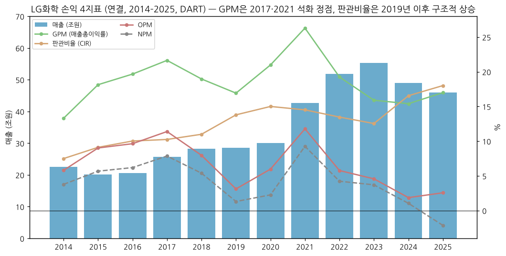

→ GPM은 석화 정점(2017 21.6%, 2021 26.3%)에서 높고, 2022 이후 15\~17%로 하락. **판관비율은 2014 7.5% → 2025 18.0%로 구조적 상승** — LGES 연구개발·판매 비용, 생명과학(AVEO) 편입 영향. 2024\~2025 영업이익 대비 금융비용(2.7조·2.2조)이 커서 세전이익 적자 [계산]

### ② 재무상태표 (12년 연결, 조원)

| 항목 (조원) | 2014 | 2015 | 2016 | 2017 | 2018 | 2019 | 2020 | 2021 | 2022 | 2023 | 2024 | 2025 | 3Q26 |
|---|---|---|---|---|---|---|---|---|---|---|---|---|---|
| 자산총계 | 18.13 | 18.58 | 20.49 | 25.04 | 28.94 | 34.02 | 41.39 | 51.14 | 67.97 | 77.47 | 93.86 | 101.06 | 102.22 |
| 유동자산 | 8.15 | 8.66 | 9.23 | 11.21 | 12.09 | 11.87 | 16.32 | 20.41 | 29.67 | 28.86 | 27.82 | 32.53 | 34.61 |
| 현금및현금성자산 | 0.99 | 1.70 | 1.47 | 2.25 | 2.51 | 1.89 | 3.27 | 3.76 | 8.50 | 9.08 | 7.85 | 9.90 | 8.69 |
| 재고자산 | 2.71 | 2.34 | 2.97 | 3.35 | 4.29 | 5.03 | 5.35 | 8.28 | 11.88 | 9.38 | 8.85 | 8.18 | 11.33 |
| 유형자산 | 8.70 | 8.87 | 9.68 | 11.21 | 13.84 | 18.59 | 20.57 | 24.38 | 29.66 | 38.95 | 54.57 | 56.46 | 56.17 |
| 부채총계 | 5.86 | 5.48 | 6.44 | 8.70 | 11.62 | 16.64 | 22.60 | 27.93 | 30.49 | 36.53 | 45.86 | 53.96 | 58.61 |
| 유동부채 | 4.81 | 4.80 | 5.45 | 6.64 | 7.27 | 8.94 | 12.62 | 15.06 | 16.46 | 18.39 | 21.09 | 26.14 | 26.75 |
| 차입금(사채 포함) | 2.93 | 2.66 | 2.89 | 3.04 | 5.32 | 8.41 | 10.19 | 14.77 | 15.96 | 21.93 | 27.38 | 33.81 | 35.55 |
| 자본총계 | 12.27 | 13.10 | 14.05 | 16.34 | 17.32 | 17.38 | 18.79 | 23.21 | 37.48 | 40.94 | 48.00 | 47.11 | 43.61 |
| 지배기업 소유주지분 | 12.14 | 12.99 | 13.94 | 16.17 | 17.08 | 17.00 | 18.04 | 21.69 | 31.45 | 32.19 | 33.28 | 32.85 | 31.81 |
| 비지배지분 | 0.13 | 0.11 | 0.11 | 0.17 | 0.24 | 0.38 | 0.75 | 1.52 | 6.03 | 8.75 | 14.71 | 14.26 | 11.80 |

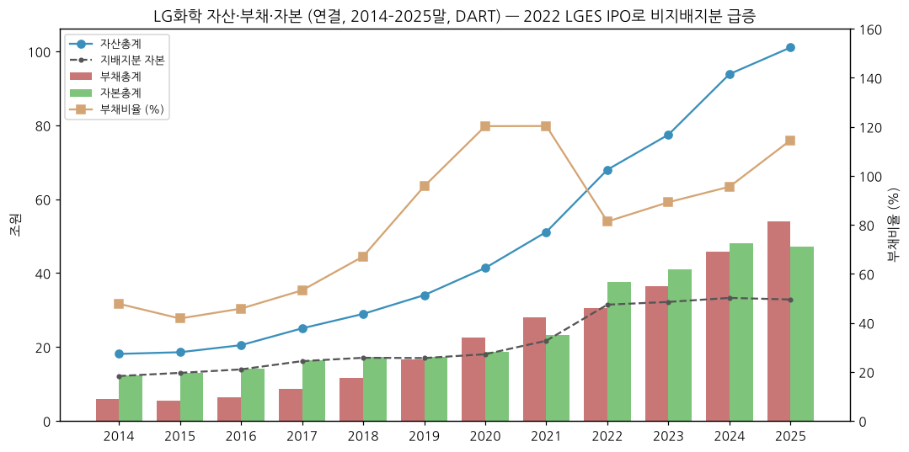

→ 자산 18.1조(2014) → 102.2조(3Q26), 5.6배. 증가분의 대부분은 LGES 유형자산(북미 공장). 차입금 2.9조 → 35.6조 (12배). 3Q26 IR 기준 부채비율 134.4%, 순차입금비율 60.4% [IR 3Q26 p.4]

### ③ 현금흐름표 (12년 연결, 억원)

| 항목 (억원) | 2014 | 2015 | 2016 | 2017 | 2018 | 2019 | 2020 | 2021 | 2022 | 2023 | 2024 | 2025 |
|---|---|---|---|---|---|---|---|---|---|---|---|---|
| 영업활동CF | 19,944 | 31,721 | 25,167 | 31,807 | 21,250 | 31,211 | 58,408 | 55,098 | 5,699 | 75,365 | 70,123 | 82,339 |
| 투자활동CF | -19,907 | -16,978 | -17,368 | -16,404 | -36,390 | -61,114 | -52,964 | -53,493 | -92,292 | -131,696 | -136,634 | -124,706 |
| 재무활동CF | -4,377 | -7,575 | -10,073 | -7,365 | 17,938 | 23,006 | 9,381 | 1,237 | 133,319 | 61,575 | 48,213 | 62,430 |
| CapEx (유형+무형) | 14,614 | 17,070 | 14,726 | 23,506 | 43,296 | 64,905 | 56,594 | 59,025 | 85,737 | 131,128 | 147,799 | 138,567 |
| FCF (영업CF−CapEx) | 5,331 | 14,651 | 10,441 | 8,302 | -22,047 | -33,694 | 1,814 | -3,927 | -80,038 | -55,763 | -77,675 | -56,228 |
| 배당금 지급 | 2,998 | 3,094 | 3,465 | 3,857 | 4,939 | 4,839 | 1,776 | 8,697 | 10,909 | 11,041 | 3,673 | 2,266 |
| 이자 지급 | 832 | 651 | 749 | 1,011 | 1,318 | 2,093 | 2,159 | 2,235 | 3,037 | 6,465 | 9,393 | 12,484 |

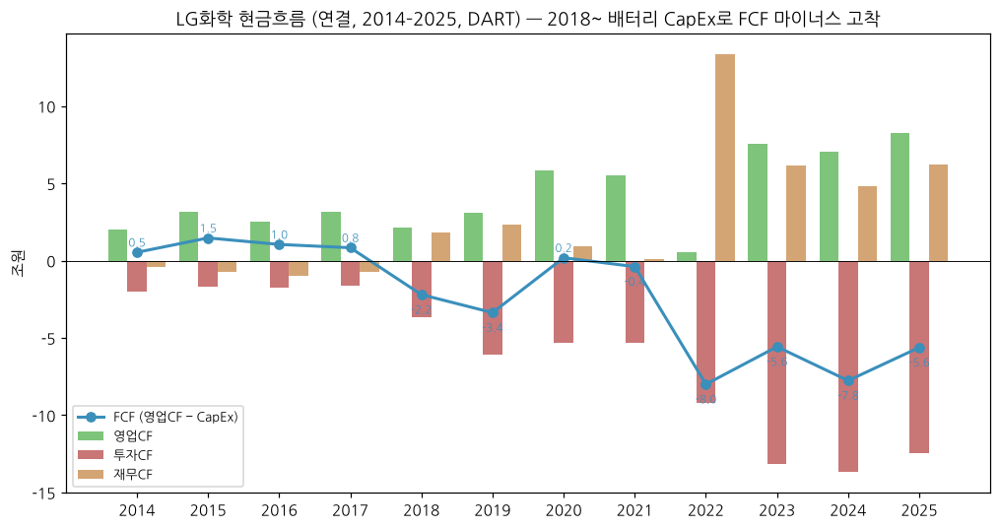

→ **FCF는 2018년부터 8년 중 7년 적자** (2020만 +0.18조). 2022\~2025 누적 FCF -27.0조 [계산] → 차입(재무CF +30.6조)과 LGES IPO·자산 매각으로 메움. 9M26: 영업CF 1.56조, 투자CF -0.90조 (LGES 지분 매각·워터솔루션 대금 유입 포함), CapEx 6.11조 [DART 분기보고서(2026.09)]. 회사 가이던스: LG화학(LGES 제외) CapEx 2025 2.89조 → 2026 약 1.7조, 향후 2\~3년 연 2조 이하 [IR 3Q26 p.13, 비즈워치 2026-01-29]

### ④ CapEx 추이 (12년, 억원)

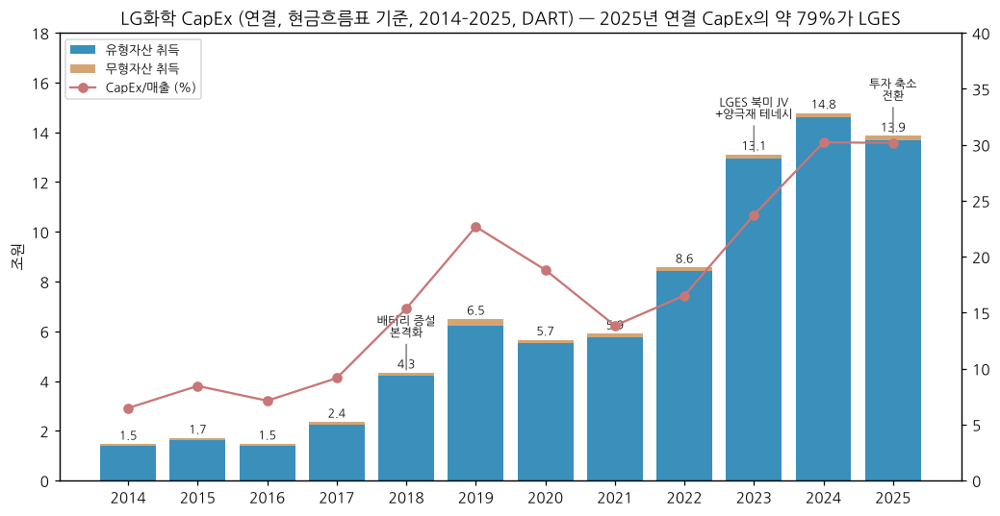

| 연도 | 유형자산 취득 | 무형자산 취득 | 합계 | CapEx/매출 | 사이클 annotation |
|---|---|---|---|---|---|
| 2014 | 14,113 | 501 | 14,614 | 6.5% |  |
| 2015 | 16,334 | 736 | 17,070 | 8.4% |  |
| 2016 | 13,985 | 741 | 14,726 | 7.1% |  |
| 2017 | 22,526 | 980 | 23,506 | 9.1% | 석화 정점 + 전지 증설 시작 |
| 2018 | 42,194 | 1,103 | 43,296 | 15.4% | 배터리 증설 본격화 (2배↑) |
| 2019 | 62,382 | 2,523 | 64,905 | 22.7% | ESS·EV 증설 + 여수 NCC 증설 |
| 2020 | 55,358 | 1,236 | 56,594 | 18.8% |  |
| 2021 | 57,736 | 1,289 | 59,025 | 13.8% | 배터리 증설 지속 |
| 2022 | 84,063 | 1,674 | 85,737 | 16.5% | LGES IPO 자금 투입 |
| 2023 | 129,599 | 1,529 | 131,128 | 23.7% | LGES 북미 JV + 테네시 양극재 |
| 2024 | 146,149 | 1,650 | 147,799 | 30.2% | ★정점 14.8조 |
| 2025 | 136,607 | 1,959 | 138,567 | 30.2% | 축소 전환 (본업 2.9조 → 2026 1.7조 계획) |

(현금흐름표 기준. 2025 연결 13.86조 중 LGES 10.48조(76%), 본업 2.66조(석화 0.92·첨단 1.67·생명 0.07) [DART 사업보고서(2025.12) II-3-마, 본업 합계는 IR 기준 2.89조와 집계 범위 차이]. 9M26 본업 CapEx 0.93조 (석화 0.41·첨단 0.42·생명 0.02·공통 0.08), 2026 계획 1.72조 [IR 3Q26 p.13])

### ⑤ 부채구조 + 채무증권 발행 history

- 3Q26 연결 차입금 35.55조 = 단기 10.62조 + 장기 24.93조 [IR 3Q26 p.11]
- **회사채 미상환 잔액 (2026-09-30, DART 분기보고서 V)**: 연결 20.44조 (공모 7.79조 + 사모 12.65조) — ㈜LG화학 별도 **6.87조** (공모 3.32조 + 사모 3.55조, 1년 이내 만기 3.09조) / LGES 13.43조 / 팜한농 0.15조
- 사채 재무약정: 부채비율 300% 이하 (현재 134.4% 이행), 담보비율 자기자본 200% 미만 (3.29%), 상호출자제한기업집단 "LG" 유지 (예: 제51-4회 2018-02 발행 3,000억 2028 만기, 제52-4회 2019-03 4,000억 2029 만기, 제53-4회 2020-02 2,500억 2030 만기) [DART 분기보고서(2026.09) V-차]
- LGES 주식 대상 **교환사채**(조기상환권 포함) 발행 이력 — 2023-07, 2025-05 (LGES 기업개요 5장) / 2025-10 PRS 2조 + 2026-10 PRS 2.5조 = LGES 지분 담보형 유동화 누계 4.5조 [CEO스코어데일리 2026-10-30]
- 신용등급: 국내 AA+ (2023\~2025 정기평가 유지) → **한국기업평가 AA (2026-07-01 하향)** / Moody's A3 (2023\~2024-02) → Baa1 (2024-12) → **Baa2 (2025-11)** / S&P BBB+ (2023\~2024) → **BBB (2025-03)** [DART 사업보고서(2025.12) I-1, 한국경제 2026-07-01]
- 경영진 코멘트 (4Q25 컨콜): "재무 건전성과 캐시플로우 흑자 유지가 가장 중요한 과제" / "설비투자는 가용 투자 재원 한도 내에서 엄정하게 관리할 계획" [비즈워치 2026-01-29] → 시사점: 성장 투자보다 **신용등급 방어가 우선순위 1번** — LGES 지분 유동화 대금도 차입 상환 비중이 클 가능성

### ⑥ 배당·자사주 추이 (12년)

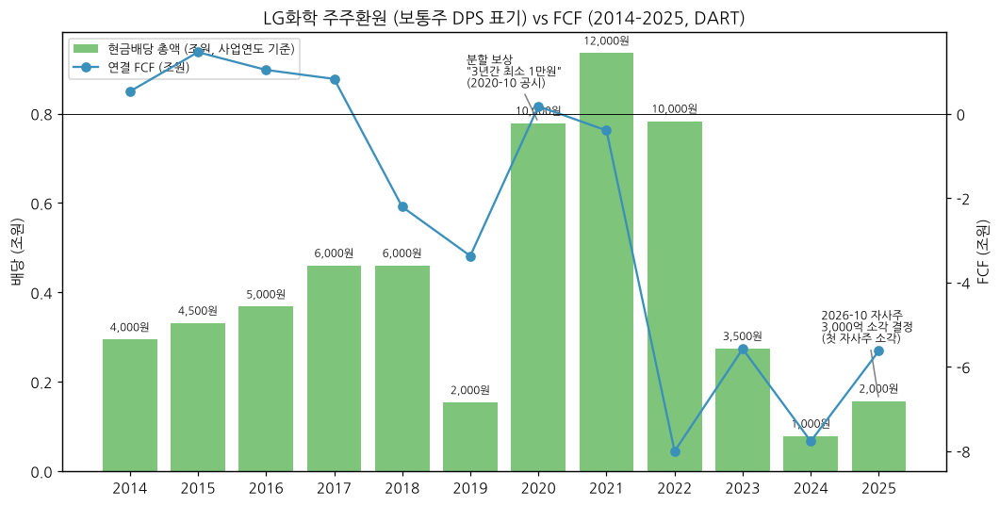

| 사업연도 | 보통주 DPS | 우선주 DPS | 배당총액 (억원) | 연결 배당성향 | 보통주 시가배당률 | 비고 |
|---|---|---|---|---|---|---|
| 2014 | 4,000 | 4,050 | 2,945 | 33.9% | 2.1% | |
| 2015 | 4,500 | 4,550 | 3,313 | 28.7% | 1.3% | |
| 2016 | 5,000 | 5,050 | 3,681 | 28.7% | 1.9% | |
| 2017 | 6,000 | 6,050 | 4,601 | 23.7% | 1.5% | LG생명과학 합병 |
| 2018 | 6,000 | 6,050 | 4,601 | 31.2% | 1.7% | |
| 2019 | 2,000 | 2,050 | 1,536 | 49.0% | 0.6% | 순이익 -79% |
| 2020 | 10,000 | 10,050 | 7,784 | 151.8% | 1.2% | 분할 보상 "3년간 최소 1만원" (2020-10 공시) |
| 2021 | 12,000 | 12,050 | 9,353 | 25.5% | 1.9% | 사상 최대 이익 |
| 2022 | 10,000 | 10,050 | 7,831 | 42.4% | 1.6% | 약속 기간 종료 |
| 2023 | 3,500 | 3,550 | 2,743 | 20.5% | 0.7% | |
| 2024 | 1,000 | 1,050 | 787 | - (적자) | 0.4% | |
| 2025 | 2,000 | 2,050 | 1,569 | - (적자) | 0.6% | 지배 순손실에도 증액 |

(출처: DART 사업보고서 2016·2019·2022·2025 '배당에 관한 사항' 최근 3사업연도 표. 배당성향 = 지배순이익 기준)
- 자사주: 2025말 보통주 2주·우선주 6,041주뿐 (사실상 미보유) → **2026-10-28 첫 대규모 매입·소각 결정** — 보통주 1,247,265주 + 우선주 142,586주, 약 3,000억원, 2026-12-01\~2027-05-31 신탁 취득 후 소각 [SBS Biz 2026-10-28]
- 정책: LGES 지분 매각 세후 현금의 약 20%를 주주환원 재원(이번 4,000억 = 자사주 3,000억 + 2026 결산배당 재원) [코리안센터·SBS Biz 2026-10-28]. 2026-11-24 종가 기준 자사주 3,000억 = 보통주 시총의 약 2.0% [계산]

### ⑦ 재무 비율 (12년)

| 연도 | ROE (지배) | ROA | 부채비율 | 유동비율 | 이자보상배율 (OP/이자지급) | 순차입금 (조원) | 연말 PBR | 연말 PER |
|---|---|---|---|---|---|---|---|---|
| 2014 | 7.1% | 4.7% | 47.8% | 169.4% | 15.8배 | 1.95 | 0.99배 | 13.8배 |
| 2015 | 9.2% | 6.3% | 41.8% | 180.4% | 28.0배 | 0.95 | 1.68배 | 18.9배 |
| 2016 | 9.5% | 6.6% | 45.8% | 169.4% | 26.6배 | 1.42 | 1.24배 | 13.5배 |
| 2017 | 12.9% | 8.9% | 53.3% | 168.6% | 29.0배 | 0.80 | 1.77배 | 14.7배 |
| 2018 | 8.9% | 5.6% | 67.1% | 166.2% | 17.0배 | 2.81 | 1.43배 | 16.6배 |
| 2019 | 1.8% | 1.2% | 95.7% | 132.7% | 4.3배 | 6.53 | 1.32배 | 71.5배 |
| 2020 | 2.9% | 1.8% | 120.3% | 129.3% | 8.3배 | 6.91 | 3.22배 | 113.5배 |
| 2021 | 18.5% | 8.5% | 120.3% | 135.5% | 22.5배 | 11.00 | 2.00배 | 11.8배 |
| 2022 | 6.9% | 3.7% | 81.4% | 180.3% | 9.9배 | 7.47 | 1.35배 | 23.0배 |
| 2023 | 4.2% | 2.8% | 89.2% | 156.9% | 3.9배 | 12.84 | 1.09배 | 26.3배 |
| 2024 | -2.1% | 0.6% | 95.6% | 131.9% | 1.0배 | 19.52 | 0.53배 | - |
| 2025 | -5.5% | -1.0% | 114.5% | 124.4% | 0.9배 | 23.91 | 0.72배 | - |

([계산] ROE = 지배순이익 / 평균 지배지분, ROA = 순이익 / 평균 자산, 순차입금 = 차입금·사채 − 현금및현금성자산(단기금융상품 제외), PBR·PER = 연말 보통주 종가(Yahoo) × 발행 보통주 / 지배지분·지배순이익 — 우선주 제외. 3Q26 현재 PBR 0.47배)
→ 2026-01 회사는 "ROE를 핵심 재무지표로 삼아 경영진 KPI에 반영" (2026-03 주총 답변) [CEO스코어데일리 2026-03-31]

---

## 5. 지배 구조

### ① 그룹·계열 관계

```
구광모 회장 등 특수관계인
   └── ㈜LG (지주회사)
          └── ㈜LG화학  (㈜LG 31.52%, 특수관계인 포함 31.54% — 발행주식총수 기준, 2026-09말)
                 ├── ㈜LG에너지솔루션  (79.38%, 2026-06말 → 2026-11-27 처분 예정분 반영 시 76.59%)  ← 유가증권시장 상장
                 ├── ㈜팜한농  (작물보호제·종자·비료)
                 ├── 해외 생산·판매법인: 중국 천진(LG DAGU)·영파(LG Yongxing), 미국 LG Chem America Advanced Materials(테네시 양극재), AVEO Pharmaceuticals(미국 항암) 등
                 └── 연결 종속회사 총 76개 (상장 1, 2025말)
```

(구광모 회장의 ㈜LG 지분 구조는 이번 버전 미기재. 출처: DART 분기보고서(2026.09) VII, 사업보고서(2025.12) I-1, LGES 기업개요 5장)

### ② 주주 구분

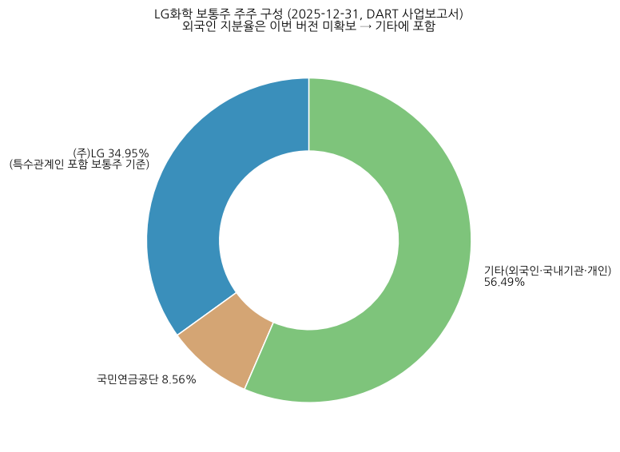

| 주주 | 보유주식 (보통주) | 지분율 | 기준 |
|---|---|---|---|
| ㈜LG (최대주주) | 24,670,331 | 31.52% (발행주식총수) / 34.95% (보통주) | 2026-09-30 DART 분기 / 2025-12-31 사업보고서 |
| LG연암문화재단 (특수관계) | 20,746 | 0.03% | 2026-09-30 |
| 김동춘 대표이사 (특수관계) | 1,000 | 0.00% | 2026-09-30 (2026-03 신규 선임) |
| 국민연금공단 | 6,043,377 | 8.56% (보통주) | 2025-12-31 |
| 소액주주 | 41,822,762 | 59.26% (보통주), 주주 수 322,694명 | 2025-12-31 |
| 우선주 (의결권 없음) | 7,688,800 | — | 보통주 배당 + 액면 1% |

(출처: DART 사업보고서(2025.12) VII-3, 분기보고서(2026.09) VII. 지분율 합계가 100%를 넘는 것은 기준일·산정방식 차이. **외국인 지분율은 이번 버전 미확보** — KRX·회사 IR 확인 필요)
- ㈜LG는 2024-11-01\~2025-03-07 총 40차례 장내 매수로 2024말 30.69% → 2025말 31.52%로 지분 확대 [DART 사업보고서(2025.12) VII]
- **행동주의**: 팰리서캐피탈 — "LGES 물적분할·중복상장이 주주가치를 훼손, NAV 대비 70% 넘게 저평가(약 60조원)" 주장, 2026-03-31 주총에 권고적 주주제안 도입(정관)·선임독립이사 선임 안건 제출 → 특별결의 요건 미충족으로 **부결** (지분율·찬성률 미공개) [CEO스코어데일리 2026-03-31]

### ③ 임원·이사회 (2026-09-30, DART 분기보고서 VII — 등기이사 7명, 독립이사 4명)

| 성명 | 직위 | 구분 | 주요 경력 | 임기 만료 |
|---|---|---|---|---|
| 김동춘 | 사장, **대표이사 CEO 겸 첨단소재사업본부장** | 사내이사 | U.Washington 경영학 석사, 前 전자소재사업부장 | 2029-03 |
| 차동석 | 사장, CFO 겸 CRO | 사내이사 | 경북대 회계학, 前 에스앤아이 CFO | 2027-03 |
| 권봉석 | 부회장 | 기타비상무이사 | 現 ㈜LG 대표이사 부회장, 前 LG전자 대표 | 2028-03 |
| 조화순 | 이사회 의장 | 독립이사 | 연세대 정치외교학과 교수 | 2028-03 |
| 이현주 | ESG위원장 | 독립이사 | KAIST 생명화학공학과 교수 | 2028-03 |
| 천경훈 | 내부거래위원장 | 독립이사 | 서울대 법학전문대학원 교수, 前 김앤장 | 2029-03 |
| 이영한 | 감사위원장 | 독립이사 | 서울시립대 세무학과 교수 | 2027-03 |

→ 이사회 의장을 독립이사가 맡는 구조 (CEO·의장 분리). 김동춘 CEO는 "2\~3년 내 어려움을 극복하겠다", "2030년 두 자릿수 영업이익률 달성에는 기술 경쟁력 확보가 필요" [CEO스코어데일리 2026-03-31·2026-10-30]

---

## 6. 기타 팩트

### ① R&D 인프라

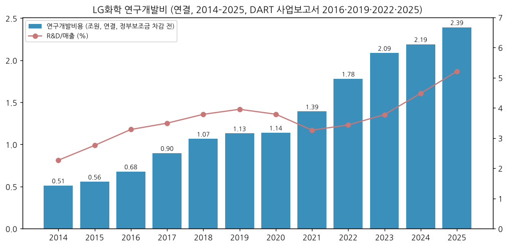

| 연도 | 연구개발비 (억원, 연결) | R&D/매출 |
|---|---|---|
| 2014 | 5,112 | 2.3% |
| 2015 | 5,566 | 2.8% |
| 2016 | 6,780 | 3.3% |
| 2017 | 8,971 | 3.5% |
| 2018 | 10,664 | 3.8% |
| 2019 | 11,310 | 4.0% |
| 2020 | 11,392 | 3.8% |
| 2021 | 13,909 | 3.3% |
| 2022 | 17,800 | 3.4% |
| 2023 | 20,857 | 3.8% |
| 2024 | 21,903 | 4.5% |
| 2025 | 23,915 | 5.2% |

(출처: DART 사업보고서 2016·2019·2022·2025 '연구개발비용' (정부보조금 차감 전, 연결 — LGES 포함). LG화학(LGES 제외) R&D: 2025 1.06조 (석화 2,300·첨단 2,690·생명 3,730·공통 1,850억), 9M26 8,560억 [IR 3Q26 p.13])
- 조직: CTO 산하 연구소 + 사업본부 개발센터, 미국·독일·일본 위성 Lab. 생명과학은 미국 보스턴 Global Innovation Center
- 특허 (LG화학 별도): 국내 12,593건, 해외 24,658건 누적 등록 (2025말) [DART 사업보고서(2025.12) II-7]

### ② 진행 중 corporate action — 10년치 주요 이벤트

| 시점 | 이벤트 | 규모 | 의미 |
|---|---|---|---|
| 2016 | 팜한농 인수 | — | 농화학 진출 |
| 2017-01 | LG생명과학 흡수합병 | 신주 발행 → 보통주 70,592,343주 | 생명과학사업본부 |
| 2020-12 | 전지사업 물적분할 → LGES | — | 중복상장·지주 할인의 시작 |
| 2021-02 | LCD 편광판 사업 매각 | — | IT소재 축소 |
| 2022-01 | LGES 상장 | 공모 10.2조 | 지분 100% → 81.84% |
| 2023-01 | AVEO Pharmaceuticals 인수 | USD 5.71억 | 미국 항암 |
| 2023 | 편광판·편광판소재 매각 결정 | (규모 미확정 — 사업보고서 II-6 '45억 위안(약 8,292억원)' 문구 대응 여부 재확인 필요) | 중단영업 |
| 2025-06 | Water Solutions 매각 | 1.4조원 | 자산 경량화 |
| 2025-08 | 에스테틱 매각 (VIG파트너스) | 2,000억원 | 포트폴리오 조정 |
| 2025-10 | LGES 지분 PRS | 약 2조 (575만주) | 지분 81.84 → 79.38% |
| 2026-01 | LGES 지분 70%까지 5년간 유동화 방침 | 10% 매각 시 약 9조 (언론 추산) | 재무 방어 + 주주환원 |
| 2026-10-28 | LGES 6,535,939주 PRS 처분 + 자사주 3,000억 소각 | 약 2.5조 | 지분 → 76.59% (2026-11-27 처분 예정, 완료 여부 미검증) |
| 2026-10 | 대산 BPA 사업 매각 (국도인터내셔널) | 784억원 | 범용 축소 |
| 진행 중 | 여수 NCC 재편 (GS칼텍스 통합 협의) | 여수 NCC 약 200만톤 | 정부 석화 구조조정 (연내 계획안 제출 목표) |

(출처: DART 사업보고서(2025.12) I-2·II-6, SBS Biz 2026-10-28, 디지털데일리 2026-02-02, CEO스코어데일리 2026-10-30, 머니투데이 2026-03-20·11-05. 편광판 매각 규모는 사업보고서 II-6의 "45억 위안(약 8,292억원)" 문구 — 해당 항목 대응 관계는 다음 버전에서 재확인)

### ③ R&D·사업 마일스톤 — 10년치

- 생명과학 주력 제품 기반: 제미글로(당뇨, DPP-4 국내 점유율 23.9%), 유트로핀(성장호르몬 국내 49.2%), 5가혼합백신 유펜타·소아마비 백신 유폴리오 (2025) [DART 사업보고서(2025.12) II-2]
- 2021-06 여수 제2 NCC Complex 증설 완료 (에틸렌 증설 — 이후 공급과잉 국면에서 부담)
- 2023 AVEO 인수로 신장암 치료제 포티브다(FOTIVDA) 미국 매출 확보
- 2025 세계 최초 개발 경구용 희귀비만치료제 라이선스 아웃 (총 1.15조, 2026 변경계약 추가 선급금) [DART 사업보고서(2025.12) II-1, mydailybyte 2026-11-09]
- 2025\~2026 양극재: LFP·LMR·고전압 Mid-Ni·전고체·소듐이온용 양극재 개발, 고밀도 LFP 기술 확보 ("저밀도 LFP는 사업화 대상 제외") [머니투데이 2026-11-05]
- 2026 전자소재: 반도체 기판소재 비메모리 확대·글로벌 고객 공급, 유리기판 TGV 소재 고객 평가, 전장용 접착제 2027 양산 [머니투데이 2026-11-05]
- 친환경: PCR 재생 플라스틱, Bio 납사 기반 Bio-SAP·PO·PVC·ABS, HVO 공정 Bio 납사 직접 생산 추진, 에어로젤 단열재 [DART 사업보고서(2025.12) II-2]
- 2035년까지 15조 투자 계획, 70%를 반도체·모빌리티·로봇 소재 등 성장 영역에 [CEO스코어데일리 2026-10-30]

### ④ 주요 리스크

- **석화 공급과잉 장기화**: 동북아 설비 폐쇄 2031년까지 약 800만톤 vs 신·증설 약 2,900만톤 (회사 추정) + 2027 S-Oil 샤힌(에틸렌 180만톤) 가동 [머니투데이 2026-11-05·2026-03-20]
- **원료·지정학**: 중동 전쟁발 고유가·납사 수급 불안 → 원료가 역래깅 (3Q26 적자 원인), 운반비 상승 [IR 3Q26 p.5]
- **구조조정 실행 리스크**: GS칼텍스 통합 — 공정거래법(증손회사 100% 지분 요건)·자산가치 이견 [머니투데이 2026-03-20]
- **LGES 의존 + 오버행**: 연결 이익의 대부분이 LGES, 반대로 LGES 지분 매각·PRS(2년 정산)는 LGES 주가에 오버행 — PRS 계약상 매수인 매각가와 기준가 차액을 LG화학이 정산 [SBS Biz 2026-10-28]
- **미국 정책**: IRA AMPC(LGES)·EV 보조금 축소, 북미 고객 전동화 전략 변경 → 양극재 물량 지연
- **환율**: USD 10% 상승 시 세전손익 -9,649억 (외화 순부채 노출, 2025말) [DART 사업보고서(2025.12) II-5]. 9M26 해외사업장 환산 기타포괄손실 약 -4.5조
- **신용등급 추가 하향**: 국내 AA(한기평) — 순차입금비율 60%대, 이자보상배율 1배 미만 (2024\~2025)
- **손상**: 2025 유형자산 손상 1.89조, 2024 0.38조 [DART 사업보고서(2025.12) II-3]

### ⑤ ESG 등급

- LG화학 지속가능경영보고서 2025 (국문, lgchem.com 게시 — 이번 수집에서 다운로드 실패로 원문 미검토)
- MSCI·KCGS(한국ESG기준원) 등급: **이번 버전 미확보** (다음 버전 보강)
- 거버넌스: 이사회 의장 독립이사(조화순), 감사위원 분리선출 정관 반영(2021), 배당기준일 이사회 결정 정관(2024·2025 개정) [DART 사업보고서(2025.12) I-5]

### ⑥ 인증·라이선스

- 생명과학: 의약품 GMP(익산·오송), 백신 WHO PQ(유펜타·유폴리오 수출 — 세부 인증 이번 버전 미검증)
- 석유화학: 온실가스 배출권거래제 대상 (배출권 전문 인력 운영) [DART 사업보고서(2025.12) II-2]
- 사채 재무약정·상호출자제한기업집단 "LG" 소속

---

## Version Log

| 버전 | 일자 | 내용 |
|---|---|---|
| v1.0 | 2026-11-25 작성 시작 / 2026-11-28 완료 | 첫 작성 — v4.8 표준 6섹션 + 차트 15종(12종 표준, chart2는 석유화학·에너지솔루션·첨단소재·생명과학팜한농 4분할). Fact verify cutoff 2026-11-24. Source 6종 점검: ① OpenDART 재무 JSON 44건(2015 FY\~3Q26) ② 정기공시 원문 XML 본문 52건 + 감사보고서 첨부 16건(2013.12\~2026.09) ③ IR 실적발표 PDF 27건(1Q19\~3Q26; 2021\~2Q23 9건은 사업부 차트 이미지 → DART 부문정보로 대체, 2021 2Q·3Q·4Q 발표본 3건은 irgo 다운로드 실패) ④ 지속가능경영보고서 2025 — 다운로드 실패(PC 디스크 공간 부족, 이후 미재시도) ⑤ Yahoo 051910.KS 월간 2001\~2026·일간 2019\~2026, 051915.KS ⑥ 언론·신용등급(DART 신용평가 표 + 한국경제). 작업 환경: 원격 VM(device_bash) 소켓 오류로 컨테이너에서 작업 후 commit |

**잔여 보완 후보 (v1.1)**
- 외국인 지분율 (KRX) 및 chart5 외국인 분리
- LGES 2026-11-24 종가 Yahoo 검증 (현재 mydailybyte 역산 추정) + 2026-11-27 PRS 처분 완료 공시 확인 → 지분율 76.59% 확정
- 지속가능경영보고서 2025 원문 + MSCI·KCGS 등급
- 2021 2Q\~4Q IR PDF 재수집 → 2021\~2Q23 사업부 분기 수치를 IR 기준으로 교체 (특히 첨단소재 기준 차이 해소), 팜한농 2021\~2Q23 공백 보강
- 2014\~2015 정보전자소재·재료 부문 분기 차트(현재 표·연간만)
- 석화 제품 스프레드(에틸렌-나프타, ABS·PVC·PE) 시계열 차트 — 외부 가격 데이터 필요
- 석화 본업(LGES 제외) 별도 EV/EBITDA·순차입금 산출 → SOTP 정교화
- 글로벌 피어(BASF·Dow·LyondellBasell) OPM·PBR 수치 검증
- 1969·1976·1947·2016(팜한농) 연혁 항목 원문 대조
