> Ticker: **NYSE: LMT — Lockheed Martin Corporation**
> Entity: **Lockheed Martin Corporation** (본사 Bethesda, Maryland, USA) — 1995-03 Lockheed + Martin Marietta 합병으로 출범한 세계 최대 방산 기업 (매출 기준). 전투기(F-35·F-16·F-22)·미사일방어(PAC-3·THAAD)·헬기(Sikorsky)·레이더/이지스·우주(전략미사일·위성)
> Sector: 방산 — 서브섹터 **방산 글로벌** (한국 5사 한화에어로스페이스·한화시스템·현대로템·한국항공우주·LIG D&A와 비교)
> 작성 시각: **2026-11-14 KST** (**v1.0** — Phase 1 Source 전수 수집 + audit + 13종 차트(12종 + BU 매트릭스) + v1.5 ① 기업 분류 표준)
> 적용 구조: v4.8 (6개 섹션) + v1.5 ① 기업 분류 표준 (Summary Box · 손익 narrative · 분류 sub-logic · 밸류에이션 · 분류 변경 조건 3종)
> 데이터 범위: **연간 12년 (FY2014~FY2025, 12월 결산)** + **FY26 9M (1Q~3Q26, 2026-10-22 발표분)** + **사업부 분기 43Q (1Q16~3Q26, 현 4개 사업부 기준)** + **LMT 주가 20년 (2006-12 ~ 2026-11-13)**
> 출처: **SEC EDGAR 10-K 13건 (FY2013~FY2025) · 10-Q 39건 (1Q14~3Q26) · 8-K 38건 (2023~2026)**, **SEC XBRL companyfacts (CIK 0000936468)**, **3Q26 Earnings Release (news.lockheedmartin.com, 2026-10-22)**, **2026 Proxy Statement (DEF 14A, 2026-03-26)**, **3Q26 컨퍼런스콜 (EarningsWhispers 트랜스크립트 요약)**, **Yahoo Finance LMT**, 보도 (TIKR·Stocktwits·Motley Fool·StockAnalysis 집계)
> 회계 기준 단절: FY2014~FY2015 = ASC 605 (구 기준, IS&GS 중단사업 재분류 후) / FY2016~ = ASC 606 (2018년 완전 소급 적용으로 FY2016·FY2017 재작성). 매출 단위 $M

# Lockheed Martin 기업 개요 (v1.0 — 방산 글로벌 / 미국 1위 방산 프라임 / 지속성장형 장기계약 업종)
> **Fact verify cutoff**: 2026-11-14 (주가 2026-11-13 종가 $596.04 [Yahoo Finance], 발행주식 231,004,640주 [10-Q 표지, 2026-10-19] → 시가총액 **$137.7B** [계산, Motley Fool 데이터박스 $137.69B와 일치], 52주 고저 $692.00 (2026-03 장중, 사상 최고) / $437.25 (2025-12) [Yahoo Finance])


## Phase 1 Source Audit (메모리 룰)

```
=== 자료 수집 audit (Lockheed Martin) ===

✅ 확보 (저장: company-overview-source/LMT/ + LMT_LOCKHEED MARTIN CORP/)
- 10-K 13건 (2014-02 ~ 2026-01 제출, FY2013~FY2025) + 10-Q 39건 (1Q14~3Q26) — sec_edgar_download_reports
- 8-K 38건 (2023-01 ~ 2026-10) — 본문만 (실적 보도자료 Ex-99.1은 SEC 직접 접근 403 → 회사 뉴스룸 HTML로 대체)
- SEC XBRL companyfacts.json (연간·분기 손익·BS·CF·RPO 정확값, 2007~2026)
- 3Q26 Earnings Release HTML (news.lockheedmartin.com, 2026-10-22) — 가이던스·사업부 잔고·인도 대수
- 2026 Proxy Statement PDF — 5% 주주·이사회
- Yahoo Finance v8 LMT 월간 20년 + 일간 1년 (2026-11-13까지)
- 3Q26 컨퍼런스콜: 웹 트랜스크립트 요약 (EarningsWhispers) — 애널리스트 Q&A 6건

❌ 누락 (4)
- Motley Fool 트랜스크립트: quote 페이지 링크 0건 (2회 시도) → 웹 요약으로 대체
- 사업부별 수주잔고 시계열: 보도자료 표만 (FY25말·3Q26말) 확보, 과거 분기 사업부 잔고 미수집
- 5% 주주: Proxy가 2023-12-31 기준 13G/A 인용 — 최신 지분율 아님
- Sustainability/ESG 보고서 원문 미수집 (MSCI·Sustainalytics 등급 미확인)

⚠️ 결과 영향
- 연간 12년 = FY2014~FY2025 (ASC 605→606 단절 1회, FY2016). FY2014 매출 YoY는 FY2013 IS&GS 포함 기준이라 비교 불가로 표기
- 사업부 분기 43Q = 1Q16~3Q26 (2016년 IS&GS 분리·Sikorsky 편입 후 4개 사업부 체계). FY2014~15 사업부 연간은 2017 10-K 재작성치(ASC 605)
- 사업부 OP는 Non-GAAP(회사 주 지표). GAAP 영업이익 = 사업부 OP + FAS/CAS 연금조정 등 Unallocated
- 프로그램 손실(reach-forward loss) 분기(1Q24·4Q24·2Q25)는 조정 기준 병기

Source 6종 audit:
[V] (1) 정기 보고서 (10-K 13 + 10-Q 39) ✓
[V] (2) IR 실적 자료 (3Q26 보도자료 ✓, 과거 분기 보도자료는 10-Q로 대체)
[△] (3) Sustainability Report ✗
[V] (4) 주가 (Yahoo LMT 20년) ✓
[V] (5) Proxy / 지배구조 ✓
[V] (6) 12년 정확값 시계열 (XBRL) ✓
→ 5/6 source 확보. 최신 분기(3Q26) 확보.
```

---

## ① 기업 분류

(1) Primary / Secondary 분류

**Primary 분류: 지속성장 (장기계약형 방산 프라임 — 저변동·저성장 우상향)**

→ 매출 FY2014 $39.9B → FY2025 $75.0B, **11년 CAGR +5.9%** [계산]. 역성장 연도는 FY2022(-1.6%) 1회뿐

→ GAAP OPM 12년 범위 **9.9%~14.3%** (진폭 4.4%p) — 사이클 기준(±10%p)에 한참 못 미치는 저변동

→ 매출의 72%가 미국 정부(FY25, 국방부 63%), 28%가 해외(대부분 FMS) — 수요는 경기가 아니라 **국방 예산·위협 환경**에 연동

**Secondary 노트: 프로그램 리스크 (고정가 개발계약 손실로 이익 레벨 하향 이력)**

→ FY2024~FY2025 OPM 9.9%·10.3%로 12년 최저권 — 기밀 프로그램(Aero·MFC)·캐나다 해상헬기(CMHP) 등 **reach-forward loss 누적 약 $3.4B** (4Q24 약 $1.7B, 2Q25 $1.6B) [10-K/10-Q]

→ 2026년 들어 손실 재발 없이 사업부 OPM 10.8%로 회복 중 (3Q26) — 다만 F-16·C-130·Heavy Lift·Seahawk 불리한 조정 9M26 $565M [10-Q]

**4개 사업부 구조 (9M26 기준, 사업부 OP = Non-GAAP)**

→ **(1) Aeronautics** — 매출 $23.3B (40%), OP $2.1B, OPM 9.1% — F-35(전사 매출 27%)·F-16·C-130·F-22·Skunk Works

→ **(2) Rotary and Mission Systems (RMS)** — 매출 $12.9B (22%), OPM 10.8% — Sikorsky 헬기, 이지스, 레이더(TPY-4·Sentinel A4), C2

→ **(3) Missiles and Fire Control (MFC)** — 매출 $12.3B (21%), OPM 14.1% — PAC-3·THAAD·GMLRS·PrSM·JASSM/LRASM·Javelin(JV), **수익성·성장 1위**

→ **(4) Space** — 매출 $10.4B (18%), OPM 9.4% — FBM(트라이던트)·NGI·위성(GPS III·OPIR)·Orion, ULA 50% 지분

(2) Summary Box (12년 시계열 + 사이클 통계)

| 지표 | 값 |
|------|-----|
| 매출 CAGR (FY14→FY25, 11년) | **+5.9%/yr** [계산] (ASC 606 이후 FY16→FY25 **+5.3%**), FY26 가이던스 $80~82B (+8% 중간값) |
| GAAP OPM 평균 (12년) | **12.5%** [계산] |
| OPM 정점 | **14.3% (FY2019)** — F-35 양산 램프 + 연금 FAS/CAS 순이익 기여 |
| OPM 저점 | **9.9% (FY2024)** — MFC·Aero 기밀 프로그램 손실 |
| 사이클 주기 | 뚜렷한 업황 사이클 없음 — 저점은 업황이 아닌 **프로그램 손실**(FY24~25) |
| 사이클 회수 | 0회 (OPM 진폭 4.4%p, 사이클 cutoff ±10%p 미달) |

```
[Lockheed Martin 12년 손익 시계열 ($M, 12월 결산)]  * 사업부 OP = Non-GAAP, GAAP OP = 사업부 OP + Unallocated(연금 FAS/CAS 조정 등)
연도    매출      사업부OP  사업부OPM  GAAP OP   OPM    순이익
FY14   39,946    5,116    12.8%    5,012   12.5%   3,614   ← IS&GS 매각 결정 전, ASC 605
FY15   40,536    4,978    12.3%    4,712   11.6%   3,605   ← 2015-11 Sikorsky $9.0B 인수 (차입 $7B+)
FY16   47,290    4,982    10.5%    5,888   12.5%   5,173   ← 2016-08 IS&GS를 Leidos와 분할합병(RMT) → 일회성 이익, ASC 606 재작성 시작
FY17   49,960    5,092    10.2%    6,744   13.5%   1,963   ← 미 세제개편 이연법인세 상각 $1.9B → 순이익 급감, 자본 마이너스(-$0.85B)
FY18   53,762    5,877    10.9%    7,334   13.6%   5,046   ← F-35 연 91대 인도, 연금 $5.0B 선출연 (영업CF 급감)
FY19   59,812    6,574    11.0%    8,545   14.3%   6,230   ← OPM 정점, F-35 연 131대
FY20   65,398    7,152    10.9%    8,644   13.2%   6,833   ← COVID에도 +9%, Taiclet CEO 취임 (2020-06)
FY21   67,044    7,664    11.4%    9,123   13.6%   6,315   ← 사업부 OP 정점, Aerojet 인수 추진 (2022-02 FTC 반대로 철회)
FY22   65,984    7,467    11.3%    8,348   12.7%   5,732   ← 12년 중 유일한 역성장 (F-35 인도 지연·공급망), 자사주 $7.9B
FY23   67,571    7,389    10.9%    8,507   12.6%   6,920   ← 우크라이나 이후 탄약 수요 → MFC 수주 급증
FY24   71,043    6,083     8.6%    7,013    9.9%   5,336   ← 4Q24 기밀 프로그램 손실 약 $1.7B (MFC $1.31B + Aero) → OPM 저점
FY25   75,048    6,743     9.0%    7,731   10.3%   5,017   ← 2Q25 손실 $1.6B (Aero 기밀 $950M·CMHP $570M·TUHP $95M), NGAD 탈락
9M26   58,795    6,214    10.6%    6,985   11.9%   5,169   ← 손실 재발 없음, PAC-3 다년계약 $52.5B·F-35 850대 10년 프레임 → 잔고 $292B

매출 CAGR 11년: +5.9% [계산] / OPM range 9.9%~14.3% = 4.4%p [계산]
프로그램 손실 제외 조정 사업부 OPM: FY24 약 11.1% [계산: (6,083+약 1,810)/71,043, 1Q24 MFC $100M 포함] · FY25 약 11.1% [계산: (6,743+1,615)/75,048] — 손실 외 기초 수익력은 11%대 유지
```

**한국 방산 5사와의 위치 (직접 비교는 섹터 리뷰에서 각 사 리뷰 숫자로)**

→ LMT 3Q26 사업부 OPM **10.8%**, MFC 14.0% — 한국 수출형 방산(폴란드 K9·K2 등 20%대 OPM 보고 사례)보다 낮은 **미국 정부 원가가산·고정가 혼합 계약 구조의 마진 천장** [판단]

→ 반면 잔고/매출 **3.6배** (잔고 $292.0B ÷ 2026 매출 가이던스 중간값 $81B, [계산]) — 장기 가시성은 피어 최상위권

(3) 정량적 분류 근거

→ **잔고 레코드** — $193.6B (FY25말) → **$292.0B (3Q26말, +51% YTD)**. 3Q26 한 분기에 +$61.6B, 그중 PAC-3 MSE 다년계약 $52.5B [10-Q Note]. MFC 잔고 $46.7B → **$142.5B** [보도자료]

→ **F-35 = 전사 매출 27% · Aero 매출 67%** (FY25) — 누적 1,387대 인도, 잔고 274대 (3Q26말) [10-Q]. 2026-10 국방부와 **10년간 최소 850대 생산·유지 프레임워크** 합의 (Lot 20+ 계약은 협상 중)

→ **MFC 탄약 램프** — 9M26 MFC 매출 +17.5% [계산], 3Q26 +24%. 회사 5년 프레임 "mid-teens 매출 성장" (3Q26 컨콜)

→ **현금 창출** — FCF FY25 $6.9B → FY26 가이던스 $7.8~8.0B (7월 $7.0~7.2B에서 상향) [보도자료]

**2026 가이던스 (2026-10-22, 2분기 연속 상향)**

→ 매출 **$80.0~82.0B** (7월 $79.75~81.75B) / 사업부 OP **$8,575~8,675M** / 희석 EPS **$30.35~30.75** (7월 $29.95~30.65) / FCF **$7.8~8.0B**

→ 사업부 매출·OP 가이던스: Aero $31.1~32.5B / $2.92~2.95B · MFC $17.25~17.45B / $2.395~2.425B · RMS $17.7~18.0B / $1.88~1.90B · Space $13.95~14.05B / $1.38~1.40B (3Q26 컨콜)

→ 2027 예비 코멘트: "4개 사업부 모두 성장, 전사 high single digit 매출 성장 가시성" (CFO Evan Scott). 마진 가이던스는 2027-01 발표

(4) 산업 분류

→ **GICS** — Industrials / Aerospace & Defense

→ **지수** — S&P 500, Dow Jones 미포함

→ **워치리스트** — 섹터 방산 / 서브섹터 **방산 글로벌** (미국 프라임: LMT·RTX·GD)

(5) 분류 결정 논리

(1) **가장 매출 큰 사업부 기준**: Aero 40% (F-35 단일 프로그램 의존) — F-35는 2006년 양산 시작 후 2040년대까지 생산·2070년대까지 유지보수가 예정된 **초장기 프로그램** → 지속성장

(2) **이익 진폭 원인**: FY24~25 저점은 업황이 아닌 고정가 개발계약 손실(기업 고유) → 사이클 분류 근거 아님

(3) **Boundary case**: Primary 지속성장 + Secondary "프로그램 리스크". MFC는 탄약 재고 재건·방공 수요로 **성장 가속형(고성장 진입)** — MFC 매출 비중이 25%를 넘고 전사 매출 성장률이 high single digit을 2년 유지하면 Secondary에 "고성장" 추가 검토

(4) **글로벌 피어 cross-ref**:
   - **RTX (Raytheon)** — 방공(Patriot 체계·레이더) 직접 경쟁, 단 민항엔진·Collins 비중 커서 방산 단독 비교 시 Raytheon 사업부만
   - **General Dynamics** — 지상장비·잠수함 중심, 전투기·미사일 겹침 작음
   - **한국 5사** — 수출 비중이 높고 단가·마진이 높은 대신 잔고 대비 단일 국가(폴란드·중동) 집중. LMT는 미국 정부 72% + FMS 다변화

(6) 적정 밸류에이션 방법 (단위 밸류는 분기 실적 분석, Terminal 밸류는 테마 통합 모드)

→ **1차 — Forward PER**: 2026 EPS 가이던스 중간값 $30.55 → **19.5배**, 2027E 컨센 $33.23 (StockAnalysis, 2026-10-26) → **17.9배** [계산: 주가 $596.04]. TIKR 기준 5년 평균 forward P/E 약 17배

→ **2차 — FCF 수익률**: 2026 FCF 가이던스 중간값 $7.9B ÷ 시총 $137.7B = **5.7%** [계산]. 배당 수익률 2.4% (분기 $3.60 × 4 ÷ $596.04, [계산])

→ **3차 — EV/사업부 OP**: EV $152.2B [계산: 시총 + 장기차입 $20.5B − 현금 $6.0B, 3Q26말] ÷ 2026 사업부 OP 가이던스 중간값 $8.63B = **17.6배** [계산]

→ **PBR 미사용 근거** — 연금 적립 부족을 자본(AOCI)에서 차감해 자본이 $6~11B로 작고 2017년엔 마이너스 → ROE 70~280%로 의미 없음

(7) 분기 재평가 트리거 (**분류 변경 조건**)

→ ① **F-35 Lot 20+ 확정계약 지연이 2개 분기 넘게 이어지고 Aero 매출 YoY 마이너스 전환** → Primary 지속성장 유지 불가 검토 (단일 프로그램 27% 의존)

→ ② **신규 reach-forward loss가 연 $1B+로 3년 연속** (FY24·FY25에 이어 FY26) → Secondary "프로그램 리스크"를 Primary급으로 격상 (밸류 할인 정당화)

→ ③ **MFC 매출 비중 25%+ · 전사 매출 성장 high single digit 2년 연속 (FY26~27)** → Secondary에 "고성장(탄약·방공)" 추가, 밸류 기준을 PER 프리미엄 체계로 이동

---

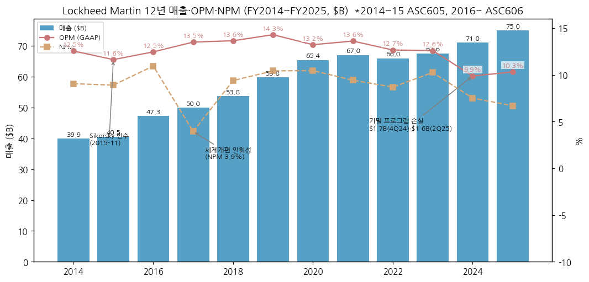

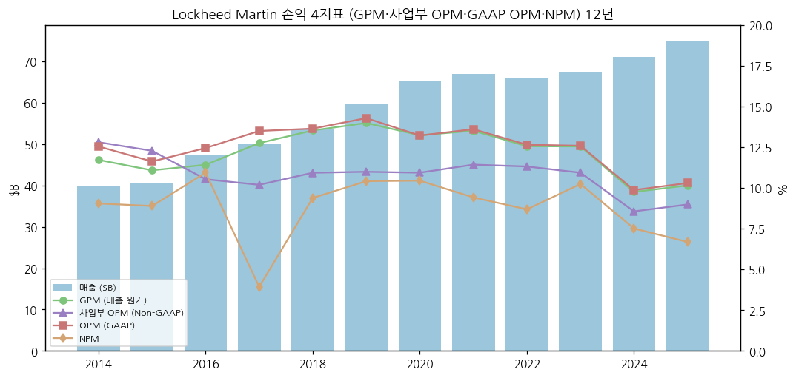

---

## ② 회사 개요

(1) 기본 정보

| 항목 | 내용 |
|---|---|
| 정식 명칭 | Lockheed Martin Corporation (Maryland 법인) |
| 본사 | 6801 Rockledge Drive, Bethesda, MD |
| 설립 | 1995-03-15 (Lockheed Corp. + Martin Marietta 합병) |
| 상장 | NYSE: LMT |
| CEO | James D. Taiclet (회장·사장·CEO, 2020-06 CEO 취임) |
| CFO | Evan Scott (3Q26 컨콜 기준) |
| 임직원 | 약 123,000명 (FY25말, 10-K) |
| 사업 한 줄 정의 | 미국·동맹국 정부에 전투기·미사일방어·헬기·레이더·우주 시스템을 개발·생산·유지보수하는 방산 프라임 |
| 고객 구성 (FY25) | 미국 정부 72% (국방부 63%) · 해외 28% (FMS 77% / DCS 23%) · 상업 기타 미미 |

(2) 핵심 KPI 요약 (FY25 + 3Q26 + FY26 가이던스, $M)

| 지표 | FY25 | 3Q26 | 9M26 | FY26 가이던스 |
|---|---|---|---|---|
| 매출 | 75,048 | 20,711 (+11.3%) | 58,795 (+7.4%) | 80,000~82,000 |
| 사업부 OP (OPM) | 6,743 (9.0%) | 2,229 (10.8%) | 6,214 (10.6%) | 8,575~8,675 |
| GAAP 영업이익 | 7,731 | 2,443 | 6,985 | 9,520~9,620 |
| 순이익 / 희석 EPS | 5,017 / $21.49 | 1,845 / $7.97 | 5,169 / $22.36 | EPS $30.35~30.75 |
| FCF | 6,908 | 2,999 | 5,625 | 7,800~8,000 |
| 잔고 | 193,622 | 291,984 | — | — |

→ (출처: 10-K FY25, 3Q26 10-Q·보도자료. YoY [계산])

(3) 주요 연혁 (시대별)

| 시기 | 사건 |
|---|---|
| 1995 | Lockheed + Martin Marietta 합병 → Lockheed Martin 출범 |
| 2001 | JSF(F-35) 개발 사업자 선정 (vs Boeing X-32) |
| 2006 | F-35 첫 비행, F-22 양산 지속 |
| 2011 | F-22 생산 종료 (187대) |
| 2015-11 | **Sikorsky 인수 ($9.0B)** — UTC로부터, RMS에 편입 |
| 2016-08 | IS&GS(정보·IT 서비스) → Leidos와 Reverse Morris Trust 분할합병, 4개 사업부 체계 확립 |
| 2018 | ASC 606 소급 적용, 연금 $5.0B 선출연 |
| 2019 | F-16 Block 70 생산 Greenville(SC)로 이전 |
| 2020-06 | Jim Taiclet CEO 취임 ("21st Century Security" 전략) |
| 2022-02 | Aerojet Rocketdyne 인수 철회 (FTC 소송) |
| 2023 | Lot 15~17 F-35 계약, 탄약 증산 투자 본격화 |
| 2024 | Terran Orbital 인수 (소형위성), 4Q24 기밀 프로그램 손실 |
| 2025 | 미 공군 NGAD(6세대) 탈락 (Boeing 선정), 2Q25 프로그램 손실 $1.6B, Golden Dome(미 본토 방공) 구상 |
| 2026 | THAAD 7년 계약, **PAC-3 MSE 다년계약 (잔고 $52.5B)**, **F-35 10년 850대 프레임워크**, 배당 24년 연속 인상 |

→ (출처: 10-K 사업 개요, 회사 보도자료, 3Q26 컨콜. 2001·2006·2011·2019 연혁은 공개 일반 사실 기준 [web])

(4) 회사 주가 역사 (narrative 영역)

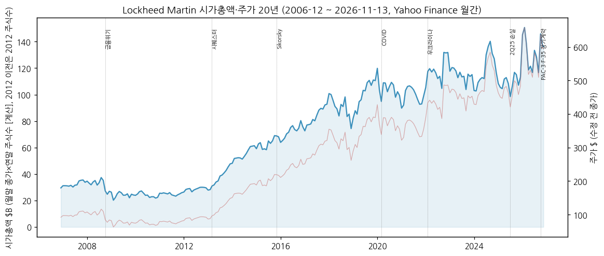

→ **2007~2012 박스권 ($70~110)** — 국방예산 시퀘스터(예산 자동삭감) 우려로 PER 10배 안팎

→ **2013~2019 장기 상승 (~$100 → $390)** — F-35 양산 본격화 + 자사주·배당. 시총 $30B → $110B

→ **2020~2024 고원 + 2022 우크라이나 랠리** — 2022 $480선 돌파, 이후 $400~600 박스

→ **2025 급락** — 2Q25 손실 발표(2025-07) 후 $410대, 2025-12 52주 저점 $437.25

→ **2026 사상 최고 → 조정** — 2026-03 장중 $692.00 사상 최고, 10월 한 달 +25.1% (Motley Fool, S&P Global 인용: 3Q 실적·F-35 프레임워크). 11-13 종가 $596.04 (고점 대비 -13.9%, [계산])

---

## ③ 비즈니스 모델

(1) 실적 추이 통합 표 (5년 + 9M26, 사업부별, $M, 사업부 OP = Non-GAAP)

| 사업부 | 항목 | 2021 | 2022 | 2023 | 2024 | 2025 | 9M26 |
|---|---|---|---|---|---|---|---|
| Aeronautics | 매출 | 26,748 | 26,987 | 27,474 | 28,618 | 30,257 | 23,279 |
| | 영업이익 | 2,800 | 2,867 | 2,825 | 2,523 | 2,086 | 2,122 |
| | OPM | 10.5 | 10.6 | 10.3 | 8.8 | 6.9 | 9.1 |
| | 매출 비중 | 39.9 | 40.9 | 40.7 | 40.3 | 40.3 | 39.6 |
| Missiles and Fire Control | 매출 | 11,693 | 11,317 | 11,253 | 12,682 | 14,450 | 12,251 |
| | 영업이익 | 1,650 | 1,637 | 1,541 | 413 | 1,989 | 1,725 |
| | OPM | 14.1 | 14.5 | 13.7 | 3.3 | 13.8 | 14.1 |
| | 매출 비중 | 17.4 | 17.2 | 16.7 | 17.9 | 19.3 | 20.8 |
| Rotary and Mission Systems | 매출 | 16,789 | 16,148 | 16,239 | 17,264 | 17,312 | 12,856 |
| | 영업이익 | 2,030 | 1,906 | 1,865 | 1,921 | 1,323 | 1,384 |
| | OPM | 12.1 | 11.8 | 11.5 | 11.1 | 7.6 | 10.8 |
| | 매출 비중 | 25.0 | 24.5 | 24.0 | 24.3 | 23.1 | 21.9 |
| Space | 매출 | 11,814 | 11,532 | 12,605 | 12,479 | 13,029 | 10,409 |
| | 영업이익 | 1,184 | 1,057 | 1,158 | 1,226 | 1,345 | 983 |
| | OPM | 10.0 | 9.2 | 9.2 | 9.8 | 10.3 | 9.4 |
| | 매출 비중 | 17.6 | 17.5 | 18.7 | 17.6 | 17.4 | 17.7 |
| **전사** | **매출** | **67,044** | **65,984** | **67,571** | **71,043** | **75,048** | **58,795** |
| | **사업부 OP 합계** | **7,664** | **7,467** | **7,389** | **6,083** | **6,743** | **6,214** |
| | **잔고 (연말·3Q말)** | 135,400 | 150,000 | 160,600 | 176,000 | 193,600 | 292,000 |
| | **해외 매출 비중** | 28% | 26% | 26% | 26% | 28% | — |

→ (출처: 각 연도 10-K 사업부 표, 9M26은 3Q26 10-Q. 잔고는 XBRL RPO, 해외 비중은 10-K 사업 개요)

**사업부 잔고 ($M)**: Aero 59,435 → 57,331 / **MFC 46,650 → 142,517** / RMS 47,715 → 49,435 / Space 39,822 → 42,701 (FY25말 → 3Q26말, 보도자료)

**사업부 해외 매출 비중 (FY25)**: Aero 36% · MFC 29% · RMS 34% · Space 미미 (10-K)

**분기 인도 대수 (3Q26 / 9M26, 보도자료)**: F-35 43 / 94 (9M25 143) · F-16 4 / 6 · C-130J 2 / 10 · 정부 헬기 16 / 51 · 해외 군용 헬기 7 / 7

(2) 사업부별 개요 (매출 비중 큰 순서)

**Aeronautics — 40%**

"5세대 스텔스 전투기 F-35를 만들고, 전 세계 F-35 함대를 수십 년간 정비해 주는 사업부." F-35가 Aero 매출의 67%. F-16 Block 70(해외 전용 신규 생산)·C-130J 수송기·F-22 개량·Skunk Works(기밀·차세대기 Vectis 무인기 자체 투자 5대)

**Rotary and Mission Systems (RMS) — 22%**

"헬기(Sikorsky)와 군함의 두뇌(이지스 전투체계)·레이더를 만드는 사업부." Black Hawk·Seahawk·CH-53K, Aegis, TPY-4·Sentinel A4·LTAMDS 경쟁 레이더, C2·훈련·사이버

**Missiles and Fire Control (MFC) — 21%**

"날아오는 미사일을 맞혀 떨어뜨리는 요격미사일(PAC-3·THAAD)과 정밀타격 미사일·로켓을 만드는 사업부." PAC-3 MSE (17개국 채택), THAAD, GMLRS/HIMARS 탄, PrSM, JASSM/LRASM, Hellfire, Javelin(RTX와 JV)

**Space — 18%**

"잠수함 발사 핵미사일(트라이던트 II D5)과 차세대 본토 요격미사일(NGI), 군·민간 위성을 만드는 사업부." FBM·NGI·GPS III·OPIR·Orion 유인 캡슐, ULA(Boeing과 50:50 발사체 JV)

(3) 사업부별 디테일 (top-seller · growth · 이익 outlier)

→ **Top-seller**: F-35 (FY25 매출의 27%, 약 $20B [계산: $75.0B × 27%])

→ **Growth**: MFC — FY22 $11.3B → 9M26 연환산 약 $16.3B [계산], 3Q26 +24%. 동인은 PAC-3·THAAD·GMLRS·PrSM 램프. 2026 가이던스 MFC 매출 +약 20%

→ **이익 outlier (부정)**: 기밀 프로그램 2건 — Aero 기밀(고정가 인센티브, 누적 손실 약 $1.8B, 3Q26 10-Q) · MFC 기밀(누적 손실 약 $1.4B, 4Q24 $1.31B) / Sikorsky CMHP(캐나다 CH-148, 2Q25 $570M) / TUHP(튀르키예 헬기, $95M)

→ **이익 outlier (긍정)**: FAS/CAS 연금 조정 — 연 약 $1.7B (2026E)가 GAAP OP를 사업부 OP보다 높게 만든다 (회사 가이던스 ~$1,685M)

(4) 주요 경쟁사 (사업부별) — **한국 방산 5사 겹침 포함**

| LMT 제품·시장 | 글로벌 경쟁사 | **한국 5사 겹침** |
|---|---|---|
| F-35 (5세대 수출 전투기) | Boeing F-15EX·F/A-18, Dassault Rafale, Saab Gripen, Eurofighter | **한국항공우주 KF-21** (4.5세대, 인니·중동 수출 추진 — F-35 비구매국 대안) |
| F-16 Block 70 (4세대 수출 전투기) | Saab Gripen E, Rafale | **한국항공우주 FA-50** (경공격기, 폴란드·말레이시아·필리핀 — 동유럽·동남아 저가 시장 겹침) |
| PAC-3 MSE·THAAD (중동·유럽 방공) | RTX Patriot GEM-T, MBDA Aster/SAMP-T, IAI Arrow, Rafael David's Sling | **LIG D&A 천궁-II (M-SAM)** — UAE·사우디·이라크 수출, 중동 중고도 방공 직접 경쟁 / 한화시스템 다기능레이더 |
| Sikorsky Black Hawk·Seahawk (군용 헬기) | Airbus H145M·NH90, Leonardo AW149·AW159 | **한국항공우주 수리온** (KUH, 이라크 수출) |
| 레이더 (TPY-4, Sentinel A4, SPY-7/이지스) | RTX(LTAMDS·SPY-6), Thales, Hensoldt, Saab Giraffe | **한화시스템** (다기능 레이더·천궁 MFR, KDX 전투체계) |
| GMLRS/HIMARS·PrSM (다연장·전술탄도) | (미국 내 독점적), Elbit PULS | **한화에어로스페이스 천무** (폴란드 Homar-K — HIMARS 대체 수출) |
| C-130J (전술수송기) | Embraer C-390, Airbus A400M | — |
| 우주·위성 | Northrop, Boeing, SpaceX | 한화시스템 (소형 SAR 위성) |

→ (출처: 10-K 경쟁 환경, 한국 5사 매핑은 브리프 지정 + 공개 수출 사례 [판단])

(5) 주요 매출처

| 고객 | 비중 (FY25) | 비고 |
|---|---|---|
| 미국 국방부 (DoW/DoD) | 63% | 육·해·공군, 미사일방어청(MDA) |
| 미국 기타 정부 | 9% | NASA, 정보기관 등 |
| 해외 (FMS 경유 77%) | 28% | F-35 파트너 7개국 + FMS 12개국, PAC-3 17개국, Aegis(일본·한국·스페인·호주) |

→ (출처: 10-K FY25. 국가별 매출 순위는 미공시)

(6) 생산 CAPA + 임직원 추이

→ 탄약 증설: 2030년까지 **$8B 투자**, 8개 사업장 200만 sq ft 증설, 2026년 3,000명+ 채용 (3Q26 컨콜). CapEx 가이던스 2026 $2.1~2.3B (FY25 $1.65B)

→ F-35: 연 156대 생산 능력 보장 (850대 프레임워크, Motley Fool·Jefferies 인용 보도)

→ 임직원: 112,000 (FY14) → 97,000 (FY16, IS&GS 분리) → 114,000 (FY20) → 121,000 (FY24) → **123,000 (FY25)** (10-K)

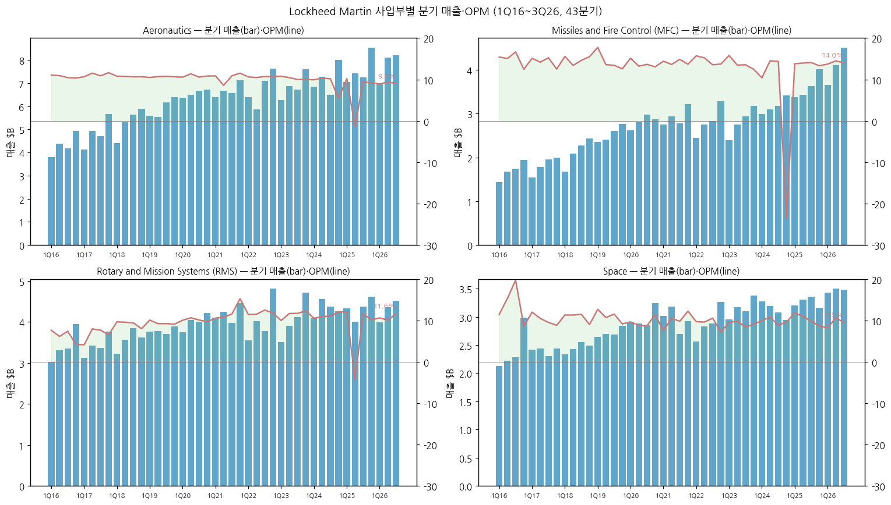

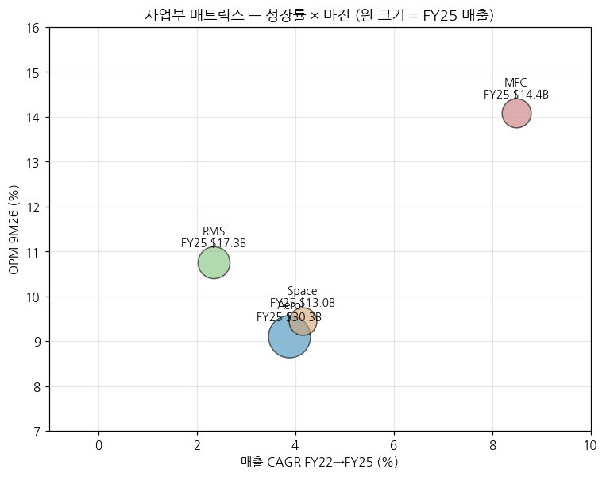

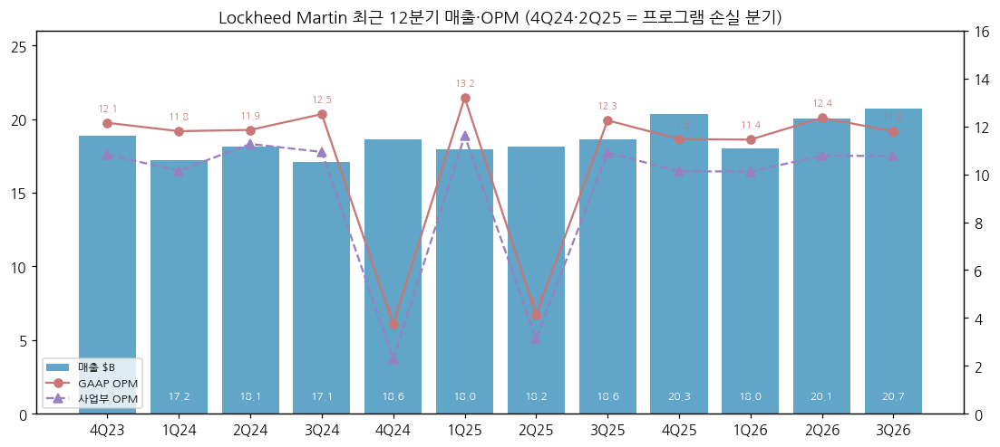

---

## ④ 재무 구조

(1) 손익계산서 (12년, $M) + chart1b

| 연도 | 매출 | 매출 YoY | 매출총이익 | GPM | 사업부 영업이익 | 사업부 OPM | 영업이익(GAAP) | OPM | 순이익 | NPM | 희석 EPS ($) |
|---|---|---|---|---|---|---|---|---|---|---|---|
| 2014 | 39,946 | — | 4,683 | 11.7 | 5,116 | 12.8 | 5,012 | 12.5 | 3,614 | 9.0 | 11.21 |
| 2015 | 40,536 | 1.5 | 4,492 | 11.1 | 4,978 | 12.3 | 4,712 | 11.6 | 3,605 | 8.9 | 11.46 |
| 2016 | 47,290 | 16.7 | 5,401 | 11.4 | 4,982 | 10.5 | 5,888 | 12.5 | 5,173 | 10.9 | 17.07 |
| 2017 | 49,960 | 5.6 | 6,371 | 12.8 | 5,092 | 10.2 | 6,744 | 13.5 | 1,963 | 3.9 | 6.75 |
| 2018 | 53,762 | 7.6 | 7,274 | 13.5 | 5,877 | 10.9 | 7,334 | 13.6 | 5,046 | 9.4 | 17.59 |
| 2019 | 59,812 | 11.3 | 8,367 | 14.0 | 6,574 | 11.0 | 8,545 | 14.3 | 6,230 | 10.4 | 21.95 |
| 2020 | 65,398 | 9.3 | 8,654 | 13.2 | 7,152 | 10.9 | 8,644 | 13.2 | 6,833 | 10.4 | 24.30 |
| 2021 | 67,044 | 2.5 | 9,061 | 13.5 | 7,664 | 11.4 | 9,123 | 13.6 | 6,315 | 9.4 | 22.76 |
| 2022 | 65,984 | -1.6 | 8,287 | 12.6 | 7,467 | 11.3 | 8,348 | 12.7 | 5,732 | 8.7 | 21.66 |
| 2023 | 67,571 | 2.4 | 8,479 | 12.5 | 7,389 | 10.9 | 8,507 | 12.6 | 6,920 | 10.2 | 27.55 |
| 2024 | 71,043 | 5.1 | 6,930 | 9.8 | 6,083 | 8.6 | 7,013 | 9.9 | 5,336 | 7.5 | 22.31 |
| 2025 | 75,048 | 5.6 | 7,619 | 10.2 | 6,743 | 9.0 | 7,731 | 10.3 | 5,017 | 6.7 | 21.49 |

→ (출처: SEC XBRL companyfacts — 10-K 정확값. 사업부 OP는 10-K 사업부 표 합산. GPM = 매출 − 매출원가(XBRL GrossProfit/CostOfRevenue). 2014·2015 순이익은 중단사업 포함. LMT 손익계산서는 판관비를 원가에 포함해 별도 CIR 산출 불가)

(2) 재무상태표 (12년, 연말, $M) + chart4

| 연말 | 자산 | 부채 | 자본 | 현금 | 장기차입(비유동) | 유동성 장기차입 | 유동자산 | 유동부채 | 유동비율 | 부채/자본 | 순차입 |
|---|---|---|---|---|---|---|---|---|---|---|---|
| 2014 | 37,046 | 33,646 | 3,400 | 1,446 | 6,142 | 0 | 12,322 | 11,112 | 1.11 | 9.9x | 4,696 |
| 2015 | 49,304 | 46,207 | 3,097 | 1,090 | 14,305 | 956 | 14,573 | 13,918 | 1.05 | 14.9x | 14,171 |
| 2016 | 47,806 | 46,200 | 1,511 | 1,837 | 14,282 | 0 | 15,108 | 12,542 | 1.20 | 30.6x | 12,445 |
| 2017 | 46,620 | 47,396 | -850 | 2,861 | 13,513 | 750 | 17,505 | 12,913 | 1.36 | n/m | 11,402 |
| 2018 | 44,876 | 43,427 | 1,394 | 772 | 12,604 | 1,500 | 16,103 | 14,398 | 1.12 | 31.2x | 13,332 |
| 2019 | 47,528 | 44,357 | 3,127 | 1,514 | 11,404 | 1,250 | 17,095 | 13,972 | 1.22 | 14.2x | 11,140 |
| 2020 | 50,710 | 44,672 | 6,015 | 3,160 | 11,669 | 500 | 19,378 | 13,933 | 1.39 | 7.4x | 9,009 |
| 2021 | 50,873 | 39,914 | 10,959 | 3,604 | 11,670 | 6 | 19,815 | 13,997 | 1.42 | 3.6x | 8,072 |
| 2022 | 52,880 | 43,614 | 9,266 | 2,547 | 15,429 | 118 | 20,991 | 15,887 | 1.32 | 4.7x | 13,000 |
| 2023 | 52,456 | 45,621 | 6,835 | 1,442 | 17,291 | 168 | 20,521 | 16,937 | 1.21 | 6.7x | 16,017 |
| 2024 | 55,617 | 49,284 | 6,333 | 2,483 | 19,627 | 643 | 21,849 | 19,420 | 1.13 | 7.8x | 17,787 |
| 2025 | 59,840 | 53,119 | 6,721 | 4,121 | 20,532 | 1,168 | 25,362 | 23,335 | 1.09 | 7.9x | 17,579 |
| 3Q26 | 64,510 | 54,447 | 10,063 | 5,960 | 20,498 | 0 | 31,001 | 24,540 | 1.26 | 5.4x | 14,538 |

→ (출처: XBRL companyfacts. 순차입 = 장기차입 + 유동성 장기차입 − 현금 [계산]. 2017 자본 마이너스는 세제개편 이연법인세자산 재평가 + 연금 AOCI)

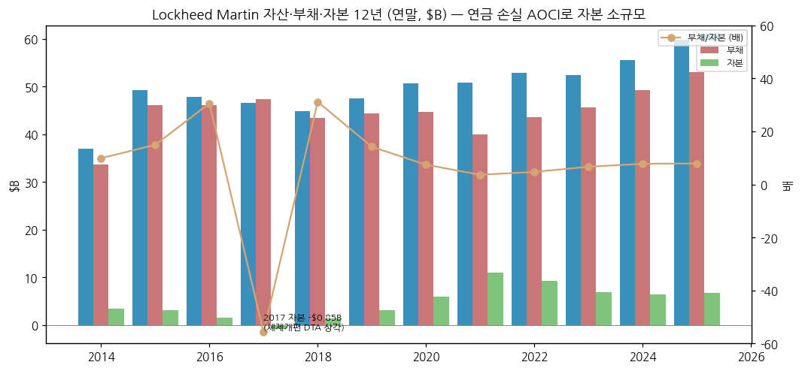

(3) 현금흐름표 (12년, $M) + chart6

| 연도 | 영업CF | 투자CF | 재무CF | CapEx | FCF | FCF/순이익 | 인수 | D&A | 자체 R&D | R&D/매출 |
|---|---|---|---|---|---|---|---|---|---|---|
| 2014 | 3,866 | -1,723 | -3,314 | 845 | 3,021 | 84% | 898 | 927 | 733 | 1.8% |
| 2015 | 5,101 | -9,734 | 4,277 | 939 | 4,162 | 115% | 9,003 | 945 | 817 | 2.0% |
| 2016 | 5,189 | -985 | -3,457 | 1,063 | 4,126 | 80% | 0 | 1,167 | 988 | 2.1% |
| 2017 | 6,476 | -1,147 | -4,305 | 1,177 | 5,299 | 270% | 0 | 1,195 | 1,200 | 2.4% |
| 2018 | 3,138 | -1,075 | -4,152 | 1,278 | 1,860 | 37% | 0 | 1,161 | 1,300 | 2.4% |
| 2019 | 7,311 | -1,241 | -5,328 | 1,484 | 5,827 | 94% | 0 | 906 | 1,300 | 2.2% |
| 2020 | 8,183 | -2,010 | -4,527 | 1,766 | 6,417 | 94% | 282 | 1,019 | 1,300 | 2.0% |
| 2021 | 9,221 | -1,161 | -7,616 | 1,522 | 7,699 | 122% | 0 | 1,364 | 1,500 | 2.2% |
| 2022 | 7,802 | -1,789 | -7,070 | 1,670 | 6,132 | 107% | — | 1,404 | 1,700 | 2.6% |
| 2023 | 7,920 | -1,694 | -7,331 | 1,691 | 6,229 | 90% | — | 1,430 | 1,500 | 2.2% |
| 2024 | 6,972 | -1,792 | -4,139 | 1,685 | 5,287 | 99% | — | 1,559 | 1,600 | 2.3% |
| 2025 | 8,557 | -1,977 | -4,942 | 1,649 | 6,908 | 138% | — | 1,687 | 2,000 | 2.7% |

→ (출처: XBRL companyfacts. FCF = 영업CF − CapEx (회사 정의와 동일). 자체 R&D = IR&D (10-K 반올림 $B 표기). 2022~2025 인수 금액은 XBRL 미태깅 — Terran Orbital 등 소규모)

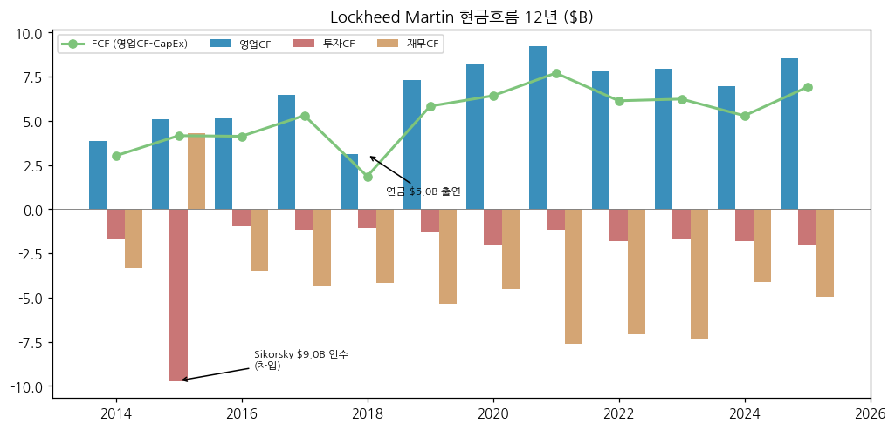

(4) CapEx + chart8

→ CapEx/매출 2.1~3.0%대 안정 (FY25 $1,649M, 2.2%). 2026 가이던스 $2.1~2.3B로 상향 — 탄약 증설(PAC-3 연산 확대, THAAD·PrSM) 반영. 다만 장기계약은 고객의 증설비 분담·현금중립 조항을 포함 (3Q26 컨콜, CEO)

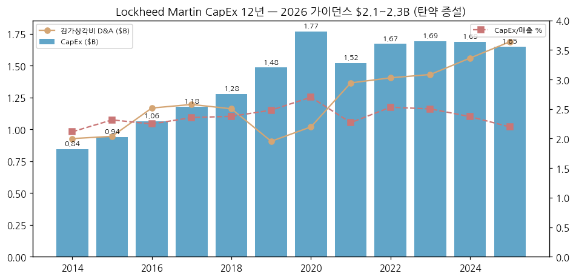

(5) 부채 구조 + 채권 history

→ 장기차입 $6.1B (FY14) → $14.3B (FY15, Sikorsky 인수 채권 발행) → $11.4B (FY19, 상환) → **$20.5B (FY25·3Q26)** — 2022~2025 자사주·연금 출연 재원으로 재차입. 이자비용 FY21 $569M → FY25 $1,118M (2배), 이자보상배율 16.0배 → 6.9배

→ 연금: CAS 연금비용 회수액이 FAS 서비스비용보다 커 영업이익에 연 $1.7B 플러스(FAS/CAS 조정). 2027년 $1B+ 의무 출연 예정, 2026년 선출연 여부 연말 결정 (3Q26 컨콜)

→ ULA(발사체 JV) 보증·추가 지원 예정 (3Q26 보도자료 위험요인)

(6) 배당·자사주 + chart9

| 연도 | DPS 선언 ($) | 배당 지급 | 자사주 매입 | 총환원 | FCF | 환원/FCF | 희석주식수(M) | 연말 발행주식(M) |
|---|---|---|---|---|---|---|---|---|
| 2014 | 5.49 | 1,760 | 1,900 | 3,660 | 3,021 | 121% | 322.4 | 314 |
| 2015 | 6.15 | 1,932 | 3,071 | 5,003 | 4,162 | 120% | 314.7 | 303 |
| 2016 | 6.77 | 2,048 | 2,096 | 4,144 | 4,126 | 100% | 303.1 | 289 |
| 2017 | 7.46 | 2,163 | 2,001 | 4,164 | 5,299 | 79% | 290.6 | 284 |
| 2018 | 8.20 | 2,347 | 1,492 | 3,839 | 1,860 | 206% | 286.8 | — |
| 2019 | 9.00 | 2,556 | 1,200 | 3,756 | 5,827 | 64% | 283.8 | 280 |
| 2020 | 9.80 | 2,764 | 1,100 | 3,864 | 6,417 | 60% | 281.2 | 279 |
| 2021 | 10.60 | 2,940 | 4,087 | 7,027 | 7,699 | 91% | 277.4 | 271 |
| 2022 | 11.40 | 3,016 | 7,900 | 10,916 | 6,132 | 178% | 264.6 | 254 |
| 2023 | 12.15 | 3,056 | 6,000 | 9,056 | 6,229 | 145% | 251.2 | 240 |
| 2024 | 12.75 | 3,059 | 3,700 | 6,759 | 5,287 | 128% | 239.2 | 234 |
| 2025 | 13.35 | 3,131 | 3,000 | 6,131 | 6,908 | 89% | 233.5 | 229 |

→ (출처: XBRL companyfacts. 2026 분기 배당 $3.45 → **$3.60 (2026-10 발표, 24년 연속 인상)**, 9M26 자사주 매입 없음 (10-Q))

→ 12년 누적 주주환원 $68.3B [계산] vs 누적 FCF $63.0B [계산] — FCF 초과 환원분은 차입으로 충당. 발행주식 314M → 231M (-26%)

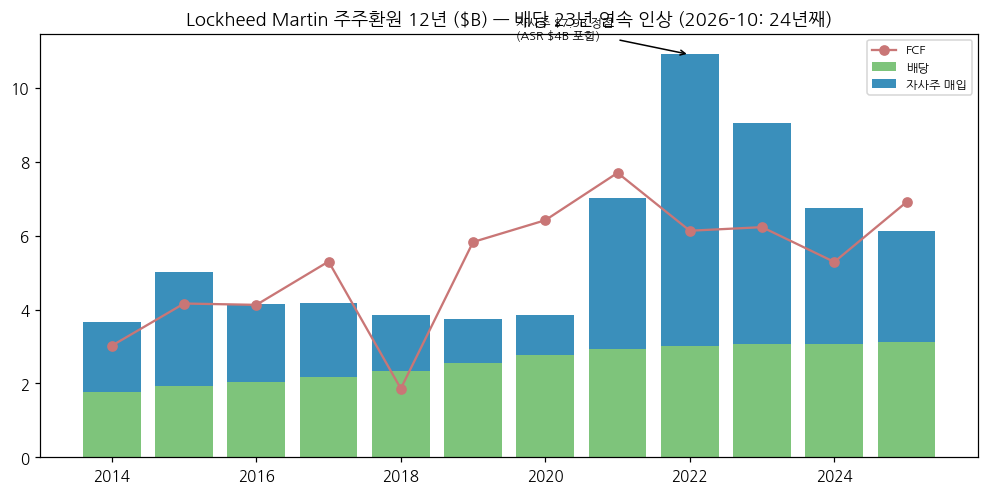

(7) 재무비율 (12년, [계산])

| 연도 | ROE (평균자본) | ROA (평균자산) | 부채비율 (부채/자본) | 유동비율 | 이자보상배율 | 실효세율 |
|---|---|---|---|---|---|---|
| 2014 | 87% | 9.9% | 990% | 1.11 | 14.7x | 30.4% |
| 2015 | 111% | 8.3% | 1,492% | 1.05 | 10.6x | 27.3% |
| 2016 | 225% | 10.7% | 3,058% | 1.20 | 8.9x | 23.0% |
| 2017 | n/m | 4.2% | n/m | 1.36 | 10.4x | 64.0% |
| 2018 | n/m | 11.0% | 3,115% | 1.12 | 11.0x | 13.6% |
| 2019 | 276% | 13.5% | 1,419% | 1.22 | 13.1x | 14.0% |
| 2020 | 149% | 13.9% | 743% | 1.39 | 14.6x | 16.4% |
| 2021 | 74% | 12.4% | 364% | 1.42 | 16.0x | 16.4% |
| 2022 | 57% | 11.0% | 471% | 1.32 | 13.4x | 14.2% |
| 2023 | 86% | 13.1% | 667% | 1.21 | 9.3x | 14.5% |
| 2024 | 81% | 9.9% | 778% | 1.13 | 6.8x | 14.2% |
| 2025 | 77% | 8.7% | 790% | 1.09 | 6.9x | 15.3% |

→ 자본이 연금 AOCI로 작아 ROE·부채비율은 비교 의미가 낮다. 비교 지표는 ROA·이자보상배율·FCF/순이익을 권장 [판단]

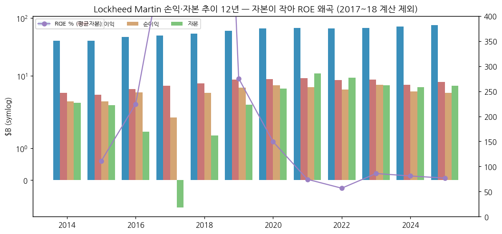

---

## ⑤ 지배 구조

(1) 그룹·계열 관계

→ 지배주주 없는 분산 소유 상장사. 주요 JV: **ULA** (Boeing 50:50, 발사체), **Javelin JV** (RTX와), AWE(영국 핵무기 시설 컨소시엄) 등 — Space·MFC 사업부 지분법 이익

(2) 주주 구분 + chart5

| 주주 | 보유 주식 | 지분율 | 비고 |
|---|---|---|---|
| State Street Corp. | 37,056,708 | 14.9% | 그중 SSBTC 2,770만 주는 LMT 임직원 연금·퇴직플랜 신탁 |
| The Vanguard Group | 22,098,899 | 8.9% | |
| BlackRock, Inc. | 18,292,313 | 7.4% | |
| 이사·임원 전체 | — | 1% 미만 | |

→ (출처: 2026 Proxy Statement — 2023-12-31 기준 13G/A 인용. 최신 지분율과 다를 수 있음)

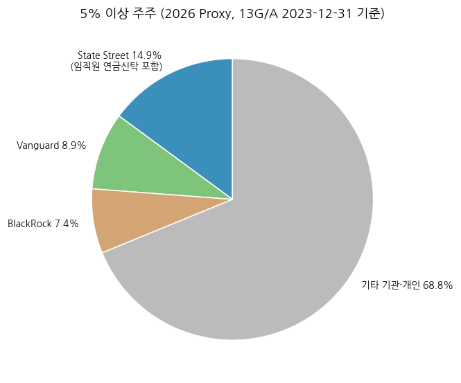

(3) 경영진·이사회

→ **James D. Taiclet** — 회장·사장·CEO. American Tower CEO 출신, 2018년 LMT 이사 → 2020-06 CEO. 전략: "21st Century Security" (디지털·AI·자율 + 기존 플랫폼 결합), 상업 기술·스타트업 협업

→ **Evan Scott** — CFO (3Q26 컨콜 발표자)

→ 독립 선임이사(Lead Independent Director) 체제 — Proxy의 독립 이사 다수 구성

---

## ⑥ 기타 팩트

(1) 시가총액·밸류에이션 스냅샷 (2026-11-13 기준)

| 지표 | 값 |
|---|---|
| 주가 | $596.04 |
| 시가총액 | $137.7B [계산] |
| EV | $152.2B [계산, 3Q26말 순차입 $14.5B] |
| P/E (2026 EPS 가이던스 중간값 $30.55) | 19.5배 |
| P/E (2027E 컨센 $33.23) | 17.9배 |
| EV / 2026 사업부 OP 가이던스 | 17.6배 |
| FCF 수익률 (2026 가이던스) | 5.7% |
| 배당 수익률 | 2.4% |
| 컨센 평균 TP | $645.48 (23명, Strong Buy 8·Buy 3·Hold 11·Strong Sell 1, StockAnalysis 2026-10-26) |

(2) R&D 인프라 + chart7

→ 자체 R&D(IR&D) FY14 $0.7B → FY25 **$2.0B** (매출 대비 2.7%). 9M26 $1.6B (3Q26 $599M) — 고객 부담 R&D는 매출에 포함돼 별도. Skunk Works(Palmdale), 13개 "mission technology roadmap" (3Q26 컨콜)

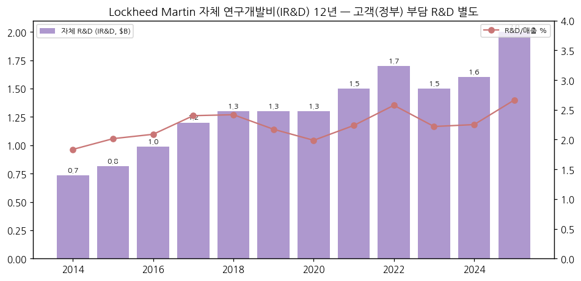

(3) 진행 중 corporate action

→ Ultra Maritime 인수 — 4Q26 종결 예정, 보유 현금으로 지급 (3Q26 컨콜, 가이던스 미반영)

→ PAC-3 MSE 다년계약 (최대 $58.6B, 7년), THAAD 7년 계약, F-35 10년 850대 프레임워크(Lot 20+ 계약 협상 중), C-130J 34대 $4.4B (3Q26 컨콜)

→ 자체 투자 Vectis(무인 협동전투기) 5대 제작

(4) 주요 리스크

→ **F-35 Lot 20 자금 공백** — 3Q26부터 Lot 20 선행계약 원가가 계약 승인·예산을 초과 (10-Q). 계약 지연 시 손익·현금흐름 악영향

→ **고정가 개발계약 손실** — Aero 기밀(누적 $1.8B, 미지급 잔여 $394M), MFC 기밀, CMHP(캐나다 재협상 중)

→ **미 국방예산** — FY2027 계속결의안(CR)으로 시작, 예산 조정(reconciliation) 불확실 (3Q26 컨콜)

→ **증권 집단소송** — 2024-01~2025-07 매수자, 기밀 프로그램·F-35 공시 관련 (10-Q Note 11)

→ **집중도** — 미국 정부 72%, F-35 27%

(5) ESG

→ 원문 미수집 (Source Audit ❌). 방산(핵무기 관련 FBM·AWE 포함) 특성상 일부 ESG 펀드 편입 제외 대상 [판단]

(6) 인증·라이선스

→ 미 국무부 ITAR·FMS 수출 통제 하 판매 (해외 매출의 77%가 FMS), 미 국방부 보안 인가 시설 다수

---

## Activity 보고 (v1.0 finalize)

### ✅ 확보 자료
→ 10-K 13 · 10-Q 39 · 8-K 38 · XBRL companyfacts · 3Q26 보도자료 · 2026 Proxy · Yahoo 20년 · 컨콜 요약

### ❌ 누락 자료 (4)
→ Motley Fool 트랜스크립트 원문 / 사업부 잔고 과거 분기 / 최신 5% 주주 / ESG 보고서

### ⚠️ 추정·계산 데이터 표시
→ 시총·EV·P/E·FCF 수익률·조정 OPM은 [계산]. 4Q24 Aero 손실분은 회사 공시 합계(약 $1.7B)에서 MFC $1.31B를 뺀 근사치

### Data Quality Confidence: **90%**

---

## Version Log

| 버전 | 일자 | 내역 |
|---|---|---|
| v1.0 | 2026-11-14 | 최초 작성 — 12년 연간·43분기 사업부·13종 차트, 3Q26(2026-10-22) 반영, 한국 5사 겹침 매핑 |

→ 잔여 보완 후보: FY26 연간 확정(2027-01 발표) 반영, 사업부 잔고 분기 시계열, ESG 등급, 최신 13F 지분
