> Ticker: **NYSE: LYV — Live Nation Entertainment, Inc.** (S&P 500 편입)
> Entity: **Live Nation Entertainment, Inc.** (본사 Beverly Hills, 캘리포니아) — 세계 최대 라이브 엔터테인먼트 기업 (공연 프로모션·공연장 운영 + Ticketmaster 티켓팅 + 스폰서십)
> Sector: 엔터 — 서브섹터 **공연 글로벌** (한국 기획사 4사의 글로벌 투어 매출·스타디움 사이클 read-through, BTS 2026 월드투어 공동 프로모터)
> 작성 시각: **2026-11-15 KST** (**v1.0** — Phase 1 Source 수집 + audit + 11종 차트)
> 적용 구조: v4.8 (6개 섹션) — 미국 기업 SEC XBRL·10-K/10-Q/8-K/DEF 14A 기반
> 데이터 범위: **연간 12년 (FY2014\~FY2025, 12월 결산)** / **분기 59Q (1Q12\~3Q26)** 세그먼트 매출·AOI / 재무상태·현금흐름 12년
> 출처: **SEC EDGAR** — XBRL companyfacts(손익·재무상태·현금흐름), 10-K 15건(2012\~2026), 10-Q 44건(2012\~2026-11-05), DEF 14A(2026-04-24), 3Q26 8-K Ex-99.1 / Yahoo Finance v8(주가 2006\~) / stockanalysis.com(52주 범위 교차 확인)
> ⚠️ **FY2026 연간 실적은 2027-02 하순 발표 예정** (전년 FY2025 10-K 2026-02-19 제출) — 발표 후 v1.1 갱신

# Live Nation Entertainment 기업 개요 (v1.0 — 공연 글로벌 / 공연·티켓팅 세계 1위 / 지속성장형 + 규제 리스크)
> **Fact verify cutoff**: 2026-11-15 (주가 2026-11-13 종가 **$178.45** [Yahoo Finance v8] × 발행주식 235,696,543주 [3Q26 10-Q 표지] = 시가총액 **$42.1B** / 종가 기준 사상 최고 **2026-08-14 $188.46** (시총 약 $44.4B) [Yahoo Finance v8 일간] — 장중 52주 고가 $189.25 [stockanalysis.com, 2026-10-27 확인] / 종가 52주 범위 $125.61\~$188.46)

## Phase 1 Source Audit

```
=== 자료 수집 audit (Live Nation Entertainment, Inc.) ===

✅ 확보
- SEC XBRL companyfacts: FY2009~FY2025 연간 손익·재무상태·현금흐름, 1Q10~3Q26 분기 손익
- 10-K 15건(FY2011~FY2025): 세그먼트 연간·KPI(관객·티켓)·임직원·공연장 수
- 10-Q 44건(1Q12~3Q26): 세그먼트 분기 매출·AOI(2Q21~)·소송 경과
- DEF 14A 2026-04-24: 5% 주주·이사회·보수
- 3Q26 8-K Ex-99.1: 이벤트 이연매출, 2026 관객 가이던스, 2027 선판매
- Yahoo Finance v8: 월간 2006-01~, 일간 2024-11~2026-11-13

❌ 누락
- 세그먼트 영업이익 → AOI 전환(2021) 이전 분기 AOI (2012~1Q21은 세그먼트 영업이익 기준만 존재)
- 2020~2021 상세 KPI(관객) 일부, ESG 등급

⚠️ 주의
- 2016년 이전 Concerts는 Artist Nation(아티스트 매니지먼트) 포함 — 2017 세그먼트 재편 후 Concerts에 통합
- 2018 ASC 606 도입으로 매출 인식 기준 변경 (Ticketing 매출 순액 인식 비중 영향)
- 현금 $8.3B(3Q26)에는 공연 선판매로 받은 고객 현금(client cash)이 포함 — 순차입 해석 주의
```

---

## ① 기업 분류

### Primary: **지속성장형** (라이브 공연 수요의 구조적 성장) / Secondary: **이벤트·규제 리스크형** (코로나 셧다운, 반독점 소송)

| Summary Box (FY2014\~FY2025, 12년) | 값 |
|---|---|
| 매출 CAGR | **+12.5%** (2014 $6.9B → 2025 $25.2B) / 코로나 전후 비교 2019→2025 +13.9% |
| OPM 평균 | **2.8%** (코로나 2020\~2021 제외 10년) / 12년 단순평균 −5.6% |
| OPM 정점 평균 | **4.9%** (2023 4.8%·2025 5.0%) — AOI 마진 기준 9.3\~9.4% (2024\~2025) |
| OPM 저점 평균 | **−47.8%** (2020 −88.8%·2021 −6.7%) — 코로나 외생 충격, 경기 사이클 아님 |
| 사이클 주기 | **N/A — secular 성장** (투어 슈퍼스타 라인업에 따른 연도별 진폭은 있으나 반복 사이클 없음) |
| 사이클 회수 (12년) | 외생 충격 1회 (2020\~2021 코로나) / 투어 공백 둔화 1회 (2024 매출 +1.9%) |

#### 12년 손익 (사이클 annotation)

| 연도 | 매출 ($M) | YoY | 영업이익 ($M) | OPM | AOI ($M) | AOI 마진 | 순이익(지배) ($M) | 비고 |
|---|---|---|---|---|---|---|---|---|
| 2014 | 6,867 | - | 7 | 0.1% | - | - | −91 | ← 저마진 공연 프로모터 (OPM 0.1%) |
| 2015 | 7,246 | 5.5% | 131 | 1.8% | - | - | −33 |  |
| 2016 | 7,826 | 8.0% | 195 | 2.5% | - | - | 3 |  |
| 2017 | 9,687 | 23.8% | 91 | 0.9% | - | - | −6 | ← 스타디움 투어 확대, 매출 +24% |
| 2018 | 10,788 | 11.4% | 273 | 2.5% | - | - | 60 | ← ASC 606 도입 |
| 2019 | 11,548 | 7.0% | 325 | 2.8% | - | - | 70 | ← 코로나 직전 고점 (매출 $11.5B) |
| 2020 | 1,861 | −83.9% | −1,653 | −88.8% | −1,016 | −54.6% | −1,725 | ← **코로나 공연 중단 — 저점** (매출 −84%) |
| 2021 | 6,268 | 236.8% | −418 | −6.7% | 324 | 5.2% | −651 | ← 하반기 재개 |
| 2022 | 16,681 | 166.1% | 722 | 4.3% | 1,407 | 8.4% | 266 | ← **리오프닝** 매출 2.7배 |
| 2023 | 22,726 | 36.2% | 1,085 | 4.8% | 1,881 | 8.3% | 557 | ← 스타디움 슈퍼사이클 (매출 $22.7B) |
| 2024 | 23,156 | 1.9% | 825 | 3.6% | 2,146 | 9.3% | 896 | ← 성장 둔화 (+1.9%), Astroworld 소송 손실충당 $455M |
| 2025 | 25,201 | 8.8% | 1,251 | 5.0% | 2,366 | 9.4% | 496 | ← AOI $2.37B 사상 최대 |

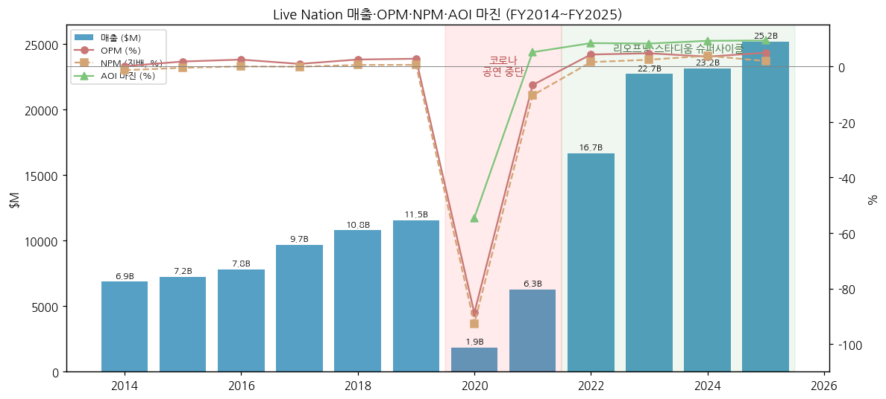

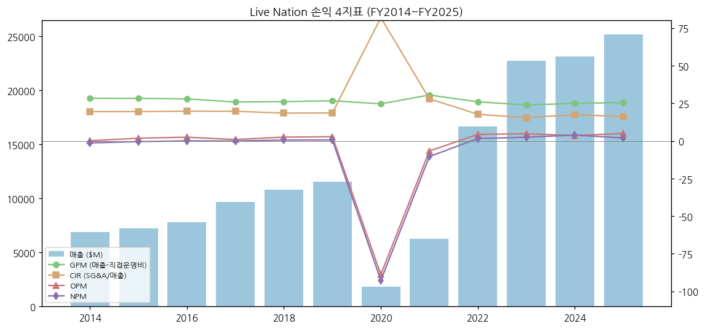

### ② 산업 분류
- SEC SIC 7900 (Services-Amusement & Recreation Services) / GICS 커뮤니케이션 서비스 — 엔터테인먼트
- 워치리스트: **엔터 섹터 — 서브섹터 "공연 글로벌"** (대분류 소비재, 핵심 종목). 한국 기획사 4사(하이브·JYP·에스엠·와이지엔터)의 공연 매출과 같은 수요를 다른 쪽(프로모터·티켓)에서 본다

### ③ 분류 결정 논리
(1) **가장 큰 사업부 기준**: Concerts가 매출의 83%(2025)지만 AOI 마진 3%대의 저마진 통과(pass-through) 사업. 공연 수요는 2014 이후 코로나를 빼면 매년 성장 → 지속성장.
(2) **이익 비중 우선 sub-rule**: AOI는 Ticketing 43%·Sponsorship 32%·Concerts 26% (2025). 이익의 3/4이 Concerts가 만든 관객 트래픽에 붙는 고마진 사업(티켓 수수료 마진 37%, 스폰서십 64%)에서 나온다 → "관객 수 × 1인당 수익화"의 플라이휠 구조. 경기보다 **슈퍼스타 투어 라인업**과 **해외 확장**에 민감.
(3) **Boundary case**: 2020\~2021 매출 −84%·영업손실 $1.65B는 경기 사이클이 아닌 외생 셧다운 → 분류에 미반영. 다만 **반독점 소송**(2026-04 배심 평결)의 구조적 구제(Ticketmaster 관련 조치)가 확정되면 이익 1위 사업부의 마진이 바뀔 수 있어 Secondary로 "규제 리스크형"을 병기.
(4) **피어 대비**: 같은 엔터 섹터의 기획사(하이브 등)는 IP 보유 → 앨범·MD 고마진, Live Nation은 IP 없이 공연 유통·티켓 플랫폼 → 저마진·고회전. 음원 글로벌(UMG·Spotify)은 구독 반복 매출, Live Nation은 이벤트 단위 매출로 분기 변동이 크다 (2Q·3Q 성수기, 1Q·4Q 비수기 손실).

### ④ 적정 밸류에이션 방법
- **EV/AOI 우선** — GAAP 영업이익은 소송 충당금(2024 Astroworld $455M, 2026 1Q DOJ·주 정부)과 인수 비용으로 왜곡, 회사·셀사이드 모두 AOI 기준. 3Q26 기준 TTM AOI $2,561M(4Q25 $194M + 9M26 $2,367M) → EV 약 $43.6B(시총 $42.1B + 차입 $9.7B − 현금 $8.3B) 기준 **EV/AOI 약 17.0배** [계산]
- **P/FCF 보조** — 공연장 투자(Venue Nation) 확대로 CapEx가 2025 $1.06B까지 늘어 FCF가 출렁인다 (2024 $1.08B → 2025 $0.33B)
- **PBR·PER 부적합** — 지배주주 자본이 2020\~2023 음수(코로나 손실 누적), 2025 희석 EPS −$0.24(상환가능 비지배지분 재평가 accretion 반영) → 주당 지표 왜곡
- 현금에 고객 선수금이 섞여 있어 순차입금이 실제보다 작게 보인다 — EV 계산 시 하단 레인지로 해석

### ⑤ 분기 재평가 트리거 (분류 변경 조건)
- 반독점 소송 구제 결정이 **Ticketmaster 분리·독점 계약 해지** 수준으로 확정 → Ticketing AOI 비중(현 43%) 축소 가능성 반영, Secondary 격상 검토
- **관객 수 2개 연도 연속 역성장** (2025 1억 5,920만 명 기준) → 지속성장 → 사이클형 재분류 검토
- AOI 마진이 2개 연도 연속 **8% 이하** → 플라이휠(고마진 사업 비중) 약화로 판단

---

## ② 회사 개요

### ① 기본 사항
- 회사명: Live Nation Entertainment, Inc. (2010-01 Live Nation + Ticketmaster Entertainment 합병)
- 사업 한 줄 정의: **아티스트 투어를 기획·판매(Concerts)하고, 티켓을 팔고(Ticketmaster), 관객에게 브랜드를 연결(Sponsorship)하는 라이브 공연 플랫폼**
- 규모 (FY2025, 10-K): 관객 약 1억 5,920만 명 / 공연 약 5만 5천 회 / 아티스트 1만 1천+ / 티켓 6억 4,600만 장 처리 / Ticketmaster 고객사 1만 500곳 / 공연장 460개 소유·운영·독점 부킹·지분 보유
- 임직원: 정규직 약 1만 7,700명 (2025-12-31) + 시즌·파트타임 최대 3만 7,000명 (2025 성수기)
- CEO Michael Rapino (2005-08 취임, 1999 입사)

### ② 12년 손익·자본 추이 ($M)

| 연도 | 매출 | 영업이익 | 순이익(지배) | 자본총계(NCI 포함) | 지배주주 자본 | 총자산 |
|---|---|---|---|---|---|---|
| 2014 | 6,867 | 7 | −91 | 1,484 | 1,297 | 5,968 |
| 2015 | 7,246 | 131 | −33 | 1,447 | 1,237 | 6,156 |
| 2016 | 7,826 | 195 | 3 | 1,350 | 1,126 | 6,764 |
| 2017 | 9,687 | 91 | −6 | 1,418 | 1,181 | 7,504 |
| 2018 | 10,788 | 273 | 60 | 1,343 | 1,099 | 8,497 |
| 2019 | 11,548 | 325 | 70 | 1,464 | 1,146 | 10,976 |
| 2020 | 1,861 | −1,653 | −1,725 | −134 | −472 | 10,589 |
| 2021 | 6,268 | −418 | −651 | −193 | −583 | 14,402 |
| 2022 | 16,681 | 722 | 266 | 65 | −368 | 16,461 |
| 2023 | 22,726 | 1,085 | 557 | 552 | −52 | 19,030 |
| 2024 | 23,156 | 825 | 896 | 819 | 173 | 19,639 |
| 2025 | 25,201 | 1,251 | 496 | 894 | 271 | 22,913 |

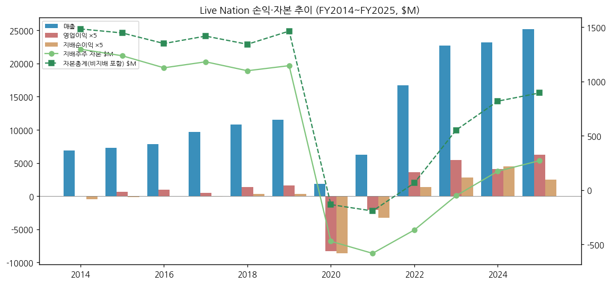

### ③ 회사 주가 역사

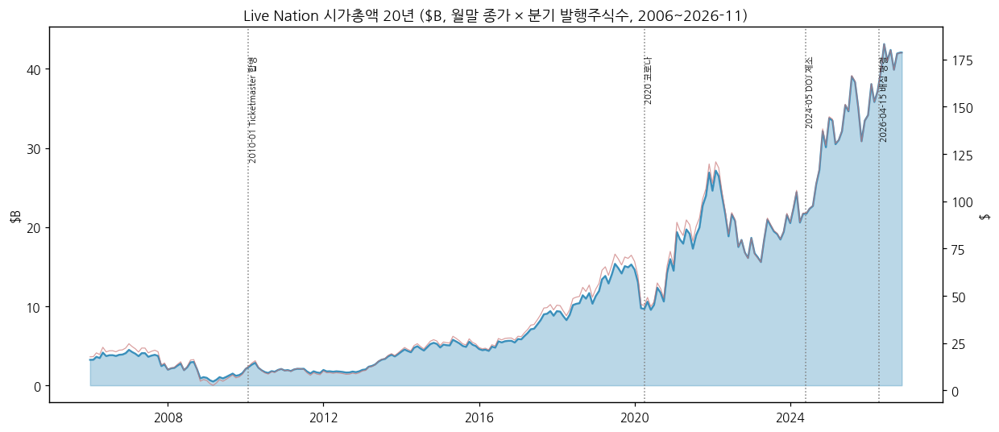

- 2005-12 Clear Channel에서 분사 상장 → 2009-03 금융위기 저점 월말 종가 $2.67
- 2010-01 Ticketmaster 합병 (Liberty Media가 최대주주로 진입)
- 2019 연말 시총 약 $15B (주가 $70대) → 2020-03 코로나로 공연 전면 중단, 주가 $30대까지 하락
- 2021\~2023 리오프닝 + 스타디움 슈퍼사이클(테일러 스위프트 Eras 등)로 매출 2.7배, 주가 회복
- 2024-05 DOJ 반독점 소송 제기에도 2025 사상 최고가 경신 행진 → **2026-08-14 종가 $188.46 사상 최고 (시총 약 $44.4B)** [Yahoo Finance v8]
- 2026-03 DOJ 합의($280M 기금 + 구조적 구제) → 2026-04-15 잔여 주 정부 배심 평결 패소 → 이후 3Q26 호실적(11/5)으로 2026-11-13 종가 $178.45 (고점 대비 −5%)

### ④ 주요 연혁
| 시기 | 이벤트 |
|---|---|
| 2005-12 | Clear Channel Communications에서 Live Nation 분사, NYSE 상장 |
| 2007\~2008 | 마돈나·U2·제이지 등 360도 계약(공연+음반+MD) |
| 2010-01 | Ticketmaster Entertainment와 합병 → Live Nation Entertainment 출범 (DOJ 동의 판결 조건부) |
| 2019-12 | DOJ 동의 판결 위반 확인, 판결 2025년까지 연장 |
| 2020-03 | 코로나로 전 세계 공연 중단 — 연간 매출 −84% |
| 2021-06 | OCESA(멕시코) 지분 51% 인수 완료 |
| 2022\~2023 | 리오프닝, 2023 관객 1억 4,580만 명·매출 $22.7B 사상 최대 |
| 2024-05 | DOJ + 30개 주·DC 반독점 소송 제기 (Ticketmaster 분리 요구) |
| 2025-12 | Liberty Media가 Liberty Live Holdings 분할(split-off) — 지분 29.62% 이전 |
| 2026-03-09 | DOJ와 합의 공개 ($280M 주 정부 기금 + 금지명령·구조적 구제) |
| 2026-04-15 | 잔여 주 정부(Litigating States) 배심 평결 패소 — 티켓당 손해배상 |
| 2026-11-05 | 3Q26 분기 매출 첫 $10B 돌파, 관객 6,110만 명 (+19%) |

---

## ③ 비즈니스 모델

### ① 실적 추이 통합 표 — 세그먼트 연간 ($M)

| 구분 | 2021 | 2022 | 2023 | 2024 | 2025 | 9M25 | 9M26 | 9M YoY |
|---|---|---|---|---|---|---|---|---|
| **매출** | | | | | | | | |
| Concerts (공연 프로모션·공연장) | 4,722 | 13,494 | 18,741 | 19,024 | 20,861 | 15,713 | 17,966 | 14.3% |
| Ticketing (Ticketmaster) | 1,134 | 2,239 | 2,959 | 2,989 | 3,081 | 2,235 | 2,488 | 11.3% |
| Sponsorship & Advertising | 412 | 968 | 1,095 | 1,195 | 1,329 | 999 | 1,147 | 14.8% |
| **연결 합계** (내부거래 제거 후) | 6,268 | 16,681 | 22,726 | 23,156 | 25,201 | 18,888 | 21,565 | 14.2% |
| **AOI** | | | | | | | | |
| Concerts (공연 프로모션·공연장) | −147* | 170 | 320 | 530 | 687 | 880 | 915 | 4.1% |
| Ticketing (Ticketmaster) | 483* | 828 | 1,140 | 1,124 | 1,134 | 829 | 902 | 8.8% |
| Sponsorship & Advertising | 239* | 592 | 675 | 764 | 845 | 677 | 772 | 14.0% |
| **연결 합계** (내부거래 제거 후) | 324 | 1,407 | 1,881 | 2,146 | 2,366 | 2,172 | 2,367 | 9.0% |
| **AOI 마진** | | | | | | | | |
| Concerts (공연 프로모션·공연장) | - | 1.3% | 1.7% | 2.8% | 3.3% | 5.6% | 5.1% | |
| Ticketing (Ticketmaster) | - | 37.0% | 38.5% | 37.6% | 36.8% | 37.1% | 36.3% | |
| Sponsorship & Advertising | - | 61.1% | 61.6% | 63.9% | 63.6% | 67.7% | 67.3% | |

> *2021 세그먼트 AOI는 2Q21\~4Q21 합계 (1Q21은 AOI 공시 전). 연결 AOI는 10-K 연간 수치. 세그먼트 합과 연결 합 차이는 Corporate 비용·내부거래 제거.
> 2025 매출 비중: Concerts 83% / Ticketing 12% / Sponsorship 5% — **AOI 비중: Concerts 26% / Ticketing 43% / Sponsorship 32%** (세그먼트 AOI 합 기준, Corporate 제외)

### ① 세그먼트별 분기 시계열 (1Q17\~3Q26)

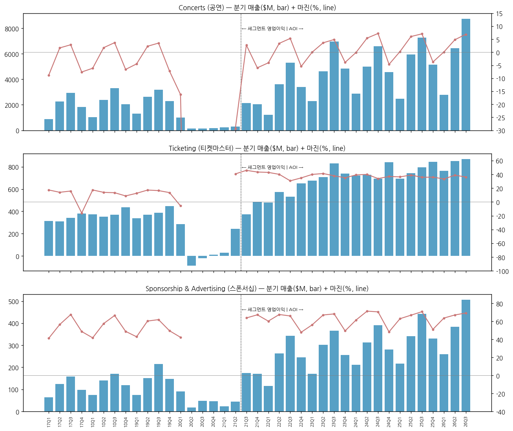

> 점선 왼쪽은 세그먼트 영업이익 마진, 오른쪽(2Q21\~)은 AOI 마진. 2Q20\~4Q20 Ticketing 매출 음수는 공연 취소 환불로 인한 수수료 환입.

<details><summary>세그먼트 분기 원자료 (1Q12\~3Q26, $M)</summary>

| 분기 | Concerts 매출 | Ticketing 매출 | Spons. 매출 | 연결 매출 | Concerts AOI | Ticketing AOI | Spons. AOI | 연결 AOI | 연결 영업이익 | OPM |
|---|---|---|---|---|---|---|---|---|---|---|
| 12Q1 | 510 | 326 | 36 | 868 | - | - | - | - | −43 | −4.9% |
| 12Q2 | 1,185 | 329 | 61 | 1,551 | - | - | - | - | 43 | 2.8% |
| 12Q3 | 1,558 | 346 | 96 | 1,963 | - | - | - | - | 105 | 5.3% |
| 12Q4 | 1,017 | 373 | 55 | 1,437 | - | - | - | - | −126 | −8.8% |
| 13Q1 | 564 | 325 | 40 | 924 | - | - | - | - | −33 | −3.6% |
| 13Q2 | 1,293 | 338 | 71 | 1,680 | - | - | - | - | 98 | 5.8% |
| 13Q3 | 1,838 | 357 | 110 | 2,262 | - | - | - | - | 126 | 5.6% |
| 13Q4 | 1,176 | 388 | 63 | 1,613 | - | - | - | - | −51 | −3.2% |
| 14Q1 | 735 | 354 | 45 | 1,127 | - | - | - | - | −12 | −1.1% |
| 14Q2 | 1,251 | 371 | 71 | 1,666 | - | - | - | - | 56 | 3.3% |
| 14Q3 | 2,056 | 386 | 115 | 2,502 | - | - | - | - | 151 | 6.0% |
| 14Q4 | 1,074 | 446 | 69 | 1,572 | - | - | - | - | −187 | −11.9% |
| 15Q1 | 701 | 376 | 52 | 1,120 | - | - | - | - | −24 | −2.1% |
| 15Q2 | 1,356 | 360 | 81 | 1,766 | - | - | - | - | 42 | 2.4% |
| 15Q3 | 2,129 | 426 | 127 | 2,623 | - | - | - | - | 154 | 5.9% |
| 15Q4 | 1,499 | 478 | 74 | 1,737 | - | - | - | - | −40 | −2.3% |
| 16Q1 | 755 | 406 | 58 | 1,208 | - | - | - | - | −33 | −2.8% |
| 16Q2 | 1,682 | 443 | 95 | 2,179 | - | - | - | - | 74 | 3.4% |
| 16Q3 | 2,644 | 456 | 136 | 3,170 | - | - | - | - | 191 | 6.0% |
| 16Q4 | 902 | 522 | 89 | 1,798 | - | - | - | - | −37 | −2.1% |
| 17Q1 | 863 | 313 | 64 | 1,243 | - | - | - | - | −21 | −1.7% |
| 17Q2 | 2,250 | 311 | 125 | 2,684 | - | - | - | - | 113 | 4.2% |
| 17Q3 | 2,939 | 340 | 158 | 3,440 | - | - | - | - | 201 | 5.9% |
| 17Q4 | 1,840 | 382 | 99 | 2,320 | - | - | - | - | −202 | −8.7% |
| 18Q1 | 1,039 | 372 | 75 | 1,482 | - | - | - | - | −6 | −0.4% |
| 18Q2 | 2,381 | 351 | 140 | 2,868 | - | - | - | - | 135 | 4.7% |
| 18Q3 | 3,297 | 368 | 171 | 3,835 | - | - | - | - | 234 | 6.1% |
| 18Q4 | 2,053 | 438 | 118 | 2,602 | - | - | - | - | −90 | −3.5% |
| 19Q1 | 1,318 | 338 | 75 | 1,728 | - | - | - | - | −24 | −1.4% |
| 19Q2 | 2,640 | 371 | 152 | 3,157 | - | - | - | - | 172 | 5.4% |
| 19Q3 | 3,174 | 388 | 215 | 3,774 | - | - | - | - | 260 | 6.9% |
| 19Q4 | 2,297 | 448 | 148 | 2,889 | - | - | - | - | −83 | −2.9% |
| 20Q1 | 993 | 284 | 90 | 1,366 | - | - | - | - | −173 | −12.6% |
| 20Q2 | 142 | −87 | 18 | 74 | - | - | - | - | −588 | −793.8% |
| 20Q3 | 155 | −20 | 48 | 184 | - | - | - | - | −504 | −274.1% |
| 20Q4 | 178 | 11 | 47 | 237 | - | - | - | - | −388 | −163.5% |
| 21Q1 | 239 | 28 | 23 | 291 | - | - | - | - | −303 | −104.3% |
| 21Q2 | 287 | 244 | 45 | 576 | −84 | 99 | 13 | 10 | −127 | −22.1% |
| 21Q3 | 2,152 | 374 | 174 | 2,699 | 60 | 172 | 111 | 306 | 137 | 5.1% |
| 21Q4 | 2,044 | 488 | 170 | 2,703 | −122 | 212 | 114 | 160 | −125 | −4.6% |
| 22Q1 | 1,208 | 480 | 116 | 1,803 | −49 | 206 | 70 | 209 | 27 | 1.5% |
| 22Q2 | 3,598 | 575 | 264 | 4,434 | 123 | 231 | 178 | 480 | 319 | 7.2% |
| 22Q3 | 5,293 | 532 | 343 | 6,154 | 281 | 163 | 226 | 621 | 506 | 8.2% |
| 22Q4 | 3,396 | 651 | 246 | 4,291 | −185 | 228 | 118 | 98 | −130 | −3.0% |
| 23Q1 | 2,281 | 678 | 170 | 3,127 | 1 | 271 | 96 | 320 | 131 | 4.2% |
| 23Q2 | 4,633 | 709 | 303 | 5,631 | 168 | 293 | 203 | 590 | 382 | 6.8% |
| 23Q3 | 6,974 | 833 | 367 | 8,152 | 341 | 316 | 250 | 836 | 654 | 8.0% |
| 23Q4 | 4,852 | 740 | 255 | 5,816 | −189 | 260 | 126 | 136 | −81 | −1.4% |
| 24Q1 | 2,879 | 723 | 211 | 3,800 | −2 | 284 | 130 | 362 | −41 | −1.1% |
| 24Q2 | 4,987 | 731 | 312 | 6,023 | 271 | 292 | 223 | 716 | 466 | 7.7% |
| 24Q3 | 6,581 | 694 | 390 | 7,651 | 474 | 236 | 275 | 910 | 640 | 8.4% |
| 24Q4 | 4,577 | 841 | 281 | 5,682 | −213 | 311 | 136 | 157 | −239 | −4.2% |
| 25Q1 | 2,484 | 695 | 216 | 3,382 | 7 | 253 | 136 | 341 | 115 | 3.4% |
| 25Q2 | 5,946 | 743 | 341 | 7,007 | 359 | 290 | 228 | 798 | 487 | 6.9% |
| 25Q3 | 7,282 | 798 | 443 | 8,499 | 514 | 286 | 313 | 1,033 | 792 | 9.3% |
| 25Q4 | 5,148 | 846 | 330 | 6,314 | −192 | 305 | 169 | 194 | −143 | −2.3% |
| 26Q1 | 2,776 | 765 | 259 | 3,793 | 3 | 256 | 165 | 371 | −371 | −9.8% |
| 26Q2 | 6,444 | 852 | 383 | 7,667 | 310 | 331 | 257 | 817 | 522 | 6.8% |
| 26Q3 | 8,746 | 870 | 506 | 10,105 | 603 | 316 | 350 | 1,179 | 892 | 8.8% |

</details>

### ① 12분기 시계열 (4Q23\~3Q26)

| 분기 | 매출 ($M) | YoY | 영업이익 | OPM | AOI | AOI 마진 | 순이익(지배) | 비고 |
|---|---|---|---|---|---|---|---|---|
| 23Q4 | 5,819 | 35.6% | −81 | −1.4% | 136 | 2.3% | −233 |  |
| 24Q1 | 3,800 | 21.6% | −41 | −1.1% | 362 | 9.5% | −54 |  |
| 24Q2 | 6,023 | 7.0% | 466 | 7.7% | 716 | 11.9% | 298 |  |
| 24Q3 | 7,651 | −6.2% | 640 | 8.4% | 910 | 11.9% | 452 |  |
| 24Q4 | 5,682 | −2.4% | −239 | −4.2% | 157 | 2.8% | 201 |  |
| 25Q1 | 3,382 | −11.0% | 115 | 3.4% | 341 | 10.1% | 23 |  |
| 25Q2 | 7,007 | 16.3% | 487 | 6.9% | 798 | 11.4% | 243 |  |
| 25Q3 | 8,499 | 11.1% | 792 | 9.3% | 1,033 | 12.2% | 431 |  |
| 25Q4 | 6,314 | 11.1% | −143 | −2.3% | 194 | 3.1% | −202 |  |
| 26Q1 | 3,793 | 12.1% | −371 | −9.8% | 371 | 9.8% | −389 | **DOJ·주 정부 소송 충당금** (영업손실 −$371M, AOI는 +9%) |
| 26Q2 | 7,667 | 9.4% | 522 | 6.8% | 817 | 10.7% | 294 |  |
| 26Q3 | 10,105 | 18.9% | 892 | 8.8% | 1,179 | 11.7% | 448 | **분기 매출 첫 $10B 돌파**, 관객 6,110만 (+19%) |

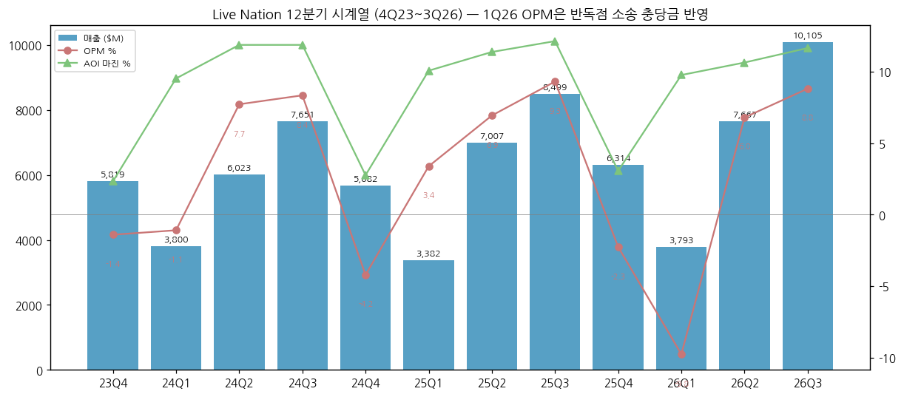

### ② 세그먼트별 개요 (매출 비중 순)
**Concerts (매출 83% / AOI 26%)** — 전 세계 투어 프로모션, 페스티벌(Lollapalooza·Rock in Rio 등), 소유·운영 공연장(Venue Nation: 앰피시어터·아레나·클럽), 아티스트 매니지먼트. 티켓 매출 대부분을 매출로 인식하고 아티스트 개런티를 비용으로 내는 구조라 마진이 얇다(AOI 마진 3\~6%). 수익성 레버는 **소유 공연장 비중**(티켓 외 식음료·주차·프리미엄석 매출)과 **해외 확장**.

**Ticketing (매출 12% / AOI 43%)** — Ticketmaster. 고객사(공연장·프로모터·스포츠 구단)를 대신해 티켓을 팔고 수수료를 받는다. 매출은 수수료(순액) 기준이라 AOI 마진 36\~38%. 3Q26 수수료 대상 티켓 9,830만 장(+10%), 수수료 대상 GTV $11.2B(+13%). 9M26 순증 고객사 티켓 약 2,300만 장 중 75%가 해외.

**Sponsorship & Advertising (매출 5% / AOI 32%)** — 공연장 명명권, 페스티벌·투어 스폰서십, Ticketmaster 사이트 광고. AOI 마진 64\~68%의 최고 마진 사업. 2026 해외 스폰서십 영업이익이 북미를 처음 추월 (3Q26 8-K).

### ③ 세그먼트별 디테일
- **3Q26 Concerts**: 매출 $8.7B(+20%), 공연 1만 3,100회(+7%), 관객 6,110만 명(+19% — 북미 3,590만 +13%, 해외 2,520만 +29%). 영국·유럽 사상 최대 여름, 남미 관객 약 5배(Rock in Rio). 주요 투어: The Weeknd·Bruno Mars·**BTS**·Karol G. Concerts AOI $603M(+17%)
- **2026 가이던스(3Q26 8-K)**: 연간 관객 약 1억 8,000만 명 접근(두 자릿수 성장), Concerts AOI 두 자릿수 성장, Ticketing AOI 한 자릿수 후반 성장. 2026 공연 티켓 판매 +13% (2026-10-19 기준), 2027 선판매 GTV 두 자릿수 증가
- **이벤트 이연매출**: 3Q말 $3.8B(+8%) 3분기 기준 사상 최대 — 다음 분기 공연 매출의 선행지표
- **이익 outlier**: 1Q26 영업손실 −$371M(소송 충당금, Corporate), 2024 Astroworld 소송 손실충당 $455M — 둘 다 AOI에서 제외

### ④ 주요 경쟁사
| 세그먼트 | 경쟁사 |
|---|---|
| Concerts | AEG Presents(비상장, 2위 프로모터), CTS Eventim(독일, 유럽 프로모션·티켓), MSG Entertainment·Sphere(공연장), 지역 독립 프로모터 |
| Ticketing | AXS(AEG), SeatGeek, Eventbrite, CTS Eventim, 2차 시장 StubHub·Vivid Seats |
| Sponsorship | 공연장·스포츠 구단 자체 스폰서십 영업, 디지털 광고 플랫폼 |

### ⑤ 주요 매출처
- B2C 공연 관객이 최종 매출원 (단일 고객 10% 이상 없음 — 10-K)
- Ticketing은 공연장·구단 등 B2B 고객사 1만 500곳과 독점 계약 (보통 3\~5년+) — 반독점 소송의 핵심 쟁점
- 한국 아티스트 연결: BTS 2026 월드투어(3Q26 주요 투어로 명시), HYBE 레이블 북미 투어 등

### ⑥ KPI · 임직원 추이

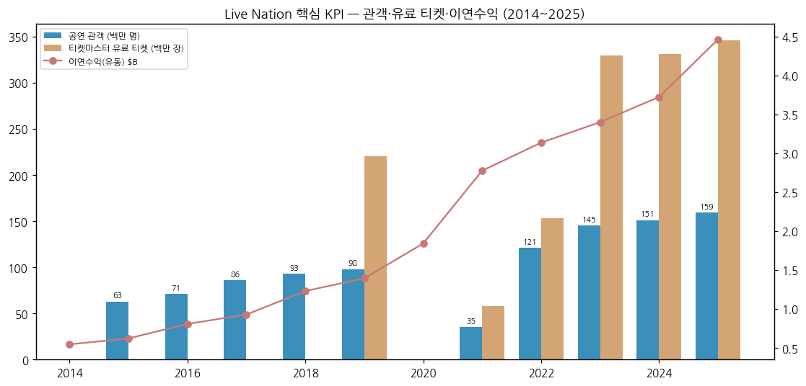

| 연도 | 관객 (백만 명) | 공연 수 (천 회) | 수수료 대상 티켓 (백만 장) | 전체 티켓 (백만 장) | 이연매출(유동, 연말 $B) |
|---|---|---|---|---|---|
| 2023 | 145.8 | 50.1 | 337.0 | 620.4 | 3.40 |
| 2024 | 151.0 | 54.7 | 340.2 | 637.7 | 3.72 |
| 2025 | 159.2 | 54.6 | 346.0 | 646.4 | 4.46 |
| 9M26 | 133.6 (+13%) | 39.8 (+5%) | 268.9 (+8%) | 482.8 (+4%) | 3Q말 이벤트 이연 3.8 |

> 출처: FY2025 10-K(2023\~2025), 3Q26 10-Q(9M26). 정규직 임직원 약 1만 7,700명 (2025-12-31).

---

## ④ 재무 구조 (12년, $M)

### ① 손익계산서

| 연도 | 매출 | 직접운영비 | 판관비(SG&A) | 감가상각 | 영업이익 | 이자비용 | 순이익(연결) | 순이익(지배) | 희석 EPS ($) | GPM | CIR(SG&A/매출) | OPM | NPM |
|---|---|---|---|---|---|---|---|---|---|---|---|---|---|
| 2014 | 6,867 | 4,920 | 1,337 | 368 | 7 | 106 | −104 | −91 | −0.49 | 28.4% | 19.5% | 0.1% | −1.3% |
| 2015 | 7,246 | 5,196 | 1,412 | 397 | 131 | 103 | −16 | −33 | −0.33 | 28.3% | 19.5% | 1.8% | −0.4% |
| 2016 | 7,826 | 5,639 | 1,548 | 319 | 195 | 107 | 20 | 3 | −0.23 | 27.9% | 19.8% | 2.5% | 0.0% |
| 2017 | 9,687 | 7,182 | 1,908 | 372 | 91 | 108 | 8 | −6 | −0.48 | 25.9% | 19.7% | 0.9% | −0.1% |
| 2018 | 10,788 | 7,968 | 1,997 | 387 | 273 | 141 | 90 | 60 | −0.09 | 26.1% | 18.5% | 2.5% | 0.6% |
| 2019 | 11,548 | 8,467 | 2,145 | 444 | 325 | 158 | 118 | 70 | −0.02 | 26.7% | 18.6% | 2.8% | 0.6% |
| 2020 | 1,861 | 1,402 | 1,524 | 485 | −1,653 | 227 | −1,828 | −1,725 | −8.12 | 24.6% | 81.9% | −88.8% | −92.7% |
| 2021 | 6,268 | 4,356 | 1,755 | 416 | −418 | 282 | −609 | −651 | −3.09 | 30.5% | 28.0% | −6.7% | −10.4% |
| 2022 | 16,681 | 12,348 | 2,956 | 450 | 722 | 278 | 375 | 266 | 0.52 | 26.0% | 17.7% | 4.3% | 1.6% |
| 2023 | 22,726 | 17,291 | 3,517 | 517 | 1,085 | 350 | 704 | 557 | 1.34 | 23.9% | 15.5% | 4.8% | 2.5% |
| 2024 | 23,156 | 17,381 | 4,044 | 550 | 825 | 326 | 1,131 | 896 | 2.74 | 24.9% | 17.5% | 3.6% | 3.9% |
| 2025 | 25,201 | 18,763 | 4,092 | 639 | 1,251 | 316 | 691 | 496 | −0.24 | 25.5% | 16.2% | 5.0% | 2.0% |

> GPM = (매출 − 직접운영비)/매출. CIR = 판관비/매출. 2025 순이익(지배) $496M인데 희석 EPS −$0.24인 것은 상환가능 비지배지분(redeemable NCI) 재평가 accretion을 보통주 귀속 이익에서 차감했기 때문.

### ② 재무상태표

| 연도말 | 총자산 | 유동자산 | 현금 | 유동부채 | 장기부채(리스 포함) | 유동성 장기부채 | 이연매출(유동) | 자본(NCI 포함) | 지배주주 자본 |
|---|---|---|---|---|---|---|---|---|---|
| 2014 | 5,968 | 2,268 | 1,382 | 2,011 | 1,996 | 47 | 543 | 1,484 | 1,297 |
| 2015 | 6,156 | 2,288 | 1,303 | 2,101 | 2,003 | 42 | 619 | 1,447 | 1,237 |
| 2016 | 6,764 | 2,674 | 1,527 | 2,460 | 2,260 | 53 | 805 | 1,350 | 1,126 |
| 2017 | 7,504 | 3,153 | 1,825 | 3,577 | 1,952 | 348 | 925 | 1,418 | 1,181 |
| 2018 | 8,497 | 3,848 | 2,372 | 3,750 | 2,733 | 82 | 1,228 | 1,343 | 1,099 |
| 2019 | 10,976 | 4,193 | 2,470 | 4,108 | 3,271 | 38 | 1,391 | 1,464 | 1,146 |
| 2020 | 10,589 | 3,650 | 2,538 | 3,797 | 4,855 | 53 | 1,839 | −134 | −472 |
| 2021 | 14,402 | 6,684 | 4,885 | 6,856 | 5,145 | 585 | 2,775 | −193 | −583 |
| 2022 | 16,461 | 8,160 | 5,606 | 8,303 | 5,283 | 620 | 3,135 | 65 | −368 |
| 2023 | 19,030 | 9,533 | 6,232 | 9,984 | 5,459 | 1,134 | 3,398 | 552 | −52 |
| 2024 | 19,639 | 9,290 | 6,095 | 9,358 | 6,177 | 261 | 3,721 | 819 | 173 |
| 2025 | 22,913 | 10,974 | 7,094 | 11,029 | 7,612 | 588 | 4,462 | 894 | 271 |
| **3Q26** | **27,896** | 14,257 | 8,257 | 14,984 | 7,889 | 1,860 | (8-K: 이벤트 이연매출 $3.8B) | 1,187 | 457 |

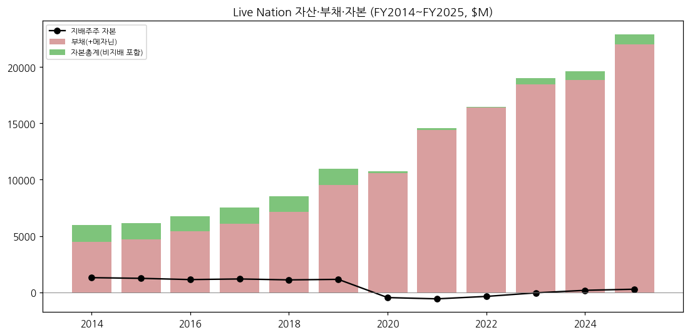

> 지배주주 자본은 코로나 손실로 2020\~2023 음수 → 2024 플러스 전환. 유동부채의 상당 부분은 공연 선판매 이연매출과 아티스트·고객사 미지급금.

### ③ 현금흐름표 · ④ CapEx

| 연도 | 영업CF | 투자CF | 재무CF | 유형 CapEx | 무형 취득 | 인수(순) | FCF (영업CF−유형CapEx) | 자사주 매입 | NCI 배당 지급 |
|---|---|---|---|---|---|---|---|---|---|
| 2014 | 292 | −392 | 226 | 140 | 3 | 210 | 153 | 0 | 33 |
| 2015 | 308 | −291 | −44 | 142 | 12 | 90 | 165 | 0 | 31 |
| 2016 | 599 | −426 | 99 | 174 | 6 | 212 | 425 | 0 | 55 |
| 2017 | 624 | −328 | −127 | 238 | 11 | 48 | 385 | 0 | 46 |
| 2018 | 942 | −497 | 189 | 240 | 36 | 120 | 702 | 0 | 59 |
| 2019 | 470 | −691 | 329 | 324 | 42 | 235 | 146 | 0 | 107 |
| 2020 | −1,083 | −224 | 1,350 | 214 | 9 | 41 | −1,297 | 0 | 42 |
| 2021 | 1,781 | −567 | 1,171 | 153 | 7 | 384 | 1,628 | 0 | 52 |
| 2022 | 1,835 | −785 | −143 | 347 | 6 | 257 | 1,488 | 0 | 101 |
| 2023 | 1,363 | −696 | −87 | 439 | 37 | 18 | 924 | 0 | 240 |
| 2024 | 1,725 | −854 | −659 | 647 | 9 | 98 | 1,079 | 0 | 246 |
| 2025 | 1,395 | −1,226 | 407 | 1,062 | 8 | 80 | 334 | 24 | 251 |

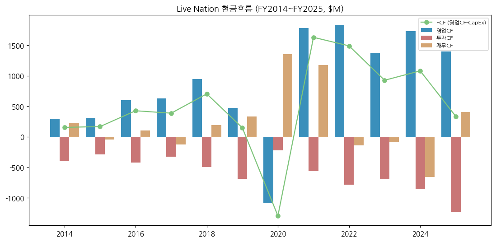

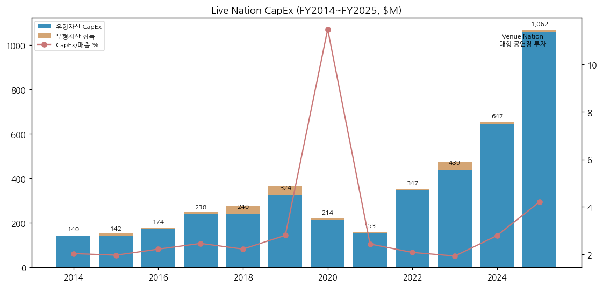

> CapEx는 2023 $439M → 2025 $1,062M로 2.4배. 대부분 "매출 창출형"(신규 공연장·Venue Nation 확장 — 2024 매출 창출형 CapEx $499M vs 유지보수 $133M, 10-K). 9M26 유형 CapEx $802M.

### ⑤ 부채 구조
- 총차입(장기+유동, 리스 포함) 3Q26 $9.7B, 현금 $8.3B (고객 선수금 포함)
- 구성: 선순위 담보·무담보 채권(2027·2028 만기 등), 전환사채, 담보 대출 — 2025-08 OCESA 관련 신용 계약 재편, 공연장 수익 담보 대출(Ruoff·Ziggo Dome·3Arena 등)
- 3Q26 유동성 장기부채 $1.86B로 증가 — 2027 만기 도래분

### ⑥ 배당·자사주
- **보통주 배당 없음**, 공개 자사주 매입 프로그램 없음 (3Q26 10-Q) — 2025 자사주 $24M은 임원 스톡옵션 행사분 매입
- 주주환원 대신 성장 투자(공연장 CapEx·인수)와 비지배지분(합작 파트너) 배당 지급($251M, 2025)

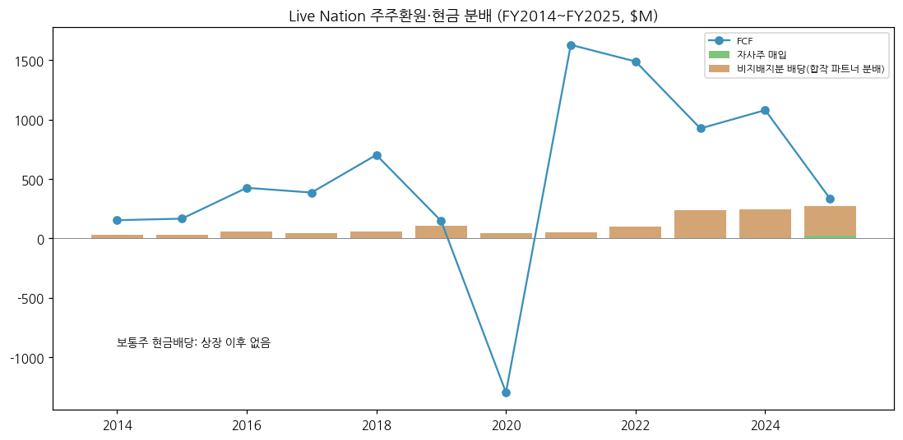

### ⑦ 재무비율

| 연도 | 총차입(장기+유동) | 순차입(차입−현금) | 유동비율 | 이자보상배율(OI/이자) | AOI/이자 | ROA(지배) | ROE | 부채비율(부채/자본) |
|---|---|---|---|---|---|---|---|---|
| 2014 | 2,043 | 661 | 1.13 | 0.07x | - | −1.5% | −7.0% | 302% |
| 2015 | 2,045 | 742 | 1.09 | 1.28x | - | −0.5% | −2.6% | 325% |
| 2016 | 2,313 | 786 | 1.09 | 1.83x | - | 0.0% | 0.3% | 401% |
| 2017 | 2,300 | 475 | 0.88 | 0.85x | - | −0.1% | −0.5% | 429% |
| 2018 | 2,815 | 443 | 1.03 | 1.93x | - | 0.7% | 5.5% | 533% |
| 2019 | 3,309 | 839 | 1.02 | 2.06x | - | 0.6% | 6.1% | 650% |
| 2020 | 4,909 | 2,371 | 0.96 | -7.29x | -4.5x | −16.3% | n/m (지배자본 음수) | n/m |
| 2021 | 5,731 | 846 | 0.97 | -1.48x | 1.1x | −4.5% | n/m (지배자본 음수) | n/m |
| 2022 | 5,903 | 297 | 0.98 | 2.59x | 5.1x | 1.6% | n/m (지배자본 음수) | 25,214% |
| 2023 | 6,593 | 362 | 0.95 | 3.10x | 5.4x | 2.9% | n/m (지배자본 음수) | 3,347% |
| 2024 | 6,438 | 343 | 0.99 | 2.53x | 6.6x | 4.6% | 517.3% | 2,298% |
| 2025 | 8,200 | 1,105 | 1.00 | 3.96x | 7.5x | 2.2% | 183.0% | 2,462% |

---

## ⑤ 지배 구조

### ① 그룹·계열 관계
- 지배주주 없음. 최대주주 **Liberty Live Holdings** (Liberty Media에서 2025-12 split-off, John Malone 계열)
- 2010 합병 당시 Liberty Media와 맺은 주주 계약으로 이사 2명 지명권 이력 — 현 이사 중 2명이 Liberty 지명 출신
- 연결 자회사 다수가 합작(OCESA 등) → 비지배지분(상환가능 포함)이 큰 구조

### ② 주주 구분

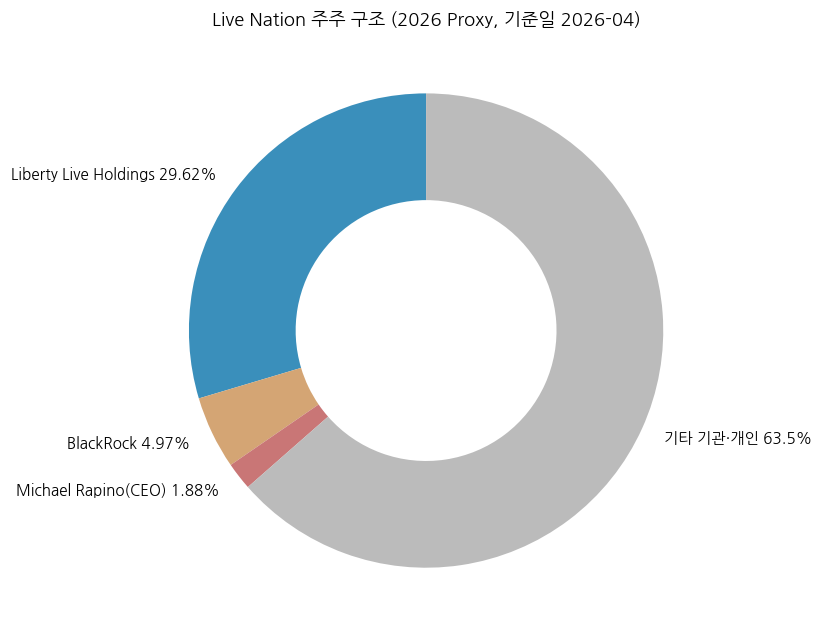

| 주주 | 보유 주식 | 지분율 | 출처 |
|---|---|---|---|
| Liberty Live Holdings, Inc. | 69,645,033 | **29.62%** | DEF 14A 2026-04-24 (13D 2025-12-17) |
| BlackRock, Inc. | 11,694,401 | 4.97% | DEF 14A 2026-04-24 |
| Michael Rapino (CEO) | — | 1.88% | DEF 14A 2026-04-24 |
| 기타 기관·개인 | — | 약 63.5% | [계산] |

### ③ 임원·이사회
- **Michael Rapino** — President & CEO (2005-08\~), 이사(2005-12\~). 1999 입사(Clear Channel 시절), Sirius XM 이사
- **Joe Berchtold** — President & CFO
- 이사회 12명 중 11명 독립, 의장은 비경영진 (DEF 14A 2026). 독립 이사에 Jimmy Iovine(Interscope 공동창업) 등

---

## ⑥ 기타 팩트

### ① R&D
- 별도 R&D 비용 공시 없음 (차트7 생략) — 기술 투자는 Ticketmaster 플랫폼 개발(판관비·무형자산 취득 $8M, 2025)로 처리

### ② 진행 중 Corporate Action (M&A 10년)
| 연도 | 내용 |
|---|---|
| 2016\~2019 | 페스티벌(C3 Presents·Bonnaroo 등)·지역 프로모터 연쇄 인수, 인수 지출 연 $0.1\~0.2B |
| 2021 | OCESA(멕시코) 51% — 인수 지출 $384M |
| 2022\~2025 | 해외 공연장·프로모터 인수, 2025 "특정 인수 비용" $87.6M (10-K) |
| 2025-12 | Liberty Live split-off (최대주주 교체, 지분 동일) |
| 2026 | 남미 Movistar 공연장(산티아고·부에노스아이레스) 등 Venue Nation 확장 |

### ③ 주요 리스크
- **반독점 소송 (최대 리스크)**: 2024-05 DOJ + 30개 주·DC 제소(이후 10개 주 추가), Ticketmaster 분리·독점 계약 해지 요구 → 2026-03 DOJ와 합의(금지명령·구조적 구제 + 주 정부 기금 $280M, 6개 주 추가 합의 $18.6M; Tunney Act 법원 승인 대기) → **2026-04-15 잔여 주 정부·DC 배심 평결 패소**(티켓당 손해배상, 적용 티켓 수 미산정). 2026-07 판결불복·재심 신청 심리, 결정 대기. 이후 "구제(remedies)" 단계에서 주 정부가 구조적 조치·민사 벌금 추가 요구 가능 → 항소 예정 (3Q26 10-Q)
- **Astroworld 소송**: 2021 휴스턴 페스티벌 압사 사고 — 2024 손실충당 $455M
- **2차 티켓 규제**: 미국 정적 가격·수수료 표시 규제, 회사 스스로 콘서트 재판매 제한 강화(2차 GTV 정체)
- **슈퍼스타 투어 공백**: 2024 매출 +1.9% (2023 스타디움 기저) — 투어 라인업 의존
- **환율**: 해외 관객 비중 48%(2025) — 해외 매출 확대로 달러 강세 시 환산 손실

### ④ ESG
- 미수집 (Data gap) — 10-K상 Fortune 존경받는 기업(2018\~21, 2024\~26) 선정 이력

### ⑤ 인증·라이선스
- 각국 공연·주류 판매·티켓 판매 라이선스, 일부 주 티켓 재판매 규제 준수

---

## Activity 보고 (v1.0)

### ✅ 확보 — SEC XBRL 연간·분기 + 10-K 15건 + 10-Q 44건 + DEF 14A + 3Q26 8-K + Yahoo 주가 20년
### ❌ 누락 — 2Q21 이전 세그먼트 AOI(세그먼트 영업이익만 존재), 2020\~2022 KPI 일부, ESG 등급, 이사회 의장 이름(Proxy 텍스트에서 미추출)
### ⚠️ 추정·계산 — [계산] CAGR·마진·EV/AOI·비율·기타 주주 지분 / 연결 AOI 2020\~2025는 10-K 연간 수치, 분기 AOI는 10-Q / 2016 이전 Concerts는 Artist Nation 합산
### 🔗 핵심 source
- SEC EDGAR LYV (CIK 0001335258): 10-K 2026-02-19, 10-Q 2026-11-05, DEF 14A 2026-04-24, 8-K 3Q26 Ex-99.1
- Yahoo Finance v8 LYV 주가 / stockanalysis.com/stocks/lyv (52주 범위 교차 확인)

### Data Quality Confidence: **88%** (손익·재무 SEC XBRL 원문, 세그먼트 10-Q·10-K 원문 파싱 / 2016 이전 세그먼트 재분류·2021 AOI 부분치는 주석 처리)

---

## Version Log
- **v1.0 (2026-11-15)**: 최초 작성 — FY2014\~FY2025 12년 + 1Q12\~3Q26 세그먼트 분기 + 11종 차트(R&D 없음). 반독점 소송 경과(2026-04 배심 평결) 반영
- 잔여 보완 후보: FY2026 10-K 반영(2027-02), 반독점 구제 결정·항소 경과, 2Q21 이전 세그먼트 AOI 재구성, ESG 등급
