> Ticker: **NASDAQ: MRVL — Marvell Technology, Inc.** (S&P 500 편입 2026-06, 언론 보도 기준)
> Entity: **Marvell Technology, Inc.** (운영 본사 Santa Clara, 캘리포니아 / 법인 Delaware — 2021-04 Bermuda 법인 Marvell Technology Group에서 미국 이전) — 팹리스 데이터 인프라 반도체 (전기광학 DSP·커스텀 ASIC·이더넷 스위치·스토리지 컨트롤러)
> Sector: 반도체 — 서브섹터 **커스텀 ASIC** (핵심 종목, Broadcom과 함께) / 실질 매출 1위 축은 AI 데이터센터 인터커넥트(전기광학)
> 작성 시각: **2026-11-15 KST** (**v1.0** — Phase 1 Source 수집 + audit + 12종 차트)
> 적용 구조: v4.8 (6개 섹션) — 미국 기업 SEC XBRL·10-K/10-Q/8-K/DEF 14A + 실적 보도자료(Ex-99.1) 기반
> 데이터 범위: **연간 12년 (FY2015\~FY2026, 1월 말 결산 — FY2026 = 2025-02 ～ 2026-01)** / **분기 손익 FQ4 FY13\~FQ2 FY27** (XBRL) / **최종시장별 분기 26Q (FQ1 FY21\~FQ2 FY27)** / Non-GAAP 연간 FY2021\~FY2026, 분기 12Q
> 출처: **SEC EDGAR** — XBRL companyfacts(신 CIK 0001835632 + 구 CIK 0001058057 Marvell Technology Group), 10-K 5건(2022\~2026), 10-Q 16건(2021-08\~2026-08-28), 8-K(2024\~2026-11-12), DEF 14A 2026-05-13 / 실적 보도자료 Ex-99.1 9건(investor.marvell.com SEC filing 미러) / 컨콜(FQ4 FY26 Motley Fool, FQ2 FY27 Benzinga 전문) / Yahoo Finance v8(주가 2000\~)
> ⚠️ **FQ3 FY27(2026-08 ～ 2026-10) 실적은 2026-12-01 발표 예정** (회사 공지 2026-11-06, 컨콜 1:30 p.m. PT) — 발표 후 v1.1 갱신. 2026-11-02 Lumentum 인수 발표 때 FQ3 매출이 "가이던스 중간값 $3.15B 유지, 범위 ±5% → ±2%로 축소"라고 예비 공시

# Marvell Technology 기업 개요 (v1.0 — 커스텀 ASIC / AI 데이터센터 인터커넥트·커스텀 실리콘 / 지속성장형 + 사이클 잔존)
> **Fact verify cutoff**: 2026-11-15 (주가 2026-11-13 종가 **$156.76** [Yahoo Finance v8] × 발행주식 876.9M주 [FQ2 FY27 10-Q 표지, 2026-08-21 기준] = 시가총액 **약 $137.5B** — stockanalysis.com 약 $136.3B(발행주식 877.99M)와 교차 확인 / 종가 기준 사상 최고 **2026-06-04 $316.43** (× 874.8M주 [FQ1 FY27 10-Q 표지] = 시총 약 **$276.8B**) [Yahoo Finance v8 일간] — 장중 최고 **2026-06-18 $329.88** [Yahoo v8, MarketBeat 2026-06-18 보도 일치] / 종가 고점 대비 −50% / 52주 범위 $70.69\~$329.88 [Yahoo v8 meta])

## Phase 1 Source Audit

```
=== 자료 수집 audit (Marvell Technology, Inc.) ===

✅ 확보
- SEC XBRL companyfacts: 구 법인(MTG, FY2008~FY2021) + 신 법인(MTI, FY2020~FY2026) 연간·분기 손익·재무상태·현금흐름
- 10-K 5건(FY2022~FY2026): 최종시장별 연간 매출, 10% 고객, 임직원, 인수·매각
- 10-Q 16건(FQ2 FY22~FQ2 FY27): 최종시장별 분기 매출(비교기간 포함 FQ1 FY21~), 지역별 매출
- 실적 보도자료 Ex-99.1 9건: FQ4 FY22·FY23·FY25·FY26, FQ3 FY25·FY26, FQ1·FQ2 FY26, FQ1·FQ2 FY27 → Non-GAAP 연간 FY21~26, 분기 12Q
- 8-K: AWS 워런트(2024-12-02), 자동차 이더넷 매각, NVIDIA 우선주(2026-03-31), Google 워런트(2026-08-19), Lumentum 합병계약(2026-11-02), 이사회 확대(2026-11-12)
- DEF 14A 2026-05-13: 5% 주주·이사회 / 컨콜 FQ4 FY26·FQ2 FY27 전문
- Yahoo Finance v8: 월간 2000-07~, 일간 2024-11-14~2026-11-13

❌ 누락
- Non-GAAP 영업이익 FY2015~FY2020 (해당 연도 보도자료 미수집 — 구 법인 8-K)
- 최종시장별 매출 FY2020 이전 분기(회사가 FQ3 FY22부터 최종시장 공시 시작), FQ4 FY26 이후 5개 시장 세부(2개 시장으로 통합)
- 커스텀(XPU)·인터커넥트 등 제품군별 매출 (공시 없음 — 컨콜 언급치만)
- 인수 무형 상각 FY2018~FY2019, SG&A FY2015~FY2021 (XBRL 태그 불일치)
- Investor Day(2026-10-06) 회사 원문 자료 — 2차 보도(Futurum·Benzinga 등)로만 확인

⚠️ 주의
- FY2016·FY2017 매출은 이후 공시에서 중단사업 재분류로 수정된 값(XBRL 최신 제출 기준). 분기 FY2016 합계(원 공시)와 연간이 다름
- FY2020 순이익 +$1.58B는 Wi-Fi/BT 사업 매각익, FY2026 순이익 +$2.67B는 자동차 이더넷 매각익 $1.83B 포함 — 영업 실적 아님
- 인수 무형자산 상각(연 $0.9~1.1B, FY22~FY26)과 SBC로 GAAP 영업이익이 FY2020~FY2025 중 5개 연도 적자 — Non-GAAP OPM은 같은 기간 24~36%
- 지역별 매출(중국 42%, FQ2 FY27)은 선적지 기준 — 최종 고객 국적 아님
```

---

## ① 기업 분류

### Primary: **지속성장형** (AI 데이터센터 인터커넥트·커스텀 실리콘의 구조적 성장) / Secondary: **사이클형 잔존** (통신·기타 재고 사이클 + 하이퍼스케일러 CapEx·고객 집중)

| Summary Box (FY2015\~FY2026, 12년) | 값 |
|---|---|
| 매출 CAGR | **+7.7%** (FY2015 $3.64B → FY2026 $8.19B) / 최근 5년 FY2021→FY2026 **+22.5%** [계산] |
| OPM 평균 | GAAP **−1.6%** (12년 단순평균) / Non-GAAP **31.0%** (FY2021\~FY2026 회사 공시 6년 평균) |
| OPM 정점 평균 | GAAP **17.0%** (FY2018 17.8%·FY2026 16.1%) / Non-GAAP **35.4%** (FY2023 35.5%·FY2026 35.3%) |
| OPM 저점 평균 | GAAP **−20.6%** (FY2016 −28.6%·FY2025 −12.5%) / Non-GAAP **29.0%** (FY2024 29.0%·FY2025 28.9%) |
| 사이클 주기 | 데이터센터 = **N/A (secular)** / 통신·기타 = 재고 사이클 약 3년 (FY2023 고점 $3.51B → FY2025 저점 $1.60B → FY2026 회복) |
| 사이클 회수 (12년) | 매출 역성장 4회 — FY2016·FY2017(포트폴리오 정리·특허소송), FY2020(소비자·스토리지 둔화), FY2024(통신 재고 조정) |

#### 12년 손익 (사이클·M&A annotation)

| FY (종료월) | 매출 ($M) | YoY | GAAP 영업이익 ($M) | GAAP OPM | Non-GAAP OPM (회사) | 순이익 ($M) | 희석 EPS ($) | 비고 |
|---|---|---|---|---|---|---|---|---|
| FY2015 (15-01) | 3,637.2 | 6.8% | 456.4 | 12.5% | 미확보 | 435.3 | 0.84 | ← HDD 컨트롤러·모바일 중심 구 Marvell, 12년 구간 내 FY2022 이전 매출 고점 |
| FY2016 (16-01) | 2,602.5 | −28.4% | −745.4 | −28.6% | 미확보 | −811.4 | −1.59 | ← **저점** — CMU 특허소송 합의 비용 $655M(FQ2, XBRL LitigationSettlementExpense), 모바일 철수 |
| FY2017 (17-01) | 2,301.0 | −11.6% | 130.4 | 5.7% | 미확보 | 21.2 | 0.04 | ← 2016-07 Matt Murphy CEO 취임, 구조조정 |
| FY2018 (18-02) | 2,409.2 | 4.7% | 429.7 | 17.8% | 미확보 | 520.8 | 1.02 | ← GAAP OPM 정점 (무인수·저상각 구간) |
| FY2019 (19-02) | 2,865.8 | 19.0% | 43.3 | 1.5% | 미확보 | −179.1 | −0.30 | ← **Cavium 인수**(2018-07, 현금 지출 $2.65B) — 인프라 반도체로 전환 |
| FY2020 (20-02) | 2,699.2 | −5.8% | −243.4 | −9.0% | 미확보 | 1,584.4 | 2.34 | ← Aquantia·Avera 인수 / **Wi-Fi·BT 매각**(NXP) 매각익으로 순이익 흑자 |
| FY2021 (21-01) | 2,968.9 | 10.0% | −258.4 | −8.7% | 24.2% | −277.3 | −0.41 | ← 5G·클라우드 전환, 인수 상각 부담 |
| FY2022 (22-01) | 4,462.4 | 50.3% | −347.7 | −7.8% | 32.8% | −421.0 | −0.53 | ← **Inphi 인수**(2021-04, 전기광학 DSP) + 미국 이전, Innovium(스위치) 인수 |
| FY2023 (23-01) | 5,919.6 | 32.7% | 238.0 | 4.0% | 35.5% | −163.5 | −0.19 | ← 통신·기타 고점 (매출 $3.51B), Non-GAAP OPM 정점 |
| FY2024 (24-02) | 5,507.7 | −7.0% | −567.7 | −10.3% | 29.0% | −933.4 | −1.08 | ← **통신 재고 조정** (엔터프라이즈·캐리어 급감), 데이터센터 AI 전환 시작 |
| FY2025 (25-02) | 5,767.3 | 4.7% | −720.3 | −12.5% | 28.9% | −885.0 | −1.02 | ← 데이터센터 72%, 구조조정·손상 $712M(FQ3) → GAAP OPM 저점 |
| FY2026 (26-01) | 8,194.6 | 42.1% | 1,322.9 | 16.1% | 35.3% | 2,670.1 | 3.07 | ← **사상 최대** — DC $6.1B, **자동차 이더넷 매각**(Infineon $2.5B, 매각익 $1.83B) |

> Non-GAAP = GAAP에서 SBC·인수 무형 상각·구조조정·인수 관련 비용 등 제외 (회사 정의, 보도자료 Ex-99.1). FY2021\~FY2026은 각 연도 4분기 보도자료의 연간 수치. FY2015\~FY2020은 미수집.
> GAAP과 Non-GAAP OPM 격차는 FY2022\~FY2025에 **31\~41%p**(인수 상각 매출 대비 18\~22% + SBC 9\~11% + 구조조정) → FY2026 **19%p**로 축소 (상각 비중 11.6%로 하락, 매출 증가 효과).

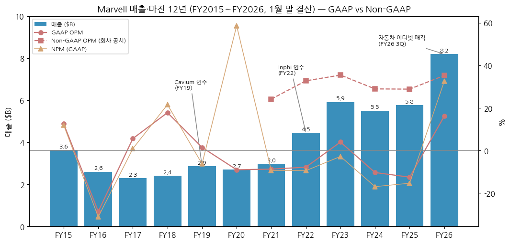

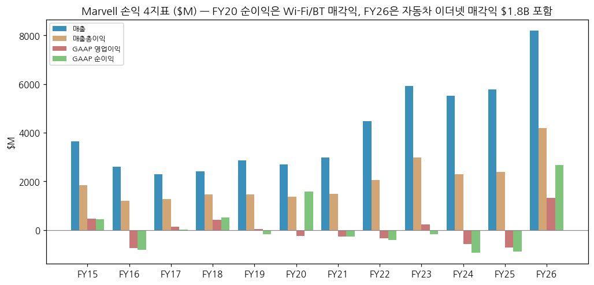

### ② 산업 분류
- SEC SIC 3674 (Semiconductors & Related Devices) / GICS 정보기술 — 반도체
- 워치리스트: **반도체 섹터 — 서브섹터 "커스텀 ASIC"** (핵심 종목, Broadcom과 2종목). 같은 반도체 섹터의 로직(Nvidia), 파운드리(TSMC), 메모리(SK하이닉스 등)와 AI 데이터센터 CapEx를 공유
- 사업 형태: **팹리스** — 웨이퍼는 TSMC 등 외부 파운드리, 조립·테스트도 외주 (CapEx/매출 1\~6%)

### ③ 분류 결정 논리
(1) **가장 큰 사업부 기준**: 단일 보고 세그먼트, 최종시장 기준 **데이터센터 매출 비중 79%** (FQ2 FY27, $2.17B). 데이터센터는 FY2024 FQ1 33% → FQ1 FY25 70% → FQ2 FY27 79%로 올라왔고, FQ2 FY27 YoY +46%로 가속. 회사는 FY2027 데이터센터 +약 60%, FY2028 +60% 이상을 제시(FQ2 FY27 컨콜) → **지속성장형**.

(2) **사이클 사업부 이익 비중 sub-rule**: 시장별 이익은 공시하지 않음(단일 세그먼트). 매출 기준으로 사이클 사업(통신·기타 = 엔터프라이즈 네트워킹·캐리어·소비자·산업)은 **21%**(FQ2 FY27)이고, FY2023 $3.51B → FY2025 $1.60B(−54%)로 재고 사이클 진폭이 컸다. 이익 비중은 매출 비중 이하로 추정 [추정 — 시장별 마진 미공시]. 이익의 대부분이 데이터센터에서 나오므로 Primary는 바뀌지 않지만, 사이클 잔존(Secondary) 표기.

(3) **Boundary case (Primary + Secondary)**:
- **서브섹터 경계**: 워치리스트상 "커스텀 ASIC"이지만, 커스텀(XPU + XPU-attach) 매출은 FY2026 **약 $1.5B**(컨콜) = 데이터센터 $6.1B의 **약 25%** [계산]. 나머지 데이터센터 매출의 주력은 **인터커넥트(PAM4·코히어런트 DSP, TIA·드라이버, AEC·리타이머)**와 이더넷 스위치·스토리지 컨트롤러. 즉 "커스텀 ASIC 2위 + AI 광 인터커넥트 1위권"의 복합형. 회사 목표대로 커스텀이 FY2028 2배 이상, FY2029 **$12B 초과**(Investor Day 2026-10-06, 2차 보도)에 이르면 커스텀이 최대 제품군이 된다.
- **사이클 잔존**: ① 하이퍼스케일러 CapEx 사이클(데이터센터 고객 상위 집중 — 10대 고객 82%, FY2026), ② 통신·기타 재고 사이클. ③ FY2025 FQ1 데이터센터는 YoY +87%였지만 전사 매출은 −12%로, 데이터센터 외 사업이 전사 실적을 끌어내린 사례.
- **M&A 변수**: 2026-11-02 발표한 **Lumentum 인수**(전액 주식, 교환비율 4.5, 종결 2028년 상반기 예정)가 끝나면 InP 레이저·광 트랜시버 제조를 떠안아 **팹리스 → 부분 제조형**으로 바뀌고, 광부품 업황 사이클에 대한 노출이 커진다 → 종결 시 재분류 대상.

(4) **글로벌 피어 대비**:
- **Broadcom 대비**: 커스텀 ASIC 1위(Google TPU 등)이고 네트워크 스위치(Tomahawk/Jericho)와 VMware 소프트웨어로 이익 기반이 훨씬 넓다. Marvell은 커스텀 2위권이면서, 광 DSP 비중이 높은 **"커넥티비티 중심"** 구조. 2026-07 Google과 TPU 생태계 부속 커스텀(추론 가속기·NIC·스토리지·메모리 인터페이스) 계약 → 같은 고객 안에서 Broadcom과 겹친다.
- **Alchip·GUC(대만 디자인하우스) 대비**: 이들은 설계 서비스·턴키 위주라 IP(SerDes·DSP)를 덜 보유. Marvell은 자체 SerDes·광 DSP IP를 갖고 XPU-attach까지 묶어 판다.
- **Credo·Astera Labs 대비**: AEC·리타이머·PCIe 스위치에서 직접 경쟁. Marvell은 XConn(PCIe·CXL 스위치) 인수로 라인업을 넓혔다.
- **Nvidia 관계**: 경쟁(커스텀 XPU vs GPU)이자 협력 — 2026-03 Nvidia가 Marvell 전환우선주 $2.0B 매입, Marvell 커스텀 XPU를 NVLink Fusion 생태계에 연결.

### ④ 적정 밸류에이션 방법
- **사업 mix**: 데이터센터 79%(인터커넥트 + 커스텀 + 스위치 + 스토리지) / 통신·기타 21% (FQ2 FY27). 데이터센터 안에서 커스텀은 마진이 낮고(컨콜: 커스텀 확대가 FQ3 매출총이익률 하락 요인) 인터커넥트는 높다 → **믹스가 마진을 좌우**.
- **Non-GAAP PER 우선**: GAAP 이익은 ① 인수 무형 상각(연 $0.9\~1.1B), ② 매각익(FY2026 $1.83B), ③ Celestial AI 조건부 대가 공정가치 변동(FQ1 FY27 영업외손실 −$256M)으로 크게 흔들린다. TTM Non-GAAP EPS **$3.30** (FQ3 FY26 $0.76 + FQ4 FY26 $0.80 + FQ1 FY27 $0.80 + FQ2 FY27 $0.94) → 2026-11-13 종가 $156.76 기준 **TTM P/E 약 47.5배** [계산]. 회사 FQ3 가이던스 Non-GAAP EPS $1.10 ±$0.05.
- **PSR·EV/Sales 보조**: TTM 매출 $9.45B → **PSR 약 14.5배** [계산]. EV 약 $138.5B(시총 $137.5B + 차입 $4.96B − 현금 $3.93B, FQ2 FY27말) / 회사 FY2028 매출 전망 약 $18B(FQ2 FY27 컨콜) → Investor Day에서 약 $20B로 상향(2차 보도) 기준 **선행 EV/Sales 약 6.9\~7.7배** [계산].
- **PBR 부적합**: 자본 $18.5B 중 영업권 $13.9B + 무형 $2.3B(FQ2 FY27말) — 유형 순자산이 거의 없어 의미 없음.
- **피어와의 차이**: Broadcom처럼 소프트웨어·현금흐름 기반의 P/FCF 평가는 아직 어렵다(FY2026 FCF 마진 17%, 공급 선급금 약 $1B 계획). 성장률(FY2027 약 +45%, FY2028 약 +50% 회사 전망)로 정당화되는 **성장주 멀티플** 구간. Lumentum 인수가 끝나면 주식 수가 약 1.5배가 되므로(Marvell 주주 67% : Lumentum 33%) **합병 후 주당 지표로 다시 계산** 필요.

### ⑤ 분기 재평가 트리거 (분류 자체가 바뀌는 조건)
- **데이터센터 매출 2개 분기 연속 YoY 역성장** → 지속성장형 → AI CapEx 사이클형으로 재분류 검토
- **Lumentum 인수 종결**(2028년 상반기 예정) 또는 **무산**(무산 시 규제 해지수수료 $3.2B 지급 조건 있음) → 종결 시 팹리스 → 부분 제조형, 광부품 사이클 노출 반영해 Primary/Secondary 재설정
- **커스텀(XPU+attach) 매출이 데이터센터의 50% 초과** → 서브섹터 "커스텀 ASIC" 주 분류 확정(현재는 인터커넥트 중심 복합형)
- **통신·기타 비중 10% 미만**으로 하락 → Secondary(사이클 잔존) 삭제 검토

---

## ② 회사 개요

### ① 기본 사항
- 회사명: Marvell Technology, Inc. (1995 설립 — 창업자 Sehat Sutardja·Weili Dai·Pantas Sutardja, 2000-06 NASDAQ 상장 / 2021-04-20 Inphi 인수와 함께 Bermuda 법인 Marvell Technology Group → Delaware 법인으로 이전)
- 사업 한 줄 정의: **AI·클라우드 데이터센터 안팎을 잇는 반도체(광 DSP·스위치·리타이머)와 하이퍼스케일러 맞춤형 칩(커스텀 XPU·XPU-attach)을 설계하는 팹리스**
- 최종시장 (FQ4 FY26부터 2개로 공시): **데이터센터** 79% / **통신·기타**(엔터프라이즈 네트워킹·캐리어 인프라·소비자·산업) 21% (FQ2 FY27)
- 임직원: **7,480명** (2026-01-31, 10-K) — 미주 49%, APAC(인도 포함) 42%, EMEA 9%
- 경영진: **Matt Murphy** — Chairman & CEO (2016-07 CEO 취임) / **Daniel Durn** — CFO (2026-06 선임, 전 Adobe CFO·Marvell 이사) / Sandeep Bharathi — President, Data Center Group

### ② 12년 손익·자본 추이 ($M)

| FY | 매출 | GAAP 영업이익 | 순이익 | 자본총계 | 총자산 | 영업권+무형 |
|---|---|---|---|---|---|---|
| FY2015 | 3,637 | 456 | 435 | 5,146 | 5,884 | 2,061 |
| FY2016 | 2,602 | −745 | −811 | 4,140 | 5,442 | 2,015 |
| FY2017 | 2,301 | 130 | 21 | 4,028 | 4,649 | 2,001 |
| FY2018 | 2,409 | 430 | 521 | 4,141 | 4,708 | 1,993 |
| FY2019 | 2,866 | 43 | −179 | 7,306 | 10,017 | 8,056 |
| FY2020 | 2,699 | −243 | 1,584 | 8,679 | 11,133 | 8,102 |
| FY2021 | 2,969 | −258 | −277 | 8,436 | 10,765 | 7,608 |
| FY2022 | 4,462 | −348 | −421 | 15,702 | 22,109 | 17,664 |
| FY2023 | 5,920 | 238 | −164 | 15,637 | 22,522 | 16,689 |
| FY2024 | 5,508 | −568 | −933 | 14,831 | 21,228 | 15,591 |
| FY2025 | 5,767 | −720 | −885 | 13,427 | 20,204 | 14,298 |
| FY2026 | 8,195 | 1,323 | 2,670 | 14,308 | 22,285 | 12,817 |
| **FQ2 FY27말** | (1H 5,157) | (1H 799) | (1H 343) | **18,532** | **27,555** | **16,221** |

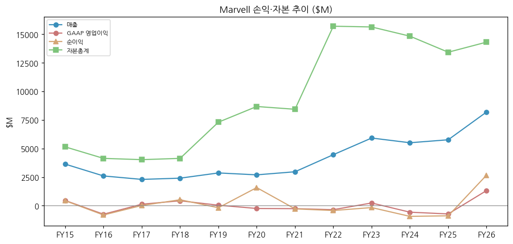

> FQ2 FY27말 자본 증가는 Celestial AI 인수 주식 발행(약 2,450만 주)과 NVIDIA 전환우선주 $2.0B 발행 반영. 영업권 $13.9B (Celestial·XConn 인수로 +$2.8B).

### ③ 회사 주가 역사

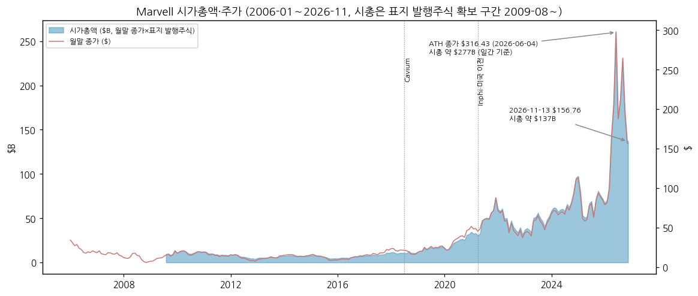

- 2000-06 NASDAQ 상장 → 2005-12 월말 종가 $28.05(수정주가) → 2008-12 금융위기 $6.67
- 2009\~2015: HDD·모바일 칩 회사로 정체 — 2012-12 시총 약 $3.9B, 2015-12 약 $4.6B (월말 종가 × 표지 발행주식) [계산]
- 2016 경영진 교체(Starboard 행동주의, Murphy CEO) → 2018 Cavium, 2021 Inphi 인수로 인프라 반도체 전환 → 2021-12 월말 $87.49 (시총 약 $73.8B)
- 2022 금리 상승·반도체 하락으로 2022-12 $37.04 (약 $31.6B) → AI 데이터센터 전환으로 2024-12 $110.45 (약 $95.6B)
- 2025-03\~04 AI 커스텀 둔화 우려로 $58\~62 (약 $51B) → 2026-04 이후 급등: 2026-06-02 Computex에서 Nvidia CEO 언급 후 하루 +32.5%(언론 보도), **2026-06-04 종가 $316.43 사상 최고 (시총 약 $276.8B)**, 2026-06-18 장중 $329.88 [Yahoo v8]
- 2026-10-06 Investor Day 당일 종가 $287.01 (+5.8%) → 2026-10-28 $251.65(Lumentum 협상 보도 전 마지막 거래일) → **2026-11-02 Lumentum 인수 발표 후** −12.7%(11/2 종가 $171.41, 10/30 대비), 11/5 AI 데이터센터 규제 우려 섹터 매도로 −16.4%($133.55) → **2026-11-13 종가 $156.76 (시총 약 $137.5B, 고점 대비 −50%)**

### ④ 주요 연혁
| 시기 | 이벤트 |
|---|---|
| 1995 | Marvell 설립 (Santa Clara), HDD 리드채널·스토리지 컨트롤러로 출발 |
| 2000-06 | NASDAQ 상장 |
| 2016 | 창업자 경영진 퇴진, Starboard Value 이사회 진입, 2016-07 **Matt Murphy CEO** 취임 / CMU 특허소송 합의(FY2016) |
| 2018-07 | **Cavium 인수** (멀티코어 프로세서·보안·이더넷) — 현금 지출 $2.65B + 주식 |
| 2019 | Aquantia(자동차 이더넷)·Avera(구 GlobalFoundries ASIC 사업) 인수, Wi-Fi·BT 사업 NXP에 매각 |
| 2021-04 | **Inphi 인수** (Inphi 1주당 현금 $66 + Marvell 2.323주) + **미국 Delaware로 법인 이전** |
| 2021-10 | Innovium(데이터센터 이더넷 스위치) 인수 |
| 2024-12-02 | **AWS 5년 전략 협력 확대** — AWS 계열사에 워런트 최대 418만 주 (8-K) |
| 2025-08-14 | **자동차 이더넷 사업 Infineon에 $2.5B 매각** (매각익 $1.83B) |
| 2025-09-24 | 자사주 매입 한도 $5.0B 추가(총 $9.7B), ASR $1.0B |
| 2026-02 | **Celestial AI**(포토닉 패브릭, 대가 $3.5B) · **XConn**(PCIe·CXL 스위치) 인수 완료 |
| 2026-03-31 | **NVIDIA에 전환우선주 $2.0B 발행** (전환가 약 $91.84, 최대 2,178만 주) |
| 2026-06 | S&P 500 편입(언론 보도), CFO 교체(Meintjes → Durn) |
| 2026-07-29 | **Google과 커스텀 실리콘 상업 계약** + 워런트 최대 5,897만 주(행사가 $206.58, 커스텀 매출 $500M당 1트랜치) |
| 2026-10-06 | Investor Day — FY2031 매출 $70\~90B 목표 (2차 보도) |
| 2026-11-02 | **Lumentum 인수 합의** (전액 주식, 4.5:1, Lumentum EV $115B) |
| 2026-11-12 | 이사회 7명 → 10명 확대 (독립이사 3명 신규) |

---

## ③ 비즈니스 모델

### ① 실적 추이 통합 표 — 최종시장별 연간 ($M)

| 최종시장 | FY2020 | FY2021 | FY2022 | FY2023 | FY2024 | FY2025 | FY2026 | 1H FY26 | 1H FY27 | 1H YoY |
|---|---|---|---|---|---|---|---|---|---|---|
| **데이터센터** | 823.8 | 1,040.7 | 1,784.6 | 2,408.8 | 2,216.7 | 4,164.2 | 6,100.3 | 2,931.1 | 4,004.2 | 36.6% |
| 엔터프라이즈 네트워킹 | 569.6 | 636.0 | 907.7 | 1,369.2 | 1,228.4 | 626.4 | (통합) | 371.1 | (통합) | |
| 캐리어 인프라 | 369.9 | 599.5 | 820.4 | 1,084.0 | 1,051.9 | 338.2 | (통합) | 268.5 | (통합) | |
| 소비자 | 845.8 | 574.6 | 700.0 | 701.1 | 622.4 | 316.1 | (통합) | 179.0 | (통합) | |
| 자동차/산업 | 90.0 | 118.0 | 249.6 | 356.5 | 388.3 | 322.4 | (통합) | 151.7 | (통합) | |
| **통신·기타 합계** | 1,875.4 | 1,928.2 | 2,677.8 | 3,510.8 | 3,291.0 | 1,603.1 | 2,094.3 | 970.3 | 1,152.9 | 18.8% |
| **연결 합계** | 2,699.2 | 2,968.9 | 4,462.4 | 5,919.6 | 5,507.7 | 5,767.3 | 8,194.6 | 3,901.4 | 5,157.1 | 32.2% |
| 데이터센터 비중 | 31% | 35% | 40% | 41% | 40% | 72% | 74% | 75% | 78% | |

> **분류 매핑**: FQ3 FY26까지 5개 최종시장(데이터센터·엔터프라이즈 네트워킹·캐리어 인프라·소비자·자동차/산업) → **FQ4 FY26(10-K FY2026)부터 "데이터센터"와 "통신·기타" 2개로 통합** (통신·기타 = 나머지 4개 시장 합계, 회사가 과거 연도도 같은 기준으로 재표시). 자동차/산업 중 ADAS·차량 네트워킹은 2025-08-14 Infineon 매각으로 이탈 — 이후 산업 이더넷·미군/정부·영상감시만 남음. FY2020\~FY2021 수치는 천 달러 단위 공시를 백만 달러로 환산. 1H FY26 통신·기타 5개 시장 합계 970.3과 10-Q 통합치 일치.

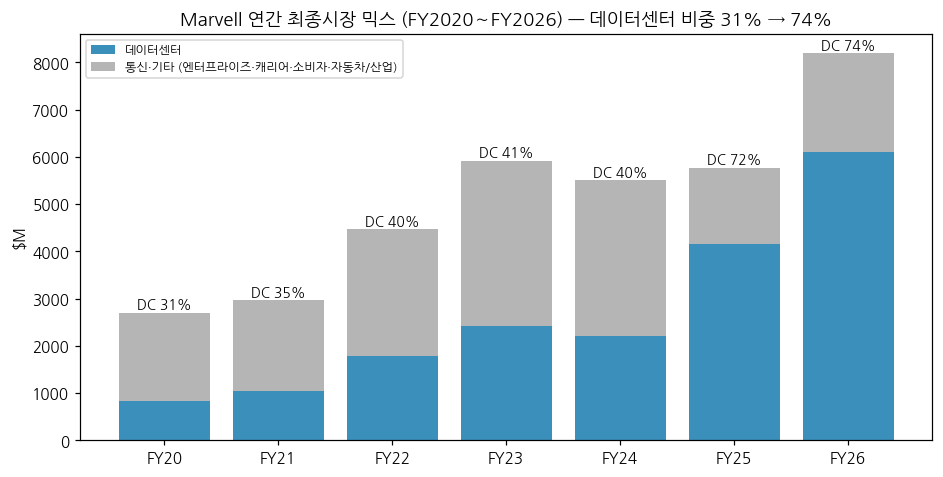

### ① 최종시장별 분기 시계열 (FQ1 FY21\~FQ2 FY27)

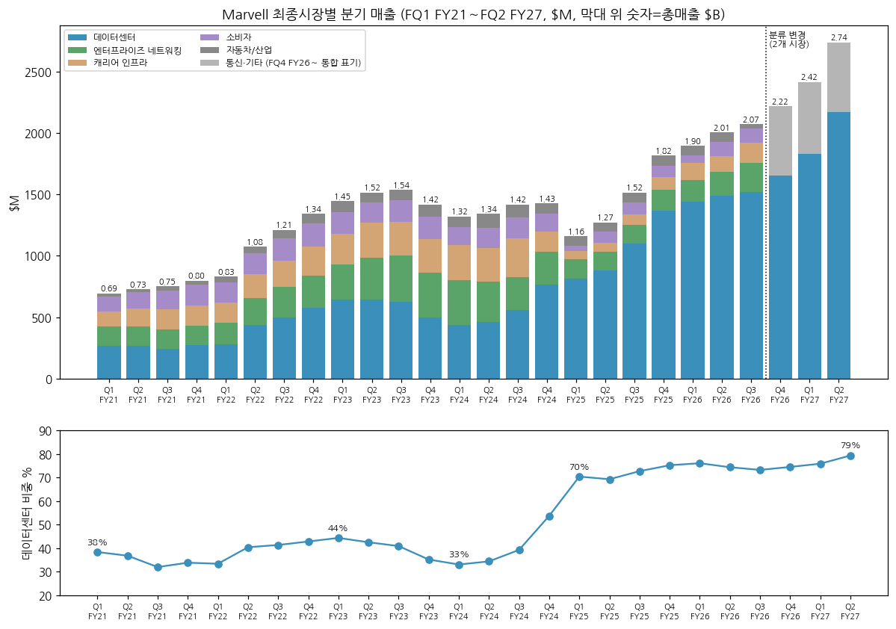

<details><summary>최종시장별 분기 원자료 (FQ1 FY21\~FQ2 FY27, $M)</summary>

| 회계분기 (캘린더) | 데이터센터 | 엔터프라이즈 | 캐리어 | 소비자 | 자동차/산업 | 통신·기타 합계 | 연결 매출 | DC 비중 |
|---|---|---|---|---|---|---|---|---|
| FQ1 FY21 (1Q20) | 265.5 | 158.3 | 122.2 | 120.3 | 27.3 | 428.2 | 693.6 | 38% |
| FQ2 FY21 (2Q20) | 266.9 | 158.1 | 142.4 | 134.4 | 25.5 | 460.4 | 727.3 | 37% |
| FQ3 FY21 (3Q20) | 239.2 | 158.9 | 168.6 | 152.3 | 31.2 | 511.0 | 750.1 | 32% |
| FQ4 FY21 (4Q20) | 269.2 | 160.7 | 166.3 | 167.7 | 34.0 | 528.6 | 797.8 | 34% |
| FQ1 FY22 (1Q21) | 277.1 | 174.8 | 167.6 | 166.7 | 46.1 | 555.2 | 832.3 | 33% |
| FQ2 FY22 (2Q21) | 433.7 | 222.7 | 196.7 | 165.4 | 57.4 | 642.2 | 1,075.9 | 40% |
| FQ3 FY22 (3Q21) | 499.7 | 247.2 | 215.1 | 182.5 | 66.6 | 711.5 | 1,211.2 | 41% |
| FQ4 FY22 (4Q21) | 574.1 | 263.0 | 241.0 | 185.4 | 79.5 | 768.9 | 1,343.0 | 43% |
| FQ1 FY23 (1Q22) | 640.5 | 286.6 | 252.0 | 178.5 | 89.3 | 806.4 | 1,446.9 | 44% |
| FQ2 FY23 (2Q22) | 643.4 | 340.3 | 285.2 | 164.4 | 83.6 | 873.5 | 1,516.9 | 42% |
| FQ3 FY23 (3Q22) | 627.3 | 376.0 | 271.4 | 178.4 | 84.2 | 910.0 | 1,537.3 | 41% |
| FQ4 FY23 (4Q22) | 497.6 | 366.3 | 275.4 | 179.8 | 99.4 | 920.9 | 1,418.5 | 35% |
| FQ1 FY24 (1Q23) | 435.8 | 364.6 | 289.9 | 142.1 | 89.3 | 885.9 | 1,321.7 | 33% |
| FQ2 FY24 (2Q23) | 459.8 | 327.7 | 275.5 | 167.7 | 110.2 | 881.1 | 1,340.9 | 34% |
| FQ3 FY24 (3Q23) | 555.8 | 271.1 | 316.5 | 168.7 | 106.5 | 862.8 | 1,418.6 | 39% |
| FQ4 FY24 (4Q23) | 765.3 | 265.0 | 170.0 | 143.9 | 82.3 | 661.2 | 1,426.5 | 54% |
| FQ1 FY25 (1Q24) | 816.4 | 153.1 | 71.8 | 42.0 | 77.6 | 344.5 | 1,160.9 | 70% |
| FQ2 FY25 (2Q24) | 880.9 | 151.0 | 75.9 | 88.9 | 76.2 | 392.0 | 1,272.9 | 69% |
| FQ3 FY25 (3Q24) | 1,101.1 | 150.9 | 84.7 | 96.5 | 82.9 | 415.0 | 1,516.1 | 73% |
| FQ4 FY25 (4Q24) | 1,365.8 | 171.4 | 105.8 | 88.7 | 85.7 | 451.6 | 1,817.4 | 75% |
| FQ1 FY26 (1Q25) | 1,440.6 | 177.5 | 138.4 | 63.1 | 75.7 | 454.7 | 1,895.3 | 76% |
| FQ2 FY26 (2Q25) | 1,490.5 | 193.6 | 130.1 | 115.9 | 76.0 | 515.6 | 2,006.1 | 74% |
| FQ3 FY26 (3Q25) | 1,517.9 | 237.2 | 167.8 | 116.6 | 35.0 | 556.6 | 2,074.5 | 73% |
| FQ4 FY26 (4Q25) | 1,651.3 | - | - | - | - | 567.4 | 2,218.7 | 74% |
| FQ1 FY27 (1Q26) | 1,832.7 | - | - | - | - | 585.1 | 2,417.8 | 76% |
| FQ2 FY27 (2Q26) | 2,171.5 | - | - | - | - | 567.8 | 2,739.3 | 79% |

> 출처: 각 10-Q·10-K 최종시장 표. FQ1 FY21·FQ1 FY22는 6개월 누계 − 2분기, 각 연도 4분기는 연간 − 9개월 누계로 산출 [계산]. FQ4 FY26부터 5개 시장 세부 미공시("-"). 캘린더 분기는 회계분기의 다수 월이 속한 분기 (예: FQ2 FY27 = 2026-05-03 ～ 2026-08-01 → 2Q26).

</details>

### ① 12분기 시계열 (FQ3 FY24\~FQ2 FY27)

| 회계분기 (캘린더) | 분기말 | 매출 ($M) | YoY | QoQ | GAAP GPM | GAAP 영업이익 | GAAP OPM | Non-GAAP GPM | Non-GAAP OPM | GAAP 순이익 | Non-GAAP EPS ($) | 비고 |
|---|---|---|---|---|---|---|---|---|---|---|---|---|
| FQ3 FY24 (3Q23) | 2023-10-28 | 1,418.6 | −7.7% | 5.8% | 38.9% | −146.3 | −10.3% | 60.6% | 29.8% | −164.3 | 0.41 | |
| FQ4 FY24 (4Q23) | 2024-02-03 | 1,426.5 | 0.6% | 0.6% | 46.6% | −33.3 | −2.3% | 63.9% | 33.8% | −392.7 | 0.46 | 14주 분기 |
| FQ1 FY25 (1Q24) | 2024-05-04 | 1,160.9 | −12.2% | −18.6% | 45.5% | −152.3 | −13.1% | 62.4% | 23.3% | −215.6 | 0.24 | **통신 재고조정 저점** |
| FQ2 FY25 (2Q24) | 2024-08-03 | 1,272.9 | −5.1% | 9.6% | 46.2% | −100.4 | −7.9% | 61.9% | 26.1% | −193.3 | 0.30 | |
| FQ3 FY25 (3Q24) | 2024-11-02 | 1,516.1 | 6.9% | 19.1% | 23.0% | −702.8 | −46.4% | 60.5% | 29.7% | −676.3 | 0.43 | 구조조정·손상(매출 대비 47%) |
| FQ4 FY25 (4Q24) | 2025-02-01 | 1,817.4 | 27.4% | 19.9% | 50.5% | 235.2 | 12.9% | 60.1% | 33.7% | 200.2 | 0.60 | GAAP 흑자 전환 |
| FQ1 FY26 (1Q25) | 2025-05-03 | 1,895.3 | 63.3% | 4.3% | 50.3% | 270.6 | 14.3% | 59.8% | 34.2% | 177.9 | 0.62 | |
| FQ2 FY26 (2Q25) | 2025-08-02 | 2,006.1 | 57.6% | 5.8% | 50.4% | 290.1 | 14.5% | 59.4% | 34.8% | 194.8 | 0.67 | |
| FQ3 FY26 (3Q25) | 2025-11-01 | 2,074.5 | 36.8% | 3.4% | 51.6% | 357.8 | 17.2% | 59.7% | 36.3% | 1,901.3 | 0.76 | 자동차 이더넷 매각익 $1.83B |
| FQ4 FY26 (4Q25) | 2026-01-31 | 2,218.7 | 22.1% | 7.0% | 51.7% | 404.4 | 18.2% | 59.0% | 35.7% | 396.1 | 0.80 | |
| FQ1 FY27 (1Q26) | 2026-05-02 | 2,417.8 | 27.6% | 9.0% | 52.1% | 339.4 | 14.0% | 58.9% | 35.0% | 34.5 | 0.80 | 조건부대가 평가손 −$256M(영업외) |
| FQ2 FY27 (2Q26) | 2026-08-01 | 2,739.3 | 36.5% | 13.3% | 53.1% | 459.7 | 16.8% | 58.9% | **36.6%** | 308.0 | 0.94 | 분기 매출 사상 최대, DC +46% |
| **FQ3 FY27 가이던스** | 2026-10-31 | **3,150 ±2%** | 약 +52% | 약 +15% | 52.9\~53.9% | - | - | 57.5\~58.5% | 약 37% [계산] | - | 1.10 ±0.05 | 2026-11-02 범위 축소 |

> GAAP 손익은 SEC XBRL(분기 = 누계 차감 산출 포함), Non-GAAP은 각 분기 보도자료 Ex-99.1. FQ3 가이던스 Non-GAAP OPM은 매출총이익률 중간값 58% − Non-GAAP 영업비용 약 $655M/$3,150M으로 산출 [계산]. FQ3 YoY는 FQ3 FY26 $2,074.5M 대비 [계산].

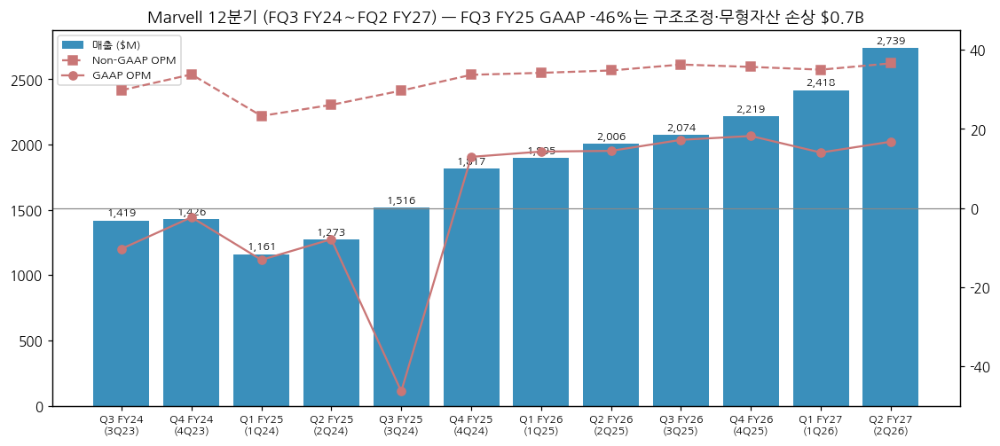

### ② 사업(제품군)별 개요
회사는 제품군별 매출을 공시하지 않는다. 아래는 10-K 사업 설명과 컨콜 언급 범위.

**인터커넥트 (데이터센터 최대 제품군 [추정])** — Inphi에서 온 **PAM4 광 DSP**(800G·1.6T, 데이터센터 내부 scale-out), **코히어런트·코히어런트-라이트 DSP**(데이터센터 간 DCI, ZR/ZR+ 모듈), TIA·레이저 드라이버(광대역 아날로그), **AEC·PCIe 리타이머**(구리 scale-up), Celestial AI의 **포토닉 패브릭 CPO**. 컨콜: FY2027 인터커넥트 +50% 초과 성장 전망(FQ4 FY26), Celestial CPO 매출 2028년 연환산 $500M → 2029년 $1B 목표.

**커스텀 (XPU + XPU-attach)** — 하이퍼스케일러 맞춤형 AI 가속기(XPU)와 그 주변 칩(NIC·CXL 메모리 확장·스토리지 컨트롤러·근접 메모리 연산). FY2026 매출 **약 $1.5B**(FY2025 대비 2배, 컨콜) → FY2027 하반기 급가속 → FY2028 2배 이상 → FY2029 $12B 초과 목표(Investor Day, 2차 보도). 매출총이익률은 회사 평균보다 낮다(컨콜).

**이더넷 스위치** — Innovium에서 온 Teralynx 12.8T·51.2T 데이터센터 스위치, 100T 샘플링 예정. FY2027 데이터센터 스위치 매출 $600M 초과 전망(FQ4 FY26 컨콜), scale-up 스위치(UALink·ESUN·NVLink) 개발 중. XConn 인수로 PCIe·CXL 스위치 추가.

**스토리지·프로세서·기타** — HDD·SSD 컨트롤러(Bravera), OCTEON 프로세서(Cavium), 파이버채널 어댑터(QLogic 계열). 통신·기타 시장의 대부분(엔터프라이즈 스위치·캐리어 5G 기지국·광대역 게이트웨이)이 여기에 속한다.

### ③ 커스텀 ASIC 고객 (공시·컨콜 범위)
| 고객 | 공시 근거 | 내용 |
|---|---|---|
| **AWS (Amazon)** | 8-K 2024-12-02 | 5년·다세대 전략 협력 확대, AWS 계열사에 워런트 최대 4,180,683주 (약 390만 주는 매출 연동 베스팅). AI 커스텀 칩(Trainium 계열)·광 DSP·AEC·DCI 모듈 등 [Trainium 세대별 담당은 언론 보도 — 공시 원문은 "custom AI products" 수준] |
| **Google** | 8-K 2026-08-19 | 2026-07-29 커스텀 실리콘 상업 계약 — TPU 생태계 부속(추론 가속기·스토리지 컨트롤러·NIC·메모리 인터페이스·근접 메모리 연산). 워런트 최대 **58,970,907주**, 행사가 $206.58, FQ3 FY27\~FY2033 커스텀 매출 **$500M당 1트랜치(총 240트랜치)** 베스팅 → 전량 베스팅 조건 = 누적 커스텀 매출 $120B [계산] |
| **Microsoft** | 미공시 | 2025-06 컨콜 "또 다른 미국 하이퍼스케일러 차세대 XPU" — 업계는 Maia로 추정 [추정·언론 보도] |
| **"리드 XPU 프로그램" 고객** | 컨콜(FQ4 FY26) | 차세대 전환 중, FY2027 전체 물량 PO 확보, FY2028도 성장 — 고객명 미공시 |
| **NVIDIA** | 8-K 2026-03-31 | 고객이 아닌 전략적 투자자 — 전환우선주 $2.0B, Marvell 커스텀 XPU를 NVIDIA AI 인프라(NVLink Fusion) 생태계에 연결 |

> 10% 이상 고객 (10-K FY2026): **유통사 A 37%**, **직접 고객 A 14%** — 상위 10대 고객 82%. 직접 고객 A 이름은 미공시.

### ④ 주요 경쟁사
| 제품군 | 경쟁사 |
|---|---|
| 커스텀 XPU·ASIC | **Broadcom**(1위), Alchip·GUC(대만 디자인하우스), MediaTek, 하이퍼스케일러 내부 설계팀 |
| 광 DSP·인터커넥트 | Broadcom, Credo(AEC·DSP), MaxLinear, Astera Labs(리타이머), 광모듈사 내재화(Coherent·Lumentum → 인수 예정) |
| 데이터센터 스위치 | Broadcom(Tomahawk), NVIDIA(Spectrum-X), Cisco |
| 스토리지·프로세서 | Broadcom, Microchip, Phison·Silicon Motion(SSD 컨트롤러) |

### ⑤ 주요 매출처·지역
- 선적지 기준 FQ2 FY27: **중국 42%**, 대만 17% (10-Q) — 중국 비중은 조립 거점(OSAT·ODM) 선적 반영으로 최종 고객 국적과 다름
- 유통사 비중이 크다(유통사 A 37%) — 아시아 ODM·OSAT향 물량을 유통사가 처리

### ⑥ 가이던스·중기 목표 (회사 제시치 — 시점 명시)
| 항목 | 내용 | 출처·일자 |
|---|---|---|
| FQ3 FY27 매출 | $3.150B ±5% → ±2%로 축소 (중간값 유지) | 보도자료 2026-08-27 / Lumentum 발표 2026-11-02 |
| FQ3 FY27 데이터센터 | QoQ +20% 초과, YoY 약 +75% / 통신·기타 QoQ 10%대 초중반 감소 | FQ2 FY27 컨콜 2026-08-27 |
| FY2027 매출 | 약 $12B (YoY 약 +45%), 데이터센터 약 +60% | FQ2 FY27 컨콜 |
| FY2028 매출 | 약 $18B (FQ2 FY27 컨콜) → 약 $20B (Investor Day 2026-10-06, 2차 보도) | 컨콜 / Futurum·Benzinga |
| FY2031 매출 | $70\~90B 목표 | Investor Day (2차 보도) |
| Non-GAAP OPM | FQ4 FY27에 장기 목표 38\~40% 구간 진입 예상 | FQ2 FY27 컨콜 |
| 공급 선급금 | FY2027 약 $1B (생산능력 확보) | FQ2 FY27 컨콜 |

---

## ④ 재무 구조 (12년, $M)

### ① 손익계산서

| FY | 매출 | 매출원가 | 매출총이익 | R&D | SG&A | 인수 무형 상각 | SBC | 구조조정 | GAAP 영업이익 | 순이익 | GPM | R&D/매출 | GAAP OPM | NPM |
|---|---|---|---|---|---|---|---|---|---|---|---|---|---|---|
| FY2015 | 3,637 | 1,799 | 1,838 | 1,092 | 미확보 | 16 | 137 | 10 | 456 | 435 | 50.5% | 30.0% | 12.5% | 12.0% |
| FY2016 | 2,602 | 1,406 | 1,196 | 955 | 미확보 | 10 | 134 | 48 | −745 | −811 | 46.0% | 36.7% | −28.6% | −31.2% |
| FY2017 | 2,301 | 1,018 | 1,283 | 805 | 미확보 | 8 | 114 | 45 | 130 | 21 | 55.8% | 35.0% | 5.7% | 0.9% |
| FY2018 | 2,409 | 947 | 1,462 | 714 | 미확보 | 미확보 | 87 | 12 | 430 | 521 | 60.7% | 29.7% | 17.8% | 21.6% |
| FY2019 | 2,866 | 1,407 | 1,458 | 914 | 미확보 | 미확보 | 184 | 78 | 43 | −179 | 50.9% | 31.9% | 1.5% | −6.2% |
| FY2020 | 2,699 | 1,342 | 1,357 | 1,080 | 미확보 | 368 | 242 | 39 | −243 | 1,584 | 50.3% | 40.0% | −9.0% | 58.7% |
| FY2021 | 2,969 | 1,481 | 1,488 | 1,073 | 미확보 | 444 | 242 | 56 | −258 | −277 | 50.1% | 36.1% | −8.7% | −9.3% |
| FY2022 | 4,462 | 2,398 | 2,064 | 1,424 | 955 | 979 | 461 | 32 | −348 | −421 | 46.3% | 31.9% | −7.8% | −9.4% |
| FY2023 | 5,920 | 2,932 | 2,988 | 1,784 | 844 | 1,087 | 552 | 22 | 238 | −164 | 50.5% | 30.1% | 4.0% | −2.8% |
| FY2024 | 5,508 | 3,214 | 2,294 | 1,896 | 834 | 1,098 | 610 | 131 | −568 | −933 | 41.6% | 34.4% | −10.3% | −16.9% |
| FY2025 | 5,767 | 3,385 | 2,382 | 1,950 | 798 | 1,053 | 597 | 185 | −720 | −885 | 41.3% | 33.8% | −12.5% | −15.3% |
| FY2026 | 8,195 | 4,014 | 4,181 | 2,075 | 767 | 942 | 591 | 30 | 1,323 | 2,670 | 51.0% | 25.3% | 16.1% | 32.6% |

> 인수 무형 상각 = 매출원가·영업비용에 나뉘어 들어간 합계 (FY2020·FY2021은 FY2022 10-K 주석, 나머지 XBRL). 구조조정은 XBRL "RestructuringCharges" — 회사 Non-GAAP 조정의 "구조조정 및 관련 비용"(FY2025 $711.8M, 자산손상 포함)보다 좁은 범위. Non-GAAP 매출총이익률: FY2021 63.3% → FY2023 64.5% → FY2025 61.0% → FY2026 59.5% (커스텀 비중 확대로 하락 추세).

### ② 재무상태표

| FY말 | 총자산 | 유동자산 | 현금성(현금+단기투자) | 재고 | 영업권 | 무형자산 | 총부채 | 유동부채 | 차입금(장기+유동) | 자본총계 | 발행주식 (백만) |
|---|---|---|---|---|---|---|---|---|---|---|---|
| FY2015 | 5,884 | 3,344 | 2,530 | 308 | 2,030 | 31 | 738 | 637 | 0 | 5,146 | 515 |
| FY2016 | 5,442 | 2,955 | 2,283 | 201 | 2,003 | 12 | 1,302 | 1,226 | 0 | 4,140 | 508 |
| FY2017 | 4,649 | 2,290 | 1,668 | 171 | 1,997 | 4 | 621 | 496 | 0 | 4,028 | 506 |
| FY2018 | 4,708 | 2,364 | 1,841 | 170 | 1,993 | 0 | 567 | 421 | 0 | 4,141 | 496 |
| FY2019 | 10,017 | 1,395 | 582 | 276 | 5,495 | 2,561 | 2,710 | 637 | 1,733 | 7,306 | 659 |
| FY2020 | 11,133 | 1,537 | 648 | 323 | 5,337 | 2,765 | 2,455 | 710 | 1,439 | 8,679 | 663 |
| FY2021 | 10,765 | 1,617 | 748 | 268 | 5,337 | 2,271 | 2,329 | 1,077 | 1,193 | 8,436 | 675 |
| FY2022 | 22,109 | 2,493 | 614 | 720 | 11,511 | 6,153 | 6,406 | 1,389 | 4,548 | 15,702 | 847 |
| FY2023 | 22,522 | 3,281 | 911 | 1,068 | 11,587 | 5,102 | 6,885 | 2,387 | 4,492 | 15,637 | 856 |
| FY2024 | 21,228 | 3,063 | 951 | 864 | 11,587 | 4,004 | 6,397 | 1,814 | 4,059 | 14,831 | 866 |
| FY2025 | 20,204 | 3,120 | 948 | 1,030 | 11,587 | 2,711 | 6,778 | 2,027 | 3,934 | 13,427 | 866 |
| FY2026 | 22,285 | 6,461 | 2,639 | 1,388 | 11,062 | 1,755 | 7,977 | 3,220 | 4,471 | 14,308 | 847 |
| **FQ2 FY27** | **27,555** | 7,919 | 3,933 | 1,361 | 13,874 | 2,347 | 9,023 | 2,500 | 4,963 | 18,532 | 876.9 (8/21) |

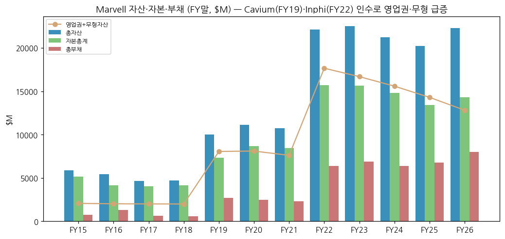

> 자산의 58\~80%가 영업권+무형자산 (FY2019 이후) — M&A로 성장한 구조. FQ2 FY27 자본 $18.5B에는 NVIDIA 전환우선주 $2.0B 포함.

### ③ 현금흐름표 · ④ CapEx

| FY | 영업CF | 투자CF | 재무CF | CapEx | FCF (영업CF−CapEx) | FCF 마진 | 인수 지출(순) |
|---|---|---|---|---|---|---|---|
| FY2015 | 729 | −369 | −115 | 63 | 666 | 18.3% | 0 |
| FY2016 | 205 | 202 | −340 | 37 | 168 | 6.5% | 0 |
| FY2017 | −358 | 162 | −267 | 45 | −403 | −17.5% | 0 |
| FY2018 | 571 | 40 | −536 | 39 | 533 | 22.1% | 0 |
| FY2019 | 597 | −1,753 | 850 | 76 | 521 | 18.2% | 2,649 |
| FY2020 | 360 | 559 | −854 | 82 | 278 | 10.3% | 1,071 |
| FY2021 | 817 | −120 | −597 | 107 | 710 | 23.9% | 0 |
| FY2022 | 819 | −3,745 | 2,791 | 169 | 650 | 14.6% | 3,555 |
| FY2023 | 1,289 | −328 | −663 | 206 | 1,083 | 18.3% | 112 |
| FY2024 | 1,370 | −350 | −980 | 336 | 1,034 | 18.8% | 0 |
| FY2025 | 1,681 | −301 | −1,383 | 285 | 1,397 | 24.2% | 10 |
| FY2026 | 1,750 | 2,098 | −2,158 | 354 | 1,396 | 17.0% | 0 |
| 1H FY27 | 1,244 | - | - | 282 | 962 | 18.7% | (Celestial 현금 $1.0B 순·XConn $0.28B) |

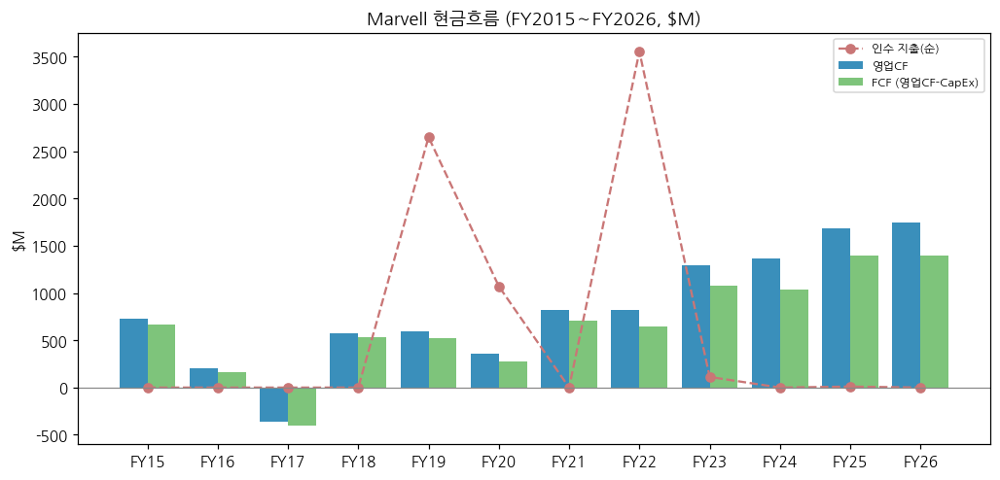

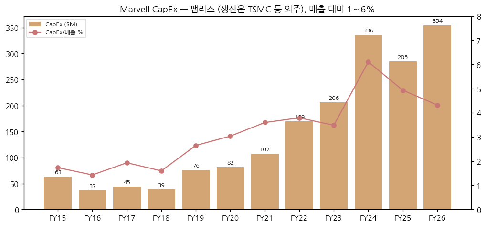

> FY2017 영업CF 마이너스는 FY2016에 비용 처리한 CMU 특허 합의금($655M)의 현금 지급 시점 영향 [추정]. FY2026 투자CF 플러스는 자동차 이더넷 매각 대금 $2.5B 유입. CapEx는 팹리스 특성상 설계 장비·마스크·테스트 장비 중심, 매출 대비 1\~6%.

### ⑤ 부채 구조
- 총차입 **$4.96B** (FQ2 FY27말, 전액 장기) / 현금 $3.93B → 순차입 약 $1.03B [계산]
- 선순위 무담보 채권: 2.450% 2028, 4.875% 2028, 5.750% 2029, 4.750% 2030, 2.950% 2031, 5.950% 2033, 5.450% 2035, **5.300% 2036($1.0B, 2026-04 발행 — 1.650% 2026년 만기 채권 상환용)** (10-Q 첨부 목록)
- 리볼빙 신용한도 $3B(증액 옵션 $2B, 2026-10-22 재계약, Bank of America 대리)
- 투자등급 회사채 발행사, GAAP 이자보상배율 FY2026 6.5배 [계산]

### ⑥ 배당·자사주

| FY | 자사주 매입 | 배당 | 주주환원 합계 | FCF 대비 환원 |
|---|---|---|---|---|
| FY2015 | 65 | 123 | 188 | 28% |
| FY2016 | 261 | 123 | 384 | 228% |
| FY2017 | 182 | 122 | 304 | n/m (FCF 음수) |
| FY2018 | 528 | 119 | 647 | 121% |
| FY2019 | 104 | 148 | 252 | 48% |
| FY2020 | 364 | 160 | 524 | 188% |
| FY2021 | 25 | 161 | 186 | 26% |
| FY2022 | 0 | 191 | 191 | 29% |
| FY2023 | 115 | 204 | 319 | 29% |
| FY2024 | 150 | 207 | 357 | 35% |
| FY2025 | 725 | 208 | 932 | 67% |
| FY2026 | 2,040 | 205 | 2,245 | 161% |
| 1H FY27 | 400 | 108 | 508 | 53% |

- **분기 배당 $0.06/주** (2026-09-25 선언, 2026-10-29 지급, 우선주는 전환 기준 동일 배당) — 배당 총액이 FY2023 이후 연 $0.2B 수준으로 고정
- 자사주 매입 한도 총 $9.7B 중 **$5.1B 잔여** (2026-08-01 기준). FY2026 ASR $1.0B (1,170만 주, 평균 $85.21) 포함 자사주 $2.04B — 자동차 이더넷 매각 대금 활용

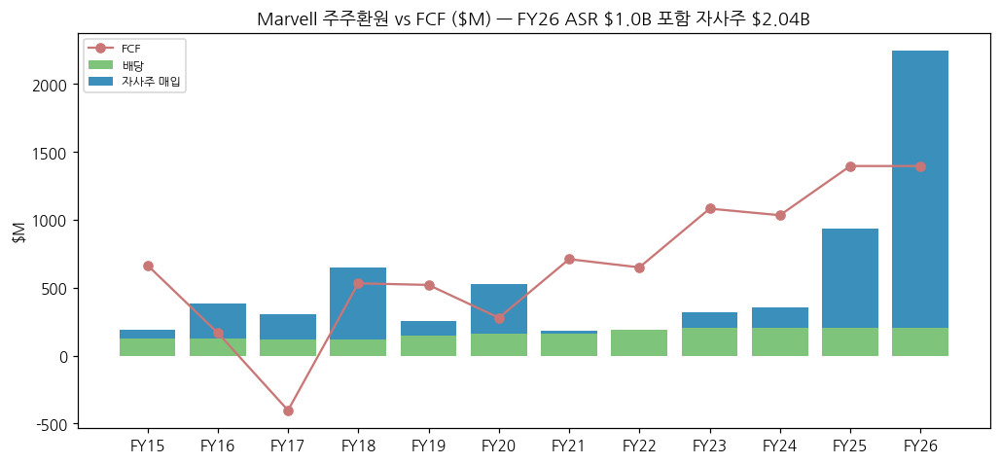

### ⑦ 재무비율

| FY | 유동비율 | 부채비율(부채/자본) | 순차입(차입−현금성) | ROE (GAAP) | 영업권+무형/총자산 | 이자비용 | GAAP 영업이익/이자 |
|---|---|---|---|---|---|---|---|
| FY2015 | 5.25 | 14% | −2,530 | 8.9% | 35% | 1.2 | n/m (무차입) |
| FY2016 | 2.41 | 31% | −2,283 | −17.5% | 37% | 0.7 | n/m |
| FY2017 | 4.61 | 15% | −1,668 | 0.5% | 43% | 0.4 | n/m |
| FY2018 | 5.61 | 14% | −1,841 | 12.8% | 42% | 0.7 | n/m (무차입) |
| FY2019 | 2.19 | 37% | 1,150 | −3.1% | 80% | 60.4 | 0.7x |
| FY2020 | 2.16 | 28% | 791 | 19.8% | 73% | 85.6 | n/m (영업적자) |
| FY2021 | 1.50 | 28% | 444 | −3.2% | 71% | 69.3 | n/m |
| FY2022 | 1.80 | 41% | 3,934 | −3.5% | 80% | 139.3 | n/m |
| FY2023 | 1.37 | 44% | 3,581 | −1.0% | 74% | 170.6 | 1.4x |
| FY2024 | 1.69 | 43% | 3,108 | −6.1% | 73% | 211.7 | n/m |
| FY2025 | 1.54 | 50% | 2,986 | −6.3% | 71% | 189.4 | n/m |
| FY2026 | 2.01 | 56% | 1,832 | 19.3% | 58% | 202.6 | 6.5x |

> ROE는 평균 자본 기준 [계산]. FY2020·FY2026 ROE는 사업 매각익 효과.

---

## ⑤ 지배 구조

### ① 그룹·계열 관계
- 지배주주 없음 — 대형 패시브·액티브 기관 분산 소유. 창업자 가문 지분은 2016 경영진 교체 후 영향력 소멸
- **전략적 지분 연결**: NVIDIA(전환우선주 200만 주, 보통주 최대 2,178만 주로 전환 가능 — 이사 선임 외 의결권 있음), Google(워런트 최대 5,897만 주, 매출 연동 베스팅), AWS 계열사(워런트 최대 418만 주)
- **Lumentum 합병 후**(2028년 상반기 종결 예정): 기존 Marvell 주주 약 67% / Lumentum 주주 약 33% (완전희석 기준), Lumentum 이사 3명(Michael Hurlston CEO 포함) Marvell 이사회 합류, Murphy가 합병회사 회장 겸 CEO 유지

### ② 주주 구분

| 주주 | 보유 주식 | 지분율 | 출처 |
|---|---|---|---|
| FMR LLC (Fidelity) | 126,698,928 | **14.95%** | DEF 14A 2026-05-13 (13G/A 2026-02-05, 2025-12-31 기준) |
| The Vanguard Group | 79,610,185 | 9.40% | DEF 14A 2026-05-13 (13G/A 2025-10-31) |
| BlackRock, Inc. | 60,534,116 | 7.14% | DEF 14A 2026-05-13 (13G/A 2024-02-12 — 시점 오래됨) |
| NVIDIA (전환우선주) | 보통주 환산 최대 21,778,000 | 약 2.4% (환산) [계산] | 8-K 2026-03-31 |
| 기타 기관·개인 | — | 약 68.5% (보통주 기준) | [계산] |

> 2026-11-05 Schedule 13G/A 제출(제출인 CIK 0000315066 = FMR 계열) — 최신 지분율 미반영, v1.1에서 확인.

### ③ 임원·이사회
- **Matt Murphy** — Chairman & CEO (2016-07 CEO). Lumentum 합병 후에도 회장 겸 CEO
- **Daniel Durn** — CFO & EVP (2026-06-10 선임, 전 Adobe CFO, 직전 Marvell 감사위원장) / 전임 Willem Meintjes(2023-01\~2026-06) 자문 역할로 2027-04까지 잔류
- 이사회: 2026 정기주총 7명 선임(Sara Andrews, Brad Buss[선임 독립이사], Rebecca House, Marachel Knight, Matt Murphy, Rajiv Ramaswami, Richard Wallace) → 2026-11-12 **10명으로 확대**(Donna Morris, Douglas Bettinger, Sasan Goodarzi — 모두 독립)
- 2026 주총 경영진 보수 자문투표: 찬성 3.28억 표 vs 반대 2.59억 표 — 찬성률 약 56% [계산] (낮은 편)

---

## ⑥ 기타 팩트

### ① R&D

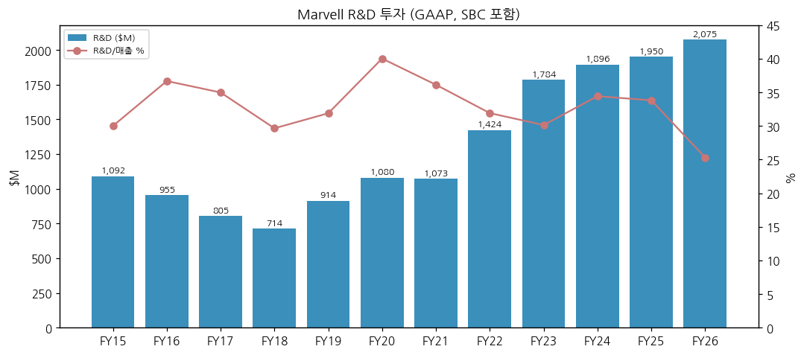

- R&D $2.08B (FY2026, 매출 대비 25.3%) — 매출 증가로 비율은 12년 최저. 1H FY27 $1.39B(분기 $652M → $741M, Celestial·XConn 인력 편입 + SBC 증가)
- 2nm·3nm 공정 커스텀 XPU·DSP 설계, 자체 SerDes(고속 직렬 인터페이스) IP가 핵심 자산
- 2025 구조조정(Fiscal 2025 Plan): 데이터센터 외 신제품 투자 축소·일부 제품 취소 → 데이터센터 R&D로 재배치 (FY2027까지 완료 예정, 10-Q)

### ② 진행 중 Corporate Action (M&A 10년)
| 연도 | 내용 |
|---|---|
| 2018 | Cavium 인수 (현금 지출 $2.65B + 주식) |
| 2019 | Aquantia·Avera 인수(FY2020 현금 지출 합계 $1.07B), Wi-Fi·BT 사업 NXP에 매각 |
| 2021 | Inphi 인수(현금 지출 $3.56B + 주식, FY2022) + Delaware 이전 / Innovium 인수 |
| 2025 | 자동차 이더넷 Infineon에 $2.5B 매각 |
| 2026-02 | Celestial AI(총 대가 $3.5B: 현금 $1.3B + 주식 약 2,450만 주 + 매출 연동 조건부 대가) · XConn(현금 $280M + 주식 약 210만 주) 인수 |
| **2026-11-02** | **Lumentum 인수 합의** — Lumentum 1주당 Marvell 4.5주(전액 주식), 내재가치 1주당 약 $1,132, Lumentum EV **$115B**, 10/28 비영향 종가 대비 프리미엄 약 23.9%. 연간 비용 시너지 $1B 이상, 합병 1년차 Non-GAAP EPS 증가 예상(회사). 해지수수료: Marvell $5.8B / Lumentum $2.9B / 규제 해지 $3.2B(Marvell 부담). 양사 주총·규제 승인 필요, **2028년 상반기 종결 예정** (8-K·보도자료) |

### ③ 주요 리스크
- **Lumentum 인수**: 전액 주식 발행으로 주식 수 약 1.5배 [계산 — 67:33 지분 기준], 발표 후 주가 급락(11/2 −12.7%), 2026-11-03 TD Cowen 투자의견 하향(언론 보도). 독점·외국인투자 심사 장기화, InP 팹 등 제조 사업 편입으로 팹리스 마진 구조 변화
- **고객 집중**: 상위 10대 고객 82%, 유통사 A 37%·직접 고객 A 14% (FY2026). 하이퍼스케일러 자체 설계 강화·디자인 윈 상실 시 매출 급감(10-K 리스크 요인)
- **커스텀 마진 희석**: 커스텀 비중 확대 → Non-GAAP GPM 64.9%(FY2022) → 58.9%(FQ2 FY27)
- **AI CapEx 지속성**: 10-Q가 데이터센터 입지 반대·전력·물 문제, 2026-07 발의된 AI 감독 법안을 리스크로 새로 명시. 2026-11-05 AI 데이터센터 규제 우려로 섹터 급락(−16.4%)
- **중국·수출 규제**: 선적지 기준 중국 42% (FQ2 FY27), 중국 고객 대상 무역 제한 리스크
- **공급 제약**: 첨단 웨이퍼·기판·테스트 공급 부족 → FY2027 공급 선급금 약 $1B
- **GAAP 이익 변동성**: Celestial 조건부 대가 공정가치 변동(주가 연동)이 영업외손익을 흔든다 — 선도 주식매입계약($300M)으로 일부 헤지

### ④ ESG
- 미수집 (Data gap) — 10-K상 2025-06-02부터 전 직원 사무실 전일 근무 정책, 연간 직원 설문(Voice of the Employee) 운영

### ⑤ 인증·라이선스
- Avera 인수 사업 관련 미국 국방 시설보안허가(NISP) 보유 — Bermuda 법인 시절 미 국방부와 외국인 소유·통제(FOCI) 완화 협약 체결 이력 (10-K)
- 미국 정부·연방 원청·하청 계약 조달 규정 적용 (Avera 인수로 편입, 10-K)

---

## Activity 보고 (v1.0)

### ✅ 확보 — SEC XBRL(신·구 법인) 연간·분기 + 10-K 5건 + 10-Q 16건 + 8-K(2024\~2026-11) + DEF 14A 2026 + 실적 보도자료 9건 + 컨콜 2건 + Yahoo 주가 2000\~
### ❌ 누락 — Non-GAAP OPM FY2015\~FY2020, 제품군(커스텀·인터커넥트·스위치)별 매출, SG&A FY2015\~FY2021·무형 상각 FY2018\~FY2019, Investor Day 회사 원문, 최신 13G/A 지분율, ESG 등급, 커스텀 ASIC 시장점유율(공식 통계 없음)
### ⚠️ 추정·계산 — [계산] CAGR·마진·밸류에이션 배수·Q4 및 FQ1 FY21/22 최종시장 차감 산출·시총(종가×표지 주식) / [추정] 시장별 이익 비중, Microsoft Maia 고객 여부 / 2차 보도: Investor Day 목표(FY2028 $20B, FY2029 커스텀 $12B 초과, FY2031 $70\~90B), S&P 500 편입, 일간 등락 원인
### 🔗 핵심 source
- SEC EDGAR MRVL (CIK 0001835632, 구 MTG 0001058057): 10-K 2026-03-11, 10-Q 2026-08-28, 8-K 2024-12-02·2026-03-31·2026-08-19·2026-11-02·2026-11-12, DEF 14A 2026-05-13
- investor.marvell.com: 실적 보도자료(FQ2 FY27 2026-08-27 등), Lumentum 합병 보도자료 2026-11-02, FQ3 컨콜 공지 2026-11-06
- 컨콜: Motley Fool FQ4 FY26(2026-03-05), Benzinga/Webull FQ2 FY27(2026-08-27)
- Yahoo Finance v8 MRVL 주가 / stockanalysis.com(시총 교차 확인) / Futurum·Benzinga(Investor Day) / Trefis·StockStory(2026-11 주가 급락 원인)

### Data Quality Confidence: **85%** (손익·재무 SEC XBRL 원문, 최종시장 10-Q·10-K 원문 파싱, Non-GAAP 보도자료 원문 / 2015\~2020 Non-GAAP 공백, 제품군 매출 미공시, Investor Day는 2차 보도)

---

## Version Log
- **v1.0 (2026-11-15)**: 최초 작성 — FY2015\~FY2026 12년 + 분기 손익 FQ4 FY13\~FQ2 FY27 + 최종시장 26Q + 12종 차트(chart1·1b·2·3·4·6·7·8·9·10·11·12). Lumentum 인수 합의(2026-11-02)·Google 워런트(2026-08)·NVIDIA 우선주(2026-03) 반영
- 잔여 보완 후보: FQ3 FY27 실적(2026-12-01) 반영, Non-GAAP OPM FY2015\~FY2020(구 법인 보도자료), Investor Day 회사 원문(세그먼트 목표 정의), Lumentum S-4(합병 재무 pro forma), 최신 13G/A 지분율, 피어(Broadcom 등) 밸류에이션 배수 fact verify, 주주 구조 차트(chart5), ESG 등급
