> Ticker: **NYSE: OKLO — Oklo Inc.** (구 AltC Acquisition Corp., SEC CIK 0001849056)
> Entity: **Oklo Inc.** (본사 Santa Clara, California, USA) — 2013년 DeWitte 부부(MIT 출신)가 창업한 소듐냉각 고속로(Aurora powerhouse) 개발사. "원자로를 팔지 않고 직접 짓고·소유·운영하며 전기·열을 판다(PPA)"는 모델. 사업은 4갈래: **발전(Aurora)·연료(재활용·가공)·동위원소(Atomic Alchemy)·엔지니어링 서비스(ARMEC·CEI)**
> Sector: 원전 — 서브섹터 **SMR·차세대 원자로** (NuScale·Oklo·X-energy) — **적자 개발사로 섹터 델타 합산 제외**, 인허가·수주 마일스톤과 현금 소진을 추적 (watchlist.md 2026-11-14 원전 글로벌 편입 원칙)
> 작성 시각: **2026-11-15 KST** (**v1.0** — Phase 1 Source 전수 수집 + audit + 13종 차트(12종 + 마일스톤 타임라인) + v1.5 ① 기업 분류 표준, 꿈형 변형)
> 적용 구조: v4.8 (6개 섹션) + v1.5 ① 기업 분류 표준 — 매출이 사실상 없는 개발사라 매출·OPM 대신 **비용·순손실·현금 소진·희석·마일스톤**으로 지표를 바꿔 적용
> 데이터 범위: **연간 FY2022\~FY2025 (12월 결산, 레거시 Oklo 기준)** + **9M26 (1Q\~3Q26, 10-Q 2026-11-06 제출)** + **분기 15Q (1Q23\~3Q26)** + **주가 2021-11 \~ 2026-11-13** (2024-05-09 이전은 AltC SPAC 주가)
> 출처: **SEC EDGAR 10-K 5건 (AltC FY2021\~23 + Oklo FY2024·FY2025) · 10-Q 17건 (2021\~3Q26) · 424B3 합병 위임장 (2024-04-26, 레거시 Oklo FY2022·23 감사재무제표) · DEF 14A 2026 (2026-04-21)**, **SEC XBRL companyfacts**, **Yahoo Finance OKLO**, **companiesmarketcap.com**, 보도 (World Nuclear News·Environment+Energy Leader·Finviz/EarningsWhispers)
> 회계 단절: 2024-05-09 AltC와의 합병은 **역합병(reverse recapitalization)** — 회계상 취득자는 레거시 Oklo. 따라서 FY2023 이전 수치는 SPAC(AltC)이 아니라 **레거시 Oklo 비상장 시절 재무**. AltC 단독 FY2021\~23 10-K는 신탁계좌(약 $300M대) 보유 SPAC 재무라 시계열에서 제외. 단위 $M

# Oklo 기업 개요 (v1.0 — 원전 / SMR·차세대 원자로 / 꿈형 개발사: 마일스톤 & 현금 트래커)
> **Fact verify cutoff**: 2026-11-15 (주가 2026-11-13 종가 **$23.92** [Yahoo Finance], 발행주식 **195,289,593주** [10-Q 3Q26 표지, 2026-11-04] → 시가총액 **$4.67B** [계산, companiesmarketcap.com 2026-11-13 $4.67B와 일치]. 종가 사상 최고 **$174.14 (2025-10-14)** · 장중 최고 $193.84 (2025-10-15), 52주 고저 $115.72 (2026-01-09 장중) / $18.535 (2026-11-05 장중) [Yahoo Finance])


## Phase 1 Source Audit (메모리 룰)

```
=== 자료 수집 audit (Oklo) ===

✅ 확보 (저장: company-overview-source/OKLO_Oklo Inc/ + company-overview-source/OKLO/)
- 10-K 5건 (2022-03 ~ 2026-03 제출) + 10-Q 17건 (2021-08 ~ 2026-11-06) — sec_edgar_download_reports
  · 2024-08 이후 제출분 = Oklo(레거시 Oklo 연속), 그 이전 = AltC SPAC
- 424B3 18건 — 그중 2024-04-26 합병 위임장(8.7MB)에 레거시 Oklo FY2022·FY2023 감사재무제표
- DEF 14A 3건 (2023 AltC / 2025 / 2026 Proxy) — 5% 주주·이사회·경영진
- SEC XBRL companyfacts.json (분기·연간 손익·BS·CF, 2023~3Q26 레거시 Oklo 기준)
- Yahoo Finance v8 OKLO 일간 (2021-11-15 ~ 2026-11-13)
- 웹 검증: DOE 7/4 임계 목표 결과, KHNP MOU, 시총(companiesmarketcap), 3Q26 시장 반응

❌ 누락 (4)
- 레거시 Oklo FY2021 이전 재무 (합병 위임장은 FY2022·23만 수록) → 연간 시계열 4년+9M
- 3Q26 실적 보도자료·컨퍼런스콜 원문 (8-K Ex-99.1 미수집) → 10-Q MD&A + 보도 요약으로 대체
- Meta 선급(prepayment) 금액·조건 — 10-K/10-Q 미공시
- ESG 등급 원문

⚠️ 결과 영향
- "12년 시계열" 표준은 적용 불가 (상장 2.5년, 매출 없음) → 연간 4년 + 9M26, 분기 15Q로 대체
- 매출·OPM 기반 지표(사이클·OPM 평균)는 N/A — 대신 비용 증가율·현금 소진·희석·런웨이로 치환
- 2023 이전 자본(음수)은 SAFE·상환전환우선주 회계 영향. 위임장(우선주 메자닌 분류)과 10-K 재작성치(-$3.1M, FY22)가 다름 → 10-K 재작성치 사용

Source 6종 audit:
[V] (1) 정기 보고서 (10-K 5 + 10-Q 17) ✓
[△] (2) IR 실적 자료 (보도자료·컨콜 원문 ✗ → 10-Q MD&A·보도로 대체)
[✗] (3) Sustainability Report ✗
[V] (4) 주가 (Yahoo OKLO 5년) ✓
[V] (5) Proxy / 지배구조 (DEF 14A 2026) ✓
[V] (6) 정확값 시계열 (XBRL + 합병 위임장) ✓
→ 4.5/6 source 확보. 최신 분기(3Q26, 2026-11-06 제출) 반영.
```

---

## ① 기업 분류

(1) Primary / Secondary 분류

**Primary 분류: 꿈 (매출 없는 차세대 원자로 개발사 — 인허가·건설·연료 마일스톤이 주가를 결정)**

→ 9M26 매출 **$3.1M** (전부 2026-06 인수한 엔지니어링 회사 ARMEC·CEI의 용역 매출) vs 영업비용 $209.7M — 본업(전력 판매) 매출 **0** [10-Q 3Q26]

→ 첫 상업 원자로 **Aurora-INL(75MWe)** 가동 목표 **2028\~2029** (10-K FY2025까지 "2028" → 3Q26 10-Q에서 "2028-2029"로 후퇴) — 매출 발생은 그 이후

→ 회사 존속은 **증자로 쌓은 현금 $3.13B** (3Q26말)에 의존. 2024-05 상장 후 순조달 약 **$3.8B** [계산: 합병 $259M + 2025 $1,264M + 9M26 $2,254M], 발행주식 +60%

**Secondary 노트: 수직계열화 원전 생태계 (발전 + 연료 재활용·가공 + 동위원소)**

→ 동위원소 사업은 2026-08-05 **Groves 시험로 첫 임계**로 실물 단계 진입, 첫 계약 납품 목표 2027 (3Q26 보도 요약) — 발전보다 먼저 매출이 날 수 있는 유일한 사업부

→ 연료: INL에서 EBR-II 회수 HALEU **5톤 확보**, Centrus HALEU 공급계약(2026-09-30), 테네시 재활용 시설(최대 $1.68B 로드맵), DOE 잉여 플루토늄 활용 협상

(2) Summary Box (꿈형 변형 — 4년 연간 + 9M26)

| 지표 | 값 |
|------|-----|
| 매출 | **사실상 0** — 9M26 $3.1M (인수 자회사 용역), 전력 매출 0 |
| 영업비용 CAGR (FY22→FY25, 3년) | **+141%/yr** [계산: $10.0M → $139.3M] / 9M26 $209.7M (+155% YoY) |
| 순손실 | FY25 **-$105.7M** / 9M26 -$123.3M (이자수익 $72.4M가 손실을 절반 가까이 상쇄) |
| 2026 현금 소진 가이던스 | 영업CF 유출 **$120\~150M** + CapEx **$400\~500M** = $520\~650M (2Q26에 $80\~100M / 투자 $350\~450M에서 상향, 3Q26 유지) |
| 유동성 (3Q26말) | 현금+시장성 채권 **$3,130.8M**, 차입 0 |
| 런웨이 | **약 4.8\~6.0년** [계산: $3,130.8M ÷ 2026 가이던스 $520\~650M] / 3Q26 분기 소진 연환산 $797M 기준 약 3.9년 |
| 사이클 주기·회수 | **N/A — 매출 부재 개발 단계** (주가는 정책·AI 전력 수요 내러티브 사이클을 탐: 2025-10 정점 → 2026-11 -86%) |

```
[Oklo 연간 손익·현금 시계열 ($M, 12월 결산, 레거시 Oklo 기준)]
연도    매출   R&D    G&A   영업비용  영업손실   이자수익   순손실   영업CF   CapEx   유동성(말)
FY22    0     6.0    4.0    10.0    -10.0     0.0    -10.0   -10.0    0.15     9.7   ← 비상장, NRC COLA 기각(2022-01) 직후 재정비
FY23    0     9.8    8.9    18.6    -18.6     0.2    -32.2   -16.0    0.08     9.9   ← AltC 합병 발표(2023-07), SAFE 평가손 -13.7 → 순손실 확대
FY24    0    26.7   26.1    52.8    -52.8     7.7    -73.6   -38.4    0.35   275.3   ← 2024-05 상장(순조달 $259M), SAFE 평가손·합병 비용, Switch 12GW
FY25    0    58.9   80.4   139.3   -139.3    29.1   -105.7   -82.2   33.2  1,412.5   ← 2025-06 공모 $460M+ATM, RPP 선정, Aurora-INL 착공, 주가 정점(10월)
9M26   3.1  108.2   99.7   209.7   -195.2    72.4   -123.3  -110.9  280.9  3,130.8   ← ATM $2.29B, Groves 첫 임계(8월), Aurora 목표 2028→2028~29, 주가 -86%

영업비용 CAGR FY22→FY25: +141% [계산] / 9M26 영업손실에는 토지 매각익 $11.4M 포함 (영업비용엔 원가 $1.8M 포함)
출처: FY22·23 = 424B3 합병 위임장(2024-04-26) 감사재무제표 / FY24·25 = 10-K / 9M26 = 10-Q 3Q26. 유동성 = 회사 공시 "cash, cash equivalents and marketable (debt) securities" (FY22·23은 현금만)
```

(3) 마일스톤 & 현금 트래커 (★ 이 종목의 핵심 추적표 — 분기마다 갱신)

**(3-1) 인허가·건설 마일스톤 — Aurora-INL (75MWe, Idaho National Laboratory)**

| 단계 | 상태 | 시점·근거 |
|---|---|---|
| DOE 부지사용허가 + EBR-II HALEU 5톤 배정 | ✅ 완료 | 2019-12 (공개 보도), 10-K 기재 |
| NRC 맞춤형 COLA(건설·운영 통합허가) 최초 제출 | ❌ 기각 | 2020-03 제출 → **2022 "without prejudice" 기각** (10-K FY2024) |
| NRC COLA Phase I 사전심사(입지·환경) | ✅ "중대 결함 없음" | 2025-07 (10-Q 3Q26) |
| DOE 원자로 파일럿 프로그램(RPP) 선정 | ✅ 11개 중 3건 (Oklo 2·Atomic Alchemy 1) | 2025-08-13 → Aurora-INL은 **DOE 인허가 경로**로 전환 |
| 비원자력 부분 착공 | ✅ | 2025-09 (DOE 승인 + 기공식) |
| DOE OTA(기타거래협약) 체결 | ✅ | 2026-02 |
| DOE 원자력안전설계협약(NSDA) 승인 | ✅ (5단계 중 1) | 2026-02 |
| NRC 주요설계기준(PDC) 토피컬 리포트 승인 | ✅ | 2026-04 |
| DOE 예비문서화안전분석(PDSA) 승인 | ✅ (5단계 중 2, NRC 건설허가에 준함) | **2026-06-11** |
| 최종 안전분석(DSA) 승인 | ⏳ 약 2028 예상 | 3Q26 보도 요약 (Finviz/EarningsWhispers) |
| **첫 가동(발전)** | ⏳ **2028\~2029** | 10-K FY2025 "2028" → **10-Q 3Q26 "2028-2029"로 후퇴** |
| NRC 상업 인허가 (후속 호기) | ⏳ 경로 재검토 | NRC 2026-10-26 최종규칙(시행 2026-11-25) — DOE 인가 원자로의 운전 데이터를 NRC 심사에 재활용 가능 → Aurora-INL 데이터로 후속 호기 NRC 인허가 단축 구상 |

→ 시공사: **Kiewit Nuclear Solutions** (Aurora-INL 주 시공사), 대형 기기: **U.S. Forged Rings** 원자로 용기 등 생산능력 예약 (2030 첫 납품, 2035까지, 2026-10), 터빈: Siemens Energy (10-K 공급사 명시)

**(3-2) DOE 2026-07-04 임계 목표 — 결과 (검증 완료)**

→ DOE RPP 목표는 "2026-07-04까지 최소 3기 임계". 결과 **4기 달성 — Antares(6/4)·Valar Atomics(6/18)·Deployable Energy(6/30)·Aalo Atomics(7/4)**, **Oklo는 미포함** [Environment+Energy Leader, 2026-07]

→ Oklo의 RPP 2개 과제 중 **Groves 동위원소 시험로(텍사스 Lockhart, 출력 상한 100W)** 는 DOE 최종 안전분석 승인(6/30)·가동 승인(7/23) 후 **2026-08-05 첫 임계** — 목표일보다 1달 늦음. RPP 과제 중 **민간 부지에서 임계에 도달한 첫 원자로** (10-Q 3Q26). Aurora-INL은 7/4 대상 아님 (PDSA 단계)

→ 그 밖에 2025-12 Los Alamos와 **플루토늄 고속 스펙트럼 임계 실험** 완료 (10-K FY2025)

**(3-3) 연료 전략 — HALEU·재활용·플루토늄**

| 경로 | 상태 | 근거 |
|---|---|---|
| EBR-II 회수 HALEU 5톤 (첫 노심) | ✅ 확보 (INL 배정) | 10-K |
| Aurora 연료가공시설 (INL) | ✅ DOE 안전설계전략·개념설계·NSDA·**PDSA 승인**, DOE 연료라인 파일럿(FLPP) 선정 | 10-Q 3Q26 |
| Centrus HALEU | LOI(2026-06, 최대 5기 수년치, 2029 납품 개시) → **공급계약 체결(2026-09-30, Meta 프로젝트용)**. 2026-11-02 Meta 자금이 에스크로에서 Centrus로 직접 지급(연료 주문 선급) | 10-Q 3Q26 |
| 재활용 (테네시 Oak Ridge Advanced Fuel Center) | 1단계 재활용 시설 발표(2025-09, 최대 $1.68B 로드맵), NRC 사전협의 중, 상업 가동 목표 **2030년대 초** | 10-Q 3Q26 |
| ARPA-E FORGE (재활용 금속연료) | $6.8M 수주 (2026-10-29) | 10-Q 3Q26 |
| DOE 잉여 플루토늄 활용 | 2026-05 **우선 협상 대상 선정** (Pluto 원자로 = RPP 과제) | 10-Q 3Q26 |
| Standard Nuclear | 재활용 연료 구매 비구속 MOU (2026-06) | 10-Q 3Q26 |

**(3-4) 수요처(오프테이크) 파이프라인 — 구속력 구분이 핵심**

| 고객 | 형태 | 규모 | 구속력 |
|---|---|---|---|
| **Meta Platforms** | 선급(Prepayment) 계약 (2026-01-05) — 오하이오 Pike County 1.2GW 캠퍼스, Meta 선급금으로 연료 확보 | 1.2GW | 선급 메커니즘은 계약, **원자로 건설 자체는 비구속** (3Q26 보도 요약). 금액 미공시 |
| **Switch** | 12GW Master Power Agreement (2024-12) | 12GW (회사 표현 "역사상 최대급 기업 PPA") | 마스터 계약 — 개별 PPA 미체결 |
| **Equinix** | LOI + 우선매수권(ROFR) — 2024-03 Oklo에 **$25M 선급** | ≥100MW (ROFR 대상) | 비구속 LOI, ROFR 36개월 (2027-02 만료) [10-Q Note 7] |
| Diamondback Energy | LOI | — | 비구속 |
| Prometheus Hyperscale (구 Wyoming Hyperscale) | LOI | — | 비구속 |
| 미 공군 Eielson 기지 (알래스카) | DLA-Energy **낙찰 예정 통보(NOITA)** 2025-06 | ≥5MWe + 열 | 최종 계약 전 |
| TVA | 사용후연료 재활용 + 전력 판매 협의 | — | 탐색 단계 |

→ **확정 PPA는 0건** — 3Q26 10-Q "계획(Plan of Operations)"에 "비구속 계약의 PPA 전환"이 여전히 과제로 기재

→ 송전망 리스크 현실화: **PJM이 버지니아 계통연계 신청을 철회, FERC가 Oklo 이의 기각** (10-Q 3Q26 위험요인). 오하이오 캠퍼스 PJM 절차는 약 24개월 (보도)

**(3-5) 현금·희석 트래커 ($M, 분기)**

| 분기 | 영업비용 | 순손실 | 영업CF | CapEx | 분기 소진 | 유동성(말) | 발행주식(M) | 주식발행 순조달 |
|---|---|---|---|---|---|---|---|---|
| 2Q24 | 17.8 | -27.3 | -9.8 | 0.1 | 9.8 | 294.6 | 122.1 | 259.0 (합병) |
| 3Q24 | 12.3 | -10.0 | -7.9 | 0.1 | 8.0 | 288.5 | 122.1 | — |
| 4Q24 | 15.4 | -12.3 | -13.5 | 0.1 | 13.5 | 275.3 | 137.7 | — (Earnout 14.7M주) |
| 1Q25 | 17.9 | -9.8 | -12.2 | 0.3 | 12.6 | 260.7 | 139.2 | — |
| 2Q25 | 28.0 | -24.7 | -18.5 | 0.9 | 19.4 | 683.0 | 147.6 | 440.1 (공모 $60) |
| 3Q25 | 36.3 | -29.7 | -18.0 | 5.0 | 23.1 | 1,183.6 | 156.2 | 약 527 (ATM \~$73) |
| 4Q25 | 57.1 | -41.4 | -33.4 | 27.0 | 60.4 | 1,412.5 | 160.5 | 약 296 (ATM $88.29) |
| 1Q26 | 51.2 | -33.1 | -17.9 | 32.8 | 50.7 | 2,536.9 | 173.9 | 1,181.9 (ATM $96.95) |
| 2Q26 | 74.1 | -48.5 | -47.6 | 94.1 | 141.7 | 3,006.3 | 185.1 | 약 985 (ATM $55.64) |
| 3Q26 | 84.3 | -41.7 | -45.5 | 154.0 | 199.5 | 3,130.8 | 195.2 | 약 87 (ATM $39.30) |

→ (출처: XBRL companyfacts — 분기값은 누적치 차감 [계산]. 유동성은 FY24·FY25·2026 분기 회사 공시치, 그 외 현금+매도가능채권 XBRL 합산. 순조달 분기 배분은 10-K/10-Q ATM 공시 기준 근사)

→ **ATM 잔여 한도**: 2026 ATM 2 ($1.0B 한도) 중 3Q말까지 $88.8M 사용 → **약 $911M 잔여** [계산]. 10/1\~11/4 발행주식 증가 0.13M주뿐 → 4Q 초 주가 급락 구간엔 ATM 사실상 중단

→ **희석 속도**: 상장 직후 122.1M주(2024-05) → **195.3M주(2026-11-04), +60%** [계산]. ATM 평균 단가는 $96.95(1Q26) → $55.64(2Q26) → $39.30(3Q26)로 하락 — 주가 하락기에 더 많은 주식을 찍는 구조

→ **이자수익의 역할**: 9M26 이자·배당 수익 $72.4M = 영업CF 유출($110.9M)의 65% [계산] — 대규모 현금이 소진을 일부 자체 상쇄

(4) 정량적 분류 근거

→ **매출 0 · 비용 가속**: 영업비용 FY22 $10.0M → FY25 $139.3M (14배), 3Q26 분기 $84.3M (연환산 $337M). 인력 FY24말 113명 → FY25말 205명 (10-K), 3Q26 평균 인원 전년 대비 R&D +155명·G&A +85명 (10-Q)

→ **CapEx 본격화**: 분기 CapEx $0.1M(2024) → $154.0M(3Q26). 미지급 CapEx $46.0M 별도 (3Q26 XBRL). Aurora-INL·연료가공시설·오하이오 부지 선행 투자

→ **가치의 원천 = 옵션**: 주가 $23.92 중 **주당 순현금 $16.03** [계산: $3,130.8M ÷ 195.29M주] = 주가의 67%. 기업가치(EV) **약 $1.54B** [계산: 시총 $4.67B − 유동성 $3.13B, 차입 0]가 "Aurora·연료·동위원소 옵션"의 시장 가격

(5) 산업 분류

→ **GICS** — Utilities / Independent Power & Renewable Electricity Producers (보도 기준 [미검증 — 비공식 출처])

→ **지수** — S&P 500 미편입. 신흥성장기업(EGC) 지위 2026-12-31 종료 예정 (10-Q)

→ **워치리스트** — 섹터 원전 / 서브섹터 **SMR·차세대 원자로** (NuScale·Oklo·X-energy), **섹터 델타 합산 제외**

(6) 분류 결정 논리

(1) **매출 기준**: 전력 매출 0, 9M26 매출 $3.1M은 인수 자회사 용역 → 사이클·지속성장·고성장 어느 분류의 정량 요건도 충족 불가 → **꿈**

(2) **이익 구조**: 순손실의 크기가 아니라 **현금 소진 대비 유동성(런웨이)** 과 **마일스톤 달성 속도**가 기업가치를 결정. 이자수익이 손실을 상쇄하는 "현금 많은 개발사" 구조

(3) **Boundary case**: 동위원소(Groves → Groves-2 Forge, Lu-177 등 치료용 동위원소) 매출이 먼저 발생해 분기 매출 $10M+로 커지면 "꿈 + 초기 매출" Secondary 추가. 단 발전 사업 가치 비중이 압도적이라 Primary 꿈은 Aurora 가동 전까지 유지

(4) **글로벌 피어 cross-ref** (같은 서브섹터):
   - **NuScale (SMR)** — NRC 설계인증 보유(US460 77MWe 모듈, 2025-05 승인)·경수로·**설계 라이선싱 모델**(원자로 판매) — Oklo는 **소유·운영(PPA) 모델 + 고속로**라 인허가 리스크가 크고 수익 구조가 유틸리티형
   - **X-energy** — 고온가스로(Xe-100), Amazon·Dow 연계, **두산에너빌리티와 16기 예약 계약** (X-energy 보도자료) — 한국 기자재 연결고리가 Oklo보다 직접적
   - **TerraPower (비상장)** — 같은 소듐냉각 고속로(Natrium 345MWe), 와이오밍 Kemmerer 건설 중 — Oklo의 가장 가까운 기술 피어
   - **GE Vernova (BWRX-300)** — 대형 산업 기업의 SMR 사업부, 캐나다 Darlington 건설 — 원전 서브섹터 중 "발전" 교차 참조

(7) 적정 밸류에이션 방법 (단위 밸류는 분기 실적 분석, Terminal 밸류는 테마 통합 모드)

→ **1차 — 주당 순현금 대비 프리미엄(EV)**: 주가 $23.92 vs 주당 순현금 $16.03 → 옵션 가치 주당 **$7.89, EV $1.54B** [계산]. 꿈형 종목에서 하방 지지선 = 순현금(단, 매 분기 소진으로 낮아짐)

→ **2차 — 런웨이 조정 순현금**: 2026 가이던스 소진($520\~650M/년) × 2.5년(2028\~29 가동까지) ≈ $1.3\~1.6B 추가 소진 [계산] → 가동 시점 순현금 약 $1.5\~1.8B (추가 증자 없을 때) — 현재 시총의 32\~39%

→ **3차 — PBR**: 자본 $3,648.3M (3Q26말) → **PBR 1.28배** [계산]. 자본 대부분이 현금이라 PBR ≈ 현금 배수

→ **PER·EV/EBITDA 미사용 근거** — 이익·EBITDA 음수, 매출 0. 발전 개시 후 MW당 EV (설치 GW × MW당 가치)로 전환 예정

(8) 분기 재평가 트리거 (**분류 변경 조건**)

→ ① **Aurora-INL 첫 가동(발전) + 첫 구속력 PPA 체결** → 꿈 → "고성장(초기 매출)" 전환 검토, 밸류 기준을 MW당 EV로 이동

→ ② **유동성 / 연간 소진 < 2년** (현재 약 4.8\~6.0년) 또는 **ATM 평균 단가 $20 이하에서 분기 순조달 $500M+** → Secondary에 "희석 위험(자금조달 의존)" 격상

→ ③ **동위원소 분기 매출 $10M+ 2개 분기 연속** → Secondary "초기 매출(동위원소)" 추가

→ ④ **Aurora 가동 목표 2차 후퇴(2030 이후)** 또는 DOE DSA 승인 지연 → 꿈 분류 유지하되 밸류 하방(순현금) 기준으로 재평가

---

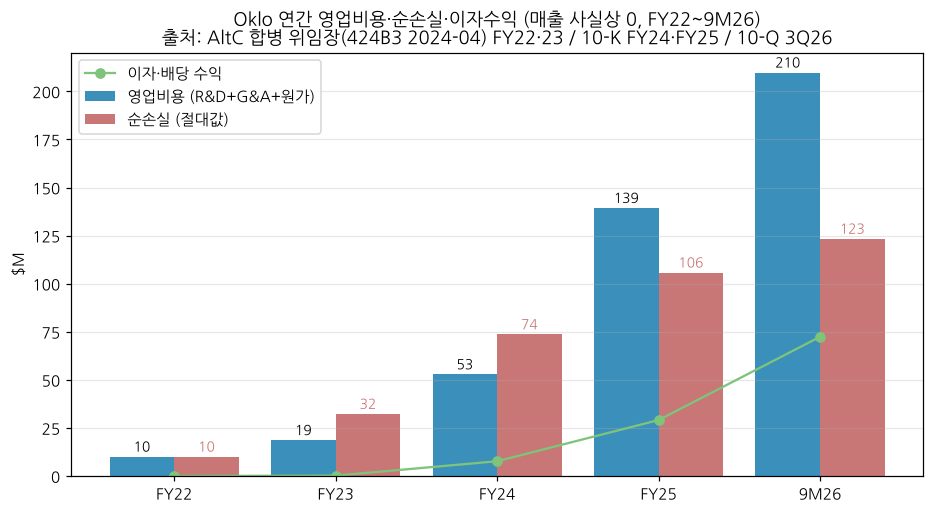

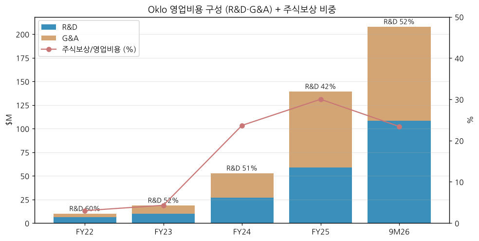

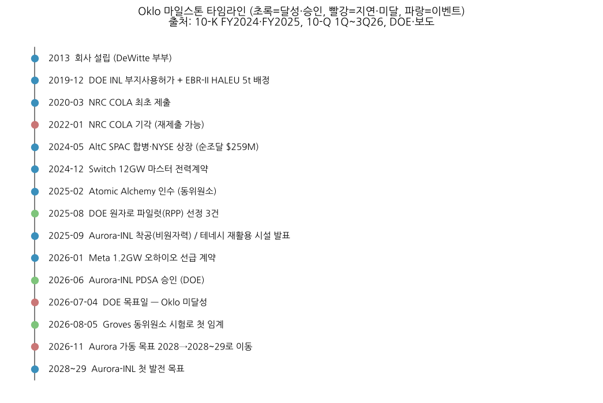

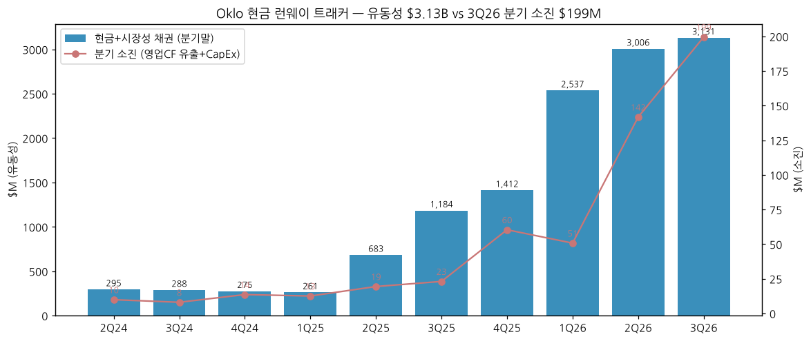

---

## ② 회사 개요

(1) 기본 정보

| 항목 | 내용 |
|---|---|
| 정식 명칭 | Oklo Inc. (Delaware 법인, 구 AltC Acquisition Corp.) |
| 본사 | 3190 Coronado Dr., Santa Clara, CA |
| 설립 | 2013 (레거시 Oklo, 창업자 Jacob DeWitte·Caroline DeWitte) |
| 상장 | NYSE: OKLO (2024-05-10 거래 개시, AltC SPAC 역합병 2024-05-09 완료) |
| CEO·회장 | Jacob DeWitte (CEO 2024-05\~, 이사회 의장 2025-04\~) |
| COO | Caroline DeWitte (공동창업자, 이사) |
| CFO | R. Craig Bealmear (2023-08 레거시 Oklo CFO → 2024-05\~) |
| 임직원 | **205명 (FY25말, 정규직, 10-K)** — FY24말 113명. 박사 13명·석사 50명, 전 NRC 직원 8명 |
| 사업 한 줄 정의 | 소듐냉각 고속로(Aurora, 15\~75MWe → 100MWe+)를 직접 짓고 소유·운영해 데이터센터·군·산업체에 전기·열을 장기계약(PPA)으로 파는 원전 개발사 + 연료 재활용·동위원소 |
| 보고 부문 | **단일 부문** (CODM = CEO, 순손실 기준 관리, 10-Q Note 12) |

(2) 핵심 KPI 요약 ($M)

| 지표 | FY24 | FY25 | 3Q26 | 9M26 | 2026 가이던스 |
|---|---|---|---|---|---|
| 매출 | 0 | 0 | 1.9 | 3.1 | — |
| 영업비용 | 52.8 | 139.3 | 84.3 (+132% YoY) | 209.7 (+155%) | — |
| 순손실 / EPS | -73.6 / -$0.74 | -105.7 / -$0.72 | -41.7 / -$0.22 | -123.3 / -$0.69 | — |
| 영업CF | -38.4 | -82.2 | -45.5 | -110.9 | **-120\~-150** |
| CapEx | 0.4 | 33.2 | 154.0 | 280.9 | **400\~500** |
| 유동성 (말) | 275.3 | 1,412.5 | 3,130.8 | — | — |
| 발행주식 (M, 말) | 137.7 | 160.5 | 195.2 | — | — |

→ (출처: 10-K FY24·FY25, 10-Q 3Q26. YoY [계산])

(3) 주요 연혁

| 시기 | 사건 |
|---|---|
| 2013 | 레거시 Oklo 창업 (MIT 출신 DeWitte 부부) |
| 2019-12 | DOE INL 부지사용허가 + EBR-II 회수 HALEU 5톤 배정 (공개 보도, 10-K 기재) |
| 2020-03 | 첫 차세대 원자로 맞춤형 COLA NRC 제출 (업계 최초) |
| 2022 | NRC COLA 기각 (without prejudice, 정보 부족) |
| 2021-07 | AltC Acquisition Corp. 상장 (Sam Altman·Michael Klein 공동 설립 SPAC) [AltC 10-K] |
| 2023-07-11 | AltC–Oklo 합병계약 |
| 2024-05-09 | 합병 완료, NYSE 상장 — 수령 $276.2M, 순조달 **$259.0M** (10-K FY24) |
| 2024-12 | Switch 12GW 마스터 전력계약, 4Q24 Earnout 14.7M주 발행 |
| 2025-02-28 | **Atomic Alchemy 인수** (동위원소, 총 $28.4M 대부분 주식) |
| 2025-04 | Jacob DeWitte 이사회 의장 취임 (Sam Altman 의장 사임 — 보도) |
| 2025-05 | **KHNP(한국수력원자력)와 협력 MOU** (World Nuclear News 2025-05-29) |
| 2025-06 | 공모 $460M (7.67M주 @ $60), Eielson 공군기지 낙찰 예정 통보 |
| 2025-08 | DOE RPP 3개 과제 선정 |
| 2025-09 | Aurora-INL 비원자력 착공, 테네시 재활용 시설 발표 |
| 2025-10-14 | **주가 종가 최고 $174.14** |
| 2025-12 | 오하이오 남부 부지 매입, $1.5B ATM 개시, Los Alamos 플루토늄 임계 실험 |
| 2026-01 | **Meta 1.2GW 선급 계약**, Groves 동위원소 원자로 DOE OTA |
| 2026-06 | Aurora-INL PDSA 승인, ARMEC·CEI 인수, Centrus HALEU LOI |
| 2026-08-05 | **Groves 동위원소 시험로 첫 임계** |
| 2026-10 | Groves-2 Forge(동위원소 생산 파일럿) NRIC Launch Pad 선정, U.S. Forged Rings 계약, ARPA-E $6.8M |
| 2026-11-06 | 3Q26 10-Q — Aurora 가동 목표 2028 → **2028\~2029** |

→ (출처: 10-K FY2024·FY2025, 10-Q 3Q26, DEF 14A 2026. 2019-12·2021-07·2025-04 일부는 공개 보도 기준)

(4) 회사 주가 역사 (narrative 영역)

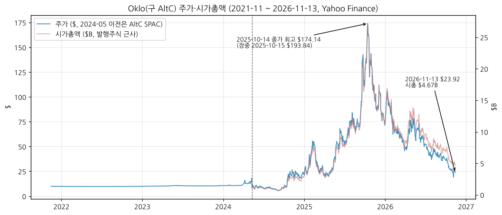

→ **2021-07\~2024-05 SPAC 구간 ($10 안팎)** — AltC 신탁가치 수준 거래

→ **2024-05 상장 → 2024-09 저점** — 상장 직후 $8 선, **2024-09-03 종가 $5.59 (사상 최저)**. 시총 약 $0.7B [계산]

→ **2024-10 \~ 2025-10 AI 전력·원전 정책 랠리 (+30배)** — 빅테크 원전 PPA 붐 + 2025-05 원전 행정명령 4건 + RPP 선정. **2025-10-14 종가 $174.14**, 시총 약 **$27B** [계산: × 156.2M주, 3Q25말]

→ **2025-11 \~ 2026-11 장기 하락 (-86%)** — 대규모 ATM 희석(2026 9M $2.29B), 7/4 임계 목표 미포함, PJM 계통연계 좌절, Aurora 일정 후퇴. 2025말 $71.76 → **2026-11-13 $23.92 (YTD -67%)**, 시총 **$4.67B** [companiesmarketcap.com 2026-11-13]

---

## ③ 비즈니스 모델

(1) 사업 구조 통합 표 (단일 보고 부문 — 사업 라인별 정성 + 정량)

| 사업 라인 | 핵심 자산·프로젝트 | 단계 (2026-11) | 매출 | 주요 지표 |
|---|---|---|---|---|
| **발전 (Power)** | Aurora-INL 75MWe (Idaho), 오하이오 Pike County 1.2GW 캠퍼스(Meta), Eielson AFB ≥5MWe | DOE PDSA 승인·건설 중, 가동 2028\~29 | 0 | 파이프라인: Switch 12GW, Meta 1.2GW, Equinix ≥100MW ROFR |
| **연료 (Fuel)** | INL 연료가공시설, 테네시 재활용 센터(최대 $1.68B), Pluto(플루토늄 원자로) | DOE PDSA 승인(가공) / NRC 사전협의(재활용) | 0 | HALEU 5톤 확보, Centrus 공급계약 |
| **동위원소 (Isotopes)** | Groves 시험로(TX, 임계 2026-08), Idaho 방사화학 연구소(NRC 물질면허), Groves-2 Forge | 시험 운전 → 파일럿 | 0 (첫 계약 납품 2027 목표 — 보도) | Lu-177 등 치료용 동위원소 |
| **엔지니어링 서비스** | ARMEC(정밀가공), CEI(소듐·알칼리금속 화학공정) — 2026-06 인수 | 영업 중 | 9M26 $3.1M | 외부 고객 용역 + 자체 공급망 내재화 |

→ (출처: 10-Q 3Q26 MD&A, 10-K FY2025)

(2) 분기 비용 시계열 (15Q)

| 분기 | 1Q23 | 2Q23 | 3Q23 | 4Q23 | 1Q24 | 2Q24 | 3Q24 | 4Q24 | 1Q25 | 2Q25 | 3Q25 | 4Q25 | 1Q26 | 2Q26 | 3Q26 |
|---|---|---|---|---|---|---|---|---|---|---|---|---|---|---|---|
| 매출 | 0 | 0 | 0 | 0 | 0 | 0 | 0 | 0 | 0 | 0 | 0 | 0 | 0 | 1.2 | 1.9 |
| R&D | 1.9 | 1.8 | 1.7 | 4.3 | 3.7 | 10.7 | 5.1 | 7.3 | 7.8 | 11.5 | 14.9 | 24.6 | 27.0 | 39.5 | 41.6 |
| G&A | 1.4 | 1.5 | 3.0 | 3.0 | 3.7 | 7.1 | 7.2 | 8.1 | 10.0 | 16.5 | 21.4 | 32.5 | 24.2 | 33.9 | 41.6 |
| 주식보상 | — | 0.0 | 0.0 | 0.6 | 0.7 | 8.5 | 1.6 | 1.7 | 2.3 | 11.4 | 9.1 | 19.0 | 15.6 | 14.4 | 19.2 |
| 이자수익 | 0.0 | 0.0 | 0.1 | 0.1 | 0.1 | 1.7 | 2.5 | 3.3 | 3.7 | 3.8 | 7.1 | 14.6 | 21.3 | 23.2 | 27.9 |
| 순손실 | -4.7 | -4.5 | -8.7 | -14.3 | -24.0 | -27.3 | -10.0 | -12.3 | -9.8 | -24.7 | -29.7 | -41.4 | -33.1 | -48.5 | -41.7 |

→ (출처: XBRL companyfacts 레거시 Oklo 기준, 4Q·2Q 등은 누적 차감 [계산]. 2023·1Q24 순손실 확대는 SAFE 공정가치 손실, 2Q24는 합병 관련 주식보상·비용)

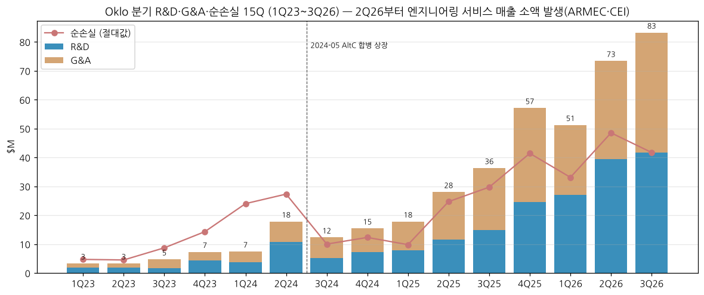

(3) 사업 라인별 디테일

→ **발전 — "Aurora"**: EBR-II(미 정부가 30년 운전한 실험 고속증식로) 기술 계승. 고속 중성자로 기존 경수로 사용후연료의 남은 에너지(약 95%)를 쓸 수 있다는 것이 핵심 주장 — 미국 사용후연료 9만톤 = 약 1.2조 배럴 석유 환산 (회사 추정, 10-K). 첫 호기에는 연료·노심 시험 설비를 추가해 원가가 높고, 후속 호기 원가 절감을 전제

→ **소유·운영 모델의 양면**: 설계를 파는 NuScale·Westinghouse와 달리 건설·운영 원가를 Oklo가 직접 짐 → 성공 시 반복 매출(PPA)·프로젝트 파이낸싱 가능, 실패 시 FOAK(첫 호기) 원가 초과·지연 리스크를 전부 흡수

→ **동위원소 — 가장 빠른 매출 후보**: Atomic Alchemy(2025-02 인수)가 기반. Groves 시험로는 원자로 건설·DOE 인가·운전 경험을 Oklo 전체에 이전하는 "연습장" 역할 (10-Q). Groves-2 Forge는 원자로 조사 + 핫셀 처리로 Lu-177 생산 목표 (상업 생산은 NRC 면허 필요)

→ **이익 outlier**: 3Q26 토지 매각익 $11.4M (일회성), 주식보상 9M26 $49.1M (영업비용의 23%, 미인식 보상비용 $187.5M 잔존·평균 3.6년)

(4) 주요 경쟁사 — **한국 원전 연결 포함**

| 영역 | 경쟁사 | 비교 포인트 | **한국 연결** |
|---|---|---|---|
| 액체금속 고속로 | TerraPower Natrium (비상장, 345MWe), ARC | 동일 노형, TerraPower가 규모·건설 앞섬 | **SK·SK이노베이션 TerraPower 투자** (공개 보도) |
| 경수로 SMR | NuScale (US460), GE-Hitachi BWRX-300, Holtec SMR-300, Westinghouse AP300 | 인허가 성숙도 우위(NRC 인증) | 두산에너빌리티 = NuScale 주기기 공급 (공개 보도) |
| 고온가스로 | X-energy Xe-100, Kairos (불화염) | 빅테크 PPA 경쟁 (Amazon·Google) | 두산에너빌리티–X-energy 16기 예약 (X-energy 보도자료) |
| 마이크로로 | Westinghouse eVinci, Aalo, Valar, Antares, Radiant | 7/4 임계 경쟁에서 Oklo보다 빨랐던 그룹 | — |
| 데이터센터 전력 일반 | 가스터빈(GE Vernova), 기존 원전 PPA(Constellation·Vistra·Talen) | 가동 시점 2028\~29 전까지 고객이 대체 전원 확보 위험 (10-Q 위험요인) | — |

→ **Oklo–한국 직접 연결**: **KHNP(한국수력원자력)와 협력 MOU (2025-05)** — Aurora 표준설계·인허가 전략, 핵심 기기 제작, BOP(보조계통) 공급망, 시장성 평가 [World Nuclear News 2025-05-29]. 구속력 계약 아님. **두산에너빌리티와의 직접 계약은 확인되지 않음** (2026-11 검색 기준)

(5) 주요 매출처

→ 전력 매출처 없음 (확정 PPA 0건). 9M26 용역 매출 $3.1M은 ARMEC·CEI의 기존 원전 산업 고객 (10-Q). 미수금 $0.8M (3Q26)

(6) 생산 CAPA + 임직원 추이

→ 설계 출력: Aurora 15·75MWe, 향후 100MWe+ (10-Q). 첫 호기 Aurora-INL 75MWe

→ 공급망 예약: Kiewit(시공), U.S. Forged Rings(원자로 용기·대형 스테인리스 기기, 2030\~2035 생산능력 예약), Siemens Energy(터빈), Amentum(엔지니어링) — 10-K 공급사 명시

→ 임직원: 113명 (FY24말) → **205명 (FY25말)** → 3Q26 평균 인원 전년 대비 +240명 수준 (R&D +155, G&A +85, 10-Q) [계산 합산]

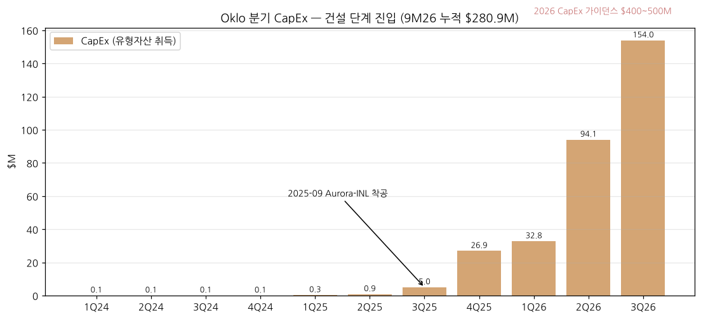

---

## ④ 재무 구조

(1) 손익계산서 (FY22\~9M26, $M) + chart1b

| 연도 | 매출 | R&D | G&A | 영업비용 | 영업손실 | 기타손익 (SAFE 등) | 이자수익 | 순손실 | 희석 EPS ($) | 주식보상 |
|---|---|---|---|---|---|---|---|---|---|---|
| FY22 | 0 | 6.0 | 4.0 | 10.0 | -10.0 | 0 | 0.0 | -10.0 | n/m (비상장) | 0.3 |
| FY23 | 0 | 9.8 | 8.9 | 18.6 | -18.6 | -13.7 | 0.2 | -32.2 | n/m (비상장) | 0.8 |
| FY24 | 0 | 26.7 | 26.1 | 52.8 | -52.8 | 약 -28.5 | 7.7 | -73.6 | -0.74 | 12.5 |
| FY25 | 0 | 58.9 | 80.4 | 139.3 | -139.3 | 약 +4.5 (세금편익 포함) | 29.1 | -105.7 | -0.72 | 41.8 |
| 9M26 | 3.1 | 108.2 | 99.7 | 209.7 | -195.2 | -0.4 (토지매각익 영업 반영) | 72.4 | -123.3 | -0.69 | 49.1 |

→ (출처: 424B3 합병 위임장(FY22·23), 10-K FY24·FY25, 10-Q 3Q26, XBRL. 기타손익은 순손실 − 영업손실 − 이자수익 [계산, 세금 포함]. 매출 부재로 GPM·OPM·NPM 산출 불가)

(2) 재무상태표 ($M) + chart4

| 시점 | 자산 | 부채 | 자본 | 현금+시장성 채권 | 유형자산(순) | 차입 | 누적결손 |
|---|---|---|---|---|---|---|---|
| FY22 | 11.0 | 14.1 | -3.1 (재작성) | 9.7 | — | 0 (SAFE 13.3) | -29.3 |
| FY23 | 14.9 | 49.2 | -34.4 | 9.9 | 0.6 | 0 (SAFE 46.0) | -61.5 |
| FY24 | 281.7 | 30.9 | 250.9 | 275.3 | 1.2 | 0 | -135.1 |
| FY25 | 1,528.5 | 52.2 | 1,476.2 | 1,412.5 | 42.3 | 0 | -240.8 |
| 3Q26 | 3,768.4 | 120.0 | 3,648.3 | 3,130.8 | 256.1 | 0 | -364.1 |

→ (출처: 424B3(FY22·23 원장), 10-K/10-Q·XBRL. 자본 FY22 -3.1은 10-K 재작성치(상환전환우선주 포함), 위임장 원장은 -28.1. SAFE = 미래지분인수계약, 합병 시 주식 전환. 부채 3Q26 중 미지급비용 $80.5M. 누적결손 FY24·25는 3Q26 기준 역산 [계산])

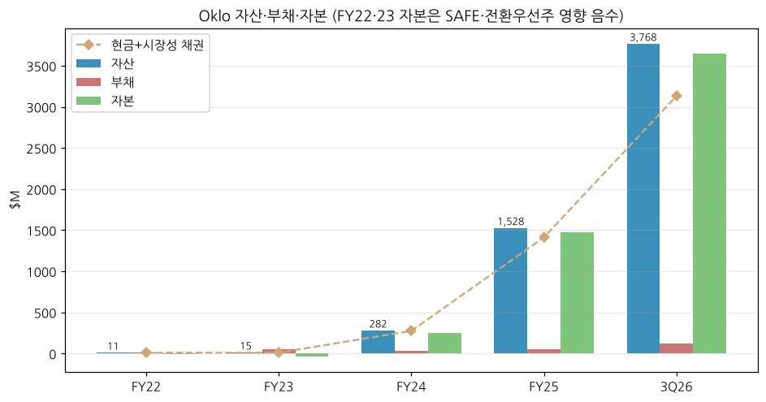

(3) 현금흐름표 ($M) + chart6

| 연도 | 영업CF | 투자CF | 재무CF | CapEx | FCF | 주식발행 | 인수 | 기타투자 |
|---|---|---|---|---|---|---|---|---|
| FY22 | -10.0 | -0.15 | 9.4 | 0.15 | -10.1 | 0 (SAFE 9.0) | 0 | 0 |
| FY23 | -16.0 | -0.08 | 16.3 | 0.08 | -16.1 | 0 (SAFE 19.3) | 0 | 0 |
| FY24 | -38.4 | -175.8 | 301.4 | 0.35 | -38.7 | 합병 순 259.0 | 0 | 0 |
| FY25 | -82.2 | -489.7 | 1,263.2 | 33.2 | -115.4 | 1,263.6 | Atomic Alchemy (주식) | 12.1 |
| 9M26 | -110.9 | -1,298.6 | 2,253.0 | 280.9 | -391.8 | 2,254.3 | 25.7 (ARMEC·CEI) | 26.5 |

→ (출처: 424B3, 10-K, 10-Q, XBRL. FCF = 영업CF − CapEx [계산]. 투자CF 대부분은 시장성 채권 순매입(9M26 $965.1M) — 현금의 형태 전환)

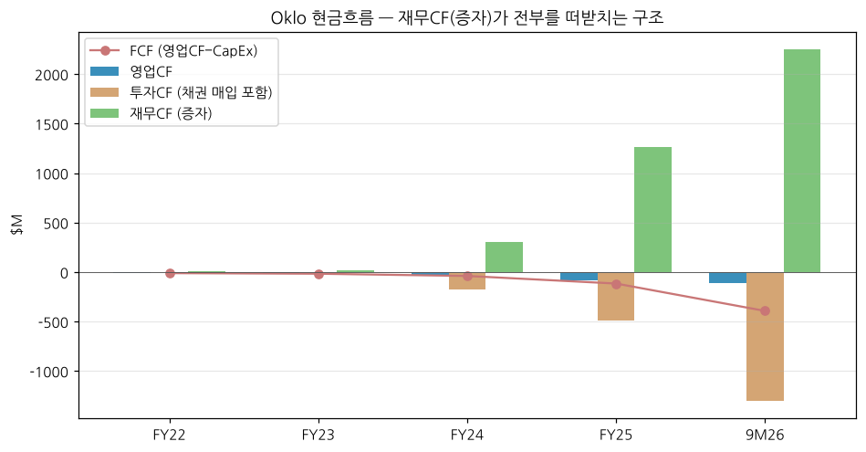

(4) CapEx + chart8

→ 분기 CapEx: 2024 분기당 $0.1M → 3Q25 $5.0M (착공) → 4Q25 $27.0M → 1Q26 $32.8M → 2Q26 $94.1M → **3Q26 $154.0M**. CapEx 선급금 포함 (10-Q)

→ 2026 가이던스 **$400\~500M** (9M $280.9M → 4Q 암시 $119\~219M [계산]). 테네시 재활용 시설 로드맵 최대 $1.68B, 오하이오 1.2GW 캠퍼스는 별도 대규모 투자 필요 — 가이던스 미반영

(5) 부채 구조

→ **차입 0** (금융리스 $0.2M·운용리스 $4.2M만). 합병 전 SAFE(FY23 $46.0M)·전환사채는 합병 시 주식 전환 (2Q24 전환사채 $42.6M 정산, XBRL)

→ Equinix ROFR 선급 $25M — 향후 PPA 할인으로 상환되는 부채성 항목 (10-Q Note 7)

→ 신용장 $58.0M (2026-08 발행, 3Q26말 제한현금) → 2026-10-13 해제 (10-Q 후속사건)

(6) 배당·자사주 → **증자·희석** + chart9

| 시기 | 형태 | 주식수 | 단가 | 총액 (gross) |
|---|---|---|---|---|
| 2024-05 | SPAC 합병 | 합병 후 122.1M주 | — | $276.2M (순 $259.0M) |
| 2024 4Q | Earnout (주가 조건) | 14.7M주 | — | 비현금 |
| 2025-06 | 인수 공모 | 7.67M주 | $60.00 | $460.0M |
| 2025-08\~09 | June ATM | 약 7.4M+1.9M주 | \~$73 | 한도 약 $540M |
| 2025-12 | December ATM | 3.40M주 | $88.29 | $300.0M |
| 2026-01 | December ATM (완료) | 12.38M주 | $96.95 | $1,199.9M |
| 2026-05\~09 | 2026 ATM 1 (완료) | 17.97M주 | $55.64 | $999.9M |
| 2026-09\~ | 2026 ATM 2 (진행, 한도 $1.0B) | 2.26M주 | $39.30 | $88.8M |

→ (출처: 10-K FY2025, 10-Q 3Q26 Note 8. 배당·자사주 매입 없음 — "예측 가능한 미래에 배당 계획 없음", 10-Q)

→ 상장 후 누적 주식발행 순조달 약 **$3.78B** [계산] vs 누적 순손실(FY24\~9M26) $302.6M — 조달 현금의 대부분은 아직 미사용 상태로 채권에 투자 중

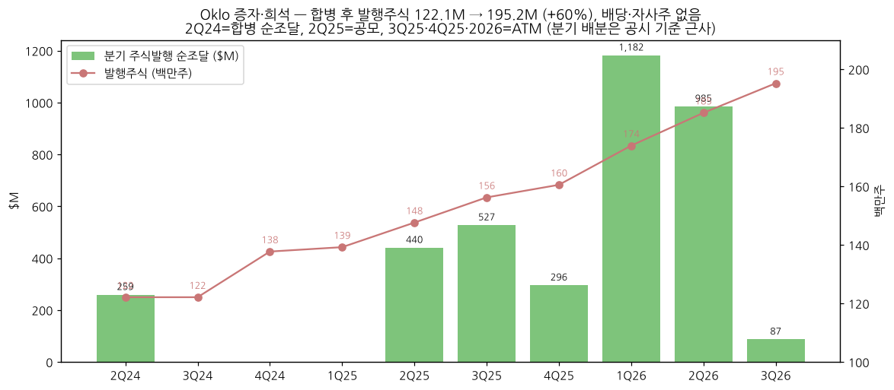

(7) 재무비율 ([계산])

| 시점 | 유동비율 | 부채/자본 | 연간 소진 (영업CF+CapEx) | 유동성/연간 소진 | 주당 순현금 ($) |
|---|---|---|---|---|---|
| FY24 | 43.5배 [XBRL 231.9/5.3] | 12% | 38.7 | 7.1년 | 2.00 |
| FY25 | 49.1배 [1,253.8/25.5] | 4% | 115.4 | 12.2년 | 8.80 |
| 3Q26 | **31.2배** [2,734.1/87.6] | 3% | 2026 가이던스 520\~650 | **4.8\~6.0년** | **16.03** |

→ ROE·ROA·이자보상배율은 손실·무차입으로 의미 없음. 비교 지표는 **런웨이·주당 순현금·희석률** 권장 [판단]

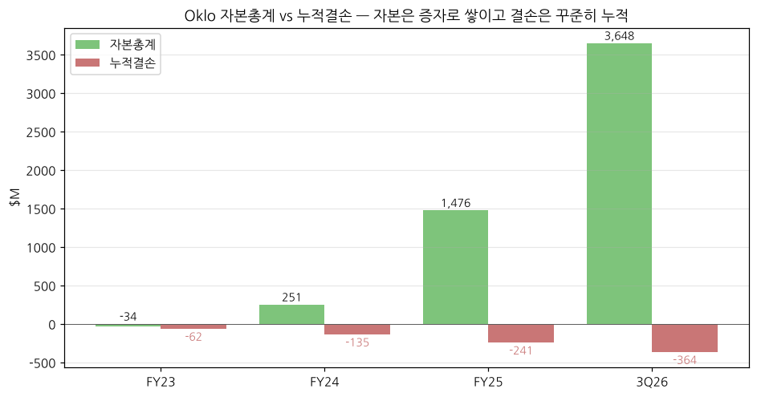

---

## ⑤ 지배 구조

(1) 그룹·계열 관계

→ 지배주주 없는 상장사, 창업자 부부가 최대 주주. 100% 자회사: Oklo Technologies(레거시 Oklo), **Atomic Alchemy**(동위원소), **ARMEC**·**CEI**(엔지니어링). 비상장 지분투자 $25.6M·상장 지분 $15.0M 보유 (10-Q Item 3)

(2) 주주 구분 + chart5

| 주주 | 보유 주식 | 지분율 | 비고 |
|---|---|---|---|
| Jacob DeWitte·Caroline DeWitte (부부 합산) | 21,159,091 | 12.16% | 창업자, CEO·COO. 가족신탁·GRAT 다수 |
| BlackRock, Inc. | 14,419,350 | 8.29% | 13G (2025-12-31 기준) |
| 이사·임원 전체 (13명) | 22,082,919 | 12.70% | DeWitte 부부 포함 |

→ (출처: DEF 14A 2026, 2026-04-06 기준 173,919,838주. 이후 ATM으로 195.3M주까지 늘어 현재 지분율은 더 낮음 — DeWitte 부부 약 10.8% [계산, 주식수 불변 가정])

→ Sam Altman: AltC 공동 설립자·전 이사회 의장(2025-04 사임, 보도). 2026 위임장 5% 이상 주주 명단에 없음

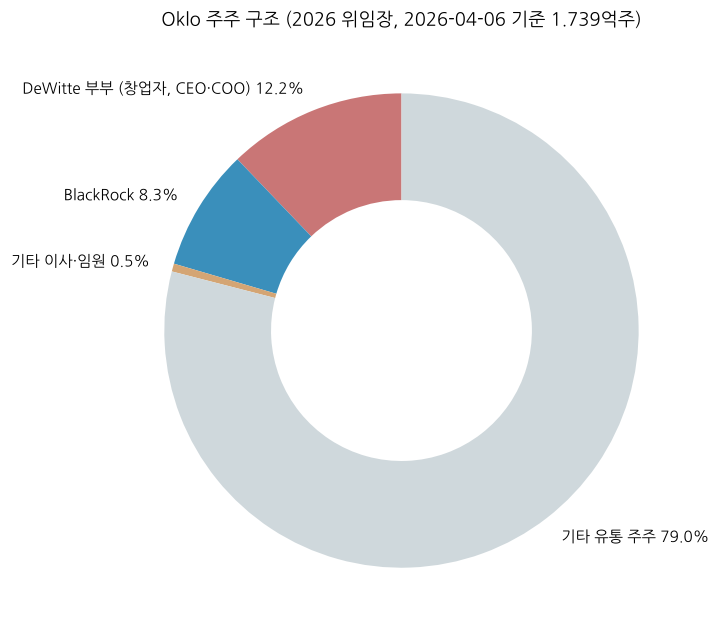

(3) 경영진·이사회

→ **Jacob DeWitte** (40세) — 회장·CEO. 레거시 Oklo 공동창업자·CEO, MIT 원자력공학 박사 (공개 약력)

→ **Caroline DeWitte** (43세) — COO·이사, 공동창업자

→ **R. Craig Bealmear** (59세) — CFO (2023-08 레거시 Oklo 합류)

→ 이사회: 선임 독립이사 **Michael Thompson** (Reinvent Capital), Michael Klein (AltC 공동설립, 2021-02\~2024-05 AltC 의장·CEO — 2025-06\~2026-06 Klein Group 자문계약 분기 $250K, 관계자 거래), Daniel Poneman (전 미 에너지부 부장관·전 Centrus CEO), Lt. Gen.(ret.) John Jansen, Richard Kinzley, 2026-04 신규 Dr. Mark Peters (MITRE CEO, 전 INL 소장)·David Christian (전 Dominion Energy)·Derek Kan·David Park (DEF 14A 2026)

---

## ⑥ 기타 팩트

(1) 시가총액·밸류에이션 스냅샷 (2026-11-13 종가 기준)

| 지표 | 값 |
|---|---|
| 주가 | $23.92 |
| 시가총액 | **$4.67B** [계산, companiesmarketcap 일치] |
| 유동성 (현금+시장성 채권, 3Q26말) | $3.13B |
| EV | **약 $1.54B** [계산] |
| 주당 순현금 | $16.03 (주가의 67%) |
| PBR | 1.28배 |
| 종가 최고 대비 | -86.3% ($174.14, 2025-10-14) [계산] |
| YTD (2026) | -66.7% ($71.76 → $23.92) [계산] |

(2) R&D 인프라 + chart7

→ R&D 비용 FY22 $6.0M → FY25 $58.9M → 9M26 **$108.2M** (영업비용의 52%). 증가 요인: 인건비(9M26 +$22.8M)·주식보상(+$13.0M)·외부 엔지니어링 용역(+$29.2M) (10-Q)

→ 협력: INL·Argonne(재활용 공정 엔드투엔드 시연 완료), Los Alamos(플루토늄 임계 실험, NVIDIA와 AI 모델링 2026-04), Battelle/INL Prometheus AI 플랫폼(2026-05) — DOE "Genesis Mission" 연계

→ ARPA-E·DOE TCF 비용분담 과제 (재활용 R&D 일부 환급)

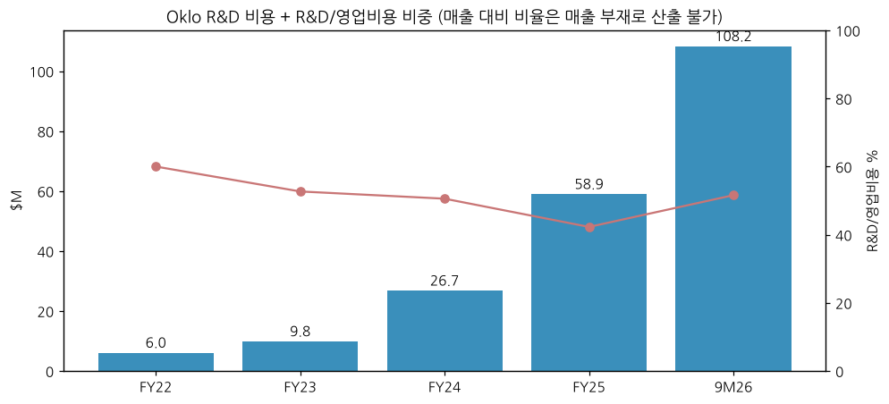

(3) 진행 중 corporate action

→ 2026 ATM 2 진행 ($911M 잔여 [계산])

→ 인수: Atomic Alchemy (2025-02, $28.4M), ARMEC ($20.5M)·CEI ($12.9M) (2026-06) — 추가 인수 검토 지속 (10-Q Plan of Operations)

→ 토지 매각 (3Q26, 매각익 $11.4M) — 오하이오 부지는 2025-12 매입

→ 우주용 방사성동위원소 전원 등 신규 영역 검토 (10-Q Plan of Operations)

(4) 주요 리스크

→ **인허가·일정** — Aurora 첫 가동 2028 → 2028\~29 후퇴. DSA 승인 약 2028 예상. NRC 상업 인허가(COLA 재제출) 시점 미정 — 2022 기각 이력

→ **FOAK 원가·소유운영 모델** — 첫 호기 시험설비 추가 원가, 관세·공급망 인플레이션을 Oklo가 전부 부담 (10-Q)

→ **연료** — HALEU 시장 가격 급등·러시아 제재 영향, 첫 노심 외 연료는 Centrus 계약·재활용·플루토늄에 의존

→ **수요처 구속력** — 확정 PPA 0건. Meta 계약도 원자로 건설은 비구속. AI 데이터센터 전력 수요 둔화·효율화 시 고객 이탈 가능 (3Q26 신규 위험요인)

→ **계통연계** — PJM 버지니아 신청 철회·FERC 이의 기각 (3Q26 신규 위험요인)

→ **희석** — ATM 상시 가동, 미인식 주식보상 $187.5M

→ **주가 변동성·공매도** — 10-Q가 "익명 SNS 공매도 세력" 위험을 별도 기재

(5) ESG

→ 원문 미수집 (Source Audit ❌). 무탄소 전원이나 사용후연료 재처리·플루토늄 활용은 핵비확산 관점 논쟁 소지 [판단]

(6) 인증·라이선스

→ DOE: RPP 선정(Aurora-INL·Pluto·Groves), Aurora-INL NSDA·PDSA 승인, Groves 가동 승인(2026-07-23), 연료가공시설 PDSA 승인·FLPP 선정

→ NRC: Aurora-INL PDC 토피컬 리포트 승인(2026-04), Idaho 방사화학 연구소 물질면허, COLA Phase I 준비성 평가 완료(2025-07). **발전용 원자로 NRC 건설·운영 면허는 미보유**

---

## Activity 보고 (v1.0 finalize)

### ✅ 확보 자료
→ 10-K 5 · 10-Q 17 · 424B3 합병 위임장 · DEF 14A 2026 · XBRL companyfacts · Yahoo 일간 5년 · 웹 검증(7/4 임계, KHNP MOU, 시총, 3Q26 반응)

### ❌ 누락 자료 (4)
→ FY2021 이전 레거시 재무 / 3Q26 보도자료·컨콜 원문 / Meta 선급 금액 / ESG 등급

### ⚠️ 추정·계산 데이터 표시
→ 시총·EV·주당 순현금·런웨이·희석률은 [계산]. 분기 순조달 배분(3Q25·4Q25·2Q26)은 ATM 공시 근사. GICS 분류는 [미검증 — 비공식 출처]. DSA 2028·동위원소 첫 납품 2027·Meta 계약 비구속 해석·PJM 오하이오 24개월은 EarningsWhispers/Finviz 3Q26 요약 기준(10-Q 원문 미확인)

### Data Quality Confidence: **85%**

---

## Version Log

| 버전 | 일자 | 내역 |
|---|---|---|
| v1.0 | 2026-11-15 | 최초 작성 — 꿈형 변형 v4.8, 연간 FY22\~9M26·분기 15Q·13종 차트, 3Q26 10-Q(2026-11-06) 반영, 마일스톤 & 현금 트래커, DOE 7/4 임계 결과 검증, KHNP MOU 확인 |

→ 잔여 보완 후보: FY26 10-K(2027-03) 반영, 3Q26 컨콜 원문(DSA·동위원소 일정 확인), Meta 선급 금액 공시 시 반영, 동위원소 첫 매출, Aurora-INL DSA 승인·COLA 재제출 시점
