> Ticker: **XETRA: RHM — Rheinmetall AG** (Frankfurt, DAX 40) / OTC ADR: RNMBY
> Entity: **Rheinmetall AG** (본사 Düsseldorf, Germany) — 유럽 최대 지상장비·탄약 방산 기업. 2025-12-17 민수(Power Systems, 구 Automotive) 사업을 IFRS 5 중단사업으로 분류해 **사실상 순수 방산 기업**으로 전환 (2026-06 AEQUITA에 매각 계약, 4Q26 종결 목표)
> Sector: 방산 — 서브섹터 **방산 글로벌** (한국 5사: 한화에어로스페이스·현대로템·한화시스템·한국항공우주·LIG D&A와 비교)
> 작성 시각: **2026-11-14 KST** (**v1.0** — Phase 1 Source 수집 + audit + 12종 차트)
> 적용 구조: v4.8 (6개 섹션) + v1.5 ① 기업 분류 표준
> 데이터 범위: **연간 12년 (2014~2025)** — 그룹 보고 기준(민수 포함) + **방산 기준**(2014~2020 Defence 사업부 / 2021~2023 그룹−민수 [계산] / 2024~ 계속사업) + **2026 9M** + **분기 16Q (1Q23~3Q26, 방산 기준)** + 사업부 7Q (1Q25~3Q26, 2026 신구조) + RHM.DE 주가 20년
> 출처: **Rheinmetall IR — Annual Report 2018·2020·2022·2024, Quarterly Statement Q1·Q3 2024 / Q1·Q3 2025 / Q1·Q3 2026, Half-Year Report 2024·2025·2026, FY2025 실적 보도자료(2026-03-11)·Bilanz-PK 발표자료, Q3 Pre-close Recap(2026-10-05), 주주구조 IR 페이지(2025-12-31)**, Yahoo Finance RHM.DE, 보도(Reuters·Börsen-Zeitung·Vara 컨센 집계)
> ⚠️ 다음 실적: **FY2026 Annual Report 2027-03-11** / **CMD 2026-11-26~27 (Hamburg)** — 2030 목표(매출 ~€50bn·OPM 20%+) 재확인 여부가 v1.1 갱신 포인트

# Rheinmetall 기업 개요 (v1.0 — 방산 글로벌 / 유럽 지상장비·탄약 1위 / 재무장 사이클 4년차)
> **Fact verify cutoff**: 2026-11-14 (주가 2026-11-13 €765.5 [Yahoo Finance RHM.DE], 시가총액 ≈ **€35.8bn** [계산: €765.5 × 46.79m주], ATH **€2,008** (2025-10 장중) [Yahoo 월간], 52주 고/저 €1,966 / €742.5 [Yahoo])

## Phase 1 Source Audit

```
=== 자료 수집 audit (Rheinmetall AG) ===

✅ 확보 (19개 파일, 저장: company-overview-source/RHM/)
- Annual Report 2018 (2012~2018 Group·Defence·Automotive key figures), 2020 (2014~2020), 2022 (2016~2022 + 5개 사업부), 2024 (2018~2024)
- 분기: QS Q1/Q3 2024, HY 2024, QS Q1/Q3 2025, HY 2025, QS Q1/Q3 2026, HY 2026 — 1Q23~3Q26 분기 그룹·사업부 표
- FY2025 보도자료 (2026-03-11, 계속사업 restated 2024·2025) + Bilanz-PK 발표자료 (2030 비전·탄약 CAPA·Arminius)
- Q3 2026 Pre-close Recap (2026-10-05), RHM.DE Yahoo 월간 20년·일간 6개월, 주주구조 IR 페이지

❌ 누락 (4)
- Annual Report 2025 연결 본문 PDF: IR 다운로드 경로 미확보 → 보도자료 + Q3 2026 QS의 2025 비교 컬럼으로 대체 (2025 OCF·CapEx·R&D 미확보)
- Q3 2026 컨퍼런스콜 트랜스크립트: 2026-11-14 기준 미게시 → 보도(Reuters·Börsen-Zeitung·Forbes.it·kapitalmarktexperten)로 대체
- 2021~2023 계속사업(민수 제외) 공식 restated 연간: 미공시 → 그룹 − 민수 사업부 [계산]
- 사업부별 R&D (2021~): 미공시

⚠️ 결과 영향
- 이익 지표 = Operating result (회사 주 지표, EBIT − PPA·특수효과 조정). 2023-Q3 정의 변경 (2022 소급)
- "방산 기준" 시계열 단절 3회: 2014~2020 Defence 사업부(보고) / 2021~2023 그룹−민수 [계산] / 2024~ 계속사업(공식). 2021~2022 민수 OP는 사업부 마진 × 매출 [계산]
- 사업부: 2025까지 VS·W&A·ES(+PS) → 2026-01 ES를 Air Defence·Digital Systems로 분할, 2026-03 Naval Systems 신설 (2025 분기는 회사 restated)
- 4Q25 사업부 = FY − 9M [계산], AD·DS 4Q25 OP는 FY 마진(17.4%·13.0%) 역산 [계산]

Source 6종 audit:
[V] (1) 정기 보고서 (AR 4개년 + 분기 9건) ✓
[V] (2) IR 실적 발표·Pre-close ✓ / Q3 2026 트랜스크립트 ✗
[△] (3) 지속가능성 보고서 — 미수집
[V] (4) 주가 (Yahoo RHM.DE 20년) ✓
[V] (5) 중장기 목표 (Bilanz-PK 2026 2030 비전) ✓
[△] (6) 12년 정확값 — 방산 기준은 단절 3회 표기
→ 4.5/6 source 확보. 최신 분기(3Q26, 2026-11-05) 반영.
```

---

## ① 기업 분류

(1) Primary / Secondary 분류

**Primary 분류: 고성장 (재무장 사이클 수혜, 성장 단계 후반 진입)**

→ 방산 기준 매출 2021 €3.7bn → 2025 €9.9bn (4년 CAGR **+28%** [계산]), Operating result €0.44bn → €1.84bn (CAGR **+43%** [계산]), OPM 11.9% → 18.5%

→ 2026 가이던스 매출 ~€13.2bn (+33% [계산]), OPM ~18.5% — 다만 2026년 들어 **가이던스 2회 하향**(8월 F126 취소, 11월 Arminius 이연) → 성장률은 높지만 "계약 타이밍"이 숫자를 흔드는 국면

**Secondary 노트: 사이클 (국방예산·전쟁 사이클)**

→ 2014 Defence OPM **-0.4%** (냉전 후 감군 저점) → 2018 7.9% → 2025 18.5%. 이익은 유럽 국방예산(GDP 대비 1.3% → NATO 3.5%+1.5% 목표)과 탄약 비축 사이클에 연동

**5개 사업부 구조 (2026 9M, Operating result 기준)**

→ **(1) Vehicle Systems (VS)** — 매출 €3.90bn (41% [계산, 사업부 합 대비]), OP €466m, 12.0% — Lynx·Puma 보병전투차, Boxer, Leopard 2/Panther KF51, 군용트럭(RMMV)

→ **(2) Weapon and Ammunition (W&A)** — 매출 €2.71bn (29%), OP €634m, 23.4% (FY 가이던스 28~29%) — **120mm 전차포·155mm 포탄·중구경탄·추진장약** — **이익 1위**

→ **(3) Digital Systems (DS)** — 매출 €1.33bn (14%), OP €118m, 8.9% — TaWAN 전술망, 병사체계(IdZ-ES), 배회탄약(FV-014), F-35 동체

→ **(4) Air Defence (AD)** — 매출 €0.73bn (8%), OP €135m, 18.5% — **Skynex·Skyranger** 대공포 체계, 35mm AHEAD 탄

→ **(5) Naval Systems (NS)** — 매출 €0.68bn (7개월), OP €71m, 10.5% — 2026-02 NVL(구 Lürssen 방산) 인수, 호위함·초계함·보급함

(2) Summary Box (12년, 방산 기준)

| 지표 | 값 |
|------|-----|
| 매출 CAGR (2014→2025, 11년) | **+14.5%/yr** [계산] (2021→2025 4년 **+28.1%**) |
| OPM 평균 (12년, 방산 기준) | **10.0%** [계산] |
| OPM 정점 | **18.5% (2025)** — 현재가 시계열 최고 |
| OPM 저점 | **-0.4% (2014)** — 냉전 후 독일 국방예산 저점 |
| 사이클 주기 | 단일 장기 상승 (2014 저점 → 2025 정점, 11년 단조 개선 — 2020 COVID에도 방산 OPM 상승) |
| 사이클 회수 (12년) | 저점 1회 / 정점 미확인 (2026 OPM 가이던스 18.5% = 2025와 동일 → **마진 정체 첫 해**) |

```
[Rheinmetall 12년 손익 (€m)]  방산 기준 = 2014~20 Defence 사업부 / 2021~23 그룹−민수 [계산] / 2024~ 계속사업
연도   그룹매출  그룹OP  방산매출  방산OP  방산OPM  그룹순이익
2014    4,688     160    2,240     -9   -0.4%      21  ← 냉전 후 저점, 독일 장비 조달 공백
2015    5,183     287    2,591     90    3.5%     160
2016    5,602     353    2,946    147    5.0%     215
2017    5,896     400    3,036    174    5.7%     252
2018    6,148     491    3,221    254    7.9%     354  ← Defence 수주 €5.6bn (호주 Boxer)
2019    6,255     505    3,522    343    9.7%     354
2020    5,405     446    3,723    414   11.1%       1  ← 민수(자동차) COVID 손상, 방산은 성장 지속
2021    5,658     594    3,692    440   11.9%     332
2022    6,410     769    4,285    591   13.8%     540  ← 우크라이나 전쟁, 독일 €100bn 특별기금
2023    7,176     918    5,092    785   15.4%     586  ← Expal(스페인 탄약) 인수
2024    9,751   1,478    7,715  1,389   18.0%     808  ← 탄약 수요 폭증, W&A OPM 28%
2025    9,935   1,841    9,935  1,841   18.5%     835  ← 민수 중단사업 분류 (그룹=방산)
9M26    8,376   1,339    8,376  1,339   16.0%     643  ← NVL 인수, 가이던스 2회 하향
2026G  ~13,200 ~2,442  (가이던스: 매출 ~€13.2bn, OPM ~18.5%)

* 그룹 2020~2024는 AR 2024 기준(2020 피스톤 사업 IFRS5 restated, 2022 OP 정의 변경 반영). 2025 순이익 = 세후이익(보도자료)
```

**한국 방산 5사 + 글로벌 피어 이익률 비교 (각사 주 지표, 최근 분기)**

→ **Rheinmetall** — 3Q26 OPM **17.5%** (W&A 22.9%·AD 23.2%·VS 13.0%), 2025 연간 18.5%

→ **현대로템** — 3Q26 OPM 15.2%, 방산(AD&RH) 28.1% (같은 폴더 3Q26 리뷰)

→ **한화에어로스페이스** — 2Q26 지상방산 OPM 25.3% (실적 캘린더 기록)

→ 시사점: 탄약(W&A 연 28~29%)은 한국 지상방산 수출 마진과 동급, 차량(VS 12%)은 K2·K9 수출 마진(20%대 후반)보다 낮음 `[판단]`

(3) 정량적 분류 근거

→ **Backlog €78.0bn (2026-09말)** — 2022말 €26.6bn 대비 약 3배. 9월말 잔고의 95.2%가 NATO·파트너국

→ **수주 지역 전환** — 9M26 Rheinmetall Nomination €19.1bn 중 독일 43.6%(전년 74.3%), 독일 외 유럽 **47.2%**(전년 16.2%) — 루마니아 SAFE 패키지 €5.7bn(Lynx 298대·함정 4척·대공·탄약)

→ **탄약 CAPA** — 155mm 2022년 7만 발 → 2027년 ~110만 발 → 2030년 ~150만 발 / 120mm 6만 → 24만 / 중구경 100만 → 400만 / 추진장약 5천t → 2만t (Bilanz-PK 2026-03)

(4) 산업 분류

→ **GICS** — Industrials / Aerospace & Defense

→ **지수** — DAX 40 (2023-03 편입)

→ **워치리스트** — 섹터 방산 / 서브섹터 **방산 글로벌**

(5) 분류 결정 논리

→ 매출 최대 사업부는 VS(41%), 이익 최대는 W&A(44% [계산: 634/1,424 사업부 OP 합]) — **이익 엔진은 탄약**, 매출 엔진은 차량

→ 2025까지 OPM 11년 단조 상승 → "사이클" cutoff(±10%p 진폭)는 충족하지만 하락 국면이 없었다 → Primary **고성장**, 하락 위험은 Secondary 사이클로 관리

→ **글로벌 피어 cross-ref** — BAE·Leonardo·Saab는 지속성장(장기 프로그램), Rheinmetall은 탄약·차량 신규 발주 의존도가 높아 **분기 변동성이 가장 큰 유럽 방산**. 한국 지상방산(한화에어로·현대로템)과 같은 "수출 대형계약 타이밍형" 분류

(6) 적정 밸류에이션 방법

→ **1차 — EV/Operating result (Forward)**: EV ≈ €39.5bn [계산: 시총 €35.8bn + 순차입 €2.9bn + 비지배 €0.8bn] ÷ 2026G OP ~€2.44bn [계산: €13.2bn × 18.5%] → **~16x** [계산]

→ **2차 — P/E**: 2025 계속사업 EPS €22.73 기준 **~34x** trailing [계산]. 9M26 조정 EPS €16.61

→ **3차 — 2030 목표 할인**: 매출 ~€50bn·OPM 20%+ (Bilanz-PK) — 11/26~27 CMD에서 하향 여부가 핵심 `[전망]`

→ PBR 미사용 — 자본 €6.2bn 대비 시총 5.8x, 선수금·운전자본 구조라 자본이 이익 체력을 반영 못함

(7) 분기 재평가 트리거 (분류 변경 조건)

→ ① **Operating result YoY 2개 분기 연속 한 자릿수 이하 + 2027 가이던스 OPM 하락** → Primary를 "사이클"로 전환 (4Q26 가이던스 역산 YoY +5%가 1차 판정 구간)

→ ② **Arminius(€12.4bn) 확정 + Backlog €100bn 돌파** → 고성장 유지 재확인

→ ③ **W&A OPM 2개 분기 연속 25% 미만** → 탄약 정점 통과 신호 (3Q26 22.9%로 1차 경고)

---

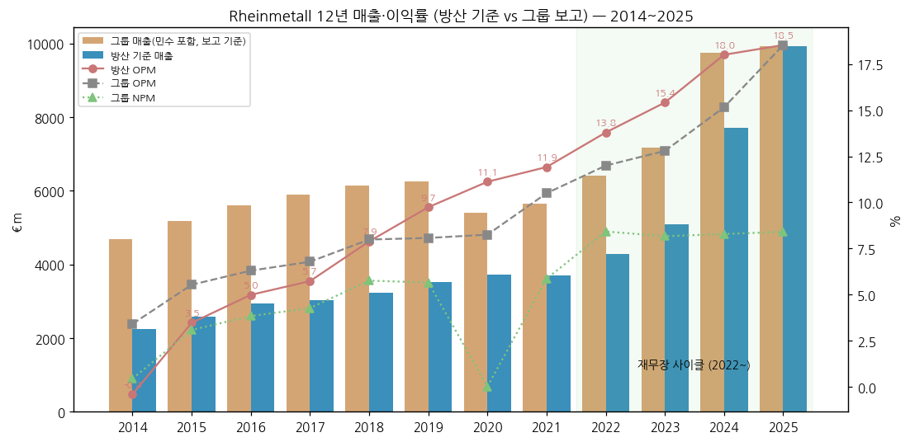

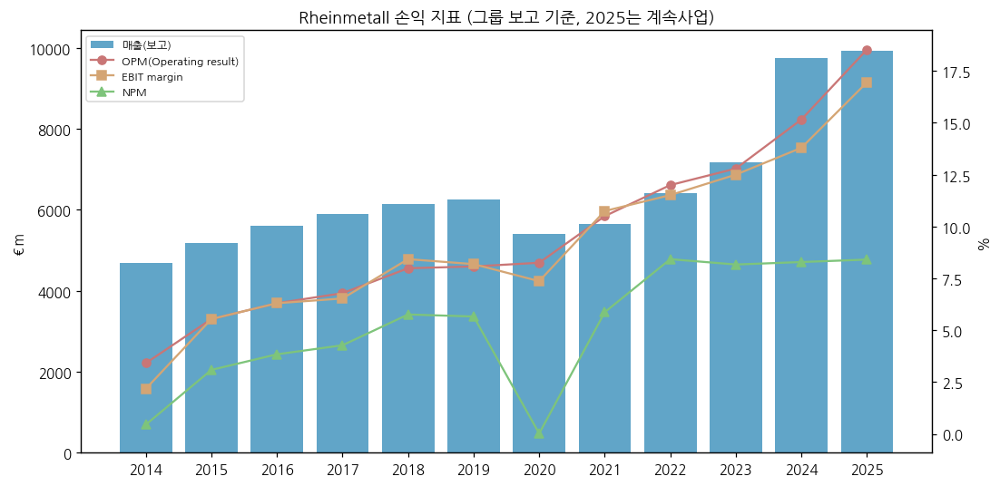

---

## ② 회사 개요

(1) 기본 정보

→ **법인명** — Rheinmetall Aktiengesellschaft (독일 주식회사), Rheinmetall Platz 1, 40476 Düsseldorf
→ **설립** — 1889년 (Rheinische Metallwaaren- und Maschinenfabrik)
→ **상장** — Frankfurt (XETRA: RHM), DAX 40 (2023-03~). 발행주식 **46,789,567주** (2026-07, 전환사채 전량 전환 후)
→ **회계연도** — 1~12월 / IFRS / 분기 공시(Q1·Q3는 Quartalsmitteilung)
→ **사업 한 줄 정의** — 전차·장갑차·탄약·대공포·전술 디지털·함정을 한 회사에서 공급하는 **유럽 지상전 "풀 패키지" 방산 시스템 하우스**
→ **CEO** — Armin Papperger (2013~, 계약 2029년 말까지) / 이사회: Klaus Neumann, Dr. Vera Saal, René Gansauge (HY 2026 책임 확인서 서명자)
→ **직원** — 37,262 FTE (2026-09말, 계속사업 30,845)

(2) 핵심 KPI 요약 (€m)

| 항목 | 2024 (계속) | 2025 (계속) | 3Q26 | 9M26 | 2026 가이던스 (11/5 하향) |
|---|---|---|---|---|---|
| 매출 | 7,715 | 9,935 | 3,149 | 8,376 | ~13,200 (종전 13,700~14,200) |
| Operating result | 1,389 | 1,841 | 553 | 1,339 | — |
| OPM | 18.0% | 18.5% | 17.5% | 16.0% | ~18.5% (종전 ~19%) |
| Rheinmetall Nomination | 26,843* | — | 2,893 | 19,131 | — |
| Backlog | 54,973* | 63,800 | 78,012 | — | (pre-close 목표 ≥100,000) |
| Operating FCF | 1,056 | 1,218 | -82 | -1,698 | CCR >0% (종전 >40%) |
| DPS (€) | 8.10 | 11.50 | — | — | — |

> \* 2024 Nomination·Backlog는 AR 2024 그룹 보고값 (Power Systems 포함). 2025 Backlog €63.8bn은 보도자료

(3) 회사 주가 역사

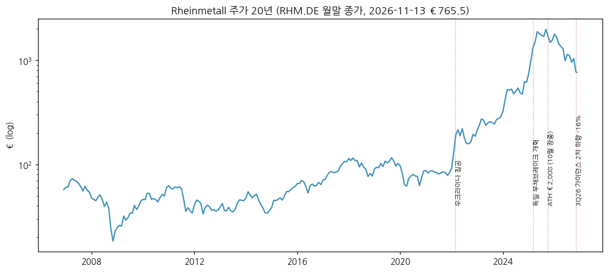

→ 2008-11 금융위기 저점 ~€19 / 2014~2021 €36~€115 박스 (자동차 부품 + 방산 복합기업 할인)
→ **2022-02 우크라이나 침공** → €90 → €200대 (2022말 €186)
→ 2024말 €614.6 → **2025-03 독일 부채브레이크 개혁** 이후 급등 → **ATH €2,008 (2025-10 장중)**, 9월말 종가 €1,984.5
→ 2026: 1월 €1,560대 → 5월 €990 → **11/5 3Q26 발표일 -16.1% (€1,003.4 → €841.5, 장중 €818.7)** → 11/13 €765.5. **연초 대비 약 -51%** [계산: 2025-12말 €1,561 기준], ATH 대비 -62% [계산]
→ 하락 원인 [판단]: ① 우크라이나 휴전 기대에 따른 탄약 수요 정점 논쟁 ② 2026 가이던스 2회 하향(J.P. Morgan 집계 11개월간 5번째 경고) ③ Arminius·SATCOMBw 등 독일 대형계약 지연 ④ 순차입 전환(9월말 €-2.9bn)

```
[주가 국면 history]
[2014 ~ 2021] 복합기업 할인 (€36 → €115 → €83) — 자동차 부품 사이클이 방산 성장을 가림
[2022-02 ~ 2024] 재무장 1차 (€90 → €615) — 우크라이나·독일 특별기금 €100bn, 탄약 증설
[2025-01 ~ 2025-10] 재무장 2차 (€615 → ATH €2,008) — 독일 부채브레이크 개혁, NATO 5% 목표
[2025-11 ~ 현재] 디레이팅 (€2,008 → €765) — 가이던스 하향 반복, 계약 지연, 휴전 기대
```

(4) 주요 연혁

→ **1889** — Heinrich Ehrhardt가 Düsseldorf에서 창업 (탄약·포)
→ **1956** — Röchling 그룹 지배하 방산 재개 / **1979** — Leopard 2 120mm 활강포 공급 시작
→ **1999~2008** — Oerlikon Contraves(스위스 대공) 인수 → 현 Air Defence의 뿌리 / Rheinmetall MAN Military Vehicles(RMMV) JV 설립
→ **2010~2015** — Defence·Automotive 2사업부 체제 (Kolbenschmidt Pierburg)
→ **2013** — Armin Papperger CEO 취임
→ **2018** — 호주 Boxer CRV 211대 (LAND 400 Ph.2) 수주 → Defence 수주 €5.6bn
→ **2021** — 5개 사업부(VS·W&A·ES·S&A·M&T)로 재편, 자동차 부품 분리 착수
→ **2022-02** — 우크라이나 전쟁, 독일 €100bn 특별기금 → 탄약·차량 프레임 계약 급증
→ **2023** — Expal Systems(스페인 탄약) 인수, DAX 편입, 헝가리 Lynx 생산 개시
→ **2024** — Loc Performance(미국 차량 부품) 인수, 독일 155mm 프레임 €8.5bn, Unterlüß 신규 포탄 공장 착공
→ **2025-12-17** — 민수(Power Systems) 중단사업 분류 → 순수 방산
→ **2026-01** — ES를 Air Defence·Digital Systems로 분할, 미국 사업 별도 사업부(U.S. America)
→ **2026-02-27** — NVL B.V. & Co. KG(구 Lürssen 방산, 조선소 4곳) 인수 → Naval Systems
→ **2026-05-29** — 루마니아 SAFE 패키지 €5.7bn (Lynx 298대 등)
→ **2026-06** — 독일 국방부 F126 호위함 6척 사업 중단 → Naval 잔고 €2.15bn 제거, 가이던스 1차 하향 (8/6)
→ **2026-06** — 민수 매각 계약 (AEQUITA, 잠정가 €350m) / DOK-ING(크로아티아 무인차량) 51% 인수
→ **2026-11-04~05** — Arminius 이연·포탄 인수시험 지연으로 가이던스 2차 하향
→ **2026-11-26~27 (예정)** — CMD (Hamburg)

---

## ③ 비즈니스 모델

(1) 실적 추이 통합 표 (€m)

| 항목 | 2023 | 2024 | 2025 | 9M25 | 9M26 |
|------|------|------|------|------|------|
| **매출 (방산 기준)** | **5,092** [계산] | **7,715** | **9,935** | **6,057** | **8,376** |
| └ Vehicle Systems | 2,609 | 3,790 | 4,992 | 3,236 | 3,898 |
| └ Weapon and Ammunition | 1,756 | 2,783 | 3,532 | 2,014 | 2,705 |
| └ Electronic Solutions (→ 2026 분할) | 1,318 | 1,726 | 2,504 | — | — |
| &nbsp;&nbsp;&nbsp;&nbsp;└ Air Defence | — | — | 769 | 448 | 731 |
| &nbsp;&nbsp;&nbsp;&nbsp;└ Digital Systems | — | — | 1,766 | 1,031 | 1,328 |
| └ Naval Systems | — | — | — | — | 679 (7개월) |
| └ 기타·연결조정 | -591 [계산] | -584 [계산] | — | -672 | -966 |
| **Operating result (OPM)** | **785 (15.4%)** | **1,389 (18.0%)** | **1,841 (18.5%)** | **795 (13.1%)** | **1,339 (16.0%)** |
| └ VS | 323 (12.4%) | 425 (11.2%) | 583 (11.7%) | 347 (10.7%) | 466 (12.0%) |
| └ W&A | 404 (23.0%) | 790 (28.4%) | 1,037 (29.3%) | 440 (21.9%) | 634 (23.4%) |
| └ ES / AD / DS | 150 (11.4%) | 217 (12.6%) | AD 134 / DS 230 [계산] | AD 59 / DS 69 | AD 135 / DS 118 |
| └ Naval | — | — | — | — | 71 (10.5%) |
| **지역 (9M26 매출)** | | | | | 독일 41.3% / 해외 58.7% / 미주 8.9% |
| **민수 (중단사업)** Power Systems | 2,084 / OP 133 | 2,038 / OP 86 | 중단사업 | | 9M26 중단사업 손익 -€144m |

> 사업부 매출은 내부거래 포함 → 합계가 그룹보다 크다 (연결조정 행). 2023 사업부 OP = 매출 × 사업부 OPM [계산]. 2025 AD·DS는 회사 restated 매출 + FY 마진(17.4%·13.0%) [계산]

(2) 사업부별 개요 (매출 비중 순)

**Vehicle Systems (VS) — 41%**

"전차·보병전투차·장갑차·군용트럭을 만드는 사업부. 매출은 가장 크지만 마진은 12% 안팎."

→ **궤도형**: Lynx KF41 보병전투차 (헝가리 218대, 이탈리아 A2CS, **루마니아 298대**), Puma (KNDS와 PSM JV, 독일 +200대 €3.5bn 중 Rheinmetall ~€2bn), Leopard 2 (KNDS 주계약 — Rheinmetall은 주포·탄·사격통제), **KF51 Panther** (차세대 전차, 이탈리아 Leonardo JV)
→ **차륜형**: **Boxer** (ARTEC JV, 독일 Schakal·**Arminius** 최대 5,500대 잠재, 호주·영국), Fuchs
→ **군용트럭**: RMMV HX/TGS — 독일·영국·호주·노르웨이 표준
→ **미국**: XM30 보병전투차 경쟁 (American Rheinmetall, 2026-09 시제 인도, 총 ~3,000대 잠재)

**Weapon and Ammunition (W&A) — 29% (이익 1위)**

"포신과 포탄을 만드는 사업부. 전쟁 이후 수요가 가장 크게 늘었고 마진이 30% 가까이 나온다."

→ **대구경탄**: 155mm 포탄 (독일 Unterlüß 35만 발, 스페인 Expal, 리투아니아·영국 공장), 120mm 전차탄 (Leopard 2·K2 호환 NATO 규격), 장사거리탄 비중 70~80%로 상승 (Pre-close 2026-10)
→ **포·포신**: Leopard 2 L44/L55 120mm 활강포, 130mm (Panther), 155mm L52
→ **중구경탄·추진장약·폭약**: Nitrochemie (Aschau 장약 공장 €350m 증설), RDX
→ **보호·기타**: 방호 시스템, 배회탄약(Destinus 협력 — 4Q26 매출 미달)

**Digital Systems (DS) — 14%**

"전장 네트워크·병사 장비·시뮬레이터를 만드는 사업부."

→ **TaWAN** (독일 전술 광역망, 프레임 €9.3bn 2025), **D-LBO** 디지털화, **IdZ-ES** 병사체계
→ 배회탄약 FV-014 (프레임 2026-04, 첫 호출 €250m), 정찰차량
→ 영국 육군 집단훈련 디지털화 (Raytheon UK 주계약, Rheinmetall 몫 ~€1bn)
→ 위성: OHB Rheinmetall Space Networks (SATCOMBw 4단계, ~€10bn 사업 지연 중)
→ F-35 중앙동체 (Weeze 공장)

**Air Defence (AD) — 8%**

"대공포와 대공포탄을 만드는 사업부 (스위스 Oerlikon 계보)."

→ **Skynex** (35mm 리볼버포 + 레이더, 우크라이나 실전), **Skyranger 30/35** (차량 탑재 이동형 대드론·근거리 방공 — 독일·네덜란드·오스트리아·덴마크)
→ 35mm AHEAD 공중폭발탄 — 드론 대응 핵심
→ 9M26 수주 €1.73bn (+439%), 2026 매출 가이던스 상향 (€1.0~1.1bn)

**Naval Systems (NS) — 2026 신설**

"독일 해군 함정을 짓고 수리하는 조선소 4곳 (Peene-Werft·Blohm+Voss·Norderwerft·Neue Jadewerft)."

→ K130 초계함, 함대지원선(FDB424), 보급선(MBV707), 불가리아 MMPV90, **루마니아 함정 4척 €920m**
→ F126 호위함 하도급 해지 (2026-06) → 잔고 €2.15bn 제거
→ 2030 매출 목표 ~€5bn (Bilanz-PK) / 루마니아 Mangalia 조선소 인수 추진 (MSC와 공동, ~€138m)

(3) 사업부별 디테일

→ **현재 잘나가는 것 (3Q26)**: Air Defence (매출 +65%, OPM 23.2%), W&A (매출 +37%), Digital (매출 +39%, OPM 10.7%)
→ **향후 큰 매출**: Arminius Boxer (첫 확정분 Rheinmetall 몫 ~€12.4bn, 선수금 20~30%, **2027 이연**), XM30 (미국), 탄약 CAPA 2027년 155mm 110만 발
→ **이익 outlier**: W&A — 2025 OPM 29.3% (155mm 가격·가동률). 3Q26 22.9%로 하락 → 4Q 연 28~29% 달성에 4Q 매출 €1.7~1.8bn 필요 [계산]

(4) 주요 경쟁사 (한국 방산 5사 겹침 중심)

| Rheinmetall 제품 | 한국 경쟁 제품 (기업) | 겹치는 시장 | 비고 |
|---|---|---|---|
| Leopard 2 주포·탄 / KF51 Panther | **K2 전차 (현대로템)** | 폴란드(K2 1차 180대·2차), 루마니아, 슬로바키아·체코 등 동유럽 | 폴란드는 Leopard 2 운용국이면서 K2 대량 도입 — Rheinmetall은 120mm 탄 공급자로 동시 수혜 가능 |
| Lynx KF41 보병전투차 | **레드백 (한화에어로스페이스)** | 호주 LAND 400 Ph.3 (2023 레드백 승), **루마니아 (2026 Lynx 298대, SAFE)**, 헝가리(Lynx) | EU SAFE 역내조달이 Lynx에 유리 — 한화는 루마니아 IFV 패배 (방산 market_signals) |
| 155mm 포탄·추진장약 / L52 포신 | **K9 자주포·탄약 (한화에어로스페이스)**, 포신(현대위아 → 현대로템 인수 예정) | 폴란드·루마니아·북유럽 포병 현대화 | Rheinmetall은 자주포 완성체 대신 탄·포신 공급 (PzH2000은 KNDS) |
| 군용트럭·다연장 탑재 (RMMV HX) | **천무 (한화에어로스페이스)** | 폴란드(천무 도입), 노르웨이·에스토니아 | 직접 경쟁보다 차체 플랫폼 영역 |
| **Skynex·Skyranger** (근거리 대공포·대드론) | **LIG D&A (천궁-II·비호복합·신궁)**, 한화에어로 비호 | 중동(사우디·UAE), 동유럽 단거리 방공 | 사거리 계층이 다름 — Skynex는 포·드론 대응, 천궁-II는 중거리 미사일 |
| TaWAN·전술망·병사체계 | **한화시스템 (TICN·전투체계)** | 국내 위주, 직접 경쟁 제한적 | |
| 함정 (K130·MMPV) | 한화오션·HD현대중공업 (조선 섹터) | 루마니아·동남아 | |

→ 유럽 내 경쟁: KNDS (Leopard 2·PzH2000·Boxer 파트너), BAE Systems (CV90·탄약), General Dynamics European Land Systems (ASCOD), Nammo·Saab (탄약·대공), Leonardo (Rheinmetall과 JV)
→ 미국: General Dynamics (Abrams·XM30 경쟁), BAE (Bradley·AMPV)

(5) 주요 매출처

> 단일 고객 10% 공시 없음. 아래는 회사 공시 수주·지역 비중 기반 [추정] 순서

→ **1. 독일 연방군 (BAAINBw)** — 9M26 매출 독일 41.3%, Nomination 43.6%
→ **2. 독일 외 EU·NATO** — 루마니아(SAFE €5.7bn), 헝가리, 이탈리아(Leonardo JV), 네덜란드, 리투아니아, 영국
→ **3. 우크라이나** — 독일 정부 지원 경유 탄약·Skynex·Lynx 현지 생산
→ **4. 미국·호주** — 9M26 미주 8.9%, XM30, 호주 Boxer
→ **5. 중동** — 사우디 RAST(시뮬레이션, 2026-07 100% 인수), 대공 체계 국제 고객

(6) 생산 CAPA + 임직원

→ 탄약 CAPA (회사 계획): 155mm 7만(2022) → ~110만(2027) → ~150만 발(2030) / 120mm 6만 → 24만 / 중구경 100만 → 400만 / 추진장약 5천t → 2만t
→ 신규 공장: Unterlüß (155mm 35만 발·RDX 1,900t·로켓모터), 리투아니아, 영국(포신), Aschau(장약), 북헤센(탄약 >€260m), 헝가리 Zalaegerszeg (Lynx)
→ 임직원 (FTE): 2014 20,166 → 2018 22,899 → 2022 25,486 → 2024 28,539 → **2026-09 37,262** (계속사업 30,845: VS 10,293 · W&A 10,401 · DS 4,827 · NS 2,014 · AD 1,839)

---

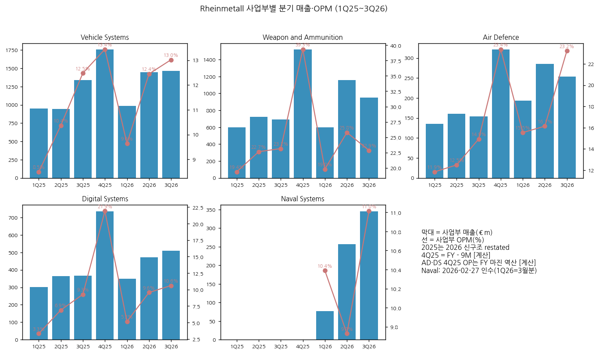

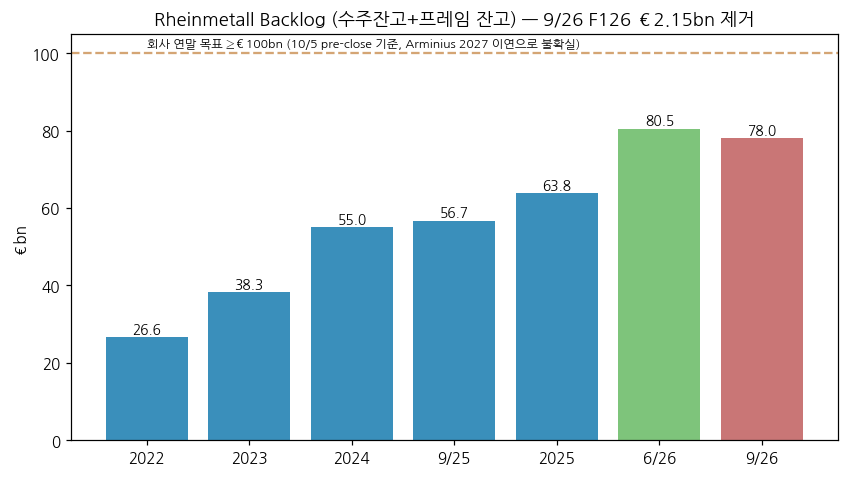

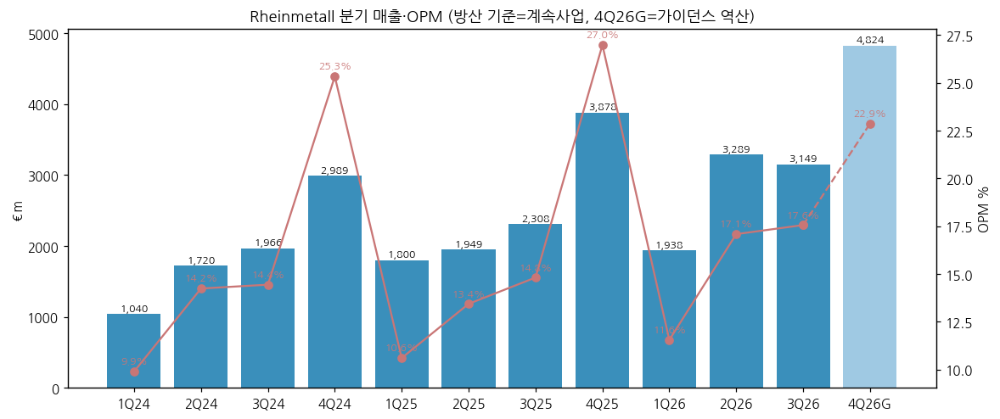

**분기 시계열 (€m, 방산 기준)**

| 분기 | 매출 | Operating result | OPM | 매출 YoY | OP YoY | 메모 |
|---|---|---|---|---|---|---|
| 1Q23 | 822 | 59 | 7.2% | | | 그룹−PS [계산] |
| 2Q23 | 1,013 | 115 | 11.4% | | | |
| 3Q23 | 1,234 | 158 | 12.8% | | | |
| 4Q23 | 2,023 | 453 | 22.4% | | | FY−9M [계산] |
| 1Q24 | 1,040 | 103 | 9.9% | 26.5% | 74.6% | |
| 2Q24 | 1,720 | 245 | 14.2% | 69.8% | 113.0% | |
| 3Q24 | 1,966 | 284 | 14.4% | 59.3% | 79.7% | |
| 4Q24 | 2,989 | 757 | 25.3% | 47.8% | 67.1% | FY 계속사업 공식 − 9M [계산] |
| 1Q25 | 1,800 | 191 | 10.6% | 73.1% | 85.4% | 2026 보고서 restated |
| 2Q25 | 1,949 | 262 | 13.4% | 13.3% | 6.9% | |
| 3Q25 | 2,308 | 342 | 14.8% | 17.4% | 20.4% | |
| 4Q25 | 3,878 | 1,046 | 27.0% | 29.7% | 38.2% | 4분기 집중(탄약 인수) |
| 1Q26 | 1,938 | 224 | 11.6% | 7.7% | 17.3% | |
| 2Q26 | 3,289 | 562 | 17.1% | 68.8% | 114.5% | NVL 연결 |
| **3Q26** | **3,149** | **553** | **17.6%** | **36.4%** | **61.7%** | 가이던스 2차 하향 |
| 4Q26G | ~4,824 | ~1,103 | ~22.9% | ~24.4% | ~5.4% | 가이던스 역산 [계산] |

> 계절성: 4분기에 연간 이익의 40~57%가 몰린다 (탄약 로트 인수시험·연말 인도). 2023~2024 분기는 그룹 − Power Systems 사업부 [계산], 2025~ 회사 계속사업 공식

---

## ④ 재무 구조

(1) 손익계산서 (그룹 보고 기준, €m) + chart1b

| 연도 | 매출 | Operating result | OPM | EBIT | EBIT margin | 세후이익 | NPM | EPS (€) | DPS (€) |
|---|---|---|---|---|---|---|---|---|---|
| 2014 | 4,688 | 160 | 3.4% | 102 | 2.2% | 21 | 0.4% | 0.47 | 0.30 |
| 2015 | 5,183 | 287 | 5.5% | 287 | 5.5% | 160 | 3.1% | 3.88 | 1.10 |
| 2016 | 5,602 | 353 | 6.3% | 353 | 6.3% | 215 | 3.8% | 4.69 | 1.45 |
| 2017 | 5,896 | 400 | 6.8% | 385 | 6.5% | 252 | 4.3% | 5.24 | 1.70 |
| 2018 | 6,148 | 491 | 8.0% | 518 | 8.4% | 354 | 5.8% | 7.10 | 2.10 |
| 2019 | 6,255 | 505 | 8.1% | 512 | 8.2% | 354 | 5.7% | 7.77 | 2.40 |
| 2020 | 5,405 | 446 | 8.3% | 398 | 7.4% | 1 | 0.0% | -0.62 | 2.00 |
| 2021 | 5,658 | 594 | 10.5% | 608 | 10.8% | 332 | 5.9% | 6.72 | 3.30 |
| 2022 | 6,410 | 769 | 12.0% | 738 | 11.5% | 540 | 8.4% | 10.94 | 4.30 |
| 2023 | 7,176 | 918 | 12.8% | 897 | 12.5% | 586 | 8.2% | 12.32 | 5.70 |
| 2024 | 9,751 | 1,478 | 15.2% | 1,345 | 13.8% | 808 | 8.3% | 16.51 | 8.10 |
| **2025 (계속)** | **9,935** | **1,841** | **18.5%** | **1,684** | **17.0%** | **835** | **8.4%** | **22.73*** | **11.50** |
| 9M26 (계속) | 8,376 | 1,339 | 16.0% | 1,179 | 14.1% | 643 | 7.7% | 14.44* | — |

> 출처: AR 2018(2014~2017), AR 2024(2018~2024, restated), FY2025 보도자료, Q3 2026 QS. \* 계속사업 EPS. 매출총이익은 총원가법(GuV 성격별) 보고라 GPM 미산출 — chart1b는 OPM·EBIT margin·NPM 3지표
→ 2014→2025 그룹 매출 CAGR +7.1% [계산], OPM 3.4% → 18.5%
→ 2025 세후이익(835)이 OP(1,841) 대비 낮은 건 민수 중단사업 손실·PPA·이자 영향 [판단]

(2) 재무상태표 (€m) + chart4

| 연말 | 자산총계 | 자본 | 자기자본비율 | 현금 | 순차입(-)/순현금(+) |
|---|---|---|---|---|---|
| 2014 | 5,271 | 1,197 | 22.7% | 486 | -330 |
| 2016 | 6,150 | 1,781 | 29.0% | 616 | +19 |
| 2018 | 6,759 | 2,173 | 32.1% | 724 | -30 |
| 2020 | 7,267 | 2,053 | 28.2% | 1,027 | +4 |
| 2022 | 8,096 | 3,090 | 38.2% | 545 | -426 |
| 2023 | 11,707 | 3,643 | 31.1% | 850 | -1,063 |
| 2024 | 14,344 | 4,465 | 31.1% | 1,184 | -1,239 |
| 2025 | 16,772 | 5,614 | 33.5% | 1,650 | +369 |
| **2026-09** | **21,765** | **6,155** | **28.3%** | **636** | **-2,901** |

→ 2026-09 순차입 전환: NVL 인수(투자CF -€1.1bn), 운전자본 -€2.0bn (재고 €4.7bn → €6.8bn), 클럽딜 €1.0bn·회사채 €0.5bn(2031, 3.375%)·단기차입 €0.8bn
→ 계약부채(선수금) €6.7bn (2025말 €5.6bn) — Arminius 선수금 이연으로 증가폭 제한

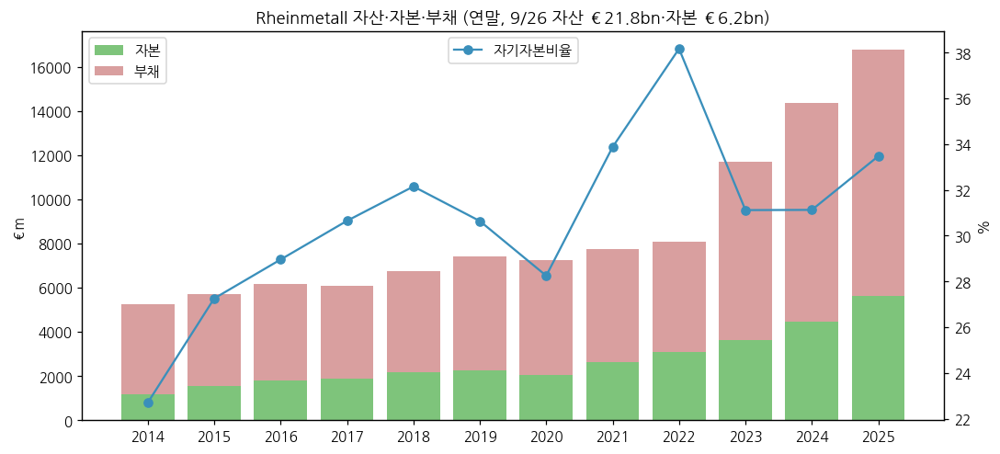

(3) 현금흐름표 (€m) + chart6

| 연도 | 영업CF | 투자CF | Operating FCF |
|---|---|---|---|
| 2014 | 102 | -284 | -182 |
| 2016 | 444 | -283 | 161 |
| 2018 | 242 | -277 | -35 |
| 2020 | 453 | -237 | 217 |
| 2021 | 690 | -271 | 419 |
| 2022 | 174 | -349 | -175 |
| 2023 | 743 | -398 | 344 |
| 2024 | 1,720 | -697 | 1,023 |
| 2025 (계속) | ❌ | ❌ | 1,218 |
| 9M26 (계속) | -1,098 | -601 (설비) | **-1,698** |

→ 9M26 Cash conversion -126.8% — 선수금이 들어오기 전 재고를 먼저 쌓는 구조. 2026 CCR 가이던스 >40% → **>0%** 로 하향 (Arminius 선수금 2027 이연)

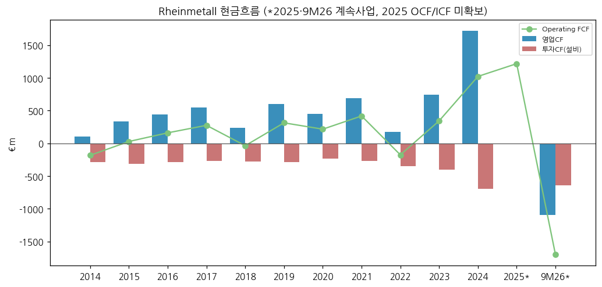

(4) CapEx + chart8

→ 설비투자 현금지출 2014~2022 €0.24~0.35bn (매출의 4~6%) → 2024 €0.70bn → 9M26 €0.64bn (계속사업, 투자율 7.1%)
→ 9M26 사업부별 투자: W&A €338m (영국 포신·리투아니아·Aschau 장약) / VS €144m / DS €83m / AD €42m

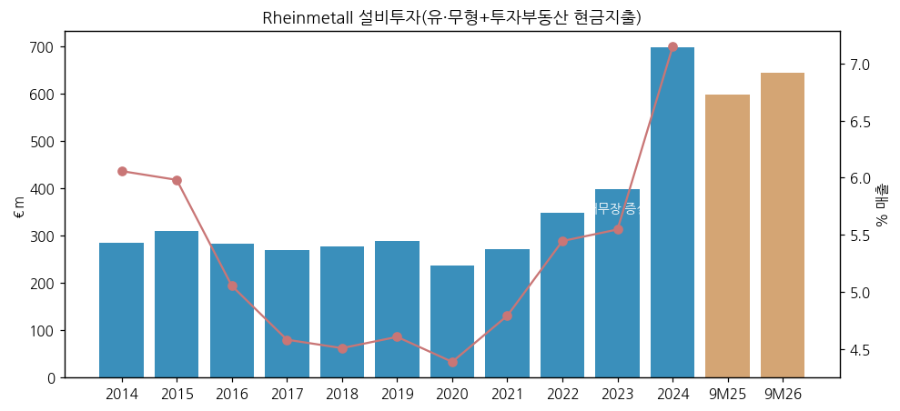

(5) 부채 구조

→ 2023-02 전환사채 €1.0bn (2030 만기) → 2025~2026-07 전량 전환 (주식수 43.4m → 46.8m)
→ 2026-01 클럽딜 €1.5bn (NVL 리파이낸싱, €1.0bn 인출) / 2026-05 회사채 €500m (2031, 3.375%, 7.8배 청약)
→ 2026-11 신디케이트 RCF €1.5bn으로 2배 증액 (Nachtragsbericht)
→ Schuldschein 조기상환 €378m (2026)

(6) 배당·자사주 + chart9

→ 배당성향 ~40~45% (2024 39.0%, 2025 45.5%) — 2025분 DPS €11.50 (2026-05-15 지급 €535m)
→ 자사주 매입 프로그램 없음 (주주환원 = 배당 단일)

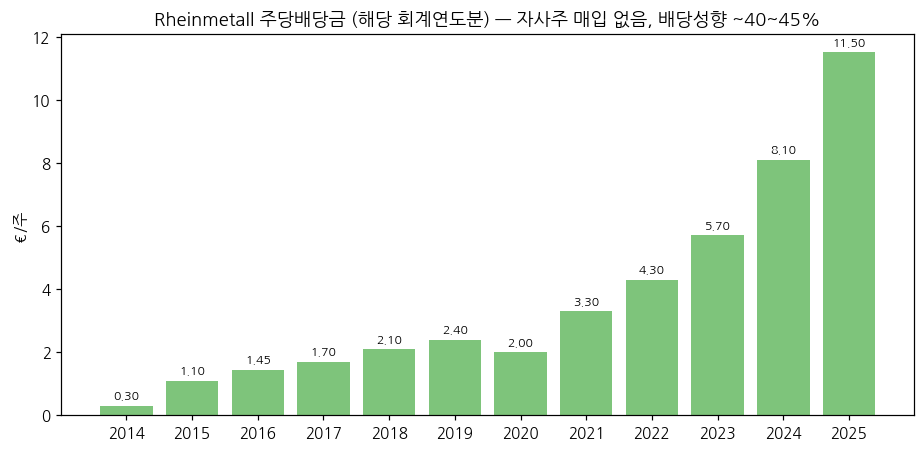

(7) 재무비율 [계산]

| 연도 | ROE (세후/기말자본) | ROA | 부채비율 | ROCE (회사) |
|---|---|---|---|---|
| 2018 | 16.3% | 5.2% | 211% | 17.1% |
| 2020 | 0.0% | 0.0% | 254% | 11.8% |
| 2022 | 17.5% | 6.7% | 162% | 21.4% |
| 2023 | 16.1% | 5.0% | 221% | 21.4% |
| 2024 | 18.1% | 5.6% | 221% | 26.4% |
| 2025 | 14.9% | 5.0% | 199% | — |

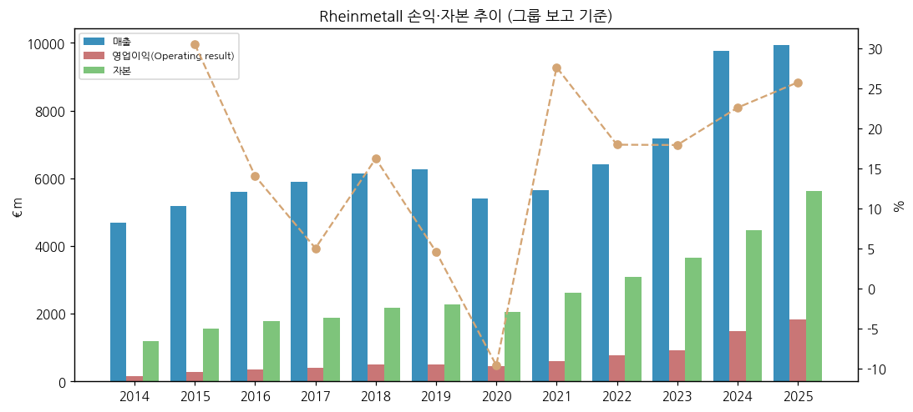

---

## ⑤ 지배 구조

(1) 그룹·계열 관계

→ 지배주주 없음 (분산 소유). 주요 JV: **ARTEC** (Boxer, KNDS 공동), **PSM** (Puma, KNDS 공동), **RMMV** (트럭), **Leonardo Rheinmetall Military Vehicles** (이탈리아 Panther·Lynx), **OHB Rheinmetall Space Networks** (50:50, 2026-11), Rheinmetall Unmanned Vehicles (DOK-ING 51%)
→ 해외 거점: American Rheinmetall (미국, 2026-01 별도 사업부), Rheinmetall Expal (스페인), Rheinmetall Denel Munition (남아공), Rheinmetall Hungary, Rheinmetall BAE Systems Land (영국 RBSL)

(2) 주주 구분 + chart5

→ 기관 58% (유럽 26% · 북미 24% · 기타 8%) / 개인 28% / 기타 14% / 자사주 0% (2025-12-31, 회사 의뢰 외부 분석)
→ 3% 이상 의결권 보유자 개별 명단은 미수집 (⚠️)

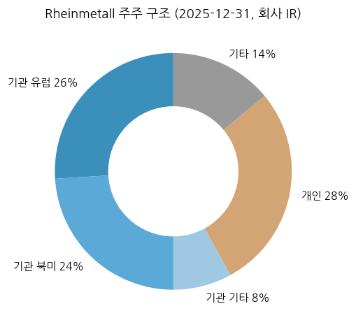

(3) 경영진

→ **CEO Armin Papperger** — 1990 입사, 2013 CEO. 계약 2029년 말까지. 3Q26 발표 수주 전 대규모 자사주 개인 매수 (Börsen-Zeitung)
→ 이사회 (Vorstand): Papperger, Klaus Neumann, Dr. Vera Saal, René Gansauge (HY 2026 기준)

---

## ⑥ 기타 팩트

(1) 시가총액·밸류에이션 스냅샷 (2026-11-13)

→ 주가 €765.5 / 시총 ≈ €35.8bn [계산] / EV ≈ €39.5bn [계산]
→ EV / 2026G OP ≈ 16x, P/E (2025 계속 EPS) ≈ 34x [계산]

(2) R&D + chart7

→ Defence 사업부 R&D: 2014 €65m → 2020 €180m (매출 대비 2.9% → 4.8%). 2021 이후 사업부별 R&D 미공시 (❌)

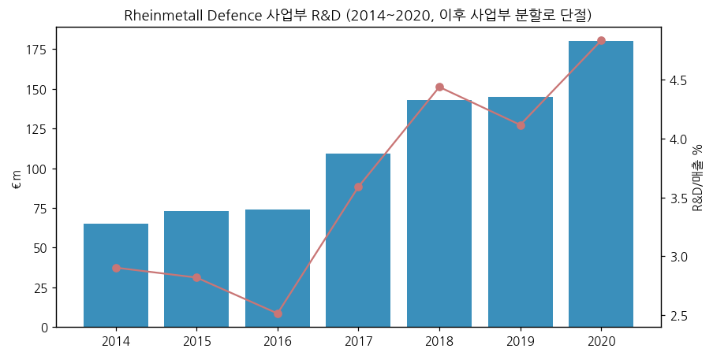

(3) 진행 중 corporate action

→ 민수(Power Systems) 매각 — AEQUITA, 잠정가 €350m, 4Q26 종결 목표
→ Mangalia 조선소(루마니아) 인수 — MSC와 공동, ~€138m, 당국 승인 대기
→ 미국 정밀미사일 협력 LOI (Unterlüß), 유럽 경쟁사 군용차량 사업 인수 추진 보도 (boerse.de) — 회사 미확인
→ CMD 2026-11-26~27 — 2030 목표(매출 ~€50bn = VS 13~15 · W&A 14~16 · DS 8~10 · AD 3~4 · Naval ~5 + M&A) 재검토

(4) 주요 리스크

→ **계약 타이밍** — Arminius·SATCOMBw 등 독일 의회 예산위 승인 지연 → 매출·선수금 이연 (2026 2회 하향)
→ **탄약 수요 정점** — 우크라이나 휴전 시 155mm 단기 수요 둔화, 포탄 로트 인수시험 지연 (3Q26 W&A OPM 22.9%)
→ **원자재** — 텅스텐 가격 급등(수출제한), 중국 이중용도 수출통제 (2026-07, 회사는 재고로 영향 제한)
→ **운전자본·부채** — 9M26 FCF -€1.7bn, 순차입 €2.9bn
→ **Naval 집행** — F126 취소 선례, 조선 마진 10%대

(5) ESG

→ 방산 기업으로 일부 ESG 펀드 편입 제외 이력. EU 택소노미 비해당. 지속가능성 보고서 미수집 (⚠️)

(6) 인증·라이선스

→ 독일 전쟁무기통제법·대외무역법 수출허가 대상 (제3국 수출은 연방안보회의 승인)

---

## Version Log

→ **v1.0** (2026-11-14) — 초안. AR 4개년 + 분기 보고서 9건 + FY2025 보도자료·PK + Pre-close Recap 수집. 12년 연간(그룹 보고 + 방산 기준) + 16분기 방산 기준 + 7분기 사업부(2026 신구조) + 12종 차트. 한국 5사 경쟁 매핑
→ **잔여 보완 (v1.1)**: CMD(11/26~27) 2030 목표 변경 반영 / AR 2025 연결본(2025 OCF·CapEx·R&D) / Q3 2026 트랜스크립트 / 3% 이상 주주 명단 / FY2026 확정치(2027-03-11)
