> Ticker: **NYSE: RTX — RTX Corporation** (구 Raytheon Technologies, 2023-07 사명 변경 / 그 이전 United Technologies Corporation, UTC)
> Entity: **RTX Corporation** (본사 Arlington, Virginia, USA) — 2020-04-03 UTC 항공우주 부문(Collins Aerospace·Pratt & Whitney)과 Raytheon Company가 합병해 출범한 세계 최대급 항공우주·방산 기업. 3개 사업부: **Collins Aerospace (항공 부품·시스템)**, **Pratt & Whitney (항공 엔진)**, **Raytheon (방산 — 방공·미사일·레이더)**
> Sector: 방산 — 서브섹터 **방산 글로벌** (한국 방산 5사와 비교: 패트리어트·LTAMDS ↔ LIG D&A 천궁-II·한화시스템 MFR / AMRAAM 등 유도무기 ↔ LIG D&A / Pratt 엔진 ↔ 한화에어로스페이스 항공엔진 부품)
> 작성 시각: **2026-11-14 KST** (**v1.0** — Phase 1 Source 전수 수집 + audit + 11종 차트)
> 적용 구조: v4.8 (6개 섹션) — 서술은 간결형 (BT 지시, 2026-11-14)
> 데이터 범위: **연간 12년 (FY14~FY25, 12월 결산)** — FY14~FY19 = UTC 보고 기준(Otis·Carrier 포함, FY19는 합병 전) / FY20~ = RTX + **분기 17Q (3Q22~3Q26, 2023-07 3사업부 재편 기준)** + **주가 20년 (2006-12~2026-11, Yahoo Finance)**
> 출처: **SEC EDGAR** — 10-K 13건 (FY13~FY25), 10-Q 39건 (1Q14~3Q26, 최신 2026-10-20), 8-K 40건 (2023~2026) + SEC XBRL companyfacts API / **RTX 보도자료** (rtx.com, 3Q26 2026-10-20·4Q25 2026-01-27) / **3Q26 컨퍼런스콜 트랜스크립트** (Webull 게재본) / **Yahoo Finance v8** RTX 월간·일간
> 다음 실적: **4Q26·2027 가이던스 — 2027-01 하순 예정** (회사 "1월에 2027 전망 제시", 3Q26 컨콜)

# RTX 기업 개요 (v1.0 — 방산 글로벌 / 민항 51%·방산 49%의 혼합형, 방산 수주 폭증 국면)
> **Fact verify cutoff**: 2026-11-14 (주가 2026-11-13 종가 **$198.58**, 52주 고가 $226.88 · 저가 $166.74 [Yahoo Finance v8 meta, 2026-11-13] / 시가총액 **약 $268.0B** [계산: $198.58 × 발행주식 1,349.4M주 (10-Q 표지, 2026-09-30 기준)] / ATH 월간 고가 $226.88 (2026-08) [Yahoo Finance])

## Phase 1 Source Audit

```
=== 자료 수집 audit (RTX Corporation) ===

✅ 확보 (저장: company-overview-source/RTX_RTX Corp/ (MCP 자동 폴더) + company-overview-source/RTX/_work/)
- 10-K 13건 (FY13~FY25), 10-Q 39건 (1Q14~3Q26) — 텍스트 변환본 _work/txt/
- 8-K 40건 (2023-01~2026-10, 표지 문서) — 실적 보도자료(Ex.99)는 www.sec.gov 403 → rtx.com 보도자료 웹 조회로 대체 (3Q26·4Q25)
- SEC XBRL companyfacts (연간 손익·재무상태·현금흐름 12년)
- 3Q26 컨퍼런스콜 Q&A (Webull 게재 트랜스크립트, 애널리스트 12명)
- Yahoo Finance v8 RTX 월간 20년 + 일간 3개월

❌ 누락 (4)
- 실적 보도자료 원문 PDF/HTM (SEC Ex.99 403) → 조정(Adjusted) 지표는 rtx.com 보도자료·컨콜로만 확보, 2022~2Q25 분기 조정 EPS는 이번 세션 원문 미대조 ⚠️
- Motley Fool 트랜스크립트 (MCP 호출 응답 시간 초과)
- 주주 구성 (13F·Proxy 기관 지분) → chart5 미작성
- 사업부별 R&D·CapEx 분기 분해, 분기 4Q23 고객유형별 매출

⚠️ 결과 영향
- 12년 시계열에 구조 단절 2회: ① 2015 Sikorsky 매각(FY14 재작성), ② 2020-04 합병 + Otis·Carrier 분사 (FY19 이전 = UTC 연결)
- 분기 사업부: 3Q22~3Q26 17분기 (2023-07 RIS+RMD → Raytheon 통합 재편, 3Q22~2Q23은 재작성 비교치). 2020~2Q22 4사업부 구조는 연간만
- 부채총계 = 자산 − 자본총계(비지배 포함) [계산]. FY25 차입금은 10-Q 공시 총차입금
- 시총·비율은 [계산] 표시

Source 6종 audit:
[V] (1) 정기 보고서 (10-K·10-Q 12년) ✓
[△] (2) IR 보도자료 (최신 2개 분기만 원문, 그 외 10-Q로 대체)
[V] (3) 컨콜 (3Q26) ✓
[V] (4) 주가 (Yahoo 20년) ✓
[✗] (5) 주주 구성 ✗
[V] (6) 12년 시계열 ✓ (구조 단절 주석)
→ 4.5/6. 최신 분기(3Q26, 2026-10-20) 확보 — 최근 분기 누락 없음
```

---

## ① 기업 분류

(1) Primary / Secondary 분류

**Primary: 지속성장 (방산 장기계약 + 민항 애프터마켓)**

→ 합병 후 FY20 → FY25 매출 $56.6B → $88.6B, CAGR **+9.4%** [계산]. FY20(코로나)·FY23(GTF 분말금속 충당 -$2.9B)의 두 번의 이익 저점은 업황 사이클이 아니라 외부 충격·기업 고유 품질 이벤트

→ 2026년 가이던스를 세 번 올렸다: 조정 매출 $92~93B(1월) → $97.0~97.5B(10월), 조정 EPS $6.60~6.80 → $7.65~7.75 (회사 보도자료)

**Secondary: 사이클 (민항 OE·애프터마켓 + 방산 예산)**

→ 매출의 49%가 민항(3Q26 고객유형 기준, 10-Q) — 항공 교통량·항공기 인도에 연동되는 사이클 업종 성격

→ 방산은 미국 국방예산(DoW)·동맹국 재무장에 연동. 3Q26 방산 수주 $59B로 수주 사이클이 상단 [판단]

**사업부 구조 (FY25, GAAP 사업부 영업이익, 10-K)**

→ (1) **Pratt & Whitney** — 매출 $32.9B (36%), 영업이익 $2.60B, OPM 7.9% — GTF·V2500 민항 엔진 + F135(F-35)·F119·F117 군용 엔진
→ (2) **Collins Aerospace** — 매출 $30.2B (33%), 영업이익 $4.92B, OPM 16.3% — 항공전자·기계·내장·동력 시스템, 방산 통신·센서
→ (3) **Raytheon** — 매출 $28.0B (31%), 영업이익 $3.23B, OPM 11.5% — **패트리어트·LTAMDS·NASAMS·SM-3/6·토마호크·AMRAAM·AIM-9X·SPY-6** (방산 100%)
→ 사업부 합계 $91.2B − 내부거래 $2.6B = 연결 $88.6B

(2) Summary Box (FY20~FY25 RTX 6년 + UTC 포함 12년)

| 지표 | 값 |
|---|---|
| 매출 CAGR | FY20→FY25 **+9.4%/yr** / FY21→FY25 +8.3%/yr [계산] |
| OPM 평균 (GAAP) | FY20~FY25 **6.1%** / FY14~FY25 9.9% (UTC 시절 12~17% 포함) [계산] |
| OPM 정점 | FY25 **10.5%** (RTX 출범 후 최고) / UTC FY14 16.6% |
| OPM 저점 | FY20 **-3.3%** (코로나, 합병 회계) · FY23 5.2% (GTF 분말금속) |
| 이익 단절 원인 | 업황 사이클 1회(FY20 코로나) + 기업 고유 1회(FY23 GTF) |
| 3Q26 실적 | 매출 $25.0B (+11.1%), GAAP 영업이익 $3.34B (OPM 13.4%), 조정 EPS $2.26 (+33%) |

```
[RTX 12년 손익 시계열 ($M, 12월 결산, GAAP)]
연도   매출     영업이익  OPM    순이익(지배)
FY14   57,900   9,593   16.6%   6,220  ← UTC (Otis·Carrier·UTAS·P&W), Sikorsky 중단사업 재작성
FY15   56,098   7,291   13.0%   7,608  ← Sikorsky 매각($9B) 차익 순이익 반영, $10B ASR
FY16   57,244   8,172   14.3%   5,055
FY17   59,837   8,672   14.5%   4,552
FY18   66,501   8,553   12.9%   5,269  ← 2018-11 Rockwell Collins 인수 (Collins Aerospace 출범)
FY19   77,046   8,966   11.6%   5,537  ← UTC 마지막 해 (합병 기준 재작성 시 매출 45,349)
FY20   56,587  -1,889   -3.3%  -3,519  ← 2020-04 Raytheon 합병·Otis/Carrier 분사, 코로나 민항 붕괴, 영업권 손상
FY21   64,388   4,958    7.7%   3,864  ← 민항 회복 시작
FY22   67,074   5,504    8.2%   5,197
FY23   68,920   3,561    5.2%   3,195  ← GTF 분말금속 충당 $2.9B, 2023-07 3사업부 재편·RTX 사명
FY24   80,738   6,538    8.1%   4,774  ← 법적 사안 합의 $0.9B·Raytheon 계약해지 $0.4B(세후) 차감
FY25   88,603   9,300   10.5%   6,732  ← 사상 최대, 수주잔고 $268B
```

**글로벌 방산 피어·한국 5사 대비 (FY25, 각사 주 지표, 참고)**

→ RTX 연결 OPM 10.5% (GAAP) — 방산 단독(Raytheon) 11.5%, 민항 Collins 16.3%가 끌어올림
→ 한국 방산 5사는 수출 마진으로 OPM 15~28%대(현대로템 방산 28%, 한화에어로 지상방산 20%대 — 각 사 3Q26 리뷰). **Raytheon의 방산 마진은 한국 수출형 대비 낮지만 미 정부 원가가산형 계약 비중이 커 변동성이 작다** [판단]

(3) 산업 분류
→ GICS Industrials / Aerospace & Defense, S&P 500
→ 워치리스트: 섹터 방산 / 서브섹터 방산 글로벌

(4) 분류 결정 논리
→ 매출 기준은 민항(51%) ≈ 방산(49%) 양분 → 이익 기준으로 보면 FY25 사업부 이익의 46%가 Collins, 30%가 Raytheon, 24%가 P&W [계산]
→ 두 축(민항 애프터마켓·방산 장기계약) 모두 구조적 성장 + 수주잔고 $340B(매출 3.5년치) → **Primary 지속성장**, 민항·예산 사이클은 Secondary
→ 섹터 비교 시에는 **Raytheon 부문만 떼어 방산 피어(LMT·NOC·GD·한국 5사)와 비교**하는 것이 원칙 [판단]

(5) 적정 밸류에이션 방법
→ **1차 Forward PER (조정 EPS)**: 2026 가이던스 중간값 $7.70 기준 **약 25.8배** [계산: $198.58 / $7.70]
→ **2차 SOTP**: Raytheon(방산 피어 멀티플) + Collins·P&W(민항 엔진·부품 피어 GE Aerospace·Safran 멀티플)
→ **3차 P/FCF**: 2026 FCF 가이던스 $9.0~9.2B → 시총 대비 약 29배 [계산]
→ PBR 미사용: 합병 영업권·무형자산이 자본의 대부분이라 의미 낮음

(6) 분류 재평가 트리거
→ ① GTF 관련 고객 보상·AOG가 다시 늘어 P&W 이익이 2개 분기 연속 역성장 → Secondary 사이클 격상
→ ② 방산 수주(B/B)가 4개 분기 연속 1.0 미만 + 방산 잔고 감소 전환 → 방산 수주 사이클 정점 통과 신호
→ ③ 민항 애프터마켓 성장률이 한 자릿수 초반으로 꺾임 → 민항 사이클 하강 반영

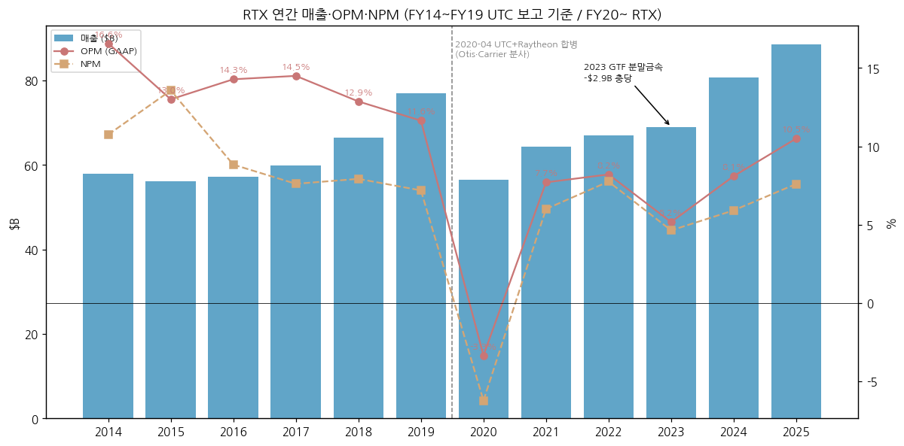

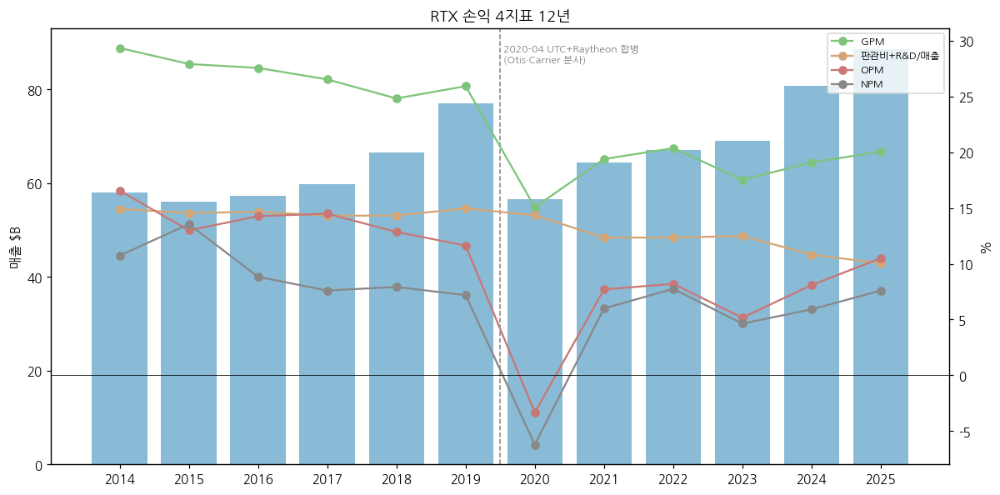

---

## ② 회사 개요

(1) 기본 정보
→ 법인명: RTX Corporation (Delaware) / 본사 1000 Wilson Blvd, Arlington, Virginia
→ 상장: NYSE RTX (S&P 500) / 12월 결산
→ 사업 한 줄 정의: **민항기 엔진·부품(Pratt·Collins)과 미사일·방공·레이더(Raytheon)를 함께 만드는 미국 최대 방산·항공우주 기업** — 비유하면 "비행기의 심장(엔진)과 신경(항공전자), 그리고 하늘을 지키는 방패(패트리어트)를 한 회사가 만든다"
→ CEO: **Christopher T. Calio** (회장 겸 CEO) / CFO: **Neil G. Mitchill Jr.** (10-Q 서명) / P&W 신임 사장 Jill Albertelli (2027-01-01, Leeham News)
→ 직원: 약 **180,000명** (2025-12말, 엔지니어 약 54,000명, 10-K)
→ 최대 고객: **미국 정부** (FY25 매출 $33.3B, 38%, FMS 제외 — 10-K)

(2) 핵심 KPI (FY25 + 3Q26 + 2026 가이던스)

| 항목 | FY25 | 3Q26 | 9M26 | 2026 가이던스 (10/20 상향) |
|---|---|---|---|---|
| 매출 ($B) | 88.6 | 25.0 | 71.7 | 97.0~97.5 (유기 +10~11%) |
| GAAP 영업이익 ($M) | 9,300 | 3,337 | 8,703 | — |
| OPM (GAAP) | 10.5% | 13.4% | 12.1% | — |
| 조정 EPS ($) | 6.29 | 2.26 | 5.93 | 7.65~7.75 |
| GAAP 희석 EPS ($) | 4.96 | 1.89 | 4.96 | — |
| FCF ($B) | 7.9 | 2.1 | — | 9.0~9.2 |
| 수주잔고 ($B) | 268 (방산 107) | 340 (방산 164) | — | — |

→ (출처: 10-K FY25, 10-Q 3Q26, 보도자료 2026-01-27·2026-10-20. 9M 조정 EPS = 1.78+1.89+2.26 [계산])

(3) 주요 연혁
→ **1934** United Aircraft 분할 설립 (Pratt & Whitney 계보 1925~) → 1975 United Technologies(UTC)로 사명 변경
→ **1922/1950s** Raytheon Company (1922 설립) — 1950년대 Sparrow·Hawk, 1980년대 **패트리어트** 개발
→ **2012** Goodrich 인수 → UTC Aerospace Systems
→ **2015** Sikorsky를 Lockheed Martin에 $9.0B 매각
→ **2018-11** Rockwell Collins 인수(약 $30B) → **Collins Aerospace** 출범
→ **2020-04-03** UTC가 Otis·Carrier 분사 후 Raytheon Company와 합병 → **Raytheon Technologies** 출범 (4사업부: Collins·P&W·RIS·RMD)
→ **2023-07** RIS+RMD → **Raytheon** 통합 3사업부 재편, 사명 **RTX** / GTF 분말금속 이슈 공표, 3Q23 $2.9B 충당
→ **2023-10** $10B ASR 포함 $11B 자사주 매입 프로그램
→ **2024** 사이버보안 사업(CIS) 매각, 수출통제·FCPA 관련 법적 사안 합의 (DPA)
→ **2025** Collins 작동·비행제어(actuation) 사업 매각($1.2B 수취분, 10-Q), Simmonds Precision 매각
→ **2026-3Q** 토마호크 약 $23B·AMRAAM $14.3B 다년 계약 → 분기 방산 수주 $59B, 수주잔고 $340B (사상 최대)

(4) 주가 역사

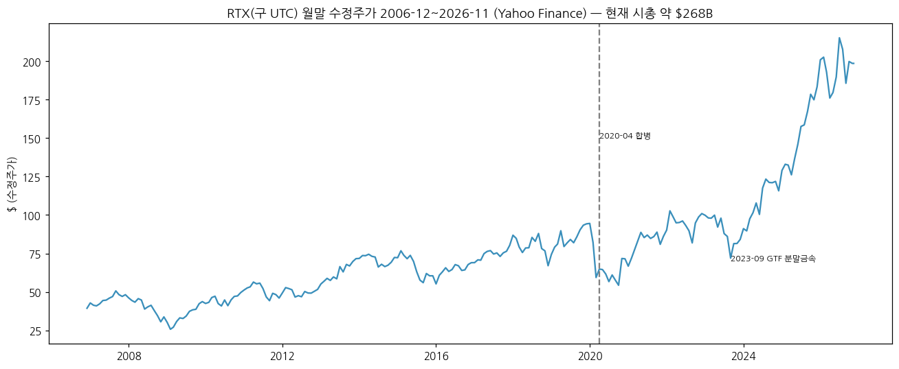

```
[주가 국면] (Yahoo Finance 수정주가, 월말 종가)
[2006~2019] UTC 복합기업 — $40~95 박스, 2019-12 $94.3
[2020-03~2020-12] 합병 + 코로나 민항 붕괴 — 2020-12 $71.5
[2021~2022] 민항 회복·방산 안정 — 2022-12 $100.9
[2023-07~2023-10] GTF 분말금속 — 2023-12 $84.1 (하락)
[2024~2025] 방산 수요(우크라이나·중동) + 민항 애프터마켓 — 2024-12 $115.7 → 2025-12 $183.4 (+58%)
[2026] 2026-08 월고가 $226.88 (ATH) → 2026-09 $185.7 조정 → 2026-11-13 $198.58 (ATH 대비 -12.5% [계산])
```

---

## ③ 비즈니스 모델

(1) 실적 추이 통합 표 ($M)

| 항목 | FY22 | FY23 | FY24 | FY25 | 9M26 |
|---|---|---|---|---|---|
| **매출** | **67,074** | **68,920** | **80,738** | **88,603** | **71,749** |
| Collins Aerospace | 23,052 | 26,253 | 28,284 | 30,196 | 24,194 |
| Pratt & Whitney | 20,530 | 18,296 | 28,066 | 32,916 | 26,293 |
| Raytheon | 25,176 | 26,350 | 26,713 | 28,043 | 23,245 |
| 내부거래·기타 | -1,684 | -1,979 | -2,325 | -2,552 | -1,983 |
| **사업부 영업이익 (OPM)** | | | | | |
| Collins Aerospace | 2,816 (12.2%) | 3,825 (14.6%) | 4,135 (14.6%) | 4,923 (16.3%) | 4,402 (18.2%) |
| Pratt & Whitney | 1,075 (5.2%) | -1,455 (-8.0%) | 2,015 (7.2%) | 2,596 (7.9%) | 2,056 (7.8%) |
| Raytheon | 2,448 (9.7%) | 2,379 (9.0%) | 2,594 (9.7%) | 3,227 (11.5%) | 3,016 (13.0%) |
| FAS/CAS 조정 | 1,399 | 1,127 | 833 | 753 | 514 |
| 인수회계 조정 | -1,893 | -1,998 | -2,058 | -2,005 | -1,393 |
| **연결 영업이익 (OPM)** | **5,504 (8.2%)** | **3,561 (5.2%)** | **6,538 (8.1%)** | **9,300 (10.5%)** | **8,703 (12.1%)** |
| **고객유형별 매출** | | | | | |
| 미국 정부 (FMS 제외) | — | 31,628 | 32,246 | 33,279 | 26,143 |
| FMS (미 정부 경유 수출) | — | — | 5,765 | 6,702 | 5,936 |
| 해외 정부 직접 (DCS) | — | — | 5,317 | 6,123 | 5,003 |
| **방산 합계 (회사 공시 3항목 합)** | — | — | **43,328 (53.7%)** | **46,104 (52.0%)** | **37,082 (51.7%)** |
| 민항·기타 상업 | — | — | 37,410 | 42,499 | 34,667 |
| 수주잔고 ($B, 연말) | 175 | 196 | 218 | 268 | 340 (9월말) |
| 그중 방산 ($B) | 69 | 78 | 93 | 107 | 164 |

→ (출처: 10-K FY23~FY25 사업부 표(3사업부 재작성), 10-Q 3Q26. 방산 합계 = 미국 정부 + FMS + 해외정부 직접 판매 [계산]. FY23 FMS·DCS는 10-K 표 구조 차이로 미기재)
→ **사업부 매핑**: 2020-04~2023-06 = Collins·P&W·RIS(정보·우주)·RMD(미사일·방공) 4사업부 → 2023-07 RIS+RMD를 **Raytheon**으로 통합, 일부 RIS 사업은 Collins로 이관 (Collins FY22 매출 20,597 → 재작성 23,052)
→ **방산 노출 정의**: Raytheon(방산 100%) + Collins 방산(3Q26 약 $2.2B) + P&W 군용(3Q26 약 $2.6B) [계산: 10-Q 사업부×고객유형 표]. 회사 공시 "방산 수주"도 이 3곳 합계

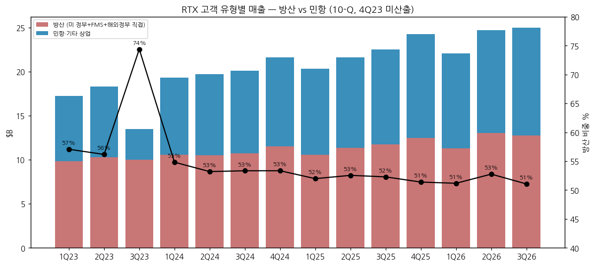

(2) 사업부별 개요

**Pratt & Whitney — 매출 36% (9M26)**
"여객기·전투기의 엔진을 만들고, 이후 수십 년간 정비로 돈을 버는 사업부."
→ 민항 대형 엔진: **GTF(PW1000G)** — A320neo·A220·E2, 2,600대 이상·90여 운영사 / V2500 (A320ceo, 애프터마켓 핵심) / GTF Advantage 인증(2025)
→ 군용 엔진: **F135** (F-35 독점), F119 (F-22), F117 (C-17), B-21 엔진, 차세대 적응형 엔진 XA103 (NGAP)
→ P&W Canada: PW100·PT6 소형·리저널 엔진
→ 최대 민항 고객 Airbus (P&W 매출의 29%, FY25). 협업 파트너 지분 13~49% (10-K)

**Collins Aerospace — 매출 34%**
"비행기의 항공전자·비행제어·랜딩기어·좌석·전력 장치를 만드는 부품 백화점."
→ Avionics·Interiors·Mission Systems·Power & Controls — 민항 OE + 애프터마켓 + 방산 통신·센서
→ 최대 고객 Boeing·Airbus (합계 Collins 매출의 16%, FY25)

**Raytheon — 매출 32% (방산 100%)**
"적 미사일·항공기를 찾아내고(레이더) 맞혀 떨어뜨리는(요격·유도탄) 무기를 만드는 사업부."
→ **지상 방공**: **패트리어트** (GEM-T 요격탄, 시스템), **LTAMDS** (패트리어트 차세대 360° GaN 레이더, 미 육군·폴란드 LRIP), **NASAMS** (Kongsberg 공동), Coyote(대드론), LIDS
→ **해군**: **SM-3·SM-6·ESSM**, **토마호크**, **SPY-6** 레이더, NGJ 재머
→ **공중**: **AMRAAM**, **AIM-9X**, StormBreaker, LRSO
→ **센서·우주**: AN/TPY-2, 조기경보레이더, 위성·고에너지 레이저
→ 수주잔고 **$130B** (2026-09말, 2025말 $75B) — 해외 비중 37% (토마호크·AMRAAM 제외 시 52%, 3Q26 컨콜)

(3) 사업부별 디테일 (3Q26 기준)
→ 잘나가는 것: **Raytheon 패트리어트·SM·토마호크** (3Q 유기 매출 +$1.0B, 해군 +$0.5B·지상방공 +$0.3B), **Collins 민항 OE·애프터마켓** (OPM 21.3%), **P&W 민항 애프터마켓** (+$0.9B)
→ 성장 기대: 토마호크·AMRAAM 등 다년 프레임 계약 약 $70B → "10년 가시성, 생산율 2~4배" (컨콜) / 핵심 유도탄 생산량 YTD +90%
→ 이익 outlier: Collins 3Q 관세 환급 약 $0.25B / P&W 3Q 고객 파산 충당 약 $0.4B (GAAP, 조정 제외)

(4) 주요 경쟁사 (한국 5사 매핑 포함)

| 사업 | 글로벌 경쟁사 | **한국 방산 5사와 겹침** |
|---|---|---|
| 지상 방공 (패트리어트·LTAMDS·NASAMS) | Lockheed Martin (PAC-3 MSE 요격탄), MBDA (SAMP/T), Diehl (IRIS-T SLM), Rafael (아이언돔·다윗의 돌팔매), Kongsberg | **LIG D&A 천궁-II (M-SAM)** + **한화시스템 MFR(다기능 레이더)** — UAE·사우디·이라크 등 **중동 방공 시장에서 패트리어트와 직접 경쟁**. 천궁-II는 가격·납기, 패트리어트는 실전 검증·미국 동맹 체계가 강점 [판단] |
| 레이더 (LTAMDS·SPY-6·TPY-2) | Lockheed, Northrop, Thales, Hensoldt, Elta | **한화시스템** (천궁 MFR, 함정 다기능레이더) |
| 유도탄 (AMRAAM·AIM-9X·SM·토마호크) | Lockheed, MBDA (Meteor), Kongsberg (NSM·JSM), Diehl (IRIS-T) | **LIG D&A** (유도무기 전 영역) — 한국군은 AMRAAM·AIM-9X 구매처이자 국산화 대체 경쟁 관계 [판단] |
| 군용 엔진 (F135·F119) | GE Aerospace (F414·F110), Rolls-Royce, Safran | **한화에어로스페이스** — GE F414 라이선스(KF-21) 생산, P&W 엔진 부품 공급망 참여 → **경쟁자이자 공급망 파트너** [판단] |
| 민항 엔진 (GTF·V2500) | CFM (GE·Safran LEAP), Rolls-Royce (Trent) | 한화에어로 (부품·RSP), 직접 경쟁 아님 |
| 항공 부품 (Collins) | Honeywell, Safran, Thales, GE | KAI (기체 구조물) 일부 |

(5) 주요 매출처
→ 1. **미국 정부** (DoW·육해공군·MDA) — FY25 $33.3B (38%), FMS 포함 시 $40.0B (45%) [계산]
→ 2. **Airbus** — P&W 매출의 29% (FY25), Collins 주요 고객
→ 3. **Boeing** — Collins 주요 고객
→ 4. **해외 정부 직접** — FY25 $6.1B: 폴란드·네덜란드·독일·사우디·카타르·UAE·일본·호주 등 패트리어트·NASAMS·SM 고객 [추정]
→ 5. 항공사·리스사 (애프터마켓 — GTF 장기 정비계약 약 80%가 장기, 3Q26 컨콜)

(6) 생산 CAPA + 임직원
→ 임직원 약 180,000명 (2025말) / 엔지니어 54,000명
→ 핵심 유도탄 생산 YTD +90%, 2025년 신규 협력사 150곳 추가, Asheville 주조 설비 투자, Forest(미시시피) $50M 증설 (3Q26 컨콜)
→ GTF MRO 처리량 +35% YoY (3Q26), GTF 정비 거점 21곳 (10-K)

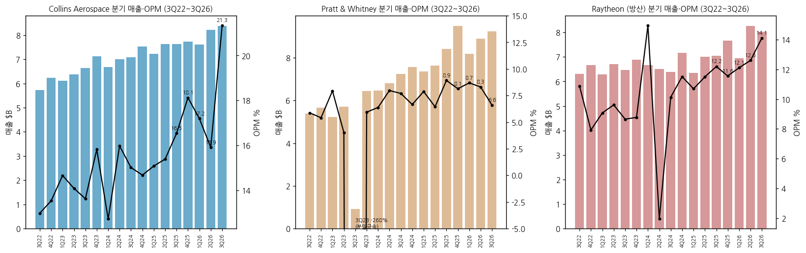

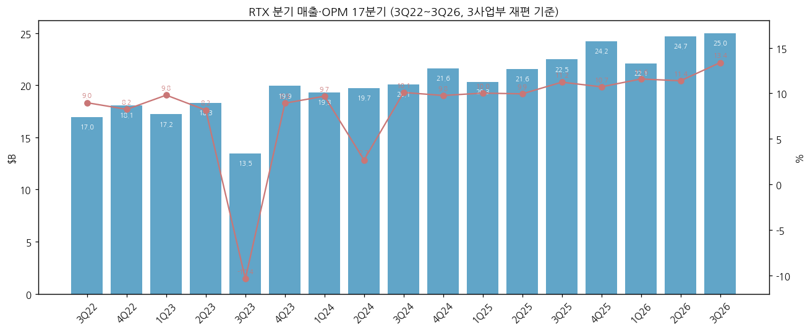

**분기 시계열 ($M, GAAP — 3사업부 재편 기준)**

| 분기 | 매출 | 영업이익 | OPM | Collins 매출/OPM | P&W 매출/OPM | Raytheon 매출/OPM | 조정 EPS | 메모 |
|---|---|---|---|---|---|---|---|---|
| 3Q22 | 16,951 | 1,520 | 9.0% | 5,718 / 13.0% | 5,380 / 5.9% | 6,308 / 10.9% | 1.21⚠️ | 재작성치 |
| 4Q22 | 18,093 | 1,491 | 8.2% | 6,231 / 13.5% | 5,652 / 5.4% | 6,661 / 7.9% | 1.27⚠️ | [계산] FY−9M |
| 1Q23 | 17,214 | 1,687 | 9.8% | 6,120 / 14.7% | 5,230 / 7.9% | 6,292 / 9.1% | 1.22⚠️ | |
| 2Q23 | 18,315 | 1,493 | 8.2% | 6,384 / 14.1% | 5,701 / 4.0% | 6,700 / 9.6% | 1.29⚠️ | |
| 3Q23 | 13,464 | -1,396 | -10.4% | 6,629 / 13.6% | 926 / -268% | 6,472 / 8.7% | 1.25⚠️ | GTF 분말금속 -$2.9B |
| 4Q23 | 19,927 | 1,777 | 8.9% | 7,120 / 15.8% | 6,439 / 5.9% | 6,886 / 8.8% | 1.29⚠️ | |
| 1Q24 | 19,305 | 1,870 | 9.7% | 6,673 / 12.7% | 6,456 / 6.4% | 6,659 / 15.0% | 1.34⚠️ | Raytheon CIS 매각 이익 |
| 2Q24 | 19,721 | 529 | 2.7% | 6,999 / 16.0% | 6,802 / 8.0% | 6,511 / 2.0% | 1.41⚠️ | 법적 합의·Raytheon 계약해지 |
| 3Q24 | 20,089 | 2,028 | 10.1% | 7,075 / 15.0% | 7,239 / 7.7% | 6,386 / 10.1% | 1.45⚠️ | |
| 4Q24 | 21,623 | 2,111 | 9.8% | 7,537 / 14.7% | 7,569 / 6.7% | 7,157 / 11.5% | 1.54 | |
| 1Q25 | 20,306 | 2,035 | 10.0% | 7,217 / 15.1% | 7,366 / 7.9% | 6,340 / 10.7% | 1.47⚠️ | |
| 2Q25 | 21,581 | 2,146 | 9.9% | 7,622 / 15.4% | 7,631 / 6.4% | 7,001 / 11.5% | 1.56⚠️ | |
| 3Q25 | 22,478 | 2,523 | 11.2% | 7,621 / 16.5% | 8,423 / 8.9% | 7,045 / 12.2% | 1.70 | |
| 4Q25 | 24,238 | 2,596 | 10.7% | 7,736 / 18.1% | 9,496 / 8.1% | 7,657 / 11.6% | 1.55 | |
| 1Q26 | 22,076 | 2,555 | 11.6% | 7,602 / 17.2% | 8,173 / 8.7% | 6,945 / 12.1% | 1.78 | |
| 2Q26 | 24,708 | 2,811 | 11.4% | 8,210 / 15.9% | 8,889 / 8.3% | 8,269 / 12.6% | 1.89 | |
| **3Q26** | **24,965** | **3,337** | **13.4%** | **8,382 / 21.3%** | **9,231 / 6.6%** | **8,031 / 14.1%** | **2.26** | 관세 환급 +$0.4B, 고객 파산 -$0.4B |

→ (출처: 각 분기 10-Q 사업부 표 (3Q22~2Q23은 2023-10~2024-10 10-Q의 재작성 비교치), 4Q = 10-K 연간 − 9M [계산]. 사업부 합계 − 내부거래 = 연결 검산 일치. 조정 EPS는 회사 보도자료 — ⚠️ 표시는 이번 세션 원문 미대조(공개 보도치 기준))

---

## ④ 재무 구조

(1) 손익계산서 (12년, $M)

| FY | 매출 | 매출총이익 | GPM | 자체 R&D | SG&A | 영업이익 | OPM | 순이익 | NPM | 희석 EPS | DPS |
|---|---|---|---|---|---|---|---|---|---|---|---|
| FY14 | 57,900 | 17,002 | 29.4% | 2,475 | 6,172 | 9,593 | 16.6% | 6,220 | 10.7% | 6.82 | 2.36 |
| FY15 | 56,098 | 15,667 | 27.9% | 2,279 | 5,886 | 7,291 | 13.0% | 7,608 | 13.6% | 8.61 | 2.56 |
| FY16 | 57,244 | 15,784 | 27.6% | 2,337 | 6,060 | 8,172 | 14.3% | 5,055 | 8.8% | 6.12 | 2.62 |
| FY17 | 59,837 | 15,884 | 26.5% | 2,387 | 6,183 | 8,672 | 14.5% | 4,552 | 7.6% | 5.70 | 2.72 |
| FY18 | 66,501 | 16,516 | 24.8% | 2,462 | 7,066 | 8,553 | 12.9% | 5,269 | 7.9% | 6.50 | 2.84 |
| FY19 | 77,046 | 19,981 | 25.9% | 3,015 | 8,521 | 8,966 | 11.6% | 5,537 | 7.2% | 6.41 | 2.94 |
| FY20 | 56,587 | 8,531 | 15.1% | 2,582 | 5,540 | -1,889 | -3.3% | -3,519 | -6.2% | -2.59 | 2.16 |
| FY21 | 64,388 | 12,491 | 19.4% | 2,732 | 5,224 | 4,958 | 7.7% | 3,864 | 6.0% | 2.56 | 2.005 |
| FY22 | 67,074 | 13,668 | 20.4% | 2,711 | 5,573 | 5,504 | 8.2% | 5,197 | 7.7% | 3.50 | 2.16 |
| FY23 | 68,920 | 12,089 | 17.5% | 2,805 | 5,809 | 3,561 | 5.2% | 3,195 | 4.6% | 2.23 | 2.32 |
| FY24 | 80,738 | 15,410 | 19.1% | 2,934 | 5,806 | 6,538 | 8.1% | 4,774 | 5.9% | 3.55 | 2.48 |
| **FY25** | **88,603** | **17,789** | **20.1%** | **2,807** | **6,095** | **9,300** | **10.5%** | **6,732** | **7.6%** | **4.96** | **2.67** |

→ (출처: SEC XBRL companyfacts (각 연도 10-K 최초 또는 최신 재작성치). 매출원가 = 총비용 − R&D − SG&A [계산], GPM [계산]. 영업이익에는 기타수익·인수회계 상각 포함)
→ RTX 출범 후 GPM 15% → 20%, OPM -3% → 10.5%로 회복. UTC 시절(GPM 25~29%)과의 차이는 Otis·Carrier(고마진 상업) 분사 + 인수 무형자산 상각(연 $2.0B)

(2) 재무상태표 (12년, $M)

| FY | 자산총계 | 부채총계 [계산] | 자본총계 | 부채비율 | 현금 | 차입금 | 순차입금 |
|---|---|---|---|---|---|---|---|
| FY14 | 91,206 | 58,642 | 32,564 | 180% | 5,229 | 19,575 | 14,346 |
| FY15 | 87,484 | 58,640 | 28,844 | 203% | 7,075 | 19,499 | 12,424 |
| FY16 | 89,706 | 60,537 | 29,169 | 208% | 7,157 | 23,300 | 16,143 |
| FY17 | 96,920 | 65,499 | 31,421 | 208% | 8,985 | 27,093 | 18,108 |
| FY18 | 134,211 | 93,601 | 40,610 | 230% | 6,152 | 44,068 | 37,916 |
| FY19 | 139,716 | 95,485 | 44,231 | 216% | 7,378 | 41,284 | 33,906 |
| FY20 | 162,153 | 88,301 | 73,852 | 120% | 8,802 | 31,576 | 22,774 |
| FY21 | 161,404 | 86,740 | 74,664 | 116% | 7,832 | 31,351 | 23,519 |
| FY22 | 158,864 | 84,686 | 74,178 | 114% | 6,220 | 31,289 | 25,069 |
| FY23 | 161,869 | 100,459 | 61,410 | 164% | 6,587 | 43,638 | 37,051 |
| FY24 | 162,861 | 100,938 | 61,923 | 163% | 5,578 | 41,078 | 35,500 |
| **FY25** | **171,079** | **103,977** | **67,102** | **155%** | **7,435** | **37,904** | **30,469** |
| 2026-09 | 176,596 | 105,632 | 70,964 | 149% | 9,173 | 37,379 | 28,206 |

→ (출처: XBRL companyfacts, 2026-09는 10-Q 3Q26. 차입금 FY14~FY24 = LongTermDebt 태그(유동성 포함), FY25·2026-09 = 10-Q 총차입금. 자본총계는 비지배지분 포함)
→ 2023 부채 증가: $10B ASR 재원 차입. 신용등급 S&P BBB+(긍정적, 2026-05) / Moody's Baa1(긍정적, 2026-02)

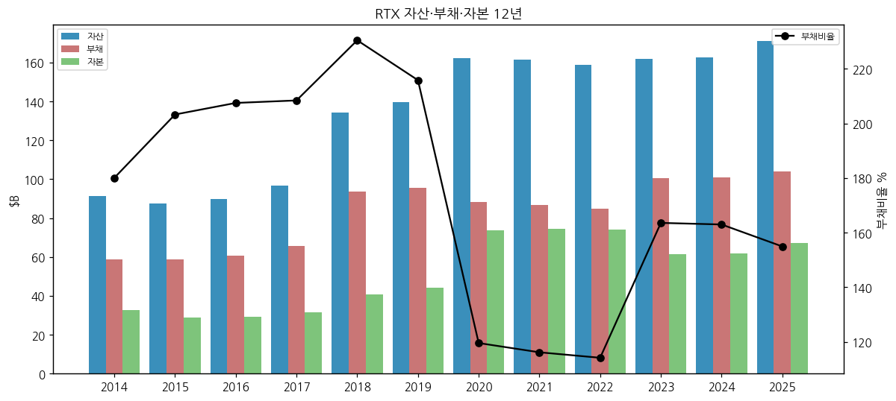

(3) 현금흐름표 (12년, $M)

| FY | 영업CF | 투자CF | 재무CF | 유형 CapEx | FCF [계산] |
|---|---|---|---|---|---|
| FY14 | 6,979 | -1,967 | -4,249 | 1,594 | 5,385 |
| FY15 | 6,755 | -2,794 | -10,776 | 1,652 | 5,103 |
| FY16 | 6,412 | -2,509 | -1,188 | 1,699 | 4,713 |
| FY17 | 5,631 | -3,019 | -993 | 2,014 | 3,617 |
| FY18 | 6,322 | -16,973 | 7,965 | 1,902 | 4,420 |
| FY19 | 8,883 | -3,092 | -4,564 | 2,256 | 6,627 |
| FY20 | 4,334 | 3,343 | -3,860 | 1,795 | 2,539 |
| FY21 | 7,142 | -1,364 | -6,756 | 2,134 | 5,008 |
| FY22 | 7,168 | -2,829 | -5,859 | 2,288 | 4,880 |
| FY23 | 7,883 | -3,039 | -4,527 | 2,415 | 5,468 |
| FY24 | 7,159 | -1,534 | -6,617 | 2,625 | 4,534 |
| **FY25** | **10,567** | **-1,265** | **-7,486** | **2,627** | **7,940** |
| 9M26 | 8,270 | -2,409 | -4,085 | — | — |

→ (출처: XBRL companyfacts (UTC 시절은 계속영업 기준), 9M26 10-Q. FY25 FCF $7,940M은 회사 발표치와 일치)
→ FY18 투자CF -$17.0B = Rockwell Collins 인수 / FY20 투자CF 플러스 = 합병 시 Raytheon 현금 편입

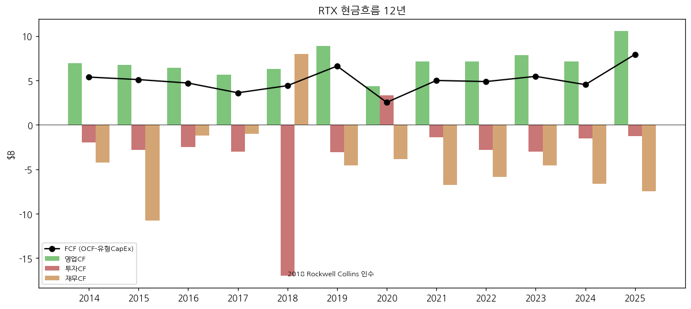

(4) CapEx
→ 유형 CapEx $1.6~2.6B/년, 매출 대비 3~4% — 자본 경량형. 무형(협업 권리·플랫폼 계약 대가) 연 $0.3~0.75B 별도
→ 9M26 CapEx는 전년 대비 +$0.3B (유도탄 증설, 10-Q)

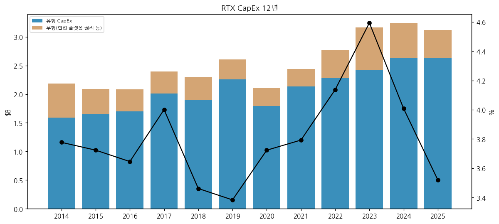

(5) 부채 구조
→ 총차입금 $37.4B (2026-09), 평균 이자율 4.5%, 2026-02 $0.5B 상환. $5.0B 리볼빙 한도(2031-08 만기) 미사용, CP 잔액 0 (10-Q)
→ 이자보상배율 (영업이익/순이자비용) FY25 5.3배 [계산]

(6) 배당·자사주

| FY | 배당 지급 | 자사주 매입 | 합계 | FCF 대비 |
|---|---|---|---|---|
| FY20 | 2,732 | 47 | 2,779 | 109% |
| FY21 | 2,957 | 2,327 | 5,284 | 106% |
| FY22 | 3,128 | 2,803 | 5,931 | 122% |
| FY23 | 3,239 | 12,870 | 16,109 | 295% |
| FY24 | 3,217 | 444 | 3,661 | 81% |
| FY25 | 3,574 | 50 | 3,624 | 46% |

→ (출처: XBRL companyfacts, [계산]) / 2023-10 $11B 프로그램 중 잔여 약 $0.6B, 3Q26 매입 없음 (10-Q)
→ FY24 이후 자사주를 거의 멈추고 차입 축소·배당 증액에 집중. 배당 성향 조정 EPS 기준 42%, GAAP 기준 54% [계산: DPS 2.67 / FY25 조정 EPS 6.29 · GAAP EPS 4.96]

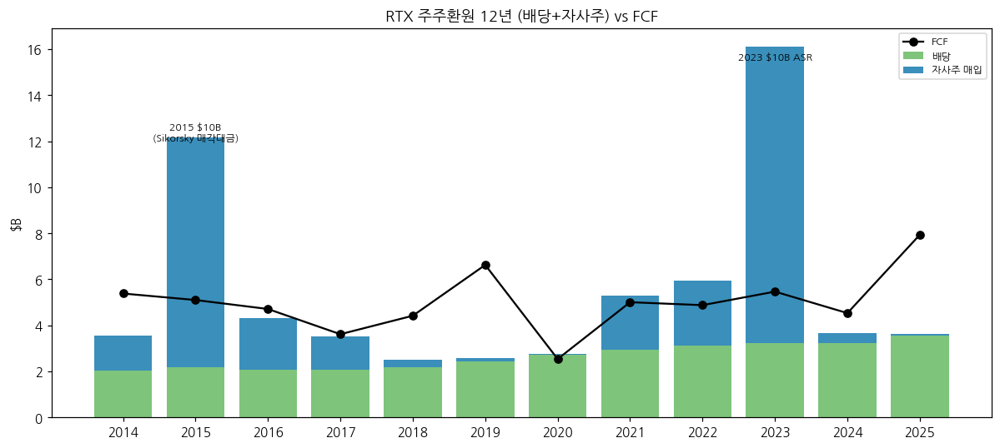

(7) 재무비율 [계산]

| FY | ROE | ROA | 부채비율 | 이자보상배율 | R&D/매출 |
|---|---|---|---|---|---|
| FY19 (UTC) | 13.3% | 4.0% | 216% | 5.6x | 3.9% |
| FY20 | -4.9% | -2.2% | 120% | -1.4x | 4.6% |
| FY21 | 5.3% | 2.4% | 116% | 3.8x | 4.2% |
| FY22 | 7.2% | 3.3% | 114% | 4.3x | 4.0% |
| FY23 | 5.3% | 2.0% | 164% | 2.4x | 4.1% |
| FY24 | 7.9% | 2.9% | 163% | 3.5x | 3.6% |
| FY25 | 10.3% | 3.9% | 155% | 5.3x | 3.2% |

→ ROE가 낮은 이유: 2020 합병 시 영업권·무형자산 약 $70B+가 자본에 쌓여 있어서 (분모가 크다). 같은 이유로 PBR보다 PER·FCF 수익률이 적합

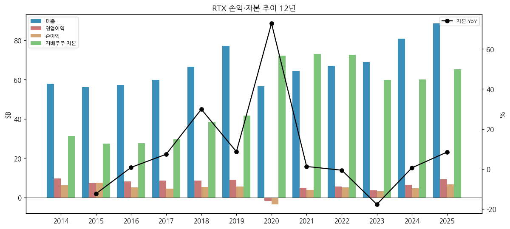

---

## ⑤ 지배 구조

(1) 그룹·계열
→ 지주회사 없음, 분산 소유 상장사. 주요 합작: P&W 엔진 협업(파트너 지분 13~49%), Engine Alliance (GE와 GP7200), International Aero Engines (V2500), Raytheon-Kongsberg NASAMS, Raytheon-Lockheed Javelin JV

(2) 주주 구성
→ ❌ 미확보 (13F·Proxy 미수집). 발행주식 1,349.4M주 (2026-09-30), chart5 미작성

(3) 경영진
→ Christopher T. Calio — 회장 겸 CEO (P&W 사장, RTX COO 거쳐 2024 CEO)
→ Neil G. Mitchill Jr. — EVP & CFO
→ Jill Albertelli — P&W 사장 (2027-01-01 취임 예정, Leeham News 2026-10-21)

---

## ⑥ 기타 팩트

(1) 밸류에이션 스냅샷 (2026-11-13 종가 $198.58)
→ 시총 약 $268.0B / 순차입금 $28.2B → EV 약 $296B [계산]
→ 2026E 조정 EPS 가이던스 중간값 $7.70 → P/E 25.8배 / FCF 가이던스 중간값 $9.1B → FCF 수익률 3.4% [계산]

(2) R&D
→ 자체 R&D $2.8B (FY25, 매출 3.2%) + 고객 부담 R&D(매출원가 포함) 9M26 $3.8B (10-Q) — 방산 개발비 대부분은 정부가 부담

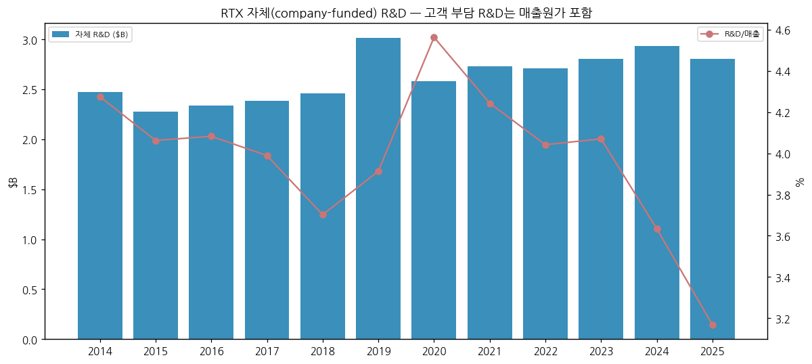

(3) 진행 중 corporate action
→ 2025 Collins actuation 사업·Simmonds 매각 완료 / 고체 로켓 모터 공급사 인수 계획 없음, 파트너십 추진 (3Q26 컨콜)
→ 토마호크·AMRAAM 다년 프레임 계약 약 $70B — 2027부터 매출 본격화, "2030년 최대 생산율" (3Q26 컨콜)

(4) 주요 리스크
→ **GTF 분말금속 (Powder Metal Matter)**: PW1100 함대 가속 점검 → AOG(지상 대기) 증가, 2026년 현금 영향 약 $0.7B (10-Q). 2027년 약 $0.5B 순풍 전망 (Leeham News)
→ **법적 사안**: DPA(기소유예 합의)·SEC 명령 이행, 2024 합의 $0.9B (세후)
→ **고객 신용**: 3Q26 항공 고객 파산 관련 약 $0.4B 충당 (P&W, 10-Q — 고객명 미공개)
→ **미국 국방예산·지속 결의안(CR)**, 공급망(고체 로켓 모터·주조품), 관세·수출통제
→ **민항 사이클**: 유가·항공 수요 (3Q26 컨콜 질문)

(5) ESG
→ GTF 연료 효율 개선(이전 세대 대비), GTF Advantage 추가 1% 개선 (10-K) / ESG 등급 미수집

(6) 인증·라이선스
→ 미국 ITAR·EAR 수출통제 대상 — 해외 판매는 FMS(미 정부 경유) 또는 DCS(직접, 국무부 승인) 필요. 한국 업체 대비 수출 절차가 길지만 동맹 체계 편입 효과가 큼 [판단]

---

## Activity 보고 (v1.0)

→ 확보: 10-K 13 · 10-Q 39 · 8-K 40 · XBRL companyfacts · 보도자료 2 · 컨콜 1 · Yahoo 2
→ 누락: 보도자료 원문(SEC Ex.99 403), 주주 구성, Motley Fool 트랜스크립트
→ 추정·계산: 4Q 분기값(FY−9M), 부채총계, 방산 매출 합계, 시총·밸류 지표 [계산] 표시
→ Data Quality Confidence: **88%** (조정 EPS 과거 분기 미대조·주주 구성 누락 감안)

## Version Log

→ v1.0 (2026-11-14): 최초 작성 — 12년 연간 + 17분기 사업부 + 11종 차트(chart5 제외) + 한국 5사 경쟁 매핑
→ 다음 보완: 4Q26·FY26 확정치 + 2027 가이던스 반영 (2027-01 하순), 주주 구성(13F), 2022~2Q25 조정 EPS 원문 대조
