# S-Oil — 기업 개요 (v1.0)

> 마지막 update: 2026-11-25 (v1.0 — 첫 작성. 3Q26 분기보고서(2026-11-16 제출)·IR 3Q26 실적발표(2026-11-02) 반영)
> 입력 source: OpenDART fnlttSinglAcntAll (연결 CFS, 2015 사업보고서\~3Q26, 44개 JSON — 2014는 2015 사업보고서 전기 컬럼, 2015 1\~3Q는 API 미제공) + DART 정기공시 원문 XML 48건 (사업보고서 2014\~2025 본문 12건 + 감사보고서 첨부 24건, 분기·반기 1Q15\~3Q26 36건, 2015.09 기재정정본 우선 — 영업부문 주석으로 1Q14\~3Q26 51개 분기 사업부별 매출·영업이익 역산) + OpenDART 기업개황·최대주주·임원·직원·배당·자기주식·주식총수 (2025 사업보고서) + S-Oil IR 실적발표 PDF 33건 (1Q18\~3Q26, irgo 경유 — 2Q21·3Q21 2건 미게시, 1Q22\~3Q24 9건은 이미지 PDF라 텍스트 추출 불가 → DART 주석으로 대체) + Yahoo Finance (010950.KS, 월간 2000-01\~2026-11, 일간 2024-11\~2026-11-25, 일간 2011) + 언론·신용평가 (ZDNet·뉴스토마토·IB토마토·한국경제·서울신문·아시아경제·CEO스코어데일리, 2026-03\~2026-11)
> 갱신 주기: 매분기 (실적 리뷰 모드 호출 시)
> 워치리스트: **대분류 소재 / 정유·화학 섹터 / 서브섹터: 정유 (SK이노베이션(석유 부문)·S-Oil) 및 정유·화학 (6종목)** (`earnings/watchlist.md` 84·86행, 137행) — 2026-11-23 추가 섹터, 4Q26부터 리뷰
> **Fact verify cutoff**: 2026-11-24 (주가 2026-11-24 종가 **94,400원** [Yahoo Finance 010950.KS 일간], 보통주 112,582,792주 [DART 사업보고서(2025.12)·분기보고서(2026.09)] → 보통주 시가총액 **10.63조원** [계산, 우선주 4,021,927주 별도]. 사상 최고 종가 **170,600원 (2026-10-07)** → 당시 보통주 시총 **19.21조원** [Yahoo 일간, 계산] — 직전 최고 종가 167,000원(2011-04-28)을 15년 만에 경신. 고점 대비 **-44.7%**, YTD **+13.7%** (2025말 83,000원), 1년 **+15.8%** (2025-11-24 81,500원). Yahoo 일간에 2026-03-04 장중 고가 177,100원이 찍혀 있으나 같은 날 종가 126,500원·저가 120,000원으로 데이터 이상치 가능성 — 종가 기준만 사용)

---

## 1. 기업 분류

- **Primary 분류: 사이클 — 정제마진·유가 연동형 (Commodity Cyclical)** — 매출의 78\~79%가 정유(휘발유·경유·항공유 등), 영업이익은 정제마진(제품가−원유가)·유가 방향(재고평가·래깅효과)에 따라 분기 OPM -19.4%\~+15.3%를 오간다
- **Secondary 노트: 윤활기유 고마진 쿠션 + 샤힌(석유화학 2단계) 구조 전환 옵션** — 윤활 부문은 매출 9\~11%로 영업이익의 25\~60%(적자연도엔 100% 초과)를 벌어주는 "이익 outlier". 2027년 초 가동하는 샤힌(9조 2,580억원)이 석유화학 생산 비중을 12% → 25%로 높이지만, 에틸렌·폴리머 역시 사이클 산업이라 분류는 "사이클"을 유지

### ① 정량 근거

**📊 Summary Box (12년, 2014\~2025 연결):**

| 지표 | 값 |
|------|-----|
| 매출 CAGR (2014→2025, 11년) | **+1.7%** (28.56조 → 34.25조) — 매출은 물량보다 유가(제품 판매단가)에 좌우. 유가 급락기 2015 -37.4%·2020 -31.0%, 유가 급등기 2022 +54.6% |
| OPM 평균 | **3.3%** (12년 단순평균, 최고 9.9% 2016 · 최저 -6.5% 2020) |
| OPM 정점 평균 | **9.0%** (2016 9.9% · 2022 8.0% — 두 번의 정제마진 호황 정점. 진행 중인 2026은 9M 11.2%) |
| OPM 저점 평균 | **-2.3%** (2014 -1.0% · 2020 -6.5% · 2025 0.7% — 유가 급락·수요 붕괴·공급과잉 저점) |
| 사이클 주기 | **약 5\~6년** (저점→저점: 2014→2020 6년, 2020→2025 5년 / 정점→정점: 2016→2022 6년) |
| 사이클 회수 (12년) | **2회 완결 + 3번째 상승 국면** (①2014 저점→2016 정점→2020 저점, ②2020 저점→2022 정점→2025 저점, ③2026 중동 전쟁발 초호황 진행 중) |
| 분기 OPM 범위 (1Q14\~3Q26, 51개 분기) | **-19.4% (1Q20) \~ +15.3% (2Q16)** — 3Q26 11.8%, LTM(4Q25\~3Q26) 9.7% |

```
[전사 손익 시계열 (12년, 연결, DART)]
연도   매출(조)  영업이익  순이익   OPM    NPM   사이클 국면 / 비고
2014    28.56    -0.29    -0.29   -1.0   -1.0   ← 저점① 유가 $100→$50 급락, 재고손실 (정유 OP -7,295억)
2015    17.89     0.82     0.63    4.6    3.5   ← 회복: 저유가로 정제마진 확대
2016    16.32     1.62     1.21    9.9    7.4   ← 정점① OPM 9.9% (정제·석화·윤활 동반 호조)
2017    20.89     1.37     1.25    6.6    6.0   ← 고원: 정유 마진 유지, RUC/ODC 투자 확대
2018    25.46     0.64     0.26    2.5    1.0   ← 하강: 4Q18 유가 급락, 재고손실 (4Q OP -3,335억)
2019    24.39     0.42     0.07    1.7    0.3   ← 바닥권: IMO2020 기대 불발, 정유 적자
2020    16.83    -1.10    -0.80   -6.5   -4.7   ← 저점② COVID 수요 붕괴, 1Q20 OP -1.0조 (정유 -1.19조)
2021    27.46     2.14     1.38    7.8    5.0   ← 회복: 수요 복귀 + 윤활 OPM 37.8%
2022    42.45     3.41     2.10    8.0    5.0   ← 정점② 러-우 전쟁, 상반기 OP 3.05조
2023    35.73     1.35     0.95    3.8    2.7   ← 하강: 마진 정상화, 윤활이 이익 60%
2024    36.64     0.42    -0.19    1.2   -0.5   ← 바닥권: 중국·중동 증설 공급과잉, 정유 적자
2025    34.25     0.24     0.18    0.7    0.5   ← 저점③ OPM 0.7%, 윤활 외 전 부문 적자
9M26    32.25     3.60     2.67   11.2    8.3   ← 상승③ 2026-03 미국·이란 전쟁 → 정제·윤활 스프레드 폭등

OPM range: -6.5 ~ 9.9% (연간) = 16.4%p / 분기 -19.4 ~ +15.3% = 34.7%p  → 전형적인 사이클 분류
```

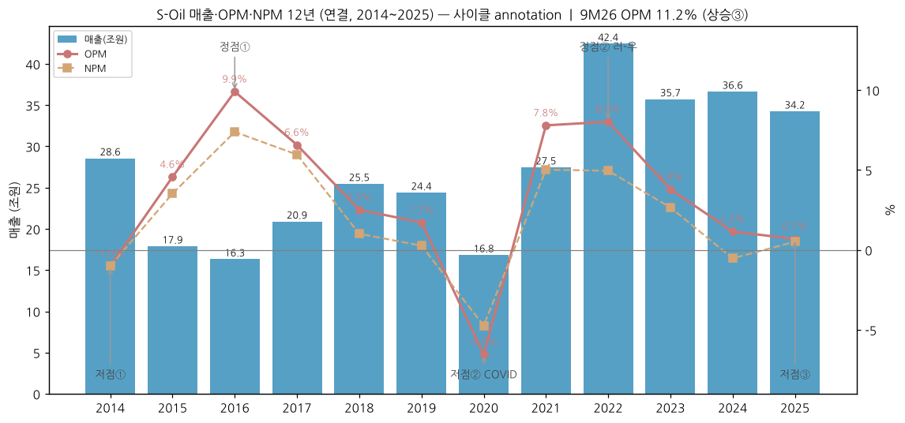

(2014 수치는 2015 사업보고서 전기 컬럼. 9M26 = 2026년 1\~3분기 누적 [DART 분기보고서(2026.09)]. 사이클 국면 판정은 연간 OPM 극값 기준 [계산])

### ② 산업 분류

- 산업: **석유정제(정유) + 윤활기유 + 방향족·올레핀 석유화학** — 울산 온산 단일 콤플렉스에 원유정제(CDU 669,000배럴/일) → 고도화(RFCC·HYC) → 윤활기유(44,700배럴/일) → 방향족(연 약 330만톤, PX 약 185만톤) → 올레핀 다운스트림(PP·PO 연 약 77만톤)이 수직 통합 [DART 분기보고서(2026.09) II]
- DART 업종: 19210 원유 정제처리업 / KRX 코스피 화학(에너지) 업종
- 워치리스트: 대분류 **소재** / 섹터 **정유·화학** / 서브섹터 **정유**(SK이노베이션 석유 부문·S-Oil) 및 **정유·화학**(6종목 통합) — 2026-11-23 신규 편입, 4Q26부터 리뷰 (T1 아님, 표준 깊이)
- 시장 지위: 국내 정유 4사(SK에너지·GS칼텍스·HD현대오일뱅크·S-Oil) 과점 구조 중 정제능력 4위권, 수출 비중이 가장 높은 편 — 2025 매출의 55.3%가 수출(18.92조 / 34.25조) [DART 사업보고서(2025.12) II-4, 계산]. 매출액 10% 이상 단일 고객은 특수관계자 Aramco Trading Singapore (2023 8.43조 = 매출의 23.6%) [DART 사업보고서(2023.12) 주석]

### ③ 분류 결정 논리

(1) **가장 매출 큰 사업부 기준** 적용 시: 정유 = 외부 매출의 78.8% (2025, 27.01조), 석유화학 12.4%, 윤활 8.8% [DART 사업보고서(2025.12) I]. 정유 매출은 "제품가격 × 판매량"이고 제품가격은 유가에 연동 → 매출 YoY가 -37%(2020)\~+55%(2022)로 출렁임 → **사이클**
(2) **이익 비중 sub-rule**: 정유 부문 영업이익은 12년간 -1.70조(2020)\~+2.34조(2022)로 부호가 4번 바뀜(2014→15, 2018→19, 2020→21, 2023→24) [DART 영업부문 주석, 계산]. 반면 윤활 부문은 51개 분기 중 적자 0회, 연간 OPM 14.3%(2019)\~37.8%(2021) → 윤활이 "사이클 안의 안정판"이지만 매출 비중 9\~11%라 전사 분류를 바꾸지는 못함 → **사이클 유지**. 3Q26 윤활 영업이익 7,427억원(OPM 48.1%)은 전사 영업이익의 52.8% [IR 3Q26]
(3) **Boundary case 처리 — 샤힌 이후 "정유+화학 복합" 전환?**: 샤힌은 스팀크래커(에틸렌 연 180만톤, 단일 설비 세계 최대)·TC2C(원유→화학원료 직접 전환)·폴리머 설비로 석유화학 제품 연 약 320만톤을 추가 → 생산 비중 12% → 25% [DART 분기보고서(2026.09) II-3]. 그러나 (a) 석유화학 부문은 2022\~2026(9M) 5개 기간 중 3개 기간 적자(9M26 OPM -1.3%)로 오히려 변동성이 크고, (b) 에틸렌 시장도 중국 증설 사이클에 묶여 있으며, (c) 2027 상업가동 후에도 매출의 70% 이상은 정유로 남을 전망(추정 — 회사 생산비중 목표 25%로부터 역산) → **"사이클" 분류 유지, 석유화학 비중 확대는 Secondary 노트로만 반영**
(4) **국내·글로벌 피어 cross-ref**:
→ **SK이노베이션 (석유 부문)**: 같은 정유 사이클(정제마진·래깅효과)을 공유하지만 연결 기준으로는 배터리(SK온) 적자·E&S(LNG) 등 이질 사업이 섞인 복합기업 → 기업 단위 분류는 "사이클 + 성장(배터리) 혼합". S-Oil은 순수 정유·윤활·석화 단일 콤플렉스라 **정제마진 민감도가 가장 순수한 상장 종목** (각 사 기업개요 `SK이노베이션_기업개요.md`와 교차 확인 필요 — 같은 날 병렬 작성)
→ **GS칼텍스(비상장, GS 50%·Chevron 50%) / HD현대오일뱅크(비상장, HD현대 계열)**: 국내 정유 4사 과점의 나머지 두 축. 3Q26 HD현대오일뱅크 영업이익 9,009억원(+371% YoY) [뉴스토마토 2026-11-03] — 같은 분기 S-Oil 1.41조·SK에너지 1.21조와 함께 "중동 전쟁발 정제마진 호황"이 업계 공통 현상임을 확인. 둘 다 상장 지주(GS·HD현대) 안에 묻혀 있어 정제마진 직접 투자 수단은 S-Oil·SK이노베이션 2종목뿐
→ **화학 4사 (LG화학 석유화학 부문·롯데케미칼·금호석유화학·한화솔루션 케미칼 부문)**: 납사(나프타)를 사서 에틸렌을 만드는 NCC·합성고무·PVC 중심 → 이익 변수는 "에틸렌−납사 스프레드"와 중국 증설. S-Oil 석유화학 부문은 지금은 PX·벤젠(방향족)+PP·PO 중심이지만, 샤힌 가동 시 국내 최대급 에틸렌 생산자로 화학 4사와 같은 스프레드 사이클에 직접 노출 — 화학 4사 기업개요(같은 날 병렬 작성)의 "중국 증설·스프레드" 서술과 교차 확인 필요
→ **글로벌**: Valero·Marathon Petroleum(미국 순수 정유, 정제마진 사이클주) / Reliance Industries(인도, O2C 정유·화학 통합 + 통신·리테일) — S-Oil은 Valero형 "순수 정유 사이클"에 윤활기유·방향족을 더한 아시아 수출형 구조. 단, 이번 버전에서는 글로벌 피어 수치를 검증하지 않음 (다음 버전 보강)

### ④ 적정 밸류에이션 방법

- **PBR 1순위** — 사이클 산업은 이익(PER 분모)이 0 근처·음수를 오가고(2014·2020·2024 적자, 2019·2025 이익 거의 0) 자본은 상대적으로 안정적이므로 PBR이 사이클 위치를 가장 잘 보여줌
→ 연말 PBR (보통주 시총 / 연결 자본총계, [계산]): 2014 1.11배 → 2017 **1.93배 (12년 최고)** → 2020 1.37배 → 2022 1.11배 → 2024 **0.71배 (12년 최저)** → 2025 1.05배
→ 현재: 시총 10.63조 / 3Q26 자본 11.42조 = **0.93배** [계산]. 사상최고가(2026-10-07) 때는 1.68배(3Q26 자본 기준)
- **PER은 정점에서 역설적으로 낮아짐 → 보조** — 최근 4개 분기(4Q25\~3Q26) 순이익 2.90조 기준 PER **3.7배** [계산]. 이익 정점에서 PER이 가장 낮고(2022 연말 4.5배), 저점에서 가장 높음(2019 164배) → 사이클주 "PER 역발상" 구간 확인용
- **EV/EBITDA 보조 (샤힌 투자기 필수)** — 순차입금이 2021말 3.61조 → 3Q26 7.16조로 늘어 시총만 보면 저평가처럼 보이는 착시를 보정. EV 17.79조 (시총 + 차입금 8.72조 − 현금 1.56조) / LTM EBITDA 4.77조 (영업이익 3.97조 + 감가상각비 등 0.79조 [DART 영업부문 주석]) = **3.7배** [계산]. 연말 기준 2022 3.3배 · 2023 5.7배 · 2024 10.8배 · 2025 15.7배 (이익 저점에서 배수 급등)
- **사업부 mix가 PBR을 고르는 이유**: 정유(이익 변동 최대) 78% + 석유화학(적자 빈번) 12%가 이익의 부호를 결정 → PER 분모가 불안정. 윤활(안정 고마진)은 10% 미만이라 PER을 정당화할 만큼 크지 않음. 샤힌 상업가동(2027) 후 감가상각비가 연 9,000억\~1.3조원 수준으로 늘 것이란 추정 [IB토마토 2026-10] → 회계이익(PER)은 더 눌리고 EBITDA는 늘어나 EV/EBITDA의 중요도가 커짐
- **피어 차별화**: SK이노베이션은 배터리 적자 때문에 PBR·SOTP 혼합 평가가 필요한 반면, S-Oil은 단일 사업 사이클주라 PBR 밴드(약 0.7\~1.9배, 2014\~2025 연말)로 사이클 위치를 읽는 방식이 가장 직관적

#### ④-1 정유·화학 6사 공통 비교 박스 (통일 기준, 2026-11-28 통합 검수)

> 6개 문서(S-Oil·SK이노베이션·LG화학·롯데케미칼·금호석유화학·한화솔루션)에 **같은 표**를 넣었다. 본문 ④의 회사별 수치는 각 사 고유 정의(IR 순차입금, 우선주 포함 시총 등)라 이 표와 소수점 차이가 날 수 있음 — **6사 비교는 이 표 기준**.

| 지표 (2026-11-24 종가, 3Q26 말 기준) | S-Oil | SK이노베이션 | LG화학 | 롯데케미칼 | 금호석유화학 | 한화솔루션 |
|---|---|---|---|---|---|---|
| 서브섹터 | 정유 | 정유 (석유 부문) | 화학 (석유화학 부문) | 화학 | 화학 | 화학 (케미칼 부문) |
| Primary 분류 | 사이클 (정제마진) | 사이클 (정제마진) + 지주형 혼합 | 이중 사이클 (석화 + LGES) | 사이클 (NCC 스프레드, 구조조정) | 사이클 (합성고무 스프레드) | 이중 사이클 (석화 + 태양광) |
| 밸류 1순위 지표 | PBR | PBR + SOTP | SOTP (LGES 지분) | PBR | PBR | PBR (+SOTP 보조) |
| 보통주 시가총액 (조원) | 10.63 | 15.57 | 15.07 | 1.85 | 2.30 | 4.49 |
| LTM 매출 (조원, 4Q25\~3Q26) | 41.05 | 101.28 | 51.80 | 20.78 | 7.56 | 16.17 |
| LTM 영업이익 (조원) / OPM | 3.98 / 9.7% | 9.65 / 9.5% | 0.70 / 1.3% | -0.53 / -2.6% | 0.38 / 5.0% | 0.00 / 0.0% |
| 3Q26 OPM | 11.8% | 12.9% | 3.6% | -5.2% | -1.1% | 2.3% |
| LTM 지배순이익 (조원) | 2.90 | 1.53 | -2.28 | -1.34 | 0.38 | -0.10 |
| LTM EBITDA (조원) | 4.77 | 12.77 | 6.89 | 0.82 | 0.70 | 0.88 |
| 순차입금 (조원, 차입금·사채 − 현금및현금성자산, 리스 제외) | 7.16 | 19.88 | 26.86 | 7.17 | -0.02 (순현금) | 11.09 |
| 비지배지분 (조원) | 0.00 | 11.31 | 11.80 | 4.79 | 0.00 | 2.71 |
| EV (조원) = 시총 + 순차입금 + 비지배지분 | 17.79 | 46.76 | 53.73 | 13.81 | 2.28 | 18.29 |
| **EV/EBITDA (LTM)** | **3.7배** | **3.7배** | **7.8배** | **16.8배** | **3.3배** | **20.8배** |
| **PBR** (보통주 시총 / 3Q26 지배기업 소유주지분) | **0.93배** (11.42조) | **0.61배** (25.52조) | **0.47배** (31.81조) | **0.15배** (12.28조) | **0.34배** (6.67조) | **0.45배** (10.07조) |
| **PER** (보통주 시총 / LTM 지배순이익) | **3.7배** | **10.2배** | 적자 | 적자 | **6.1배** | 적자 |

(출처: 종가 = 각 문서 헤더 Fact verify cutoff (Yahoo Finance 일간, 롯데케미칼은 네이버 종가) × DART 보통주 발행주식총수 — 우선주는 6사 통일을 위해 제외. 매출·영업이익·지배순이익 = OpenDART fnlttSinglAcntAll 연결 (LTM = 2025 연간 + 9M26 누적 − 9M25 누적). 차입금·현금·지배지분·비지배지분 = DART 3Q26 연결 재무상태표 (SK이노베이션은 유동성장기부채 5.93조 포함). EBITDA = 각 문서 ④의 LTM EBITDA — S-Oil·금호석유화학은 영업이익 + DART 감가상각(금호는 2025 연간 대용), SK이노베이션·롯데케미칼·한화솔루션은 IR 분기 EBITDA 4개 합산, LG화학은 LTM 영업이익 + IR 감가상각이라 **EBITDA 정의는 회사별로 완전히 같지 않다**. 모두 [계산])

→ **읽는 법**: 2026년은 **정유가 정점, 화학이 저점**인 국면이 표에 그대로 찍혀 있다. ① **정유 2사(S-Oil·SK이노베이션)** = LTM OPM 9\~10%·EV/EBITDA 3.7배 — 이익 정점의 저배수 (사이클주는 이익 정점에서 배수가 가장 낮아 보인다는 점 주의). ② **LG화학** = 석화 적자를 LGES 이익이 메우는 구조라 EV/EBITDA 7.8배 — 석화 피어가 아니라 SOTP로 본다. ③ **롯데케미칼·한화솔루션** = EBITDA가 붕괴해 EV/EBITDA 16\~21배, PER 산출 불가 — 지금은 PBR(0.15·0.45배)과 정상화 이익으로만 비교 가능. ④ **금호석유화학** = 6사 중 유일한 순현금, EV/EBITDA 3.3배 — 3Q26 분기 적자에도 재무 리스크가 가장 작다.

### ⑤ 분기 재평가 트리거 (분류 변경 조건)

- **샤힌 가동 후 석유화학 부문이 4개 분기 연속 흑자 + 매출 비중 25% 이상** 시 → "정유 사이클" 단일 분류 → "정유·화학 복합 사이클"로 Secondary 승격 검토 (현재 9M26 석유화학 매출 비중 10.8%, OPM -1.3%)
- **윤활 부문 이익 비중이 3개 연도 연속 50% 이상** 시 → 윤활기유를 "구조적 프리미엄 사업"으로 별도 평가(SOTP) 도입 검토 (2023 60%, 2024·2025는 정유 적자로 100% 초과 — 정유 저점 효과라 아직 구조적이라 보기 어려움)
- **정제마진 강세가 전쟁 종료 후 4개 분기 이상 유지** (회사 코멘트: "종전이 되더라도 정제마진 강세가 당분간 이어질 것" [ZDNet 2026-11-02]) 시 → 2027 사이클 정점 연장 가능성 점검. 반대로 정유 부문 2개 분기 연속 적자 복귀 시 → 하강 국면 진입 판정
- **순차입금/EBITDA 3배 초과 또는 신용등급 하향** (현재 한국기업평가 AA+(안정적, 2026-03 상향)) 시 → 재무 리스크형 할인 반영

---

## 2. 회사 개요

### ① 기본 사항

- **회사명**: 에쓰-오일(주) (S-Oil Corporation) / KRX 010950 (보통주), 010955 (우선주) — 유가증권시장 1987년 상장 [DART 사업보고서(2025.12) I]
- **본사**: 서울특별시 마포구 백범로 192 (2011-06 이전) / **공장**: 울산광역시 울주군 온산공단 (단일 콤플렉스)
- **설립**: 1976-01-06 "한·이석유(주)" (한국-이란 국영석유 합작) → 1980-06 이란 지분 철수로 "쌍용정유(주)" → 2000-03-24 쌍용그룹에서 분리, "에쓰-오일(주)"로 사명 변경 [DART 사업보고서(2025.12) I-2]
- **지배구조**: Saudi Aramco 계열이 보통주 63.41% 보유 — 2026-10-01 Aramco Overseas Company B.V.(AOC) → **Aramco Downstream Asia Pte. Ltd.(ADA)** 로 전량 양도 (지분율 동일, 최상위 지배기업 Saudi Aramco 불변) [DART 분기보고서(2026.09) I]. 국민연금 8.50% (2025말)
- **사업 한 줄 정의**: 사우디 아람코로부터 장기계약으로 원유를 받아 울산 단일 콤플렉스(정제 66.9만 배럴/일)에서 휘발유·경유·항공유(정유), Group III 고급 윤활기유(윤활), PX·벤젠·PP·PO(석유화학)를 만들어 매출의 55%를 수출하는 아시아 수출형 정유사. 2027년 초 샤힌(에틸렌 180만톤 스팀크래커+TC2C) 가동으로 석유화학 비중 확대 예정
- **대표이사**: Anwar A. Al-Hejazi (안와르 알 히즈아지) CEO — 2023-05-09 임시주총 선임, 아람코 출신 (전임 Hussain A. Al-Qahtani). 이사회 11명(사내 1·기타비상무 4(아람코)·사외 6), 이사회 의장 권오규 사외이사(전 부총리) — CEO·의장 분리 [DART 사업보고서(2025.12) VI]
- **신용등급**: 회사채 **AA+(안정적)** — 한국기업평가 2024-08 상향, 한국신용평가 2026-03-25 AA(긍정적)→AA+(안정적) 상향 [DART 사업보고서(2025.12) I, 아시아경제 2026-03-26]. NICE AA(긍정적, 2025말). 국제: Moody's Baa2(부정적, 2025-04)·S&P BBB(안정적, 2025-03)

### ② 최근 12년 손익·자본 추이 (조원, 연결, DART)

| 연도 | 매출 | YoY | 영업이익 | OPM | 순이익 | 자본총계 | 자본 YoY |
|---|---|---|---|---|---|---|---|
| 2014 | 28.56 | - | -0.29 | -1.0% | -0.29 | 4.91 | - |
| 2015 | 17.89 | -37.4% | 0.82 | 4.6% | 0.63 | 5.39 | +9.8% |
| 2016 | 16.32 | -8.8% | 1.62 | 9.9% | 1.21 | 6.39 | +18.6% |
| 2017 | 20.89 | +28.0% | 1.37 | 6.6% | 1.25 | 6.84 | +7.1% |
| 2018 | 25.46 | +21.9% | 0.64 | 2.5% | 0.26 | 6.47 | -5.5% |
| 2019 | 24.39 | -4.2% | 0.42 | 1.7% | 0.07 | 6.50 | +0.4% |
| 2020 | 16.83 | -31.0% | -1.10 | -6.5% | -0.80 | 5.68 | -12.5% |
| 2021 | 27.46 | +63.2% | 2.14 | 7.8% | 1.38 | 6.99 | +23.0% |
| 2022 | 42.45 | +54.6% | 3.41 | 8.0% | 2.10 | 8.48 | +21.4% |
| 2023 | 35.73 | -15.8% | 1.35 | 3.8% | 0.95 | 9.04 | +6.5% |
| 2024 | 36.64 | +2.5% | 0.42 | 1.2% | -0.19 | 8.70 | -3.8% |
| 2025 | 34.25 | -6.5% | 0.24 | 0.7% | 0.18 | 8.89 | +2.2% |
| 9M26 | 32.25 | +26.7% (9M YoY) | 3.60 | 11.2% | 2.67 | 11.42 | +28.5% (vs 2025말) |

(연결 기준, OpenDART fnlttSinglAcntAll. 2014는 2015 사업보고서 전기 컬럼. 자본총계 = 지배기업 소유주지분 (비지배지분 없음). 9M26 매출 YoY = 32.25조 / 25.45조 [계산])

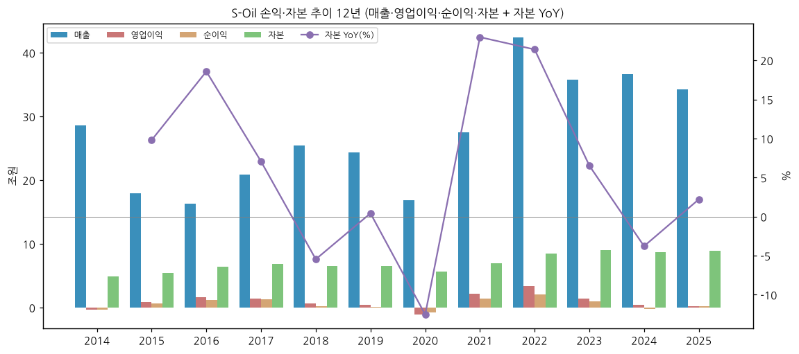

### ③ 회사 주가 역사 ★ narrative 영역

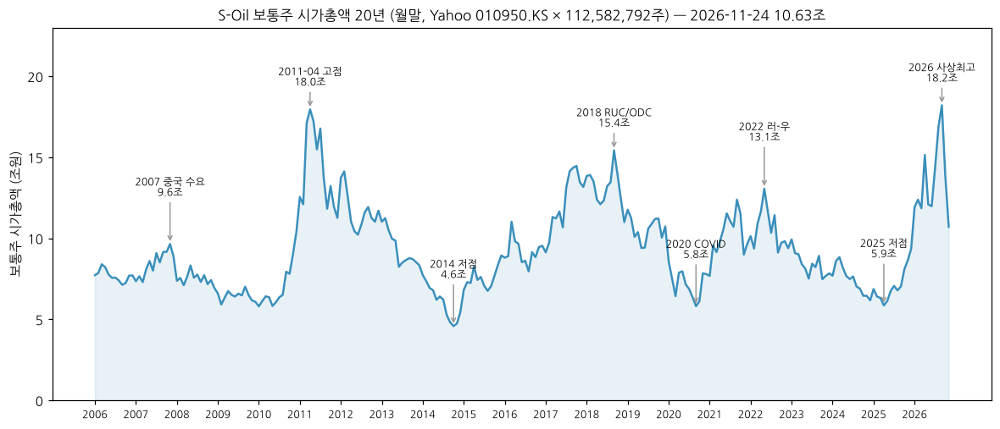

> 가격 처리: Yahoo 010950.KS 월말 종가(배당 미조정 원주가) × 보통주 112,582,792주 (2000년 이후 주식수 변동 없음 — DART 사업보고서 "최근 5년간 자본금 변동사항 없음", 2014\~2025 사업보고서 주식총수 동일 확인). 우선주 시총은 제외 [계산]

(1) 2000\~2003: 쌍용 분리·아람코 대주주 체제 출범 → 저평가 탈출
→ 2000-05 월말 9,375원(시총 약 1.06조, 20년 최저) → 2003-12 28,000원(3.15조) [Yahoo, 계산]

(2) 2004\~2008: 중국 수요 슈퍼사이클 + 고도화설비 효과
→ 2007-11 월말 85,700원(9.65조) → 2008 금융위기 2009-02 52,500원(5.91조)

(3) 2010\~2011: 1차 정점 — 제2 아로마틱 콤플렉스(2011, PX 생산능력 2배) + 정제마진 호황
→ 2011-04-28 종가 **167,000원** (당시 사상 최고, 시총 18.80조) [Yahoo 일간 2011]. 이후 15년간 미경신

(4) 2012\~2015: 유가 급락 — 2014 저점①
→ 2014-10 월말 40,650원(4.58조, 2005년 이후 최저) — 2014 영업손실 -2,897억(유가 $100→$50대, 재고손실). 2015-01 아람코(AOC)가 한진에너지 지분 28.4% 인수 → 보통주 63.41%로 확대 [DART 사업보고서(2025.12) I-2]

(5) 2016\~2019: 저유가 정제마진 호황 + RUC/ODC 1단계 석유화학 투자
→ 2016 영업이익 1.62조(OPM 9.9%), 2016 DPS 6,200원(배당성향 59.9%) → 2018-09 월말 137,000원(15.42조). 2018-11 RUC/ODC(잔사유 고도화·올레핀 다운스트림, PP·PO) 상업가동 [DART 분기보고서(2026.09) II]
→ 4Q18 유가 급락으로 분기 영업손실 -3,335억 → 2019 OPM 1.7%

(6) 2020: 저점② COVID — 1Q20 영업손실 -1.0조 (정유 -1.19조, 재고손실), 연간 무배당(보통주) → 2020-09 월말 51,600원(5.81조)

(7) 2021\~2023: 2차 정점 — 러시아-우크라이나 전쟁 정제마진 급등
→ 2022 영업이익 3.41조(사상 최대 연간), 상반기에만 3.05조 → 2022-05 월말 116,000원(13.06조). 2022-11-16 샤힌 프로젝트 최종투자결정(FID, 9조 2,580억원) [DART 분기보고서(2026.09) II-3]

(8) 2024\~2025: 저점③ — 중국·중동 신증설 공급과잉 + 샤힌 투자부담
→ 2024 순손실 -1,930억, DPS 125원 / 2025 OPM 0.7% → 2025-04 월말 52,000원(5.85조), 2024말 PBR 0.71배(12년 최저) [계산]

(9) 2026: 3차 정점 — 미국·이란 전쟁, 중동 정유·윤활 설비 피해
→ 2026-03 초 미국·이스라엘의 이란 공습과 호르무즈 해협 봉쇄 우려로 브렌트유 하루 13% 급등 [서울신문 2026-03-03] → 3-03 종가 141,300원(전일 110,000원, +28.5%) [Yahoo 일간]
→ 1Q26 영업이익 1.23조(재고효과·래깅효과), 2Q26 0.97조, 3Q26 **1.41조** (윤활 7,427억 분기 사상 최대) [DART·IR 3Q26]. 중동 윤활기유 설비 드론 피해로 글로벌 공급 약 30% 차질 [ZDNet 2026-11-02]
→ **2026-10-07 종가 170,600원 (사상 최고, 시총 19.21조)** — 2011-04 고점을 15년 만에 경신
→ 이후 11월 유가 조정·외국인 대량 매도로 급락: 2026-11-24 94,400원(고점 대비 -44.7%) — 11-05·11-06 이틀간 코스피 외국인 순매도 약 6조원 [AlphaDistill 2026-11-06]

### ④ 주요 연혁

| 연도 | 이벤트 |
|---|---|
| 1976-01 | 한·이석유(주) 설립 (한국-이란 합작) |
| 1980-06 | 이란 지분 철수, 쌍용정유(주)로 사명 변경 |
| 1987 | 유가증권시장 상장 |
| 1991 | Saudi Aramco 지분 참여 (35% 내외, 이후 최대주주) — 정확한 일자는 DART 10년 연혁 범위 밖, 회사 홈페이지 확인 필요 |
| 2000-03 | 쌍용그룹 분리, 에쓰-오일(주)로 사명 변경 |
| 2011 | 제2 아로마틱 콤플렉스 완공 (PX 연 약 185만톤) |
| 2012-02 | Saudi Aramco와 장기 원유구매계약 체결 |
| 2015-01 | AOC, 한진에너지 보유 지분 28.4% 전량 인수 → 보통주 63.41% |
| 2018-11 | RUC/ODC (1단계 석유화학, 약 4.8조원 — 언론 기준) 상업가동 |
| 2020-09 | 동북화학(주) 흡수합병 |
| 2022-11 | 샤힌 프로젝트 FID (9조 2,580억원) |
| 2024-07 | AOC 대주주 대여금 6억 달러 + 한도대출 5.38억 달러 약정 |
| 2026-03 | 미국·이란 전쟁 / 한국신용평가 AA+ 상향 / 창립 50주년 |
| 2026-04 | Aramco Asia Singapore 대주주 대여금 9.3억 달러 추가 약정 |
| 2026-10 | 최대주주 AOC → ADA 지분 양도 (아람코 내부 이전) / 사상 최고가 170,600원 |
| 2026-4Q\~2027 초 | 샤힌 시운전(Commissioning) → 2027년 초 순차 Start-up, 상업가동 |

(출처: DART 사업보고서(2025.12) I-2·분기보고서(2026.09) II-3, IR 3Q26 p12, 언론. 1991 아람코 참여·RUC/ODC 투자비는 공시 10년 범위 밖이라 다음 버전에서 회사 연혁 원문으로 검증 필요)

---

## 3. 비즈니스 모델

### ① 실적 추이 통합 표 (5년 연간 + 9M26, 사업부별, 억원)

| 구분 | 2021 | 2022 | 2023 | 2024 | 2025 | 9M26 |
|---|---|---|---|---|---|---|
| **매출 합계** | 274,639 | 424,460 | 357,267 | 366,370 | 342,470 | 322,549 |
| ├ 정유 매출 | 201,908 | 340,049 | 282,571 | 288,045 | 270,053 | 251,953 |
| ├ 윤활 매출 | 26,158 | 34,156 | 30,849 | 31,297 | 30,074 | 35,811 |
| ├ 석유화학 매출 | 46,574 | 50,255 | 43,848 | 47,028 | 42,342 | 34,785 |
| **영업이익 합계** | 21,409 | 34,052 | 13,546 | 4,222 | 2,356 | 36,027 |
| ├ 정유 영업이익 | 9,082 | 23,443 | 3,535 | -2,734 | -1,951 | 22,618 |
| ├ 윤활 영업이익 | 9,890 | 11,107 | 8,105 | 5,683 | 5,785 | 13,867 |
| ├ 석유화학 영업이익 | 2,438 | -498 | 1,906 | 1,273 | -1,478 | -457 |
| └ 정유 OPM | 4.5% | 6.9% | 1.3% | -0.9% | -0.7% | 9.0% |
| └ 윤활 OPM | 37.8% | 32.5% | 26.3% | 18.2% | 19.2% | 38.7% |
| └ 석유화학 OPM | 5.2% | -1.0% | 4.3% | 2.7% | -3.5% | -1.3% |
| 윤활 영업이익 비중 | 46% | 33% | 60% | 135% | 245% | 38% |

(외부매출 기준 — 부문간 내부거래 제거 후. DART 영업부문 주석(1Q·반기·3Q 누적·연간)에서 분기 역산, 4Q = 연간 − 3Q누적 [계산]. 연결 합계와 오차 ±0.1% 이내, 4Q17·4Q18은 후속 보고서 재작성으로 영업이익 14\~26억 차이. 2024·2025 윤활 비중이 100%를 넘는 것은 정유 적자 때문)

**제품별 (2025, 정유 부문 내역, 억원)** [DART 사업보고서(2025.12) II-2]: 경유 100,493 (29.3%) / 휘발유 59,275 (17.3%) / 항공유 43,752 (12.8%) / 납사 20,145 (5.9%) / 기타 정유 46,388 / 윤활기유 28,280 (8.3%) / 윤활유 1,794 / 석유화학(BTX·PP·PO) 42,342 (12.4%)

**지역별**: 2025 수출 18.92조 (55.3%) / 내수 15.33조 (44.7%). 수출 품목 중 항공유는 88.5%, 윤활기유는 82.8%가 수출 [DART 사업보고서(2025.12) II-4, 계산]. 9M26 지역 매출: 국내 14.31조, 동남아 5.04조, 기타 3.01조, 오세아니아 2.60조, 아메리카 2.44조, 일본 2.03조, 중국 1.83조, 유럽 1.01조 [DART 분기보고서(2026.09) 주석 5]

#### ①-2 사업부별 51개 분기 시계열 (1Q14\~3Q26)

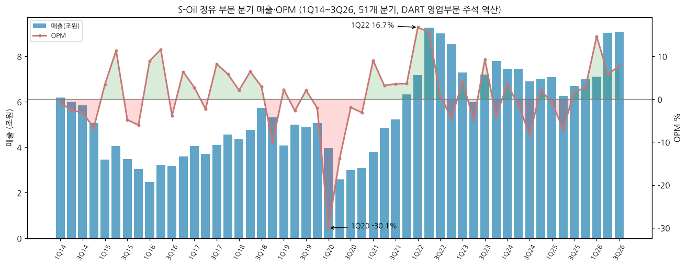

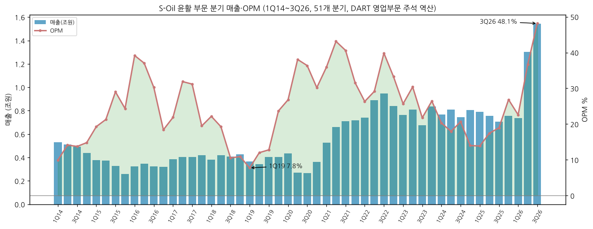

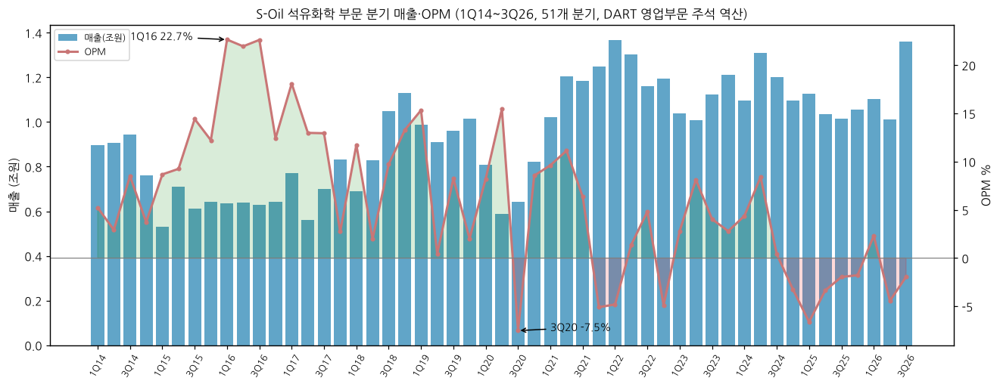

```
[분기 사업부별 영업이익 (억원) / OPM — 최근 20개 분기]
분기    매출합계   정유OP   윤활OP  석화OP  전사OP   전사OPM  정유OPM  윤활OPM  석화OPM
4Q21      82,911    2,282   2,268    -637    3,913     4.7%    3.6%   31.5%   -5.1%
1Q22      92,870   12,022   1,953    -656   13,320    14.3%   16.7%   26.3%   -4.8%
2Q22     114,424   14,451   2,589     180   17,220    15.0%   15.6%   29.2%    1.4%
3Q22     111,226      788   3,767     561    5,117     4.6%    0.9%   39.8%    4.8%
4Q22     105,940   -3,818   2,797    -583   -1,604    -1.5%   -4.5%   33.3%   -4.9%
1Q23      90,776    2,906   1,958     293    5,157     5.7%    4.0%   25.7%    2.8%
2Q23      78,196   -2,920   2,465     820      364     0.5%   -4.9%   30.4%    8.1%
3Q23      89,996    6,662   1,472     454    8,589     9.5%    9.3%   21.8%    4.0%
4Q23      98,299   -3,113   2,210     339     -564    -0.6%   -4.0%   26.4%    2.8%
1Q24      93,085    2,504   1,557     480    4,541     4.9%    3.4%   20.3%    4.4%
2Q24      95,708     -950   1,458   1,099    1,606     1.7%   -1.3%   18.0%    8.4%
3Q24      88,406   -5,737   1,538      50   -4,149    -4.7%   -8.3%   20.7%    0.4%
4Q24      89,171    1,449   1,130    -356    2,224     2.5%    2.1%   14.0%   -3.2%
1Q25      89,905     -568   1,097    -745     -215    -0.2%   -0.8%   13.9%   -6.6%
2Q25      80,485   -4,411   1,318    -346   -3,440    -4.3%   -7.0%   17.5%   -3.4%
3Q25      84,154    1,155   1,336    -199    2,292     2.7%    1.7%   19.0%   -2.0%
4Q25      87,926    1,873   2,033    -187    3,719     4.2%    2.7%   26.9%   -1.8%
1Q26      89,427   10,390   1,666     255   12,311    13.8%   14.6%   22.6%    2.3%
2Q26     113,435    5,324   4,774    -448    9,650     8.5%    5.9%   36.7%   -4.4%
3Q26     119,687    6,904   7,427    -264   14,067    11.8%    7.6%   48.1%   -1.9%
```

(전체 51개 분기 표는 원본 seg_q.json, 차트 chart2_* 참조. 2014\~2015 분기는 2015 분기·반기보고서의 전기 컬럼에서 역산 — 순이익은 사업부 주석에 없어 분기 순이익 시계열은 1Q16부터)

#### ①-3 최근 12분기 시계열

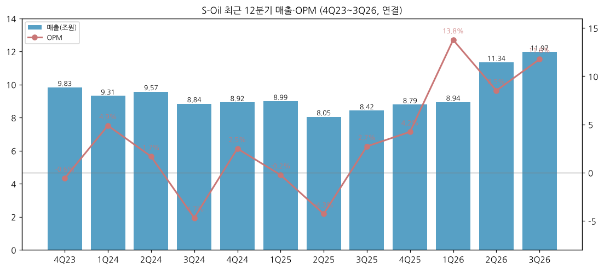

| 분기 | 매출(억) | 영업이익(억) | OPM | 매출 YoY | 영업이익 YoY | 순이익(억) |
|---|---|---|---|---|---|---|
| 4Q23 | 98,299 | -564 | -0.6% | -7.2% | 적지 | 1,605 |
| 1Q24 | 93,085 | 4,541 | 4.9% | +2.5% | -11.9% | 1,662 |
| 2Q24 | 95,708 | 1,606 | 1.7% | +22.4% | +341.2% | -213 |
| 3Q24 | 88,406 | -4,149 | -4.7% | -1.8% | 적전 | -2,062 |
| 4Q24 | 89,171 | 2,224 | 2.5% | -9.3% | 흑전 | -1,317 |
| 1Q25 | 89,905 | -215 | -0.2% | -3.4% | 적전 | -446 |
| 2Q25 | 80,485 | -3,440 | -4.3% | -15.9% | 적전 | -668 |
| 3Q25 | 84,154 | 2,292 | 2.7% | -4.8% | 흑전 | 632 |
| 4Q25 | 87,926 | 3,719 | 4.2% | -1.4% | +67.2% | 2,251 |
| 1Q26 | 89,427 | 12,311 | 13.8% | -0.5% | 흑전 | 7,210 |
| 2Q26 | 113,435 | 9,650 | 8.5% | +40.9% | 흑전 | 5,146 |
| 3Q26 | 119,687 | 14,067 | 11.8% | +42.2% | +513.7% | 14,356 |

(OpenDART dart_quarterly_summary, 4Q = 연간 − 3Q 누적. 3Q26 확정치(분기보고서 2026-11-16) — 잠정실적(2026-11-02)과 동일: 매출 11조 9,687억, 영업이익 1조 4,067억, 순이익 1조 4,356억)

### ② 사업부별 개요 (매출 비중 큰 순서)

| 사업부 | 2025 매출 비중 | 9M26 매출 비중 | 주요 제품 | 설비 (표준생산능력) | 이익 변수 |
|---|---|---|---|---|---|
| 정유 | 78.8% | 78.1% | 경유·휘발유·항공유·납사·LPG·벙커C | CDU 669,000 b/d, RFCC·HYC 고도화 | 싱가포르 복합정제마진, 유가 방향(재고·래깅), 내수 최고가격제·수출 규제 |
| 석유화학 | 12.4% | 10.8% | PX·벤젠(방향족), PP·PO(올레핀) | Basic Chemical 105,000 b/d, Polymer 765,000톤/년 | PX−납사, PP−프로필렌 스프레드, 중국 PX·PP 증설 |
| 윤활 | 8.8% | 11.1% | Group III 고급 윤활기유 (S-VIS·S-Oil 7 등), 윤활유 | Lube 44,700 b/d | 윤활기유(LBO 복합)−VGO 스프레드, 중동·글로벌 공급 차질 |

(표준생산능력 [DART 분기보고서(2026.09) II-3]. 윤활유 완제품은 공동기업 에쓰-오일토탈에너지스윤활유(50%+1주, 지분법)가 담당)

### ③ 사업부별 디테일 (top-seller, growth, 이익 outlier)

**(1) 정유 — 매출 엔진이자 변동성의 원천**
- 51개 분기 중 22개 분기 영업적자 [계산] — 적자 분기는 대부분 유가 급락기(재고평가손실 + 래깅효과 역전): 4Q14 -3,376억, 1Q20 -1.19조, 4Q18 -5,330억, 3Q24 -5,737억
- **래깅효과(lagging effect)**: 중동산 원유는 선적 후 도착까지 약 1개월 → 유가 상승기엔 "싼 원유로 비싼 제품"을 만들어 이익 확대, 하락기엔 반대. **재고평가손익**: 유가 하락 시 보유 재고 가치를 낮춰 손실 인식. 3Q26 재고관련효과 -294억원 (유가 상승에도 일부 역효과) [IR 3Q26 p5]
- 2026 초호황 요인: 미국·이란 전쟁으로 중동·러시아 정제설비 가동 차질 + 낮은 글로벌 제품재고 → 아시아 정제마진 강세. 반대로 정부의 **내수 최고가격제**·경유 수출 제한(전년 대비 100% 이내 → 110% 이내로 완화)이 이익을 일부 제약 [ZDNet·뉴스토마토 2026-11]
- 가동률: CDU 93%(2024) → 96%(2025) → 80%(1H26) → 81%(3Q26) — 2026 원유 조달 차질·정기보수 영향 [IR 3Q26 p15]

**(2) 윤활 — 이익 outlier ★**
- 51개 분기 연속 흑자, 분기 OPM 7.8%(1Q19) \~ **48.1%(3Q26)**, 연간 OPM 14.3%(2019) \~ 37.8%(2021) [계산]
- 2025: 매출 3.01조(전사 8.8%)로 영업이익 5,785억 — 전사 영업이익 2,356억의 245% (정유·석화 적자 상쇄)
- 3Q26: 영업이익 7,427억(분기 사상 최대, 2개 분기 연속 최대) — "중동지역의 생산차질과 물류제약이 장기화되며 주요 시장에서 Group III를 중심으로 상승세 지속" [IR 3Q26 p9]. 윤활기유 스프레드(LBO 복합−VGO) Q2 26 $139.7/bbl → Q3 26 $166.8/bbl, 2011\~2025 연·분기 평균은 대략 $35\~72 범위 [IR 3Q26 p9·p16 차트 판독]
- 왜 고마진인가: 원유 정제 후 남는 잔사유(VGO)를 수소첨가 분해해 고점도지수(Group III) 기유를 생산 — 원료가 정유 부산물이라 원가 경쟁력이 높고, Group III 공급자가 소수(SK·S-Oil·중동 일부)라 과점적

**(3) 석유화학 — 체질 전환 대기**
- 현재: PX·벤젠(방향족, 2011 제2 아로마틱)·PP·PO(올레핀 다운스트림, 2018 RUC/ODC). 2016 OPM 19.9% 정점 → 2022 이후 중국 PX·PP 대규모 증설로 2022 -1.0%, 2025 -3.5% [계산]
- 3Q26: 매출 1.36조, 영업손실 -264억 — "PX와 BZ 시장은 역내 주요 설비 정기보수와 휘발유 blending 수요에 따른 공급 감소" 개선 vs "PP시장은 역내 공급증가와 수요부진으로 약세" [IR 3Q26 p8]
- **샤힌 프로젝트 (석유화학 2단계)**: 총 9조 2,580억원 (EPC 직접비 + 건설자금이자 + 인건비 등) — 스팀크래커(에틸렌 연 180만톤, 단일 설비 세계 최대), TC2C(원유→화학원료 직접 전환, 국내 최초), 폴리머 설비 → 석유화학 제품 연 약 320만톤 추가, 생산비중 12% → 25% [DART 분기보고서(2026.09) II-3, 한국경제 2026-03-29]
  → 일정: 2022-11 FID → 2023-01 EPC 착수(현대건설·현대엔지니어링·롯데건설) → 2026 주요 설비 기계적 완공·4Q26 시운전 → **2027년 초 순차 Start-up**, 전 공정 가동 후 상업가동까지 2\~3개월 [IR 3Q26 p12, ZDNet 2026-11-02]
  → 원가 경쟁력 주장: 에틸렌 손익분기 약 $171/톤 vs 일반 NCC $250\~300/톤 (업계 추정), 원료 약 83% 자체 조달 [IB토마토 2026-10] — **추정치, 회사 공식 수치 아님**
  → 판매: SABIC과 샤힌 PE(연 132만톤) 공급·마케팅 계약 2026\~2030 약 5.51조원 [IB토마토 2026-10]
  → CapEx 영향: 샤힌 집행 2025 3.36조 → 2026 계획 1.56조(1\~3Q 0.92조 집행) [IR 3Q26 p15]. 건설중인자산 2.38조(2023말) → 8.60조(2025말), 상업가동 후 연 감가상각비 9,000억\~1.3조원 추정(2025 7,051억) [IB토마토 2026-10]

### ④ 주요 경쟁사 (사업부별)

| 사업부 | 국내 | 글로벌·역내 |
|---|---|---|
| 정유 | SK에너지(SK이노베이션), GS칼텍스, HD현대오일뱅크 — 국내 4사 과점 | 중국 Sinopec·PetroChina·민영 대형 정유(Hengli 등), 인도 Reliance, 싱가포르·중동 수출정유 |
| 윤활기유 | SK엔무브(SK이노베이션), GS칼텍스 | ExxonMobil·Shell(Group II), 중동 ADNOC·Bapco 등 Group III |
| 석유화학 (방향족) | SK지오센트릭·한화토탈에너지스·GS칼텍스 | 중국 PX 대규모 신증설 (Hengli·Rongsheng 등) |
| 석유화학 (올레핀·샤힌 이후) | LG화학·롯데케미칼·한화솔루션·여천NCC·대한유화 | 중국 NCC/CTO 증설, 중동 에탄 크래커 |

(경쟁 구도는 DART 사업보고서 II-7 서술 + 업계 일반 정보. 사별 CAPA 수치는 이번 버전에서 검증하지 않음)

### ⑤ 주요 매출처

- DART 공시 기준 매출 10% 이상 단일 고객: **Aramco Trading Singapore Pte. Ltd.** (특수관계자, 정유·석유화학) — 2022 8.67조 / 2023 8.43조 (매출의 23.6%) [DART 사업보고서(2023.12) 주석 6]. 2024 1H 4.48조 [DART 반기보고서(2024.06)]
- 원유 매입: 원유의 상당 부분을 Saudi Aramco로부터 장기계약(2012-02 체결)으로 구매. 평균 원유도입가 $85.02(2023) → $81.42(2024) → $70.38/bbl(2025) [DART 사업보고서(2025.12) II-3]
- 2026 전쟁기 조달: 기존 장기계약 + Spot·대체 원유 + 정부 비축유 Swap 임차, STS 환적 등 운송 다변화 [IR 3Q26 p11]
- 내수 판매: 소매 경질유 70% 이상을 주유소 통해 판매, 항공유는 국내외 항공사 [DART 사업보고서(2025.12) II-4]

### ⑥ 생산 CAPA + 임직원 추이

| 구분 | 표준생산능력 | 2024 생산(천bbl·천톤) | 2025 생산 | 2025 가동률 | 9M26 가동률 |
|---|---|---|---|---|---|
| 정유 | 669,000 b/d | 229,844 | 236,050 | 96.7% | 85.3% |
| 윤활 | 44,700 b/d | 15,965 | 16,557 | 101.5% | 99.3% |
| 석유화학 Basic Chemical | 105,000 b/d | 37,853 | 38,893 | 101.5% | 87.7% |
| 석유화학 Polymer | 765,000 톤/년 | 700 | 651 | 80.8% | 80.2% |

(생산능력 = 표준능력 × 정기보수 제외 가동가능일수 기준 가동률 [DART 사업보고서(2025.12)·분기보고서(2026.09) II-3])

| 연도 | 2014 | 2015 | 2016 | 2017 | 2018 | 2019 | 2020 | 2021 | 2022 | 2023 | 2024 | 2025 |
|---|---|---|---|---|---|---|---|---|---|---|---|---|
| 직원 수(명) | 2,796 | 2,865 | 3,088 | 3,277 | 3,258 | 3,224 | 3,222 | 3,154 | 3,137 | 3,242 | 3,497 | 3,537 |

(DART 사업보고서 VIII 직원 현황 합계, 기간제 포함. 2025말 3,537명: 정유 1,195 / 윤활 115 / 석유화학 685 / 기타(본사·영업 등) 1,542, 평균근속 17.4년, 1인 평균급여 1억 3,865만원)

---

## 4. 재무 구조 (12년 시계열)

### ① 손익계산서

| 연도 | 매출 | 매출원가율 | GPM | 판관비율 | OPM | 금융·기타손익 | 세전이익 | NPM | EPS(원) |
|---|---|---|---|---|---|---|---|---|---|
| 2014 | 28.56조 | 99.0% | 1.0% | 1.7% | -1.0% | -958억 | -3,855억 | -1.0% | -2,473 |
| 2015 | 17.89조 | 91.9% | 8.1% | 3.0% | 4.6% | -49억 | 8,127억 | 3.5% | 5,422 |
| 2016 | 16.32조 | 85.9% | 14.1% | 3.5% | 9.9% | -418억 | 15,751억 | 7.4% | 10,353 |
| 2017 | 20.89조 | 89.9% | 10.1% | 3.5% | 6.6% | 2,716억 | 16,449억 | 6.0% | 10,706 |
| 2018 | 25.46조 | 95.0% | 5.0% | 2.4% | 2.5% | -3,077억 | 3,318억 | 1.0% | 2,216 |
| 2019 | 24.39조 | 95.7% | 4.3% | 2.6% | 1.7% | -3,097억 | 1,104억 | 0.3% | 561 |
| 2020 | 16.83조 | 103.2% | -3.2% | 3.3% | -6.5% | -687억 | -11,678억 | -4.7% | -6,839 |
| 2021 | 27.46조 | 89.9% | 10.1% | 2.3% | 7.8% | -2,629억 | 18,780억 | 5.0% | 11,840 |
| 2022 | 42.45조 | 90.2% | 9.8% | 1.8% | 8.0% | -5,066억 | 28,985억 | 5.0% | 18,075 |
| 2023 | 35.73조 | 94.1% | 5.9% | 1.7% | 3.8% | -2,229억 | 11,317억 | 2.7% | 8,149 |
| 2024 | 36.64조 | 96.7% | 3.3% | 2.2% | 1.2% | -7,547억 | -3,325억 | -0.5% | -1,659 |
| 2025 | 34.25조 | 97.0% | 3.0% | 2.4% | 0.7% | -624억 | 1,732억 | 0.5% | 1,519 |

(OpenDART 연결. 금융·기타손익 = 세전이익 − 영업이익 [계산] — 환율 변동(원/달러) 관련 외환·파생손익이 핵심. 3Q26에는 순환차손익 +6,097억(원/달러 -183.1원 하락) [IR 3Q26 p5]. EPS는 보통주 기본주당이익)

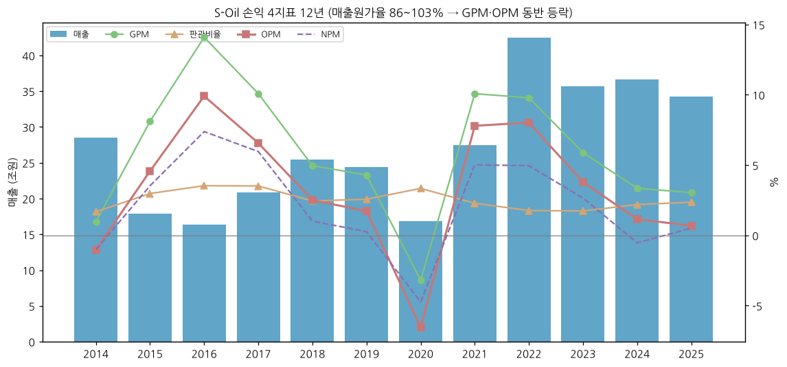

→ **원가 구조의 의미**: 매출원가율이 86\~103%로 극단적으로 높고(원유 매입비가 대부분) 판관비율은 1.7\~3.5%에 불과 → "제품가 − 원유가" 스프레드 1\~2%p 변화가 영업이익을 통째로 흔드는 구조. 2020은 매출원가율 103.2%(GPM -3.2%)로 원가가 매출을 초과

### ② 재무상태표

| 연도 | 자산총계 | 부채총계 | 자본총계 | 현금 | 차입금 | 순차입금 | 재고자산 | 유형자산 | 부채비율 |
|---|---|---|---|---|---|---|---|---|---|
| 2014 | 10.26 | 5.35 | 4.91 | 0.71 | 3.64 | 2.93 | 2.42 | 4.32 | 109% |
| 2015 | 10.80 | 5.41 | 5.39 | 0.20 | 3.60 | 3.39 | 1.60 | 4.73 | 100% |
| 2016 | 13.96 | 7.57 | 6.39 | 0.77 | 4.71 | 3.94 | 2.42 | 5.71 | 118% |
| 2017 | 15.09 | 8.24 | 6.84 | 0.48 | 4.84 | 4.36 | 2.79 | 7.97 | 120% |
| 2018 | 15.96 | 9.49 | 6.47 | 0.66 | 6.34 | 5.67 | 3.14 | 9.74 | 147% |
| 2019 | 16.33 | 9.84 | 6.50 | 0.29 | 6.38 | 6.09 | 3.20 | 10.14 | 151% |
| 2020 | 15.69 | 10.01 | 5.68 | 0.74 | 5.81 | 5.07 | 2.19 | 10.08 | 176% |
| 2021 | 18.69 | 11.71 | 6.99 | 1.95 | 5.55 | 3.61 | 3.55 | 9.56 | 168% |
| 2022 | 19.61 | 11.13 | 8.48 | 1.31 | 4.96 | 3.65 | 4.73 | 9.59 | 131% |
| 2023 | 21.58 | 12.54 | 9.04 | 1.96 | 5.62 | 3.66 | 4.64 | 11.15 | 139% |
| 2024 | 24.45 | 15.76 | 8.70 | 1.95 | 7.81 | 5.86 | 4.49 | 13.58 | 181% |
| 2025 | 26.56 | 17.67 | 8.89 | 1.83 | 7.54 | 5.70 | 4.16 | 16.99 | 199% |
| 3Q26 | 31.51 | 20.09 | 11.42 | 1.56 | 8.72 | 7.16 | 7.00 | 18.02 | 176% |

(조원, OpenDART 연결. 차입금 = 유동·비유동 "차입금" 계정 합계(사채·대주주 대여금 포함, 리스부채 제외) [계산]. 3Q26 차입금 8.72조 = 유동 3.31조 + 비유동 5.41조)

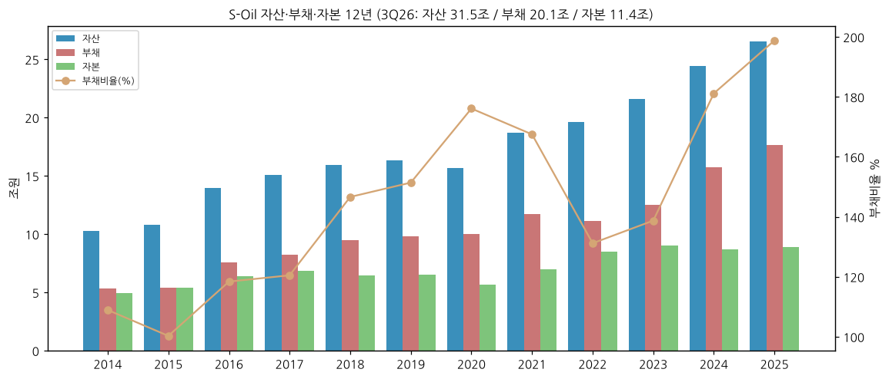

→ 자산은 10.26조(2014) → 31.51조(3Q26)로 3.1배, 증가분의 핵심은 유형자산 4.32조 → 18.02조 — RUC/ODC(2016\~2018)와 샤힌(2023\~2026) 두 번의 대형 투자. 3Q26 재고자산 7.00조(2025말 4.16조)는 유가 급등에 따른 재고 가치 상승

### ③ 현금흐름표

| 연도 | 영업CF | 투자CF | 재무CF | CapEx(유·무형) | FCF (영업CF−CapEx) |
|---|---|---|---|---|---|
| 2014 | 0.88 | -0.96 | 0.21 | 0.91 | -0.03 |
| 2015 | 2.48 | -2.80 | -0.18 | 0.66 | 1.81 |
| 2016 | 1.72 | -1.97 | 0.81 | 1.07 | 0.65 |
| 2017 | 1.14 | -0.83 | -0.60 | 2.42 | -1.27 |
| 2018 | -0.29 | -0.42 | 0.89 | 2.04 | -2.33 |
| 2019 | 0.68 | -1.07 | 0.02 | 0.83 | -0.15 |
| 2020 | 1.63 | -0.64 | -0.55 | 0.55 | 1.08 |
| 2021 | 1.48 | 0.20 | -0.47 | 0.29 | 1.19 |
| 2022 | 1.28 | -0.77 | -1.14 | 0.60 | 0.68 |
| 2023 | 2.53 | -2.07 | 0.19 | 2.19 | 0.34 |
| 2024 | 1.47 | -3.03 | 1.54 | 3.07 | -1.60 |
| 2025 | 3.94 | -3.78 | -0.27 | 3.91 | 0.03 |
| 9M26 | -0.03 | -1.39 | +1.15 | 1.48 | -1.51 |

(조원, OpenDART 연결 [계산]. 9M26 영업CF -312억은 유가 급등기 재고·매출채권 증가(운전자본 흡수) 때문 — 이익은 2.67조인데 현금은 아직 회수 전 [DART 분기보고서(2026.09)])

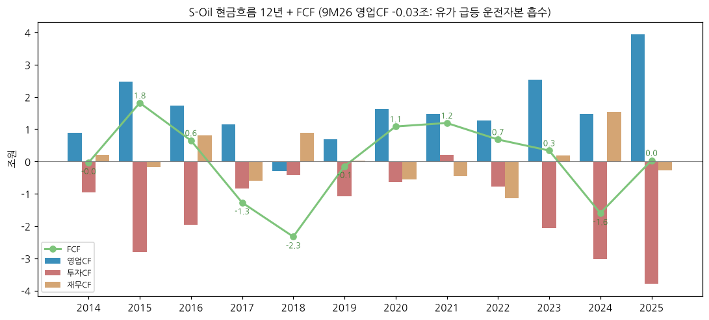

### ④ CapEx

| 연도 | 유형자산 취득 | 무형자산 취득 | 총 CapEx | 감가상각비 등 | CapEx/감가상각 | 사이클·투자 annotation |
|---|---|---|---|---|---|---|
| 2014 | 0.91 | 0.001 | 0.91 | 0.34 | 2.7x | 제2 아로마틱 이후 유지보수 |
| 2015 | 0.65 | 0.006 | 0.66 | 0.27 | 2.4x | RUC/ODC 착공 전 |
| 2016 | 1.06 | 0.009 | 1.07 | 0.29 | 3.7x | RUC/ODC 본격 집행 |
| 2017 | 2.41 | 0.002 | 2.42 | 0.29 | 8.2x | RUC/ODC 피크 |
| 2018 | 2.04 | 0.000 | 2.04 | 0.35 | 5.8x | RUC/ODC 완공(2018-11) |
| 2019 | 0.83 | 0.000 | 0.83 | 0.57 | 1.4x | 유지보수 |
| 2020 | 0.55 | 0.000 | 0.55 | 0.57 | 1.0x | COVID 투자 축소 |
| 2021 | 0.27 | 0.013 | 0.29 | 0.59 | 0.5x | 투자 최저 |
| 2022 | 0.60 | 0.001 | 0.60 | 0.59 | 1.0x | 샤힌 FID(11월) |
| 2023 | 2.19 | 0.002 | 2.19 | 0.66 | 3.3x | 샤힌 EPC 착수 |
| 2024 | 3.04 | 0.027 | 3.07 | 0.69 | 4.4x | 샤힌 집행 |
| 2025 | 3.91 | 0.003 | 3.91 | 0.72 | 5.4x | 샤힌 피크 (샤힌 3.36조) |
| 9M26 | 1.48 | - | 1.48 | 0.60 | 2.5x | 샤힌 마무리 (2026 계획 2.12조, 샤힌 1.56조) |

(조원. 감가상각비 등 = DART 영업부문 주석 "감가상각비 등" 합계(촉매상각 포함). IR 기준 CapEx: 2025 3.875조(샤힌 3.356조·공정개선 0.456조) / 2026 계획 2.115조(샤힌 1.562조) / 1\~3Q26 집행 1.348조 [IR 3Q26 p15])

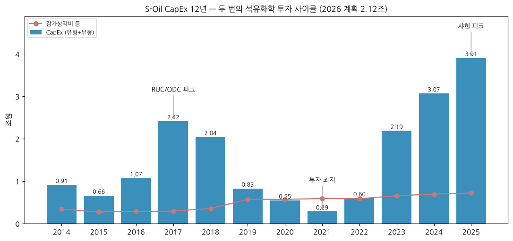

### ⑤ 부채구조 + 채무증권 발행 history

- **3Q26 차입금 8.72조원** (유동 3.31조 / 비유동 5.41조), 순차입금 7.16조, 부채비율 176% [DART 분기보고서(2026.09), 계산]
- **회사채 미상환 잔액 3.60조원** (공모 100%) — 만기 1년 이하 0.33조 / 1\~2년 0.86조 / 2\~3년 0.91조 / 3\~4년 0.58조 / 4\~5년 0.27조 / 5\~10년 0.65조 [DART 분기보고서(2026.09) III-7]. 2026년 1\~3분기 신규 채무증권 발행 없음
- 2025 사채 발행 1.34조원(이 중 샤힌 자금 6,800억) / 상환 0.66조 [DART 2025 현금흐름표·분기보고서(2026.09) II-3]
- **샤힌 자금조달 구조**: ① 산업시설자금대출 1조원 (2023, 저탄소 설비 인정 저금리) ② AOC 대주주 대여금 6억 달러 + 한도대출 5.38억 달러 (2024-07) ③ Aramco Asia Singapore 대주주 대여금 9.3억 달러 (2026-04 추가) ④ 회사채 [DART 분기보고서(2026.09) II-3] — 아람코가 "만기 연장·대여·한도 제공"으로 재무 부담을 흡수한다는 점이 신용등급 상향 근거 [한국신용평가, 아시아경제 2026-03-26]
- 담보: KDB산업은행 여신 관련 토지·건물·기계장치 3,525억원 담보 설정 [DART 분기보고서(2026.09) II-3]

### ⑥ 배당·자사주

| 연도 | 보통주 DPS(원) | 배당총액(억) | 배당성향(연결) | 시가배당률(보통주) | 비고 |
|---|---|---|---|---|---|
| 2014 | 150 | 176 | - | 0.3% | 적자, 최소 배당 |
| 2015 | 2,400 | 2,795 | 44.3% | 3.0% |  |
| 2016 | 6,200 | 7,219 | 59.9% | 7.3% | **특별배당급** DPS 6,200원 (성향 59.9%) |
| 2017 | 5,900 | 6,870 | 55.1% | 4.7% | 고배당 유지 |
| 2018 | 750 | 874 | 33.9% | 0.7% | 4Q 재고손실로 감배 |
| 2019 | 200 | 234 | 35.7% | 0.2% |  |
| 2020 | 0 | 1 | - | - | **무배당** (보통주, 우선주 25원) |
| 2021 | 3,800 | 4,425 | 32.1% | 4.3% | 회복 |
| 2022 | 5,500 | 6,404 | 30.4% | 6.2% | 정점 이익 → DPS 5,500원 |
| 2023 | 1,700 | 1,980 | 20.9% | 2.4% |  |
| 2024 | 125 | 146 | - | 0.2% | 적자, 중간배당 125원만 |
| 2025 | 330 | 385 | 21.8% | 0.3% | 가이드라인 20% 이상 (2025\~2026) |
| 2026 (중간) | 800 | 931 | - | - | 중간배당 800원 (기준일 2026-08-25) |

(DART 사업보고서 각 연도 "배당에 관한 사항" 당기 컬럼. 배당총액은 우선주 포함. 2026 중간배당 [DART 반기보고서(2026.06) 주석 21])

- **배당 정책**: 2019년부터 2년마다 배당 가이드라인 공시 — 2025\~2026 사업연도 "당기순이익의 20% 이상" (2025-02 공시) [DART 분기보고서(2026.09) III-6]. 3Q26 컨퍼런스콜에서 동일 가이드라인 유지 확인 [ZDNet 2026-11-02]
- 9M26 순이익 2.67조 기준 20% = 약 5,340억 → 보통주 환산 DPS 약 4,600원(우선주 포함 1.16억주로 나눈 단순 계산, 추정) — 중간배당 800원 제외 시 결산배당 여력 약 3,800원 [계산, 추정 — 4Q26 이익·회사 결정에 따라 변동]
- **자사주**: 우선주 184,080주(4.58%) 보유, 최근 3년간 취득·처분·소각 없음. 보통주 자사주 없음 [DART 사업보고서(2025.12) I-4]

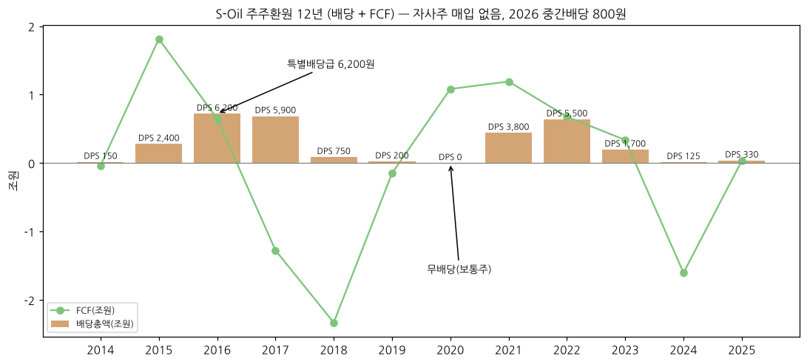

### ⑦ 재무비율

| 연도 | ROE | ROA | 부채비율 | 유동비율 | 순차입금/EBITDA | 이자보상배율 | 연말 PBR | 연말 PER | 연말 EV/EBITDA |
|---|---|---|---|---|---|---|---|---|---|
| 2014 | -5.9% | -2.8% | 109% | 144% | 58.5x | -6.1x | 1.11 | 적자 | 167.5 |
| 2015 | 11.7% | 5.8% | 100% | 177% | 3.1x | 14.3x | 1.66 | 14.2 | 11.3 |
| 2016 | 18.9% | 8.6% | 118% | 165% | 2.1x | 19.5x | 1.49 | 7.9 | 7.1 |
| 2017 | 18.2% | 8.3% | 120% | 149% | 2.6x | 12.2x | 1.93 | 10.6 | 10.5 |
| 2018 | 4.0% | 1.6% | 147% | 101% | 5.7x | 4.2x | 1.70 | 42.6 | 16.8 |
| 2019 | 1.0% | 0.4% | 151% | 98% | 6.1x | 2.3x | 1.65 | 164.0 | 17.0 |
| 2020 | -14.0% | -5.1% | 176% | 76% | -9.6x | -6.5x | 1.37 | 적자 | -24.4 |
| 2021 | 19.7% | 7.4% | 168% | 98% | 1.3x | 19.3x | 1.38 | 7.0 | 4.9 |
| 2022 | 24.8% | 10.7% | 131% | 112% | 0.9x | 23.8x | 1.11 | 4.5 | 3.3 |
| 2023 | 10.5% | 4.4% | 139% | 104% | 1.8x | 5.3x | 0.87 | 8.3 | 5.7 |
| 2024 | -2.2% | -0.8% | 181% | 86% | 5.2x | 1.2x | 0.71 | 적자 | 10.8 |
| 2025 | 2.0% | 0.7% | 199% | 71% | 6.0x | 0.5x | 1.05 | 52.8 | 15.7 |
| LTM(3Q26) | 25.4% | - | 176% | - | 1.5x | - | 0.93 (2026-11-24) | 3.7 | 3.7 |

(ROE = 당기순이익 / 기말 자본, 이자보상배율 = 영업이익 / 이자지급액(현금흐름표), EBITDA = 영업이익 + 감가상각비 등(영업부문 주석), 연말 PBR·PER·EV/EBITDA = 12월말 종가 × 보통주 [모두 계산]. 2020 EV/EBITDA는 EBITDA 음수라 의미 없음)

---

## 5. 지배 구조

### ① 그룹·계열 관계

- **Saudi Aramco 그룹 편입** — 최상위 지배기업 Saudi Arabian Oil Company. 보유 법인: Aramco Overseas Company B.V.(네덜란드) → 2026-10-01 Aramco Downstream Asia Pte. Ltd.(싱가포르)로 보통주 71,387,560주(63.41%) 전량 이전 [DART 분기보고서(2026.09) I]
- **아람코와의 거래 의존**: 원유 장기공급계약(2012-02) + 제품 판매(Aramco Trading Singapore가 매출 10% 이상 단일 고객) + 대주주 대여금·한도대출(총 약 20.7억 달러, 2024-07·2026-04) — 원료·판매·자금 3면에서 대주주와 연결 [DART 분기보고서(2026.09) II-3, 계산]
- 국내 계열: 공정위 지정 "에쓰-오일 대규모기업집단" — 에쓰-오일, 에쓰-오일토탈에너지스윤활유(공동기업, 50%+1주, TotalEnergies 합작, 지분법) 등. 연결 종속회사 3개(S-International(사모아, 원유·제품 트레이딩), S-Oil Singapore, S-Oil Europe B.V.(2025-01 설립)) [DART 사업보고서(2025.12) I]
- 시사점: 아람코 입장에서 S-Oil은 아시아 최대 "원유 판로 + 화학 전환(TC2C)" 거점 → 샤힌 같은 대형 투자 결정과 자금 지원은 대주주 전략에 좌우. 소수주주 관점에선 특수관계자 거래(원유 가격·판매 조건) 공정성이 상시 모니터링 포인트

### ② 주주 구분

| 주주 | 보통주 주식수 | 지분율 | 비고 |
|---|---|---|---|
| Aramco (AOC → ADA, 2026-10-01) | 71,387,560 | 63.41% | 최대주주, 우선주 351,502주(8.74%)도 보유 |
| 국민연금공단 | 9,567,343 | 8.50% | 5% 이상 주주 (2025말) |
| 소액주주 | 31,627,889 | 28.09% | 주주 수 76,462명 (2025말) |
| 등기임원 등 특수관계인 | 약 23,800 | 0.02% | |

(DART 사업보고서(2025.12) VII. 소액주주 28.09%에는 외국인 기관·개인이 섞여 있음 — 외국인 보유율(최대주주 포함)은 KRX 기준 별도 확인 필요)

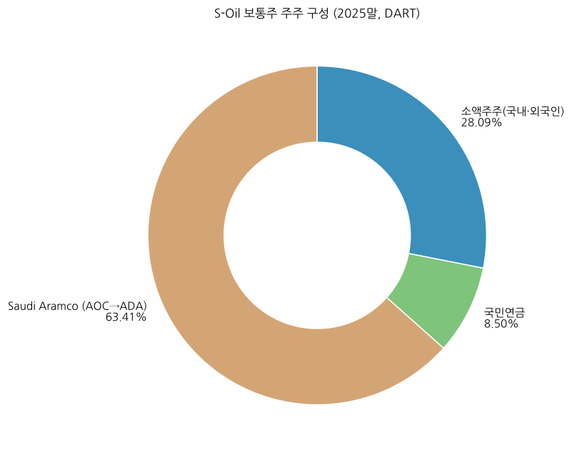

→ 유통 물량이 사실상 보통주의 약 28%(국민연금 제외 시 약 20%)에 불과 — 외국인 수급 변화에 주가 변동성이 커지는 구조 (2026-11 외국인 대량 매도 구간 -44.7%)

### ③ 임원·이사회

- **대표이사 CEO Anwar A. Al-Hejazi** — 2023-05-09 임시주총에서 선임 (전임 Hussain A. Al-Qahtani). 최근 5년 연혁상 CEO는 아람코 측 인사(Hussain A. Al-Qahtani → Anwar A. Al-Hejazi)가 맡아 옴 [DART 사업보고서(2025.12) I-2] (상세 약력은 다음 버전 보강)
- **이사회 11명**: 사내이사(대표이사) 1 + 기타비상무이사 4 (Mohammed Y. Al-Qahtani, S.M. Al-Hereagi, Motaz A. Al-Mashouk, Ibrahim M. Al-Nitaifi — 아람코 측) + 사외(독립)이사 6 (권오규 의장(전 부총리)·이재훈·이전환·고승범·이은형·강진아) [DART 사업보고서(2025.12) VI]
- 위원회: 감사위원회·보수위원회·사외이사후보추천위원회·ESG위원회. 2026-03-30 주총에서 개정 상법 반영 — 사외이사 → 독립이사 명칭 변경, 감사위원 2인 분리선출, 집중투표제 배제 조항 삭제 [DART 반기보고서(2026.06) I-5]

---

## 6. 기타 팩트

### ① R&D 인프라

| 연도 | 2014 | 2015 | 2016 | 2017 | 2018 | 2019 | 2020 | 2021 | 2022 | 2023 | 2024 | 2025 |
|---|---|---|---|---|---|---|---|---|---|---|---|---|
| 연구개발비(억원) | 127 | 117 | 162 | 164 | 210 | 176 | 114 | 142 | 174 | 172 | 195 | 180 |
| R&D/매출 | 0.04% | 0.07% | 0.10% | 0.08% | 0.08% | 0.07% | 0.07% | 0.05% | 0.04% | 0.05% | 0.05% | 0.05% |

(DART 사업보고서 II-6 "연구개발비용 계", 전액 판관비 처리. 9M26 122억원(0.04%))

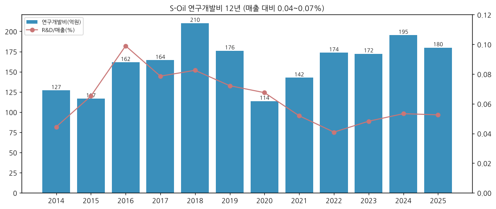

- 조직: 윤활R&D팀(윤활영업부문), Chemical기술개발부문(PE·PP제품개발, 중합/촉매개발) — 서울 마곡 기술개발센터 [DART 분기보고서(2026.09) II-6]
- 정유사 특성상 R&D 비중은 매출의 0.04\~0.07%로 극히 낮음 — 경쟁력의 원천은 연구개발이 아니라 설비 규모·고도화율·원유 조달(아람코)

### ② 진행 중 corporate action (10년)

| 시기 | 내용 |
|---|---|
| 2015-01 | AOC, 한진에너지 지분 28.4% 인수 → 63.41% |
| 2017-12 | 동북화학(주) 지분 100% 취득 → 2020-09 흡수합병 |
| 2018-11 | RUC/ODC(1단계 석유화학) 상업가동 |
| 2022-11 | 샤힌(2단계) FID 9조 2,580억원 |
| 2024-11 | GTG(가스터빈 발전) 프로젝트 FID 2,630억원 — 2026-12 완공·2027-04 상업가동 목표, 9월말 2,098억 집행 |
| 2025-01 | S-Oil Europe B.V. 설립 (암스테르담 지사 법인화) |
| 2026-04 | Aramco Asia Singapore 대여금 9.3억 달러 약정 |
| 2026-10 | 최대주주 AOC → ADA 지분 이전 |
| 2027 초 | 샤힌 Start-up·상업가동 (진행 중) |

### ③ R&D·기술 마일스톤 (10년)

- TC2C(Thermal Crude to Chemicals) 국내 최초 도입 — 샤힌 핵심 공정, 원유를 정제 중간단계 없이 화학원료로 전환 [DART·한국경제 2026-03-29]
- 윤활: 장수명·고연비 엔진오일, 전기차 전용 윤활유, **데이터센터·ESS용 액침냉각유** 개발 / 화학: 메탈로센 촉매 폴리올레핀, 섬유·컴파운딩용 PP / 신재생: 유글레나 기반 bio-SAF(지속가능 항공유) 기술 [DART 사업보고서(2025.12) II-6]
- 특허 111건 보유(2025말), 2025년 신규 20건 [DART 사업보고서(2025.12) II-7]

### ④ 주요 리스크

- **유가·정제마진 사이클**: 유가 급락 시 재고평가손실 + 래깅효과 역전으로 분기 조 단위 적자 가능 (1Q20 -1.0조). 2026-11 현재 전쟁 프리미엄 축소 국면 — 브렌트 $104.77(11-02) vs 개전 직전 $72.48 [뉴스토마토 2026-11-03]
- **원유 조달·지정학**: 원유 대부분을 중동(사우디)에서 장기계약 도입 → 호르무즈 해협 봉쇄 시 조달·가동률 리스크 (2026 CDU 가동률 80%대로 하락). 한국 원유 수입의 70.7%가 중동 [서울신문 2026-03-03]
- **정책 리스크**: 내수 최고가격제, 경유 수출 물량 제한(전년 대비 110% 이내) 등 전시 물가 대책 [뉴스토마토 2026-11-03]
- **샤힌 실행 리스크**: 2027 Start-up 지연·원가 초과, 상업가동 후 감가상각비 증가(연 9,000억\~1.3조 추정)와 에틸렌·PE 공급과잉(중국 증설) 시 투자 회수 지연. 건설중인자산이 유형자산의 50.6%(2025말) [IB토마토 2026-10]
- **환율**: 원유 매입·제품 수출 모두 달러 표시 → 원/달러 변동이 금융손익(외환·파생)으로 분기 수천억 규모 변동 (3Q26 순환차손익 +6,097억, 2Q26 -1,556억) [IR 3Q26]. 환율 10% 변동 시 세후이익 영향 약 1,375억(2017말 기준 예시) [DART 사업보고서(2017.12) 주석 3]
- **대주주 거래 집중**: 원유 매입·제품 판매·자금 조달이 아람코 계열에 집중 → 거래조건 변경 리스크
- 소송·우발채무: 3Q26 분기보고서상 중요 소송 기재 미확인 — 다음 버전에서 "우발부채와 약정사항" 주석 전수 확인 필요

### ⑤ ESG 등급

- 이사회 내 ESG위원회 운영, 배출권거래제·대기오염물질 배출총량관리제 대상 사업장 [DART 분기보고서(2026.09) II-7]
- 샤힌: 150MW LNG 자가발전·폐열회수 보일러로 CO₂ 감축, 에너지원단위 업계 상위 25% [한국경제 2026-03-29]. GTG 프로젝트(2,630억)도 탄소중립 로드맵 일환
- 외부 ESG 등급(KCGS·MSCI 등)·지속가능경영보고서 수치: **이번 버전 미확보** (다음 버전 보강)

### ⑥ 인증·라이선스

- 상표권 627건(국내외), 특허 111건 [DART 사업보고서(2025.12) II-7]
- 석유정제업(석유 및 석유대체연료 사업법), 화학물질관리법·화평법 대상 사업장, 공정위 지정 대규모기업집단

---

## Version Log

- **2026-11-28 v1.0 통합 검수**: 정유·화학 6사(S-Oil·SK이노베이션·LG화학·롯데케미칼·금호석유화학·한화솔루션) 병렬 작성 후 교차 검수 — 1장 ④-1 '정유·화학 6사 공통 비교 박스'(보통주 시총·PBR·PER·EV/EBITDA 통일 정의) 6문서 동일 삽입

- **v1.0 (2026-11-25)**: 첫 작성 — v4.8 표준 6개 섹션 + 12종 차트(14장). 3Q26 분기보고서(2026-11-16 제출, 확정치) 반영 — 잠정 표기 불필요
  - 연간 12년(2014\~2025): OpenDART fnlttSinglAcntAll(2015\~2025) + 2015 사업보고서 전기 컬럼(2014). 일부 결측 계정(2019 영업이익·세전이익, 2023 세전이익·판관비, 2015·2016 판관비)은 같은 JSON의 다른 계정명에서 보정
  - 분기 51개(1Q14\~3Q26) 사업부별: DART 영업부문 주석(1Q·반기·3Q 누적·연간)에서 역산 — 연결 합계와 일치 확인(4Q17 +14억·4Q18 -26억 재작성 차이). 2014\~2015는 2015 보고서 전기 컬럼, 분기 순이익은 1Q16부터
  - 감가상각비: 영업부문 주석 "감가상각비 등"(촉매상각 포함) — IR의 EBITDA(촉매상각 제외)와 정의 차이
  - 시총: Yahoo 월말·일간 종가 × 보통주 112,582,792주(우선주 제외)
- **잔여 보완 후보**: ① 2011\~2013 분기 사업부별(60+분기 목표) — 2013 이전 정기보고서 다운로드 필요 ② 1Q22\~3Q24 IR PDF 이미지 9건 OCR(재고효과·정제마진 등 IR 전용 지표) ③ 지속가능경영보고서·외부 ESG 등급 ④ 외국인 보유율 시계열(KRX) → chart5 외국인 분리 ⑤ 글로벌 피어(Valero·Marathon·Reliance) 밸류에이션 수치 ⑥ 1991 아람코 지분 참여·RUC/ODC 투자비 원문 검증 ⑦ 대표이사 상세 약력 ⑧ 우발부채·소송 주석 전수 확인 ⑨ 국내 정유 4사 정제능력 비교 수치 검증
